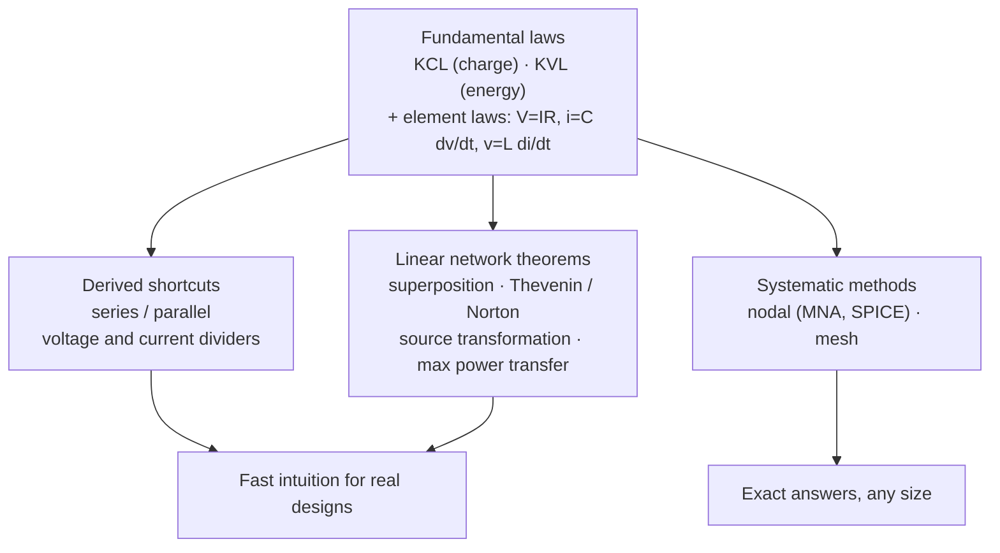

::: basics
### In plain words
Circuit analysis rests on a small set of rules that let you find every voltage and current in a circuit. Ohm's law covers each single part. Kirchhoff's two laws cover how parts connect. Shortcuts and theorems built on those three save time on bigger circuits.

### Picture it
Think of a network of roads. Cars do not vanish at an intersection, so the cars arriving equal the cars leaving. That is Kirchhoff's current law. If you hike around a loop of trails and return to your start, your net change in height is zero. That is Kirchhoff's voltage law, with height standing in for voltage. With those two bookkeeping rules plus a rule for each part, you can account for everything. The analogy fails for fast signals, where loops can pick up extra voltage from changing magnetic fields.

### Words you need
- **Node**: a point where two or more parts connect.
- **KCL** (Kirchhoff's current law): the current flowing into a node equals the current flowing out. See [[q0004]].
- **KVL** (Kirchhoff's voltage law): going around any closed loop, the voltage rises and drops add up to zero. See [[q0004]].
- **Series / parallel**: parts in one chain share a current; parts side by side share a voltage.
- **Thevenin equivalent**: a whole network replaced by one battery-like source and one resistor.

### The simplest example
Connect 12 V across two 1 kΩ resistors in series. The total is 2 kΩ, so the current is $12 / 2000 = 6$ mA through both. Each resistor uses up 6 V of the push (its "voltage drop"). Check with KVL: $12 - 6 - 6 = 0$. That is the whole idea. The rest of this page groups the tools into layers and adds the network theorems and the systematic nodal method for bigger circuits.
:::

::: testing
This is a breadth question: can you lay out the **toolbox** and show you know what each tool is for? The interviewer is listening for:

1. The foundation: **Ohm's law, KCL and KVL**, and that KCL/KVL are conservation laws (charge, energy).
2. The shortcuts built on them: series/parallel combination, voltage and current dividers.
3. The linear-circuit theorems: **superposition, Thevenin/Norton**, source transformation, maximum power transfer.
4. The systematic methods: nodal and mesh analysis (and that SPICE uses a nodal formulation).
5. Judgment: *when* each applies (e.g. superposition needs linearity) and which you'd reach for first.
:::

::: why
Every schematic review, every "why is this node at 2.1 V?" debug session and every simulation sanity check runs on these few laws. In practice engineers rarely write ten-equation matrices by hand; they use Thevenin equivalents to reason about loading, dividers to set feedback voltages, superposition to separate a DC bias from a small AC signal, and KCL to find where current is going. An interviewer asks this open question to see how organised your mental toolbox is and whether you can pick the right tool quickly. It also sets up the next questions (KCL/KVL, worked problems).
:::

::: concepts
- **Ohm's law**: the element relation for resistors, $V = IR$. See [[q0001]].
- **KCL**: currents into a node sum to zero (charge conservation). See [[q0004]].
- **KVL**: voltages around any closed loop sum to zero (energy conservation / conservative field). See [[q0004]].
- **Series/parallel and dividers**: $R_{series} = \sum R$, $1/R_{par} = \sum 1/R$; voltage divider, current divider. See [[q0008]].
- **Linearity**: circuits of resistors, linear dependent sources and independent sources obey superposition and have Thevenin/Norton equivalents.
- **Systematic analysis**: nodal (KCL at each node in terms of node voltages) and mesh (KVL around each loop in terms of loop currents). See [[q0005]].
:::

::: answer
"I'd group them into three layers.

The foundation is Ohm's law plus Kirchhoff's two laws. KCL says the currents into any node add up to zero, which is conservation of charge. KVL says the voltages around any closed loop add up to zero, which is conservation of energy. With just those three you can solve any linear circuit.

Then there are shortcuts that come straight out of them: series resistors add, parallel conductances add, and the voltage and current divider rules.

The third layer is the network theorems for linear circuits. Superposition lets me analyse one source at a time and add the results. Thevenin and Norton let me collapse everything behind two terminals into one source and one resistance, which is how I think about loading, like a divider feeding an ADC. Related to that, maximum power transfer happens when the load equals the Thevenin resistance.

For bigger circuits I'd use nodal analysis, writing KCL at each node in terms of node voltages. It's systematic, and it's what SPICE does under the hood. In practice I reach for Thevenin and dividers first for intuition, and nodal when I need the exact answer."
:::

::: technical
**Fundamental laws (hold for all lumped circuits):**
- **KCL:** $\sum_k i_k = 0$ at every node (or any closed surface). From charge conservation with no charge accumulation at a node.
- **KVL:** $\sum_k v_k = 0$ around every closed loop. Valid when the loop encloses no changing magnetic flux (the lumped assumption).
- **Element relations:** $v = iR$ (resistor), $i = C\,dv/dt$, $v = L\,di/dt$, and source definitions.

**Derived rules:**
- Series: $R_{eq} = R_1 + R_2 + \dots$; parallel: $R_{eq} = (1/R_1 + 1/R_2 + \dots)^{-1}$, two in parallel $= R_1R_2/(R_1+R_2)$.
- Voltage divider: $V_k = V\,R_k/\sum R$. Current divider (two branches): $I_1 = I\,R_2/(R_1+R_2)$.

**Linear network theorems** (require linear elements):
- **Superposition:** the response to several independent sources is the sum of responses to each alone, with other voltage sources shorted and current sources opened. Applies to voltages and currents, **not** to power.
- **Thevenin:** any linear two-terminal network ≡ $V_{th}$ (open-circuit voltage) in series with $R_{th}$ (resistance seen with independent sources zeroed). **Norton:** $I_N = V_{th}/R_{th}$ (short-circuit current) in parallel with $R_{th}$.
- **Source transformation:** $V$ in series with $R$ ↔ $V/R$ in parallel with $R$.
- **Maximum power transfer:** $P_L$ is maximum when $R_L = R_{th}$ (conjugate match $Z_L = Z_{th}^*$ for AC); efficiency is then only 50%. See [[q0141]].

**Systematic methods:**
- **Nodal analysis:** pick ground, write KCL at the $N-1$ other nodes using node voltages → $\mathbf{G}\mathbf{v} = \mathbf{i}$. Modified nodal analysis (adds voltage-source currents) is the formulation used in SPICE.
- **Mesh analysis:** KVL around each independent loop of a planar circuit in terms of mesh currents.

**AC extension:** all of the above hold with phasors and complex impedance $Z$ in place of $R$ for sinusoidal steady state.
:::

::: short
"The core three are Ohm's law, KCL and KVL. KCL says currents into a node sum to zero, conservation of charge; KVL says voltages around a loop sum to zero, conservation of energy. From those you get series and parallel rules and the voltage and current dividers. For linear circuits you also have superposition and Thevenin/Norton equivalents, plus maximum power transfer. For anything bigger I'd use nodal analysis, which is what SPICE does."
:::

::: long
"I like to think of the laws in layers, from the fundamental ones up to the shortcuts.

At the bottom is Kirchhoff. KCL: the sum of currents into any node is zero, because charge can't pile up at a node. KVL: the sum of voltage drops around any closed loop is zero, because voltage is a potential, so going around a loop and back to where you started has to give zero net change. Those two hold for every lumped circuit, linear or not. Then each element has its own law: Ohm's law $V = IR$ for resistors, $I = C\,dV/dt$ for capacitors, $V = L\,dI/dt$ for inductors.

The second layer is shortcuts derived from those: series resistances add, parallel conductances add, and the voltage divider and current divider rules. These cover maybe 80% of the hand calculations I actually do, like setting a regulator's feedback divider.

The third layer is network theorems, which need the circuit to be linear. Superposition says I can turn on one source at a time, short the other voltage sources and open the current sources, and add up the results. It works for voltages and currents but not for power, because power is quadratic. Thevenin's theorem says any linear network seen from two terminals looks like a voltage source in series with a resistor, and Norton's is the current-source version. That's my go-to for loading problems: what does this divider or sensor look like to the ADC? Maximum power transfer follows from Thevenin: the load gets the most power when it matches the source resistance, though only at 50% efficiency.

Finally, for anything with several nodes, I'd do nodal analysis: choose a ground, write KCL at each node in terms of node voltages, and solve the linear system. It's systematic and it's exactly what SPICE does with modified nodal analysis.

And all of it carries over to AC with phasors, just replacing resistance with impedance."
:::

::: terms
- **Node**: a point where two or more elements connect; all wire connected without elements between is one node.
- **Loop / mesh**: a closed path through a circuit; a mesh is a loop containing no other loops (planar circuits).
- **Linear circuit**: one whose elements obey linear relations, so scaling and adding inputs scales and adds outputs.
- **Thevenin equivalent**: $V_{th}$ (open-circuit voltage) in series with $R_{th}$ (resistance with sources zeroed).
- **Norton equivalent**: $I_N$ (short-circuit current) in parallel with $R_{th}$.
- **Superposition**: total response = sum of the responses to each independent source acting alone.
- **Zeroing a source**: replacing an independent voltage source with a short and a current source with an open.
- **Modified nodal analysis (MNA)**: the nodal formulation, extended for voltage sources, that SPICE solves.
:::

::: exceptional
**An average answer** lists "Ohm's law, KCL, KVL" and maybe "Thevenin".

**An exceptional answer**:
- **Organises** the list: fundamental laws → derived shortcuts → linear theorems → systematic methods.
- States what physical principle KCL and KVL come from (charge and energy conservation) and that they hold for nonlinear circuits too.
- Knows the **conditions**: superposition and Thevenin require linearity; superposition doesn't apply to power; KVL assumes no changing flux through the loop (lumped).
- Explains **how to zero sources** correctly (voltage → short, current → open; dependent sources stay).
- Says which tool they'd actually reach for and why ("Thevenin for loading, nodal for exact answers, SPICE uses MNA").
- Mentions the AC extension with impedances.
:::

::: mistakes
- **Applying superposition to power.** $P = I^2R$ is quadratic: $(I_1 + I_2)^2 \neq I_1^2 + I_2^2$. Superpose currents/voltages, then compute power from the total.
- **Zeroing sources the wrong way.** A zeroed voltage source is a short (0 V across it), a zeroed current source is an open (0 A through it). Dependent sources are never zeroed.
- **Calling KCL/KVL "approximations".** They're exact for lumped circuits. What fails at high frequency is the lumped assumption itself, e.g. when a loop links changing magnetic flux.
- **Using Thevenin on nonlinear circuits.** A diode network doesn't have a single Thevenin equivalent; you can only linearise around an operating point.
- **Assuming maximum power transfer is the design goal for power delivery.** It gives 50% efficiency. Power systems want $R_{source} \ll R_{load}$; matching is for RF and signal transfer.
- **Missing that two resistors are in series only if *no other current* leaves the node between them.**
:::

::: deep
## The three layers


Figure: Everything rests on KCL, KVL and the element laws. The shortcuts and theorems are consequences you use for speed and intuition; nodal/mesh analysis is the brute-force method that always works.

## Layer 1: Kirchhoff and the element laws

**KCL** at a node: $\sum i_{in} = \sum i_{out}$. Physically, a node is a tiny bit of wire with negligible capacitance, so it can't store charge; whatever arrives must leave.

**KVL** around a loop: $\sum v = 0$. Voltage is a potential: if you walk around a loop and return to your starting node, the net change in potential is zero.

Both are exact under the **lumped-circuit assumption**: dimensions small compared with the wavelength, and no changing magnetic flux threading the loops of interest. They don't care whether elements are linear, so they apply to diodes and transistors too. [[q0004]] digs into both.

The **element laws** say how each component relates its own voltage and current: $V = IR$ ([[q0001]]), $i = C\,dv/dt$, $v = L\,di/dt$. Kirchhoff tells you how elements are connected; element laws tell you what each one does. Together they fully determine the circuit.

## Layer 2: shortcuts

| Rule | Formula | Requires |
|---|---|---|
| Series resistors | $R_{eq} = R_1 + R_2$ | same current through both (KCL) |
| Parallel resistors | $R_{eq} = \frac{R_1R_2}{R_1 + R_2}$ | same voltage across both (KVL) |
| Voltage divider | $V_2 = V\frac{R_2}{R_1+R_2}$ | series, no load at the tap |
| Current divider | $I_1 = I\frac{R_2}{R_1+R_2}$ | two parallel branches |

Note the "wrong-looking" current divider: the current in branch 1 is proportional to the *other* branch's resistance, because current prefers the easier path.

> [!TIP]
> Quick parallel sanity checks: two equal resistors in parallel give half; the parallel combination is always smaller than the smallest resistor; 1 kΩ ∥ 10 kΩ ≈ 909 Ω, so a 10× bigger parallel resistor changes things by about 10%.

## Layer 3: linear theorems

These need **linearity**: resistors, linear controlled sources and independent sources. They're powerful because they let you *simplify* rather than solve everything at once.

**Superposition**: turn on one independent source at a time, zeroing the others (voltage sources → short, current sources → open), solve each simple circuit, and add the results. Indispensable for separating DC bias from AC signal in amplifiers.

**Thevenin/Norton**: from any two terminals, a linear network is indistinguishable from $V_{th}$ in series with $R_{th}$ (or $I_N$ in parallel with $R_{th}$). Find $V_{th}$ as the open-circuit voltage; find $R_{th}$ by zeroing independent sources and looking back in (or $R_{th} = V_{oc}/I_{sc}$). This is the right mental model for anything "driving" something else: a sensor driving an ADC, a regulator driving a load, a gate driver driving a MOSFET gate.

**Maximum power transfer**: with $V_{th}$ and $R_{th}$ fixed, load power $P_L = V_{th}^2R_L/(R_{th}+R_L)^2$ peaks at $R_L = R_{th}$, where it's $V_{th}^2/4R_{th}$ and efficiency is 50% ([[q0141]]).

## One circuit, four methods

The best way to show these laws are consistent is to solve one circuit several ways.

```circuit
{"caption":"Two sources feeding one node","elements":[
 {"t":"V","a":[0,2],"b":[0,6],"label":"V_1","value":"10 V"},
 {"t":"wire","pts":[[0,2],[0,0],[1,0]]},
 {"t":"R","a":[1,0],"b":[5,0],"label":"R_1","value":"1 kΩ"},
 {"t":"wire","pts":[[5,0],[6,0]]},
 {"t":"dot","at":[6,0]},
 {"t":"wire","pts":[[6,0],[6,2]]},
 {"t":"R","a":[6,2],"b":[6,6],"label":"R_2","value":"2 kΩ"},
 {"t":"wire","pts":[[6,0],[7,0]]},
 {"t":"R","a":[7,0],"b":[11,0],"label":"R_3","value":"1 kΩ"},
 {"t":"wire","pts":[[11,0],[12,0],[12,2]]},
 {"t":"V","a":[12,2],"b":[12,6],"label":"V_2","value":"5 V"},
 {"t":"wire","pts":[[0,6],[0,7],[12,7],[12,6]]},
 {"t":"wire","pts":[[6,6],[6,7]]},{"t":"dot","at":[6,7]},
 {"t":"gnd","at":[3,7]},
 {"t":"text","at":[6,-1.2],"text":"V_A","color":"accent"}
]}
```
Figure: Node A connects three branches. Every method below must give the same V_A, and they do: 6 V.

**Method 1: nodal analysis (KCL at A).** Currents leaving A:

$$\frac{V_A - 10}{1\text{k}} + \frac{V_A}{2\text{k}} + \frac{V_A - 5}{1\text{k}} = 0\;\Rightarrow\; V_A(1 + 0.5 + 1) = 15\;\Rightarrow\; V_A = 6\text{ V}$$

**Method 2: superposition.**
- $V_1$ alone ($V_2$ shorted): $R_2 \parallel R_3 = 667\ \Omega$, so $V_A' = 10\times\frac{667}{1000+667} = 4$ V.
- $V_2$ alone ($V_1$ shorted): $R_1 \parallel R_2 = 667\ \Omega$, so $V_A'' = 5\times\frac{667}{1667} = 2$ V.
- Total: $4 + 2 = 6$ V. ✓

**Method 3: Thevenin, looking into $R_2$.** Remove $R_2$. The open-circuit voltage at A is the midpoint of two 1 kΩ resistors between 10 V and 5 V: $V_{th} = 7.5$ V. Zero both sources: $R_{th} = 1\text{k}\parallel1\text{k} = 500\ \Omega$. Reconnect $R_2$: $V_A = 7.5\times\frac{2000}{2500} = 6$ V. ✓

**Method 4: KCL check of branch currents.**
- $I_{R1} = (10-6)/1\text{k} = 4$ mA into A.
- $I_{R2} = 6/2\text{k} = 3$ mA down to ground.
- $I_{R3} = (6-5)/1\text{k} = 1$ mA out of A *into* $V_2$'s + terminal.

$4 = 3 + 1$ ✓. Notice that $V_2$ is being *charged*: current enters its + terminal, so it absorbs power.

**Power balance (Tellegen's theorem in action):** $V_1$ delivers $10\times4 = 40$ mW. $V_2$ absorbs $5\times1 = 5$ mW. Resistors: $R_1$: $4^2\times1 = 16$ mW, $R_2$: $3^2\times2 = 18$ mW, $R_3$: $1^2\times1 = 1$ mW. Total absorbed $16+18+1+5 = 40$ mW ✓.

> [!WARNING]
> Superposition fails for power. With $V_1$ alone, $R_2$ gets $(4\text{ V})^2/2\text{k} = 8$ mW; with $V_2$ alone, $(2\text{ V})^2/2\text{k} = 2$ mW. The sum, 10 mW, is wrong: the real dissipation is 18 mW. Always superpose voltages/currents first.

## Try it

```sim
{"id":"circuit-lab","preset":"superposition"}
```
Figure: Toggle each source off (replace it with a wire) and record the node voltages, then turn both on. The node voltages add; the resistor powers don't.

## Layer 4: systematic methods

For circuits too tangled for shortcuts:

- **Nodal analysis**: choose a reference node, label the other $N-1$ node voltages, write KCL at each. You get a matrix equation $\mathbf{G}\mathbf{v} = \mathbf{i}$ where $\mathbf{G}$ is the conductance matrix. Voltage sources between nodes are handled with supernodes, or by adding their currents as unknowns: that's **modified nodal analysis**, which is what SPICE builds and solves (with nonlinear devices linearised and iterated via Newton-Raphson).
- **Mesh analysis**: assign a circulating current to each mesh, write KVL around each. Good for planar circuits with many series elements and voltage sources.

Count the unknowns before choosing: nodal needs $N-1$ equations, mesh needs $B - N + 1$ (branches minus nodes plus one). Pick whichever is smaller.

## The AC extension

With sinusoidal sources in steady state, replace every element by its impedance ($R$, $j\omega L$, $1/j\omega C$) and every voltage/current by a phasor. KCL, KVL, dividers, superposition and Thevenin all work identically with complex numbers. That's how you analyse filters ([[q0010]]) and RLC circuits ([[q0009]]).

## Which tool when

| Situation | Reach for |
|---|---|
| "What does this node look like to the next stage?" | Thevenin/Norton |
| Bias + small signal | Superposition |
| Feedback divider, ADC scaling | Voltage divider |
| Load matching for RF | Max power transfer |
| Messy multi-node network | Nodal / SPICE |
| Sanity-checking a simulation | KCL at a few nodes, power balance |
:::

::: applications
- **Regulator feedback networks**: the divider rule sets $V_{out} = V_{ref}(1 + R_1/R_2)$. See [[q0008]].
- **ADC front ends**: Thevenin resistance of a sensor or divider determines whether the ADC's sample capacitor settles in time.
- **Amplifier biasing**: superposition separates the DC operating point from the AC small-signal response in a BJT or MOSFET stage.
- **RF matching**: maximum power transfer (conjugate matching) between a 50 Ω source, transmission line and antenna.
- **SPICE simulation**: every netlist you simulate is turned into a modified nodal analysis matrix.
- **Debugging**: KCL at a node ("current in from the regulator should equal the sum of the loads") finds a hidden short or leakage path.
:::

::: assumptions
- **Lumped elements**: dimensions much smaller than the wavelength; otherwise use transmission-line theory, where voltage along a wire isn't single-valued.
- **Linear elements** for superposition, Thevenin/Norton and source transformation. Nonlinear circuits (diodes, saturated transistors) only allow these around a linearised operating point.
- **Ideal sources** unless stated: a real source has internal resistance you can fold into a Thevenin model.
- **DC or sinusoidal steady state**: for transients you also need the capacitor/inductor differential equations and initial conditions.

Some interviewers count Tellegen's theorem, Millman's theorem, or the reciprocity theorem in the list; they're valid but less commonly used in industry. The core expected set is Ohm, KCL, KVL, series/parallel, dividers, superposition, Thevenin/Norton.
:::

::: followups
### Why does superposition not work for power?
Power is quadratic in current or voltage ($P = I^2R$). If source 1 alone gives $I_1$ and source 2 alone gives $I_2$, the actual current is $I_1 + I_2$ and the power is $(I_1+I_2)^2R = I_1^2R + I_2^2R + 2I_1I_2R$. The cross term is missing if you add powers. Superpose currents or voltages, then compute power from the totals.

### How do you find the Thevenin resistance if the circuit has a dependent source?
You can't just zero everything and combine resistors, because the dependent source stays active. Either apply a test source (put 1 V across the terminals, compute the current $I_{test}$, then $R_{th} = 1/I_{test}$), or compute both the open-circuit voltage and the short-circuit current and use $R_{th} = V_{oc}/I_{sc}$.

### When does KVL fail?
When the loop encloses a changing magnetic flux: Faraday's law says the line integral of $E$ around the loop equals $-d\Phi/dt$, not zero. In circuit practice this shows up as induced voltage in a ground loop or a probe's ground lead picking up switching noise. We handle it by adding a mutual inductance or induced source to the model, keeping KVL valid for the modified circuit.

### Two 10 kΩ resistors in parallel feed a 5 kΩ resistor in series from 10 V. What current flows?
10 kΩ ∥ 10 kΩ = 5 kΩ, plus 5 kΩ = 10 kΩ total, so 1 mA. The parallel pair has 5 V across it with 0.5 mA in each resistor. KCL: 0.5 + 0.5 = 1 mA ✓.

### What if the circuit has a diode? Which laws still apply? (harder probe)
KCL and KVL still hold exactly: they don't care about linearity. Ohm's law doesn't apply to the diode; you use its exponential I–V or a constant-drop model. Superposition and Thevenin don't apply to the whole circuit, but you can still Thevenin-ize the *linear part* the diode sees, then solve the diode against that source with a load line. For small signals around a bias point, linearise the diode as $r_d = nV_T/I_D$ and superposition works again for the small-signal part.
:::

::: interpretations
"Basic circuit analysis laws" is open-ended. Some interviewers mean only **Ohm, KCL, KVL** (and will move on to [[q0004]]/[[q0005]]); others want the theorems too. A safe structure is to name the three fundamentals first, then offer the theorems ("and for linear circuits, superposition and Thevenin/Norton…") and let the interviewer steer.
:::

::: references
- Alexander & Sadiku, *Fundamentals of Electric Circuits*: Chapters 2–4 (Ohm's law, Kirchhoff's laws, nodal/mesh analysis, superposition, Thevenin/Norton, maximum power transfer).
- Nilsson & Riedel, *Electric Circuits*: chapters on circuit analysis techniques.
- Horowitz & Hill, *The Art of Electronics*, 3rd ed.: Chapter 1, Thevenin equivalent circuits and the source/load impedance rule of thumb.
- Hayt, Kemmerly & Durbin, *Engineering Circuit Analysis*: nodal and mesh analysis, network theorems.
:::

::: rubric
- Names Ohm's law, KCL and KVL as the foundation :: These are the minimum expected answer.
- Explains KCL/KVL as conservation of charge/energy :: Shows understanding rather than recall, and why they hold even for nonlinear circuits.
- Mentions series/parallel rules and voltage/current dividers :: These are the everyday tools engineers actually use.
- Mentions superposition and Thevenin/Norton, with the linearity requirement :: Shows you know the theorems and their limits.
- Describes nodal (and/or mesh) analysis as the systematic method, ideally noting SPICE :: Demonstrates you can handle circuits too complex for shortcuts.
- Gives a sense of when to use which, or a practical example (loading, biasing) :: Judgment is what the open-ended question is really probing.
:::

::: quiz
```json
[
 {"type":"mcq","level":"fundamental","q":"KCL is a statement of which conservation law?","options":["Energy","Charge","Momentum","Power"],"answer":1,"explain":"Charge can't accumulate at an ideal node, so the current in equals the current out. KVL is the energy (potential) statement."},
 {"type":"numeric","level":"intermediate","q":"In the two-source circuit on this page ($V_1$ = 10 V via 1 kΩ, $V_2$ = 5 V via 1 kΩ, 2 kΩ from node A to ground), what is the Thevenin voltage seen by the 2 kΩ resistor?","answer":7.5,"tolerance":0.01,"unit":"V","explain":"Remove the 2 kΩ. With equal 1 kΩ resistors between 10 V and 5 V, node A sits at the midpoint: 7.5 V. $R_{th}$ = 1k ∥ 1k = 500 Ω, and reconnecting gives 7.5·2/2.5 = 6 V."},
 {"type":"truefalse","level":"intermediate","q":"Superposition can be used to find the total power dissipated in a resistor by adding the power from each source acting alone.","answer":false,"explain":"Power is quadratic. Add the voltages or currents first, then compute $P$. In the page's example, adding per-source powers gives 10 mW for $R_2$ instead of the correct 18 mW."},
 {"type":"mcq","level":"intermediate","q":"When finding a Thevenin resistance by zeroing sources, an independent current source is replaced by:","options":["A short circuit","An open circuit","A 1 Ω resistor","It is left in place"],"answer":1,"explain":"Zeroing a current source means 0 A through it, which is an open. A zeroed voltage source (0 V across) is a short. Dependent sources are left in place."},
 {"type":"numeric","level":"advanced","q":"A sensor has $V_{th}$ = 2 V and $R_{th}$ = 10 kΩ. What load resistance maximises the power delivered, and what is that maximum power in µW?","answer":100,"tolerance":0.01,"unit":"µW","explain":"Maximum power at $R_L = R_{th}$ = 10 kΩ: $P = V_{th}^2/(4R_{th}) = 4/(40000) = 100$ µW. Only 50% of the power drawn from the source reaches the load."},
 {"type":"multi","level":"advanced","q":"Which of these still hold exactly in a circuit containing diodes? Select all that apply.","options":["KCL","KVL","Superposition applied to the whole circuit","A single Thevenin equivalent of the whole circuit including the diode"],"answer":[0,1],"explain":"KCL and KVL don't require linearity. Superposition and Thevenin equivalents require linear elements, so they only apply to the linear part, or to a small-signal linearisation around a bias point."}
]
```
:::
