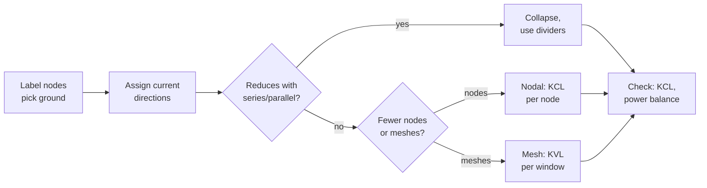

::: testing
This is the whiteboard version of Q4. The interviewer draws a small circuit and watches *how* you solve it:

1. **Setup discipline**: do you label nodes, choose a ground, assign current directions and polarities *before* writing equations?
2. **Method choice**: series-parallel reduction when it works, nodal analysis when it doesn't, mesh when there are many voltage sources in loops.
3. **Algebra without sign errors**, under mild pressure, while talking through it.
4. **Sanity checks**: does KCL balance at every node? Does the power delivered equal the power absorbed? Are the voltages within the source range?
:::

::: why
Hand analysis is how you review schematics, check a simulation, and debug a board ("this node should be 4 V; it's 3.2 V, so something is loading it"). Interviewers use these problems because they reveal habits quickly: candidates who label carefully and check their answers make fewer mistakes in real designs. They're also the gateway to everything else: op-amp circuits, transistor biasing, filter analysis and power-supply feedback all reduce to KCL at a node.
:::

::: concepts
- **KCL and KVL**: the two conservation laws. See [[q0004]].
- **Ohm's law**: turns every branch current into $(V_a - V_b)/R$. See [[q0001]].
- **Series-parallel reduction and dividers**: the fastest route for simple ladders. See [[q0008]].
- **Nodal analysis**: unknown node voltages, KCL at each non-ground node.
- **Mesh analysis**: unknown loop currents, KVL around each mesh.
- **Thevenin equivalents and superposition**: for the "find the current in this one resistor" type of problem. See [[q0003]].
:::

::: answer
"For these I follow the same routine every time. First I label every node, pick a ground, and assign a direction to every current I care about. Then I look at the circuit: if it's just series and parallel resistors, I collapse it with series and parallel rules and use dividers. If it has several nodes or more than one source, I use nodal analysis: I write KCL at each unknown node, expressing each current as the voltage difference over the resistance, and solve the linear equations. If there are lots of voltage sources around loops, mesh analysis with KVL can be quicker.

For example, if 10 volts feeds node A through 2 kΩ, A has 2 kΩ to ground and 1 kΩ to node B, and B has 1 kΩ to ground plus 2 mA injected, I get two equations, $2V_A - V_B = 5$ and $-V_A + 2V_B = 2$, which gives $V_A = 4$ V and $V_B = 3$ V.

Then I always check: the currents into each node should sum to zero, and the power the sources deliver should equal what the resistors burn. If a negative current shows up, that's fine, it just flows the other way."
:::

::: technical
**General procedure.**
1. Label nodes; choose ground (usually the node with the most connections or a source's − terminal).
2. Assign reference directions/polarities.
3. Choose a method:
   - **Series-parallel + dividers** if the network reduces.
   - **Nodal**: $N-1$ unknowns. For each node, $\sum_k \frac{V_n - V_k}{R_{nk}} = I_{injected}$. Voltage sources to ground fix a node voltage; a voltage source between two unknown nodes → **supernode** (KCL around both, plus the constraint $V_a - V_b = V_s$).
   - **Mesh** (planar circuits): $B - N + 1$ unknown loop currents. Shared resistors carry the difference of adjacent mesh currents. A current source on an outer branch fixes that mesh current; a shared one → **supermesh**.
4. Solve (substitution, Cramer's rule for 2×2, or matrix).
5. Check: KCL at every node, KVL around one unused loop, power balance $\sum P_{delivered} = \sum P_{absorbed}$.

**Matrix form (nodal).** $\mathbf{G}\mathbf{v} = \mathbf{i}$, with $G_{nn} = \sum$ conductances at node $n$, $G_{nk} = -$ conductance between $n$ and $k$, $\mathbf i$ = injected source currents. For 2×2: $V_1 = \frac{i_1G_{22} - i_2G_{12}}{G_{11}G_{22} - G_{12}G_{21}}$.

**Results of the worked problems below.**
- Ladder: 24 V, 2 kΩ + [6 kΩ ∥ (2 kΩ + 4 kΩ)] → 4.8 mA, middle node 14.4 V.
- Nodal: $V_A = 4$ V, $V_B = 3$ V.
- Mesh: $I_a = 4.2$ mA, $I_b = 1.8$ mA, shared-resistor current 2.4 mA; power 37.8 mW = 32.4 mW + 5.4 mW.
- Bridge: $V_{ab} = 0.667$ V open-circuit; balance when $R_1/R_2 = R_3/R_4$.
:::

::: short
"I label nodes, pick a ground and assign current directions first. If the circuit reduces with series and parallel rules, I collapse it and use dividers. Otherwise I use nodal analysis: KCL at each unknown node with each current written as voltage difference over resistance, then solve the equations. Mesh analysis is the KVL alternative when there are many voltage sources. Finally I check that currents balance at every node and that source power equals resistor power."
:::

::: long
"My approach to any KCL/KVL problem is a fixed routine, because the mistakes are almost always in setup, not algebra.

Step one: label every node, pick a ground, and draw an arrow for every current I need. The directions are guesses; a negative answer just means it flows the other way.

Step two: choose the method. If the resistors collapse with series and parallel rules, that's fastest. For example, 24 volts feeding 2 kΩ in series with 6 kΩ in parallel with a 2k-plus-4k string: the parallel part is 6k parallel 6k, which is 3k, so 5k total, 4.8 milliamps, and the middle node is at 14.4 volts.

If it doesn't reduce, I use nodal analysis. I write KCL at each unknown node, with each current as the voltage difference over the resistance. Say 10 volts feeds node A through 2k, A has 2k to ground and 1k over to node B, and B has 1k to ground and a 2 milliamp source pushing current in. At A: $(V_A-10)/2 + V_A/2 + (V_A-V_B)/1 = 0$. At B: $(V_B-V_A)/1 + V_B/1 = 2$. That simplifies to $2V_A - V_B = 5$ and $-V_A + 2V_B = 2$, so $V_A = 4$ volts and $V_B = 3$ volts.

When there are multiple voltage sources around loops, mesh analysis can be cleaner: one current per window, KVL around each, and shared resistors see the difference of the two mesh currents.

Step three is checking. KCL at B: 1 milliamp in from A plus 2 from the source equals 3 milliamps through the 1k to ground. Good. I'll also check power: the sources should deliver exactly what the resistors dissipate. And if a node voltage ever comes out higher than every source in a purely resistive circuit, I know I've made a sign error."
:::

::: terms
- **Node voltage**: the voltage of a node relative to the chosen ground (reference) node.
- **Nodal analysis**: KCL at each non-reference node, with currents expressed via node voltages.
- **Mesh current**: a fictitious current circulating around one window of a planar circuit.
- **Supernode**: two nodes joined by a voltage source, treated as one region for KCL plus a voltage constraint.
- **Supermesh**: two meshes sharing a current source, treated as one loop for KVL plus a current constraint.
- **Conductance matrix ($\mathbf G$)**: the coefficient matrix of nodal analysis; symmetric for circuits of resistors and independent sources.
- **Power balance (Tellegen)**: total power delivered by sources equals total power absorbed.
- **Balanced bridge**: a Wheatstone bridge with $R_1/R_2 = R_3/R_4$, so the bridge output is zero.
:::

::: exceptional
**An average answer** writes equations straight away, gets lost in signs, and presents the first number it gets.

**An exceptional answer**:
- Talks through a **setup routine**: ground, node labels, current arrows, method choice with a reason.
- Picks the **cheapest method** (counts unknowns: nodal $N-1$ vs mesh $B-N+1$) and spots shortcuts like a balanced bridge or a divider.
- Writes equations in a **consistent form** ("sum of currents leaving = injected current").
- **Checks** the result two ways (KCL at a node and power balance, or a limiting case) and says so out loud.
- Interprets the result physically ("V₂ is absorbing power, so it's being charged").
:::

::: mistakes
- **Mixing "leaving" and "entering" conventions** within one KCL equation. Pick "all currents leaving = 0" and write every term as $(V_{this} - V_{other})/R$.
- **Forgetting the shared resistor carries the *difference* of mesh currents.** In mesh analysis, the middle resistor's voltage is $R(I_a - I_b)$ in mesh a's equation and $R(I_b - I_a)$ in mesh b's.
- **Treating resistors as series when a third branch connects between them.** Series requires the *same* current: no other connection at the shared node.
- **Writing KCL at a node fixed by a voltage source to ground.** That node's voltage is known; its KCL equation just gives the source current. Don't count it as an unknown.
- **Not checking.** A node voltage outside the range of the source voltages in a purely resistive circuit, or a power imbalance, means an error somewhere.
- **Dropping units** midway. Working in kΩ, mA and V keeps the numbers small and consistent: V/kΩ = mA.
:::

::: deep
## The routine

Every KCL/KVL problem, whatever it looks like, gets the same treatment:


Figure: The habit that prevents mistakes: set up, choose the cheapest method, then check. Interviewers notice the checking step more than the algebra.

> [!TIP]
> Work in V, kΩ and mA. Ohm's law then needs no powers of ten: 6 V / 2 kΩ = 3 mA, and $I^2R$ in mA²·kΩ gives mW directly.

## Problem 1: series-parallel ladder

*A 24 V source feeds $R_1$ = 2 kΩ, then a node X. From X to ground: $R_2$ = 6 kΩ in parallel with the series string $R_3$ = 2 kΩ + $R_4$ = 4 kΩ. Find the voltage across $R_4$.*

1. The string is $2 + 4 = 6$ kΩ. In parallel with 6 kΩ: 3 kΩ.
2. Total: $2 + 3 = 5$ kΩ, so $I = 24/5 = 4.8$ mA.
3. $V_X = 4.8 \times 3 = 14.4$ V (or the divider $24 \times 3/5$).
4. The two 6 kΩ branches split equally: 2.4 mA each. $V_{R4} = 2.4 \times 4 = 9.6$ V (or the divider $14.4 \times 4/6$).

Check KVL down the right-hand path: $24 - 2(4.8) - 2(2.4) - 4(2.4) = 24 - 9.6 - 4.8 - 9.6 = 0$ ✓.

## Problem 2: nodal analysis with a current source

```circuit
{"caption":"Two unknown nodes, one voltage source, one current source","elements":[
 {"t":"V","a":[0,2],"b":[0,6],"label":"V_S","value":"10 V"},
 {"t":"wire","pts":[[0,2],[0,0],[1,0]]},
 {"t":"R","a":[1,0],"b":[5,0],"label":"R_1","value":"2 kΩ"},
 {"t":"wire","pts":[[5,0],[7,0]]},{"t":"dot","at":[6,0]},
 {"t":"wire","pts":[[6,0],[6,2]]},
 {"t":"R","a":[6,2],"b":[6,6],"label":"R_2","value":"2 kΩ"},
 {"t":"R","a":[7,0],"b":[11,0],"label":"R_3","value":"1 kΩ"},
 {"t":"wire","pts":[[11,0],[15,0],[15,2]]},{"t":"dot","at":[12,0]},
 {"t":"wire","pts":[[12,0],[12,2]]},
 {"t":"R","a":[12,2],"b":[12,6],"label":"R_4","value":"1 kΩ"},
 {"t":"I","a":[15,6],"b":[15,2],"label":"I_S","value":"2 mA"},
 {"t":"wire","pts":[[0,6],[0,7],[15,7],[15,6]]},
 {"t":"wire","pts":[[6,6],[6,7]]},{"t":"dot","at":[6,7]},
 {"t":"wire","pts":[[12,6],[12,7]]},{"t":"dot","at":[12,7]},
 {"t":"gnd","at":[3,7]},
 {"t":"text","at":[6,-1],"text":"A","color":"accent"},
 {"t":"text","at":[12,-1],"text":"B","color":"accent"}
]}
```
Figure: Node A connects R₁, R₂ and R₃; node B connects R₃, R₄ and the current source, which pushes 2 mA *up* into B. Two unknowns, two KCL equations.

**KCL at A** (currents leaving, in mA with kΩ):
$$\frac{V_A - 10}{2} + \frac{V_A}{2} + \frac{V_A - V_B}{1} = 0 \;\Rightarrow\; 2V_A - V_B = 5$$

**KCL at B** (currents leaving = current injected):
$$\frac{V_B - V_A}{1} + \frac{V_B}{1} = 2 \;\Rightarrow\; -V_A + 2V_B = 2$$

**Solve.** From the second, $V_A = 2V_B - 2$. Substitute: $2(2V_B - 2) - V_B = 5 \Rightarrow 3V_B = 9$, so $V_B = 3$ V and $V_A = 4$ V.

**Branch currents.** $R_1$: $(10-4)/2 = 3$ mA into A. $R_2$: $4/2 = 2$ mA down. $R_3$: $(4-3)/1 = 1$ mA from A to B. $R_4$: $3/1 = 3$ mA down.

**Checks.** KCL at A: $3 = 2 + 1$ ✓. At B: $1 + 2 = 3$ ✓. Power: $V_S$ delivers $10\times3 = 30$ mW; $I_S$ delivers $V_B \times 2 = 6$ mW (current leaves its + end at B). Resistors: $3^2(2) + 2^2(2) + 1^2(1) + 3^2(1) = 18 + 8 + 1 + 9 = 36$ mW ✓.

> [!NOTE]
> In matrix form this is $\begin{bmatrix}2 & -1\\ -1 & 2\end{bmatrix}\begin{bmatrix}V_A\\V_B\end{bmatrix} = \begin{bmatrix}5\\2\end{bmatrix}$ (conductances in mS, voltages in V, currents in mA; the 5 mA on the right is the Norton current $10\text{ V}/2\text{ kΩ}$ of the source branch). The matrix is symmetric, which is always true for resistor networks with independent sources, and a quick check you set it up correctly.

## Problem 3: mesh analysis with two voltage sources

```circuit
{"caption":"Two meshes sharing R₂","elements":[
 {"t":"V","a":[0,2],"b":[0,6],"label":"V_1","value":"9 V"},
 {"t":"wire","pts":[[0,2],[0,0],[2,0]]},
 {"t":"R","a":[2,0],"b":[6,0],"label":"R_1","value":"1 kΩ"},
 {"t":"wire","pts":[[6,0],[10,0]]},{"t":"dot","at":[8,0]},
 {"t":"wire","pts":[[8,0],[8,2]]},
 {"t":"R","a":[8,2],"b":[8,6],"label":"R_2","value":"2 kΩ"},
 {"t":"R","a":[10,0],"b":[14,0],"label":"R_3","value":"1 kΩ"},
 {"t":"wire","pts":[[14,0],[16,0],[16,2]]},
 {"t":"V","a":[16,2],"b":[16,6],"label":"V_2","value":"3 V"},
 {"t":"wire","pts":[[0,6],[0,7],[16,7],[16,6]]},
 {"t":"wire","pts":[[8,6],[8,7]]},{"t":"dot","at":[8,7]},
 {"t":"gnd","at":[4,7]},
 {"t":"loop","at":[4.3,3.8],"r":1.1,"dir":"cw","label":"I_a"},
 {"t":"loop","at":[12.3,3.8],"r":1.1,"dir":"cw","label":"I_b"}
]}
```
Figure: Two clockwise mesh currents. R₂ is shared, so the current through it (downward) is I_a − I_b. V₂'s + terminal is on top, so mesh b goes *down* through it, a 3 V drop.

**Mesh a** (clockwise, rises positive):
$$9 - 1(I_a) - 2(I_a - I_b) = 0 \;\Rightarrow\; 3I_a - 2I_b = 9$$

**Mesh b** (clockwise: up through $R_2$, across $R_3$, down through $V_2$):
$$-2(I_b - I_a) - 1(I_b) - 3 = 0 \;\Rightarrow\; 2I_a - 3I_b = 3$$

**Solve** (Cramer): determinant $= 3(-3) - (-2)(2) = -5$.
$$I_a = \frac{9(-3) - (-2)(3)}{-5} = 4.2\text{ mA},\qquad I_b = \frac{3(3) - 2(9)}{-5} = 1.8\text{ mA}$$

So $R_2$ carries $I_a - I_b = 2.4$ mA downward and the middle node sits at $2.4\times2 = 4.8$ V.

**Cross-check with nodal** at the middle node: $\frac{V-9}{1} + \frac{V}{2} + \frac{V-3}{1} = 0 \Rightarrow 2.5V = 12 \Rightarrow V = 4.8$ V ✓. One equation instead of two: for this circuit nodal is cheaper. (Nodes: 1 unknown; meshes: 2.)

**Power.** $V_1$ delivers $9 \times 4.2 = 37.8$ mW. $V_2$ *absorbs* $3 \times 1.8 = 5.4$ mW (current enters its + terminal). Resistors: $4.2^2 + 2(2.4^2) + 1.8^2 = 17.64 + 11.52 + 3.24 = 32.4$ mW. $32.4 + 5.4 = 37.8$ ✓.

## Problem 4: the Wheatstone bridge

```circuit
{"caption":"Wheatstone bridge: output between nodes a and b","elements":[
 {"t":"V","a":[0,2],"b":[0,8],"label":"V_S","value":"10 V"},
 {"t":"wire","pts":[[0,2],[0,0],[12,0]]},
 {"t":"wire","pts":[[5,0],[5,1]]},{"t":"dot","at":[5,0]},
 {"t":"wire","pts":[[12,0],[12,1]]},
 {"t":"R","a":[5,1],"b":[5,4],"label":"R_1","value":"1 kΩ","labelSide":"other"},
 {"t":"R","a":[5,5],"b":[5,8],"label":"R_2","value":"2 kΩ","labelSide":"other"},
 {"t":"R","a":[12,1],"b":[12,4],"label":"R_3","value":"2 kΩ"},
 {"t":"R","a":[12,5],"b":[12,8],"label":"R_4","value":"3 kΩ"},
 {"t":"wire","pts":[[5,4],[5,5]]},{"t":"wire","pts":[[12,4],[12,5]]},
 {"t":"wire","pts":[[5,4.5],[7,4.5]]},{"t":"dot","at":[5,4.5]},
 {"t":"term","at":[7,4.5],"label":"a","side":"right"},
 {"t":"wire","pts":[[12,4.5],[10,4.5]]},{"t":"dot","at":[12,4.5]},
 {"t":"term","at":[10,4.5],"label":"b","side":"left"},
 {"t":"wire","pts":[[0,8],[0,9],[12,9],[12,8]]},
 {"t":"wire","pts":[[5,8],[5,9]]},{"t":"dot","at":[5,9]},
 {"t":"gnd","at":[2.5,9]}
]}
```
Figure: Two dividers side by side. The output is the *difference* of their midpoints, so it's zero when the ratios match, regardless of the supply voltage.

**Open-circuit output.** Each side is a divider:
$$V_a = 10\cdot\frac{2}{1+2} = 6.667\text{ V},\qquad V_b = 10\cdot\frac{3}{2+3} = 6\text{ V},\qquad V_{ab} = 0.667\text{ V}$$

**Balance condition.** $V_{ab} = 0$ when $\frac{R_2}{R_1+R_2} = \frac{R_4}{R_3+R_4}$, i.e. $\frac{R_1}{R_2} = \frac{R_3}{R_4}$. With $R_4 = 4$ kΩ instead of 3 kΩ, the bridge balances.

**What if a 1 kΩ meter connects a to b?** Now it's no longer two simple dividers. The quickest route is Thevenin: $V_{th} = 0.667$ V, and with the source shorted, $R_{th} = (R_1\parallel R_2) + (R_3\parallel R_4) = 0.667 + 1.2 = 1.867$ kΩ. So $I_{meter} = 0.667/(1.867 + 1) = 0.233$ mA. This is the classic problem that *looks* like it needs a 3×3 nodal solve but falls to Thevenin in two lines.

> [!INTERVIEW]
> The "five resistors, find $R_{eq}$" bridge is a favourite trick question. If the bridge is balanced (e.g. all five resistors equal), the middle resistor carries zero current and can be deleted, leaving two parallel strings: with all 1 Ω, $R_{eq} = 2 \parallel 2 = 1\ \Omega$. Spot the balance before you start writing equations.

## Try it

```sim
{"id":"circuit-lab","preset":"wheatstone"}
```
Figure: Change one arm of the bridge until the meter current reads zero, then confirm the ratio condition R₁/R₂ = R₃/R₄. Next, change the supply voltage: the balance point doesn't move. That's why bridges are used for sensors.

## Supernodes and supermeshes (the two awkward cases)

- **Voltage source between two non-ground nodes**: you can't write its current with Ohm's law. Draw a bubble around both nodes (a supernode), write KCL for the bubble as a whole, and add the constraint $V_a - V_b = V_s$.
- **Current source shared between two meshes**: draw a loop around both meshes avoiding the source (a supermesh), write KVL for it, and add the constraint $I_a - I_b = I_s$.

Both are the same idea: when an element doesn't obey Ohm's law, replace its equation with the constraint it imposes.

## Sanity checks worth saying out loud

1. **Range check**: in a circuit of resistors, every node voltage lies between the most negative and most positive source voltage (this follows from KCL: a node can't be a local maximum unless something injects current). Problems 2 and 3 pass.
2. **KCL at an unused node.**
3. **Power balance.**
4. **Limiting cases**: set one resistor to 0 or ∞ and see if the answer behaves sensibly.
:::

::: applications
- **Regulator feedback and ADC scaling**: Problem 1-style ladders and dividers set output voltages and sensing ranges.
- **Sensor bridges**: strain gauges, load cells and RTDs sit in Wheatstone bridges; the balance condition makes the output insensitive to supply variations.
- **Transistor biasing**: nodal analysis at the base/gate node finds the DC operating point.
- **Op-amp circuits**: KCL at the inverting input gives every standard gain formula ([[q0012]]).
- **Power distribution networks**: mesh/nodal models of planes and vias predict IR drop across a board.
- **Schematic review**: a quick nodal check catches resistor-value typos before boards are built.
:::

::: assumptions
- **DC, resistive circuits** with ideal sources. With capacitors and inductors, the same methods apply using complex impedances (AC steady state) or differential equations (transients), see [[q0009]].
- **Linear elements**: nodal and mesh equations stay linear and solvable in one shot. With diodes or transistors you linearise or iterate (as SPICE does).
- **Ideal meters**: in Problem 4, the open-circuit $V_{ab}$ assumes a meter with infinite input resistance; with a real 1 kΩ meter the reading drops, as shown.

Interviewers sometimes accept any correct method. If you prefer mesh to nodal, that's fine, as long as you say *why* you chose it.
:::

::: followups
### How do you decide between nodal and mesh analysis?
Count unknowns. Nodal needs $N-1$ equations (non-reference nodes, minus any fixed by voltage sources to ground). Mesh needs one per window of a planar circuit, minus meshes fixed by current sources. Pick the smaller set. Nodal is usually preferred because it works for non-planar circuits and gives node voltages directly, which is what you measure with a scope.

### What's the equivalent resistance of five 1 kΩ resistors in a bridge?
The bridge is balanced (all ratios equal), so the middle resistor carries no current and can be removed. That leaves two parallel paths of 2 kΩ each: $R_{eq} = 1$ kΩ. If the bridge weren't balanced, you'd use a delta-to-wye transformation or nodal analysis with a test source.

### In Problem 2, what happens to $V_A$ if the 2 mA source is removed?
Now B is only R₃ and R₄ in series (2 kΩ) to ground, which is in parallel with R₂: $2 \parallel 2 = 1$ kΩ. $V_A = 10\cdot\frac{1}{2+1} = 3.33$ V, and $V_B = V_A/2 = 1.67$ V. Superposition check: the current source alone contributes $V_A = 0.667$ V, and $3.33 + 0.667 = 4.0$ V ✓.

### How would you handle a voltage source between nodes A and B in nodal analysis?
Use a supernode: draw a boundary around A and B and write one KCL equation for all currents leaving that boundary (the source's own current is internal and cancels). Add the constraint $V_A - V_B = V_S$. Two equations, two unknowns, without ever needing the source current. You can recover it afterwards from KCL at A alone.

### What if the problem has a dependent source, say a current $I = g\,V_x$? (harder probe)
Write it into the KCL equation exactly like an independent source, but express $V_x$ in terms of node voltages. The result is still a linear system, but the conductance matrix is no longer symmetric. For Thevenin resistance, you can't just zero sources and combine resistors; apply a test voltage at the port, compute the test current, and take $R_{th} = V_{test}/I_{test}$. This is exactly how transistor small-signal models are analysed.
:::

::: interpretations
"Basic KCL/KVL circuit problems" isn't a question but a category: the interviewer will draw a circuit and ask for a voltage, current or equivalent resistance. This page teaches a repeatable method with four representative problems (ladder, nodal with a current source, mesh with two sources, bridge). The conceptual "what are KCL/KVL" is [[q0004]]; the full toolbox is [[q0003]].
:::

::: references
- Alexander & Sadiku, *Fundamentals of Electric Circuits*: Chapter 3 (nodal and mesh analysis, supernodes, supermeshes) with many practice problems.
- Nilsson & Riedel, *Electric Circuits*: node-voltage and mesh-current methods; Thevenin equivalents.
- Hayt, Kemmerly & Durbin, *Engineering Circuit Analysis*: nodal and mesh analysis chapters.
- Schaum's Outline of Electric Circuits (Nahvi & Edminister): large sets of worked KCL/KVL problems for practice.
:::

::: rubric
- Labels nodes, chooses a ground and assigns current directions before writing equations :: Most errors come from sloppy setup; interviewers watch for this habit.
- Chooses an appropriate method and can justify it (reduction, nodal, mesh) :: Shows judgment, not just mechanics.
- Writes KCL/KVL equations with consistent signs :: Sign errors are the classic failure mode.
- Solves correctly and states units :: The numeric answer must be right.
- Verifies with KCL at a node, power balance, or a limiting case :: Self-checking is what makes engineers trustworthy.
- Spots shortcuts (balanced bridge, divider, Thevenin) when present :: Efficiency and insight beat brute force.
:::

::: quiz
```json
[
 {"type":"numeric","level":"fundamental","q":"24 V feeds 2 kΩ in series with [6 kΩ ∥ (2 kΩ + 4 kΩ)]. What is the source current in mA?","answer":4.8,"tolerance":0.01,"unit":"mA","explain":"6k ∥ 6k = 3k; total 5 kΩ; I = 24/5 = 4.8 mA."},
 {"type":"numeric","level":"intermediate","q":"In Problem 2 (10 V via 2 kΩ to A; 2 kΩ from A to ground; 1 kΩ A–B; 1 kΩ B to ground; 2 mA injected into B), what is $V_A$?","answer":4,"tolerance":0.01,"unit":"V","explain":"KCL gives 2V_A − V_B = 5 and −V_A + 2V_B = 2. Solving: V_B = 3 V, V_A = 4 V."},
 {"type":"numeric","level":"intermediate","q":"In Problem 3 (9 V and 3 V sources, 1 kΩ / 2 kΩ shared / 1 kΩ), what current flows down through the shared 2 kΩ resistor, in mA?","answer":2.4,"tolerance":0.01,"unit":"mA","explain":"Mesh currents I_a = 4.2 mA and I_b = 1.8 mA; the shared resistor carries I_a − I_b = 2.4 mA. Nodal check: middle node 4.8 V, 4.8/2 = 2.4 mA."},
 {"type":"mcq","level":"intermediate","q":"A Wheatstone bridge has R1 = 1 kΩ, R2 = 2 kΩ (left arm) and R3 = 2 kΩ (right top). What R4 balances it?","options":["1 kΩ","2 kΩ","3 kΩ","4 kΩ"],"answer":3,"explain":"Balance requires R1/R2 = R3/R4, so R4 = R3·R2/R1 = 2·2/1 = 4 kΩ."},
 {"type":"truefalse","level":"fundamental","q":"In a purely resistive circuit with sources of 0 V (ground) and 10 V, a node voltage of 12 V indicates an error.","answer":true,"explain":"Node voltages in a resistor network must lie between the extreme source voltages; a node can't be a local maximum without a source injecting current there."},
 {"type":"numeric","level":"advanced","q":"The unbalanced bridge in Problem 4 ($V_{ab}$ = 0.667 V open-circuit, R1 = 1k, R2 = 2k, R3 = 2k, R4 = 3k) is loaded by a 1 kΩ meter between a and b. What current flows in the meter, in mA?","answer":0.2326,"tolerance":0.02,"unit":"mA","explain":"Thevenin: R_th = (1∥2) + (2∥3) = 0.667 + 1.2 = 1.867 kΩ. I = 0.667/(1.867 + 1) ≈ 0.233 mA."}
]
```
:::
