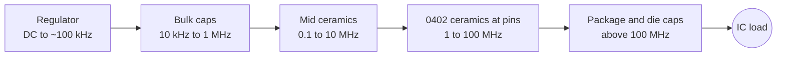

::: testing
Whether you understand **why** capacitors sit on supply pins and can separate three overlapping ideas: *bypass* (shunting AC noise to ground), *decoupling* (isolating a circuit from supply disturbances, and the supply from the circuit's switching), and *bulk* capacitance (a large reservoir for low-frequency load changes). Good answers add: each does a different job in a different frequency band, the targets come from a **target impedance** $Z_{target}=\Delta V/\Delta I$, and real capacitors have ESL and ESR, so layout and value mixing matter. Interviewers also listen for whether you say "the terms are used interchangeably in practice, here's how I distinguish them".
:::

::: why
Digital ICs draw current in nanosecond bursts. The regulator is too slow and too far away to supply that current, so without local charge storage the rail droops or rings, the IC glitches, and the board fails EMC. Almost every board you will touch has a decoupling scheme and a power-integrity review, and "how many capacitors, what values, where?" is a classic design and interview question. The same reasoning applies to analog circuits, where supply noise couples straight into the signal.
:::

::: concepts
- **Capacitor as charge reservoir** ([[q0022]]): $i=C\,dv/dt$; a capacitor supplies current while its voltage droops by $\Delta V=I\Delta t/C$.
- **Impedance and SRF** ([[q0024]], [[q0031]]): capacitors are only capacitive below their self-resonant frequency.
- **Parasitics** ([[q0030]]): ESR and ESL (including mounting) set the high-frequency limit.
- **Target impedance**: $Z_{target}=\Delta V_{allowed}/\Delta I_{transient}$ across the band that matters.
- **Frequency division of labour**: regulator at low frequency, bulk caps next, ceramic caps for high frequency, package/die capacitance last.
- **Anti-resonance**: parallel capacitors with different SRFs create an impedance peak between them.
:::

::: answer
"A decoupling or bypass capacitor is a small capacitor placed right at an IC's supply pin to ground. It does two things. It supplies the fast bursts of current the IC needs when its transistors switch, because the regulator and the traces back to it have too much inductance to respond in nanoseconds. And it shunts high-frequency noise on the supply to ground so it doesn't reach the chip, and so the chip's own switching noise doesn't get out onto the rail. Typically that's a 100 nanofarad ceramic per supply pin, sometimes with a 10 or 1 nanofarad.

A bulk capacitor is a much larger one, tens to hundreds of microfarads, often electrolytic, tantalum, polymer or a bank of ceramics, placed near where power enters the board or the load. It handles low-frequency demand: slower load steps, in the microsecond to millisecond range, the time it takes the regulator's control loop to respond, and it holds up the rail through that gap.

The difference is the frequency band, and the physical size and parasitics. Big capacitors have high ESL, so they stop being capacitors at maybe a megahertz; small ceramics with low ESL work up to tens of MHz. So you need both, plus intermediate values, and you place them in order, with the smallest closest to the pin.

I'd size them from a target impedance: the allowed voltage ripple divided by the transient current, and then check the impedance curve for anti-resonance peaks."
:::

::: technical
**Charge reservoir:** for a current step $\Delta I$ lasting $\Delta t$ before the regulator responds, the droop is $\Delta V\approx\Delta I\,\Delta t/C$, so $C\ge\Delta I\,\Delta t/\Delta V$. Example: 1 A for 1 µs with 100 mV allowed droop requires 10 µF.

**Target impedance:** $Z_{target}=\Delta V/\Delta I$, e.g. a 1.0 V core with ±5 % tolerance (50 mV) and 5 A transient needs $Z\le10\ \text{m}\Omega$ from DC up to the frequency where the die/package capacitance takes over.

**Inductance limit:** $v=L\,di/dt$. With 1 nH of loop inductance and a 1 A/ns edge, the drop is 1 V; no capacitance value fixes that: only lower inductance.

**Band allocation** (typical, depends on the design):

| Role | Typical parts | Effective band | Limited by |
|---|---|---|---|
| Regulator + feedback loop | converter output caps | DC to ~10–100 kHz | loop bandwidth |
| Bulk | 47–470 µF polymer/electrolytic, 22–100 µF MLCC | 10 kHz–1 MHz | ESR, ESL |
| Mid-frequency | 1–10 µF MLCC (0603/0805) | 100 kHz–10 MHz | ESL, mounting |
| High-frequency (bypass/decoupling) | 10–100 nF MLCC (0402/0201) near pins | 1–100 MHz | ESL, via inductance |
| Package/die | on-die cap, package caps | >100 MHz | fixed by silicon |

**Bypass vs. decoupling.** Bypass: provides an AC path to ground, "bypassing" the noise around a sensitive node. Decoupling: separates (decouples) the stage from the shared supply impedance so that one stage's current doesn't disturb another. The same physical capacitor does both.
:::

::: short
"A decoupling or bypass cap is a small ceramic, about 100 nF, right at the IC's supply pin. It supplies the fast current bursts the chip needs and shunts high-frequency noise to ground. A bulk capacitor is large, tens to hundreds of microfarads, near the power entry or load, holding the rail up through slower load steps while the regulator reacts. The difference is the frequency band: big caps have high ESL so they only work at low frequency, small ones work to tens of MHz, so you use both, smallest closest to the pin."
:::

::: long
"Digital chips draw current in very short bursts, on the order of nanoseconds, every time they switch. The regulator is centimeters away, with trace and via inductance, and its control loop responds in microseconds. So nothing upstream can deliver that current in time, and without local charge storage the supply would droop and ring and the chip would glitch.

A decoupling capacitor, sometimes called a bypass capacitor, is a small ceramic placed right at the supply pin, usually 100 nanofarads, sometimes 10 nanofarads or 1 microfarad as well. It does two jobs. It's a local reservoir that supplies the burst of current, and it's a low-impedance path to ground for high-frequency noise, so noise on the rail is shunted away, and the chip's own switching noise doesn't propagate out. Strictly, bypass means shunting noise around a sensitive node and decoupling means isolating one stage from another via the shared supply, but it's the same part doing both.

A bulk capacitor is the large one: tens to hundreds of microfarads, electrolytic, polymer or tantalum or lots of ceramics, near the power input or the load. It covers the lower frequency demand, slower load steps in the microsecond to millisecond range, and keeps the rail up during the regulator's response time, and it also helps absorb ripple.

Why not just one big capacitor? Because every capacitor has ESL, and above its self-resonant frequency it acts as an inductor. A 100 microfarad electrolytic is inductive above a couple hundred kilohertz. So you need a hierarchy: bulk for low frequency, mid-value ceramics, and small ceramics with the lowest ESL closest to the pins.

I size by target impedance: allowed ripple divided by the transient current, so 50 millivolts over 5 amps is 10 milliohms, and then check the impedance curve of the combination, watching for anti-resonance peaks between values and keeping the loop inductance low with short vias."
:::

::: terms
- **Decoupling capacitor**: a capacitor that isolates a circuit from supply disturbances and supplies local transient current.
- **Bypass capacitor**: provides an AC shunt path to ground around a node or supply.
- **Bulk capacitor**: large-value capacitor for low-frequency load steps and ripple.
- **Target impedance**: $\Delta V_{allowed}/\Delta I_{transient}$, the PDN impedance goal.
- **PDN (power delivery network)**: regulator, planes, vias and capacitors seen by the load.
- **Anti-resonance**: impedance peak between capacitors of different SRFs.
- **Loop inductance / mounting inductance**: inductance of the pad, via and plane path through which the capacitor connects.
- **Transient current ($di/dt$)**: the rapid load change the PDN must supply.
:::

::: exceptional
**An average answer** says "decoupling caps filter noise; bulk caps store energy; use 100 nF near each pin".

**An exceptional answer**:
- Distinguishes the roles by *frequency band* and explains the hierarchy (regulator → bulk → mid → HF → package/die).
- Explains why one big capacitor doesn't work: ESL, SRF, mounting inductance.
- Uses numbers: $C=I\Delta t/\Delta V$, $Z_{target}=\Delta V/\Delta I$, and a loop inductance drop $L\,di/dt$.
- Mentions placement and layout (closest to the pin, vias at the pad, thin plane spacing) and anti-resonance with damping.
- States the nuance that bypass/decoupling are often used interchangeably, but there is a conceptual difference.
- Acknowledges derating (DC-bias loss in MLCCs) and verifying with simulation or measurement.
:::

::: mistakes
- **"One big capacitor is enough."** It is inductive above its SRF; high-frequency edges see only the inductance.
- **Placing the capacitor far from the pin.** The loop inductance of a few cm of trace (10+ nH) makes it useless at high frequency.
- **Counting capacitor value, not impedance.** Ten 100 nF in parallel help by dividing *inductance*, not by adding capacitance.
- **Ignoring DC-bias derating.** A 10 µF X5R at 5 V might act like 3–5 µF.
- **Ignoring anti-resonance.** Adding a value can *create* an impedance peak; check the curve.
- **Using ferrite beads/series R with no check.** They help isolate noise but add impedance to the supply path: check for resonance with the downstream capacitance.
- **Assuming the terms mean different parts.** The same ceramic bypasses and decouples; distinctions are about function.
:::

::: deep
## What problem is being solved

A CMOS gate that switches draws a short current pulse from the supply. A modern processor can have amps of current changing in nanoseconds: $di/dt\sim$ 1 A/ns or more. The supply path from the regulator has resistance and, more importantly, inductance $L_{loop}$. A current step across it gives $\Delta V=L\,di/dt$: 1 nH × 1 A/ns = 1 V. That's the whole motivation. We need a charge source *closer than the inductance can matter*, which means local capacitors.


Figure: Each stage supplies the current the previous one can't deliver fast enough. The stages overlap in frequency; the chain is limited by the weakest link, usually inductance.

## Sizing the reservoir

A capacitor supplying a step $\Delta I$ for a time $\Delta t$ droops by $\Delta V=\Delta I\,\Delta t/C$ (ignoring ESR and ESL). For a 1 A step the regulator takes about 1 µs to react and you can allow 100 mV droop: $C=1\cdot10^{-6}/0.1=10$ µF. The ESR adds $\Delta I\cdot R_{esr}$ immediately: 1 A × 20 mΩ = 20 mV. The ESL adds $L\,di/dt$: for a 1 nH loop and 1 A in 10 ns, 0.1 V.

## Target impedance

A more general method: the load changes by $\Delta I$ across a band of frequencies; the PDN impedance must satisfy
$$|Z_{PDN}(f)|\le Z_{target}=\frac{\Delta V_{allowed}}{\Delta I}$$
over that band. For a 1.0 V rail with ±5 % tolerance and 5 A transient: 50 mV/5 A = 10 mΩ. For a 3.3 V logic rail with 5 % tolerance and 0.5 A of transient: 165 mV/0.5 A = 0.33 Ω.

## Why you need several values

```plot
{"title":"PDN impedance: one bulk capacitor vs. bulk + mid + high-frequency ceramics","x":{"label":"Frequency","unit":"Hz","min":1e4,"max":3e8,"log":true},"y":{"label":"|Z|","unit":"Ω","min":0.003,"max":10,"log":true},
 "series":[
  {"label":"100 µF alone (ESR 30 mΩ, ESL 5 nH)","fn":"sqrt(0.0009+pow((2*pi*x*5e-9-1/(2*pi*x*0.0001)),2))","color":"orange"},
  {"label":"100 µF + 10 µF + 100 nF in parallel","fn":"1/sqrt(pow(0.03/(0.0009+pow((2*pi*x*5e-9-1/(2*pi*x*0.0001)),2))+0.005/(0.000025+pow((2*pi*x*1.5e-9-1/(2*pi*x*0.00001)),2))+0.02/(0.0004+pow((2*pi*x*1e-9-1/(2*pi*x*1e-7)),2)),2)+pow((2*pi*x*5e-9-1/(2*pi*x*0.0001))/(0.0009+pow((2*pi*x*5e-9-1/(2*pi*x*0.0001)),2))+(2*pi*x*1.5e-9-1/(2*pi*x*0.00001))/(0.000025+pow((2*pi*x*1.5e-9-1/(2*pi*x*0.00001)),2))+(2*pi*x*1e-9-1/(2*pi*x*1e-7))/(0.0004+pow((2*pi*x*1e-9-1/(2*pi*x*1e-7)),2)),2))","color":"accent"}],
 "hlines":[{"at":0.01,"label":"target 10 mΩ","color":"red"}]}
```
Figure: The single bulk capacitor bottoms out at its 30 mΩ ESR near its self-resonance (about 225 kHz) and then goes inductive: at 10 MHz it is above 0.3 Ω. Adding mid and small ceramics drops the impedance in the 1–10 MHz range, but there is an **anti-resonance peak** (about 0.26 Ω near 11 MHz in this example) where the inductance of the larger parts resonates with the 100 nF capacitor. Damping (ESR) and more values at intermediate steps flatten it. Above about 20 MHz even this network is inductive, which is why placement and via inductance are the real limit.

Real PDN design uses a tool (a PDN calculator or a vendor's simulation) and measures the result, but the logic is as above. See the full simulation:

```sim
{"id":"decap-network","preset":"mixed","ztarget":0.05}
```
Figure: Try 'single', 'many-same', 'mixed' and 'far-placement'. In 'many-same' all capacitors share an SRF and so they produce a tall anti-resonance with the planes; 'mixed' spreads SRFs; 'far-placement' shows how added loop inductance destroys high-frequency performance.

## Worked example: building a network for the 2 A, 100 ns step

Take the follow-up scenario and finish it. The core rail is 1.2 V with a 3 % budget (36 mV) and a 2 A step in 100 ns, so $Z_{target} = 36\ \text{mV}/2\ \text{A} = 18\ \text{m}\Omega$. From the charge bound $C \ge I\,\Delta t/\Delta V = 5.6\ \mu$F and the inductance bound $L \le \Delta V\,\Delta t/\Delta I = 1.8$ nH, the obvious first design is:

- One 47 µF bulk capacitor near the regulator (ESR 10 mΩ, ESL 3 nH including its connection; SRF about 424 kHz).
- Four 4.7 µF ceramics (ESR 5 mΩ, ESL 1.2 nH each as mounted; SRF about 2.1 MHz).
- Eight 100 nF ceramics at the pins (ESR 20 mΩ, ESL 1 nH each as mounted; SRF 15.9 MHz).

These ESL and ESR numbers are illustrative values for a lumped model, not datasheet figures; mounted inductance depends on pad, via and plane geometry. Eight 100 nF parts in parallel give $1\ \text{nH}/8 = 0.125$ nH, and the ceramic set as a whole has roughly 0.09 nH of parallel ESL on paper, far below the 1.8 nH budget. In a real layout that ideal figure is never reached, because the planes and the vias shared between capacitors add inductance the lumped model leaves out.

Now evaluate the impedance of the parallel network at each frequency (complex admittances added, then inverted), using node as the calculator. The result:

| Frequency | |Z| (mΩ), without 1 µF stage | |Z| (mΩ), with 6 × 1 µF |
|---|---|---|
| 300 kHz | 9.0 | 8.3 |
| 1 MHz | 8.3 | 6.4 |
| 5 MHz | 9.0 | 1.3 |
| 10 MHz | 35.6 | 8.8 |
| 12 MHz | 11.4 | 16.2 |
| 50 MHz | 25.0 | 16.9 |
| 100 MHz | 52.9 | 35.1 |

The first network fails the 18 mΩ target between about 6.7 and 11 MHz (and again above about 38 MHz, where only mounted inductance is left; see the figure caption). The peak is 61.5 mΩ near 9 MHz and is an anti-resonance: the 4.7 µF parts are already inductive above their 2.1 MHz SRF, while the 100 nF parts are still capacitive below 15.9 MHz, and an inductor in parallel with a capacitor peaks where their reactances cancel. Adding six 1 µF ceramics (ESR 8 mΩ, ESL 1 nH) fills the gap by moving the SRF steps closer together. The worst anti-resonance drops from 61.5 mΩ to about 16 mΩ (near 12 MHz), just under the target (the curve then stays below 18 mΩ up to about 53 MHz), so the margin is thin and in a real layout I would add a few more parts or some damping.

```plot
{"title":"Modeled PDN impedance: 47 µF + 4×4.7 µF + 8×100 nF, with and without 6×1 µF","x":{"label":"Frequency","unit":"Hz","min":300000,"max":100000000,"log":true},"y":{"label":"|Z|","unit":"Ω","min":0.001,"max":0.2,"log":true},"series":[{"label":"without 1 µF stage","points":[[300000,0.00895],[320000,0.00869],[341300,0.0085],[364100,0.00841],[388400,0.00841],[414300,0.00851],[441900,0.00872],[471400,0.00904],[502800,0.00947],[536300,0.00999],[572100,0.0106],[610200,0.0112],[650900,0.0117],[694300,0.012],[740600,0.012],[790000,0.0116],[842600,0.0109],[898800,0.00997],[958700,0.00896],[1023000,0.00794],[1091000,0.00697],[1164000,0.00607],[1241000,0.00525],[1324000,0.00451],[1412000,0.00383],[1506000,0.00322],[1607000,0.00266],[1714000,0.00217],[1828000,0.00174],[1950000,0.00142],[2080000,0.00125],[2219000,0.00129],[2367000,0.00151],[2525000,0.00185],[2693000,0.00226],[2872000,0.00273],[3064000,0.00324],[3268000,0.00378],[3486000,0.00437],[3719000,0.00501],[3966000,0.0057],[4231000,0.00648],[4513000,0.00734],[4814000,0.00833],[5135000,0.00947],[5477000,0.0108],[5842000,0.0125],[6232000,0.0146],[6647000,0.0174],[7091000,0.0213],[7563000,0.0273],[8068000,0.0371],[8606000,0.053],[9179000,0.0603],[9791000,0.0416],[10440000,0.0262],[11140000,0.0174],[11880000,0.012],[12680000,0.00837],[13520000,0.00575],[14420000,0.00386],[15380000,0.0027],[16410000,0.00253],[17500000,0.00318],[18670000,0.00417],[19920000,0.00528],[21240000,0.00641],[22660000,0.00756],[24170000,0.00873],[25780000,0.00993],[27500000,0.0111],[29340000,0.0124],[31290000,0.0137],[33380000,0.015],[35600000,0.0164],[37980000,0.0179],[40510000,0.0194],[43210000,0.0211],[46090000,0.0228],[49160000,0.0246],[52440000,0.0264],[55940000,0.0284],[59670000,0.0306],[63650000,0.0328],[67890000,0.0352],[72420000,0.0377],[77250000,0.0404],[82400000,0.0432],[87890000,0.0463],[93750000,0.0495],[100000000,0.0529]],"color":"orange"},{"label":"with 6 × 1 µF added","points":[[300000,0.00832],[320000,0.00808],[341300,0.00792],[364100,0.00784],[388400,0.00784],[414300,0.00793],[441900,0.00811],[471400,0.00838],[502800,0.00873],[536300,0.00911],[572100,0.0095],[610200,0.00981],[650900,0.00996],[694300,0.0099],[740600,0.00958],[790000,0.00905],[842600,0.00837],[898800,0.00762],[958700,0.00686],[1023000,0.00612],[1091000,0.00543],[1164000,0.00479],[1241000,0.00421],[1324000,0.00367],[1412000,0.00317],[1506000,0.00271],[1607000,0.00229],[1714000,0.00191],[1828000,0.00157],[1950000,0.00132],[2080000,0.00121],[2219000,0.0013],[2367000,0.00161],[2525000,0.00212],[2693000,0.00282],[2872000,0.00378],[3064000,0.00506],[3268000,0.00643],[3486000,0.00682],[3719000,0.00559],[3966000,0.004],[4231000,0.00278],[4513000,0.00193],[4814000,0.00142],[5135000,0.00127],[5477000,0.00144],[5842000,0.0018],[6232000,0.00224],[6647000,0.00275],[7091000,0.00331],[7563000,0.00395],[8068000,0.00468],[8606000,0.00557],[9179000,0.00669],[9791000,0.00821],[10440000,0.0104],[11140000,0.0135],[11880000,0.0162],[12680000,0.0129],[13520000,0.00764],[14420000,0.00438],[15380000,0.00273],[16410000,0.00233],[17500000,0.00275],[18670000,0.00344],[19920000,0.00418],[21240000,0.00493],[22660000,0.00568],[24170000,0.00643],[25780000,0.00719],[27500000,0.00797],[29340000,0.00877],[31290000,0.00959],[33380000,0.0104],[35600000,0.0113],[37980000,0.0123],[40510000,0.0133],[43210000,0.0143],[46090000,0.0154],[49160000,0.0166],[52440000,0.0178],[55940000,0.0191],[59670000,0.0205],[63650000,0.0219],[67890000,0.0235],[72420000,0.0251],[77250000,0.0269],[82400000,0.0288],[87890000,0.0308],[93750000,0.0329],[100000000,0.0351]],"color":"accent"}],"hlines":[{"at":0.018,"label":"target 18 mΩ","color":"red"}]}
```
Figure: Without an intermediate stage there is a bump above the 18 mΩ target at about 9 MHz where the 4.7 µF banks go inductive and the 100 nF parts have not yet taken over. Six 1 µF parts cut the bump to just under the target (the small remaining peak is near 12 MHz). Above about 20 MHz both curves climb steadily (crossing the target near 38 MHz and 53 MHz respectively) because the loop inductance of the board-level parts is all that is left: this region is covered by package and die capacitance, not by anything you can add on the board.

Two caveats keep this honest. First, a lumped ESR/ESL model leaves out the plane's spreading inductance and the via inductance shared between capacitors, which raise the real inductance, so a real board shows a worse high-frequency curve than this model. Second, MLCC capacitance falls with DC bias and temperature, so a 4.7 µF X5R part may behave like a 3 µF part; check the vendor's bias curve for the value you specify. A rail at 1.2 V on a 6.3 V part keeps this small but not negligible.

> [!UNCERTAIN]
> ESL per mounted capacitor typically lands between about 0.5 and 2 nH depending on the pad geometry and the via arrangement, and ESR varies with dielectric, size and frequency. The numbers above are a plausible set, not measured data.

## Limiting cases

- **Zero inductance.** With ideal capacitors one big capacitor would do. The anti-resonance and the whole discussion of values exist only because of ESL and ESR.
- **Heavy ESR damping.** A lossy bulk capacitor flattens the anti-resonance peak but makes the impedance floor high (the ESR sits in the target budget). The solution is a mix: ceramics for the floor, a bulk part with some ESR for damping.
- **Very slow loads.** If the current steps slowly (milliseconds), the regulator's loop handles it and the decoupling network matters little. The design effort belongs to loads that step in tens of nanoseconds.

## Verifying on the bench

1. **Load-step test.** Drive the rail with an electronic load or a switched resistor (the function generator driving a MOSFET works) with a fast edge. Measure the rail at the load pins with a short ground spring on the probe, not a long ground lead, because the lead inductance adds a false ringing of its own. Compare the droop with your $\Delta V$ budget.
2. **Impedance measurement with a VNA.** Connect the rail with two short coaxial probes in a shunt-through configuration; the impedance of the PDN is $Z = 25\,S_{21}/(1 - S_{21})$ for 50 Ω ports. For a 10 mΩ target the reading is near the instrument's noise floor, so use the shunt-through method with a low-impedance cable calibration, not a one-port reflection measurement, which cannot resolve milliohms.
3. **Compare with the model.** The anti-resonance peak frequency is the first thing a measurement should reproduce. If it sits at a different frequency from the model, the mounted ESL is wrong, and the layout, not the capacitor values, is what needs another look.

## Layout is half of the answer

- Place the smallest capacitor closest to the supply pin, with the **power pad → capacitor → ground via** path as short as possible. Put vias at (or in) the capacitor pads, not at the end of a trace.
- Use closely spaced power/ground planes (thin dielectric) for low plane inductance and extra distributed capacitance ([[q0503]]).
- Don't share one via for several capacitors; use two vias per pad for large parts.
- Put bulk capacitors near the regulator output and near high-current loads; connect with wide pours.
- Keep the loop area small: loop inductance is roughly proportional to the area, about 1 nH/mm of via length is a common rule of thumb for estimating, not a spec.

> [!UNCERTAIN]
> Placement rules of thumb (distances, inductance per mm) depend on stackup and via geometry. Use a field solver or the vendor's PDN guidelines for specific designs.

## Bulk capacitor details

Bulk capacitors do double duty: they store energy for load steps (the regulator's loop needs time) and they carry converter ripple current, so ripple-current rating and ESR heating matter. Polymer and tantalum parts have low ESR but must be derated for voltage; aluminum electrolytics are cheap with high ESR, which also provides useful *damping* for anti-resonance. In many designs a mixture of MLCCs and a polymer bulk cap gives both low ESL and damping. Remember MLCC bias derating for the value you specify. Also check that the regulator is stable with the total output capacitance and ESR you added ([[q0030]]).

## Analog and mixed-signal view

An op-amp or ADC supply pin has finite PSRR that falls with frequency. A local bypass capacitor (e.g. 100 nF plus 1–10 µF) keeps noise from the shared rail from passing to the output. A series ferrite bead or resistor with the bypass capacitor forms an LC or RC filter ("decoupling" from the rest of the board). Check for resonance: the bead's inductance and the capacitor's value form an LC whose Q can create a peak.
:::

::: applications
- **Microcontroller/FPGA/SoC rails**: one 100 nF per power pin plus a few µF per rail, bulk at the regulator.
- **High-speed DDR memory and processors**: carefully designed PDN with tens to hundreds of capacitors and low-ESL packages.
- **Op-amp and ADC supplies**: 100 nF plus a few µF, with a bead or RC filter for noise isolation.
- **Switching regulators**: input capacitors supply the pulsed input current; output caps set ripple and transient response.
- **RF amplifiers**: bypass networks with multiple small values (e.g. 100 pF + 10 nF + 1 µF) matched to the RF frequency.
- **Motor drivers**: bulk capacitance at the H-bridge supply to absorb regenerative and switching energy.
:::

::: assumptions
- I treat "bypass" and "decoupling" as the same physical practice and distinguish them functionally; textbooks differ.
- Typical values (100 nF per pin, 10–100 µF bulk) are starting points; the real answer comes from target impedance and the IC's datasheet or reference design.
- MLCC parameters are nominal (no DC-bias loss); real parts need derating.
- A solid reference plane below the capacitors is assumed. On two-layer boards loop inductance is higher and the same capacitor does less.
- This answer concerns the power rail context (as in [[q0142]] and [[q0143]]) and the generic definition; the PCB placement/routing context is in [[q0501]] and [[q0503]].
:::

::: followups
### Why can't you use one big capacitor instead of many small ones?
A big capacitor has a lower SRF (more $C$, bigger package, more ESL). Above its SRF it's an inductor, so for fast edges its impedance is $\omega L$, perhaps 0.3 Ω at 10 MHz for a 5 nH electrolytic. Many small, low-ESL capacitors in parallel divide the inductance and provide low impedance at higher frequency, which is the band where the IC's current bursts occur.

### How would you size decoupling for a processor that steps 2 A in 100 ns with a 3 % budget on 1.2 V?
Budget: 36 mV. $Z_{target}=36\ \text{mV}/2\ \text{A}=18\ \text{m}\Omega$. Charge: $C=I\,\Delta t/\Delta V=2\cdot10^{-7}/0.036=5.6$ µF in the 100 ns window, plus ESL budget: $L\le\Delta V\Delta t/\Delta I=0.036\cdot10^{-7}/2=1.8$ nH total loop inductance. So several 1 µF/100 nF ceramics with very short, low-inductance connections, plus bulk further back for the longer-timescale response.

### What's an anti-resonance peak and how do you reduce it?
Where a capacitor's inductive region (above its SRF) meets another's capacitive region, the two form a parallel LC with high impedance. Reduce it with intermediate values to spread the SRFs, more ESR (a lossy capacitor or a small series resistance), closely spaced planes, or placing similar-value caps instead of widely different ones.

### What if the decoupling capacitor is on the far side of the board from the IC?
The loop now includes via barrels and planes through the board's thickness, plus the lateral path; inductance may be 3–5 nH or more, so its SRF drops and it does nothing above a few MHz. It still helps at low frequency, but the high-frequency bypass must be close, ideally on the same side as the IC or directly underneath, with the shortest route to the plane.

### Do decoupling capacitors add noise in any way?
They can ring: capacitor + inductance of the supply path forms a resonance that can be excited by switching. Also ceramic capacitors can be microphonic (piezoelectric) at audio frequencies, and electrolytic dry-out changes ESR. Good practice is to check the PDN impedance and measure the rail with a proper probe.
:::

::: interpretations
This is Q32, asked in the capacitor section. The same topic reappears as Q142 (a power rail with many capacitors: why so many, why not one massive one?), Q143 (bulk capacitance) and Q501 (decoupling capacitors in the ground/PCB context). Here I answer the definitions and the difference: [[q0142]] concentrates on the power-rail "why so many capacitors" argument, [[q0143]] on the bulk capacitance, and [[q0501]] on when decoupling is needed and its placement.
:::

::: references
- Johnson & Graham, *High-Speed Digital Design: A Handbook of Black Magic*: chapter on power-system design and bypassing.
- Vendor power-delivery-network design guides (for example from FPGA and processor manufacturers) describing target-impedance methodology; check the current documentation for your device family.
- Eric Bogatin, *Signal and Power Integrity: Simplified*: decoupling capacitors, target impedance, and loop inductance.
- Henry W. Ott, *Electromagnetic Compatibility Engineering*: bypass capacitor selection and placement.
:::

::: rubric
- Defines decoupling/bypass: local charge source and AC shunt to ground at the IC pin :: The fundamental purpose.
- Defines bulk capacitance and its low-frequency role (regulator response time, ripple) :: The second half of the question.
- States the difference is frequency band and parasitics, not just value :: The key insight.
- Explains why several values are used (ESL, SRF, anti-resonance) :: Shows PDN understanding.
- Uses a calculation (charge $I\Delta t/\Delta V$ or target impedance) :: Quantitative backing.
- Mentions placement/layout and loop inductance :: Layout determines effectiveness.
- Notes DC-bias derating or ESR damping :: Real-component awareness.
:::

::: quiz
```json
[
 {"type":"mcq","level":"fundamental","q":"What is the main job of a decoupling capacitor placed at an IC's supply pin?","options":["To raise the supply voltage","To supply local high-frequency current and shunt noise to ground","To block DC current into the chip","To reduce the chip's operating frequency"],"answer":1,"explain":"It acts as a nearby charge reservoir for fast current bursts and a low-impedance AC path to ground. It doesn't change the DC voltage."},
 {"type":"numeric","level":"fundamental","q":"A load steps by 2 A for 5 µs before the regulator responds. What capacitance limits the droop to 100 mV?","answer":100,"tolerance":0.02,"unit":"µF","explain":"$C=I\\Delta t/\\Delta V=2\\cdot5\\times10^{-6}/0.1=100\\ \\mu$F."},
 {"type":"numeric","level":"intermediate","q":"A 1.0 V rail has a ±5 % tolerance and a 4 A load transient. What is the target impedance?","answer":12.5,"tolerance":0.02,"unit":"mΩ","explain":"$Z=\\Delta V/\\Delta I=0.05/4=12.5$ mΩ."},
 {"type":"mcq","level":"intermediate","q":"Why is one 100 µF electrolytic not enough to decouple a fast digital IC?","options":["It has too little capacitance","Its ESL makes it inductive above a few hundred kHz, so it can't supply fast edges","It cannot store charge","It is polarized"],"answer":1,"explain":"The big part's ESL and ESR dominate at high frequency, so for MHz-range bursts you need low-ESL ceramics close to the pins."},
 {"type":"numeric","level":"intermediate","q":"A loop inductance of 2 nH sees a current slew of 0.5 A/ns. What is the induced voltage drop?","answer":1,"tolerance":0.03,"unit":"V","explain":"$v=L\\,di/dt=2\\times10^{-9}\\cdot0.5\\times10^{9}=1$ V."},
 {"type":"truefalse","level":"advanced","q":"Adding more capacitor values to a PDN can never make the impedance at some frequency worse.","answer":false,"explain":"Parallel capacitors with different SRFs create an anti-resonance peak between them, where the combined impedance can exceed that of either part alone. Damping and well-spread values reduce it."}
]
```
:::
