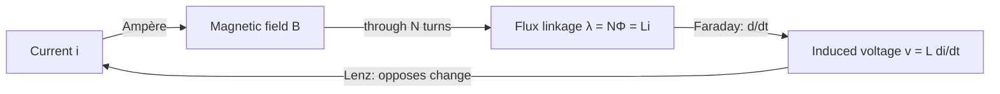

::: basics
### In plain words
Inductance is the property that makes a conductor resist changes in its current. Current makes a magnetic field. If the current changes, the field changes, and that creates (induces) a voltage that pushes back against the change. The rule is $v = L\,di/dt$, where $di/dt$ is how many amps per second the current changes. The unit is the henry. Inductance is large for coils with many turns and for coils with a magnetic core.

### Picture it
Picture water flowing in a long, wide pipe. Moving water has momentum, so you cannot start or stop it instantly. Try to stop it suddenly and the pressure spikes. Inductance is the same kind of inertia for current. Steady flow needs no push. The analogy fits well for this idea, but electrons have almost no mass. The inertia comes from the magnetic field, not from the electrons' weight.

### Words you need
- **Inductance (L)**: how strongly a part resists changes in current, in henries (H).
- **Magnetic flux**: the amount of magnetic field passing through the loop or coil.
- **Lenz's law**: the induced voltage always opposes the change that caused it.
- **Stored energy**: $\tfrac12 L I^2$, kept in the magnetic field. See [[q0022]] for the capacitor version.
- **Parasitic inductance**: the small inductance of any wire or trace, which matters for fast edges.

### The simplest example
Take a 1 mH inductor. If the current is steady, $di/dt = 0$, so the voltage across it is 0 V. Now ramp the current up by 1 A in 1 ms. That is 1,000 A/s, so $v = 0.001 \times 1000 = 1$ V. Make the same change in 1 µs and $v = 1000$ V. The faster you try to change the current, the more voltage the inductor develops. That is the whole idea. The rest of this page covers where the formula comes from and how geometry and core material set $L$.
:::

::: testing
Whether you understand inductance as a **physical property** rather than "the thing measured in henries". The interviewer wants to hear:

1. The definition: flux linkage per unit current, $L = \lambda/i = N\Phi/i$.
2. The consequence: by Faraday's and Lenz's laws, a changing current induces a voltage that opposes the change, $v = L\,di/dt$.
3. Where it comes from physically (turns, area, core permeability, path length) and that **every** current loop has some, which is why parasitic inductance matters.
4. That it stores energy, $\tfrac12 Li^2$, in the magnetic field.
:::

::: why
Inductance is behind half the "mysterious" problems in hardware: the voltage spike when you switch off a relay coil, ground bounce in fast digital I/O, ringing on a scope probe's ground lead, a buck converter's ripple current, and why decoupling capacitors must sit right next to the chip. It's also the energy-storage element that makes switching power supplies possible. If you understand inductance as "current has inertia, and the size of the loop sets how much", you can reason about all of these without memorizing each one. It's the foundation for the rest of the inductor section ([[q0040]]–[[q0054]]).
:::

::: concepts
- **Magnetic flux** ($\Phi$, webers): the total magnetic field passing through a surface. Current in a wire creates it (Ampère's law).
- **Flux linkage** ($\lambda = N\Phi$): how much flux threads through the loop(s) of the circuit, counted once per turn.
- **Faraday's law**: a changing flux linkage induces a voltage $v = d\lambda/dt$.
- **Lenz's law**: the induced voltage opposes the change in current that caused it. That's the minus sign, and the reason inductors "resist change" ([[q0043]]).
- **Permeability** ($\mu = \mu_0\mu_r$): how easily a material supports magnetic flux; cores raise it ([[q0048]]).
- **Energy storage**: inductors store energy in the magnetic field, $E = \tfrac12 L i^2$, just as capacitors store it in the electric field ([[q0022]]).
:::

::: answer
"Inductance is the property of a conductor that makes it oppose changes in the current through it. When current flows, it creates a magnetic field, and that field links back through the circuit. Inductance is how much magnetic flux linkage you get per amp: $L = N\Phi/I$, measured in henries.

The important part is what happens when the current changes. A changing current means a changing flux, and Faraday's law says a changing flux induces a voltage. Lenz's law says that voltage pushes back against the change. So you get $v = L\,di/dt$: the faster you try to change the current, the bigger the voltage the inductor develops to fight it.

I think of it as inertia for current. A capacitor resists changes in voltage; an inductor resists changes in current. And it stores energy in its magnetic field, $\tfrac12 LI^2$, which is exactly what buck and boost converters exploit.

Physically it depends on geometry and material: more turns, bigger loop area, and a high-permeability core all increase it, roughly $L = \mu N^2 A/\ell$. And it's not just in coils. Every wire and PCB trace forms a loop with its return path, so everything has some parasitic inductance. That's why fast edges cause ground bounce and ringing."
:::

::: technical
**Definition.** For a circuit carrying current $i$ whose magnetic flux $\Phi$ links $N$ turns:
$$L = \frac{\lambda}{i} = \frac{N\Phi}{i}\qquad [\text{H} = \text{Wb/A} = \text{V·s/A}]$$

**Terminal law.** Faraday: $v = \frac{d\lambda}{dt}$. If $L$ is constant (linear, unsaturated), $\lambda = Li$ gives
$$v = L\frac{di}{dt}$$
with the passive sign convention (current entering the + terminal). Lenz's law is built into the sign: the induced voltage opposes the change in current.

**Geometry and material.** Using the magnetic-circuit analogy (MMF $= Ni$, reluctance $\mathcal{R} = \ell/(\mu A)$, $\Phi = Ni/\mathcal{R}$):
$$L = \frac{N^2}{\mathcal{R}} = \frac{\mu_0\mu_r N^2 A_e}{\ell_e}$$
Core vendors publish $A_L = 1/\mathcal{R}$ in nH/turn², so $L = A_L N^2$.

**Energy.** Power into the inductor is $p = vi = Li\,\frac{di}{dt}$, so
$$E = \int_0^{I} L i\,di = \tfrac12 L I^2$$
stored in the field with density $B^2/(2\mu)$. In a gapped core, most of it sits in the air gap because $\mu_0$ is far smaller than $\mu_{core}$.

**Self vs. mutual.** Self-inductance links a circuit's own flux; mutual inductance $M = k\sqrt{L_1L_2}$ (coupling coefficient $0 \le k \le 1$) links one circuit's flux to another, which is the basis of transformers and also of crosstalk.

**Parasitic inductance.** Any current path is a loop with its return. A rough rule of thumb is on the order of 1 nH per mm for an isolated thin wire or trace far from its return. Over a solid ground plane it's much lower, because the return current flows right underneath and the loop area shrinks.

**Typical magnitudes.** Package bond wire: ~1 nH. RF chip inductor: 1–100 nH. Buck converter inductor: 0.47–47 µH. Audio crossover coil: ~0.1–10 mH. Mains-frequency choke: up to henries.
:::

::: short
"Inductance is the ratio of magnetic flux linkage to current, $L = N\Phi/I$, in henries. Its practical meaning is that it opposes changes in current: change the current and the changing flux induces a voltage that fights you, $v = L\,di/dt$. It stores energy in the magnetic field as $\tfrac12 LI^2$. It grows with turns squared, loop area and core permeability, and every current loop has some, which is why fast edges cause ringing and ground bounce."
:::

::: long
"Inductance is about the relationship between current and magnetic field. Any current creates a magnetic field around it, and that field passes back through the loop the current flows in. Inductance is the flux linkage per amp: $L$ equals $N\Phi$ over $I$, in henries.

On its own that's just a ratio. The useful part comes from Faraday's law. If the current changes, the flux changes, and a changing flux induces a voltage in the loop. Lenz's law says the induced voltage opposes the change. Put those together for a constant L and you get the inductor equation, $v = L\,di/dt$. So an inductor doesn't care how much current is flowing; it cares how fast the current is changing. Ramp it slowly and you barely see a voltage. Try to stop it instantly and you get a huge voltage spike, which is the inductive kick you see when you turn off a relay or motor.

The analogy I like is inertia. Mass resists changes in velocity, inductance resists changes in current. And just like a moving mass stores kinetic energy, an inductor stores magnetic energy, $\tfrac12 LI^2$. That's what switching converters use: store energy in the inductor during one part of the cycle and release it in the other.

Physically, inductance depends on geometry and material. For a coil it's roughly $\mu N^2 A$ over length: more turns, more area, or a magnetic core with high permeability all increase it. Turns count squared because each turn adds flux and also links the flux of all the others.

The last point is that inductance isn't only in coils. Every trace and wire is part of a loop with its return path, so everything has parasitic inductance, on the order of a nanohenry per millimetre for a trace far from its return. With a fast edge, even 10 nH and a 50 mA step in a nanosecond gives you half a volt, which is why layout and loop area matter so much."
:::

::: terms
- **Inductance (L)**: flux linkage per unit current, $L = N\Phi/i$; sets how much voltage a changing current produces.
- **Henry (H)**: 1 V across an inductor when its current changes at 1 A/s; equivalently 1 Wb/A.
- **Flux linkage (λ)**: $N\Phi$, the flux counted once for every turn it passes through.
- **Back-EMF / induced voltage**: the voltage produced by changing flux, polarized to oppose the change (Lenz).
- **Permeability (μ)**: material property relating B to H; $\mu_r$ is relative to free space.
- **Reluctance (ℛ)**: the magnetic "resistance" of a flux path, $\ell/(\mu A)$; $L = N^2/\mathcal{R}$.
- **Mutual inductance (M)**: flux from one circuit linking another; basis of transformers and magnetic crosstalk.
- **Parasitic inductance**: unintended inductance of traces, leads, vias and packages, set by loop area.
:::

::: exceptional
**An average answer** says "inductance is the ability to store energy in a magnetic field" and stops.

**An exceptional answer**:
- Gives the actual definition, $L = N\Phi/i$, and derives $v = L\,di/dt$ from Faraday + Lenz.
- Says clearly that an inductor responds to the **rate of change** of current, not the current itself.
- Explains the physical knobs: $L \propto N^2$, area, permeability, path length, and why turns count squared.
- Brings in energy, $\tfrac12 LI^2$, and links it to a real use (buck converters, ignition coils).
- Points out that **all loops have inductance**, quantifies a parasitic example (ground bounce: $10\text{ nH}\times 50\text{ mA}/1\text{ ns} = 0.5$ V), and says how layout reduces it (smaller loop area, return path close by).
:::

::: mistakes
- **"Inductance opposes current."** It opposes *changes* in current. At DC steady state an ideal inductor is a short circuit ([[q0044]]).
- **Confusing inductance with resistance.** Resistance dissipates energy; ideal inductance stores it and gives it back. A real inductor has both (DCR and core loss, [[q0050]]).
- **Thinking inductance only exists in coils.** Every current loop has inductance; a straight trace "has inductance" only because it's part of a loop with its return path.
- **Saying L is proportional to N.** It's proportional to $N^2$: double the turns, roughly four times the inductance (for the same core).
- **Assuming L is constant.** With a magnetic core, $L$ falls as current approaches saturation ([[q0046]]) and drifts with temperature and frequency.
:::

::: deep
## From current to field to voltage

Start with three facts from electromagnetism.

1. **Current makes a magnetic field** (Ampère's law). Around a long straight wire, $B = \mu_0 I / (2\pi r)$. Wind the wire into a coil and the fields of the turns add up through the middle.
2. **Flux links the circuit.** The field passing through the area enclosed by the loop is the flux $\Phi = \int \mathbf{B}\cdot d\mathbf{A}$. If the coil has $N$ turns, the same flux threads each one, so the circuit's total flux linkage is $\lambda = N\Phi$.
3. **Changing flux induces voltage** (Faraday's law), and the polarity opposes the change (Lenz's law): $v = d\lambda/dt$.

Inductance is the constant connecting fact 1 and fact 2: how much flux linkage you get per amp.

$$\lambda = L\,i \quad\Rightarrow\quad v = \frac{d\lambda}{dt} = L\frac{di}{dt}$$

That last step assumes $L$ is constant, which holds for an air core and for a magnetic core well below saturation.


Figure: Inductance is the gain from current to flux linkage. Faraday turns a change in that linkage into voltage, and Lenz's law makes that voltage push back on the change, closing the loop.

## Why it's "inertia for current"

The equation $v = L\,di/dt$ has the same form as Newton's $F = m\,dv/dt$:

| Mechanical | Electrical |
|---|---|
| Force $F$ | Voltage $v$ |
| Velocity | Current $i$ |
| Mass $m$ | Inductance $L$ |
| Kinetic energy $\tfrac12 mv^2$ | Magnetic energy $\tfrac12 Li^2$ |

A heavy flywheel spins happily at constant speed with no torque, but needs a large torque to speed up or slow down fast. An inductor carries constant current with zero voltage across it, but needs a large voltage to change that current quickly. Rearranged:

$$\frac{di}{dt} = \frac{v}{L}$$

A fixed voltage across an inductor gives a **linear current ramp**, and the slope is set by $L$. This is the single most useful fact in power electronics.

```plot
{"title":"Current ramp with 5 V applied across an ideal inductor","x":{"label":"t","unit":"s","min":0,"max":1e-5},"y":{"label":"i_L","unit":"A","min":0,"max":5.5},
 "vars":{"v":5,"l1":10e-6,"l2":22e-6},
 "series":[{"label":"L = 10 µH (slope 0.5 A/µs)","fn":"v/l1*x"},{"label":"L = 22 µH (slope 0.227 A/µs)","fn":"v/l2*x","color":"orange"}],
 "points":[{"x":1e-5,"y":5,"label":"5 A at 10 µs"},{"x":1e-5,"y":2.27,"label":"2.27 A"}]}
```
Figure: Constant voltage means constant di/dt. The larger inductance ramps more slowly; after 10 µs the 10 µH part carries 5 A while the 22 µH part carries 2.27 A. Inductance literally sets the slope.

Try it interactively: a step into an RL circuit shows the current creeping up with time constant $L/R$ rather than jumping.

```sim
{"id":"rc-transient","kind":"rl","r":100,"l":0.01,"vs":5,"drive":"step"}
```
Figure: Increase L and the current rises more slowly (τ = L/R = 100 µs here). The current never jumps; the inductor voltage does, and it starts at the full 5 V.

## What sets the value: geometry and material

Push the flux through a **magnetic circuit**. The winding supplies a magnetomotive force $\mathcal{F} = Ni$ (ampere-turns). The flux path has reluctance $\mathcal{R} = \ell/(\mu A)$, analogous to a resistor's $\rho\ell/A$. Then "magnetic Ohm's law" gives:

$$\Phi = \frac{Ni}{\mathcal{R}} \quad\Rightarrow\quad L = \frac{N\Phi}{i} = \frac{N^2}{\mathcal{R}} = \frac{\mu_0\mu_r N^2 A}{\ell}$$

This shows exactly why turns count twice: once in the MMF that makes the flux, once in the linkage that collects it.

**Worked example (toroid).** A ferrite toroid with $\mu_r = 2000$, effective path length $\ell_e = 5$ cm and cross-section $A_e = 20$ mm²:

$$\mathcal{R} = \frac{0.05}{2000 \cdot 4\pi\times10^{-7}\cdot 20\times10^{-6}} \approx 9.95\times10^{5}\ \text{A·turn/Wb}$$

So $A_L = 1/\mathcal{R} \approx 1005$ nH/turn². Ten turns gives $L = A_L N^2 \approx 100\ \mu$H. The same ten turns in air would give 2000 times less, about 50 nH. That's the job of a core ([[q0048]]).

> [!NOTE]
> Real ferrite permeability depends on temperature, frequency and flux density, and vendors specify $A_L$ with tolerances of ±20–25% for ungapped cores. That's one reason power inductors are usually gapped: the gap makes $L$ depend mostly on geometry, which is far more stable.

## Energy: where it lives and why it matters

Power into an inductor is $p = vi = L i\,\frac{di}{dt}$. Integrating from zero current:

$$E = \int_0^I L\,i\,di = \tfrac12 L I^2$$

This energy is stored in the magnetic field, with density $w = B^2/(2\mu)$. Because $\mu_0 \ll \mu_{core}$, for the same B an air gap stores far more energy per volume than the core material. That's why energy-storage inductors and flyback transformers are deliberately gapped: the core guides the flux, the gap stores the energy.

**Example.** A 22 µH buck inductor at 2 A holds $\tfrac12 \cdot 22\ \mu\text{H}\cdot 4 = 44\ \mu$J. Tiny, but delivered 500,000 times a second it moves real power. A 10 mH relay coil at 1 A holds 5 mJ, and if you open the switch with nowhere for the current to go, that energy dumps into the switch as an arc or avalanche ([[q0144]]).

## Inductance you didn't ask for

Every current flows in a loop: out along a trace, back along the return. That loop has area, so it has inductance. A useful rule of thumb is on the order of **1 nH per mm** for a wire or trace far from its return path. Over a solid ground plane, the return current crowds directly underneath the trace, the loop area collapses, and the inductance falls a lot.

Parasitic inductance turns into voltage whenever current changes quickly:

$$v = L\frac{di}{dt} = 10\text{ nH}\times\frac{50\text{ mA}}{1\text{ ns}} = 0.5\text{ V}$$

That's **ground bounce**: eight outputs switching at once through a shared package ground pin can lift the chip's internal ground by hundreds of millivolts. The same physics explains:

- why decoupling capacitors must be close to the IC pins (their connection inductance limits how fast they can deliver current),
- why the long ground clip on a scope probe makes a clean edge look like it's ringing ([[q0011]]),
- why buck converter "hot loops" must be tiny.

> [!UNCERTAIN]
> The "1 nH/mm" figure is a rough rule of thumb for a thin conductor with a distant return; actual partial or loop inductance depends strongly on conductor width, height above the return plane and return-path geometry. Use a field solver or published formulas for real numbers.

## Self vs. mutual inductance

If flux from circuit 1 also links circuit 2, a change in $i_1$ induces a voltage in circuit 2: $v_2 = M\,di_1/dt$. The mutual inductance is $M = k\sqrt{L_1L_2}$, where the coupling coefficient $k$ is near 1 for windings on a shared closed core (transformers) and small for neighbouring PCB traces. Intentional $M$ makes transformers and coupled inductors; unintentional $M$ is inductive crosstalk.

> [!INTERVIEW]
> If you can only say three things, say: "flux linkage per amp", "$v = L\,di/dt$ so it opposes changes in current", and "every loop has it, so loop area matters." That covers the physics, the circuit law and the practical consequence.
:::

::: applications
- **Switching converters**: buck, boost and flyback converters store energy in an inductor each cycle; $di/dt = v/L$ sets the ripple current ([[q0188]], [[q0212]]).
- **Ignition coils and boost circuits**: interrupting current in an inductor produces a high voltage on purpose, from tens of volts in a boost converter to kilovolts in a car's ignition coil.
- **Filters and chokes**: inductors block high-frequency current in EMI filters and LC output filters ([[q0052]]).
- **Sensors**: inductive proximity sensors and metal detectors measure a change in inductance when metal changes the magnetic path.
- **Parasitics in layout**: ground bounce, decoupling effectiveness and switching-node ringing are all governed by loop inductance.
- **Transformers and wireless charging**: mutual inductance transfers energy between coils (e.g. Qi chargers).
:::

::: assumptions
- $v = L\,di/dt$ assumes **constant L**: linear material, below saturation, fixed geometry. With a saturating core, use $v = d\lambda/dt$ with a nonlinear $\lambda(i)$ ([[q0046]]).
- The **passive sign convention** is assumed: current enters the + terminal. Some texts write $v = -L\,di/dt$ for the induced EMF; that's the same physics with the opposite reference direction.
- The geometric formula $L = \mu N^2A/\ell$ assumes a **closed magnetic path or long solenoid** with uniform flux and no leakage. Short coils need correction factors (e.g. Wheeler's or Nagaoka's).
- "Inductance" here is self-inductance of a two-terminal element. If the question is in a transformer or crosstalk context, mutual inductance is the relevant quantity.
:::

::: followups
### Why does inductance scale with N² and not N?
The coil's magnetomotive force is $Ni$, so the flux it drives through the core is proportional to $N$. That flux then threads all $N$ turns, so the flux linkage $N\Phi$ picks up a second factor of $N$. Hence $L = N^2/\mathcal{R}$. Practically, going from 10 to 20 turns on the same core takes 100 µH to roughly 400 µH (and roughly doubles the DCR, since the wire is twice as long).

### How is inductance like capacitance, and how is it different?
They're duals. A capacitor stores energy in the electric field ($\tfrac12 CV^2$), obeys $i = C\,dv/dt$, and resists sudden voltage changes. An inductor stores energy in the magnetic field ($\tfrac12 LI^2$), obeys $v = L\,di/dt$, and resists sudden current changes. At DC an ideal capacitor is open and an ideal inductor is a short; at high frequency the reverse. See [[q0022]].

### A trace carries a 100 mA current step with a 2 ns edge. If its loop inductance is 5 nH, how much voltage appears across it?
$v = L\,di/dt = 5\text{ nH}\times(0.1\text{ A}/2\text{ ns}) = 0.25$ V. That's significant noise on a 1.8 V or 3.3 V logic rail, which is why you minimize loop area and put decoupling right at the pins.

### Where is the energy stored in a gapped inductor, and why gap it?
Mostly in the air gap. Energy density is $B^2/(2\mu)$, and with the same B in the core and in the gap, the gap's $\mu_0$ is thousands of times smaller than the ferrite's, so its energy density is thousands of times higher. Gapping lowers $L$ per turn but lets the core carry more DC current before saturating and makes $L$ much less sensitive to the ferrite's variable permeability. See [[q0048]].

### What if you double both the number of turns and the length of a solenoid, keeping the area fixed?
$L = \mu N^2 A/\ell$, so $L$ scales by $2^2/2 = 2$: the inductance doubles. The turn density stays the same, so the field inside is unchanged for the same current, but there are twice as many turns linking it.
:::

::: references
- Griffiths, *Introduction to Electrodynamics*: Faraday's law, inductance and energy in magnetic fields (chapter on electrodynamics).
- Alexander & Sadiku, *Fundamentals of Electric Circuits*: capacitors and inductors chapter ($v = L\,di/dt$, energy storage).
- Erickson & Maksimović, *Fundamentals of Power Electronics*: magnetics chapters (magnetic circuits, reluctance, inductor design).
- Howard Johnson & Martin Graham, *High-Speed Digital Design: A Handbook of Black Magic*: ground bounce and parasitic inductance of leads and traces.
:::

::: rubric
- Defines inductance as flux linkage per unit current ($L = N\Phi/i$), in henries :: The precise definition shows you know what the number means physically.
- States $v = L\,di/dt$ and that the voltage opposes the change (Lenz) :: This is the operational meaning of inductance and the basis of every inductor circuit.
- Emphasises rate of change: inductors oppose changes in current, not current itself :: The most common misconception; it predicts DC short and inductive kick.
- Mentions energy storage $\tfrac12 LI^2$ in the magnetic field :: Connects inductance to its main uses (converters) and dangers (flyback spikes).
- Names the physical dependencies: $N^2$, area, permeability, path length :: Shows you can reason about how to change L and why cores help.
- Points out parasitic inductance of every current loop and a consequence (ground bounce, ringing) :: Distinguishes practical engineers from people who memorized a definition.
:::

::: quiz
```json
[
 {"type":"mcq","level":"fundamental","q":"An ideal inductor opposes:","options":["Current","Voltage","Changes in current","Changes in voltage"],"answer":2,"explain":"From $v = L\\,di/dt$, the voltage depends on the rate of change of current. Constant current, however large, produces zero voltage across an ideal inductor. Opposing changes in voltage is the capacitor's role."},
 {"type":"numeric","level":"fundamental","q":"A constant 12 V is applied across an ideal 4.7 µH inductor. What is the rate of change of current, in A/µs?","answer":2.553,"tolerance":0.01,"unit":"A/µs","explain":"$di/dt = V/L = 12/4.7\\times10^{-6} \\approx 2.553\\times10^6$ A/s = 2.553 A/µs. A constant voltage gives a linear ramp."},
 {"type":"numeric","level":"intermediate","q":"How much energy (in µJ) does a 47 µH inductor store at 3 A?","answer":211.5,"tolerance":0.01,"unit":"µJ","explain":"$E = \\tfrac12 LI^2 = 0.5\\times47\\times10^{-6}\\times9 = 211.5$ µJ."},
 {"type":"mcq","level":"intermediate","q":"You rewind an inductor on the same core with three times as many turns. Approximately what happens to its inductance?","options":["It triples","It becomes 9 times larger","It becomes 1/3","It stays the same because the core sets L"],"answer":1,"explain":"$L = N^2/\\mathcal{R}$: the core's reluctance is unchanged, and $3^2 = 9$. (The DCR also roughly triples because the wire is three times longer.)"},
 {"type":"numeric","level":"advanced","q":"Eight outputs on a chip switch simultaneously, each drawing a 20 mA step with a 1 ns edge, all returning through one ground pin with 4 nH of inductance. Estimate the ground bounce in volts.","answer":0.64,"tolerance":0.02,"unit":"V","explain":"Total $di/dt = 8\\times20\\text{ mA}/1\\text{ ns} = 1.6\\times10^8$ A/s. $v = L\\,di/dt = 4\\times10^{-9}\\times1.6\\times10^8 = 0.64$ V. This is why ICs have many ground pins and why output slew rate is controlled."},
 {"type":"truefalse","level":"advanced","q":"In a gapped ferrite inductor, most of the magnetic energy is stored in the ferrite because it carries the flux over most of the path length.","answer":false,"explain":"Energy density is $B^2/(2\\mu)$. The gap has the same B (roughly) but $\\mu_0$ is thousands of times lower than the ferrite's $\\mu$, so the gap's energy density is thousands of times higher and it holds most of the energy despite being short."}
]
```
:::
