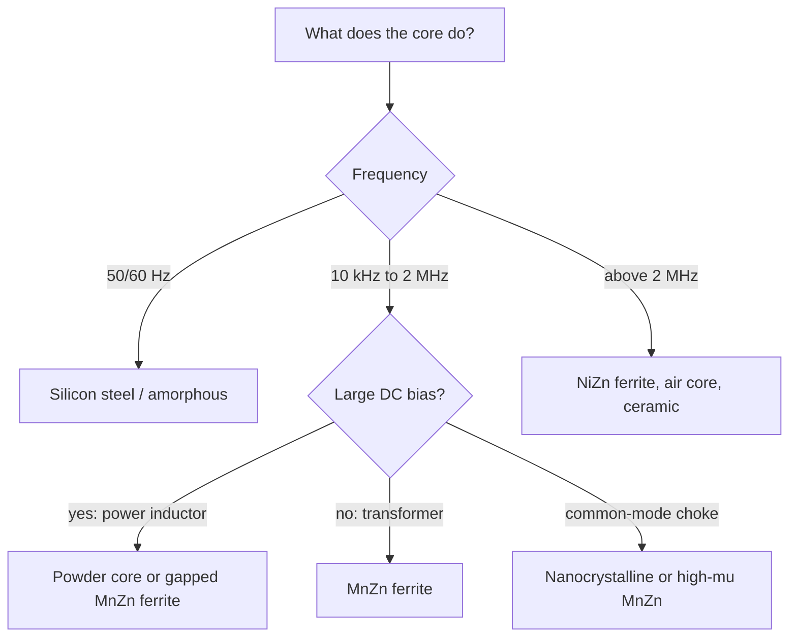

::: basics
### In plain words
Inductor cores come in several materials, and each one is good at a different job. The main ones are ferrite, powdered iron, silicon steel, and nanocrystalline alloys. The answer is a short match-up: which material fits which frequency and current. You choose by how much magnetic flux it can hold, how much energy it wastes, and its cost.

### Picture it
Think of choosing a vehicle. A sports car is fast but carries little. A truck carries a lot but is slow. A van sits in between. Core materials are the same: ferrite is the sports car (fast at high frequency, small load capacity), silicon steel is the truck (high capacity, only low frequency), and powder cores are the van. The comparison simplifies one thing: every material also has a cost and temperature behavior.

### Words you need
- **Permeability**: how strongly the material concentrates magnetic flux.
- **Saturation flux density ($B_{sat}$)**: the most flux the material can carry. See [[q0046]].
- **Core loss**: energy wasted as heat in the core, which rises with frequency.
- **Ferrite**: a ceramic of iron oxide. It is an insulator, so it has low loss at high frequency.
- **Powder core**: metal particles in a binder, which saturate gradually.

### The simplest example
You need an inductor for a 500 kHz buck converter that carries a large DC current. A ferrite core has low loss at 500 kHz but saturates hard, so you add an air gap. A powdered-iron core saturates softly and handles DC well. You pick the powder core, or a gapped ferrite. That is the whole idea. The rest of this page lists each material's typical numbers, such as saturation at about 0.3 to 0.5 tesla for ferrite and 1.5 to 2 tesla for silicon steel.
:::

::: testing
Whether you can name the common core materials and **match each to an application** using the properties that matter: permeability $\mu_r$, saturation flux density $B_{sat}$, core loss vs. frequency, saturation softness, temperature behaviour and cost. The interviewer is listening for ferrite (MnZn and NiZn), powdered iron and related powder cores, laminated silicon steel, amorphous/nanocrystalline, and air. A strong answer adds *why* each fits: ferrite for high-frequency low loss, powder cores for DC-biased power inductors, silicon steel for 50/60 Hz, nanocrystalline for common-mode chokes.
:::

::: why
The core material decides the inductor's size, efficiency, saturation behaviour and cost. In a converter, a poor choice means either a core that saturates under a fault, a core that overheats at the switching frequency, or an inductor twice as big as it needs to be. In EMI, the wrong ferrite grade for the noise band does nothing. This question tests whether you've seen real magnetics selection rather than just formulas.
:::

::: concepts
- **Permeability** ([[q0048]]): sets inductance per turn; high $\mu_r$ means high $L$ but usually lower $B_{sat}$ or need for a gap.
- **Saturation flux density $B_{sat}$** ([[q0046]]): sets the maximum energy/current for a given size.
- **Core loss** ([[q0050]]): hysteresis + eddy current + residual; depends on frequency, flux swing, material and resistivity.
- **Resistivity**: ferrites are ceramic insulators (high resistivity, low eddy loss); metals need laminations, thin ribbon or powder to suppress eddy currents.
- **Distributed gap**: powder cores have tiny insulating gaps between particles, giving low $\mu_{eff}$ and soft saturation.
- **Curie temperature**: above it, a ferromagnetic material loses its magnetic properties.
:::

::: answer
"The main ones are ferrite, powdered iron and its relatives, silicon steel, and amorphous or nanocrystalline alloys, and air for RF.

Ferrite is a ceramic of iron oxide with manganese-zinc or nickel-zinc. It has high permeability, low eddy-current loss because it's an insulator, so it's the standard for transformers and inductors from tens of kilohertz up to a few megahertz. The catch is a relatively low saturation, around 0.3 to 0.5 tesla, and it saturates hard, so for DC-biased inductors it's gapped. Nickel-zinc has lower permeability but works to hundreds of megahertz, so it's used for EMI beads.

Powdered iron and its cousins, sendust, high-flux and MPP, are made of metal particles in an insulating binder. That gives a distributed air gap, so low permeability, maybe 10 to 200, saturation around 1 tesla or more, and soft saturation where the inductance falls gradually. That's why they're used in buck converter inductors and DC chokes.

Laminated silicon steel has the highest saturation, around 1.5 to 2 tesla, but eddy currents limit it to line frequencies, so it's for 50 or 60 hertz transformers.

Nanocrystalline and amorphous ribbon have very high permeability and good saturation, around 1.2 tesla, with low loss, so they're used in common-mode chokes and high-power medium-frequency transformers.

I pick based on frequency, DC bias, losses, and cost."
:::

::: technical
Approximate typical values (vary by grade and temperature; verify with the vendor's data):

| Material | $\mu_r$ (initial/effective) | $B_{sat}$ (T) | Useful frequency | Saturation | Notes |
|---|---|---|---|---|---|
| Air | 1 | none | DC–GHz | none | no core loss, low L per size |
| MnZn ferrite | 700–15,000 (power grades ~1,500–3,000) | 0.3–0.5 (lower at 100 °C) | ~20 kHz–2 MHz | hard | low loss, gapped for DC; $T_C\approx200$–300 °C |
| NiZn ferrite | 10–2,000 | 0.2–0.35 | ~1 MHz–GHz | hard | high resistivity; RF chokes, beads |
| Iron powder | 10–100 (typ.) | ~1.0–1.4 | DC–~500 kHz | soft | cheap, higher core loss; thermal aging of binder |
| Sendust (Fe-Si-Al) | 26–125 | ~1.0 | to ~1 MHz | soft | lower loss than iron powder, no thermal aging |
| MPP (Ni-Fe-Mo) | 14–550 | ~0.7–0.8 | to ~1 MHz | soft | lowest loss powder, expensive |
| High-flux (Ni-Fe) | 14–160 | ~1.4–1.5 | to ~500 kHz | soft | high bias capability |
| Silicon steel (laminated) | 1,500–40,000 | 1.5–2.0 | 50 Hz–~1 kHz | hard | line transformers, big |
| Amorphous alloy | ~1,000–100,000 | ~1.2–1.6 | up to ~100 kHz | hard | low loss at 50 Hz–tens of kHz |
| Nanocrystalline | 20,000–100,000+ | ~1.0–1.3 | ~10 kHz–1 MHz+ | hard | CM chokes, high-power transformers |

> [!UNCERTAIN]
> These are typical ranges, not specifications. $\mu_r$, $B_{sat}$ and loss depend on the exact grade, temperature, frequency and DC bias; manufacturers (Ferroxcube, TDK, Magnetics Inc., Micrometals, Vacuumschmelze, Hitachi Metals) publish the curves.

**Selection heuristics:** power inductor with large DC bias → powder core or gapped ferrite; high-frequency transformer → MnZn ferrite; EMI bead → NiZn ferrite; common-mode choke → nanocrystalline or high-$\mu$ MnZn; 50/60 Hz → silicon steel; RF coil → air or NiZn/ceramic.
:::

::: short
"The main core materials are ferrite, powdered iron and its relatives like sendust and MPP, laminated silicon steel, and amorphous or nanocrystalline alloys. Ferrite is low loss for tens of kHz to a few MHz but saturates hard around 0.3 to 0.5 tesla. Powder cores have distributed gaps, so low permeability, around 1 tesla, and soft saturation, which suits DC-biased power inductors. Silicon steel is for line frequency. Nanocrystalline is for common-mode chokes."
:::

::: long
"The typical core materials are ferrites, powder cores, laminated steel, and the amorphous and nanocrystalline alloys, plus air for RF.

Ferrite is an iron-oxide ceramic with manganese-zinc or nickel-zinc. Because it's an insulator, eddy-current loss is low, so it works from tens of kilohertz to a few megahertz. MnZn has high permeability, thousands, but only 0.3 to 0.5 tesla of saturation, and it saturates abruptly, so for energy storage it is gapped. NiZn has lower permeability and much higher resistivity, so it works up to hundreds of megahertz, which makes it the choice for EMI beads and RF chokes.

Powder cores are metal particles, iron, sendust, high-flux or MPP, each insulated and pressed in a binder. The insulation between particles acts like a distributed air gap, so the permeability is low, tens to a couple hundred, and saturation flux is high, 0.7 to 1.5 tesla, and it saturates softly. That's what you want for a buck converter inductor that sees DC bias and occasional overloads. Iron powder is cheapest but has more loss and can thermally age; sendust and MPP and high-flux cost more but have lower loss.

Silicon steel laminations have the highest flux density, up to two tesla, but eddy currents force thin laminations and limit it to line frequency, so it's for mains transformers. Amorphous and nanocrystalline ribbon have very low loss and high permeability. Nanocrystalline especially is used for common-mode chokes and medium-frequency high-power transformers.

So how do I choose? By frequency, DC bias, flux swing, losses, size, and cost: for a switching inductor at 500 kilohertz with big DC current I'd choose a powder core or a gapped ferrite; for a 100 kilohertz transformer, ferrite; for a 60 hertz transformer, steel."
:::

::: terms
- **MnZn / NiZn ferrite**: manganese-zinc / nickel-zinc iron-oxide ceramics.
- **Powder core**: pressed metal-alloy particles in an insulating binder with a distributed gap.
- **Sendust / MPP / High Flux**: Fe-Si-Al, Ni-Fe-Mo and Ni-Fe powder-core alloys.
- **Silicon steel (electrical steel)**: Fe-Si alloy used in thin laminations.
- **Amorphous / nanocrystalline**: rapidly quenched ribbon alloys with high $\mu$ and low loss.
- **Curie temperature $T_C$**: temperature above which the material loses its magnetic properties.
- **Soft vs. hard saturation**: gradual vs. abrupt loss of inductance with current.
- **Initial permeability $\mu_i$**: small-signal permeability at low field.
:::

::: exceptional
**An average answer** lists "ferrite, iron powder, air".

**An exceptional answer**:
- Organizes materials by $\mu_r$, $B_{sat}$, loss vs frequency, saturation softness and cost, ideally in a table.
- Explains *why* each behaves as it does (ceramic resistivity → low eddy loss; distributed gap → soft saturation; laminations → eddy suppression).
- Maps materials to applications and frequency bands (power inductor, transformer, EMI bead, CM choke, line transformer, RF coil).
- Mentions MnZn vs NiZn, and the powder family (iron, sendust, MPP, high-flux), with relative cost/loss.
- Notes temperature behaviour (Curie temperature, $B_{sat}$ falling at 100 °C, thermal aging of iron powder) and gives numbers with a caveat.
- Mentions the practical design decision (gap vs distributed gap) and verification with vendor curves.
:::

::: mistakes
- **"Ferrite is a metal."** It is a ceramic, which is exactly why its eddy-current loss is low.
- **Using ferrite at full $B_{sat}$ at 100 °C.** $B_{sat}$ drops from ~0.5 T at 25 °C to ~0.4 T at 100 °C for typical MnZn power ferrites; design to the hot value.
- **Choosing iron powder for a 1 MHz inductor** and then finding that core loss makes it too hot.
- **Using high-μ ferrite for DC-biased inductors without a gap**: it saturates at tiny currents.
- **Ignoring that NiZn is for high-frequency/EMI**, not for efficient power transformers.
- **Quoting a single number for $\mu_r$.** Permeability changes with frequency (falls off at the material's relaxation frequency), bias and temperature.
- **Forgetting cost and availability.** MPP and nanocrystalline are significantly more expensive than ferrite or iron powder.
:::

::: deep
## Why the materials differ

Two physical facts decide almost everything:

1. **Eddy currents.** A changing flux induces circulating currents in any conductor, dissipating $P\propto f^2B^2d^2/\rho$ ($d$ the thickness/particle size, $\rho$ the resistivity). A solid metal core would heat itself at kHz frequencies. The fixes: make the material an insulator (ferrite, $\rho\sim1$–$10^6\ \Omega$m depending on type), split it into thin laminations (silicon steel, 0.2–0.35 mm), thin ribbons (amorphous/nanocrystalline, ~20 µm), or insulated particles (powder cores).
2. **Magnetic domains and the B–H loop.** Magnetization saturates when all domains are aligned ($B_{sat}$, set by the iron content), and the area of the B–H loop is the hysteresis loss per cycle. Metallic alloys carry more iron per volume, so higher $B_{sat}$; ceramic ferrites dilute the iron with oxygen and Mn/Zn/Ni, so lower $B_{sat}$.

```svg
<svg viewBox="0 0 540 250" role="img" aria-label="Core materials: permeability versus saturation flux density">
 <g font-family="Inter, sans-serif" font-size="11" fill="var(--d-ink)">
  <line x1="60" y1="20" x2="60" y2="200" stroke="var(--d-ink)"/>
  <line x1="60" y1="200" x2="510" y2="200" stroke="var(--d-ink)"/>
  <g text-anchor="end" fill="var(--d-muted)">
   <text x="54" y="204">0</text><text x="54" y="169">0.5</text><text x="54" y="134">1.0</text><text x="54" y="99">1.5</text><text x="54" y="64">2.0</text>
  </g>
  <g text-anchor="middle" fill="var(--d-muted)">
   <text x="60" y="216">1</text><text x="148" y="216">10</text><text x="236" y="216">100</text><text x="324" y="216">1k</text><text x="412" y="216">10k</text><text x="500" y="216">100k</text>
  </g>
  <text x="285" y="236" text-anchor="middle">relative permeability μ (log scale)</text>
  <text x="14" y="110" transform="rotate(-90 14 110)" text-anchor="middle">B_sat (T)</text>
  <rect x="148" y="95" width="153" height="74" rx="8" fill="var(--d-orange)" fill-opacity="0.18" stroke="var(--d-orange)"/>
  <text x="224" y="118" text-anchor="middle">Powder cores</text><text x="224" y="132" text-anchor="middle" fill="var(--d-muted)">iron, sendust, MPP, high-flux</text>
  <rect x="311" y="157" width="117" height="18" rx="8" fill="var(--d-blue)" fill-opacity="0.2" stroke="var(--d-blue)"/>
  <text x="370" y="170" text-anchor="middle">MnZn ferrite</text>
  <rect x="148" y="176" width="202" height="16" rx="8" fill="var(--d-green)" fill-opacity="0.2" stroke="var(--d-green)"/>
  <text x="249" y="188" text-anchor="middle">NiZn ferrite</text>
  <rect x="340" y="57" width="125" height="36" rx="8" fill="var(--d-red)" fill-opacity="0.15" stroke="var(--d-red)"/>
  <text x="402" y="79" text-anchor="middle">Silicon steel</text>
  <rect x="438" y="104" width="62" height="40" rx="8" fill="var(--d-purple)" fill-opacity="0.2" stroke="var(--d-purple)"/>
  <text x="469" y="128" text-anchor="middle">Nanocryst.</text>
 </g>
</svg>
```
Figure: Approximate regions (illustrative; grades vary). Metals (powder, steel, nanocrystalline) reach high $B_{sat}$ (energy per volume), ferrites trade low $B_{sat}$ for high resistivity and low high-frequency loss. Powder cores sit at low $\mu$ because their distributed gaps dilute the permeability.

## Ferrites

**MnZn** (power ferrites, e.g. the 3C/N-series families): $\mu_i$ ~ 1500–3000 for power grades, up to 10,000+ for EMI/CM-choke grades; $B_{sat}\approx$ 0.5 T at 25 °C and 0.4 T at 100 °C; low loss at 20 kHz–1 MHz when the grade is optimized for the band; Curie temperature ~200–250 °C; resistivity ~1–10 Ω·m, so eddy currents limit use to a few MHz. Used in SMPS transformers, gapped inductors, flyback and forward converters.

**NiZn**: $\mu_i$ 10–2000; resistivity up to $10^6\ \Omega$m, so usable from ~1 MHz into the GHz range; lossy at high frequency, thus ideal for EMI suppression (bead impedance is mostly resistive), and for RF chokes and antenna rods.

Weakness of both: hard saturation, brittleness, and a $B_{sat}$ that falls with temperature.

## Powder cores

Pressed alloy powder: each particle coated with insulation, giving an effective distributed air gap, hence $\mu_{eff}$ in the tens to hundreds and **soft saturation**: the inductance falls smoothly with DC bias (the percent-of-initial-L vs. DC-bias curves in the datasheets).
- **Iron powder (carbonyl/hydrogen-reduced):** cheapest; high loss above ~100 kHz; thermal aging of the binder at high temperature (permeability and loss drift over time); used in cost-driven chokes and 50–500 kHz filters.
- **Sendust (Fe-Si-Al):** $B_{sat}\approx1$ T, lower core loss than iron powder, no thermal aging.
- **MPP (Ni-Fe-Mo):** lowest loss, best temperature stability, expensive, $B_{sat}\approx0.7$–0.8 T.
- **High-flux (Ni-Fe):** highest bias capability among powders, $B_{sat}\approx1.5$ T, moderate loss.
- **Molded/composite metal-alloy chokes** (modern chip power inductors) are the same idea in a molded body with the winding embedded.

## Laminated steel, amorphous and nanocrystalline

**Silicon steel:** 3–4 % Si lowers eddy loss; $B_{sat}$ 1.5–2 T; used for line transformers and large chokes in 50/60 Hz–1 kHz range.
**Amorphous alloys:** ribbon with low loss at 50 Hz–tens of kHz (distribution transformers, medium-frequency inductors).
**Nanocrystalline:** ribbon (e.g. Fe-Si-B with Nb, Cu) with $\mu_i$ up to 100,000, $B_{sat}\approx1.2$ T, low loss to hundreds of kHz; ideal for common-mode chokes, current transformers and high-power transformers.

## Matching material to application


Figure: A first-pass decision path. Real choices also weigh losses at the actual flux swing, size, cost, temperature rise and EMI/shielding requirements.

To compare materials with the simulator, use the cores available there:

```sim
{"id":"inductor-saturation","core":"powder","l0":1e-5,"isat":3,"v":5}
```
Figure: Switch between 'ferrite' (hard saturation), 'powder' (soft saturation, L declines gradually) and 'air' (no core, no saturation but tiny L). Observe how the current ramp changes when L collapses.

## A worked selection

*Buck converter, 12 V → 3.3 V, 5 A, 500 kHz, ripple 30 %.* $\Delta I=1.5$ A, $L=(V_{in}-V_o)D/(f\,\Delta I)$ with $D=0.275$: $L=(8.7)(0.275)/(5\times10^5\cdot1.5)=3.2$ µH. Peak current 5.75 A with margin for overload 8 A. Requirements: $I_{sat}\ge8$ A at 100 °C, low DCR, moderate core loss at 500 kHz with ripple flux. A soft-saturating powder core (sendust or high-flux) or a molded alloy-powder choke is the typical choice; a gapped MnZn ferrite would have lower core loss but needs a careful gap, has fringing loss, and saturates abruptly in a fault.

*100 kHz isolated transformer, 100 W.* High $\mu$, low loss at 100 kHz and low $B$ swing: MnZn power ferrite (E or planar core).

*EMI filter for 100 MHz noise on a cable.* NiZn bead with impedance peak near the noise frequency.

## Eddy currents in numbers: why thickness and resistivity decide the frequency range

The eddy-current loss density scales as $f^2B^2d^2/\rho$. That makes the choices in the table quantitative:

- **Lamination thickness.** Going from 0.35 mm silicon-steel laminations to 0.1 mm cuts eddy loss at the same flux and frequency by $(0.35/0.1)^2=12\times$. A 20 µm nanocrystalline ribbon cuts it by $(0.35/0.02)^2=306\times$ compared with the 0.35 mm sheet. That, not the magnetic properties, is why ribbons work at tens of kHz where laminated steel cannot.
- **Frequency.** Moving from 50 Hz to 1 kHz multiplies eddy loss at fixed $B$ by $(1000/50)^2=400$. Steel laminations that run cool at mains frequency would cook at 1 kHz without a drastic derating of $B$.
- **Resistivity.** Silicon steel is about $4.7\times10^{-7}\ \Omega\text{m}$. A MnZn ferrite at roughly 1 to 10 Ω·m is a few million to tens of millions of times more resistive, which is how ferrite can handle hundreds of kHz with a solid (unlaminated) core. NiZn ferrite is typically several orders of magnitude more resistive again (grade-dependent), which is why it is used up into the RF range.

Eddy loss is only one part. The total core loss also includes hysteresis and residual loss, which the Steinmetz equation $P_v=k\,f^{\alpha}B^{\beta}$ lumps together with exponents fitted to measured data (typical fitted values are around $\alpha\approx1.3$ to 2 and $\beta\approx2$ to 3, and the constants depend on the grade and temperature range, so use vendor data). The exponents already tell you something. With illustrative values $\alpha=1.4$ and $\beta=2.6$:

- Doubling the flux swing at a fixed frequency multiplies the loss by $2^{2.6}=6.1$. Halving it cuts the loss to 16 %.
- Doubling the frequency at a **fixed flux** multiplies the loss by $2^{1.4}=2.6$.
- Doubling the frequency at a **fixed voltage** is a different case, because for a transformer $B\propto V/(Nf A_e)$ falls as $1/f$. Then $P_v\propto f^{\alpha-\beta}=f^{-1.2}$, and doubling the frequency cuts the core loss to 44 %, while the copper loss changes only a little. This is the reason switch-mode power supplies move up in frequency to shrink the transformer: with a fixed voltage, a smaller core can run the same peak flux without more loss, up to the point where switching and winding losses take over.

## Worked example: choosing a powder core by field, not flux

Return to the buck converter in the worked selection: 12 V to 3.3 V, 5 A, 500 kHz, with $L=3.2\ \mu$H and a 5.75 A peak. A powder core does not saturate abruptly, so the question is not whether $B$ reaches $B_{sat}$; it is how much permeability is lost at the peak DC bias. That is a function of the field, $H=NI/\ell_e$, not of $B$, and powder-core datasheets plot $\mu$ against $H$.

Assume (illustratively) a core with $A_e=25$ mm², $\ell_e=30$ mm and $\mu_{eff}=60$ at low bias.

1. **Turns for 3.2 µH.** $N=\sqrt{L\ell_e/(\mu_0\mu_{eff}A_e)}=\sqrt{3.2\ \mu\text{H}\times0.03/(4\pi\times10^{-7}\times60\times25\ \text{mm}^2)}=7.1$, so use 7 turns, which gives $L=3.08\ \mu$H.
2. **Check the DC field.** $H_{dc}=NI_{dc}/\ell_e=7\times5/0.03=1{,}170$ A/m and $H_{pk}=7\times5.75/0.03=1{,}340$ A/m.
3. **Look up the roll-off.** At about 1.3 kA/m a 60 µ sendust or iron-powder core typically retains a fraction of its initial permeability that varies by material. Read the vendor's curve at 1.34 kA/m. If it says the part keeps 70 %, the inductance at peak is 2.2 µH and the ripple current rises to $1.5/0.7\approx2.1$ A at the peak of the cycle.
4. **Check the flux for core loss.** $B_{pk}=LI_{pk}/(NA_e)=3.08\ \mu\text{H}\times5.75/(7\times25\ \text{mm}^2)=0.10$ T total, far below the 1 T $B_{sat}$ of sendust. The AC part, which drives the core loss, is much smaller: $\Delta B_{pp}=L\Delta I/(NA_e)=26$ mT peak-to-peak, so $B_{ac,pk}=13$ mT. Use that number, not the 0.10 T, at 500 kHz in the vendor's core-loss curve for this material.

The qualitative result is typical: the DC field limits inductance and the AC flux limits loss. A ferrite alternative would have much lower core loss at 13 mT and 500 kHz, but at 0.10 T it would need a gap, its abrupt saturation would be a hazard in a fault, and the fringing flux would heat the winding.

> [!UNCERTAIN]
> The core geometry, $\mu_{eff}$ and the permeability roll-off in this example are illustrative. Different powder materials (and different permeability grades of the same material) have very different curves; take actual values from the vendor's datasheet at the operating temperature.

## Temperature and aging, per family

- **MnZn ferrite** has a loss minimum near the temperature its composition was tuned for (commonly around 100 °C for power grades) and a saturation that falls with temperature toward zero at the Curie point.
- **Iron powder** with an organic binder can age: at sustained high temperature the binder degrades, losses increase and the part can fail by thermal runaway. This is the reason cost-driven chokes sometimes fail after months in a hot enclosure.
- **MPP, sendust and high-flux** use inorganic insulation and are considered stable, which is part of what you pay for.
- **Amorphous and nanocrystalline** ribbons are sensitive to mechanical stress and to heat treatment (cutting or bending a core changes its properties), so they are supplied in tape-wound or cut forms with a protective case.

## Verifying on the bench

1. **L versus DC bias.** Use an LCR meter with a DC bias fixture (or a bias tee) to record $L$ against $I_{dc}$. For a powder core the curve falls gradually; for a gapped ferrite it stays flat until near $I_{sat}$ and then drops.
2. **Core loss by the B–H loop method.** Wind a primary and a secondary on the core, drive the primary from an amplifier, and put an integrator on the secondary to obtain $B=\frac{1}{N_2A_e}\int v_2\,dt$ while $H=N_1i/\ell_e$ comes from the primary current. For $N_2=10$ turns, $A_e=25$ mm², 100 kHz and $B_{pk}=0.05$ T, the secondary amplitude is $2\pi f N_2A_eB_{pk}=7.9$ V. Plot $B$ against $H$ on the scope's XY mode: the loop area times frequency is the loss per unit volume. Phase errors of even a fraction of a degree in the current channel distort the measured loss at high frequency, so use matched probes and de-skew them.
3. **Thermal check.** For a quick answer, run the part in the real circuit at full load in a closed box and measure the core's temperature rise with a thermocouple or an IR camera after it stabilizes, then compare with the vendor's loss curve through the thermal resistance.
4. **Compare materials.** If you have the same shape in two materials, a direct heating comparison at the same excitation shows the difference without any math.
:::

::: applications
- **Buck/boost/SEPIC inductors**: powder cores or molded alloy chokes, gapped ferrite.
- **Isolated SMPS transformers** (flyback, forward, LLC): MnZn ferrite E/ETD/planar cores.
- **EMI ferrite beads and clamp-on cores**: NiZn or MnZn depending on frequency.
- **Common-mode chokes** in power and USB/Ethernet: nanocrystalline and high-μ ferrite.
- **Mains transformers and large chokes**: silicon steel laminations (or amorphous for low-loss distribution transformers).
- **RF coils, baluns, antennas**: air, NiZn or ceramic-core.
:::

::: assumptions
- Values quoted are **typical** and temperature-, frequency- and grade-dependent; the point is relative ranking.
- "Useful frequency" ranges are rules of thumb; the real limit depends on the specific grade's loss curve.
- Design of the gap and the effective permeability is covered in [[q0048]]; losses in [[q0050]].
- I treat the common commercial families; special alloys (cobalt-based amorphous, iron-cobalt, soft magnetic composites) exist for niche uses.
- The best material depends on size, cost and thermal budget as much as on frequency.
:::

::: followups
### Why is ferrite used for high-frequency transformers but silicon steel for mains transformers?
Eddy currents: silicon steel is a conductor, so even in thin laminations its loss grows quickly with frequency; it's best at 50/60 Hz–1 kHz where its high $B_{sat}$ (1.5–2 T) gives small, cheap transformers. Ferrite is an insulating ceramic, so eddy loss is small and it's efficient at 20 kHz–MHz even with lower $B_{sat}$ (0.3–0.5 T), because the volts-per-turn and size scale down with frequency.

### What's the difference between hard and soft saturation and why does it matter?
With hard saturation (ferrite) the inductance stays nearly constant until close to $B_{sat}$ and then collapses abruptly; the current can spike dangerously during an overload. With soft saturation (powder cores) inductance falls gradually with DC bias, so the inductor tolerates overloads more gracefully, though it reduces L at full load. Converters may use a powder core precisely because the derating is predictable.

### Why do powder cores have such low permeability?
Each metal particle is insulated, so the flux must cross many tiny non-magnetic gaps in series. They behave like a distributed air gap that reduces the effective permeability to 10–200 even though the metal itself has $\mu_r$ in the thousands. The same effect gives their high $B_{sat}$ (metal) and their soft saturation.

### What if you need an inductor to work at 5 MHz with moderate DC bias?
MnZn ferrite loses efficiency above 1–2 MHz, and iron powder loses too much to eddy and hysteresis loss. Options: NiZn ferrite or low-permeability RF powder (carbonyl-iron grades), or an air-core inductor/planar magnetics. I'd check the vendor's core-loss curves at 5 MHz and the flux swing, and probably accept a larger core or use air core with a lower inductance.

### How does temperature affect ferrite saturation?
$B_{sat}$ decreases with temperature (for power MnZn from ~0.5 T at 25 °C to ~0.4 T at 100 °C), and approaches zero at the Curie temperature. Also, core loss has a minimum at a specific temperature (near 90–100 °C for power grades), which the material is designed around, and it increases away from it. So you design to the hot $B_{sat}$ and check loss at the operating temperature.
:::

::: references
- Erickson & Maksimović, *Fundamentals of Power Electronics*: core materials and magnetics design.
- McLyman, *Transformer and Inductor Design Handbook*: core materials, properties and selection.
- Core manufacturers' material data books and selection guides (Ferroxcube, TDK/EPCOS, Magnetics Inc., Micrometals, Vacuumschmelze, Hitachi Metals); check the vendor's current documentation for exact curves.
- Kazimierczuk, *High-Frequency Magnetic Components*.
:::

::: rubric
- Names ferrite (MnZn and NiZn), powder cores, silicon steel and amorphous/nanocrystalline :: The expected list.
- Gives typical $\mu_r$ and $B_{sat}$ ranges with a caveat :: Quantitative comparison.
- Explains why (resistivity, distributed gap, laminations) :: Physical reasoning.
- Matches materials to applications and frequency :: The point of the question.
- Contrasts hard vs soft saturation :: Important practical property.
- Mentions temperature (Curie, $B_{sat}$ at 100 °C) and cost :: Real-world constraints.
:::

::: quiz
```json
[
 {"type":"mcq","level":"fundamental","q":"Which core material is the usual choice for 50/60 Hz power transformers?","options":["NiZn ferrite","Laminated silicon steel","Air","Carbonyl iron powder"],"answer":1,"explain":"Silicon steel has the highest saturation flux density (1.5–2 T); at line frequency, laminations keep eddy-current loss acceptable."},
 {"type":"mcq","level":"fundamental","q":"Why is ferrite used for high-frequency transformers?","options":["It has the highest saturation flux density","It's a ceramic insulator, so eddy-current losses are low","It never saturates","It has the lowest permeability"],"answer":1,"explain":"Ferrite is an iron-oxide ceramic with high resistivity, so eddy currents are small; its low $B_{sat}$ is acceptable because flux swing scales down with frequency."},
 {"type":"mcq","level":"intermediate","q":"Which statement best describes powder-core saturation?","options":["Abrupt, like ferrite","Soft and gradual because of the distributed air gap","None; powder cores never saturate","Occurs only above the Curie temperature"],"answer":1,"explain":"The insulated particles create a distributed gap, so inductance declines gradually with DC bias."},
 {"type":"numeric","level":"intermediate","q":"A buck converter has $V_{in}=12$ V, $V_o=3.3$ V, $f=500$ kHz and a ripple current target of 1.5 A p-p. What inductance is needed? ($D=V_o/V_{in}$)","answer":3.19,"tolerance":0.03,"unit":"µH","explain":"$D=0.275$; $L=(V_{in}-V_o)D/(f\\,\\Delta I)=8.7\\cdot0.275/(5\\times10^5\\cdot1.5)=3.19$ µH."},
 {"type":"multi","level":"intermediate","q":"Select the core materials that are typically used for EMI suppression above ~100 MHz.","options":["NiZn ferrite beads","Silicon steel laminations","Iron-powder toroids with $\\mu=75$ (low-frequency chokes)","NiZn ferrite clamp-on or sleeve cores on cables"],"answer":[0,3],"explain":"NiZn ferrite has the very high resistivity needed to stay lossy-and-useful at hundreds of MHz. Silicon steel is for line frequency and iron-powder toroids are for DC-biased chokes below a few MHz."},
 {"type":"truefalse","level":"advanced","q":"The saturation flux density of MnZn power ferrite is higher at 100 °C than at 25 °C.","answer":false,"explain":"For MnZn ferrites $B_{sat}$ decreases as temperature rises (toward zero at the Curie temperature), so designs must use the hot value."}
]
```
:::
