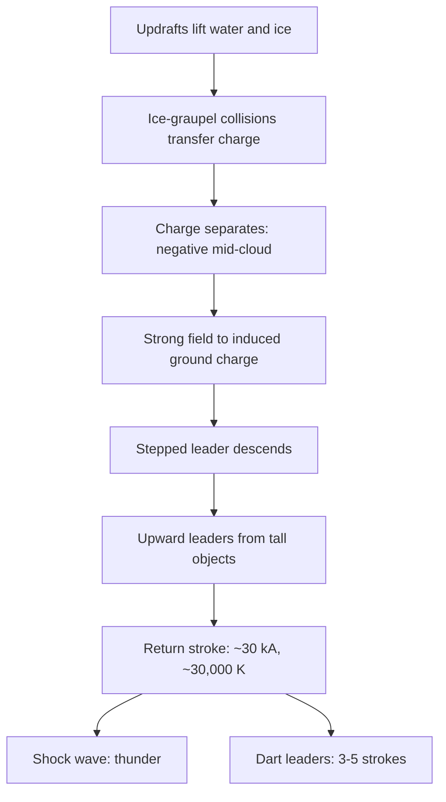

::: testing
Whether you can explain a natural phenomenon as a **chain of physical mechanisms**: charge separation, field build-up, dielectric breakdown of air, leader propagation, the return stroke, and thunder. Then, for a hardware role, whether you can **connect it to design**: surge protection, induced voltages from huge $di/dt$, grounding and standards.

The hidden sub-skills are knowing the rough magnitudes (tens of kA, microsecond rise times, ~30,000 K channel) and being honest about what's still uncertain (exactly how lightning initiates is an open research question).
:::

::: why
Lightning is the extreme case of things hardware engineers deal with every day: dielectric breakdown, ESD, fast transients and inductive coupling. Surge immunity requirements (e.g. the IEC 61000-4-5 surge test with its 1.2/50 µs voltage and 8/20 µs current waveforms) exist because nearby strikes induce large transients on power and data lines. Outdoor products like PoE cameras, EV chargers, solar inverters and telecom gear need GDTs, MOVs, TVS diodes and careful grounding. Explaining lightning well shows you can reason from physics to protection design.
:::

::: concepts
- **Charge separation**: collisions between ice particles in a thunderstorm transfer charge, and gravity plus updrafts separate the charged particles into regions.
- **Electric field and voltage**: separated charge creates a field; integrated over kilometres, it gives potential differences of order $10^8$ V. See [[q0059]].
- **Dielectric breakdown**: air is an insulator until the field accelerates free electrons enough to ionize molecules (avalanche); ~3 MV/m at sea level in a uniform gap. See [[q0055]].
- **Plasma**: ionized gas that conducts; the lightning channel is a hot plasma column.
- **Inductive coupling**: a changing current creates a changing magnetic field that induces voltage in nearby loops, $V = M\,di/dt$.
- **Surge protection**: devices that clamp or divert transient overvoltages to ground (GDTs, MOVs, TVS diodes).
:::

::: answer
"Lightning is basically a giant electrostatic discharge between a charged region of a thundercloud and the ground, or another part of the cloud.

It starts with charge separation. Inside a thunderstorm, strong updrafts carry water and ice up past the freezing level. Small ice crystals collide with heavier soft hail called graupel, and charge gets transferred in each collision. The light crystals get carried up with positive charge, and the heavier graupel ends up negative in the middle of the cloud. That leaves a big negative region a few kilometres up, and it induces positive charge on the ground below.

When the field gets strong enough, the air breaks down. A channel of ionized air called a stepped leader works its way down in jumps of tens of metres. As it gets close, the field at tall objects is enough to launch upward streamers. When one connects, you've got a conductive path, and a huge return stroke flows: tens of kiloamps in a few microseconds. That current heats the channel to around 30,000 K, which is the flash, and the air expands explosively, which is the thunder. Usually there are several strokes down the same channel, which is why lightning flickers.

For hardware, the takeaway is surges. Even a nearby strike induces big transients through that huge $di/dt$, so outdoor electronics need surge protection and good grounding."
:::

::: technical
**1. Charge separation (non-inductive collision mechanism).** In a cumulonimbus, updrafts of 10+ m/s carry supercooled water and ice above the 0 °C level. Rebounding collisions between graupel and small ice crystals in the presence of supercooled droplets transfer charge; the sign depends on temperature and liquid water content (a "reversal temperature" around −10 to −20 °C). Typical result: a **tripole** with a main negative region near −10 to −25 °C (≈5–8 km altitude), positive charge above, and a smaller positive region below. The negative region induces positive charge on the ground.

**2. Field build-up and initiation.** Measured in-cloud fields are typically a few hundred kV/m, well below the ~3 MV/m sea-level breakdown field (lower at altitude, since breakdown field scales with air density). Initiation is believed to involve field enhancement at hydrometeors and possibly runaway-electron processes, and is still an active research topic.

**3. Stepped leader.** A negatively charged ionized channel advances in discrete steps (tens of metres each, with pauses of tens of µs), averaging ~$10^5$–$10^6$ m/s, branching as it goes. It lowers several coulombs of charge toward the ground.

**4. Attachment.** Within tens to ~100 m of ground, the leader's field launches **upward connecting leaders** from tall or sharp objects. When they meet, the circuit closes.

**5. Return stroke.** A current wave travels up the channel at roughly 1/3–1/2 the speed of light. First negative return strokes have a median peak current of about 30 kA (range a few kA to over 200 kA), rise times of a few µs, and decay over tens of µs. The channel (a few cm in diameter) heats to ~30,000 K.

**6. Thunder.** Sudden heating raises channel pressure to many atmospheres, launching a shock wave that decays into sound; distance ≈ (seconds between flash and thunder) / 3 km.

**7. Multiple strokes.** After ~tens of ms, a **dart leader** retraces the channel, triggering a subsequent stroke; flashes average 3–5 strokes over ~0.2–0.5 s. Some flashes include a **continuing current** (~100 A for 100+ ms), which causes most fires.

**Statistics.** Most flashes are intra-cloud. About 90% of cloud-to-ground flashes lower negative charge; positive flashes are rarer but often larger. Globally roughly 40–50 flashes per second occur.

**Hardware relevance:** induced voltage in a loop $\approx M\,di/dt$; surge test waveforms (IEC 61000-4-5: 1.2/50 µs open-circuit voltage, 8/20 µs short-circuit current); structural protection per IEC 62305 / NFPA 780.
:::

::: short
"Lightning is a huge electrostatic discharge. In a thunderstorm, collisions between ice crystals and graupel separate charge: the cloud's middle ends up negative, and that induces positive charge on the ground. When the field gets high enough the air breaks down. A stepped leader of ionized air works its way down, an upward streamer meets it, and a return stroke of tens of kiloamps flows in microseconds, heating the channel to ~30,000 K. That's the flash, and the explosive expansion is the thunder. For electronics, the big $di/dt$ induces surges, so we need surge protection."
:::

::: long
"I'd break lightning into charge separation, breakdown, and the discharge itself.

Charge separation happens inside a cumulonimbus cloud. Strong updrafts carry water vapour and droplets up past the freezing level, where you get a mix of supercooled water, small ice crystals and soft hail called graupel. When ice crystals bounce off graupel, charge transfers between them, and at the temperatures in the middle of the cloud the graupel tends to come away negative and the crystals positive. Updrafts carry the light crystals to the top, gravity keeps the graupel lower, so you end up with a big negative charge region a few kilometres up and positive charge above it. The negative region induces positive charge on the ground below.

That creates a huge electric field. Air normally insulates, but if the field is strong enough, a free electron gains enough energy between collisions to ionize a molecule, which frees another electron, and you get an avalanche. Exactly how it starts in a cloud, where measured fields are below the textbook breakdown value, is still being researched.

Once it starts, a channel of plasma called a stepped leader moves toward the ground in jumps of tens of metres, branching as it goes. When it gets close, the field at tall objects like trees, towers and lightning rods is high enough that they launch upward streamers. When a streamer meets the leader, the circuit closes and the return stroke happens. A current wave races up the channel at a big fraction of the speed of light, peaking around 30 kA typically, with a rise time of a few microseconds. The channel heats to about 30,000 kelvin, it glows, and the air expands so violently that it makes a shock wave, which we hear as thunder. Often several strokes follow down the same channel within a fraction of a second.

As a hardware engineer the interesting part is the side effects. Thirty kiloamps changing in a microsecond induces big voltages in any nearby wiring loop, and that's why outdoor and mains-connected products need surge protection like GDTs, MOVs and TVS diodes, plus a solid ground."
:::

::: terms
- **Graupel**: soft hail formed when supercooled droplets freeze onto ice; key to thunderstorm charging.
- **Non-inductive charging**: charge transfer during rebounding ice-graupel collisions; the leading explanation for thunderstorm electrification.
- **Stepped leader**: a branching, step-wise advancing ionized channel that precedes the main discharge.
- **Upward connecting leader (streamer)**: a discharge launched from a grounded object toward the descending leader.
- **Return stroke**: the high-current pulse after attachment; it produces the bright flash.
- **Dart leader**: a fast, continuous leader that retraces an existing channel and triggers a subsequent stroke.
- **Dielectric breakdown**: the field at which an insulator (here, air) starts conducting via avalanche ionization.
- **Surge protective device (SPD)**: a component that limits transient overvoltage by diverting current (GDT, MOV, TVS).
:::

::: exceptional
**Average:** "Clouds build up static charge from rubbing, and when it gets big enough it jumps to the ground. Thunder is the sound."

**Exceptional:**
- Explains **charge separation** specifically (ice-graupel collisions, updrafts, the tripole structure).
- Describes the **stepped leader → upward streamer → return stroke** sequence and why tall objects get struck.
- Gives **magnitudes**: ~30 kA median peak current, µs rise times, ~30,000 K channel, multiple strokes per flash, thunder ≈ 3 s/km.
- Is **honest about uncertainty** (initiation at fields below breakdown is still researched).
- Connects to **hardware**: $M\,di/dt$ induction, surge standards and waveforms (8/20 µs), protection layering (GDT → MOV → TVS) and grounding.
:::

::: mistakes
- **"Lightning never strikes the same place twice."** Tall structures get hit repeatedly; the Empire State Building is struck many times per year.
- **"Lightning is static electricity from friction."** Charging is from collisions between ice particles, but it's not simple rubbing; temperature and supercooled water control the sign.
- **"The flash travels from the cloud down."** The faint stepped leader goes down; the bright return stroke propagates *up* from the ground along the channel.
- **"Rubber tires protect you in a car."** A metal car body acts as a Faraday cage that routes current around the occupants; the tires are irrelevant against $10^8$ V.
- **"A lightning rod attracts lightning or discharges the cloud."** It provides a preferred attachment point and a low-impedance path to ground, protecting the structure; it doesn't prevent strikes.
- **Thinking only direct strikes damage electronics.** Most damage comes from **induced and conducted surges** from nearby strikes, and from ground potential rise between differently grounded equipment.
:::

::: deep
## The sequence at a glance


Figure: Lightning is a chain: charging by microphysics, separation by convection, breakdown when the field is high enough, and a discharge that's limited by how fast the channel can carry current. Each box is a different physics problem.

## Step 1: separating charge

A thunderstorm cloud (cumulonimbus) can be 10+ km tall, with updrafts of 10–30 m/s. Updrafts carry droplets above the 0 °C level, where they stay liquid ("supercooled") until they hit something. Three kinds of particles coexist there: supercooled droplets, small ice crystals and **graupel** (soft hail formed when droplets freeze onto ice).

Laboratory experiments show that when an ice crystal bounces off a riming graupel pellet, a small charge (on the order of femtocoulombs per collision) is transferred. The sign depends on temperature and liquid water content: in the main charging zone (colder than roughly −10 to −20 °C) graupel tends to charge **negative** and crystals **positive**. Billions of collisions per second, plus sorting (light crystals ride the updraft up, heavy graupel stays lower), produce the classic **tripole**:

- Upper **positive** region (cloud top, ice crystals).
- Main **negative** region at roughly −10 to −25 °C, around 5–8 km.
- A small lower **positive** region.

The negative center induces a positive charge "shadow" on the ground beneath the storm that follows it as it moves.

> [!UNCERTAIN]
> The ice-graupel (non-inductive) mechanism is the leading explanation and is supported by lab and field data, but the details (reversal temperature, role of liquid water content, contributions from other mechanisms) vary between studies and storms. Charge-region altitudes and temperatures also vary by storm type and climate.

## Step 2: the field and breakdown of air

Air is an excellent insulator ([[q0055]]): a few free electrons from cosmic rays and background radiation, nothing more. In a strong field, those electrons accelerate between collisions. If they gain more than the ionization energy of N₂/O₂ (around 12–16 eV) before colliding, each collision frees another electron: an **avalanche**. In a uniform gap at sea level that happens around **3 MV/m** (3 kV/mm); the threshold scales roughly with air density, so it's lower at cloud altitudes.

Here's the puzzle: balloon and aircraft measurements in thunderclouds usually find peak fields of a few hundred kV/m, well below conventional breakdown. Proposed explanations include field enhancement at the tips of ice particles and water drops, and relativistic "runaway" electron avalanches seeded by cosmic rays. **How lightning initiates is still an open research question**, and saying so is a strong answer.

## Step 3: the stepped leader

Once a discharge starts, it doesn't jump the whole gap at once. A **stepped leader** grows from the negative charge region downward:

- It advances in **steps of tens of metres**, pausing **tens of microseconds** between steps.
- Average speed is around $10^5$–$10^6$ m/s, so crossing a few km takes tens of milliseconds.
- It branches, and its channel is a weakly conducting plasma carrying charge of several coulombs.

Each step works because the leader tip, being a conductor at cloud potential, concentrates the field ahead of it (like a sharp point), which breaks down the next section of air.

## Step 4: attachment and why tall things get hit

As the leader approaches within roughly 100 m of the ground, its field at the ground is strongly enhanced at sharp, tall, grounded objects. Those launch **upward connecting leaders** (positive streamers). Whichever one meets the downward leader determines the strike point. That's why towers, trees and lightning rods get struck, and it's the basis of the **rolling sphere method** used in IEC 62305 and NFPA 780 to decide what a protection system covers: imagine a sphere (radius tied to the protection level, often 20–60 m) rolled over the structure; anything it touches can be struck.

## Step 5: the return stroke

With the channel connected to ground, the charge in the leader channel drains to earth in a powerful **return stroke**: a current wave propagating *up* the channel at roughly 1/3–1/2 the speed of light. This is the bright part of the flash.

```plot
{"title":"Illustrative first return-stroke current (double exponential)","x":{"label":"Time","unit":"s","min":0,"max":2e-4},"y":{"label":"Current","unit":"A","min":0,"max":35000},
 "vars":{"ip":30000,"t1":0.5e-6,"t2":70e-6,"k":1.0436},
 "series":[{"label":"i(t) = k·Ip·(e^(−t/τ2) − e^(−t/τ1))","fn":"k*ip*(exp(-x/t2)-exp(-x/t1))","n":2000}],
 "hlines":[{"at":15000,"label":"half value","color":"muted"}],
 "vlines":[{"at":2.5e-6,"label":"peak ≈ 2.5 µs","color":"orange"},{"at":5.15e-5,"label":"half value ≈ 52 µs","color":"muted"}]}
```
Figure: A sketch of a typical negative first return stroke: 30 kA peak, ~1 µs 10–90% rise, decaying to half in ~50 µs. Integrating gives about 2 C. Real strokes vary hugely (a few kA to 200+ kA; subsequent strokes rise faster, often well under 1 µs), and protection standards use defined test waveforms like 10/350 µs (direct strike) and 8/20 µs (induced surge) instead.

**Key numbers** (median-ish for negative first strokes; distributions are wide):
- Peak current ≈ 30 kA; 5% of strokes exceed ~100 kA.
- Maximum $di/dt$ of order 10–100 kA/µs (higher for subsequent strokes).
- Channel diameter a few cm, temperature ≈ 30,000 K (several times the Sun's surface).
- Potential difference cloud-to-ground of order $10^8$ V (it's not well defined because the leader carries cloud potential down with it).

> [!UNCERTAIN]
> Lightning parameters come from statistical measurements (instrumented towers, triggered lightning, detection networks) and differ by region and method. Treat the numbers above as typical orders of magnitude, not specifications. Energy per flash is often quoted around $10^9$ J, but published estimates span more than an order of magnitude either way.

## Step 6: thunder, and multiple strokes

Heating a column of air to ~30,000 K in microseconds raises its pressure to many atmospheres. It expands supersonically (a shock wave) and decays within metres into a loud acoustic wave: **thunder**. Because sound travels ~343 m/s, count seconds between flash and thunder and divide by 3 for kilometres. The rumble comes from different parts of a km-long channel arriving at different times.

After the first stroke, the channel cools but stays partly ionized. Tens of milliseconds later, a **dart leader** can race down the old channel continuously (no steps) and trigger a **subsequent stroke**. A flash typically has 3–5 strokes over 0.2–0.5 s, which is why lightning seems to flicker. Some flashes include a **continuing current** of ~100 A lasting 100+ ms: it carries a lot of charge and is responsible for most lightning-started fires and for melting holes in metal.

## Not all lightning hits the ground

- **Intra-cloud** (within or between clouds) is the most common type, several times more frequent than cloud-to-ground.
- **Negative cloud-to-ground** (described above) is about 90% of ground flashes.
- **Positive cloud-to-ground** often comes from the upper positive region or the anvil; rarer, but often higher charge and longer continuing currents.
- **Upward lightning** starts at tall structures (towers, wind turbines) and goes up.

## Why a hardware engineer cares: induced surges

A direct strike to your product is rare. Far more common is a strike **near** cables. The return stroke's magnetic field changes extremely fast and induces voltage in any loop.

**Worked example.** A 30 kA stroke rising in ~1 µs, 100 m from a building. The field at 100 m (long-wire approximation):

$$B = \frac{\mu_0 I}{2\pi r} = \frac{4\pi\times10^{-7}\times30\times10^{3}}{2\pi\times100} = 60\ \mu\text{T}$$

Its rate of change is about $60\ \mu\text{T}/1\ \mu\text{s} = 60$ T/s. A 1 m² loop (say, a signal cable and its separate ground wire) sees

$$V = A\frac{dB}{dt} \approx 1\times60 = 60\ \text{V}$$

Enough to damage a 3.3 V interface. A 10 m² loop (cables between two buildings) gets 600 V. That's why **loop area** and **cable routing** matter, and why surge standards exist. Even worse is **ground potential rise**: tens of kA flowing into earth with a few ohms of resistance lifts local ground by tens to hundreds of kV relative to remote ground, so equipment grounded at two different points sees that difference across its cables.

### Layered surge protection

```circuit
{"elements":[
 {"t":"term","at":[0,0],"label":"line in","side":"left"},
 {"t":"F","a":[0,0],"b":[4,0],"label":"fuse"},
 {"t":"wire","pts":[[4,0],[6,0]]},{"t":"dot","at":[6,0]},
 {"t":"Z","a":[6,0],"b":[6,5],"label":"GDT","value":"kA-class,\nslow"},
 {"t":"Lcore","a":[6,0],"b":[11,0],"label":"L or R","value":"decoupling"},
 {"t":"wire","pts":[[11,0],[13,0]]},{"t":"dot","at":[13,0]},
 {"t":"Z","a":[13,0],"b":[13,5],"label":"MOV"},
 {"t":"R","a":[13,0],"b":[18,0],"label":"R_s"},
 {"t":"wire","pts":[[18,0],[20,0]]},{"t":"dot","at":[20,0]},
 {"t":"TVS","a":[20,5],"b":[20,0],"label":"TVS","value":"fast, low V_{clamp}"},
 {"t":"wire","pts":[[20,0],[23,0]]},
 {"t":"term","at":[23,0],"label":"to IC","side":"right"},
 {"t":"wire","pts":[[6,5],[20,5]]},{"t":"dot","at":[13,5]},
 {"t":"gnd","at":[13,5]}
]}
```
Figure: Coordinated protection, from rugged-but-slow to fast-but-weak. The gas discharge tube handles kA-level energy but fires late and at high voltage; the series inductance or resistance limits current and lets voltage build so the upstream device fires; the MOV and TVS clamp progressively lower and faster near the sensitive IC. The ground connection must be short and low-inductance, or $L\,di/dt$ in the ground lead defeats the clamp.

Design points worth saying in an interview:
- **Know the test**: IEC 61000-4-5 surge (1.2/50 µs voltage, 8/20 µs current from a combination-wave generator) for equipment ports; IEC 62305 / NFPA 780 for buildings; telecom-specific standards for line equipment.
- **Divert, don't absorb**: the goal is a low-impedance path to ground that keeps the current away from the circuit.
- **Mind the inductance**: 1 µH of ground lead at 1 kA/µs is 1 kV of extra drop. Keep protection-device leads short.
- **Bond grounds** at a single entry point so equipment doesn't see ground potential rise between its own cables.
:::

::: applications
- **Building lightning protection**: air terminals (rods), down conductors and earth electrodes designed using IEC 62305 or NFPA 780 and the rolling-sphere method.
- **Surge protection in products**: MOVs and GDTs on mains inputs of power supplies, TVS diodes on Ethernet/PoE, RS-485 and CAN ports of outdoor or industrial equipment.
- **Power grid**: shield wires above transmission lines and surge arresters (metal-oxide) at substations and transformers.
- **Aircraft and wind turbines**: designed to take direct strikes; carbon-fibre structures include conductive meshes to carry the current.
- **Lightning detection networks**: VLF/LF radio receivers triangulate the return stroke's radiated pulse to locate strikes and estimate peak current.
- **Electronics testing**: surge generators reproduce standard waveforms to qualify products before certification.
:::

::: assumptions
- **Negative cloud-to-ground flash** is the default story; positive and upward flashes differ in polarity, leader type and current waveform.
- **Typical values** (30 kA, 30,000 K, 3–5 strokes) are medians from measurement campaigns; actual strokes span orders of magnitude.
- **Charging mechanism**: the ice-graupel non-inductive mechanism is the mainstream explanation; others (inductive charging, convective charging) are discussed in the literature as secondary or debated.
- **Initiation** is not fully understood; any answer claiming certainty about how the first breakdown starts is oversimplifying.
- **The induced-voltage example** uses a long straight channel and quasi-static field at 100 m; real coupling also depends on the radiated field, cable geometry, ground conductivity and the soil.
:::

::: followups
### Why do tall, pointed objects get struck more often?
The descending leader's field is strongly enhanced at sharp, tall, grounded objects (like any conductor point). That lets them launch upward connecting leaders earlier and from further away, so they "win" the attachment. A lightning rod exploits this to choose the strike point and route the current safely to ground.

### How far away is a storm if thunder arrives 9 seconds after the flash?
Sound travels about 343 m/s, so 9 s × 343 m/s ≈ 3.1 km. The flash arrives essentially instantly.

### How can a strike 100 m away damage equipment that wasn't hit?
Through induced and conducted surges. 30 kA changing in ~1 µs produces a magnetic field changing at about 60 T/s at 100 m, which induces about 60 V per square metre of loop area. Cables between buildings form large loops and can see hundreds of volts to kilovolts. Current flowing into the soil also raises local ground potential relative to remote grounds, so devices grounded at different points see that difference across their cables.

### Why does a car protect you from lightning?
Its metal body acts as a Faraday cage: current flows through the conductive shell around the occupants and arcs to ground. It has nothing to do with rubber tyres, which are a few cm of insulation against a discharge that just crossed kilometres of air. Convertibles and fibreglass bodies don't offer the same protection.

### What if you placed a TVS diode right at the IC but its ground connection was a long, thin trace?
The TVS would clamp, but the surge current through the ground trace's inductance adds $L\,di/dt$. At 50 A rising in 1 µs (the front of an 8/20 µs surge), 20 nH adds about 1 V, which might be fine, but faster ESD edges with 10 A/ns through 20 nH add 200 V on top of the clamp voltage. Short, wide ground connections to a solid plane are essential, and the protection should be at the connector so current is diverted before it reaches the board's interior.
:::

::: interpretations
"How does lightning work?" is a physics question, but in a hardware interview the interviewer may want you to land on **surge protection, ESD, grounding and breakdown**. Give the physics in a minute, then bridge: "As an engineer, what I care about is that it's an extreme ESD and surge event, so…". If asked "how does a lightning rod work", focus on attachment and the low-impedance path to ground, not "attracting" or "discharging" the cloud.
:::

::: references
- V. A. Rakov and M. A. Uman, *Lightning: Physics and Effects* (Cambridge University Press): comprehensive reference on charging, leaders, return-stroke parameters.
- M. A. Uman, *The Lightning Discharge*: accessible treatment of the discharge sequence.
- IEC 62305 (Protection against lightning) and NFPA 780 (Standard for the Installation of Lightning Protection Systems).
- IEC 61000-4-5: Electromagnetic compatibility, surge immunity test (1.2/50 µs and 8/20 µs combination wave).
:::

::: rubric
- Explains charge separation via ice-graupel collisions and updraft sorting :: The root cause; "friction" alone is a weak answer.
- Describes dielectric breakdown of air and the avalanche process :: Connects lightning to a general electrical phenomenon.
- Describes stepped leader, upward connecting leader and return stroke in order :: Shows you know the actual sequence, not just "a spark jumps".
- Gives realistic magnitudes (≈30 kA, µs rise, ≈30,000 K, multiple strokes) :: Numbers demonstrate real understanding and are needed for protection design.
- Explains thunder as a shock wave from rapid heating :: Completes the physical picture.
- Connects to hardware: induced surges via $di/dt$, surge standards and protection devices :: Makes the answer relevant to the job.
- Acknowledges open questions (initiation) honestly :: Signals scientific maturity.
:::

::: quiz
```json
[
 {"type":"mcq","level":"fundamental","q":"What is the main mechanism thought to separate charge in a thunderstorm?","options":["Friction between air molecules and the ground","Collisions between ice crystals and graupel in the presence of supercooled water","Sunlight ejecting electrons from water droplets","Magnetic fields from the Earth's core"],"answer":1,"explain":"Rebounding collisions between ice crystals and graupel transfer charge (non-inductive charging); updrafts and gravity then separate the light positive crystals from the heavier negative graupel."},
 {"type":"mcq","level":"fundamental","q":"Which part of a cloud-to-ground flash produces the bright light and most of the current?","options":["The stepped leader","The return stroke","The upward streamer alone","The anvil"],"answer":1,"explain":"The stepped leader is faint and carries little current. Once attached, the return stroke carries tens of kA up the channel, heating it to ~30,000 K."},
 {"type":"numeric","level":"fundamental","q":"Thunder arrives 6 s after the flash. Using 343 m/s for the speed of sound, how far away is the strike? Give km.","answer":2.06,"tolerance":0.02,"unit":"km","explain":"$6\\times343 = 2058$ m ≈ 2.06 km."},
 {"type":"numeric","level":"intermediate","q":"A 20 kA stroke current rises in 1 µs, 200 m away (field $B = \\mu_0 I/2\\pi r$). Estimate the voltage induced in a 2 m² loop, in volts.","answer":40,"tolerance":0.03,"unit":"V","explain":"$B = 4\\pi\\times10^{-7}\\times20000/(2\\pi\\times200) = 20$ µT. $dB/dt \\approx 20$ µT/1 µs = 20 T/s. $V = A\\,dB/dt = 2\\times20 = 40$ V."},
 {"type":"truefalse","level":"advanced","q":"Measured electric fields inside thunderclouds routinely exceed the 3 MV/m sea-level breakdown field of air, which fully explains how lightning starts.","answer":false,"explain":"Measured in-cloud fields are typically a few hundred kV/m, below conventional breakdown even after correcting for altitude. Initiation is thought to involve field enhancement at hydrometeors and possibly runaway-electron processes, and is still being researched."}
]
```
:::
