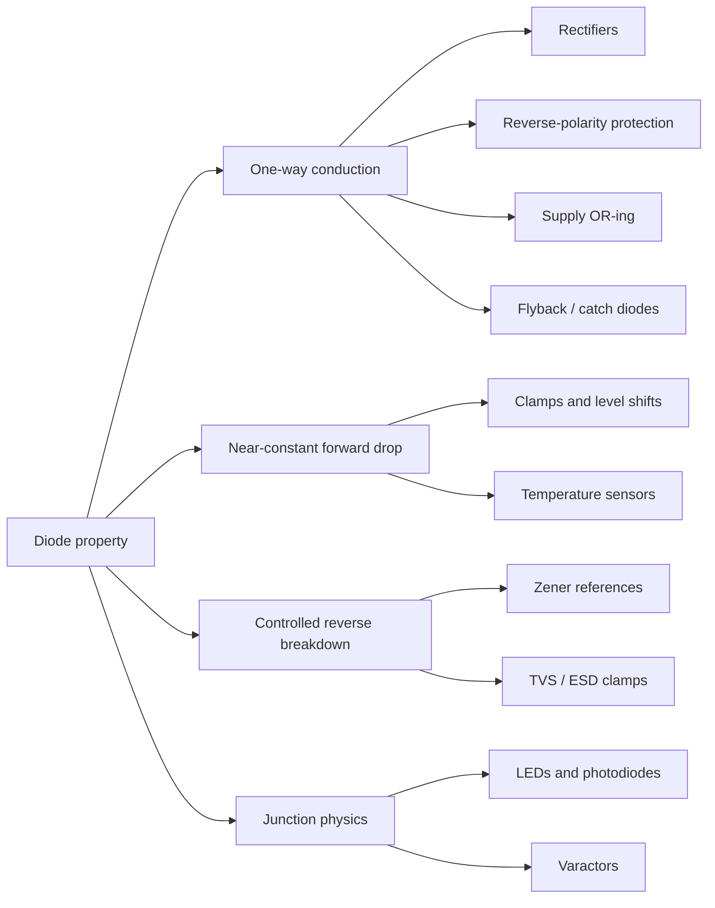

::: basics
### In plain words
A diode lets current go one way and not the other, and engineers use that in many ways. It can turn AC (current that keeps reversing) into DC (current that flows one way), block a battery that is plugged in backwards, or absorb a voltage spike. A few special diodes do other jobs, such as emitting light. This page asks you to list the uses and say which diode property each one relies on.

### Picture it
Picture a one-way street. You can use it to keep traffic from going the wrong way, as in a rectifier. You can use it to stop a car from backing out, as in battery protection. And you can give runaway traffic a side road to drain into, as a flyback diode does for a coil. All of those come from one rule: traffic goes one way. The analogy leaves out the small toll a diode charges in voltage.

### Words you need
- **Rectifier**: a diode circuit that turns AC into DC.
- **Flyback diode**: a diode across a coil that gives its current a safe path when switched off.
- **Zener diode**: a diode designed to conduct in reverse at a set voltage.
- **Forward drop**: the voltage lost across a conducting diode, about 0.7 V in silicon.
- **Schottky diode**: a diode with a lower forward drop.

### The simplest example
Say a user might plug a battery in backwards. Put a diode in series with the supply. Plugged correctly, current flows, and the diode drops about 0.7 V. Plugged backwards, the diode blocks, and the circuit is safe. The price is power: with 2 A, the diode wastes about 0.7 V × 2 A = 1.4 W. That is the whole idea. The rest of this page groups the uses by property, and shows when to pick a Schottky or an ideal-diode controller.
:::

::: testing
Whether you've actually *used* diodes in circuits, not just read about them. A good answer is organized by the **property being exploited**, because each use case relies on a different part of the I–V curve:

- **one-way conduction** (rectifiers, reverse-polarity protection, OR-ing, flyback paths),
- **the nearly-constant forward drop** (level shifting, temperature sensing, clamps),
- **reverse breakdown** (Zener references, TVS surge clamps),
- **the junction as an optical or capacitive device** (LEDs, photodiodes, varactors).

The interviewer also listens for trade-offs: the forward-drop power loss, leakage, reverse recovery, and when you'd use a MOSFET instead.
:::

::: why
Practically every board you'll design has several diodes: a TVS on each connector, a flyback diode on any relay or solenoid, a Schottky or ideal-diode controller on the power input, LEDs for status, and dozens of ESD diodes hidden inside every IC. Picking the wrong one causes real failures: a slow rectifier in a buck converter overheats, a Schottky's leakage drains a battery, a missing flyback diode kills a transistor. Being able to rattle off use cases *with the reason the diode is there* tells the interviewer you can read and design schematics.
:::

::: concepts
- **One-way conduction**: forward biased it conducts with a drop $V_F$; reverse biased it blocks until breakdown. See [[q0072]].
- **Forward-voltage drop**: ~0.6–0.7 V silicon, ~0.2–0.45 V Schottky, ~1.8–3.5 V for LEDs. It costs power $P = V_F I$. See [[q0078]].
- **Reverse breakdown**: a controlled breakdown voltage makes a voltage reference or clamp (Zener, TVS). See [[q0077]].
- **Inductor current continuity**: an inductor's current can't change instantly, so it needs a path when a switch opens. See [[q0144]].
- **I–V curve regions**: forward, reverse, breakdown. Each application lives in one or more regions. See [[q0074]], [[q0075]].
:::

::: answer
"I'd group them by what property of the diode you're using.

The obvious one is one-way conduction. That gives you rectifiers, like a bridge turning AC into DC; reverse-polarity protection, where a series diode blocks current if someone plugs the battery in backwards; diode OR-ing, where two supplies feed one rail and whichever is higher wins; and flyback diodes across relay coils or motors, which give the inductor current somewhere to go when the transistor turns off so you don't get a huge voltage spike.

Second, you can use the reverse breakdown region on purpose. A Zener diode gives you a simple voltage reference or clamp, and a TVS diode absorbs ESD and surge on connectors. Every IC pin also has little ESD diodes to the rails.

Third, the junction itself can be the point: LEDs emit light, photodiodes detect it, varactors are voltage-controlled capacitors for tuning, and the forward voltage's minus 2 millivolt per degree tempco is used as a temperature sensor.

The main trade-off is the forward drop. A silicon diode in series with a 2 amp load burns over a watt, so for power paths I'd use a Schottky, or an ideal-diode MOSFET controller if efficiency really matters."
:::

::: technical
| Property used | Application | Typical part / numbers |
|---|---|---|
| Unidirectional conduction | Half-wave / bridge rectifier | 1N4001–1N4007 (1 A, 50–1000 V); ripple $\Delta V \approx I/(fC)$ half-wave, $I/(2fC)$ full-wave |
| | Reverse-polarity protection | Series Schottky, loss $P = V_F I$ (≈0.9 W at 2 A, 0.45 V) |
| | Supply OR-ing | Two Schottkys into a common node; the higher input supplies the load |
| | Flyback / freewheel diode | Across relay/solenoid/motor; clamps switch voltage at $V_{supply} + V_F$ |
| | Buck/boost catch diode | Schottky (no reverse recovery) in asynchronous converters |
| | Peak detector / sample hold | Diode + capacitor holds the maximum of a signal |
| Forward drop as a "stiff" voltage | Level shift / bias | String of diodes biasing a class-AB output stage ($2V_{BE}$) |
| | Clamping to a rail | Input protection diodes to VDD and GND |
| | Temperature sensing | $dV_F/dT \approx -2$ mV/°C at constant current |
| Reverse breakdown | Zener reference/clamp | 2.4–200 V nominal ratings; best stability around 5–6 V |
| | TVS surge/ESD suppression | Fast avalanche clamp, sub-ns response, rated in peak pulse power |
| Junction optics | LED, laser diode | $V_F$ ≈ photon energy: $E(\text{eV}) \approx 1240/\lambda(\text{nm})$ |
| | Photodiode, solar cell | Reverse biased (photoconductive) or zero-bias (photovoltaic) |
| Junction capacitance | Varactor | $C_j \propto (1+V_R/V_{bi})^{-m}$, VCO tuning |
| Nonlinearity | RF mixers, detectors | Schottky detector diodes |

**Key design checks** for any diode application: reverse voltage rating $V_{RRM}$ with margin, average and surge current ($I_{F(AV)}$, $I_{FSM}$), power dissipation and junction temperature, reverse recovery $t_{rr}$ for switching circuits, and leakage $I_R$ (especially Schottky at high temperature) for low-power circuits.
:::

::: short
"I group diode uses by the property they exploit. One-way conduction gives rectifiers, reverse-polarity protection, OR-ing two supplies, and flyback diodes across inductive loads. Controlled breakdown gives Zener references and TVS surge clamps, plus the ESD diodes on every IC pin. And the junction itself makes LEDs, photodiodes, varactors and temperature sensors. The main cost is the forward drop, so in power paths I'd use a Schottky or an ideal-diode MOSFET."
:::

::: long
"The way I think about diode applications is by which part of the I–V curve you're using.

First, one-way conduction, where the diode is either forward biased and conducting or reverse biased and blocking. Rectifiers are the classic one: a bridge of four diodes turns AC into pulsating DC, and a capacitor smooths it. Reverse-polarity protection is another: put a diode in series with a battery input and if the battery goes in backwards, the diode blocks instead of the circuit frying. Diode OR-ing lets two supplies, say USB and a battery, feed one rail, and whichever is higher supplies the load. And flyback or freewheeling diodes go across relay coils, solenoids and motors. When the transistor turns off, the inductor current has to keep flowing, and without a diode it would make a huge voltage spike and kill the transistor. Asynchronous buck converters use a Schottky catch diode for the same reason.

Second, the breakdown region. A Zener diode breaks down at a well-defined voltage, so with a series resistor it makes a cheap reference or clamp. TVS diodes are designed to avalanche very fast and absorb ESD or surge energy at connectors, and every CMOS input has little clamp diodes to VDD and ground for the same reason.

Third, the forward voltage itself. It's nearly constant, so diodes are used for level shifting and biasing, like the two diodes that bias a push-pull output stage. And it drops about 2 millivolts per degree, which is how on-chip temperature sensors work.

Finally, the junction as a device in its own right: LEDs emit light, photodiodes and solar cells convert light to current, and varactors use the voltage-dependent depletion capacitance to tune oscillators.

The trade-off I'd always mention is the forward drop. At 2 amps a silicon diode burns well over a watt, so in power paths I'd pick a Schottky, or an ideal-diode MOSFET controller if I care about efficiency."
:::

::: terms
- **Rectifier**: a diode (or bridge of diodes) that converts AC to unidirectional current.
- **Freewheeling / flyback diode**: a diode across an inductive load that carries the inductor current when the driving switch opens.
- **OR-ing diode**: diodes that let multiple sources feed one rail without back-feeding each other.
- **Clamp diode**: a diode that limits a node to roughly one $V_F$ beyond a rail.
- **TVS (transient voltage suppressor)**: an avalanche diode built to absorb high peak power surges and ESD quickly.
- **Zener diode**: a diode designed to operate in reverse breakdown at a specified voltage.
- **Catch diode**: the freewheeling diode in an asynchronous buck converter.
- **$V_{RRM}$ / $I_{F(AV)}$ / $I_{FSM}$**: repetitive peak reverse voltage, average forward current, and non-repetitive surge current ratings.
- **Varactor**: a diode used as a voltage-controlled capacitor in reverse bias.
:::

::: exceptional
**An average answer** lists "rectifiers, LEDs, protection" without explaining why the diode is there.

**An exceptional answer**:
- Organizes uses by the physical property (one-way conduction, forward drop, breakdown, optical/capacitive junction), which shows real understanding.
- Explains the *mechanism* of at least one in detail, e.g. why a relay coil needs a flyback diode (inductor current continuity, $V = L\,di/dt$) and what voltage the switch then sees.
- Names real parts and numbers: 1N4148 small-signal, 1N4007 rectifier, 1N5819/SS14 Schottky, SMBJ-series TVS.
- Quantifies the cost: power loss $V_FI$, the extra release time a plain flyback diode causes, Schottky leakage.
- Knows when *not* to use a diode: ideal-diode MOSFET controllers for low-loss OR-ing ([[q0079]]), synchronous rectification in bucks ([[q0203]]).
:::

::: mistakes
- **Putting the flyback diode the wrong way round.** It goes cathode to the positive supply, anode to the switch node. Backwards, it shorts the supply through the transistor every time it turns on.
- **"Any diode works as a catch diode."** A 1N4007 has microsecond-scale reverse recovery and will overheat and cause big current spikes in a 500 kHz buck. Use a Schottky or ultrafast diode.
- **Ignoring the forward drop's power.** A 1N4001-class diode at 1 A drops ~1 V, so 1 W, in a tiny package. Check $V_F I$ and the thermal rating.
- **Using a Schottky everywhere because it has a lower drop.** Its leakage can be hundreds of µA at high temperature, which matters for battery-powered and precision circuits, and its reverse-voltage ratings are lower.
- **Expecting a Zener to be a precision reference.** Tolerance is typically ±2–5%, and voltage varies with current and temperature. Use a bandgap reference IC (e.g. TL431, LM4040) for accuracy.
- **Forgetting the series resistor with an LED or Zener.** Both have a near-vertical I–V curve; without current limiting they draw destructive current.
:::

::: deep
## Organizing the zoo: which part of the I–V curve?

Every diode application uses one or more of the three regions you'd draw on the I–V curve ([[q0074]]):


Figure: Group applications by the property they exploit. In an interview this gives you a structure to work through instead of a random list, and each branch has its own trade-off.

## 1. Rectification

The original use. A diode passes the positive half of an AC waveform and blocks the negative half. A **bridge** of four diodes flips the negative half up too, so a capacitor after it charges twice per cycle. The ripple on the capacitor is roughly the charge the load pulls between peaks, divided by C:

$$\Delta V \approx \frac{I_{load}}{f\,C}\ \text{(half-wave)},\qquad \Delta V \approx \frac{I_{load}}{2f\,C}\ \text{(bridge)}$$

For a 100 mA load from 60 Hz mains through a transformer, with 1000 µF: half-wave gives about 1.67 V ripple, a bridge about 0.83 V. The bridge also loses *two* diode drops in each half-cycle (~1.4 V), which matters for low-voltage supplies. See [[q0160]] for the full bridge story.

```sim
{"id":"rectifier-lab","type":"bridge","vpk":17,"f":60,"c":0.001,"rl":100,"vf":0.7}
```
Figure: Switch between half-wave and bridge and watch the ripple halve. Shrink C and notice the diodes conduct only in short, tall current pulses near each peak; those peaks, not the average current, are what stress the diodes and transformer.

## 2. Reverse-polarity protection

Someone will eventually insert the battery backwards. A series diode on the input conducts for correct polarity and blocks for reversed polarity. Simple and bulletproof, but it costs $V_F$ all the time:

- 2 A load through a Schottky with $V_F = 0.45$ V: 0.9 W lost, and 0.45 V of headroom gone.
- The same through a silicon diode at ~0.9 V: 1.8 W.

For low-voltage, high-current inputs that's unacceptable, which is why designers use a P-channel MOSFET (body diode conducts first, then the gate turns the channel on) or an ideal-diode controller. See [[q0079]].

## 3. OR-ing multiple supplies

Two sources, say 5 V USB and a 3.7 V Li-ion battery, each feed a common rail through a Schottky. The diode on the higher source is forward biased and supplies the load; the other is reverse biased and blocks back-feed into the lower source (which would otherwise try to charge a battery through USB, or push current back into a USB host).

```circuit
{"caption":"Diode OR-ing two supplies","elements":[
 {"t":"term","at":[0,1],"label":"USB 5 V","side":"left"},
 {"t":"Schottky","a":[0,1],"b":[5,1],"label":"D_1"},
 {"t":"term","at":[0,6],"label":"V_{BAT} 3.7 V","side":"left"},
 {"t":"Schottky","a":[0,6],"b":[5,6],"label":"D_2"},
 {"t":"wire","pts":[[5,1],[10,1]]},
 {"t":"wire","pts":[[5,6],[7,6],[7,1]]},{"t":"dot","at":[7,1]},
 {"t":"R","a":[10,1],"b":[10,6],"label":"Load","value":"(LDO, MCU…)"},
 {"t":"gnd","at":[10,6]},
 {"t":"text","at":[8.5,0],"text":"V_{sys} ≈ 4.6 V","muted":true}
]}
```
Figure: With USB present, D₁ conducts and V_sys ≈ 5 − 0.4 = 4.6 V, which reverse biases D₂ by about 0.9 V so the battery is isolated. Unplug USB and D₂ takes over automatically, with no switching logic. The cost is a Schottky drop and its leakage.

## 4. Flyback (freewheeling) diodes on inductive loads

This is the use case interviewers love, because it needs real physics. A relay coil, solenoid or motor is an inductor, and an inductor's current can't change instantly: $V = L\,\frac{di}{dt}$. If a transistor abruptly stops the current, $di/dt$ is huge, and so is the voltage. The collector of the transistor flies up to whatever voltage it takes to keep the current flowing, often hundreds of volts, and the transistor breaks down.

```circuit
{"caption":"Flyback diode across a relay coil","elements":[
 {"t":"rail","at":[4,0],"label":"+12 V","dir":"up"},
 {"t":"wire","pts":[[4,0],[4,1]]},
 {"t":"L","a":[4,1],"b":[4,5],"label":"Relay coil","value":"400 Ω","labelSide":"other"},
 {"t":"wire","pts":[[4,1],[8,1]]},{"t":"dot","at":[4,1]},
 {"t":"D","a":[8,5],"b":[8,1],"label":"D_{FW}","value":"1N4148"},
 {"t":"wire","pts":[[4,5],[8,5]]},{"t":"dot","at":[4,5]},
 {"t":"npn","at":[2,7],"label":"Q_1"},
 {"t":"R","a":[-3,7],"b":[2,7],"label":"R_B","value":"1 kΩ"},
 {"t":"term","at":[-3,7],"label":"GPIO","side":"left"},
 {"t":"gnd","at":[4,9]}
]}
```
Figure: When Q₁ turns off, the coil current (30 mA here) can no longer flow through the transistor. It circulates through D_FW instead, so the collector only rises to 12 V + one diode drop. Note the orientation: cathode to +12 V, so the diode is reverse biased during normal operation.

With the diode, the collector is clamped at $V_{CC} + V_F \approx 12.7$ V and the current decays through the coil's own resistance with $\tau = L/R$. The catch is that a slow decay means the relay **releases slowly**. If that matters, add a Zener in series with the diode: the coil then sees $-(V_Z + V_F)$ and the current falls much faster, at the cost of a higher transistor voltage. See [[q0144]] for the full analysis.

```sim
{"id":"flyback-protection","protection":"diode","l":0.01,"i0":1,"vsupply":12}
```
Figure: Switch protection to "none" and look at the switch voltage spike, then back to "diode" (clamped but slow current decay), then "zener" (higher clamp, faster decay). The energy ½LI² has to go somewhere in every case.

## 5. Clamping and ESD protection

Every CMOS input pin has a diode from the pin to VDD and from GND to the pin. In normal operation both are reverse biased. If the pin is pushed above $V_{DD} + V_F$ or below $-V_F$, a diode conducts and dumps the current into a rail. That's how ICs survive handling ESD, and also why "back-powering" happens: drive an I/O pin high on an unpowered chip and you power its VDD rail through the upper clamp diode.

```circuit
{"caption":"Rail clamp diodes on an input","elements":[
 {"t":"term","at":[0,4],"label":"V_{in}","side":"left"},
 {"t":"R","a":[0,4],"b":[4,4],"label":"R_S","value":"1 kΩ"},
 {"t":"wire","pts":[[4,4],[9,4]]},{"t":"dot","at":[6,4]},
 {"t":"D","a":[6,4],"b":[6,0.5],"label":"D_H"},
 {"t":"rail","at":[6,0.5],"label":"V_{DD}","dir":"up"},
 {"t":"D","a":[6,7.5],"b":[6,4],"label":"D_L"},
 {"t":"gnd","at":[6,7.5]},
 {"t":"term","at":[9,4],"label":"to CMOS gate","side":"right"}
]}
```
Figure: The node is clamped between −V_F and V_DD + V_F. R_S limits the clamp current: a 12 V spike into a 3.3 V part through 1 kΩ pushes about (12 − 3.3 − 0.6)/1k ≈ 8 mA into the VDD rail. Check that the rail can absorb it.

Board-level surges are too big for those tiny on-chip diodes, so connectors get a **TVS diode**: an avalanche diode designed to clamp hundreds of watts for microseconds. It's chosen so its standoff voltage $V_{WM}$ is above the normal signal level and its clamping voltage $V_C$ is below what the protected IC can survive.

## 6. Using the forward drop as a near-constant voltage

Because current changes 10× for each ~60 mV, the forward voltage is nearly constant over a wide current range. That makes diodes useful as:

- **Level shifters / bias**: two series diodes give about 1.3 V, used to bias a class-AB push-pull output stage just above cutoff so there's no crossover distortion.
- **Crude low-voltage references** or "drop one rail by ~0.6 V" (e.g. dropping 3.6 V to ~3.0 V for a part with a lower absolute maximum), with the caveat that the drop changes with current and temperature.
- **Temperature sensors**: at fixed current, $V_F$ falls about 2 mV/°C. On-die temperature sensors in CPUs and the "remote diode" inputs of temperature-sensor ICs use exactly this (often a diode-connected transistor).

## 7. Breakdown on purpose: Zener and avalanche

A Zener diode in reverse breakdown holds a fairly constant voltage over a range of current. With a series resistor it makes a simple shunt regulator or clamp: from 12 V to a 5.1 V Zener with 1 kΩ gives 6.9 mA. It's cheap but imprecise (±2–5%, changes with current and temperature). See [[q0077]] for more.

## 8. The junction as the product

- **LEDs** emit light when electrons and holes recombine across a direct bandgap. The forward voltage roughly tracks photon energy: red (~630 nm, ~1.97 eV) runs at about 1.8–2.2 V, blue (~470 nm, ~2.64 eV) at about 2.8–3.3 V. From a 3.3 V GPIO, a red LED at 2.0 V and 5 mA needs $R = (3.3-2.0)/5\text{ mA} = 260$ Ω, so 270 Ω gives ~4.8 mA ([[q0806]]).
- **Photodiodes and solar cells** work in reverse: absorbed photons create electron-hole pairs that the junction field sweeps out as current.
- **Varactors** exploit the depletion capacitance, which shrinks as reverse voltage widens the depletion region. They tune VCOs and filters.

> [!INTERVIEW]
> After listing uses, pick one and go one level deeper unprompted. The flyback diode is the best choice: explain $V = L\,di/dt$, why the transistor dies without it, which way the diode points, and why it slows relay release. That turns a list into a demonstration of understanding.
:::

::: applications
- **Arduino Uno-style boards** use a series diode or MOSFET between the barrel jack and the regulator for reverse-polarity protection.
- **Relay driver modules** have a 1N4148 or 1N4007 across each coil, driven by an NPN transistor or a ULN2003 Darlington array, which has built-in freewheeling diodes.
- **USB ports** carry a TVS array (e.g. multi-channel ESD diodes on D+/D−) and often a Schottky or load switch on VBUS.
- **Asynchronous buck converters** use a Schottky catch diode such as an SS14 / 1N5819 class part.
- **Power banks and laptops** OR battery and adapter inputs, increasingly with ideal-diode controllers instead of discrete Schottkys.
- **CPU and SoC thermal monitoring** uses substrate diodes or diode-connected transistors read by a remote temperature-sensor IC.
:::

::: assumptions
- I've assumed ordinary low-voltage board-level electronics (≤ 60 V, ≤ a few A). At high power, rectifiers become SiC Schottkys or thyristors, and synchronous rectification replaces diodes for efficiency.
- Numbers like $V_F$, leakage and $t_{rr}$ are typical ranges that vary by part, current and temperature. Always check the datasheet.
- "Diode" here includes the family (Zener, Schottky, TVS, LED, photodiode). If the interviewer means only standard PN rectifier diodes, focus on rectification, protection, flyback and clamping.
- Many of these jobs are now done by MOSFETs plus control (ideal diodes, synchronous rectifiers, load switches) when the forward drop is too costly. A complete answer mentions that.
:::

::: followups
### Why do you need a flyback diode on a relay, and which way does it go?
The coil is an inductor, so its current can't stop instantly. When the transistor turns off, $V = L\,di/dt$ drives the collector to whatever voltage keeps the current flowing, easily hundreds of volts, and breaks the transistor down. The diode goes across the coil with its **cathode to the positive supply** so it's reverse biased normally and forward biased only when the coil voltage reverses at turn-off. The collector is then clamped near $V_{CC} + 0.7$ V. See [[q0144]].

### What's the downside of a plain flyback diode, and how do you fix it?
The coil current decays slowly, with only the coil resistance and ~0.7 V opposing it, so a relay releases slowly (often several ms extra) and contacts arc more. Adding a Zener in series makes the coil voltage $-(V_Z+0.7)$ during turn-off, so $di/dt$ is much larger and release is fast. The transistor must then be rated for $V_{CC}+V_Z+0.7$.

### Why use a Schottky in a buck converter's catch diode instead of a 1N4007?
Two reasons. Lower forward drop (~0.3–0.5 V vs ~1 V) cuts conduction loss during the off-time. More importantly, a Schottky has no minority-carrier storage, so no reverse recovery. A 1N4007 takes microseconds to recover; at 500 kHz the high-side switch would turn on into a diode that's still conducting backwards, creating a shoot-through-like current spike, big losses and EMI. See [[q0197]].

### A 2 A product uses a series diode for reverse-polarity protection and runs hot. What would you do?
Quantify first: 2 A × 0.45 V (Schottky) = 0.9 W, or 1.8 W for a silicon diode. Replace it with a P-channel MOSFET in the supply line (source to load, gate to ground through a resistor, Zener clamp on Vgs). With correct polarity the body diode conducts first, then $V_{GS}$ turns the channel on; with an $R_{DS(on)}$ of 20 mΩ the loss is $2^2 \times 0.02 = 80$ mW. With reversed polarity the gate is at the positive potential and the FET stays off. An ideal-diode controller also handles reverse-current blocking for OR-ing. See [[q0079]].

### What happens if you drive an MCU input to 5 V while the MCU is unpowered?
The input's upper ESD clamp diode forward biases and current flows into the unpowered VDD rail, partially powering the chip (back-powering). That can cause latch-up, undefined behaviour, or damage if the current exceeds the injection limit (often a few mA). Fix it with a series resistor, a 5 V-tolerant input, or a level shifter/buffer with power-off protection ($I_{off}$ spec).
:::

::: references
- Horowitz & Hill, *The Art of Electronics*, 3rd ed.: Chapter 1 diode applications (rectification, clamps, inductive-load protection) and Chapter 9 on power supplies.
- Sedra & Smith, *Microelectronic Circuits*: chapter on diodes, sections on rectifier circuits, limiting and clamping circuits, Zener regulators.
- Manufacturer datasheets for the 1N4001–1N4007, 1N4148 and 1N5817–1N5819 families (e.g. onsemi, Vishay) for typical $V_F$, $t_{rr}$ and leakage values.
- IEC 61000-4-2 (ESD immunity) and IEC 61000-4-5 (surge immunity): the standards that TVS diode selection is usually driven by.
:::

::: rubric
- Covers one-way conduction applications: rectifier, reverse-polarity protection, OR-ing :: These are the core uses; missing them suggests no practical exposure.
- Explains the flyback diode on an inductive load, with correct orientation :: The most common practical diode job and a favourite follow-up.
- Mentions breakdown-region uses: Zener reference/clamp and TVS/ESD protection :: Shows you know the reverse region is useful, not just "off".
- Includes junction-based devices: LEDs, photodiodes, varactors or temperature sensing :: Demonstrates breadth across the diode family.
- Quantifies the forward-drop cost ($P = V_F I$) :: The key trade-off that drives part selection.
- Knows alternatives: Schottky for low drop/fast recovery, MOSFET ideal diodes or synchronous rectification :: Shows design judgment beyond textbook usage.
:::

::: quiz
```json
[
 {"type":"mcq","level":"fundamental","q":"A relay coil is driven by an NPN low-side switch from +12 V. How should the flyback diode be connected?","options":["Anode to +12 V, cathode to the collector","Cathode to +12 V, anode to the collector","In series with the coil","From the base to ground"],"answer":1,"explain":"The diode must be reverse biased in normal operation (collector below +12 V) and conduct when the coil voltage reverses at turn-off and the collector flies above +12 V. That means cathode to +12 V, anode to the collector node."},
 {"type":"numeric","level":"intermediate","q":"A product draws 1.5 A through a series Schottky (V_F = 0.4 V) for reverse-polarity protection. How much power does the diode dissipate?","answer":0.6,"tolerance":0.01,"unit":"W","explain":"$P = V_F I = 0.4 \\times 1.5 = 0.6$ W. That's significant heat in a small SMD package, which is why MOSFET-based protection is used at higher currents."},
 {"type":"numeric","level":"intermediate","q":"A bridge rectifier from 60 Hz mains feeds a 200 mA load with a 2200 µF capacitor. Estimate the peak-to-peak ripple.","answer":0.758,"tolerance":0.03,"unit":"V","explain":"A bridge recharges the capacitor at 120 Hz: $\\Delta V \\approx I/(2fC) = 0.2/(2\\cdot 60\\cdot 2200\\times10^{-6}) \\approx 0.76$ V."},
 {"type":"multi","level":"fundamental","q":"Which applications rely on operating a diode in reverse breakdown? Select all that apply.","options":["Zener shunt reference","TVS surge clamp","Bridge rectifier","Flyback diode on a relay"],"answer":[0,1],"explain":"Zeners and TVS diodes are designed to conduct in breakdown at a specified voltage. Rectifiers and flyback diodes only use forward conduction and reverse blocking; breakdown there is a failure."},
 {"type":"truefalse","level":"advanced","q":"In a 500 kHz asynchronous buck converter, a 1N4007 is a fine catch diode as long as its current and voltage ratings are adequate.","answer":false,"explain":"The 1N4007 is a general-purpose rectifier with reverse recovery in the microsecond range. At 500 kHz (2 µs period) it would still be conducting in reverse when the high-side switch turns on, causing large current spikes, losses and EMI. Use a Schottky or ultrafast diode."},
 {"type":"numeric","level":"intermediate","q":"A red LED (V_F = 2.0 V) is driven from a 5 V supply. What series resistor gives 10 mA?","answer":300,"tolerance":0.01,"unit":"Ω","explain":"$R = (5 - 2.0)/0.01 = 300$ Ω. The resistor sets the current because the LED's voltage barely changes with current."}
]
```
:::
