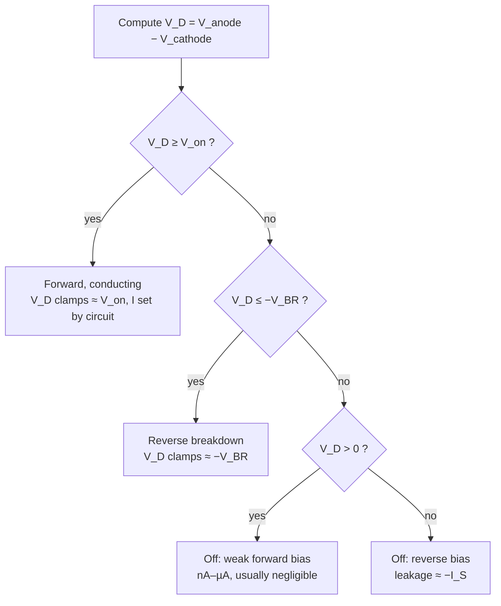

::: testing
Whether you can take numbers (anode voltage, cathode voltage, a "threshold" or turn-on voltage $V_{on}$, maybe a breakdown voltage) and **correctly classify the diode's region**, and then whether you can do the same inside a circuit where the diode's voltage isn't given directly.

The hidden sub-skills:
- getting the **sign convention** right: $V_D = V_{anode} - V_{cathode}$,
- comparing against **two** boundaries, $V_{on}$ and $-V_{BR}$, not one,
- recognising that a diode can't sustain much more than $V_{on}$ forward, so a "given" voltage above it means the diode is on and clamping,
- the **assume → solve → verify** method (or the Thevenin shortcut) when the diode is in a circuit.
:::

::: why
This is the core skill for analysing any circuit with diodes, and it's the same pattern you'll use for transistors: given $V_{GS}$ and $V_t$, which region is the MOSFET in ([[q0100]])? Given $V_{BE}$ and $V_{CE}$, which mode is the BJT in ([[q0087]])? In real work it's how you check whether a protection diode will conduct during a fault, whether a Zener is actually regulating at minimum input voltage, or whether a reverse-polarity diode blocks. Interviewers like it because a numeric answer is right or wrong, and sign errors show up immediately.
:::

::: concepts
- **Diode voltage**: $V_D = V_A - V_K$ (anode minus cathode). Positive means forward. See [[q0074]].
- **Turn-on (threshold) voltage $V_{on}$**: the constant-drop model's voltage, ~0.7 V for silicon, ~0.3 V Schottky, ~2 V red LED.
- **Breakdown voltage $V_{BR}$** (or $V_Z$): the reverse voltage where the diode conducts in reverse. See [[q0075]].
- **Constant-drop model**: on → a $V_{on}$ source; off → an open circuit.
- **Thevenin equivalent**: any linear network seen by the diode reduces to $V_{th}$ in series with $R_{th}$. See [[q0008]].
- **KVL/KCL**: used to verify the assumed state. See [[q0004]].
:::

::: answer
"First I'd define the diode voltage as anode minus cathode, $V_D = V_A - V_K$. Then there are three cases.

If $V_D$ is at or above the turn-on voltage, about 0.7 volts for silicon, the diode is forward biased and conducting. If it's between minus the breakdown voltage and the turn-on voltage, it's off: either reverse biased, or forward biased so weakly that the current is negligible. And if $V_D$ is at or below minus $V_{BR}$, it's in reverse breakdown.

For example, anode at 3 volts and cathode at 2.5: $V_D$ is 0.5, below 0.7, so I'd call it off, even though technically it's weakly forward biased. Anode at 0 and cathode at 12 with a 100 volt part: minus 12 volts, reverse biased. A 5.1 volt Zener with 8 volts across it backwards, fed through a resistor: breakdown.

The catch is that in a real circuit you usually don't know the diode voltage, because the diode sets it. So I'd remove the diode, find the open-circuit voltage across its terminals, and compare that to the thresholds. Or I'd assume a state, solve, and check: if I assumed on, the current must come out positive; if I assumed off, the voltage must come out below 0.7."
:::

::: technical
**Decision rule** (constant-drop model, $V_D = V_A - V_K$):

$$\text{region} = \begin{cases} \text{forward, conducting} & V_D \ge V_{on} \\ \text{off (reverse, or weak forward)} & -V_{BR} < V_D < V_{on} \\ \text{reverse breakdown} & V_D \le -V_{BR} \end{cases}$$

Subdivide "off": $0 < V_D < V_{on}$ is weak forward bias (exponentially small but nonzero current: ~1 nA at 0.3 V, ~2.5 µA at 0.5 V for $I_S = 10^{-14}$ A); $V_D < 0$ is reverse bias (leakage ≈ $-I_S$).

**When the diode is in a circuit**, the terminal voltage isn't free: a conducting diode clamps $V_D \approx V_{on}$, a breakdown diode clamps $V_D \approx -V_Z$. Use either:

1. **Thevenin test.** Remove the diode; find the open-circuit voltage $V_{oc} = V_A - V_K$ and the resistance $R_{th}$ seen between the terminals.
   - $V_{oc} > V_{on}$ → on, $I_D = (V_{oc} - V_{on})/R_{th}$.
   - $-V_Z < V_{oc} < V_{on}$ → off, $V_D = V_{oc}$, $I_D \approx 0$.
   - $V_{oc} < -V_Z$ → breakdown, reverse current $(|V_{oc}| - V_Z)/R_{th}$.

2. **Assume–solve–verify** (needed for multiple diodes):
   - Assume ON → replace with $V_{on}$ source, solve, require $I_D > 0$ (anode→cathode).
   - Assume OFF → replace with open, solve, require $-V_{BR} < V_D < V_{on}$.
   - Assume BREAKDOWN → replace with $V_Z$ source (cathode +), require reverse current > 0.
   - With $N$ diodes, at most $3^N$ (usually $2^N$) combinations; only one is self-consistent. Start with the most likely guess.

**Typical $V_{on}$ values** (at mA currents): Si 0.6–0.7 V; Schottky 0.2–0.45 V; Ge 0.2–0.3 V; red LED ~1.8–2.2 V; blue/white LED ~2.8–3.3 V; SiC Schottky ~1.2–1.7 V. See [[q0078]].
:::

::: short
"I take $V_D$ as anode minus cathode. At or above the turn-on voltage, about 0.7 for silicon, it's forward conducting. Between minus the breakdown voltage and 0.7, it's off: reverse biased or only weakly forward. At or below minus $V_{BR}$, it's in breakdown. In a circuit, the diode clamps its own voltage, so I remove it, find the open-circuit voltage across its terminals and compare that, or I assume a state, solve, and check the current and voltage are consistent."
:::

::: long
"I'd start with the sign convention, because that's where most mistakes happen. The diode voltage is anode minus cathode. Positive means forward.

Then there are two boundaries. The turn-on voltage, call it $V_{on}$, which is about 0.7 volts for silicon at milliamp currents, 0.3 for a Schottky, around 2 for a red LED. And the breakdown voltage, which is on the negative side.

So: if $V_D$ is at or above $V_{on}$, the diode is forward biased and conducting. If it's between minus $V_{BR}$ and $V_{on}$, I'd call it off. That includes the reverse-bias case where only leakage flows, and the weak forward case, like 0.4 volts on a silicon diode, where it's technically forward biased but only conducts nanoamps. And if it's at or below minus $V_{BR}$, it's in breakdown.

Quick examples: anode 5, cathode 4.2, so 0.8 volts: on. Anode 1, cathode 0.6, so 0.4: off, weak forward. Anode 0, cathode 20, 50 volt rectifier: minus 20, reverse. 5.1 volt Zener with its cathode 9 volts above the anode through a resistor: breakdown.

There's a subtlety I'd point out. If someone 'gives' you 1.5 volts forward across a silicon diode, that can't really be the diode voltage at steady state, because once it's on, the diode clamps itself near 0.7. So in a circuit I'd do it differently: take the diode out, compute the open-circuit voltage across where it was, and the Thevenin resistance. If that open-circuit voltage is above 0.7, the diode's on, and the current is the excess voltage divided by the Thevenin resistance. If it's between minus $V_{BR}$ and 0.7, it's off and the voltage is just the open-circuit value.

With several diodes I'd use assume, solve, verify. Guess each diode's state, replace it with the model, solve, and check: an 'on' diode must carry positive current, an 'off' diode must have less than 0.7 volts across it. If anything's inconsistent, flip that guess and solve again."
:::

::: terms
- **$V_D$ (diode voltage)**: $V_{anode} - V_{cathode}$; positive is forward.
- **Turn-on / threshold / cut-in voltage $V_{on}$**: the forward voltage at which you treat the diode as conducting (~0.7 V Si).
- **Off state**: $-V_{BR} < V_D < V_{on}$; current negligible for the circuit.
- **Weak forward bias**: $0 < V_D < V_{on}$; exponentially small current, usually ignored.
- **Breakdown**: $V_D \le -V_{BR}$; reverse conduction with $V_D$ clamped near $-V_{BR}$.
- **Open-circuit voltage $V_{oc}$**: the voltage across the diode's terminals with the diode removed.
- **Assume–solve–verify**: guess each nonlinear device's state, solve the linear circuit, check consistency.
- **Load line**: $I_D = (V_{th} - V_D)/R_{th}$; its intersection with the diode curve is the operating point.
:::

::: exceptional
**An average answer** compares one number with 0.7 V and says "on" or "off".

**An exceptional answer**:
- States the sign convention explicitly and uses **both** boundaries ($V_{on}$ and $-V_{BR}$).
- Distinguishes "forward biased" (polarity) from "conducting" (engineering threshold), noting weak forward conduction below $V_{on}$.
- Points out that a forward voltage well above $V_{on}$ can't persist across a diode: the diode clamps, so the given number is really an open-circuit voltage, and the excess drops across the series resistance.
- Uses the **Thevenin test** to classify a diode inside a circuit and then computes the current.
- Explains assume–solve–verify for multi-diode circuits and shows a check (positive current, voltage below $V_{on}$).
- Uses the right $V_{on}$ for the device (Schottky, LED, Zener forward vs reverse).
:::

::: mistakes
- **Computing cathode minus anode.** Always $V_A - V_K$. Write it down before plugging numbers.
- **Treating 0 V as the boundary.** Polarity tells you forward vs reverse; whether it *conducts* depends on $V_{on}$.
- **Forgetting breakdown.** −20 V across a 15 V Zener is breakdown, not reverse bias. Check $V_{BR}$ when given.
- **Using the Zener voltage in the forward direction.** A Zener with its anode positive just drops ~0.7 V like any diode.
- **Not checking the assumption.** If you assume ON and get negative current, the diode is OFF; re-solve rather than reporting a negative current.
- **Taking the open-circuit voltage as the operating voltage.** If $V_{oc} = 2.5$ V, the diode doesn't sit at 2.5 V; it turns on and sits at ~0.7 V with the rest across $R_{th}$.
:::

::: deep
## The decision rule

Everything hangs on one number, $V_D = V_A - V_K$, compared with two thresholds:


Figure: Two comparisons decide the region. The extra split inside "off" tells you whether the tiny current is forward (exponentially small) or reverse (leakage); it rarely changes a design but shows you know "forward biased" and "conducting" aren't the same thing.

### Direct numerical examples

Assume a silicon diode with $V_{on} = 0.7$ V and $V_{BR} = 100$ V unless stated.

| $V_A$ | $V_K$ | $V_D$ | Region |
|---|---|---|---|
| 5.0 V | 4.2 V | +0.8 V | Forward, conducting |
| 3.0 V | 2.5 V | +0.5 V | Off (weak forward, ~µA) |
| 1.0 V | 1.0 V | 0 V | Off (zero bias) |
| 0 V | 12 V | −12 V | Reverse bias |
| −3.3 V | 0 V | −3.3 V | Reverse bias |
| 0 V | 150 V | −150 V | Breakdown (and probably destroyed) |
| 5.1 V Zener: 0 V | 8 V | −8 V | Breakdown (Zener regulates if current-limited) |
| Red LED ($V_{on}$ ≈ 1.9 V): 3.3 V | 2.0 V | +1.3 V | Off: below the LED's turn-on |
| Schottky ($V_{on}$ ≈ 0.3 V): 1.0 V | 0.6 V | +0.4 V | Forward, conducting |

Notice the same +0.4 V is "off" for a silicon diode and "on" for a Schottky. The threshold depends on the device.

> [!WARNING]
> A steady +0.8 V across a small silicon diode, as in the first row, means it's conducting a lot (tens of mA to hundreds of mA). A steady +1.5 V would mean amps, more than a small diode survives. In a working circuit you'll almost never *measure* far above $V_{on}$ across a forward diode, because it clamps. A "given" large forward voltage is really telling you the diode is on.

## When the diode is in a circuit: the Thevenin test

In practice you're not handed $V_D$. You're handed a circuit and the diode determines its own voltage. The cleanest method for a single diode:

1. Remove the diode.
2. Compute the open-circuit voltage between where its anode and cathode were: $V_{oc} = V_A - V_K$.
3. Compute the Thevenin resistance $R_{th}$ seen between those terminals.
4. Compare $V_{oc}$ to $V_{on}$ and $-V_{BR}$ exactly as before.
5. If on: $I_D = (V_{oc} - V_{on})/R_{th}$. If off: $V_D = V_{oc}$.

### Worked example: diode on a divider

```circuit
{"caption":"Is D on? Divider driving a diode to ground","elements":[
 {"t":"V","a":[0,2],"b":[0,7],"label":"V_S","value":"5 V"},
 {"t":"wire","pts":[[0,2],[0,0],[4,0],[4,1]]},
 {"t":"R","a":[4,1],"b":[4,4],"label":"R_1","value":"10 kΩ"},
 {"t":"R","a":[4,4],"b":[4,7],"label":"R_2","value":"10 kΩ"},
 {"t":"wire","pts":[[4,4],[8,4]]},{"t":"dot","at":[4,4]},
 {"t":"D","a":[8,4],"b":[8,7],"label":"D","value":"Si"},
 {"t":"wire","pts":[[0,7],[0,9],[8,9],[8,7]]},
 {"t":"wire","pts":[[4,7],[4,9]]},{"t":"dot","at":[4,9]},
 {"t":"gnd","at":[2,9]}
]}
```
Figure: The anode connects to the divider midpoint; the cathode goes to ground. Remove D and the midpoint would sit at V_oc = 2.5 V behind R_th = 10k ∥ 10k = 5 kΩ.

- $V_{oc} = 5 \times \frac{10}{10+10} = 2.5$ V, $R_{th} = 10\text{k}\parallel10\text{k} = 5$ kΩ.
- $2.5 > 0.7$ → **on**. $I_D = (2.5 - 0.7)/5\text{k} = 0.36$ mA, and the midpoint is clamped to ~0.7 V.
- Exact Shockley solution ($I_S = 10^{-14}$ A): $V_D = 0.629$ V, $I_D = 0.374$ mA. The constant-drop model is within 4%.

Now change $R_2$ to 1 kΩ:

- $V_{oc} = 5 \times \frac{1}{11} = 0.455$ V, $R_{th} = 10\text{k}\parallel1\text{k} = 909$ Ω.
- $0.455 < 0.7$ → **off** (weakly forward biased). The exact solution gives 0.43 µA, negligible next to the 0.45 mA in the divider.

### Seeing it as a load line

The external circuit forces $I_D = (V_{oc} - V_D)/R_{th}$, a straight line on the I–V plane. The diode forces $I_D = I_S(e^{V_D/V_T}-1)$. The operating point is where they cross:

```plot
{"title":"Load lines for the two divider cases","x":{"label":"V_D","unit":"V","min":0,"max":1},"y":{"label":"I_D","unit":"mA","min":0,"max":0.6},
 "vars":{"vt":0.02585,"is":1e-14},
 "series":[{"label":"Diode (Shockley)","fn":"1000*is*(exp(x/vt)-1)","n":1500},{"label":"Load line: 2.5 V, 5 kΩ","fn":"1000*(2.5-x)/5000","color":"green","dashed":true},{"label":"Load line: 0.455 V, 909 Ω","fn":"1000*(0.4545-x)/909.1","color":"red","dashed":true}],
 "points":[{"x":0.629,"y":0.374,"label":"ON: 0.63 V, 0.37 mA"},{"x":0.454,"y":0.0004,"label":"OFF: ≈0.45 V, 0.4 µA"}]}
```
Figure: Where the green load line hits the diode curve, the diode carries 0.37 mA at 0.63 V: on. The red load line ends (I = 0) at V_oc = 0.455 V, before the diode curve has risen at all: the crossing is at essentially zero current, so the diode is off. The open-circuit voltage relative to the knee decides it.

```sim
{"id":"diode-iv","device":"si","vs":2.5,"r":5000,"view":"loadline"}
```
Figure: This is the Thevenin equivalent of the first case. Lower V_S toward 0.5 V and watch the operating point slide down the knee until the diode is effectively off. Switch the device to Schottky or a red LED and see how the same source lands in a different region.

## Several diodes: assume, solve, verify

With more than one diode you can't Thevenin each one independently, because they interact. Guess the states, solve, and check.

```circuit
{"caption":"Which diode conducts?","elements":[
 {"t":"term","at":[0,1],"label":"5 V","side":"left"},
 {"t":"D","a":[0,1],"b":[5,1],"label":"D_1"},
 {"t":"term","at":[0,5],"label":"3 V","side":"left"},
 {"t":"D","a":[0,5],"b":[5,5],"label":"D_2"},
 {"t":"wire","pts":[[5,1],[9,1]]},
 {"t":"wire","pts":[[5,5],[7,5],[7,1]]},{"t":"dot","at":[7,1]},
 {"t":"R","a":[9,1],"b":[9,6],"label":"R","value":"1 kΩ"},
 {"t":"gnd","at":[9,6]},
 {"t":"text","at":[8,0],"text":"V_X","color":"accent"}
]}
```
Figure: A diode-OR. Two ideal voltage sources feed node V_X through silicon diodes; R pulls the node to ground.

**Guess 1: both on.** Then $V_X = 5 - 0.7 = 4.3$ V *and* $V_X = 3 - 0.7 = 2.3$ V. Contradiction, so at least one is off.

**Guess 2: D₁ on, D₂ off.** $V_X = 4.3$ V, $I_{D1} = 4.3/1\text{k} = 4.3$ mA > 0 ✔. Check D₂: $V_D = 3 - 4.3 = -1.3$ V < 0.7 ✔ (reverse biased). **Consistent.**

**Guess 3 (for completeness): D₁ off, D₂ on.** $V_X = 2.3$ V, then D₁ has $V_D = 5 - 2.3 = 2.7$ V > 0.7 ✘, contradiction.

Only guess 2 survives. The intuition: in an OR the highest input wins and reverse-biases the rest.

> [!TIP]
> Pick your first guess from intuition (current flows from the highest voltage, diodes facing that way are likely on), then verify. In interviews, say the check out loud: "I assumed D₂ off, so its voltage must be below 0.7; it's −1.3, so that's consistent."

## Zeners: three-way classification

A Zener adds a usable breakdown region. Fed from $V_{in}$ through $R_S$ with load $R_L$, and the Zener cathode at the output:

- Thevenin test: $V_{oc} = V_{in}\frac{R_L}{R_S+R_L}$ (the reverse voltage it would see), $R_{th} = R_S \parallel R_L$.
- If $V_{oc} > V_Z$ → breakdown, $V_{out} = V_Z$, $I_Z = (V_{oc} - V_Z)/R_{th}$.
- If $0 < V_{oc} < V_Z$ → reverse bias (off), $V_{out} = V_{oc}$.
- If the input goes negative by more than ~0.7 V → the Zener is forward biased and clamps the output at −0.7 V.

Example: $V_{in} = 12$ V, $R_S = 330$ Ω, $R_L = 1$ kΩ, $V_Z = 5.1$ V. $V_{oc} = 12\times1000/1330 = 9.02$ V > 5.1 V → breakdown. $R_{th} = 248$ Ω, $I_Z = (9.02 - 5.1)/248 = 15.8$ mA, matching the direct KCL calculation in [[q0075]].

## Where the "threshold" comes from

The question says "threshold voltage", but a diode has no sharp threshold: current grows ~10× per 60 mV ([[q0074]]). $V_{on}$ is the voltage at which the current is *large enough to matter* in your circuit. For mA circuits, 0.6–0.7 V. For a µA-level precision circuit, a silicon diode at 0.45 V may already be leaking too much. For an amp-level rectifier, $V_F$ is ~1 V. If the interviewer gives a threshold, use it; if not, state the one you're assuming and why.
:::

::: applications
- **Reverse-polarity checks**: confirm a series protection diode sees $V_D < 0$ with the battery reversed, and that $|V_D|$ stays below $V_{RRM}$.
- **Zener regulator design**: verify the Zener stays in breakdown at minimum $V_{in}$ and maximum load current, i.e. $V_{oc} > V_Z$ in the worst case.
- **Input clamp verification**: check that an MCU's ESD diode turns on only when the input exceeds $V_{DD} + 0.3$–0.5 V (many datasheets limit input voltage to $V_{DD} + 0.3$ V for this reason).
- **LED indicator troubleshooting**: a blue LED ($V_{on}$ ≈ 3 V) on a 3.3 V rail through a 100 Ω resistor and a transistor's 0.2 V drop may barely reach turn-on; the classification explains dim or dark LEDs.
- **Diode logic and OR-ing**: confirming which source supplies a rail in a diode-OR power path.
:::

::: assumptions
- **Constant-drop model** with a stated $V_{on}$. The real boundary is fuzzy; for precision or low-current work use the Shockley equation or the datasheet curve.
- $V_{on}$ depends on device type, current and temperature (−2 mV/°C). Using 0.7 V for a Schottky or an LED gives the wrong region.
- Sources are ideal and the network around the diode is linear, so a Thevenin equivalent exists.
- Static (DC) analysis. With AC or switching signals, classify the region at each instant (e.g. a rectifier is on near each peak and off otherwise) and consider recovery time.
- Some courses use $V_{on} = 0.6$ V or 0.65 V instead of 0.7 V. Either is fine if you state it.
:::

::: followups
### If the voltage across a silicon diode is 0.5 V, is it on or off?
It's forward biased but, for most circuits, effectively off. With $I_S = 10^{-14}$ A it carries about 2.5 µA, versus mA at 0.7 V. Whether that's "off" depends on context: next to a 1 mA signal it's negligible; in a 10 µA sleep-current budget it isn't. I'd say: "forward biased, below the knee, I'd model it as open unless I'm doing a low-current analysis."

### A diode has its anode at 5 V and cathode at 3 V. What do you conclude?
$V_D = +2$ V, way above 0.7 V. A silicon diode can't hold 2 V forward at steady state without enormous current, so either it's conducting heavily and something is limiting the current with a large drop elsewhere (and the diode is overheating or about to fail), or it's not a silicon diode (e.g. an LED with $V_F$ ≈ 2 V, which would be on), or those voltages were computed with the diode removed. In the last case, the diode turns on and pulls the voltages until $V_D \approx 0.7$ V.

### How do you find the region when two diodes interact?
Assume–solve–verify. Guess both states (start with the most plausible), replace each "on" diode with a 0.7 V source and each "off" one with an open, solve with KVL/KCL, then check: on diodes need positive anode→cathode current, off diodes need $V_D < 0.7$ V. Any violation means flip that diode's state and re-solve. Only one combination is self-consistent for a circuit with a unique solution.

### What if the Thevenin voltage is exactly 0.7 V?
Then you're at the knee, where the constant-drop model is least accurate. The diode conducts a small current (with $I_S = 10^{-14}$ A, the exact solution sits a bit below 0.7 V at µA–tens of µA depending on $R_{th}$). Use the exponential model, the PWL model, or a load-line plot, and accept that the answer depends on $I_S$ and temperature. In a design you'd avoid operating there, because the current would vary a lot with temperature.

### How does this change for a Zener diode?
Add a third boundary. With $V_D = V_A - V_K$: $V_D \ge 0.7$ V → forward (it behaves like a normal diode); $-V_Z < V_D < 0.7$ V → off; $V_D \le -V_Z$ → breakdown, where it clamps at $-V_Z$. In circuit terms, compute the reverse open-circuit voltage and compare it to $V_Z$. A 5.1 V Zener with 9 V open-circuit reverse voltage is in breakdown; with 4 V it's just off.
:::

::: interpretations
"Given a forward/reverse voltage and threshold voltage" most likely means: you're told the voltage across the diode (positive for forward, negative for reverse) and the turn-on threshold (e.g. 0.7 V), and asked to say on/off/breakdown. The page covers that directly, plus the more realistic version where the diode is in a circuit. "Threshold voltage" is MOSFET language; for diodes the equivalent is the **cut-in / turn-on / forward voltage**. If the interviewer also gives a breakdown voltage, use the three-way rule.
:::

::: references
- Sedra & Smith, *Microelectronic Circuits*: chapter on diodes, sections on modelling the forward characteristic and analysing circuits with multiple diodes (assume–verify method).
- Razavi, *Fundamentals of Microelectronics*: diode models and circuits chapter, including the constant-voltage model and load-line analysis.
- Alexander & Sadiku, *Fundamentals of Electric Circuits*: Thevenin's theorem chapter, used here to classify a diode inside a linear network.
- Horowitz & Hill, *The Art of Electronics*, 3rd ed.: Chapter 1 diode circuits, Zener regulator discussion.
:::

::: rubric
- Defines $V_D = V_{anode} - V_{cathode}$ before classifying :: Sign errors are the most common failure on this question.
- Uses both boundaries, $V_{on}$ and $-V_{BR}$, to give three regions :: Missing breakdown is an incomplete answer.
- Treats $0 < V_D < V_{on}$ as forward biased but effectively off, with a reason :: Shows you understand the exponential curve rather than a hard switch.
- Uses the device-appropriate $V_{on}$ (Si, Schottky, LED) :: The same voltage can be a different region for different diodes.
- Recognises a diode clamps its own voltage and uses open-circuit voltage/Thevenin to classify in a circuit :: This is how the question is really answered in practice.
- Applies assume–solve–verify with explicit checks :: The standard, reliable method for multi-diode circuits.
:::

::: quiz
```json
[
 {"type":"mcq","level":"fundamental","q":"A silicon diode (V_on = 0.7 V, V_BR = 75 V) has V_A = 1.2 V and V_K = 2.0 V. Which region?","options":["Forward, conducting","Off: reverse bias","Off: weak forward bias","Breakdown"],"answer":1,"explain":"$V_D = 1.2 - 2.0 = -0.8$ V. Negative, but far from −75 V, so it's reverse biased and blocking."},
 {"type":"mcq","level":"fundamental","q":"A Schottky diode with V_on ≈ 0.3 V has 0.45 V across it, anode positive. Which region?","options":["Off: below threshold","Forward, conducting","Reverse bias","Breakdown"],"answer":1,"explain":"0.45 V exceeds the Schottky's ~0.3 V turn-on, so it's conducting. The same 0.45 V would be 'off' for a silicon PN diode, which is why you must use the device's own threshold."},
 {"type":"numeric","level":"intermediate","q":"A 9 V source feeds a silicon diode (V_on = 0.7 V) through a divider: R1 = 6 kΩ on top, R2 = 3 kΩ to ground, diode anode at the midpoint and cathode to ground. What is the diode current?","answer":1.15,"tolerance":0.02,"unit":"mA","explain":"Remove the diode: $V_{oc} = 9\\cdot3/9 = 3$ V, $R_{th} = 6\\text{k}\\parallel3\\text{k} = 2$ kΩ. Since 3 V > 0.7 V the diode is on: $I = (3-0.7)/2\\text{k} = 1.15$ mA."},
 {"type":"numeric","level":"intermediate","q":"Same circuit, but R2 = 500 Ω. What is the voltage across the diode?","answer":0.692,"tolerance":0.02,"unit":"V","explain":"$V_{oc} = 9\\cdot0.5/6.5 \\approx 0.692$ V, which is below 0.7 V, so the diode is (just) off and $V_D \\approx V_{oc} \\approx 0.69$ V. In reality it's at the knee and would conduct a little, pulling it slightly lower."},
 {"type":"truefalse","level":"advanced","q":"In a diode-OR with inputs of 5 V and 3.3 V into a resistive load, both silicon diodes conduct.","answer":false,"explain":"If D1 is on, the node sits at 4.3 V, so the 3.3 V diode sees $V_D = 3.3 - 4.3 = -1.0$ V and is reverse biased. Assuming both on gives two different node voltages, a contradiction."},
 {"type":"mcq","level":"advanced","q":"A 6.2 V Zener has its cathode at the output of a 15 V source through 1 kΩ, with a 1 kΩ load in parallel with the Zener. Which region is the Zener in, and what's V_out?","options":["Breakdown, 6.2 V","Reverse bias, 7.5 V","Breakdown, 7.5 V","Forward, 0.7 V"],"answer":0,"explain":"Remove the Zener: $V_{oc} = 15\\cdot1\\text{k}/2\\text{k} = 7.5$ V > 6.2 V, so it's in breakdown and clamps V_out to 6.2 V. Zener current = $(7.5 - 6.2)/500\\,\\Omega = 2.6$ mA (R_th = 1k ∥ 1k)."}
]
```
:::
