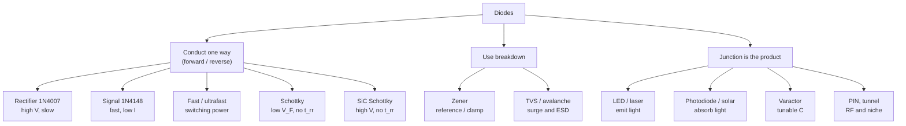

::: testing
Breadth plus judgment. The interviewer wants to hear that you know the diode family and, more importantly, **what each type is optimized for and what it trades away**. The key axes are:

- **forward voltage** (conduction loss),
- **reverse voltage rating and leakage**,
- **switching speed** (reverse recovery, capacitance),
- **intentional use of a region** (breakdown for Zener/TVS, reverse bias for photodiodes/varactors),
- **material** (Si, Schottky metal–Si, SiC, GaAs/GaN for LEDs).

A strong answer groups types logically and attaches a real application and a typical number to each, rather than reciting a list.
:::

::: why
Choosing the wrong diode type is a classic hardware bug: a general-purpose rectifier in a 500 kHz converter overheats, a Schottky's leakage drains a coin cell, a Zener used as a "precision" reference drifts, a regular diode on a connector doesn't stop ESD. Schematics are full of different diode symbols, and you need to read them. This question also sets up later ones: forward voltage by type ([[q0078]]), ideal diodes ([[q0079]]), buck catch diodes ([[q0197]]), and wide-bandgap power devices ([[q0146]]).
:::

::: concepts
- **PN junction vs metal–semiconductor junction**: most diodes are PN; Schottky diodes use a metal–semiconductor barrier, which changes $V_F$, leakage and speed. See [[q0072]].
- **Operating regions**: forward, reverse, breakdown. Some diodes are built to live in one specific region. See [[q0075]].
- **Reverse recovery**: stored minority charge in PN diodes delays turn-off; Schottkys don't have it.
- **Bandgap**: sets forward voltage and, for LEDs, the emitted wavelength ($E \approx 1240/\lambda$ eV·nm).
- **Junction capacitance**: depends on reverse voltage; exploited by varactors, minimized for fast signal diodes.
:::

::: answer
"I'd group them by what they're optimized for.

For conducting one way, there are standard rectifiers like the 1N4007, which handle high reverse voltage but are slow; small-signal switching diodes like the 1N4148, which are fast with low capacitance but only handle a couple hundred milliamps; fast and ultrafast recovery diodes for switching power; and Schottky diodes, which use a metal–semiconductor junction so they have a low forward drop, around 0.3 volts, and essentially no reverse recovery, but they leak more and usually have lower voltage ratings. For high-voltage power there are silicon carbide Schottkys.

Then there are diodes designed to operate in breakdown: Zener diodes as simple voltage references and clamps, and TVS diodes, which are avalanche diodes built to absorb big ESD and surge pulses.

And then there are diodes where the junction physics is the product: LEDs and laser diodes emit light, photodiodes and solar cells convert light to current, and varactors use the reverse-bias capacitance as a voltage-controlled capacitor for tuning.

There are some niche ones too, like PIN diodes for RF switching and tunnel diodes with negative resistance. The real skill is picking between them: forward drop versus leakage, speed versus voltage rating."
:::

::: technical
| Type | Key structure / physics | $V_F$ (typ.) | Strength | Weakness | Example parts |
|---|---|---|---|---|---|
| General-purpose rectifier | PN, thick lightly-doped region | ~0.9–1.1 V at rated $I$ | High $V_{RRM}$ (to 1 kV), cheap, robust surge | Slow: $t_{rr}$ of µs | 1N4001–1N4007 |
| Small-signal / switching | Small PN, low capacitance | ~0.6–1.0 V | Fast ($t_{rr}$ ~4 ns), few pF | Low current (~150–300 mA) | 1N4148, 1N914, BAV99 |
| Fast / ultrafast recovery | PN with lifetime control | ~1–1.7 V | $t_{rr}$ tens of ns at high voltage | Higher $V_F$ | UF400x, MUR-series |
| Schottky | Metal–semiconductor barrier, majority carriers | ~0.2–0.5 V | Low $V_F$, no reverse recovery | Higher leakage (rises fast with T), usually ≤ 100–200 V | 1N5817–1N5819, BAT54, SS14 |
| SiC Schottky | Schottky on wide-bandgap SiC | ~1.3–1.8 V | 600–1700 V with no recovery | Higher $V_F$, cost | Wolfspeed C3D/C4D families |
| Zener | Heavily doped PN, controlled breakdown | normal forward; $V_Z$ 2.4–200 V reverse | Simple reference / clamp | ±2–5% tolerance, $r_z$, tempco | 1N47xxA, BZX84C, MMSZ |
| TVS / avalanche | PN optimized for peak pulse power | — | Absorbs kW-level µs pulses, fast | Capacitance on fast lines, leakage | SMAJ/SMBJ series, ESD arrays |
| LED | Direct-bandgap III-V PN (GaAs, GaP, InGaN) | 1.8–3.5 V by colour | Light emission | Low reverse rating (~5 V) | — |
| Laser diode | LED + optical cavity | ~1.8–3 V+ | Coherent light | Needs tight current control | — |
| Photodiode / PIN / APD | Reverse-biased junction collects photocarriers | — | Linear light sensing, fast | Dark current, needs TIA | BPW34 (PIN) |
| Solar cell | Large-area PN, photovoltaic | ~0.5–0.6 V open circuit (Si) | Power generation | — | — |
| Varactor | Junction with tailored doping profile | — | Voltage-tuned capacitance | Nonlinear, limited range | — |
| PIN (RF) | Intrinsic layer between P and N | — | RF switch/attenuator | Needs DC bias | — |
| Tunnel (Esaki) | Degenerately doped, tunnelling | — | Negative resistance, very fast | Niche, low voltage | — |

**Selection rules of thumb.** Mains rectification at 50/60 Hz → standard rectifier. Logic/clamping/signal switching → 1N4148 class. Switch-mode power below ~100 V → Schottky (or synchronous FET). Switch-mode at 400–1000 V → ultrafast Si or SiC Schottky. References → Zener for crude, bandgap IC for precise. Connector protection → TVS sized by IEC 61000-4-2/-5 levels and data-line capacitance.
:::

::: short
"I group them by job. Conduction: standard rectifiers like the 1N4007 for high voltage but slow; small-signal 1N4148 for fast, low-current switching; ultrafast recovery for switching power; Schottkys for low forward drop and no reverse recovery but more leakage; and silicon carbide Schottkys for high-voltage power. Breakdown: Zeners for references and clamps, TVS diodes for surge and ESD. And optical or capacitive: LEDs, laser diodes, photodiodes, solar cells and varactors."
:::

::: long
"I find it easiest to group diodes by what they're optimized for, because each type is really a trade-off between forward drop, voltage rating, speed and leakage.

The first group just conducts one way. A standard rectifier like the 1N4001 to 1N4007 has a thick, lightly doped region so it blocks up to 1000 volts and survives big surges, but it stores a lot of charge, so its reverse recovery is microseconds. Fine at 60 hertz, terrible in a switching converter. Small-signal diodes like the 1N4148 are the opposite: tiny, a few picofarads, recover in a few nanoseconds, but only handle a couple hundred milliamps. In between there are fast and ultrafast recovery diodes for switching power at higher voltages.

Schottky diodes are a different structure: a metal–semiconductor junction. Conduction is by majority carriers, so there's no stored charge and basically no reverse recovery, and the forward drop is low, 0.2 to 0.5 volts. The costs are higher leakage, which gets a lot worse when hot, and lower voltage ratings, usually under about 100 to 200 volts. For high voltage you'd use a silicon carbide Schottky, which gets you no recovery at 600 volts or more, with a higher forward drop.

The second group operates in reverse breakdown deliberately. Zener diodes break down at a specified voltage, so with a resistor they make a simple reference or clamp. TVS diodes are avalanche diodes built for huge peak power for microseconds, which is what you put on connectors for ESD and surge.

The third group uses the junction itself. LEDs emit light when carriers recombine in a direct-bandgap material, and their forward voltage tracks the photon energy, so red is around 2 volts and blue around 3. Laser diodes add an optical cavity. Photodiodes and solar cells do the reverse, turning light into current. Varactors use the voltage-dependent depletion capacitance to tune oscillators.

There are niche ones too: PIN diodes for RF switching, tunnel diodes with negative resistance. In practice, I'd pick based on the application: voltage, current, frequency, and how much leakage I can tolerate."
:::

::: terms
- **Rectifier diode**: a PN diode built for high reverse voltage and current at line frequency.
- **Small-signal (switching) diode**: low-current, low-capacitance, fast PN diode.
- **Reverse recovery time $t_{rr}$**: time for a PN diode to stop conducting after being reverse biased.
- **Schottky diode**: metal–semiconductor junction diode; low $V_F$, no minority-carrier storage.
- **Zener diode**: diode specified to operate in reverse breakdown at $V_Z$.
- **TVS diode**: avalanche diode rated for peak pulse power, used for transient suppression.
- **Standoff voltage $V_{WM}$ / clamping voltage $V_C$**: TVS ratings: max normal voltage without conduction, and voltage across it at rated pulse current.
- **Varactor (varicap)**: diode used as a voltage-controlled capacitor.
- **PIN diode**: P–intrinsic–N structure; used as RF switch/attenuator and fast photodiode.
- **Wide-bandgap (SiC, GaN)**: semiconductors with larger bandgap than Si, enabling higher voltage and temperature.
:::

::: exceptional
**An average answer** lists "normal, Zener, Schottky, LED".

**An exceptional answer**:
- Organizes types by purpose and names the **trade-off axis** each one moves along (V_F vs leakage, speed vs voltage rating).
- Explains *why* Schottkys are fast and low-drop (metal–semiconductor, majority carriers, lower barrier) and *why* rectifiers are slow (stored charge in a thick drift region).
- Distinguishes Zener (reference, continuous breakdown) from TVS (transient, peak-power rated).
- Gives **real part numbers and numbers**: 1N4148 ~4 ns, 1N4007 1000 V, 1N5819 ~0.4–0.6 V at 1 A, SMBJ ~600 W peak pulse.
- Mentions wide-bandgap SiC Schottkys in PFC stages and EV chargers.
- Connects to selection: "for a 12 V, 500 kHz buck I'd use a 40 V Schottky or go synchronous."
:::

::: mistakes
- **"Zener and TVS are the same thing."** Both use breakdown, but a Zener is a low-power reference specified at a test current; a TVS is built to absorb hundreds of watts for microseconds and is specified by standoff and clamping voltage.
- **"Schottky is always better because the drop is lower."** It trades lower $V_F$ for much higher leakage (rising roughly exponentially with temperature), lower $V_{RRM}$, and risk of thermal runaway at high temperature.
- **"LEDs are just diodes that light up, so their forward voltage is 0.7 V."** LED $V_F$ is set by the bandgap of the material: ~2 V red, ~3 V blue/white.
- **"A 1N4148 can replace a 1N4007."** It's fast but rated for ~200 mA average and 100 V; it will fail as a mains rectifier.
- **"Reverse-biasing an LED is harmless."** Many LEDs have reverse-voltage ratings around 5 V; exceed that and they can be damaged.
- **"Photodiodes need forward bias."** They're operated reverse biased (photoconductive) or at zero bias (photovoltaic), never forward biased.
:::

::: deep
## The organizing idea: every diode is a set of trade-offs

All diodes are built around a rectifying junction, but the doping, materials and geometry are tuned for different jobs. Group them by job and the list becomes a map:


Figure: Three families. The first is about efficiency and speed when conducting; the second about controlled breakdown; the third about using the junction's optical or capacitive behaviour. Each leaf is a different point in the trade-off space.

```circuit
{"caption":"Schematic symbols you'll see","elements":[
 {"t":"D","a":[0,1],"b":[0,5],"label":"Standard"},
 {"t":"Schottky","a":[6,1],"b":[6,5],"label":"Schottky"},
 {"t":"Zener","a":[12,1],"b":[12,5],"label":"Zener"},
 {"t":"TVS","a":[18,1],"b":[18,5],"label":"TVS (bidir.)"},
 {"t":"LED","a":[24,1],"b":[24,5],"label":"LED"},
 {"t":"photodiode","a":[30,1],"b":[30,5],"label":"Photodiode"},
 {"t":"text","at":[15,7],"text":"anode on top, cathode (bar) at the bottom; the bidirectional TVS has no polarity","muted":true}
]}
```
Figure: All are drawn anode-to-cathode in the direction of the arrow. The cathode bar is modified to show the type: hooks for Schottky, bent ends for Zener, two back-to-back junctions for a bidirectional TVS. LEDs have arrows pointing out; photodiodes have arrows pointing in.

## Family 1: diodes that conduct one way

### Standard rectifiers vs small-signal diodes

The trade-off here is **stored charge vs voltage rating**. A high-voltage PN diode needs a thick, lightly doped region to support a wide depletion region in reverse. In forward conduction that region floods with minority carriers (conductivity modulation), which keeps $V_F$ reasonable at high current but leaves a lot of stored charge. Removing it takes time: **reverse recovery**.

| | 1N4007 (rectifier) | 1N4148 (signal) |
|---|---|---|
| $V_{RRM}$ | 1000 V | 100 V |
| Average current | 1 A | ~200 mA |
| $V_F$ | ~1 V at 1 A | ~0.7 V at 5 mA, ~1 V at 10 mA (max spec) |
| $t_{rr}$ | µs range | ~4 ns |
| Capacitance | tens of pF | ~2–4 pF |
| Use | 50/60 Hz rectification | logic, clamps, fast switching |

> [!UNCERTAIN]
> The exact $t_{rr}$ of 1N400x parts varies by manufacturer and is often not even specified (some datasheets give ~2 µs typical, others list nothing). Treat it as "microseconds, unsuitable above a few kHz of hard switching".

**Fast and ultrafast recovery diodes** (e.g. UF400x, MUR families) use lifetime control (gold or platinum doping, or electron irradiation) to kill stored carriers faster, getting $t_{rr}$ down to tens of ns at hundreds of volts, at the cost of higher $V_F$ and leakage.

### Schottky diodes

A Schottky diode replaces the P side with a metal (or silicide) contact on lightly doped N silicon. The metal–semiconductor barrier is lower than a PN barrier, and current flows by **majority carriers** being thermionically emitted over it. Two consequences:

1. **Lower $V_F$**, typically 0.2–0.5 V depending on barrier metal, current rating and current.
2. **No minority-carrier storage**, so no reverse recovery. Only junction capacitance has to charge.

The price is a much larger saturation current, which shows up as **leakage**: µA at room temperature for a 1 A part, rising to mA at 100+ °C. Because leakage power grows with temperature, a hot Schottky blocking high voltage can thermally run away. Schottky barriers also limit practical reverse voltages in silicon to around 100–200 V.

### SiC Schottky diodes

Silicon carbide has a bandgap of ~3.3 eV versus 1.12 eV for silicon and roughly ten times the critical breakdown field, so a Schottky barrier can block 600–1700 V with a thin drift region and still have no reverse recovery. $V_F$ is higher (~1.3–1.8 V), but eliminating recovery loss makes them the standard choice in boost PFC stages, solar inverters and EV chargers. See [[q0146]].

### Comparing the forward curves

```plot
{"title":"Forward I–V by diode type (illustrative models)","x":{"label":"V_F","unit":"V","min":0,"max":3.4},"y":{"label":"I_F","unit":"mA","min":0,"max":20},
 "vars":{"vt":0.02585},
 "series":[{"label":"Schottky","fn":"1000*1e-6*(exp(x/(1.05*vt))-1)","n":1600},{"label":"Silicon PN","fn":"1000*1e-14*(exp(x/vt)-1)","n":1600},{"label":"Red LED","fn":"1000*1e-19*(exp(x/(2*vt))-1)","n":1600},{"label":"Blue LED","fn":"1000*1e-28*(exp(x/(2*vt))-1)","n":1600}]}
```
Figure: Same exponential law, different barrier. The Schottky turns on lowest (~0.25 V at 10 mA in this model), silicon at ~0.7 V, red LED at ~2 V and blue LED near 3 V. The parameters are illustrative, chosen to land at typical datasheet values. Why the values differ is the subject of [[q0078]].

```sim
{"id":"diode-iv","device":"schottky","vs":5,"r":1000,"view":"curve"}
```
Figure: Cycle through the device presets (silicon, Schottky, germanium, red LED, blue LED, Zener). Note where each crosses 10 mA, and how the Zener differs only in the reverse direction.

## Family 2: diodes that use breakdown

### Zener diodes

Heavy doping on both sides makes the depletion region thin, so breakdown happens at a low, well-controlled voltage: tunnelling (true Zener effect) below ~5 V, avalanche above ~6 V. A Zener is specified at a test current $I_{ZT}$, with tolerance (typically ±2% to ±5%), dynamic impedance $Z_{ZT}$, and power rating (e.g. 1N47xxA series: 1 W, 3.3–100 V).

Example: a 5.1 V Zener fed from 12 V through 330 Ω with a 1 kΩ load carries ~16 mA and dissipates ~81 mW ([[q0075]]). It's a fine clamp or crude reference, but for precision use a shunt reference IC such as a TL431 or LM4040, which have much lower dynamic impedance and tighter tolerance.

### TVS diodes

A TVS is an avalanche diode engineered for **peak pulse power**: large junction area and good thermal mass so it can absorb, say, 600 W for a 10/1000 µs surge waveform (SMBJ-class) or a 1 ns ESD edge. Key specs:

- **$V_{WM}$ (standoff)**: highest normal operating voltage, at which leakage is guaranteed low.
- **$V_{BR}$**: breakdown, a bit above $V_{WM}$.
- **$V_C$ (clamping)**: voltage across it at its rated peak pulse current, noticeably higher than $V_{BR}$.
- **Capacitance**: matters on fast data lines (USB, HDMI), where low-capacitance ESD arrays with steering diodes are used instead of big TVS parts.

Bidirectional TVS parts (two junctions back to back) protect signals that swing both ways, like RS-485 or audio.

## Family 3: the junction as the product

### LEDs and laser diodes

In a **direct-bandgap** semiconductor (GaAs, GaP, InGaN), an electron dropping from the conduction band into a hole emits a photon with energy close to the bandgap. Photon energy and wavelength are related by $E\,[\text{eV}] \approx 1240/\lambda\,[\text{nm}]$:

| Colour | λ | Photon energy | Typical $V_F$ |
|---|---|---|---|
| Infrared | 940 nm | 1.32 eV | ~1.2–1.5 V |
| Red | 630 nm | 1.97 eV | ~1.8–2.2 V |
| Green (InGaN) | 525 nm | 2.36 eV | ~2.8–3.3 V |
| Blue | 470 nm | 2.64 eV | ~2.8–3.3 V |

Silicon has an **indirect** bandgap, so recombination releases heat (phonons) instead of light, which is why silicon diodes don't glow. White LEDs are blue LEDs plus a phosphor. Laser diodes add an optical cavity and need precise current control because output rises steeply above a threshold current.

### Photodiodes and solar cells

Run the LED process backwards: a photon absorbed in or near the depletion region creates an electron-hole pair, and the built-in field sweeps them apart, producing a current proportional to light. Photodiodes are usually **reverse biased** (wider depletion region, lower capacitance, faster) and read with a transimpedance amplifier. **PIN** photodiodes add an intrinsic layer for a wide absorption region and low capacitance; **avalanche photodiodes (APDs)** run near breakdown for internal gain. **Solar cells** are large-area photodiodes run at zero-to-forward bias, delivering power (~0.5–0.6 V open circuit per silicon cell).

### Varactors

The depletion region is a capacitor whose "plate spacing" grows with reverse voltage: $C_j = C_{j0}/(1+V_R/V_{bi})^m$. Varactors use doping profiles that make this dependence strong ("hyperabrupt", $m$ > 0.5) to tune VCOs and filters with a DC control voltage.

### Niche types

- **PIN diode (RF)**: at RF, a forward-biased PIN behaves like a current-controlled resistor and a reverse-biased one like a small capacitor, making it an RF switch or attenuator.
- **Tunnel (Esaki) diode**: so heavily doped that tunnelling gives a negative-resistance region in forward bias; historically used in very fast oscillators.
- **Step-recovery diode**: designed to snap off abruptly at the end of reverse recovery, used for harmonic generation and pulse sharpening.
- **"Constant-current diodes"**: actually a JFET with gate tied to source, packaged as a two-terminal current regulator.

## A selection walkthrough

> [!INTERVIEW]
> When asked "which diode would you use?", walk the axes out loud: "What's the max reverse voltage? Peak and average current? Switching frequency, so does reverse recovery matter? Is leakage a problem, for example battery-powered or hot? Then I'd pick." Interviewers care more about this reasoning than the part number.

| Requirement | Pick | Why |
|---|---|---|
| 230 V AC bridge, 1 A | 1N4007 ×4 or a bridge package | 1000 V rating, 50 Hz doesn't care about $t_{rr}$ |
| 12 V → 5 V, 500 kHz async buck, 2 A | 3 A / 40 V Schottky | Low $V_F$, no recovery; 40 V gives margin over 12 V |
| 400 V boost PFC | SiC Schottky | No recovery at high voltage |
| Relay flyback, 12 V, 50 mA | 1N4148 or 1N4007 | Low frequency, low current; either works |
| USB 2.0 data lines | Low-capacitance ESD array | Must clamp ESD without loading 480 Mb/s signals |
| 24 V industrial input surge | SMBJ-class TVS (standoff ≥ 24–28 V) | Absorbs IEC 61000-4-5 surge energy |
| Coin-cell reverse-polarity | Low-leakage PN or a MOSFET | Schottky leakage would drain the cell |
:::

::: applications
- **Laptop/phone chargers**: a bridge rectifier at the AC input, an SiC or ultrafast diode in the PFC boost (higher-power units), Schottky or synchronous rectification on the low-voltage output.
- **Arduino-style boards**: a Schottky or PN diode for input protection, a TVS or ESD array on USB, an LED for power indication.
- **Automotive ECUs**: high-power TVS diodes for load-dump protection on the 12 V battery input.
- **Optical sensors**: PIN photodiodes in pulse oximeters and ambient-light sensors; APDs in LiDAR receivers.
- **RF front ends**: varactors in tunable filters and VCOs; PIN diodes in T/R switches.
- **Solar panels**: bypass diodes (often Schottky) in the junction box across groups of cells.
:::

::: assumptions
- Values like $V_F$, $t_{rr}$ and leakage are typical ranges; they depend on current, temperature, voltage rating and manufacturer. Always check the datasheet.
- "Kinds of diodes" can be read by structure (PN, Schottky, PIN), by material (Si, Ge, SiC, GaAs), or by application (rectifier, Zener, TVS, LED). I've organized by application/purpose and mentioned structure and material where they drive behaviour. Any of these organizations is a valid answer if it's clear.
- Germanium diodes are mostly historical (low $V_F$ ~0.2–0.3 V, high leakage); mention them if asked about older circuits or crystal radios.
- Synchronous MOSFETs and ideal-diode controllers increasingly replace diodes in power paths; that's not a "kind of diode" but it's the modern answer to "how do I avoid diode loss?" See [[q0079]].
:::

::: followups
### Why does a Schottky diode have no reverse recovery?
Its current is carried by majority carriers (electrons in N-type silicon) crossing a metal–semiconductor barrier. There's no injection of minority carriers into a neutral region, so no stored minority charge to remove at turn-off. The only thing to charge is the junction capacitance, which looks like a small capacitive current blip rather than a recovery spike. That's why Schottkys are used as catch diodes in switching converters.

### When would you NOT use a Schottky diode?
When leakage matters or voltage is high. A 1 A Schottky can leak tens to hundreds of µA at 85–125 °C, which matters in battery-powered circuits, sample-and-hold, peak detectors and precision sensing. At high temperature and high reverse voltage the leakage power can cause thermal runaway. Silicon Schottkys also top out around 100–200 V, so for 400 V you'd use an ultrafast silicon diode or a SiC Schottky.

### What's the difference between a Zener and a TVS?
Both conduct in reverse breakdown. A Zener is a low-power, continuous-duty reference: you choose $V_Z$ at a test current and run it there. A TVS is designed for short, high-energy transients: large junction, peak pulse power ratings of hundreds of watts to kW, and specs like standoff and clamping voltage. A Zener used for surge protection will often fail; a TVS used as a reference will be imprecise and leaky.

### Why do LEDs have different forward voltages for different colours?
Photon energy equals roughly the bandgap energy, and wavelength is $\lambda \approx 1240/E$ (nm, eV). Shorter wavelengths need wider-bandgap materials, and the forward voltage must at least supply that energy per electron: red at ~1.97 eV needs ~1.8–2.2 V, blue at ~2.64 eV needs ~2.8–3.3 V. Series resistance and heterostructure details add a bit on top. See [[q0078]].

### Your 300 kHz boost converter's diode is overheating. It's a UF4007-class ultrafast part. What could you change?
Calculate losses first: conduction loss $V_F \cdot I_{avg}$ (with $V_F$ ~1.7 V for an ultrafast part this is large) and recovery loss roughly $Q_{rr}V_{out}f_{sw}$. If the output is below ~100 V, switch to a Schottky rated for the output voltage with margin: lower $V_F$ and no recovery. If it's 400 V, consider a SiC Schottky. If efficiency is critical, go synchronous with a MOSFET. Also check thermal design: copper area, airflow.
:::

::: references
- Horowitz & Hill, *The Art of Electronics*, 3rd ed.: Chapter 1 (diodes, Zeners) and Chapter 9 (rectifiers, transient protection).
- Sedra & Smith, *Microelectronic Circuits*: diodes chapter, sections on Zener diodes and special diode types (Schottky, varactor, photodiode, LED).
- Sze & Ng, *Physics of Semiconductor Devices*: chapters on metal–semiconductor contacts, p-n junctions, LEDs and photodetectors.
- Baliga, *Fundamentals of Power Semiconductor Devices*: chapters on Schottky rectifiers and P-i-N rectifiers (reverse recovery, SiC).
- IEC 61000-4-2 and IEC 61000-4-5: ESD and surge immunity standards that drive TVS selection.
:::

::: rubric
- Covers rectifier, small-signal, Schottky, Zener, LED at minimum :: These are the types every hardware engineer meets.
- Explains Schottky trade-off: low $V_F$ and no reverse recovery vs higher leakage and lower voltage rating :: The most practically important comparison.
- Distinguishes Zener (reference/clamp) from TVS (transient energy absorption) :: A common confusion with real consequences for protection design.
- Mentions optical/capacitive types: photodiode, solar cell, varactor :: Shows breadth across the family.
- Explains speed vs voltage/stored charge for rectifiers vs fast/small-signal diodes :: Explains why you can't use a 1N4007 everywhere.
- Gives real part examples or numbers :: Signals hands-on familiarity.
- Mentions wide-bandgap (SiC) diodes for high-voltage power :: Shows awareness of current industry practice.
:::

::: quiz
```json
[
 {"type":"mcq","level":"fundamental","q":"Which diode type has the lowest forward voltage and essentially no reverse-recovery charge?","options":["Standard PN rectifier","Zener","Schottky","Silicon small-signal (1N4148)"],"answer":2,"explain":"A Schottky uses a metal–semiconductor barrier (lower than a PN barrier) and conducts with majority carriers, so there's no stored minority charge to recover."},
 {"type":"mcq","level":"intermediate","q":"You need to rectify 230 V AC at 50 Hz, 0.5 A. Which is the most sensible choice?","options":["1N4148","1N5819 (40 V Schottky)","1N4007","A 5.1 V Zener"],"answer":2,"explain":"The peak reverse voltage is ~325 V, so you need a high-voltage rectifier. The 1N4007 is rated 1000 V, 1 A, and its slow recovery is irrelevant at 50 Hz. The 1N4148 (100 V, ~200 mA) and a 40 V Schottky would fail."},
 {"type":"numeric","level":"intermediate","q":"Using E (eV) ≈ 1240/λ (nm), what is the photon energy of a 590 nm (amber) LED?","answer":2.10,"tolerance":0.02,"unit":"eV","explain":"$E = 1240/590 \\approx 2.10$ eV, so its forward voltage will be a little over 2 V."},
 {"type":"truefalse","level":"fundamental","q":"A TVS diode and a Zener diode are interchangeable because both operate in reverse breakdown.","answer":false,"explain":"A Zener is a low-power reference specified at a test current; a TVS is built to absorb high peak pulse power (hundreds of W) for short transients. Using one in the other's role leads to failure or poor accuracy."},
 {"type":"multi","level":"advanced","q":"Which are genuine drawbacks of silicon Schottky diodes compared with PN diodes? Select all that apply.","options":["Higher reverse leakage, rising steeply with temperature","Lower practical reverse-voltage ratings","Longer reverse-recovery time","Risk of thermal runaway at high temperature and reverse voltage"],"answer":[0,1,3],"explain":"Schottkys leak far more, top out around 100–200 V in silicon, and their leakage power can run away when hot. Reverse recovery is their strength, not a weakness."},
 {"type":"mcq","level":"advanced","q":"Why do silicon diodes not emit useful light while GaAs and InGaN diodes do?","options":["Silicon's bandgap is too large","Silicon has an indirect bandgap, so recombination mostly releases phonons (heat)","Silicon has no holes","Silicon diodes are reverse biased in normal operation"],"answer":1,"explain":"In an indirect-bandgap material, recombination needs a phonon to conserve momentum, so radiative recombination is very unlikely and the energy goes into heat. III-V direct-bandgap materials recombine radiatively."}
]
```
:::
