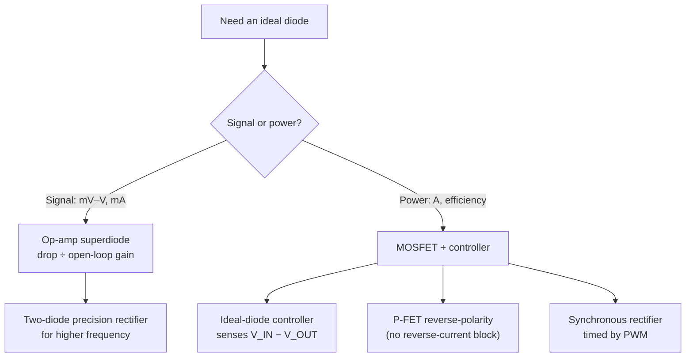

::: testing
Whether you understand **what's non-ideal about a real diode** (forward drop, reverse leakage, reverse recovery) and can use other components, usually feedback or a MOSFET, to remove it. The interviewer is listening for two answers that serve different worlds:

- **Signal level**: the op-amp **"superdiode"** (precision rectifier), where the op-amp's open-loop gain divides the diode drop down to microvolts.
- **Power level**: a **MOSFET driven by a controller** that senses the voltage across it and turns it on for forward current and off for reverse current. This is what "ideal diode" means in power design (ideal-diode controllers, synchronous rectification, P-FET reverse-polarity protection).

Advanced sub-skills: knowing the MOSFET's **body diode orientation**, why an N-FET high-side needs a **charge pump**, why a simple P-FET protects against **reverse polarity** but not **reverse current**, and the limits (speed, op-amp saturation, controller turn-off time).
:::

::: why
Diode drops are expensive at low voltage and high current. A Schottky carrying 5 A wastes about 2 W; a MOSFET with 5 mΩ on-resistance wastes 0.125 W. That's why laptops, servers, USB-C power paths, battery OR-ing, automotive reverse-battery protection and every modern buck converter use "ideal diode" techniques. On the signal side, any time you need to rectify a millivolt-level AC signal (AC voltmeters, envelope detectors, absolute-value circuits), a plain diode's 0.6 V drop makes it useless. This question checks whether you can see a component's imperfection and engineer around it, and it's the setup for [[q0198]] (ideal diode in a buck) and [[q0203]] (synchronous rectification).
:::

::: concepts
- **Ideal diode**: zero forward drop, zero reverse current, instant switching. Real diodes violate all three. See [[q0072]], [[q0078]].
- **Negative feedback with high gain**: an op-amp forces its inputs equal, so anything inside the loop (including a diode drop) is divided by the open-loop gain. See [[q0124]].
- **MOSFET as a bidirectional switch**: a fully-on MOSFET conducts in either direction as a resistor $R_{DS(on)}$. See [[q0096]].
- **Body diode**: the intrinsic diode from source to drain (NMOS) that conducts even when the gate is off. See [[q0101]].
- **Gate drive**: an N-FET needs $V_{GS}$ above threshold; on the high side that means a gate voltage above the input rail (charge pump or bootstrap).
- **Conduction loss**: diode $P = V_FI$ vs MOSFET $P = I^2R_{DS(on)}$.
:::

::: answer
"It depends on whether it's a signal or a power path.

For signals, I'd use an op-amp superdiode: put the diode inside the op-amp's feedback loop, with the output taken from the cathode. When the input is positive, the op-amp drives its output up to whatever it takes, about 0.6 volts above the input, so the cathode exactly follows the input. The diode drop gets divided by the open-loop gain, so it's effectively microvolts. When the input is negative, the diode is reverse biased and the output sits at zero through the load. The downside is speed: the op-amp output slams into the negative rail and has to slew back, so it's limited to fairly low frequencies.

For power, the ideal diode is a MOSFET with a controller. The MOSFET's body diode points the right way, so current can flow at first, then the controller senses the voltage from input to output, and if it's forward it turns the gate on, so the drop is just $I \times R_{DS(on)}$, millivolts instead of 0.4 volts. If the output tries to go above the input, it sees reverse voltage and turns the gate off fast, which blocks reverse current. With an N-channel FET on the high side, the controller needs a charge pump to get the gate above the source. Parts like the LTC4357 or LM74700 do exactly this.

A simpler version is a P-channel FET with its gate to ground for reverse-polarity protection, but that doesn't block reverse current, so it's not a true ideal diode."
:::

::: technical
**Real-diode non-idealities to remove:** $V_F$ (0.3–1 V), reverse leakage (nA–mA), reverse recovery ($t_{rr}$), temperature dependence.

**1. Op-amp superdiode (precision half-wave rectifier).** Diode D from op-amp output to $V_{out}$; feedback from $V_{out}$ to the inverting input; $V_{in}$ to the non-inverting input; $R_L$ to ground.
- $V_{in} > 0$: D conducts, loop closed, $V_{out} = V_{in}\frac{A}{1+A} - \frac{V_F}{1+A} \approx V_{in}$. Effective drop $V_F/A$: 0.6 V / 10⁵ = 6 µV.
- $V_{in} < 0$: D reverse biased, loop open, $V_{out} = 0$ (via $R_L$), op-amp output saturates at $V_{EE}$.
- Limit: on each positive crossing the op-amp must slew from $V_{EE}$ to ~$+V_F$: $t \approx (|V_{EE}| + V_F)/SR$. With $V_{EE} = -12$ V and SR = 0.5 V/µs that's ~25 µs, so distortion appears well below 10 kHz. Fix: the two-diode inverting precision rectifier keeps the op-amp in feedback in both half-cycles, so it only has to slew ~2 $V_F$.

**2. MOSFET ideal-diode controller (power).** N-FET in series with source at the input (anode side) and drain at the output (cathode side), so the body diode conducts input → output.
- Controller senses $V_{IN} - V_{OUT}$. Forward: drives the gate to regulate the drop to a small value (tens of mV) at light load, or fully on at heavy load: $V_{drop} = \max(V_{REG}, IR_{DS(on)})$.
- Reverse ($V_{OUT} > V_{IN}$): pulls the gate down fast, blocking reverse current (the body diode is reverse biased).
- High-side N-FET needs $V_G > V_{IN} + V_{th}$: an internal charge pump. P-FET versions avoid the charge pump but have higher $R_{DS(on)}$ per area (hole mobility).
- Loss at 5 A: Schottky 0.45 V → 2.25 W; 5 mΩ FET → $5^2\times0.005 = 0.125$ W.
- Back-to-back FETs (common-source) are needed if you must also *disconnect* in the forward direction, because a single FET's body diode always conducts forward.

**3. P-FET reverse-polarity protection.** Drain to battery +, source to load, gate to ground via resistor, Zener gate–source clamp. Correct polarity: body diode conducts, then $V_{GS} \approx -V_{BAT}$ turns the channel on. Reversed: $V_{GS} \ge 0$, FET off, body diode reverse biased. It does **not** block reverse current when the load side is higher (the channel is on whenever the gate sees the battery).

**4. Synchronous rectification.** In converters, the controller turns a MOSFET on exactly when the diode would conduct (low-side FET of a buck). Same idea, timed by the PWM rather than by sensing. See [[q0203]].
:::

::: short
"For signals, an op-amp superdiode: the diode goes inside the op-amp's feedback loop, so its 0.6 volt drop is divided by the open-loop gain and the output follows the input for positive signals, at the cost of speed. For power, a MOSFET with a controller: the body diode points the right way, and the controller senses forward voltage and turns the gate on so the drop is just $I R_{DS(on)}$, then turns it off fast if current tries to reverse. Parts like the LTC4357 or LM74700 do this."
:::

::: long
"First I'd say what's wrong with a real diode: it drops 0.3 to 1 volt forward, it leaks a bit in reverse, and PN diodes have reverse recovery. An ideal diode would have zero drop, zero reverse current and switch instantly. How to get close depends on whether it's a signal or a power path.

For small signals, the classic trick is the superdiode, or precision rectifier. You feed the input to an op-amp's non-inverting input, put the diode from the op-amp output to the output node, and take feedback from the output node, the cathode, back to the inverting input. When the input is positive, the diode conducts, the loop is closed, and the op-amp forces the output to equal the input. The op-amp output just sits one diode drop higher. Because the drop is inside the loop, it's divided by the open-loop gain, so 0.6 volts over a gain of 100,000 is 6 microvolts. When the input goes negative, the diode turns off, the output is pulled to zero by the load, and the op-amp saturates at its negative rail. That's the weakness: every time the input crosses zero, the op-amp has to slew back from the rail, which limits it to low frequencies. The two-diode inverting version fixes that by keeping the op-amp in feedback both ways.

For power paths, the ideal diode is a MOSFET plus a controller. I'd put an N-channel FET in series with its source on the input side, so its body diode conducts in the forward direction. The controller watches the voltage across the FET. If the input is higher, it drives the gate on, so the drop is just $I R_{DS(on)}$: at 5 amps with 5 milliohms that's 25 millivolts and 125 milliwatts, compared with over 2 watts for a Schottky. If the output rises above the input, like when another supply is OR'd in, the controller pulls the gate low quickly and the reversed body diode blocks. Since the FET is on the high side, the controller has a charge pump to get the gate above the rail. Chips like the LTC4357 and TI's LM74700 are made for this.

There's also the cheap version, a P-channel FET with its gate tied to ground, for reverse-battery protection. It's great at that, but it doesn't block reverse current, so it's not a full ideal diode. And synchronous rectifiers in buck converters are the same idea, timed by the PWM instead of sensing."
:::

::: terms
- **Ideal diode**: a hypothetical element with zero forward drop, zero reverse current and instantaneous switching; also the industry name for MOSFET-based diode replacements.
- **Superdiode / precision rectifier**: op-amp circuit placing a diode inside the feedback loop to cancel its drop.
- **Ideal-diode controller**: IC that drives a series MOSFET to emulate a diode with millivolt drop and fast reverse blocking.
- **Body diode**: intrinsic PN diode between source and drain of a MOSFET (anode at source for NMOS).
- **$R_{DS(on)}$**: on-resistance of a fully enhanced MOSFET; sets conduction loss $I^2R_{DS(on)}$.
- **Charge pump**: circuit that generates a gate voltage above the input rail for a high-side N-FET.
- **Reverse-current blocking**: preventing current flowing from output back to input when $V_{OUT} > V_{IN}$.
- **Synchronous rectification**: replacing a rectifier diode with a MOSFET switched on in sync with when the diode would conduct.
- **Power-path / OR-ing**: selecting between multiple supplies without back-feeding.
:::

::: exceptional
**An average answer** says "use a Schottky" or "use a MOSFET" without explaining how it behaves like a diode.

**An exceptional answer**:
- Lists the non-idealities being removed (drop, leakage, recovery) and asks "signal or power?" first.
- Draws the superdiode and explains **why** the drop disappears: high-gain feedback divides it by $A_{OL}$. Mentions its slew/saturation limitation and the two-diode fix.
- Draws the MOSFET ideal diode with the **body diode correctly oriented**, explains sensing and gate control, the charge-pump requirement, and computes the loss saving with numbers.
- Distinguishes **reverse-polarity protection** (P-FET with grounded gate) from **reverse-current blocking** (needs active sensing).
- Mentions limits: controller turn-off time during a fast reverse event, regulated forward drop at light load (to avoid oscillation), back-to-back FETs when you also need a disconnect, and synchronous rectification as the converter equivalent.
:::

::: mistakes
- **Putting the MOSFET in backwards.** If the body diode points output → input, current flows backwards through it even with the gate off, and there's no blocking. For an N-FET ideal diode, source goes to the input (anode side).
- **"A Schottky is an ideal diode."** It's a better diode (~0.3–0.5 V drop, no recovery), but it still drops hundreds of mV and leaks more than a PN diode.
- **Driving a high-side N-FET gate from the input rail.** Then $V_{GS} = 0$ at best; it never turns on. You need a gate voltage above the source by $V_{GS(on)}$, i.e., a charge pump or bootstrap.
- **Thinking a P-FET reverse-polarity circuit blocks reverse current.** With correct battery polarity the gate is held on, so if the load side rises above the battery (e.g. a second supply), current flows back into the battery.
- **Using a basic superdiode at high frequency.** The op-amp saturates at the negative rail every half-cycle and must slew back, causing distortion and glitches at the zero crossing.
- **Forgetting the turn-off speed.** During an input short, the controller must turn the FET off within microseconds or large reverse current flows from the output capacitors back into the short.
:::

::: deep
## What "ideal" means, and what we're fixing

An ideal diode has the L-shaped I–V curve: a short for forward current, an open for reverse voltage, with nothing in between. Real diodes depart from that in three ways:

| Non-ideality | Typical magnitude | Hurts |
|---|---|---|
| Forward drop $V_F$ | 0.3–0.5 V Schottky, 0.6–1 V Si | Power efficiency, low-voltage headroom, small-signal rectification |
| Reverse leakage | nA (Si) to mA (hot Schottky) | Battery drain, precision circuits |
| Reverse recovery | ns to µs (PN) | Switching losses, EMI |

There are two very different contexts, and the solutions differ:


Figure: The first question to ask is signal or power. Signal circuits use feedback to hide the diode drop; power circuits replace the diode with a MOSFET channel and add control to decide when it's on.

## 1. Signal level: the op-amp superdiode

### How it works

```circuit
{"caption":"Op-amp superdiode (precision half-wave rectifier)","elements":[
 {"t":"opamp","at":[4,4],"swap":true},
 {"t":"term","at":[0,3],"label":"V_{in}","side":"left"},
 {"t":"wire","pts":[[0,3],[4,3]]},
 {"t":"D","a":[8,4],"b":[12,4],"label":"D"},
 {"t":"wire","pts":[[12,4],[15,4]]},{"t":"dot","at":[13,4]},
 {"t":"wire","pts":[[13,4],[13,8],[2,8],[2,5],[4,5]]},
 {"t":"R","a":[15,4],"b":[15,8],"label":"R_L","value":"10 kΩ"},
 {"t":"gnd","at":[15,8]},
 {"t":"term","at":[15,4],"label":"V_{out}","side":"top"},
 {"t":"text","at":[8,2.6],"text":"V_A","muted":true}
]}
```
Figure: The input drives the non-inverting (+) input. The feedback is taken from the diode's cathode (V_out), not the op-amp output (V_A), so the diode sits inside the loop. For positive inputs the op-amp raises V_A to V_out + V_F, whatever that takes.

**Positive input.** Suppose $V_{in} = 0.1$ V. If the diode is conducting, the loop is closed and the op-amp drives $V_{out}$ to equal $V_{in}$. To do that, its output $V_A$ must sit at $V_{in} + V_F \approx 0.7$ V. The op-amp doesn't care: it just produces whatever output closes the loop. With finite open-loop gain $A$:

$$V_A = A(V_{in} - V_{out}),\quad V_{out} = V_A - V_F\ \Rightarrow\ V_{out} = \frac{A}{1+A}V_{in} - \frac{V_F}{1+A}$$

With $A = 10^5$ and $V_F = 0.6$ V, the diode drop shrinks to **6 µV** referred to the input. A 0.1 V signal is rectified essentially perfectly, which a bare diode couldn't do at all.

**Negative input.** Now the op-amp tries to pull $V_{out}$ negative, driving $V_A$ down. The diode becomes reverse biased, the loop opens, $R_L$ holds $V_{out}$ at 0 V, and the op-amp (with $V_+ < V_-$) saturates at its negative rail.

```plot
{"title":"Rectifying a 200 mV sine: bare diode vs superdiode","x":{"label":"t","unit":"ms","min":0,"max":2},"y":{"label":"V","unit":"V","min":-0.25,"max":0.25},
 "vars":{"a":0.2,"f":1},
 "series":[{"label":"V_in","fn":"a*sin(2*pi*f*x)","dashed":true,"color":"muted"},{"label":"Superdiode V_out","fn":"max(a*sin(2*pi*f*x),0)","color":"accent"},{"label":"Bare silicon diode V_out","fn":"max(a*sin(2*pi*f*x)-0.6,0)","color":"red"}]}
```
Figure: A 200 mV, 1 kHz signal never exceeds a silicon diode's ~0.6 V drop, so a bare diode rectifier outputs nothing (red line stuck at zero). The superdiode outputs a clean half-wave because the drop is hidden inside the feedback loop.

### Its limitation: speed

Each time the input goes positive, the op-amp output must climb from its negative rail (e.g. −12 V) to about +0.6 V before the diode conducts. During that time the output is wrong. With slew rate SR:

$$t_{glitch} \approx \frac{|V_{EE}| + V_F}{SR} = \frac{12.6\text{ V}}{0.5\text{ V/µs}} \approx 25\text{ µs}$$

That's significant even at a few kHz. Also, many op-amps recover slowly from saturation, adding more delay.

**The fix: the two-diode inverting precision rectifier.** An inverting amplifier with one diode in the output path and a second diode directly from the output to the inverting input. For one polarity the first diode closes the main loop; for the other the second diode closes a local loop that clamps the op-amp output one $V_F$ away from virtual ground. The op-amp never saturates and only has to slew about $2V_F$ at each crossing. Full-wave (absolute-value) circuits add a summing stage. These are standard in AC voltmeters and envelope detectors.

```sim
{"id":"opamp-lab","config":"comparator","vin":0.2,"wave":"sine","f":1000,"real":true}
```
Figure: The superdiode's negative half-cycle is effectively an open-loop comparator slamming into the rail. Enable real op-amp effects and raise f: watch the output take visible time to slew between rails. That slewing is exactly the glitch time the superdiode suffers at each zero crossing.

## 2. Power level: MOSFET + controller

At amps, op-amps and diodes aren't the answer. The trick is a MOSFET, whose channel is a **resistor that conducts in both directions** when the gate is on, plus a body diode in one direction always.

### Orienting the MOSFET

In an N-channel MOSFET the body diode's anode is the source and its cathode is the drain ([[q0101]]). For an ideal diode we want the body diode to agree with the desired diode: **anode (input) = source, cathode (output) = drain.** Then:

- Before the gate turns on, current can still flow forward through the body diode (startup works).
- With the gate off, reverse voltage ($V_{OUT} > V_{IN}$) reverse-biases the body diode, so it blocks.

Put the FET in the other way round and the body diode conducts backwards no matter what the gate does.

```circuit
{"caption":"N-channel ideal diode with controller","elements":[
 {"t":"nmos","at":[6,6],"label":"Q_1","bodyDiode":true},
 {"t":"term","at":[8,11],"label":"V_{IN} (anode)","side":"bottom"},
 {"t":"wire","pts":[[8,11],[8,8]]},
 {"t":"wire","pts":[[8,4],[8,1],[13,1]]},
 {"t":"term","at":[13,1],"label":"V_{OUT} (cathode)","side":"right"},
 {"t":"box","at":[-1,3],"w":4,"h":6,"label":"Ideal-diode controller","pins":[{"side":"right","pos":1,"name":"OUT"},{"side":"right","pos":3,"name":"GATE"},{"side":"right","pos":5,"name":"IN"},{"side":"bottom","pos":2,"name":"GND"}]},
 {"t":"wire","pts":[[3,4],[8,4]]},{"t":"dot","at":[8,4]},
 {"t":"wire","pts":[[3,6],[6,6]]},
 {"t":"wire","pts":[[3,8],[8,8]]},{"t":"dot","at":[8,8]},
 {"t":"gnd","at":[1,9]},
 {"t":"arrow","a":[9.5,9.5],"b":[9.5,5.5],"label":"I_F"}
]}
```
Figure: Current flows upward from V_IN (source) to V_OUT (drain). The body diode drawn inside Q₁ conducts in this same direction, so the circuit works as a plain diode even before the gate is driven. The controller senses both ends, raises the gate (via an internal charge pump, above V_IN) when V_IN > V_OUT, and slams it low when V_OUT > V_IN.

### The control law

Typical ideal-diode controllers do two things:

1. **Forward regulation.** Rather than switching hard on, they regulate the forward drop to a small target (tens of mV). At light load the FET is partly on; at heavy load it's fully on and the drop is $IR_{DS(on)}$. Regulating instead of hard-switching prevents the FET from chattering on and off at light load, where $IR_{DS(on)}$ would be tiny.
2. **Fast reverse turn-off.** If $V_{OUT} - V_{IN}$ goes positive (another supply took over, or the input was shorted), the gate is discharged quickly so very little reverse current flows from the output capacitors back into the input.

$$V_{drop} \approx \max\!\left(V_{REG},\ I_F R_{DS(on)}\right)$$

> [!UNCERTAIN]
> The regulated forward-voltage target and reverse turn-off time vary by part (e.g. Analog Devices LTC4357/LTC4359, TI LM74700-Q1). Typical regulation targets are on the order of 20–30 mV and turn-off times are in the sub-µs to µs range; check the specific datasheet before quoting a number.

### Worked example: the efficiency win

A 12 V, 5 A input with OR-ing protection:

| Element | Drop at 5 A | Loss |
|---|---|---|
| Silicon PN rectifier (~0.9 V) | 0.9 V | 4.5 W |
| Schottky (~0.45 V) | 0.45 V | 2.25 W |
| N-FET, 5 mΩ, with controller | 25 mV | 0.125 W |

The FET solution cuts loss 18× vs the Schottky, removes the need for a heatsink and gives back ~0.4 V of headroom.

```plot
{"title":"Conduction loss vs current: Schottky vs MOSFET ideal diode","x":{"label":"I_F","unit":"A","min":0,"max":10},"y":{"label":"Loss","unit":"W","min":0,"max":7},
 "vars":{"vt":0.02585,"rs":0.04,"rds":0.005},
 "series":[{"label":"Schottky (model: 1.05·V_T·ln(I/1 mA)+I·40 mΩ)","fn":"x*(1.05*vt*log(x/0.001+1)+x*rs)","color":"red"},{"label":"MOSFET 5 mΩ: I²R","fn":"x*x*rds","color":"green"}],
 "points":[{"x":5,"y":2.16,"label":"Schottky ≈ 2.2 W"},{"x":5,"y":0.125,"label":"FET 0.125 W"}]}
```
Figure: The Schottky's loss grows roughly linearly with current (V_F barely changes), while the FET's grows as I² but from a tiny base. Below roughly a few amps the difference is small in watts; at 5–10 A it's the difference between a heatsink and none. The Schottky curve uses an illustrative model, not a specific part.

### Why the charge pump?

For an N-FET to be on, its gate must be ~5–10 V above its **source**. Here the source sits at $V_{IN}$ (say 12 V), so the gate needs ~17–22 V, higher than anything else on the board. Ideal-diode controllers include a small charge pump for this. The alternative is a **P-channel** FET, which turns on with its gate pulled *below* the source (easy: tie toward ground). But holes have lower mobility than electrons, so a P-FET has roughly 2–3× higher $R_{DS(on)}$ for the same silicon area and cost. High-current designs therefore usually use N-FETs with a charge pump.

## 3. The cheap option: P-FET reverse-polarity protection

```circuit
{"caption":"P-FET reverse-polarity protection","elements":[
 {"t":"pmos","at":[6,5],"label":"Q_1","bodyDiode":true},
 {"t":"term","at":[8,10],"label":"V_{BAT}+","side":"bottom"},
 {"t":"wire","pts":[[8,10],[8,7]]},
 {"t":"wire","pts":[[8,3],[8,1],[13,1]]},
 {"t":"term","at":[13,1],"label":"to load","side":"right"},
 {"t":"wire","pts":[[6,5],[3,5]]},{"t":"dot","at":[3,5]},
 {"t":"Zener","a":[3,5],"b":[3,1],"label":"D_Z","value":"12 V","labelSide":"other"},
 {"t":"wire","pts":[[3,1],[8,1]]},{"t":"dot","at":[8,1]},
 {"t":"R","a":[3,5],"b":[3,9],"label":"R_G","value":"100 kΩ","labelSide":"other"},
 {"t":"gnd","at":[3,9]}
]}
```
Figure: The P-FET's drain faces the battery and its source faces the load, so its body diode (drain → source) conducts for correct polarity. Then the source rises to about V_BAT − 0.7 V while the gate is held at ground through R_G, so V_GS ≈ −V_BAT and the channel turns fully on, shorting out the body diode. D_Z limits V_GS for batteries above the FET's gate rating.

- **Battery correct:** channel on, drop $= IR_{DS(on)}$.
- **Battery reversed:** the gate is at ground and the source can't go above ground, so $V_{GS} \ge 0$: FET off. The body diode is reverse biased. Nothing flows.
- **But:** if another source raises the load side above the battery while the battery is connected correctly, $V_{GS}$ is still negative, the channel stays on, and current flows backwards into the battery. That's why this circuit is **reverse-polarity protection, not an ideal diode**. To block reverse current you need sensing (a controller, or a discrete comparator such as a matched-PNP-pair circuit driving the gate).

## 4. Synchronous rectification: an ideal diode timed by the PWM

In a buck converter the low-side "diode" carries the inductor current during the off-time. Replacing it with a MOSFET that the controller turns on exactly then (with dead time to prevent shoot-through) is **synchronous rectification**: the same ideal-diode idea, with timing from the PWM instead of from sensing the voltage. During dead time the body diode conducts briefly. See [[q0198]] and [[q0203]].

```sim
{"id":"buck-lab","vin":12,"vout":1.2,"iout":5,"sync":false,"view":"efficiency"}
```
Figure: This is a 12 V → 1.2 V, 5 A asynchronous buck. Look at the diode-loss share of the efficiency breakdown: the diode conducts ~90% of each cycle. Now set sync to true: the diode becomes a MOSFET (an ideal diode timed by the PWM) and the efficiency jumps.

## Comparison

| Method | Effective drop | Reverse blocking | Speed | Typical use |
|---|---|---|---|---|
| Schottky diode | 0.3–0.5 V | Yes (leaky) | Very fast | Simple OR-ing, catch diodes |
| Op-amp superdiode | µV | Yes | Limited by slew/saturation | Precision rectifiers, peak detectors |
| Two-diode precision rectifier | µV | Yes | Much better | AC measurement, envelope detection |
| Ideal-diode controller + N-FET | ~20–50 mV | Yes, actively | µs-scale turn-off | Supply OR-ing, redundant power, USB-C |
| P-FET, gate to ground | $IR_{DS(on)}$ | Only reverse polarity | Passive | Battery input protection |
| Synchronous rectifier | $IR_{DS(on)}$ | Timed by controller | Switching speed | Buck/boost/flyback converters |
:::

::: applications
- **Server and telecom redundant supplies**: two 12 V or 48 V feeds OR'd with ideal-diode controllers driving N-FETs, so either feed can fail without dragging down the bus.
- **Laptops and USB-C power paths**: battery and adapter selection with low-loss MOSFET power-path controllers instead of Schottkys.
- **Automotive reverse-battery protection**: ideal-diode controllers (e.g. TI's LM74700-Q1 family) or P-FETs replace a lossy series diode on ECU inputs.
- **AC voltmeters and audio level meters**: precision full-wave rectifiers (absolute-value circuits) built around op-amps and small-signal diodes.
- **AM envelope detectors and peak detectors**: superdiode plus hold capacitor for accurate low-level detection.
- **Every modern point-of-load buck**: synchronous rectification replaces the catch diode.
:::

::: assumptions
- "Ideal diode" can mean the textbook model (zero drop, zero leakage) or the industry term for MOSFET-based diode replacements. I've covered both: circuits that approach the textbook ideal at signal level, and the power-electronics product category.
- Op-amp analysis assumes a single op-amp with gain ~10⁵ and finite slew rate; rail-to-rail and fast-recovery op-amps reduce but don't remove the saturation issue.
- MOSFET numbers ($R_{DS(on)}$ = 5 mΩ) are representative of modern low-voltage power FETs; controller thresholds and timings vary by part.
- None of these are perfect: the superdiode needs supply rails and bandwidth; the MOSFET solution has $IR_{DS(on)}$ drop, quiescent current, and finite turn-off time during fast reverse transients.
- If the interviewer means "ideal" in the analysis sense (how to model a diode as ideal), the answer is the piecewise model: short when forward biased, open when reverse biased. See [[q0074]].
:::

::: followups
### Why does the superdiode output equal the input instead of input minus 0.6 V?
Because the feedback is taken from the cathode, after the diode. The op-amp adjusts its own output until its inverting input (the cathode) equals its non-inverting input ($V_{in}$). If the diode needs 0.6 V, the op-amp output simply sits 0.6 V higher. Mathematically the drop is divided by $1 + A_{OL}$, so it becomes microvolts.

### What happens in a MOSFET ideal diode if the input is suddenly shorted to ground?
The output capacitors are now at a higher voltage than the input, so current wants to flow backwards through the FET's channel (which is still on). The controller sees $V_{OUT} > V_{IN}$ and must pull the gate down fast. During the turn-off delay, reverse current can reach large values limited by $R_{DS(on)}$, trace inductance and the capacitors' ESR. Once the gate is off, the body diode is reverse biased and blocks. That's why turn-off speed is a key spec for OR-ing controllers.

### Why use an N-FET with a charge pump instead of a P-FET?
For the same die area, an N-FET has roughly 2–3× lower $R_{DS(on)}$ because electrons are more mobile than holes, and N-FETs are cheaper and more available at very low $R_{DS(on)}$. At high currents that loss difference outweighs the cost of the charge pump. P-FETs are fine for lower currents where simplicity wins.

### Can you build an ideal diode that also lets you turn the power path off?
Not with a single FET, because its body diode always conducts forward. Use two FETs back to back (sources or drains tied together) so the body diodes oppose each other. Then the controller can block both directions (a load switch with reverse-current blocking). Many power-path and eFuse ICs do exactly this.

### Your ideal-diode OR-ing circuit oscillates at light load. Why?
If the controller simply switches the FET fully on when $V_{IN} > V_{OUT}$ and off otherwise, at light load the drop $IR_{DS(on)}$ is tiny (microvolts), comparable to the controller's offset and noise, so it chatters between on and off. Controllers avoid this by regulating a small forward drop (tens of mV) at light load, adjusting the gate linearly rather than switching, and by adding hysteresis to the reverse-current comparator.
:::

::: interpretations
"How can you build an ideal diode?" has two common readings. An analog/circuits interviewer usually wants the **op-amp superdiode** (precision rectifier). A power-electronics interviewer usually wants the **MOSFET + controller** (ideal-diode controllers, synchronous rectification), since this list's buck converter section asks "If the diode is replaced with an ideal diode, how does it impact performance?" ([[q0198]]). Give both, starting with whichever fits the conversation, and mention the P-FET reverse-polarity circuit as the simplest approximation.
:::

::: references
- Horowitz & Hill, *The Art of Electronics*, 3rd ed.: op-amp chapter sections on active rectifiers (precision rectifiers, the "superdiode") and power-switching sections on MOSFET-based diode replacement.
- Sedra & Smith, *Microelectronic Circuits*: section on precision rectifier circuits (superdiode, precision half- and full-wave rectifiers).
- Analog Devices (Linear Technology) LTC4357 and LTC4359 ideal diode controller datasheets: operation of MOSFET-based ideal diodes, forward regulation and reverse turn-off.
- Texas Instruments LM74700-Q1 ideal diode controller datasheet: automotive reverse-battery protection with an N-channel MOSFET.
:::

::: rubric
- Identifies what makes a real diode non-ideal: forward drop, leakage, reverse recovery :: You need to know what you're fixing before you fix it.
- Describes the op-amp superdiode with feedback taken from the cathode, drop divided by open-loop gain :: The classic signal-level answer.
- Notes the superdiode's speed limitation (op-amp saturation/slew) and the improved two-diode version :: Shows you understand the circuit's real behaviour.
- Describes the MOSFET ideal diode: body diode oriented forward, controller senses and drives the gate, fast reverse turn-off :: The power-level answer used in industry.
- Explains the charge-pump need for a high-side N-FET (or P-FET trade-off) :: Shows gate-drive understanding.
- Quantifies the efficiency gain (e.g. Schottky 2.25 W vs FET 0.125 W at 5 A) :: Turns the idea into an engineering justification.
- Distinguishes reverse-polarity protection from reverse-current blocking :: A common misconception that interviewers probe.
:::

::: quiz
```json
[
 {"type":"numeric","level":"intermediate","q":"A superdiode uses an op-amp with open-loop gain 2×10⁵ and a silicon diode with V_F = 0.7 V. What is the effective forward drop referred to the input, in µV?","answer":3.5,"tolerance":0.02,"unit":"µV","explain":"The drop is divided by roughly A: 0.7/(2×10⁵) = 3.5 µV."},
 {"type":"mcq","level":"intermediate","q":"In an N-channel MOSFET ideal diode, which terminal connects to the input (anode side)?","options":["Drain, so the body diode blocks forward current","Source, so the body diode conducts forward like the intended diode","Gate","It doesn't matter; MOSFETs are symmetric"],"answer":1,"explain":"The NMOS body diode runs source → drain. Putting the source on the input makes it conduct in the intended forward direction and block when V_OUT > V_IN with the gate off."},
 {"type":"numeric","level":"intermediate","q":"An OR-ing path carries 8 A. What is the loss in a 3 mΩ MOSFET used as an ideal diode?","answer":0.192,"tolerance":0.02,"unit":"W","explain":"$P = I^2R = 64\\times0.003 = 0.192$ W. A 0.45 V Schottky would dissipate 3.6 W."},
 {"type":"truefalse","level":"advanced","q":"A P-FET in the supply line with its gate tied to ground through a resistor blocks reverse current when a second supply raises the load side above the battery.","answer":false,"explain":"With correct battery polarity the gate is held well below the source, so the channel is on and conducts in both directions. It protects only against a reversed battery, not against reverse current."},
 {"type":"mcq","level":"advanced","q":"A basic superdiode works well at 100 Hz but distorts badly at 20 kHz. What's the main cause?","options":["Diode reverse recovery","The op-amp saturates at its negative rail each negative half-cycle and must slew back at each zero crossing","Thermal noise in the load resistor","The diode's forward drop increases at high frequency"],"answer":1,"explain":"With the diode off the loop opens and the op-amp output hits the negative rail. Slewing ~12 V back at, say, 0.5 V/µs takes ~25 µs, a large fraction of a 50 µs period. The two-diode precision rectifier avoids saturation."},
 {"type":"multi","level":"advanced","q":"Which are needed for a high-side N-channel MOSFET ideal-diode controller to work properly? Select all that apply.","options":["A gate voltage above V_IN (charge pump or bootstrap)","Sensing of V_IN − V_OUT","Fast gate turn-off when V_OUT > V_IN","A second diode in series with the MOSFET"],"answer":[0,1,2],"explain":"The N-FET needs V_GS above threshold with its source at V_IN, so the gate must exceed V_IN. The controller senses the forward/reverse voltage and turns off quickly on reverse. A series diode would reintroduce the drop the circuit is designed to remove."}
]
```
:::
