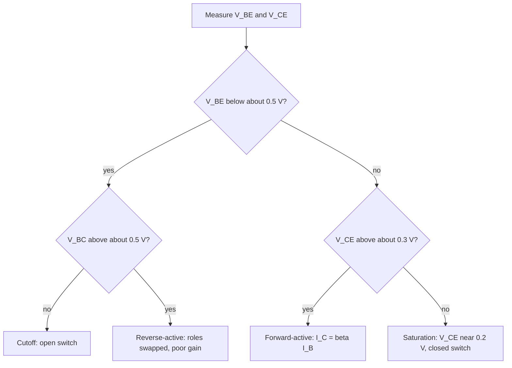

::: testing
Whether you can name the four modes **and decide which one a transistor is in from voltages**, because that's what you do at the bench or in a simulation. The interviewer is looking for:

1. The mode defined by the bias of the two junctions: cutoff (both reverse), forward-active (BE forward, BC reverse), saturation (both forward), reverse-active (BE reverse, BC forward).
2. What each mode does and what it's used for: switch off, amplifier, switch on, and (rarely) a degraded reverse mode.
3. Numbers: $V_{BE}\approx0.7$ V on, $V_{CE(sat)}\approx0.2$ V, $I_C=\beta I_B$ only in the active region.
4. A way to test saturation: compare $I_B\beta$ with the load-limited current.
:::

::: why
Debugging a transistor circuit starts with "what mode is it in?". A switch that doesn't switch fully is usually not saturated; an amplifier that clips is hitting cutoff or saturation; a transistor that is slow to turn off is coming out of deep saturation. The mode determines which equations apply ($I_C=\beta I_B$ is wrong in saturation), so getting this right is the basis of every BJT calculation, and it's the BJT version of the diode regions ([[q0075]]) and MOSFET regions ([[q0099]]).
:::

::: concepts
- **Two junctions, each forward or reverse biased**: four combinations, four modes. See [[q0085]].
- **Diode turn-on voltage**: a silicon junction conducts significantly above about 0.6-0.7 V. See [[q0072]].
- **Current gain**: $I_C=\beta I_B$ only when the base-collector junction is reverse biased. See [[q0088]].
- **Load line**: the circuit limits $I_C$ to $(V_{CC}-V_{CE})/R_C$. See [[q0084]].
- **Stored charge**: saturation fills the base with excess carriers, which slows turn-off.
:::

::: answer
"A BJT has two PN junctions, base-emitter and base-collector, and the mode is just whether each one is forward or reverse biased. That gives four modes.

Cutoff is both junctions reverse biased, or at least $V_{BE}$ below about 0.5 V. No base current, essentially no collector current, so it's an open switch.

Forward-active is base-emitter forward biased and base-collector reverse biased. This is the amplifier mode. $V_{BE}$ is about 0.7 V, $V_{CE}$ is above about 0.3 V, and the collector current is beta times the base current.

Saturation is both junctions forward biased. $V_{CE}$ collapses to about 0.1 to 0.3 V, and the collector current is limited by the external circuit, so it's less than beta times the base current. That's the closed-switch mode.

Reverse-active is base-emitter reverse biased and base-collector forward biased, so the emitter and collector swap roles. It works, but with a very low gain, so it's rarely used on purpose.

To check which one I'm in, I look at the voltages. If $V_{BE}$ is below about 0.5 V it's cutoff. If $V_{BE}\approx0.7$ V and $V_{CE}>0.3$ V, it's active. If $V_{BE}\approx0.7$ V and $V_{CE}\approx0.2$ V, it's saturated. For a switch I drive well into saturation with a forced beta of about 10, and for an amplifier I bias in the middle of the active region."
:::

::: technical
**Junction biasing (NPN).**

| Mode | BE junction | BC junction | Typical voltages | Equations |
|---|---|---|---|---|
| Cutoff | reverse / below turn-on | reverse | $V_{BE}<\sim0.5$ V; $V_{CE}\approx V_{CC}$ | $I_C\approx I_{CEO}$ (nA) |
| Forward-active | forward | reverse | $V_{BE}\approx0.65$-$0.7$ V; $V_{CE}>\sim0.3$ V | $I_C=\beta I_B=I_Se^{V_{BE}/V_T}$ |
| Saturation | forward | forward | $V_{BE}\approx0.7$-$0.8$ V; $V_{CE(sat)}\approx0.1$-$0.3$ V | $I_C<\beta I_B$ (forced $\beta=I_C/I_B$) |
| Reverse-active | reverse | forward | $V_{BE}<0$; $V_{BC}>0.6$ V | $I_E\approx\beta_RI_B$, $\beta_R\sim1$-$10$ (device-dependent) |

**Testing saturation.** The load limits current to $I_{C(sat)}\approx(V_{CC}-V_{CE(sat)})/R_C$. The transistor is saturated if $\beta I_B>I_{C(sat)}$. Critical base current: $I_{B(sat)}=I_{C(sat)}/\beta$.

**Example.** $V_{CC}=12$ V, $R_C=1$ kΩ, $\beta=100$, $V_{CE(sat)}=0.2$ V: $I_{C(sat)}=11.8$ mA, $I_{B(sat)}=118\ \mu$A. For $I_B=50\ \mu$A: active, $I_C=5$ mA, $V_{CE}=7$ V. For $I_B=200\ \mu$A: saturated, $I_C=11.8$ mA, $V_{CE}=0.2$ V, forced $\beta=59$.

**Degree of saturation.** Overdrive factor $=I_B/I_{B(sat)}$. Hard saturation (forced $\beta=10$) gives an overdrive of about 6-10x with a nominal $\beta$ of 100; excess base charge slows turn-off (storage time).

**Switching.** Cutoff and saturation are the two states; the active region is traversed during transitions. Baker clamps (Schottky from base to collector) or non-saturating drive reduce storage time.
:::

::: short
"A BJT's mode comes from the bias on its two junctions. Cutoff: both reverse, no current, open switch. Forward-active: base-emitter forward, base-collector reverse, $V_{BE}\approx0.7$ V and $I_C=\beta I_B$, the amplifier mode. Saturation: both forward, $V_{CE}\approx0.2$ V, current limited by the circuit, closed switch. Reverse-active: roles of emitter and collector swapped, with poor gain. I tell them apart by $V_{BE}$ and $V_{CE}$, and for a switch I check $\beta I_B$ against the load current."
:::

::: long
"A BJT is two diodes sharing a base, so the mode comes down to whether each junction is forward or reverse biased. Four combinations, four modes.

Cutoff is when the base-emitter junction isn't forward biased enough to conduct, so $V_{BE}$ is below about half a volt. Base current is nearly zero, collector current is just leakage, and $V_{CE}$ sits at the supply. That's the off state of a switch.

Forward-active is the normal amplifier mode. The base-emitter junction is forward biased around 0.7 V and the base-collector junction is reverse biased, so $V_{CE}$ is above a few tenths of a volt. In this region the collector current is beta times the base current and is nearly independent of $V_{CE}$. For an amplifier I bias it so $V_{CE}$ is roughly half the supply, which leaves room to swing both ways.

Saturation is when both junctions are forward biased. If I push more base current than the circuit can use, the collector can't carry beta times $I_B$ because the load limits it. $V_{CE}$ falls to about 0.1 to 0.3 volts, and the collector current is just the supply minus that drop over the load resistance. That's the on state of a switch. The test is whether $\beta I_B$ exceeds the load-limited current. For example, with a 12 V supply and 1 kΩ load, the load-limited current is about 11.8 mA, so with a beta of 100 I need more than 118 µA of base current. A design rule is to use a forced beta of about 10 to guarantee saturation across parts and temperature.

The fourth mode, reverse-active, has the base-emitter junction reverse biased and base-collector forward biased. Emitter and collector swap roles, but because the doping is asymmetric the gain is very low, so it only shows up by accident, for example in a transistor connected backwards or in some BiCMOS and logic tricks.

One practical consequence: a saturated transistor stores a lot of excess charge in the base, so turning it off takes a storage time of hundreds of nanoseconds to microseconds. Fast switching designs use less base drive, a Schottky clamp, or a MOSFET."
:::

::: terms
- **Cutoff**: both junctions off; transistor is an open switch.
- **Forward-active**: BE forward, BC reverse; the amplifying mode with $I_C=\beta I_B$.
- **Saturation**: both junctions forward; $V_{CE}\approx V_{CE(sat)}$; the closed-switch state.
- **Reverse-active**: BE reverse, BC forward; emitter and collector exchange roles, low gain.
- **$V_{CE(sat)}$**: collector-emitter voltage of a saturated BJT, typically 0.1-0.3 V.
- **Forced beta**: $I_C/I_B$ in saturation; a design value (about 10) chosen to ensure saturation.
- **Storage time**: delay to remove excess base charge before the transistor leaves saturation.
- **Baker clamp**: Schottky diode from base to collector that prevents deep saturation.
:::

::: exceptional
**An average answer** lists the four mode names with "on/off/amplify".

**An exceptional answer**:
- Defines each mode by junction biases, and gives approximate voltages for each ($V_{BE}$ 0.5/0.7 V, $V_{CE(sat)}$ 0.2 V).
- Gives a quick test for saturation ($\beta I_B$ vs load-limited $I_C$) with a worked numerical example.
- Explains what changes in the equations in each mode (the $I_C=\beta I_B$ equation fails in saturation).
- Knows the practical consequences: forced-beta design rule, storage time, clamping, amplifier headroom and clipping.
- Mentions reverse-active and why it's poor (asymmetric doping), and how it can occur by accident.
- Connects to the diode and MOSFET analogues (cutoff/triode/saturation naming differs, so state what "saturation" means for a BJT versus a MOSFET).
:::

::: mistakes
- **Using $I_C=\beta I_B$ in saturation.** In saturation the collector current is set by the circuit; the actual $I_C/I_B$ is less than $\beta$.
- **Mixing up "saturation" in BJTs and MOSFETs.** BJT saturation means *both junctions forward, switch on*. MOSFET saturation means *channel pinched off, constant-current region* (the amplifier region).
- **Assuming $V_{CE(sat)}=0$.** It's about 0.1-0.3 V, which matters for dissipation and logic levels.
- **Designing a switch with the datasheet's typical $\beta$.** $\beta$ varies by 2-3x with temperature and part, so use a forced beta of about 10.
- **Forgetting stored charge.** Deep saturation makes the turn-off slow; an over-driven switch is a slow switch.
- **Calling a transistor "active" when $V_{CE}<V_{BE}$.** If $V_{CE}$ is below about $V_{BE}-0.4$ V the BC junction starts to forward bias; you're entering saturation.
:::

::: deep
## Two junctions, four combinations

Consider an NPN. The base-emitter junction $J_E$ and base-collector junction $J_C$ are each either forward (F) or reverse (R) biased:

| $J_E$ | $J_C$ | Mode |
|---|---|---|
| R | R | Cutoff |
| F | R | Forward-active |
| F | F | Saturation |
| R | F | Reverse-active |


Figure: A quick triage you can do with a multimeter. $V_{BC}=V_{BE}-V_{CE}$, so "$V_{CE}<\sim0.3$ V with $V_{BE}\approx0.7$ V" means the collector junction is forward biased by about 0.4 V or more, i.e. saturation.

## Forward-active: the amplifier

This is the mode of [[q0085]]: electrons injected from the emitter are collected nearly perfectly because the BC junction is reverse biased. Equations:
$$I_C=I_Se^{V_{BE}/V_T}\left(1+\frac{V_{CE}}{V_A}\right),\qquad I_B=\frac{I_C}{\beta},\qquad I_E=I_C+I_B$$
An amplifier is biased near the middle of this region so signals have room to swing: for $V_{CC}=12$ V, put $V_{CE}\approx6$ V.

## Saturation: the closed switch

As the base is driven harder, $I_C$ rises until the voltage drop across $R_C$ leaves only a small $V_{CE}$. Once $V_{CE}<V_{BE}-0.4$ V (roughly) the BC junction becomes forward biased and starts injecting electrons back into the base, which reduces the net collection of emitter-injected carriers. The collector current can't rise further because the circuit limits it.

```plot
{"title":"Collector current and V_CE versus base current (V_CC = 12 V, R_C = 1 kΩ, β = 100)","x":{"label":"Base current I_B","unit":"A","min":0,"max":2.5e-4},"y":{"label":"I_C (mA) and V_CE (V)","min":0,"max":13},
 "vars":{"b":100,"vcc":12,"rc":1000,"vsat":0.2},
 "series":[
  {"label":"I_C (mA)","fn":"min(b*x,(vcc-vsat)/rc)*1000","color":"accent"},
  {"label":"V_CE (V)","fn":"max(vsat,vcc-min(b*x,(vcc-vsat)/rc)*rc)","color":"orange"}],
 "vlines":[{"at":"(vcc-vsat)/rc/b","label":"I_B(sat) = 118 µA","color":"muted"}],
 "xspans":[{"from":0,"to":"(vcc-vsat)/rc/b","label":"forward-active"}]}
```
Figure: To the left of the dashed line the transistor is in forward-active: $I_C=\beta I_B$ rises linearly and $V_{CE}$ falls linearly. Beyond $I_B(sat)=118\ \mu$A the collector current clips at $11.8$ mA and $V_{CE}$ sticks at 0.2 V. More base current doesn't increase $I_C$; it just stores more charge in the base. (The plot has a sharp corner; real devices round it over a factor of about 2 in base current.) At $I_B=0$ the transistor is in cutoff: $I_C\approx0$, $V_{CE}=V_{CC}$.

**Forced beta.** In saturation $\beta_{forced}=I_C/I_B<\beta$. A switch with $I_B=1.18$ mA for the same load has forced beta 10 and an overdrive factor of 10, a robust design. Power dissipated is small: $V_{CE(sat)}I_C+V_{BE}I_B=0.2\times11.8+0.75\times1.18\approx3.2$ mW.

**Why $V_{CE(sat)}$ isn't zero.** In saturation both junctions are forward, and their voltages roughly oppose: $V_{CE}=V_{BE}-V_{BC}$, with $V_{BE}\approx0.75$ V and $V_{BC}\approx0.55$ V gives about 0.2 V. It grows with collector current (series resistance) and with heavier $\beta_{forced}$ requirements (datasheets specify $V_{CE(sat)}$ at a stated $I_C/I_B$ ratio).

## Cutoff: the open switch

For $V_{BE}$ below about 0.5 V the collector current falls exponentially (60 mV per decade), so at 0.4 V the collector current is $e^{-0.3/0.02585}=9\times10^{-6}$ of its value at 0.7 V. Leakage ($I_{CEO}$, $I_{CBO}$) of nA to µA remains, rising with temperature. For a clean off state in noisy environments or at high temperature, add a pull-down resistor from base to emitter (and in switches driving fast edges, a small negative turn-off voltage).

## Reverse-active: swapped roles

When $J_E$ is reverse and $J_C$ forward, the collector acts as the injector and the emitter as the collector. Because the collector is lightly doped and large, the injection efficiency is poor and the reverse $\beta_R$ is only about 1-10 (device-dependent). It appears accidentally when a transistor is wired backwards, or in a circuit whose emitter goes above its collector (e.g. an inverted pass transistor), and deliberately in some IC structures (I$^2$L). Also $V_{EBO}$ (about 6 V) limits the reverse voltage across the emitter-base junction.

## Storage time and switching

Saturation puts excess minority charge $Q_s\approx\tau_s(I_B-I_{B(sat)})$ in the base. To turn off, this must be removed, giving a storage delay $t_s\approx\tau_s\ln\frac{I_{B1}-I_{B2}}{I_{C}/\beta-I_{B2}}$ where $I_{B1}$ is the on-state base current and $I_{B2}$ the (negative) turn-off base current. Typical small-signal parts show $t_s$ of tens to hundreds of ns, power BJTs microseconds. To speed up: limit the overdrive, use a Baker (Schottky) clamp, apply a negative turn-off base current, or use a MOSFET.

> [!UNCERTAIN]
> $V_{CE(sat)}$, $\beta_R$ and storage times depend on the specific part, collector current, temperature and the forced-beta ratio. The values given are typical small-signal-NPN figures; look up the datasheet's specified conditions (e.g. $V_{CE(sat)}$ at $I_C/I_B=10$).

## Experiment with it

```sim
{"id":"bjt-lab","type":"npn","beta":100,"vcc":12,"rc":1000,"ib":50e-6}
```
Figure: Start at 50 µA (forward-active, $V_{CE}\approx7$ V). Raise the base current to 200 µA and see the operating point hit saturation, with the collector voltage pinned near zero and the region label changing. Then drop to zero for cutoff.

## Reading modes in a real circuit

- **Common-emitter amplifier:** keep $V_{CE}>V_{CE(sat)}$ with margin for the signal peak (often 1-2 V) so it never saturates.
- **LED/relay driver:** at "on", check $V_{CE}\approx0.2$ V; if it's 1-3 V the base drive is inadequate and the transistor is dissipating heat in the active region.
- **Logic-level shifting with BJTs:** saturation is acceptable but affects timing.
- **Clipping in an audio stage:** the top is cutoff clipping (transistor turns off), the bottom is saturation clipping.
:::

::: applications
- **Digital-style switching** (LED, relay, MOSFET gate drivers): saturation and cutoff with forced beta of about 10.
- **Linear amplifiers and voltage regulators**: forward-active with bias at mid-supply or a regulated $V_{CE}$.
- **TTL logic**: saturating bipolar gates; Schottky-clamped (74S/74LS) variants reduce storage delay.
- **Analogue switches and choppers** in older designs that exploit the low $V_{CE(sat)}$ (offset of a few mV in inverse mode).
- **Current mirrors and references**: must stay in forward-active for matching, so $V_{CE}>V_{BE}$ is required.
- **Debugging:** reading $V_{BE}$ and $V_{CE}$ with a DMM tells you the mode at a glance.
:::

::: assumptions
- **NPN silicon BJT** at room temperature; PNP is the mirror with voltages reversed.
- **Approximate thresholds** ($V_{BE}$ of about 0.5 V off, 0.65-0.75 V on, $V_{CE(sat)}$ of 0.1-0.3 V) are rule-of-thumb; the transitions are gradual, not sharp.
- **DC (static) analysis.** Dynamic effects (storage time, Miller capacitance) are noted but not modelled.
- **Constant $\beta$ in the active region** for the load-line example; real $\beta$ varies with current and temperature.
- **Naming varies**: some texts call the region between cutoff and saturation the "linear" or "normal active" region; "quasi-saturation" in power BJTs is an extra region where the collector's lightly doped region conducts with conductivity modulation.
:::

::: followups
### How do you tell if a BJT switch is saturated using only a multimeter?
Measure $V_{CE}$. For a fully on switch it's about 0.1-0.3 V. If $V_{CE}$ is a volt or more with the load drawing less than expected, the transistor is in the active region (not enough base drive). Also check $V_{BE}\approx0.7$-$0.8$ V and compute the load current from the drop across $R_C$ to compare $I_C/I_B$ to $\beta$; $I_C/I_B$ well below $\beta$ confirms saturation.

### Why do we design switches with a forced beta of 10 rather than the datasheet beta of 100?
Because $\beta$ varies with part, temperature (low at cold) and current, perhaps by a factor of 3 or more, and saturation needs $\beta I_B$ comfortably above the load current. A forced beta of 10 guarantees saturation across the spread, at the cost of 10% extra base current. Datasheets also specify $V_{CE(sat)}$ at $I_C/I_B=10$, so it gives the guaranteed number.

### What is storage time and how do you reduce it?
When saturated, excess minority charge is stored in the base (and collector). On turn-off the transistor keeps conducting until that charge is removed, giving a delay of tens of ns (small signal) to µs (power). Reduce it by limiting overdrive (less base drive), using a Baker clamp (Schottky from base to collector) so it never saturates deeply, applying a negative base turn-off current, or by using a MOSFET, which has no minority-carrier storage.

### Where does the BJT operate when used as an amplifier, and how do you choose the Q-point?
In forward-active with $V_{CE}$ comfortably above saturation. Typically I'd bias $V_{CE}\approx V_{CC}/2$ for maximum symmetric swing, or set the DC emitter voltage to about 10% of $V_{CC}$ for stability (via the emitter resistor) and the collector at roughly half the supply. Then check that the signal peaks won't push the collector into saturation (bottom) or cutoff (top).

### Is it possible for the BJT to be in forward-active with $V_{CE}<V_{BE}$?
Marginally. The BC junction becomes forward biased when $V_{BC}=V_{BE}-V_{CE}>0$, but it doesn't conduct significantly until it exceeds about 0.4-0.5 V. So between $V_{CE}=V_{BE}$ and about $V_{BE}-0.4$ V the device is "soft saturated" (quasi-active) with $I_C$ reduced only a little. Datasheets define saturation at a specific ratio $I_C/I_B$.

### Scenario: your relay driver's transistor runs hot even though the relay works. What mode might it be in?
The active region: base drive is insufficient (too large a base resistor, a 3.3 V drive with a higher $V_{BE}$, or a lower beta at temperature), so $V_{CE}$ is several volts while the relay current flows and the transistor burns $V_{CE}I_C$. Measure $V_{CE}$: it should be about 0.2 V. Reduce $R_B$ to give a forced beta of about 10, and check that the relay coil current plus any flyback behaviour is within the transistor's rating.
:::

::: interpretations
The wording "modes of operation" for a BJT means the **four regions** set by the junction biases; some textbooks only list three (cutoff, active, saturation) and treat the reverse-active region as a footnote. I cover all four. Do not confuse BJT "saturation" (both junctions forward, switch on) with MOSFET "saturation" (pinch-off, constant current): see [[q0099]]. The diode has its own regions ([[q0075]]).
:::

::: references
- Sedra & Smith, *Microelectronic Circuits*: the BJT chapter, sections on modes of operation (cutoff, active, saturation, reverse active) and the large-signal model.
- Horowitz & Hill, *The Art of Electronics*: the transistor chapter, on saturation, forced beta and switching design.
- Gray, Hurst, Lewis & Meyer, *Analysis and Design of Analog Integrated Circuits*: BJT large-signal model, storage time and quasi-saturation.
- onsemi/Fairchild 2N3904 datasheet: $V_{CE(sat)}$, $V_{BE(sat)}$ and switching-time specifications (storage time).
:::

::: rubric
- Names the four modes and defines them by BE/BC junction bias :: The framework everything else hangs on.
- Gives typical voltages ($V_{BE}\approx0.7$ V, $V_{CE(sat)}\approx0.2$ V) :: Shows bench-level knowledge.
- States that $I_C=\beta I_B$ holds only in forward-active :: Avoids the commonest calculation mistake.
- Gives a saturation test with a worked example (load-limited current vs $\beta I_B$) :: Demonstrates usable analysis.
- Explains forced beta and why switches are overdriven :: Shows design practice.
- Mentions storage time and how to reduce it :: Shows awareness of switching behaviour.
- Mentions reverse-active and why it is poor, or notes the BJT vs MOSFET "saturation" naming difference :: Shows depth and precision.
:::

::: quiz
```json
[
 {"type":"mcq","level":"fundamental","q":"Which mode has both the base-emitter and base-collector junctions forward biased?","options":["Cutoff","Forward-active","Saturation","Reverse-active"],"answer":2,"explain":"Saturation has both junctions forward biased, giving a low $V_{CE}$ and the switch-on state."},
 {"type":"mcq","level":"fundamental","q":"In which region does a BJT amplify, with $I_C=\\beta I_B$?","options":["Cutoff","Saturation","Forward-active","Breakdown"],"answer":2,"explain":"Forward-active has BE forward and BC reverse biased, where collector current is proportional to base current."},
 {"type":"numeric","level":"intermediate","q":"$V_{CC}=12$ V, $R_C=1$ kΩ, $V_{CE(sat)}=0.2$ V and $\\beta=100$. What is the minimum base current in µA to saturate the transistor?","answer":118,"tolerance":0.02,"unit":"µA","explain":"$I_{C(sat)}=(12-0.2)/1000=11.8$ mA and $I_{B(sat)}=11.8\\text{ mA}/100=118\\ \\mu$A."},
 {"type":"numeric","level":"intermediate","q":"For the same circuit with $I_B=50\\ \\mu$A (active), what is $V_{CE}$ in volts?","answer":7,"tolerance":0.02,"unit":"V","explain":"$I_C=100\\times50\\ \\mu\\text{A}=5$ mA; $V_{CE}=12-5\\text{ mA}\\times1\\text{ k}\\Omega=7$ V."},
 {"type":"numeric","level":"intermediate","q":"$V_{CC}=5$ V, $R_C=500$ Ω, $V_{CE(sat)}=0.2$ V. With a forced beta of 10, what base current (mA) should you supply?","answer":0.96,"tolerance":0.02,"unit":"mA","explain":"$I_C=(5-0.2)/500=9.6$ mA, $I_B=9.6/10=0.96$ mA."},
 {"type":"truefalse","level":"advanced","q":"In saturation a BJT still obeys $I_C=\\beta I_B$ with the datasheet $\\beta$, so extra base current gives proportionally more collector current.","answer":false,"explain":"In saturation the circuit limits $I_C$, so the actual $I_C/I_B$ (forced beta) is less than $\\beta$; extra base current only stores more charge, increasing turn-off delay."}
]
```
:::
