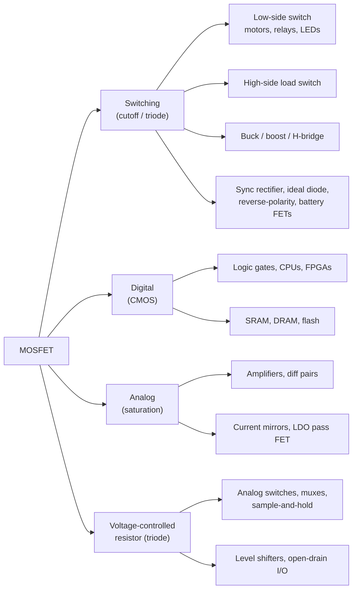

::: testing
It sounds like a list question, but the interviewer is listening for **breadth plus reasoning**:

1. Can you cover the three big families: **switching** (power and load switching), **digital logic** (CMOS), and **analog** (amplifiers, current sources, pass elements, analog switches)?
2. For each use, do you know *which property* of the MOSFET makes it fit: voltage-controlled insulated gate, low $R_{DS(on)}$, fast majority-carrier switching, behaviour as a voltage-controlled resistor, or as a transconductance device in saturation?
3. Can you name a concrete circuit you've built or seen (a low-side switch for a motor, a PFET reverse-polarity circuit, a BSS138 level shifter) and size something in it?

Strong candidates organise the list rather than rattle it off.
:::

::: why
The MOSFET is the most manufactured device in history and the default switch in modern hardware. In an internship you'll likely pick a MOSFET for an LED or motor driver, review a load switch on a power rail, debug a level shifter, or read a buck converter schematic. Knowing *why* each application uses a MOSFET, and which operating region it runs in (triode for switches, saturation for amplifiers), is what lets you choose parts and spot mistakes. It also sets up [[q0093]] (why MOSFETs are so common) and the comparison with BJTs in [[q0094]].
:::

::: concepts
- **Operating regions**: switches live in cutoff and triode (low resistance), amplifiers and current sources live in saturation. See [[q0099]].
- **Insulated gate**: zero DC gate current means easy drive from logic and no static drive power. See [[q0090]].
- **$R_{DS(on)}$ and conduction loss**: on-state loss is $I^2 R_{DS(on)}$. See [[q0006]].
- **Body diode**: decides which direction the switch blocks. Exploited in synchronous rectifiers and reverse-polarity circuits. See [[q0101]].
- **N vs P channel**: NFET for low-side, PFET for simple high-side switching. See [[q0097]].
- **CMOS**: complementary NMOS/PMOS pairs as the basis of digital logic. See [[q0105]].
:::

::: answer
"I'd group them into three buckets.

The biggest is **switching**. An NFET as a low-side switch lets a 3.3 V microcontroller pin turn a motor, solenoid or LED strip on and off. PFETs are used as high-side load switches to cut power to a subsystem. In power electronics, MOSFETs are the switches in buck and boost converters and H-bridges for motors, and they replace diodes in synchronous rectifiers and ideal-diode circuits because a few milliohms beats a 0.4 V diode drop. There are also protection uses, like a PFET for reverse-battery protection or two FETs back-to-back in a battery pack.

The second is **digital logic**. Every CMOS gate, processor and memory is built from NMOS and PMOS pairs, and DRAM and flash cells are MOSFET-based too.

The third is **analog**. In saturation a MOSFET is a voltage-controlled current source, so you get amplifiers, current mirrors, and the pass element in an LDO. In triode it's a voltage-controlled resistor, which is how analog switches, multiplexers and sample-and-holds work. And a single NFET with pull-ups makes a bidirectional I²C level shifter.

The reason it's everywhere is the insulated gate: no DC drive current, easy to drive from logic, and very low on-resistance."
:::

::: technical
| Family | Application | Region used | Key MOSFET property |
|---|---|---|---|
| Power switching | Low-side switch (motor, relay, LED strip), high-side load switch, H-bridge, buck/boost switch | Cutoff ↔ triode | Low $R_{DS(on)}$, voltage drive, fast switching |
| Rectification | Synchronous rectifier, ideal diode / OR-ing | Triode (reverse conduction, 3rd quadrant) | $I R_{DS(on)} \ll V_F$ of a diode |
| Protection | Reverse-polarity PFET, back-to-back battery FETs, hot-swap / inrush limiter, eFuse | Triode, or saturation during inrush | Body-diode direction, controllable $I_D$ |
| Digital | CMOS logic, SRAM, DRAM access transistor, flash (floating gate / charge trap) | Cutoff ↔ triode | Near-zero static power, scaling |
| Analog | Common-source amplifier, current mirror, differential pair, LDO pass element | Saturation | Transconductance $g_m = \sqrt{2k_nI_D}$ |
| Signal switching | Analog switch / mux, transmission gate, sample-and-hold, level shifter, open-drain outputs | Triode | Voltage-controlled resistance |

**Switch sizing.** Conduction loss $P = I^2R_{DS(on)}$ evaluated at the *actual* gate drive. Example: 2 A through a logic-level NFET with $R_{DS(on)} = 20$ mΩ at $V_{GS} = 4.5$ V → 80 mW. Switching loss ≈ $\tfrac12 V I (t_r + t_f) f_{sw}$ in hard-switched converters.

**Diode replacement.** Synchronous buck, 12 V → 3.3 V at 5 A ($D = 0.275$): a 0.5 V Schottky freewheel diode dissipates $V_F I(1-D) \approx 1.81$ W; a 10 mΩ low-side FET dissipates $I^2R(1-D) \approx 0.18$ W.

**Amplifier.** Common-source voltage gain $A_v = -g_m (R_D\parallel r_o)$.

**Analog switch.** On-resistance in triode: $R_{on} \approx \frac{1}{k_n'(W/L)(V_{GS} - V_t)}$, which varies with signal level. Transmission gates (NMOS ∥ PMOS) flatten it.
:::

::: short
"Three main areas. Switching: low-side NFETs driving motors, relays and LEDs from a GPIO, PFET high-side load switches, and the switches in buck converters, H-bridges and synchronous rectifiers. Digital: every CMOS gate and memory cell. Analog: in saturation it's a voltage-controlled current source for amplifiers, current mirrors and LDO pass elements, and in triode it's a voltage-controlled resistor for analog switches and level shifters. The insulated gate and low on-resistance are why it fits all of them."
:::

::: long
"I like to sort MOSFET applications by which region the transistor is operating in, because that tells you why it's used.

First, the switching applications, where the FET goes between cutoff and fully-on triode. The everyday one is a low-side switch: an N-channel MOSFET with its source to ground and the load to the supply, driven straight from a microcontroller pin. That's how you drive a solenoid, a small DC motor or an LED strip, with a flyback diode for inductive loads. A P-channel on the high side gives you a load switch that cuts power to a sensor rail. Scaling up, MOSFETs are the switches in buck and boost converters and in H-bridges for motor control. Because a fully-on MOSFET is just a small resistor, it also replaces diodes: synchronous rectification, ideal-diode OR-ing, and reverse-polarity protection, where a PFET in the supply line drops tens of millivolts instead of a Schottky's 0.4 volts. Battery packs use two NFETs back-to-back to block charge and discharge.

Second, digital logic. CMOS pairs an NMOS and PMOS so one is always off, so logic draws almost no static current. Every processor, FPGA, SRAM and DRAM is built this way, and flash memory stores bits as charge on a MOSFET's gate.

Third, analog. In saturation the drain current is set by the gate-source voltage, so the MOSFET is a transconductance device. That gives common-source amplifiers, differential pairs, current mirrors, and the pass element in an LDO. In triode it acts like a voltage-controlled resistor, which gives analog switches, multiplexers and sample-and-holds. A neat combination is the BSS138 level shifter for I²C, which uses the channel and the body diode to translate between 3.3 and 5 volts.

What ties them together is the insulated gate: no DC drive current, easy to drive from logic, and with modern parts, milliohm on-resistance."
:::

::: terms
- **Low-side switch**: the switch sits between the load and ground. Natural for an NFET.
- **High-side switch / load switch**: the switch sits between the supply and the load. Simple with a PFET, or an NFET with a boosted gate drive.
- **$R_{DS(on)}$**: drain-source resistance when fully on, specified at a given $V_{GS}$ and temperature.
- **Synchronous rectification**: replacing a rectifier diode with a MOSFET that's switched on when the diode would conduct.
- **Ideal diode / OR-ing controller**: a MOSFET plus controller that acts as a diode with millivolt drop.
- **Pass element**: the series transistor in a linear regulator that drops the excess voltage.
- **Transmission gate**: an NMOS and PMOS in parallel used as a bidirectional analog switch.
- **Hot-swap / inrush limiting**: running a MOSFET in saturation briefly to limit current into a capacitive load.
:::

::: exceptional
**An average answer** lists "switches and amplifiers."

**An exceptional answer**:
- Organises applications by **region** (switch = cutoff/triode, amplifier/current source = saturation, analog switch = triode as a resistor) or by family (power, digital, analog).
- Gives **specific circuits**: low-side NFET with flyback diode and gate pulldown, PFET reverse-polarity protection, synchronous buck, H-bridge, CMOS inverter, current mirror, LDO, BSS138 level shifter.
- Puts a **number** on at least one: "2 A through 20 mΩ is 80 mW, vs 1.4 W for a BJT with 0.7 V drop."
- Explains the **property** that makes each use work (insulated gate, low $R_{DS(on)}$, body diode direction, square-law transconductance).
- Mentions a limitation: switching losses at high frequency, or the body diode preventing bidirectional blocking.
:::

::: mistakes
- **Only listing "switch" and "amplifier."** That misses digital logic (the biggest use by count) and the diode-replacement and protection uses.
- **Using a standard-threshold FET with a 3.3 V GPIO.** A part whose $R_{DS(on)}$ is only specified at $V_{GS}$ = 10 V may barely turn on at 3.3 V. Pick a logic-level part with $R_{DS(on)}$ specified at 2.5 V or 4.5 V.
- **Forgetting the flyback diode** on an inductive load. The drain spikes until the MOSFET avalanches.
- **Leaving the gate floating.** A MOSFET gate holds charge; without a pulldown it can turn on during MCU reset and fry a motor or heater.
- **Thinking a MOSFET switch blocks both directions.** The body diode conducts in reverse; bidirectional switching needs two FETs.
- **Assuming switching loss is zero because $R_{DS(on)}$ is tiny.** At hundreds of kHz, transition losses and gate-charge losses can dominate.
:::

::: deep
## A map of where MOSFETs show up


Figure: Sorting by operating region explains the "why." Switches flip between cutoff and triode, amplifiers and current sources sit in saturation, and analog switches use triode as a variable resistor.

The common thread: the gate is insulated, so you control the device with a **voltage** and essentially zero DC current. That one property makes it easy to drive from logic, lets billions coexist on a chip with near-zero static power, and lets a single gate control a device carrying hundreds of amps.

## 1. The workhorse: low-side switch from a microcontroller

The most common MOSFET circuit you'll build as an intern:

```circuit
{"caption":"Low-side NFET driving a 12 V solenoid from a 3.3 V GPIO","elements":[
 {"t":"rail","at":[8,0],"label":"+12 V","dir":"up"},
 {"t":"wire","pts":[[8,0],[8,1]]},
 {"t":"L","a":[8,1],"b":[8,5],"label":"Solenoid","labelSide":"other"},
 {"t":"wire","pts":[[8,1],[11,1]]},{"t":"wire","pts":[[8,5],[11,5]]},
 {"t":"D","a":[11,5],"b":[11,1],"label":"D_{fly}"},
 {"t":"dot","at":[8,1]},{"t":"dot","at":[8,5]},
 {"t":"nmos","at":[6,7],"label":"Q1","bodyDiode":true},
 {"t":"wire","pts":[[8,9],[8,10]]},{"t":"gnd","at":[8,10]},
 {"t":"term","at":[0,7],"label":"GPIO","side":"left"},
 {"t":"R","a":[0,7],"b":[3,7],"label":"R_G","value":"100 Ω"},
 {"t":"wire","pts":[[3,7],[6,7]]},{"t":"dot","at":[4,7]},
 {"t":"R","a":[4,7],"b":[4,10],"label":"R_{PD}","value":"100 kΩ","labelSide":"other"},
 {"t":"gnd","at":[4,10]}
]}
```
Figure: The source sits at ground, so the GPIO voltage is V_GS directly. R_G limits the gate charging current and damps ringing, R_PD holds the gate low while the MCU is in reset (pins float), and D_fly gives the solenoid current a path when Q1 turns off so the drain doesn't spike.

Design checks, with numbers:

- **Gate drive**: 3.3 V GPIO, so choose a logic-level part with $R_{DS(on)}$ specified at $V_{GS} = 2.5$ V or lower, or at least 4.5 V with margin. $V_{GS(th)}$ alone is *not* the turn-on voltage. At threshold the datasheet only promises something like 250 µA.
- **Conduction loss**: a 2 A solenoid with $R_{DS(on)} = 20$ mΩ: $P = I^2R = 2^2 \times 0.02 = 80$ mW. A BJT with $V_{CE(sat)} = 0.3$ V would burn 0.6 W and need about 100 mA of base current.
- **Voltage rating**: 12 V supply plus the flyback diode's drop at turn-off → a 30 V part leaves margin.
- **Inductive kick**: without $D_{fly}$, $V = L\,di/dt$ drives the drain up until the MOSFET avalanches.

```sim
{"id":"gate-drive","vdrive":3.3,"rg":100,"qg":10e-9,"vth":1.5}
```
Figure: The 3.3 V drive barely clears the Miller plateau. Raise vdrive to 5 or 10 and see how much faster and harder the FET turns on. Increase rg and the plateau stretches, which means more switching loss.

## 2. Power conversion: buck converters and H-bridges

In a synchronous buck, two MOSFETs alternately connect the switch node to $V_{in}$ and ground. The low-side FET replaces the freewheeling diode. For 12 V → 3.3 V at 5 A, $D = 3.3/12 = 0.275$:

| Freewheel element | Loss during the off-time |
|---|---|
| Schottky, $V_F = 0.5$ V | $V_F I (1-D) = 0.5 \cdot 5 \cdot 0.725 \approx 1.81$ W |
| MOSFET, $R_{DS(on)} = 10$ mΩ | $I^2 R (1-D) = 25 \cdot 0.01 \cdot 0.725 \approx 0.18$ W |

That 10× reduction is why almost every modern low-voltage converter is synchronous. The MOSFET conducts in its third quadrant (current source→drain) here, which it happily does when the gate is on.

An H-bridge uses four MOSFETs to drive a DC motor in either direction, with PWM for speed. Here the body diodes do real work: during dead time, when all switches are off, the motor current freewheels through them.

```sim
{"id":"h-bridge-lab","mode":"h"}
```
Figure: Turn on the top-left and bottom-right switches for forward; then turn both off and watch the current freewheel through the body diodes. Try turning on both switches in one leg to see shoot-through.

## 3. Protection: the PFET reverse-polarity circuit

A diode in series with the battery protects against reverse insertion but wastes $V_F \cdot I$. A PFET does the same job with almost no drop:

```circuit
{"caption":"PFET reverse-polarity protection","elements":[
 {"t":"pmos","at":[4,4],"label":"Q1","bodyDiode":true},
 {"t":"term","at":[6,10],"label":"V_{BAT}","side":"bottom"},
 {"t":"wire","pts":[[6,10],[6,6]]},
 {"t":"wire","pts":[[6,2],[6,1]]},
 {"t":"wire","pts":[[2,1],[13,1]]},{"t":"dot","at":[6,1]},
 {"t":"Zener","a":[2,4],"b":[2,1],"label":"D_Z","labelSide":"other"},
 {"t":"wire","pts":[[2,4],[4,4]]},{"t":"dot","at":[2,4]},
 {"t":"R","a":[2,4],"b":[2,8],"label":"R_G","labelSide":"other","value":"100 kΩ"},
 {"t":"gnd","at":[2,8]},
 {"t":"R","a":[13,1],"b":[13,5],"label":"Load"},
 {"t":"gnd","at":[13,5]},
 {"t":"term","at":[10,1],"label":"V_{OUT}","side":"top"}
]}
```
Figure: Correct polarity: the PFET's body diode (drain→source) conducts first, so the source rises to about V_BAT − 0.7 V. The gate is held at ground by R_G, so V_GS ≈ −V_BAT and the channel turns on, shorting out the diode. Reversed battery: the body diode is reverse-biased and V_GS ≈ 0, so Q1 stays off. The Zener clamps V_GS for supplies above the gate rating.

At 3 A, a 30 mΩ PFET dissipates $3^2 \times 0.03 = 0.27$ W versus $0.4 \times 3 = 1.2$ W for a Schottky. Notice the transistor is wired "backwards" from a normal high-side switch: the drain faces the battery. The body-diode direction is the entire design ([[q0101]]).

Related protection uses: two NFETs back-to-back in Li-ion packs, ideal-diode controllers that OR two supplies, and hot-swap controllers that run the FET in saturation to limit inrush into big capacitors.

## 4. Digital: CMOS everywhere

A CMOS inverter is a PMOS from $V_{DD}$ to the output and an NMOS from the output to ground with their gates tied. In either steady state one device is off, so static current is just leakage. Power is dynamic, $P \approx \alpha C V_{DD}^2 f$. Billions of these switches make up processors, and memory uses MOSFETs too: a DRAM cell is one access transistor plus a capacitor, and a flash cell stores charge on a floating gate (or charge-trap layer) that shifts the transistor's threshold ([[q0105]]).

## 5. Analog: amplifiers, current sources, pass elements

In saturation, $I_D = \tfrac12 k_n (V_{GS}-V_t)^2$, so the gate voltage sets a current nearly independent of $V_{DS}$. That makes the MOSFET a **transconductor** with $g_m = \sqrt{2k_nI_D}$:

- **Common-source amplifier**: $A_v = -g_m(R_D\parallel r_o)$. With $k_n = 2$ mA/V², $I_D = 1$ mA, $g_m = 2$ mA/V; with $R_D = 5$ kΩ, gain ≈ −10.
- **Current mirror**: a diode-connected reference device copies its current to a matched output device ([[q0104]]).
- **LDO pass element**: a PMOS (or NMOS with a charge pump) whose gate is driven by an error amplifier to hold $V_{out}$ constant ([[q0104]], [[q0278]]).

## 6. Voltage-controlled resistor: analog switches and level shifters

In deep triode ($V_{DS} \ll V_{GS} - V_t$), $R_{on} \approx 1/[k_n(V_{GS}-V_t)]$. This is how analog multiplexers, CMOS switches (e.g. the classic 4066-style quad switch) and ADC sample-and-hold switches work. The resistance depends on the signal voltage, so precision switches use NMOS ∥ PMOS transmission gates.

The single-FET bidirectional level shifter (BSS138 with pull-ups on both sides) is a beautiful example: the gate sits at the low-side supply, and the channel or body diode pulls the high side down whenever either side goes low.

> [!INTERVIEW]
> Close by naming the one you've used: "In my *[project]*, I used a logic-level NFET as a low-side switch for *[load]* and had to pick it by $R_{DS(on)}$ at 3.3 V gate drive." A concrete example beats a longer list.
:::

::: applications
- **Microcontroller-driven loads**: an AO3400-class SOT-23 logic-level NFET driving a 12 V LED strip or fan from a 3.3 V GPIO.
- **Laptop and phone power paths**: PFET or NFET load switches (often integrated load-switch ICs) that sequence rails and cut power to idle blocks.
- **Point-of-load converters**: synchronous buck converters on every motherboard and FPGA board use MOSFET pairs, often integrated in the regulator IC.
- **Motor drives**: H-bridges for brushed DC motors and three-phase bridges for BLDC motors in drones and e-bikes.
- **Battery packs**: back-to-back NFETs controlled by a protection IC in every Li-ion phone and laptop battery.
- **Digital ICs and memory**: CMOS logic, SRAM caches, DRAM, NAND flash.
- **I²C level translation**: BSS138 bidirectional shifters between 3.3 V MCUs and 5 V peripherals ([[q0104]]).
:::

::: assumptions
- I assumed **enhancement-mode silicon** MOSFETs, which cover nearly all board-level use. Depletion-mode parts have niche uses (start-up circuits, current sources: [[q0098]]).
- Loss numbers assume **conduction loss only** at DC or low switching frequency. At high frequency add switching and gate-drive losses.
- At **high voltage and high power** (hundreds of volts, tens of amps and up), IGBTs, SiC MOSFETs and GaN HEMTs share or take over the role. The application list stays similar, but the device choice changes ([[q0414]]).
- For precision analog (low noise, high $g_m$ per current), BJTs can still be the better choice ([[q0120]]), so "MOSFET amplifier" is valid but not always optimal.
:::

::: followups
### How do you pick a MOSFET for a low-side switch driven by a 3.3 V MCU?
Start with $V_{DS}$ rating (supply plus spikes, roughly 1.5–2× margin), then current, then **$R_{DS(on)}$ specified at a $V_{GS}$ you can actually supply** (2.5 V or 3.3 V for a logic-level part). Compute $I^2R_{DS(on)}$ with $R_{DS(on)}$ derated for temperature (it can rise 50% or more hot) and check the package's thermal resistance. Add a gate resistor, a pulldown and a flyback diode for inductive loads.

### Why use a MOSFET instead of a diode for reverse-polarity protection?
Lower drop. A Schottky drops about 0.3–0.5 V, so at 3 A it wastes about 1.2 W and steals headroom from a low-voltage battery. A PFET with 30 mΩ drops 90 mV and wastes 0.27 W. The cost is a few more parts and a gate-source Zener if the supply exceeds $V_{GS(max)}$.

### Why can't a single MOSFET be used as a bidirectional power switch?
The body diode conducts whenever the source is above the drain (NFET), regardless of the gate. To block both directions you need two FETs back-to-back with opposing body diodes, which is what battery packs and USB-C power-path switches do.

### When would you run a MOSFET in saturation on purpose in a power circuit?
Hot-swap and inrush limiting: the controller ramps the gate slowly so the FET acts as a current source while the output capacitors charge, keeping inrush to a set level. The FET dissipates a lot of power during that time, so you must check its **safe operating area** (SOA) curve, not just $R_{DS(on)}$. LDO pass elements also run in saturation continuously.

### Harder: a MOSFET switch works on the bench but turns on briefly at power-up in the product. Why?
The gate was floating while the MCU booted (GPIOs are high-impedance in reset), and $C_{GD}$ coupled the rising drain supply into the gate, or leakage charged it. The fix is a gate pulldown (10–100 kΩ), and checking that the rail ramp's $dV/dt$ times $C_{GD}/(C_{GD}+C_{GS})$ can't reach $V_{GS(th)}$.
:::

::: references
- Horowitz & Hill, *The Art of Electronics*, 3rd ed.: Chapter 3, Field-Effect Transistors (MOSFET switches, load switches, analog switches) and Chapter 9 on power regulation.
- Sedra & Smith, *Microelectronic Circuits*: chapters on MOSFETs, MOS amplifiers and CMOS digital logic.
- Erickson & Maksimović, *Fundamentals of Power Electronics*: chapters on converter switch realization (MOSFETs as switches, synchronous rectification).
- NXP AN10441, "Level shifting techniques in I2C-bus design" (single-MOSFET bidirectional level shifter).
:::

::: rubric
- Covers switching, digital logic and analog applications :: Breadth shows you understand the MOSFET isn't just a switch.
- Gives specific circuits (low-side switch, load switch, buck, H-bridge, CMOS, current mirror, LDO) :: Concrete examples prove familiarity rather than memorisation.
- Links each use to the operating region (cutoff/triode vs saturation) :: The region is the reason the circuit works.
- Explains the enabling property: insulated gate, low $R_{DS(on)}$, body diode :: Shows you know *why* a MOSFET fits.
- Quantifies at least one case ($I^2R_{DS(on)}$ vs diode or BJT drop) :: Numbers are what separate engineers from list-reciters.
- Mentions a practical gotcha (logic-level gate drive, flyback diode, gate pulldown, body diode) :: Signals hands-on experience.
:::

::: quiz
```json
[
 {"type":"mcq","level":"fundamental","q":"In which operating region does a MOSFET used as an on/off load switch spend its 'on' time?","options":["Cutoff","Triode (linear/ohmic)","Saturation","Breakdown"],"answer":1,"explain":"A fully-on switch has a small V_DS, so it's in triode, where it behaves like the small resistor R_DS(on). Saturation is used for amplifiers and current sources."},
 {"type":"numeric","level":"intermediate","q":"A low-side NFET with $R_{DS(on)}$ = 15 mΩ switches a 4 A DC load continuously on. What is the conduction loss?","answer":0.24,"tolerance":0.02,"unit":"W","explain":"$P = I^2R = 16 \\times 0.015 = 0.24$ W. Remember $R_{DS(on)}$ rises with temperature, so check the hot value."},
 {"type":"numeric","level":"intermediate","q":"A buck converter runs at D = 0.25 with 6 A output. Replacing a 0.45 V Schottky freewheel diode with a 8 mΩ synchronous MOSFET saves how much power (conduction only)?","answer":1.809,"tolerance":0.02,"unit":"W","explain":"Diode: $0.45 \\times 6 \\times 0.75 = 2.025$ W. MOSFET: $36 \\times 0.008 \\times 0.75 = 0.216$ W. Savings ≈ 1.81 W."},
 {"type":"multi","level":"intermediate","q":"Select all applications where the MOSFET normally operates in saturation (active region).","options":["Common-source amplifier","Current mirror output device","CMOS inverter output held at logic high","LDO pass element regulating normally","Fully-on high-side load switch"],"answer":[0,1,3],"explain":"Amplifiers, current mirrors and LDO pass devices (above dropout) need the drain current set by V_GS, which is saturation. A logic output at a rail and a fully-on load switch are in triode or cutoff."},
 {"type":"truefalse","level":"advanced","q":"In a PFET reverse-polarity protection circuit, the PFET's drain connects to the battery and its source to the load.","answer":true,"explain":"The PFET is placed so its body diode (drain→source) conducts with correct polarity, letting the source rise and V_GS go negative to turn the channel on. With a reversed battery the body diode blocks and V_GS ≈ 0, so the FET stays off."}
]
```
:::
