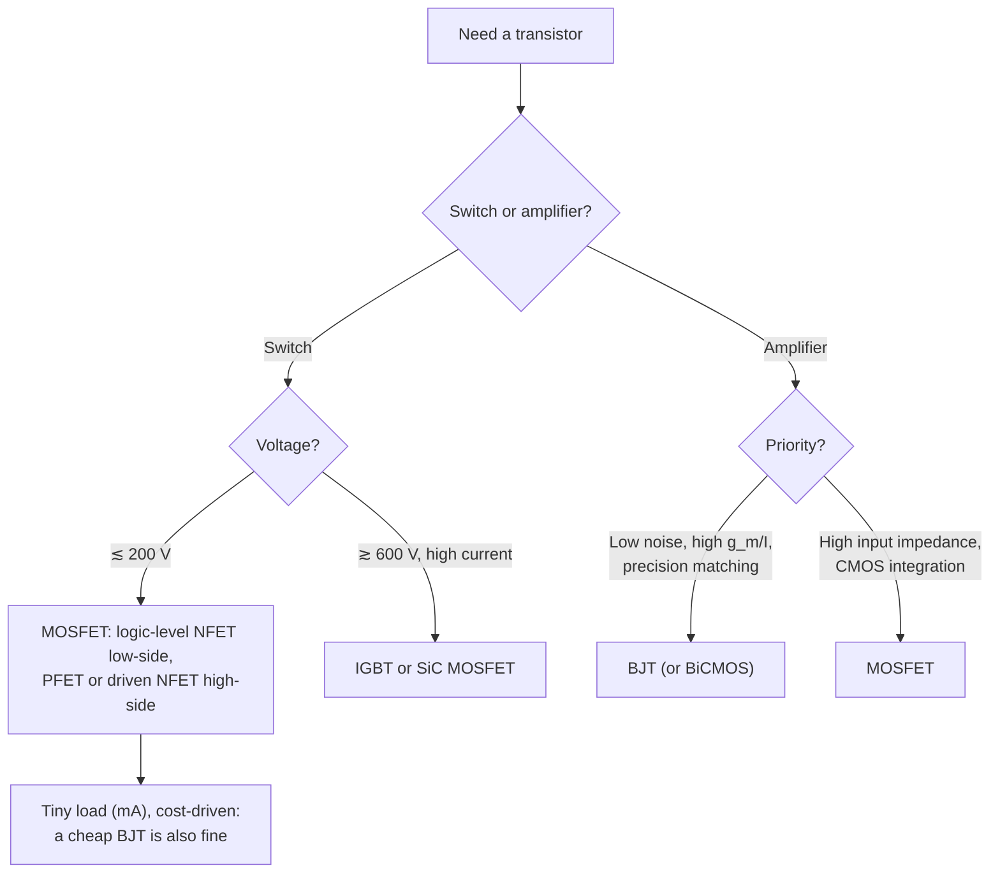

::: basics
### In plain words
A BJT and a MOSFET both act as electronic switches or amplifiers, but you control them differently. A BJT needs a steady base current to stay on. A MOSFET needs only a voltage on its insulated gate. That one difference explains most of why MOSFETs dominate switching.

### Picture it
Think of two ways to keep a door open. A BJT is like holding it with your hand: as long as you keep pushing, it stays open. A MOSFET is like setting a latch: you push once and it stays. The comparison fails on one point. A MOSFET gate still needs a short burst of current each time it switches.

### Words you need
- **Base current**: the steady current a BJT needs. About collector current divided by beta. See [[q0085]].
- **Gate capacitance**: why the MOSFET gate takes current only during switching.
- **$V_{CE(sat)}$ and $R_{DS(on)}$**: a BJT's fixed drop when on, versus a MOSFET's resistance when on.
- **Transconductance**: how much output current changes per volt of input. BJTs have more per milliamp.
- **Saturation**: in a BJT it means fully on. In a MOSFET it means constant-current mode.

### The simplest example
Say you want to carry 1 A. A BJT with a beta of 100 needs about 10 mA of base current the whole time it is on. A MOSFET needs essentially zero current once the gate has charged. Neither is free, but the MOSFET's DC drive cost is far lower.

That is the whole idea. The rest of this page covers on-resistance, switching speed, paralleling, where BJTs still win, and the confusing way both devices use the word "saturation".
:::

::: testing
This is the classic comparison, asked here in the MOSFET section, so the interviewer expects you to speak fluently about MOSFET behaviour against a BJT baseline. They're checking:

1. The core distinction: **current/junction-controlled bipolar device vs voltage/field-controlled unipolar device**, and what that means for drive.
2. That you can compare **with equations and numbers**: exponential vs square-law, $g_m = I_C/V_T$ vs $2I_D/V_{ov}$, $V_{CE(sat)}$ vs $I R_{DS(on)}$.
3. That you don't trip on the **"saturation" naming trap**: BJT saturation is fully on, MOSFET saturation is the amplifier region.
4. That you can turn the comparison into a **choice**: which device for a GPIO-driven load, a 1 MHz converter, a low-noise preamp, a 600 V inverter.
:::

::: why
Choosing between a BJT and a MOSFET is a decision you'll make on real boards: a 2N3904 vs a 2N7002 to drive an LED, a power MOSFET vs a Darlington for a solenoid, a BJT input stage for a low-noise sensor amplifier. The comparison also shows up in datasheet reading (base resistor vs gate resistor, $V_{CE(sat)}$ vs $R_{DS(on)}$), in thermal design (thermal runaway vs paralleling), and in IC design (CMOS vs BiCMOS). Interviewers use it because it reveals whether you understand both devices physically or just memorized two symbol drawings.
:::

::: concepts
- **How a BJT works**: forward-biased base-emitter junction injects carriers across a thin base. $I_C = I_S e^{V_{BE}/V_T}$. See [[q0085]].
- **How a MOSFET works**: gate field induces a channel. $I_D = \tfrac12 k_n(V_{GS}-V_t)^2$ in saturation. See [[q0096]].
- **Operating regions**: the names don't map one-to-one across devices. See [[q0087]] and [[q0099]].
- **Transconductance $g_m$**: output current change per input voltage change, the key amplifier figure.
- **Gate charge vs base current**: what it costs to drive each device. See [[q0090]].
- **Temperature behaviour**: thermal runaway vs positive tempco. See [[q0093]].
:::

::: answer
"The big difference is how you control them. A BJT is a bipolar, junction device: you forward-bias the base-emitter junction, and to keep it on you have to keep supplying base current, roughly the collector current divided by beta. A MOSFET is a field-effect device with an insulated gate: you apply a voltage, the field creates a channel, and once the gate capacitance is charged it takes essentially zero current to stay on.

That leads to the practical differences. When fully on, a BJT has a roughly fixed $V_{CE(sat)}$ of a couple hundred millivolts or more, while a MOSFET acts like a resistor, $R_{DS(on)}$, which can be milliohms. MOSFETs switch faster because they're majority-carrier devices, with no stored charge to pull out of a saturated base. And MOSFETs parallel more easily because $R_{DS(on)}$ rises with temperature, whereas a BJT tends toward thermal runaway.

BJTs still win in some places: they have higher transconductance per milliamp, $I_C/V_T$, about 39 mS per mA, and lower $1/f$ noise, so they're good for precision analog, and they turn on at a predictable 0.6–0.7 V.

One trap: the regions are named confusingly. A BJT in *saturation* is fully on, like a switch, but a MOSFET in *saturation* is the constant-current amplifier region. The MOSFET's switch region is triode."
:::

::: technical
| Property | BJT (NPN) | MOSFET (NMOS, enhancement) |
|---|---|---|
| Carrier type | Bipolar (electrons and holes) | Unipolar (electrons only) |
| Control | $V_{BE}$ across a forward-biased junction; draws $I_B = I_C/\beta$ | $V_{GS}$ across an oxide; $I_G \approx 0$ at DC |
| Large-signal law | $I_C = I_S e^{V_{BE}/V_T}$ | $I_D = \tfrac12 k_n(V_{GS}-V_t)^2(1+\lambda V_{DS})$ |
| Turn-on voltage | $V_{BE(on)} \approx 0.6$–0.7 V, tightly set by physics | $V_{GS(th)}$ ≈ 0.4–4 V depending on design, wide tolerance |
| $g_m$ | $I_C/V_T$ ≈ 38.7 mS/mA at 300 K | $2I_D/V_{ov} = \sqrt{2k_nI_D}$ (10 mS/mA at $V_{ov}$ = 0.2 V) |
| Input resistance | $r_\pi = \beta/g_m$ (2.6 kΩ at 1 mA, β = 100) | ≈ ∞ at DC, capacitive at AC |
| Output resistance | $r_o = V_A/I_C$ (Early) | $r_o = 1/(\lambda I_D)$ (channel-length modulation) |
| On-state (switch) | Saturation: $V_{CE(sat)}$ ≈ 0.05–1 V | Triode: $V_{DS} = I_D R_{DS(on)}$ |
| Switching speed | Limited by stored base charge (storage time) | Limited by charging $C_{GS}$, $C_{GD}$ |
| Temperature | $V_{BE}$ falls ~2 mV/°C → thermal runaway risk | $R_{DS(on)}$ rises → self-balancing when fully on |
| Intrinsic diode | None across C-E | Body diode S→D |
| Failure modes | Second breakdown, thermal runaway | Gate oxide overvoltage/ESD, avalanche, linear-mode SOA |
| Noise | Lower $1/f$ noise, low voltage noise | Higher $1/f$ noise (oxide traps) |

**Region-name trap.** BJT active ↔ MOSFET saturation (amplifier). BJT saturation ↔ MOSFET triode (switch). Both have cutoff.

**Drive example (switching 100 mA from a 3.3 V GPIO).** BJT with forced $\beta = 10$: $I_B = 10$ mA, $R_B = (3.3-0.7)/10\text{ mA} = 260$ Ω. MOSFET: gate resistor ~100 Ω only to tame edges, zero DC current.
:::

::: short
"A BJT is current-controlled through a forward-biased junction: it needs continuous base current, roughly $I_C/\beta$, and when on it has a fixed-ish $V_{CE(sat)}$. A MOSFET is voltage-controlled through an insulated gate: no DC gate current, and when on it's a resistor, $R_{DS(on)}$. MOSFETs switch faster and parallel easily. BJTs have more transconductance per milliamp and lower noise, so they still win in some analog. And watch the names: BJT saturation is fully on, MOSFET saturation is the amplifier region."
:::

::: long
"I'd compare them on control, conduction, switching, temperature and analog performance.

Control first. A BJT is a bipolar junction device. You forward-bias the base-emitter junction, and the collector current is exponential in $V_{BE}$: $I_C = I_S e^{V_{BE}/V_T}$. The catch is that some of the injected carriers recombine in the base, so you have to supply base current, $I_C/\beta$, the whole time it's on. A MOSFET is a field-effect device. The gate sits on an oxide, so its voltage controls the channel without any DC current. In saturation the drain current follows a square law in the overdrive, $V_{GS} - V_t$. So to switch 100 milliamps from a 3.3 V pin, a BJT needs about 10 milliamps of base current through a 260 ohm resistor. A MOSFET just needs its gate charged.

Conduction: a saturated BJT has a voltage drop of a couple hundred millivolts up to around a volt at high current. A MOSFET in triode is just a resistor. With milliohm parts, that's far lower loss at high current.

Switching: a saturated BJT stores minority charge in its base, which causes a storage-time delay at turn-off. MOSFETs are majority-carrier devices, so they switch as fast as you can charge the gate capacitance.

Temperature: a hot BJT conducts more at the same $V_{BE}$, so it can run away thermally, and paralleling needs ballast resistors. A fully-on MOSFET's resistance rises with temperature, so paralleled devices share current.

Analog: BJTs win on transconductance per unit current: $g_m = I_C/V_T$ is about 39 millisiemens per milliamp, versus about 10 for a MOSFET at 0.2 V overdrive. They also have lower $1/f$ noise and predictable $V_{BE}$ matching. MOSFETs win on input impedance.

One thing I always flag is the naming. BJT saturation means fully on. MOSFET saturation means the constant-current amplifier region. The MOSFET's switch region is triode."
:::

::: terms
- **Bipolar vs unipolar**: BJTs conduct with both carrier types; MOSFETs with one (majority carriers in the channel).
- **Transconductance $g_m$**: $\partial I_{out}/\partial V_{in}$. $I_C/V_T$ for a BJT, $2I_D/V_{ov}$ for a MOSFET.
- **Thermal voltage $V_T$**: $kT/q$ ≈ 25.9 mV at 300 K.
- **Overdrive voltage $V_{ov}$**: $V_{GS} - V_t$.
- **$V_{CE(sat)}$**: BJT collector-emitter voltage when saturated (fully on).
- **$R_{DS(on)}$**: MOSFET resistance when fully on (triode).
- **Storage time**: BJT turn-off delay while excess base charge is removed.
- **Thermal runaway**: positive feedback where rising temperature raises current, which raises temperature.
- **Forced beta**: $I_C/I_B$ chosen well below β to guarantee saturation.
:::

::: exceptional
**An average answer** says "BJT is current-controlled, MOSFET is voltage-controlled."

**An exceptional answer**:
- Explains *why*: base current exists because of recombination and back-injection at a forward-biased junction, while the MOSFET gate is an insulated capacitor.
- Compares with **equations**: exponential vs square law, and $g_m/I$ of $1/V_T$ ≈ 38.7 V⁻¹ vs $2/V_{ov}$.
- Calls out the **saturation naming trap** unprompted.
- Gives a **switch design** comparison with numbers (base resistor vs gate drive, $V_{CE(sat)}$ vs $I^2R_{DS(on)}$).
- Covers temperature behaviour (runaway vs self-balancing, with the linear-mode caveat), body diode presence, and failure modes.
- Ends with a **decision rule**: MOSFET for most switching and all logic, BJT for low-noise/precision analog and cheap low-current switching, IGBT at high voltage.
:::

::: mistakes
- **"BJTs are current-controlled, period."** Physically the collector current is set by $V_{BE}$ exponentially. Base current is a by-product you must supply. Saying "current-controlled" is fine as engineering shorthand, but know the physics.
- **Mixing up saturation.** In a MOSFET, saturation is the *amplifier* region. Saying "drive the MOSFET into saturation to turn it fully on" is wrong in textbook terms (though some power-electronics people say it loosely).
- **Assuming $V_{GS(th)}$ is the turn-on voltage.** It's where a tiny current flows (e.g., 250 µA). Full enhancement needs several volts more.
- **"MOSFETs need no drive current."** True at DC; switching needs peak amps.
- **Forgetting the body diode.** A BJT has no intrinsic C-E reverse diode; a MOSFET does. That changes how each behaves in bridges and with reverse voltage.
- **Comparing $g_m$ without fixing the current.** The fair comparison is $g_m/I$.
:::

::: deep
## Two different physical mechanisms

**BJT.** An NPN is two back-to-back PN junctions sharing a thin P base. Forward-bias the base-emitter junction and electrons are injected from the emitter into the base. The base is thin, so most diffuse across to the reverse-biased collector junction and get swept into the collector. The collector current depends exponentially on $V_{BE}$:

$$I_C = I_S\, e^{V_{BE}/V_T},\qquad V_T = \frac{kT}{q} \approx 25.9\text{ mV at 300 K}$$

Some injected electrons recombine in the base, and the base also injects holes back into the emitter. Those currents must be supplied from the base terminal: $I_B = I_C/\beta$. That's the "current-controlled" nature. It's a cost you pay, not really the control mechanism.

**MOSFET.** The gate is a capacitor plate over an oxide. A gate voltage above threshold attracts a layer of electrons (the inversion channel) linking source and drain. The channel charge per area is $C_{ox}(V_{GS}-V_t)$, and in saturation

$$I_D = \tfrac12 \mu_n C_{ox}\frac{W}{L}(V_{GS} - V_t)^2$$

No carriers cross the oxide, so the gate draws no DC current. Conduction is by electrons only (unipolar), and there's no forward-biased junction in the current path.

## The naming trap, solved with a table

| What the device is doing | BJT name | MOSFET name |
|---|---|---|
| Off | Cutoff | Cutoff (subthreshold) |
| Acting as a current source / amplifier | **Forward-active** | **Saturation** |
| Fully on, low voltage drop (switch) | **Saturation** | **Triode** (linear, ohmic) |

The word "saturation" means opposite things. For a BJT, the collector current has *saturated*: it can't increase further because the transistor is fully on. For a MOSFET, the drain current has *saturated* with respect to $V_{DS}$: it stops increasing with $V_{DS}$ because the channel pinches off at the drain. If you use one word in an interview, state which device you mean.

## Analog: transconductance per unit current

The amplifier figure of merit is $g_m$ for a given bias current. Differentiate each law:

$$g_{m,BJT} = \frac{I_C}{V_T},\qquad g_{m,MOS} = \frac{2I_D}{V_{GS}-V_t} = \sqrt{2k_nI_D}$$

At 1 mA and 300 K the BJT gives $1\text{ mA}/25.9\text{ mV} = 38.7$ mS. A MOSFET at a typical $V_{ov} = 0.2$ V gives 10 mS. To match the BJT's $g_m/I$, a MOSFET would need $V_{ov} = 2V_T \approx 52$ mV, which pushes it into weak inversion where it gets slow and large.

```plot
{"title":"Transconductance vs bias current","x":{"label":"Bias current","unit":"A","min":0,"max":0.002},"y":{"label":"g_m","unit":"S","min":0,"max":0.08},
 "vars":{"vt":0.025852,"k1":0.002,"k2":0.02},
 "series":[{"label":"BJT: I/V_T","fn":"x/vt"},{"label":"MOSFET, k_n = 20 mA/V²","fn":"sqrt(2*k2*x)","color":"orange"},{"label":"MOSFET, k_n = 2 mA/V²","fn":"sqrt(2*k1*x)","color":"purple","dashed":true}],
 "points":[{"x":0.001,"y":"0.001/vt","label":"38.7 mS at 1 mA"},{"x":0.001,"y":"sqrt(2*k2*0.001)","label":"6.3 mS"}]}
```
Figure: The BJT's g_m grows linearly with current; a MOSFET's grows only as √I, and you need a much wider device (bigger k_n, i.e., more W/L) just to approach the BJT. This is why bipolar input stages are still used in low-noise and high-gain analog.

Other analog differences:
- **Input impedance**: BJT $r_\pi = \beta/g_m$ ≈ 2.6 kΩ at 1 mA with β = 100. MOSFET ≈ infinite at DC. That's why MOSFET (or JFET) inputs are used for high-impedance sensors.
- **Noise**: MOSFETs have significant $1/f$ (flicker) noise from oxide traps. BJTs have lower $1/f$ noise but have base current shot noise, which matters with high source impedance.
- **Matching**: $V_{BE}$ matches to around a millivolt between adjacent devices. MOSFET $V_t$ mismatch is typically several mV and scales as $1/\sqrt{WL}$ ([[q0103]]).

```sim
{"id":"bjt-lab","type":"npn","vcc":10,"rc":1000,"ib":20e-6}
```
Figure: Compare this BJT family of curves with the MOSFET's in the next sim. Here each curve is set by base current, and the low-V_CE region is "saturation" (switch on). Raise ib until the operating point slides into saturation on the load line.

```sim
{"id":"mosfet-lab","type":"nmos","view":"output","vt":1,"k":200e-6,"wl":10}
```
Figure: The MOSFET's curves are set by V_GS, not a current. The low-V_DS region where the curves fan out like resistors is triode (switch on); the flat region is saturation (amplifier). Same shapes, swapped names.

## Switching: drive, drop and speed

```circuit
{"caption":"Driving a 100 mA load from a 3.3 V GPIO: BJT vs MOSFET","elements":[
 {"t":"rail","at":[6,0],"label":"+5 V","dir":"up"},
 {"t":"R","a":[6,0],"b":[6,4],"label":"Load","value":"100 mA"},
 {"t":"npn","at":[4,6],"label":"Q1"},
 {"t":"wire","pts":[[6,8],[6,9]]},{"t":"gnd","at":[6,9]},
 {"t":"term","at":[0,6],"label":"GPIO","side":"left"},
 {"t":"R","a":[0,6],"b":[4,6],"label":"R_B","value":"260 Ω"},
 {"t":"arrow","a":[0.5,8],"b":[2.5,8],"label":"I_B = 10 mA"},
 {"t":"rail","at":[20,0],"label":"+5 V","dir":"up"},
 {"t":"R","a":[20,0],"b":[20,4],"label":"Load","value":"100 mA"},
 {"t":"nmos","at":[18,6],"label":"Q2"},
 {"t":"wire","pts":[[20,8],[20,9]]},{"t":"gnd","at":[20,9]},
 {"t":"term","at":[12,6],"label":"GPIO","side":"left"},
 {"t":"R","a":[12,6],"b":[15,6],"label":"R_G","value":"100 Ω"},
 {"t":"wire","pts":[[15,6],[18,6]]},{"t":"dot","at":[16,6]},
 {"t":"R","a":[16,6],"b":[16,9],"label":"100 kΩ","labelSide":"other"},
 {"t":"gnd","at":[16,9]}
]}
```
Figure: The BJT needs 10 mA of continuous base current (forced β = 10 to guarantee saturation) through R_B = (3.3 − 0.7)/10 mA = 260 Ω, which is near the limit of many MCU pins. The MOSFET's gate draws nothing at DC; R_G just limits edge current and the 100 kΩ holds it off while the MCU boots.

| Switching metric | BJT | MOSFET |
|---|---|---|
| Hold-on drive | $I_C/\beta_{forced}$ continuous | Zero (after $Q_g$ delivered) |
| On-state drop at 100 mA | $V_{CE(sat)}$ ≈ 0.1–0.2 V | e.g. 2 Ω × 0.1 A = 0.2 V (2N7002-class) or 5 mV with a 50 mΩ part |
| On-state drop at 10 A | ≈ 0.5–1 V | 50 mV with 5 mΩ |
| Turn-off delay | Storage time (base charge removal) | Gate discharge through the Miller plateau |
| Reverse conduction | Not intrinsic | Body diode always present |

> [!NOTE]
> At low current a small-signal BJT can actually beat a small-signal MOSFET on voltage drop. A 2N7002's $R_{DS(on)}$ of a few ohms gives a few hundred mV at 100 mA. The MOSFET's advantage is mostly drive current and, with power parts, very low resistance at high current.

## Temperature and ruggedness

- **BJT**: $V_{BE}$ at constant $I_C$ falls about 2 mV/°C. Hold $V_{BE}$ fixed and a hotter BJT draws more current, heats more: **thermal runaway**. Paralleled BJTs hog current unless each gets an emitter resistor. Power BJTs also suffer **second breakdown** (current crowding into hot spots).
- **MOSFET**: fully enhanced, $R_{DS(on)}$ rises with temperature, so paralleled devices share current. But the **gate oxide** is fragile ([[q0102]]), and in linear mode MOSFETs can hot-spot too.

## A decision guide


Figure: There's no universal winner. Decide from voltage, current, drive capability, noise and what process or parts you have.
:::

::: applications
- **GPIO-driven loads**: 2N7002 / AO3400-class MOSFETs for low-side switching vs 2N3904/MMBT3904 BJTs with base resistors for tiny loads.
- **Power conversion**: MOSFETs in nearly every buck/boost below ~200 V; IGBTs and SiC in industrial and EV inverters.
- **Low-noise analog**: bipolar-input op-amps for low voltage noise from low-impedance sources (e.g., microphone or strain-gauge preamps) vs CMOS/JFET-input op-amps for high-impedance sources (pH probes, photodiodes).
- **Bandgap references and temperature sensors**: built from BJTs (even in CMOS processes, using parasitic PNPs), because $V_{BE}$ is so predictable.
- **Digital ICs**: CMOS everywhere; BJTs persist in niche ECL/SiGe high-speed and RF parts.
:::

::: assumptions
- Silicon devices, room temperature, **enhancement NMOS** vs **NPN** unless stated. PNP/PMOS mirror everything with flipped polarities.
- MOSFET equations are **long-channel square law**. Short-channel devices are closer to linear in $V_{ov}$ (velocity saturation), which lowers $g_m/I$ further.
- $V_{CE(sat)}$ and $R_{DS(on)}$ values are **representative ranges**, not specific datasheets.
- If the interviewer comes from **power electronics**, they may say "saturation" for a fully-on MOSFET. Clarify which convention you're using rather than correcting them bluntly.
- This page answers from the MOSFET section's perspective. The same question in the BJT section ([[q0083]]) is answered from the BJT side.
:::

::: followups
### Which has higher transconductance at the same bias current, and why?
The BJT. Its $g_m = I_C/V_T$ because current depends exponentially on $V_{BE}$, giving 38.7 mS at 1 mA. A MOSFET in strong inversion has $g_m = 2I_D/V_{ov}$, about 10 mS at 1 mA with 0.2 V overdrive, because current is only square-law in voltage. In weak inversion the MOSFET becomes exponential too, but with a slope factor $n \approx 1.2$–1.5, so it still can't quite reach $I/V_T$.

### Why do BJTs suffer thermal runaway and MOSFETs (mostly) don't?
At fixed $V_{BE}$, BJT collector current roughly doubles every 10 °C or so because $I_S$ rises steeply with temperature (equivalently $V_{BE}$ drops ~2 mV/°C at fixed current). More current means more heat and more current. A fully-on MOSFET's $R_{DS(on)}$ rises with temperature, giving negative feedback. In linear mode near threshold, though, MOSFET current *rises* with temperature, so runaway-like hot-spotting can happen.

### What does "saturation" mean for each device?
BJT: both junctions forward-biased, $V_{CE}$ at its minimum, fully on, used as a closed switch. MOSFET: $V_{DS} \ge V_{GS} - V_t$, channel pinched off at the drain, current nearly independent of $V_{DS}$, used as an amplifier or current source. The MOSFET's switch region is triode.

### You need to switch 50 mA from a 1.8 V MCU pin. BJT or MOSFET?
A BJT is often easier: it turns on at ~0.7 V regardless, so 1.8 V gives 1.1 V across a base resistor, e.g. 5 mA (forced β = 10) via ~220 Ω. A MOSFET needs $R_{DS(on)}$ specified at $V_{GS} \le 1.8$ V; such parts exist (low-threshold small-signal FETs), but many "logic-level" parts are only specified at 2.5 V or 4.5 V. Check the MCU's pin current limit for the BJT option.

### Harder: why are bandgap references built from BJTs even in all-CMOS chips?
Because $V_{BE}$ is set by fundamental physics ($V_T$, bandgap energy) and has a well-defined −2 mV/°C slope, while $\Delta V_{BE}$ between two BJTs at different current densities is $V_T\ln N$, exactly proportional to absolute temperature. Summing them cancels temperature dependence to give ~1.2 V. MOSFET thresholds are process-dependent and far less predictable. CMOS processes provide parasitic vertical PNPs that work for this.
:::

::: interpretations
This is a near-duplicate of [[q0083]] in the BJT section. Both pages are complete; this one leans on MOSFET behaviour (square law, triode/saturation, gate charge, body diode) and the [[q0093]] "why MOSFETs are everywhere" context. If the interviewer is clearly a power-electronics person, emphasize switching (drive, $R_{DS(on)}$, speed, paralleling); if analog, emphasize $g_m/I$, noise and matching.
:::

::: references
- Sedra & Smith, *Microelectronic Circuits*: chapters on MOSFETs and BJTs, including the comparison of MOSFET and BJT amplifiers.
- Razavi, *Design of Analog CMOS Integrated Circuits*: chapter on basic MOS device physics, with BJT comparisons; bandgap reference chapter.
- Horowitz & Hill, *The Art of Electronics*, 3rd ed.: Chapter 2 (bipolar transistors) and Chapter 3 (field-effect transistors), including switching comparisons.
- Gray, Hurst, Lewis & Meyer, *Analysis and Design of Analog Integrated Circuits*: chapter on models for integrated-circuit active devices.
:::

::: rubric
- Control mechanism: BJT via forward-biased junction with base current; MOSFET via insulated gate with no DC current :: The central difference everything else follows from.
- Gives the large-signal laws (exponential vs square law) :: Shows physical rather than rote understanding.
- Compares $g_m$ per unit current ($1/V_T$ vs $2/V_{ov}$) :: The key analog trade-off, and why BJTs persist.
- Compares on-state: $V_{CE(sat)}$ vs $I R_{DS(on)}$ :: The key power-switching trade-off.
- Flags the saturation naming trap :: A frequent source of confusion that interviewers probe.
- Mentions switching speed (storage time vs gate charge) and temperature (runaway vs positive tempco) :: Practical differences that drive device choice.
- Gives a decision rule for when to use each :: Turns knowledge into engineering judgment.
:::

::: quiz
```json
[
 {"type":"mcq","level":"fundamental","q":"A MOSFET used as a closed switch (fully on, small V_DS) is operating in which region?","options":["Saturation","Triode","Cutoff","Forward-active"],"answer":1,"explain":"Triode (linear/ohmic) is the MOSFET's switch region, where it behaves as R_DS(on). MOSFET saturation is the constant-current region, which corresponds to the BJT's forward-active region."},
 {"type":"numeric","level":"intermediate","q":"A BJT is biased at I_C = 2 mA at 300 K (V_T = 25.9 mV). What is its transconductance in mS?","answer":77.2,"tolerance":0.02,"unit":"mS","explain":"$g_m = I_C/V_T = 2\\text{ mA}/25.9\\text{ mV} \\approx 77.2$ mS. A MOSFET at 2 mA with 0.2 V overdrive would have $2I_D/V_{ov}$ = 20 mS."},
 {"type":"numeric","level":"intermediate","q":"You drive an NPN switch carrying 200 mA from a 5 V pin with forced β = 10. Assuming V_BE = 0.75 V, what base resistor do you need (in Ω)?","answer":212.5,"tolerance":0.02,"unit":"Ω","explain":"$I_B = 200/10 = 20$ mA. $R_B = (5 - 0.75)/0.02 = 212.5$ Ω. A MOSFET would need no DC gate current, though 20 mA may exceed many MCU pin ratings, which is a practical argument for the MOSFET."},
 {"type":"truefalse","level":"fundamental","q":"A discrete NPN BJT has an intrinsic diode from emitter to collector analogous to a MOSFET's body diode.","answer":false,"explain":"The MOSFET's body diode comes from the body being tied to the source. A BJT has no such built-in reverse diode across C-E; if you need one (e.g., in a bridge), you add it externally."},
 {"type":"mcq","level":"advanced","q":"For a low-noise preamplifier fed by a 200 Ω microphone, which input device is generally preferred and why?","options":["MOSFET, because its input impedance is infinite","BJT, because it has lower voltage noise and 1/f noise for a given current, and the source impedance is low","MOSFET, because it has no shot noise and higher g_m per mA","Either; noise doesn't depend on device type"],"answer":1,"explain":"With a low source impedance, voltage noise dominates. BJTs give higher g_m per mA (lower voltage noise) and lower 1/f noise. MOSFET/JFET inputs win with high source impedance, where the BJT's base-current noise hurts."}
]
```
:::
