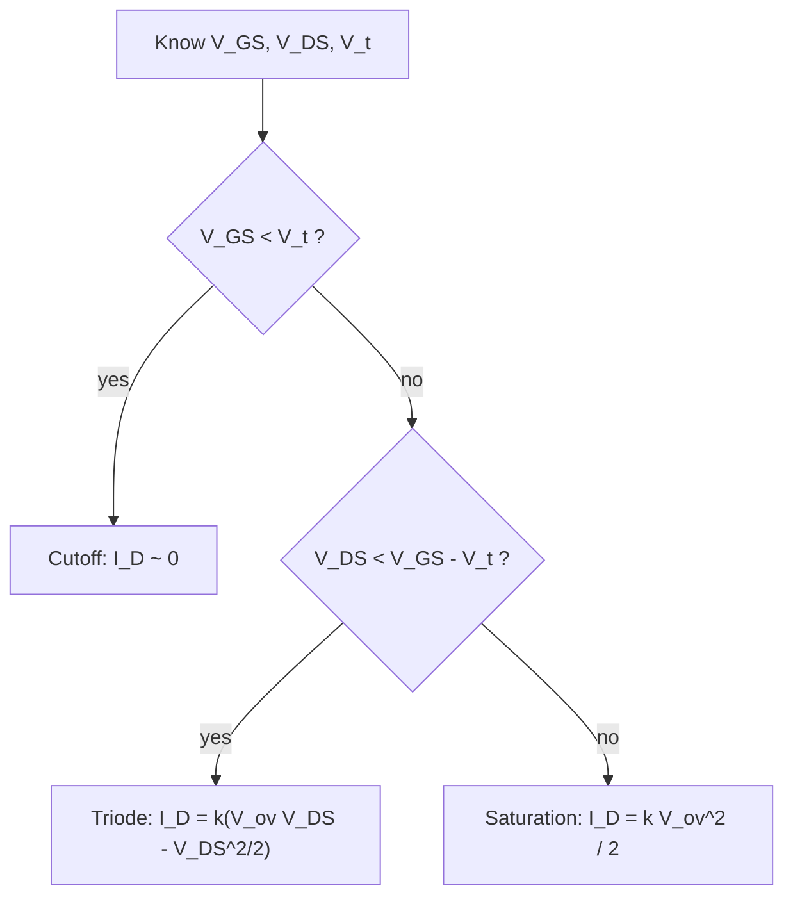

::: testing
Whether you can name the **three regions (cutoff, triode, saturation)** and, more importantly, give the *conditions* and the *physical picture* for each. A strong answer includes:

1. The two comparisons that decide the region: $V_{GS}$ vs $V_t$ (is there a channel?) and $V_{DS}$ vs $V_{GS}-V_t$ (is the channel pinched off at the drain?).
2. The behavioural summary: cutoff = open switch, triode = voltage-controlled resistor, saturation = voltage-controlled current source.
3. Which region you *want* for each job: switch (cutoff/triode) vs amplifier (saturation). Watch for the BJT trap: the word "saturation" means something different for a MOSFET ([[q0087]]).
:::

::: why
Every MOSFET circuit, from a logic gate to an LDO pass device, works because the transistor is deliberately placed in a particular region. A switch lives in cutoff and deep triode, an amplifier in saturation, a current mirror in saturation. If you can't determine the region you can't pick the right equation, and most "my circuit doesn't work" bugs are a device sitting in the wrong region. This question is also the setup for the region-finding and load-line problem in [[q0100]].
:::

::: concepts
- **Threshold voltage $V_t$**: the minimum $V_{GS}$ for an inversion channel. See [[q0096]].
- **Overdrive voltage $V_{ov}=V_{GS}-V_t$**: how far above threshold the gate is; sets channel charge, on-resistance and current.
- **Pinch-off**: when $V_{DS}\ge V_{ov}$ the gate-to-channel voltage at the drain end falls to $V_t$ and the channel stops at the drain. Current stops depending on $V_{DS}$.
- **Square-law model**: $I_D$ in each region. See [[q0095]].
- **Channel-length modulation ($\lambda$)**: a slight slope on the saturation current; finite output resistance $r_o\approx1/(\lambda I_D)$.
- **PMOS mirror image**: replace $V_{GS}\to V_{SG}$, $V_{DS}\to V_{SD}$ ([[q0097]]).
:::

::: answer
"A MOSFET has three main regions, and which one it's in depends on two comparisons. First, is the gate above threshold? If $V_{GS}<V_t$ there's no channel and the transistor is in cutoff: essentially open, tiny leakage, $I_D\approx0$.

If the gate is above threshold, then I look at $V_{DS}$ against the overdrive, $V_{GS}-V_t$. If $V_{DS}$ is smaller, the channel runs all the way from source to drain and the device acts like a voltage-controlled resistor with $R_{on}\approx1/(k\,V_{ov})$. That's the triode, or linear, region, and it's where a switch sits when it's on.

If $V_{DS}$ is bigger than the overdrive, the channel pinches off at the drain end and the current saturates at $\tfrac12k(V_{GS}-V_t)^2$, roughly independent of $V_{DS}$. That's saturation, where the device acts as a voltage-controlled current source. It's what amplifiers and current mirrors use.

So switches go between cutoff and triode, amplifiers sit in saturation. And one caution: 'saturation' in a MOSFET means current saturation, not heavily on like a BJT in saturation, which is the opposite of what a switch wants."
:::

::: technical
**Conditions (N-channel, enhancement, long-channel square law)**, with $V_{ov}=V_{GS}-V_t$:

| Region | Condition | Drain current | Small-signal behaviour |
|---|---|---|---|
| Cutoff | $V_{GS}<V_t$ | $\approx0$ (subthreshold leakage, $\propto e^{V_{GS}/nV_T}$) | open circuit |
| Triode (linear) | $V_{GS}>V_t$ and $V_{DS}<V_{ov}$ | $I_D=k\left[V_{ov}V_{DS}-\tfrac12V_{DS}^2\right]$ | resistor $r_{ds}\approx\dfrac{1}{kV_{ov}}$ at small $V_{DS}$ |
| Saturation (active) | $V_{GS}>V_t$ and $V_{DS}\ge V_{ov}$ | $I_D=\tfrac12kV_{ov}^2(1+\lambda V_{DS})$ | current source with $g_m=kV_{ov}=\sqrt{2kI_D}$, $r_o\approx\dfrac{1}{\lambda I_D}$ |

with $k=\mu C_{ox}\,W/L$. The two I-V expressions meet (value and slope) at $V_{DS}=V_{ov}$, where $I_D=\tfrac12kV_{ov}^2$.

**PMOS:** same table with $V_{SG}>|V_{tp}|$ and $V_{SD}$ in place of $V_{GS}$ and $V_{DS}$.

**Example.** $k=2$ mA/V², $V_t=1$ V NMOS:
- $V_{GS}=0.5$ V, $V_{DS}=5$ V: cutoff, $I_D\approx0$.
- $V_{GS}=3$ V, $V_{DS}=1$ V: $V_{ov}=2$ V, $V_{DS}<V_{ov}$ so triode, $I_D=2\text{ m}(2\cdot1-0.5)=3$ mA.
- $V_{GS}=3$ V, $V_{DS}=5$ V: saturation, $I_D=\tfrac12(2\text{ m})(4)=4$ mA.
- Deep triode on-resistance at $V_{GS}=3$ V: $1/(2\text{ m}\cdot2)=250$ Ω.

**Beyond the three.** Weak inversion/subthreshold conduction below $V_t$ (exponential, used in low-power analog), velocity saturation in short channels (current becomes closer to linear in $V_{ov}$), and breakdown at high $V_{DS}$ (avalanche, punch-through).
:::

::: short
"There are three regions. In cutoff, $V_{GS}$ is below threshold, there's no channel, and the device is open. In triode, $V_{GS}$ is above threshold but $V_{DS}$ is less than the overdrive, so the channel spans the whole device and it behaves like a voltage-controlled resistor. In saturation, $V_{DS}$ is bigger than the overdrive, the channel pinches off at the drain, and the current flattens at about half k times overdrive squared, so it acts like a gate-controlled current source. Switches use cutoff and triode, amplifiers use saturation."
:::

::: long
"A MOSFET has three regions, determined by two checks. First: is the gate voltage above the threshold? If not, there's no inversion channel, so the device is in cutoff and the drain current is basically zero, apart from a small subthreshold leakage. That's the 'off' state of a switch.

Second, if $V_{GS}$ is above threshold, compare $V_{DS}$ with the overdrive, $V_{GS}-V_t$. When $V_{DS}$ is smaller than the overdrive, the gate still has enough voltage over the whole channel, including the drain end, so the channel connects source to drain and current increases with $V_{DS}$. That's the triode region. For small $V_{DS}$ it's almost linear, $R_{on}\approx1/(k\,V_{ov})$, so I can say a 2 mA/V² device with 2 V of overdrive is about 250 Ω. That's the 'on' state of a switch.

When $V_{DS}$ reaches the overdrive, the voltage between gate and channel at the drain end drops to the threshold, the channel pinches off there, and extra drain voltage just drops across the pinched-off region. The current saturates at $\tfrac12k(V_{GS}-V_t)^2$, with a small slope from channel-length modulation. That's saturation, where the transistor is a voltage-controlled current source with transconductance $g_m=kV_{ov}$. It's the region amplifiers, current mirrors and source followers operate in.

For a PMOS it's the same, with source-referenced magnitudes. And I'd mention that below threshold there's still an exponential subthreshold current, which matters for leakage and for micropower analog.

The naming trap is that a MOSFET in saturation is *not* fully on like a BJT in saturation. A MOSFET switch is on in triode."
:::

::: terms
- **Cutoff**: $V_{GS}<V_t$; no channel, $I_D\approx0$.
- **Triode / linear / ohmic region**: $V_{DS}<V_{ov}$; resistor-like behaviour with $R_{on}\approx1/(kV_{ov})$.
- **Saturation / active region**: $V_{DS}\ge V_{ov}$; channel pinched off, $I_D$ nearly independent of $V_{DS}$.
- **Overdrive voltage ($V_{ov}$)**: $V_{GS}-V_t$.
- **Pinch-off**: the channel has zero depth at the drain end when $V_{DS}=V_{ov}$.
- **Channel-length modulation ($\lambda$)**: shortening of the effective channel with $V_{DS}$ which gives finite $r_o$.
- **Transconductance ($g_m$)**: $\partial I_D/\partial V_{GS}=kV_{ov}$ in saturation.
- **Subthreshold (weak inversion)**: exponential conduction below $V_t$.
:::

::: exceptional
An average answer lists "cutoff, triode, saturation" and says what each looks like. An exceptional answer:

- Gives the **two inequalities** (and a one-line reason for $V_{DS}$ vs $V_{ov}$: pinch-off at the drain) rather than a memorized chart.
- Gives the equations and a **numeric** example with the on-resistance.
- Maps each region to a job: switch, amplifier, current source, mirror.
- Warns about the **BJT "saturation" naming trap** and the PMOS sign flip.
- Mentions the regions the textbook leaves out: subthreshold, velocity saturation and breakdown.
- Notes that the boundary parabola $I_D=\tfrac12kV_{DS}^2$ separates the two on-regions on the I-V plot.
:::

::: mistakes
- **Equating MOSFET saturation with BJT saturation.** MOSFET saturation = constant current, device is *amplifying*. The "fully on" state of a MOSFET switch is **triode**.
- **Comparing $V_{DS}$ to $V_t$ instead of to $V_{GS}-V_t$.** The pinch-off boundary depends on overdrive, not on $V_t$ alone.
- **Using the saturation equation for a switch.** An on-state switch with small $V_{DS}$ is in triode; using $\tfrac12kV_{ov}^2$ gives a current far above the real one.
- **PMOS sign errors.** Use $V_{SG}$ and $V_{SD}$, or check the condition in absolute values.
- **Saying cutoff current is exactly zero.** It's tiny, but it grows exponentially with temperature and as $V_t$ is lowered; it is why standby power exists in modern chips.
- **Forgetting channel-length modulation** when asked for output resistance; the ideal saturation current has infinite $r_o$, which is not true of real devices.
:::

::: deep
## The gate and drain set up a channel that varies along its length

Consider an NMOS above threshold. Along the channel, the local gate-to-channel voltage is $V_{GS}-V(x)$, where $V(x)$ rises from 0 at the source to $V_{DS}$ at the drain. The inversion charge per unit area is

$$Q_n(x)=C_{ox}\left[V_{GS}-V(x)-V_t\right],$$

so charge is greatest at the source and smallest at the drain. The drain current is the same everywhere, $I_D=\mu\,W\,Q_n(x)\,\dfrac{dV}{dx}$. Integrating from $x=0$ to $L$ gives the triode formula:

$$I_D=\mu C_{ox}\frac WL\left[(V_{GS}-V_t)V_{DS}-\tfrac12V_{DS}^2\right]$$

Notice the structure. For small $V_{DS}$ the quadratic term is negligible and $I_D\approx kV_{ov}V_{DS}$: a resistor. As $V_{DS}$ rises, the charge near the drain falls, the curve bends over, and at $V_{DS}=V_{ov}$ the charge at the drain end hits zero. That is **pinch-off**. The parabola has its maximum there, at $I_D=\tfrac12kV_{ov}^2$.

Beyond that point the physics changes slightly: the pinched-off sliver of channel next to the drain absorbs the extra voltage, in a high-field region where carriers are swept across. The voltage across the *inverted* part of the channel stays $V_{ov}$ and the current stays at $\tfrac12kV_{ov}^2$. A small effect remains because the pinched-off region grows with $V_{DS}$, shortening the effective channel: channel-length modulation.

```plot
{"title":"NMOS output characteristics with region boundary (k = 2 mA/V², V_t = 1 V, λ = 0)","x":{"label":"V_DS","unit":"V","min":0,"max":6},"y":{"label":"I_D","unit":"A","min":0,"max":0.0105},
 "vars":{"k":0.002},
 "series":[
  {"label":"V_GS = 2 V (V_ov = 1)","fn":"x<1 ? k*(1*x-x^2/2) : k/2*1"},
  {"label":"V_GS = 3 V (V_ov = 2)","fn":"x<2 ? k*(2*x-x^2/2) : k/2*4"},
  {"label":"V_GS = 4 V (V_ov = 3)","fn":"x<3 ? k*(3*x-x^2/2) : k/2*9"},
  {"label":"V_GS = 0.5 V (cutoff)","fn":"0","color":"muted"},
  {"label":"boundary: V_DS = V_ov","fn":"k/2*x^2","dashed":true,"color":"red"}],
 "points":[{"x":1,"y":0.003,"label":"triode (3 mA at V_DS = 1 V, V_GS = 3 V)"},{"x":5,"y":0.004,"label":"saturation (4 mA)"}]}
```
Figure: Each curve rises through the origin (triode), bends, and goes flat once it meets the dashed red parabola $I_D=\tfrac12kV_{DS}^2$ (saturation). Left of and above the parabola is triode; right of and below it is saturation. The flat segments are spaced like $V_{ov}^2$: 1, 4, 9 times 1 mA.

## Region as a decision procedure


Figure: The whole classification is two comparisons. For a PMOS apply the same chart to $V_{SG}$ and $V_{SD}$.

## Worked examples

NMOS, $V_t=1$ V, $k=2$ mA/V², no channel-length modulation.

| $V_{GS}$ | $V_{DS}$ | $V_{ov}$ | Region | $I_D$ |
|---|---|---|---|---|
| 0.5 V | 5 V | negative | cutoff | 0 |
| 3 V | 0.1 V | 2 V | triode | $2\text{ m}(0.2-0.005)=0.39$ mA (resistive: $V/250\,\Omega=0.4$ mA) |
| 3 V | 1 V | 2 V | triode | 3 mA |
| 3 V | 2 V | 2 V | boundary | 4 mA |
| 3 V | 5 V | 2 V | saturation | 4 mA |

PMOS, $|V_t|=1$ V, source at 5 V, gate at 3 V, drain at 1 V: $V_{SG}=2$ V, $V_{ov}=1$ V, $V_{SD}=4$ V $>V_{ov}$, so saturation.

## Experiment

```sim
{"id":"mosfet-lab","type":"nmos","view":"output","vt":1,"k":200e-6,"wl":10,"vgs":3,"vds":1}
```
Figure: Drag $V_{GS}$ and $V_{DS}$ and watch the region readout change. Start at $V_{GS}=3$ V and raise $V_{DS}$ from 0 to 5 V: the operating point slides up the curve, bends, and goes flat at $V_{ov}=2$ V. Note $R_{on}$ in triode and $g_m$ in saturation.

## Why each region is used

- **Digital/power switch.** Gate drive pushes $V_{ov}$ high (say 4-10 V in a power FET) and the load current is limited by the load, so $V_{DS}$ is small: the device is in deep triode, $R_{on}$ is tens of mΩ and $P=I^2R_{on}$. Cutoff gives a high-impedance off state. The transition passes briefly through saturation, which is where switching loss lives ([[q0109]] and the power chapters).
- **Amplifier.** Saturation gives a high output resistance and a stable transconductance, so the stage behaves like a gain element. Biasing keeps $V_{DS}>V_{ov}$ with some margin for signal swing ([[q0119]]).
- **Current mirror.** Both devices in saturation so $I_D$ depends only on $V_{GS}$, copying current ([[q0104]]).
- **Voltage-controlled resistor.** Triode at small $V_{DS}$: analog gain control, MOSFET-C filters, and the on-resistance of an analog switch.

## Real hardware

- **Short channels.** Velocity saturation makes $I_D\approx WC_{ox}v_{sat}V_{ov}$ rather than quadratic, and $V_{DS,sat}<V_{ov}$.
- **Subthreshold.** Below $V_t$: $I_D\propto e^{V_{GS}/(nV_T)}$, with a slope of about 60-100 mV/decade at room temperature. Leakage grows quickly with temperature.
- **Body effect.** If source and body differ, $V_t$ rises and the boundaries move. See [[q0091]].
- **Datasheet language.** Power MOSFET datasheets call the triode region the "ohmic" or "linear" region, and use "saturation" for the constant-current region; some datasheets contrast "linear mode" operation (hot-swap, ideal-diode controllers) with switching operation. Check the definitions when reading.

> [!UNCERTAIN]
> The terms "linear region" and "saturation" are used inconsistently across power-electronics datasheets, where "linear mode" sometimes means the *constant-current* region. In textbooks, "linear" is the triode region. State which one you mean in an interview.
:::

::: applications
- **Logic gates**: transistors switch between cutoff and triode, with the brief passage through saturation setting the propagation delay.
- **Load switch / hot-swap controller**: the FET is deliberately held in the saturation ("linear") region during inrush to limit current, then driven into triode for low $R_{on}$.
- **Common-source amplifier**: biased in saturation with $g_m=kV_{ov}$ giving voltage gain $-g_mR_D$.
- **Current mirror / current source**: devices held in saturation for high output resistance.
- **Analog switch / transmission gate**: triode with $R_{on}\approx1/(kV_{ov})$, varying with signal level.
- **Variable-resistor gain control** (AGC): a small-signal triode FET as a gate-controlled resistor.
:::

::: assumptions
- **Square-law, long-channel** model with $\lambda=0$ unless stated. Short-channel devices follow a velocity-saturated model with a lower $V_{DS,sat}$.
- **Enhancement-mode NMOS** unless noted; for depletion devices the threshold is negative but the regions are identical ([[q0098]]).
- **Source tied to body** (no body effect); otherwise $V_t$ shifts.
- **DC (quasi-static) operation.** At high frequency, gate capacitance and carrier transit time limit the response regardless of region.
- Some texts name the regions differently: *cutoff / linear (ohmic) / active* or *off / triode / pinch-off*. "Active region" is the BJT word for something different, so clarify if the interviewer uses it.
:::

::: followups
### What is the on-resistance in triode and what sets it?
For small $V_{DS}$, $R_{on}=1/(\mu C_{ox}\frac WL V_{ov})$. A device with $k=2$ mA/V² at $V_{ov}=2$ V has 250 Ω; at $V_{ov}=4$ V it has 125 Ω. Wider W (bigger k) and higher gate drive both lower it. Real power MOSFETs reach milliohms by paralleling millions of cells.

### Why does the current stop increasing with $V_{DS}$ in saturation?
At pinch-off the inversion charge at the drain end is zero, so the voltage across the inverted part of the channel is fixed at $V_{ov}$. Extra $V_{DS}$ drops across the short depleted region next to the drain. The current is set by $V_{ov}$ alone. Channel-length modulation gives a small slope: $I_D=\tfrac12kV_{ov}^2(1+\lambda V_{DS})$.

### How does a MOSFET in saturation differ from a BJT in saturation?
A MOSFET in saturation is a constant-current source: that's the amplifier region, similar to the BJT's forward-active region. A BJT in saturation is the "fully on" state, with both junctions forward biased and $V_{CE}\approx0.2$ V. The MOSFET equivalent of that is triode. See [[q0087]].

### Given $V_{GS}=5$ V, $V_t=1$ V, $k=2$ mA/V², what is the largest $V_{DS}$ for which the device stays in triode, and what is $I_D$ there?
$V_{ov}=4$ V, so triode needs $V_{DS}<4$ V. At $V_{DS}=4$ V, $I_D=\tfrac12(2\text{ m})(16)=16$ mA. Check with the triode formula: $2\text{ m}(4\cdot4-8)=16$ mA ✓.

### What happens to the boundary between regions if $V_t$ rises with temperature or body effect?
$V_{ov}=V_{GS}-V_t$ falls, so for the same $V_{GS}$ the saturation boundary $V_{DS,sat}$ moves down and the current falls as $V_{ov}^2$. A load switch that was marginal becomes worse, an amplifier loses headroom.

### Scenario: your power MOSFET is hot even though the load current is small and the gate is at 3.3 V. Which region is it in and why?
A power FET with $V_{th}\approx$ 2-4 V and only 3.3 V of gate drive has very little overdrive; $R_{on}$ is much higher than the datasheet value (usually quoted at 10 V or 4.5 V). It may even sit in saturation if the load pulls $V_{DS}$ above the tiny overdrive. Fix it with a gate driver at a higher voltage or a logic-level FET with a spec at 3.3 V.
:::

::: interpretations
"Modes of operation" in the MOSFET context usually means these **regions** (cutoff, triode, saturation). It can also mean **enhancement vs depletion mode** ([[q0098]]), which is a different classification. In the BJT section ([[q0087]]) "modes" are cutoff, forward-active, saturation and reverse-active. A good answer states which meaning it is addressing and mentions the other briefly.
:::

::: references
- Sedra & Smith, *Microelectronic Circuits*: MOSFET chapter, sections on operation with $V_{DS}$ applied and the $i$-$v$ characteristics (triode and saturation).
- Razavi, *Fundamentals of Microelectronics*: MOS I/V characteristics, including pinch-off and channel-length modulation.
- Horowitz & Hill, *The Art of Electronics*, 3rd ed.: MOSFET chapters (switching and linear-mode operation).
- Weste & Harris, *CMOS VLSI Design*: MOS transistor theory chapter, including velocity saturation and subthreshold conduction.
:::

::: rubric
- Names the three regions with correct conditions ($V_{GS}$ vs $V_t$, $V_{DS}$ vs $V_{GS}-V_t$) :: These are the defining inequalities everything else depends on.
- Describes behaviour: open, resistor, current source :: Shows you understand what each region is *for*.
- Gives the drain-current equations or the triode $R_{on}$ :: Lets you compute rather than hand-wave.
- Explains pinch-off physically :: Demonstrates understanding rather than memorization.
- Maps regions to uses: switch vs amplifier vs mirror :: Connects theory to design.
- Warns about the BJT "saturation" naming difference :: A classic interview trap.
- Mentions subthreshold, velocity saturation or channel-length modulation :: Signals awareness of real devices beyond the textbook.
:::

::: quiz
```json
[
 {"type":"mcq","level":"fundamental","q":"An NMOS has $V_t=1$ V, $V_{GS}=3$ V, and $V_{DS}=0.5$ V. Which region is it in?","options":["Cutoff","Triode","Saturation","Breakdown"],"answer":1,"explain":"$V_{ov}=2$ V and $V_{DS}=0.5$ V is less than $V_{ov}$, so the channel spans source to drain: triode."},
 {"type":"mcq","level":"fundamental","q":"Which statement about a MOSFET used as a closed switch is correct?","options":["It operates in saturation","It operates in deep triode with a small $V_{DS}$","It operates in cutoff","It operates in the reverse-active region"],"answer":1,"explain":"The on-state of a MOSFET switch is triode (a small resistance, $R_{on}$). Saturation is the constant-current region."},
 {"type":"numeric","level":"intermediate","q":"An NMOS with $k=2$ mA/V² and $V_t=1$ V has $V_{GS}=3$ V and $V_{DS}=1$ V. What is $I_D$?","answer":3,"tolerance":0.02,"unit":"mA","explain":"$V_{ov}=2$ V, $V_{DS}<V_{ov}$ so triode: $I_D=2\\text{ m}\\,[2(1)-\\tfrac12(1)^2]=3$ mA."},
 {"type":"numeric","level":"intermediate","q":"Same device, $V_{GS}=3$ V, $V_{DS}=5$ V. What is $I_D$ (ignore channel-length modulation)?","answer":4,"tolerance":0.02,"unit":"mA","explain":"$V_{DS}=5$ V exceeds $V_{ov}=2$ V, so saturation: $I_D=\\tfrac12(2\\text{ m})(2)^2=4$ mA."},
 {"type":"numeric","level":"intermediate","q":"What is the small-signal on-resistance of the device above ($k=2$ mA/V², $V_{ov}=2$ V) in deep triode?","answer":250,"tolerance":0.02,"unit":"Ω","explain":"$R_{on}=1/(kV_{ov})=1/(2\\text{ mA/V}^2\\times2\\text{ V})=250$ Ω."},
 {"type":"truefalse","level":"advanced","q":"A PMOS with $|V_t|=1$ V, source at 5 V, gate at 3 V and drain at 4.5 V is in saturation.","answer":false,"explain":"$V_{SG}=2$ V so $V_{ov}=1$ V; $V_{SD}=0.5$ V is less than $V_{ov}$, so it is in triode, not saturation."}
]
```
:::
