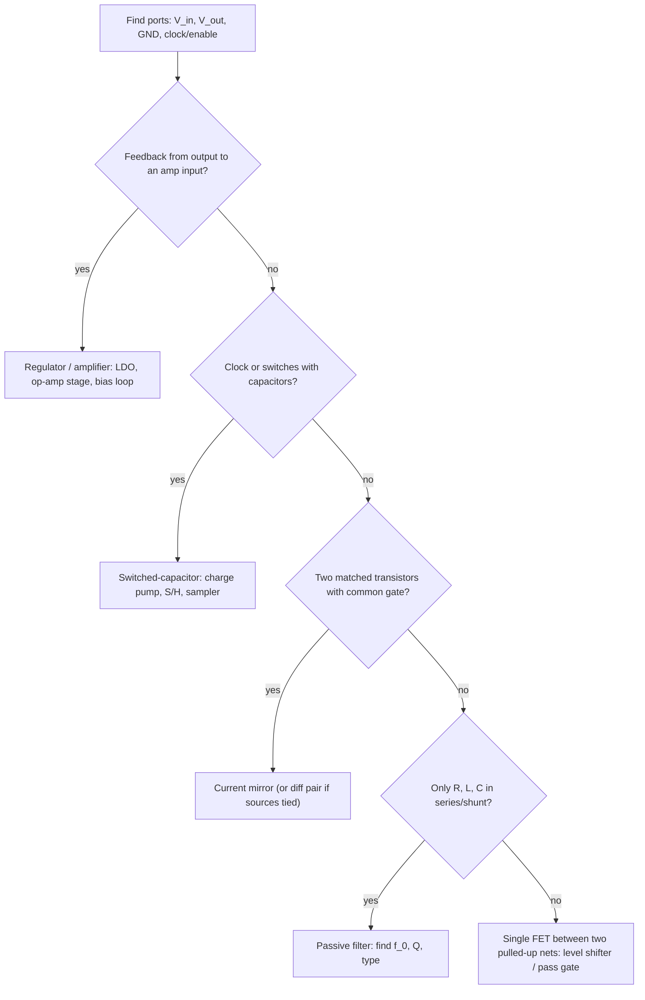

::: testing
This is a **pattern-recognition and communication** question. The interviewer hands you an unlabeled schematic and watches how you reason. What they are looking for:

1. A systematic approach: find the ports (inputs, outputs, supplies, ground), look for feedback, switches and energy storage, and decide what the circuit's job is before naming it.
2. Correctly naming it (charge pump, level shifter, LDO, RLC filter, current mirror, or something else) and then giving its **governing equation** and **limits**.
3. Staying calm when it is not on your list: a candidate who says "here is what I can tell, here is the likely function" beats one who guesses a name.
:::

::: why
Reading schematics is the day-to-day job of a hardware engineer: datasheet reference designs, a colleague's board, an unfamiliar IC's internals. Interviewers use "what is this circuit?" to test whether your fundamentals compose into fluency. The five you listed (charge pump, level shifter, LDO, RLC filters, current mirror) are common because each is a small, recognizable arrangement of parts. This page gives you the signature of each, how to explain it in two minutes, and a method for the circuits you haven't memorized.
:::

::: concepts
- **Signal path and port identification**: where energy enters and leaves, what is the supply, what is the reference.
- **Feedback detection**: a path from the output back to an input of an amplifier means regulation or precision (LDO, op-amp circuits).
- **Energy storage elements**: capacitors that switch (charge pump) vs filter (RLC), inductors, and what their placement implies. See [[q0010]].
- **Matched devices**: two identical transistors sharing $V_{GS}$ means a current mirror. See [[q0099]].
- **MOSFET as a switch or a pass element**: triode vs saturation. See [[q0100]].
- **Body diode**: sets the behaviour of the single-FET level shifter. See [[q0101]].
- **Related deep dives**: [[q0277]] LDOs, [[q0284]] charge pumps, [[q0878]] level shifters, [[q0129]] filter response.
:::

::: answer
"When I get an unnamed circuit I don't guess the name first. I identify the ports: where's the supply, ground, input and output. Then I look for three tell-tale features. Is there feedback from the output back to an amplifier input? Are there switches or a clock with capacitors? Are there two identical transistors with gates tied together?

If there's an error amplifier, a reference, a pass transistor and a resistor divider on the output, that's an LDO: it compares the divided output to the reference and adjusts the pass device, so $V_{out}=V_{ref}(1+R_1/R_2)$. If I see a clock driving a capacitor through diodes or switches into an output capacitor, that's a charge pump, and the output is roughly $2V_{in}$ minus the diode drops and droop. If I see two matched MOSFETs with the gates tied and the reference one diode-connected, it's a current mirror and the output current copies the reference scaled by their W/L ratio. A single NMOS with the gate at the low supply and pull-ups on both sides is a bidirectional level shifter. And a resistor, inductor and capacitor in series with the output across the capacitor is a second-order low-pass with a corner at $1/(2\pi\sqrt{LC})$ and $Q$ set by the resistance.

Then I'd explain what it does, give the one key equation, and say what limits it."
:::

::: technical
**Method for an unfamiliar schematic.**
1. **Ports**: supplies, ground, inputs, outputs, enable/clock pins.
2. **Topology clues**: feedback loop from output to an input (regulation, precision); switching elements + clock + capacitors (switched-capacitor/charge pump); two matched transistors with a common gate (mirror); series/shunt R, L, C without active devices (passive filter); one transistor between two pulled-up nets (level shifter or pass gate).
3. **DC analysis first** (what is the bias?), then the AC/transient behaviour.
4. **Name it, give the equation, give limits.**

**The five on your list.**

| Circuit | Signature | Governing relation | Key limit |
|---|---|---|---|
| Charge pump (doubler) | clock, flying capacitor, 2 diodes/switches, output cap | $V_{out}\approx2V_{in}-2V_D-\dfrac{I_{out}}{fC}$ | drops with load; no inductor; low current |
| Level shifter (single FET) | NMOS, gate to low rail, pull-ups to both rails on source/drain | each side follows the other low; high side pulled to its own rail | speed set by $RC$; open-drain-style; max pull-up current |
| LDO | pass FET, error amp, reference, feedback divider, output cap | $V_{out}=V_{ref}(1+R_1/R_2)$; $\eta\approx V_{out}/V_{in}$ | dropout; power dissipation $(V_{in}-V_{out})I$; stability with $C_{out}$ ESR |
| RLC filter | series R, L; shunt C to ground (LPF) | $f_0=\dfrac{1}{2\pi\sqrt{LC}}$, $Q=\dfrac1R\sqrt{\dfrac LC}$ | peaking if $Q>0.707$; parasitics |
| Current mirror | two matched FETs, common gate, one diode-connected | $I_{out}=I_{ref}\dfrac{(W/L)_2}{(W/L)_1}$ | finite $r_o$ ($\lambda$), mismatch, compliance voltage $\ge V_{ov}$ |

**Worked numbers.**
- Charge pump: $V_{in}=3.3$ V, Schottky drops 0.3 V, $f=500$ kHz, $C=1$ µF, 10 mA load: droop $I/(fC)=20$ mV, so $V_{out}\approx6.6-0.6-0.02=5.98$ V.
- LDO: $V_{ref}=1.2$ V, $V_{out}=3.3$ V, $R_2=10$ kΩ gives $R_1=10\text{k}(3.3/1.2-1)=17.5$ kΩ. From 5 V at 200 mA: efficiency $3.3/5=66\%$, dissipation 0.34 W, a 20 °C rise at $\theta_{JA}=60$ °C/W.
- RLC: $L=10$ µH, $C=1$ µF gives $f_0=50.3$ kHz; $R=1$ Ω gives $Q=3.16$ (10 dB peak); $R=4.47$ Ω gives $Q=0.707$ (maximally flat).
- Mirror: $k=2$ mA/V², $I_{ref}=1$ mA gives $V_{ov}=1$ V; a 1:4 W/L ratio gives 4 mA out.
- Level shifter: 10 kΩ pull-up with 50 pF load: rise time $2.2RC\approx1.1$ µs.
:::

::: short
"I find the ports and look for the telltale features: feedback to an amplifier input means regulation, like an LDO with $V_{out}=V_{ref}(1+R_1/R_2)$; a clock with flying capacitors and diodes is a charge pump giving about $2V_{in}$ minus drops; two matched FETs with a diode-connected reference is a current mirror copying current by the W/L ratio; a single NMOS with pull-ups either side is a level shifter; and series R, L with a shunt C is a second-order low-pass with a corner at $1/(2\pi\sqrt{LC})$. Then I state what it does, the key equation, and its limit."
:::

::: long
"My approach for an unnamed circuit is to orient first, then classify, then explain. Orient: where are the supply and ground, what's the input, what's the output? Then I ask three questions. Is there feedback from the output to an amplifier? Is there a clock or switching with capacitors? Are there matched transistors sharing a gate?

If there's an error amplifier comparing a divided-down output to a reference and driving a pass transistor, it's an LDO. The key equation is $V_{out}=V_{ref}(1+R_1/R_2)$, efficiency is about $V_{out}/V_{in}$, so it burns $(V_{in}-V_{out})\times I$, and I'd mention dropout and the output capacitor needed for stability.

If I see a clock driving a capacitor, with two diodes or switches and an output capacitor, that's a charge pump. In the doubler, the flying capacitor charges to $V_{in}$ and is then stacked on top of the input, so $V_{out}$ is about $2V_{in}$ minus diode drops and a droop of $I/(fC)$. Limits are low current and no regulation.

Two matched MOSFETs, gates tied, one diode-connected and fed by a resistor: current mirror. The reference device sets $V_{GS}$ for the reference current, and the second device passes the same current scaled by W/L. Limits are finite output resistance, so the copy changes with output voltage, plus mismatch, and the output needs at least an overdrive of headroom.

A lone NMOS with its gate on the low rail, source on the low-voltage line and drain on the high-voltage line, each with a pull-up, is a bidirectional level shifter. Pull either side low and the other follows, via the channel or the body diode.

And series R, L with a shunt C is a second-order low-pass filter, corner $1/(2\pi\sqrt{LC})$, with $Q$ set by R: low R gives peaking. If it's something else entirely, I'd say what I can see and reason from the parts."
:::

::: terms
- **Charge pump**: switched-capacitor circuit that makes an output voltage higher than (or inverted from) the input using capacitors and a clock, no inductor.
- **Flying capacitor**: the capacitor that is alternately charged and stacked in series with the supply in a charge pump.
- **Level shifter**: circuit that translates logic levels between voltage domains (3.3 V to 5 V).
- **LDO (low-dropout regulator)**: linear regulator able to operate with small $V_{in}-V_{out}$ (dropout).
- **Dropout voltage**: the minimum $V_{in}-V_{out}$ at which the regulator still regulates.
- **Current mirror**: two matched transistors where one's current copies the other's.
- **Compliance voltage**: the minimum output voltage at which the mirror's output device stays in saturation.
- **Resonant frequency ($f_0$) and $Q$**: $f_0=1/(2\pi\sqrt{LC})$; $Q$ is the sharpness of resonance.
:::

::: exceptional
An average answer names each circuit when shown it. An exceptional answer:

- Describes the **process of identification** (ports, feedback, switching, matched devices), so it generalizes to circuits you haven't memorized.
- Gives for each circuit the **one equation and the numbers** (e.g. $R_1$ for a 3.3 V LDO from a 1.2 V reference, droop of a charge pump, $Q$ for an RLC).
- States the **failure modes and limits**: dropout and stability for an LDO, droop and no regulation for a pump, $r_o$ and mismatch for a mirror, RC rise time for a shifter, peaking for an RLC.
- Compares alternatives: LDO vs buck, charge pump vs boost, single-FET vs dedicated shifter IC, simple vs cascode mirror.
- Is honest when something doesn't match: "this looks like X but the feedback goes to Y, so maybe Z."
:::

::: mistakes
- **Naming the circuit and stopping.** The interviewer wants the explanation: how it works, key equation, trade-offs.
- **Missing the feedback path**: a "pass FET with a resistor divider" is an LDO only if the divider feeds an error amp that drives the gate.
- **Treating a charge pump like a boost converter.** No inductor, a clocked capacitor network, output droops with load, typically milliamps.
- **Forgetting the mirror needs saturation.** If the output node drops below $V_{ov}$ the output FET leaves saturation and the copy fails.
- **Drawing the level shifter's gate at the high rail.** The gate is tied to the *low* voltage rail so the FET turns on when the low side is pulled low.
- **Ignoring $Q$ in an RLC.** A series RLC with low R isn't a clean low-pass; it peaks near $f_0$ and rings.
:::

::: deep
## A method that works on any schematic


Figure: A decision flow for classifying an unnamed circuit. It is a thinking aid, not a replacement for tracing signals. If two answers fit, say both and say what you'd check.

After you classify, answer in this order: **purpose**, **how it works** (one or two sentences), **equation and numbers**, **limits and failure modes**, **improvement or alternative**. Now the five.

## 1. Current mirror

```circuit
{"caption":"NMOS current mirror: M1 is diode-connected and sets V_GS; M2 copies the current","elements":[
 {"t":"rail","at":[6,0],"label":"V_{DD}","dir":"up"},
 {"t":"R","a":[6,1],"b":[6,5],"label":"R_{ref}","value":"3 kΩ","labelSide":"other"},
 {"t":"dot","at":[6,6]},
 {"t":"wire","pts":[[6,5],[6,8]]},
 {"t":"nmos","at":[8,10],"label":"M_1","flip":true},
 {"t":"nmos","at":[10,10],"label":"M_2"},
 {"t":"wire","pts":[[8,10],[10,10]]},{"t":"dot","at":[9,10]},
 {"t":"wire","pts":[[9,10],[9,6],[6,6]]},
 {"t":"wire","pts":[[12,8],[12,4]]},{"t":"term","at":[12,4],"label":"load","side":"top"},
 {"t":"arrow","a":[13,5],"b":[13,7],"label":"I_{out}"},
 {"t":"wire","pts":[[6,12],[6,14],[12,14],[12,12]]},{"t":"gnd","at":[9,14]},{"t":"dot","at":[9,14]}
]}
```
Figure: The gate-drain short on M1 forces it into saturation and generates the $V_{GS}$ for $I_{ref}=(V_{DD}-V_{GS})/R_{ref}$. M2, sharing that $V_{GS}$, passes $I_{out}=I_{ref}(W/L)_2/(W/L)_1$.

**How it works.** M1's drain is connected to its gate, so $V_{DS1}=V_{GS1}$, which is always $\ge V_{ov}$: M1 is in saturation. $I_{ref}=\tfrac12k_1(V_{GS}-V_t)^2$ fixes $V_{GS}$. M2 sees the same $V_{GS}$, so as long as it's also in saturation, $I_{out}=\tfrac12k_2(V_{GS}-V_t)^2=I_{ref}\,k_2/k_1$.

**Numbers.** $k=2$ mA/V², $V_t=1$ V, $I_{ref}=1$ mA gives $V_{ov}=1$ V and $V_{GS}=2$ V. With $V_{DD}=5$ V, $R_{ref}=(5-2)/1\text{ mA}=3$ kΩ. A 4:1 width ratio gives 4 mA. M2 needs $V_{DS2}\ge V_{ov}$ (about 1 V).

**Limits.** With channel-length modulation, $I_{out}=I_{ref}\dfrac{1+\lambda V_{DS2}}{1+\lambda V_{GS}}\cdot\dfrac{k_2}{k_1}$: the copy drifts with output voltage. $\lambda=0.02$ /V gives a 3% change in $I_{out}$ for 2 V of $V_{DS}$ change. Mismatch in $V_t$ gives an error $\Delta I/I\approx2\Delta V_t/V_{ov}$. Remedies: longer $L$, larger area, cascode mirrors, higher overdrive. BJT mirrors have a $\beta$ error ($2/\beta$).

```sim
{"id":"current-mirror","type":"mos","iref":1e-3,"ratio":4}
```
Figure: Sweep the output voltage and watch $I_{out}$ stay flat above the compliance voltage and then collapse; change the ratio to see the copy scale.

## 2. LDO regulator

```circuit
{"caption":"LDO: error amplifier, pass PMOS, feedback divider, output capacitor","elements":[
 {"t":"rail","at":[14,0],"label":"V_{in}","dir":"up"},
 {"t":"wire","pts":[[14,0],[14,4]]},
 {"t":"pmos","at":[12,6],"label":"M_{pass}"},
 {"t":"opamp","at":[8,6],"label":"EA"},
 {"t":"wire","pts":[[12,6],[12,6]]},
 {"t":"term","at":[3,5],"label":"V_{ref}","side":"left"},{"t":"wire","pts":[[3,5],[8,5]]},
 {"t":"wire","pts":[[8,7],[6,7],[6,12],[17,12]]},
 {"t":"wire","pts":[[14,8],[24,8]]},{"t":"dot","at":[17,8]},{"t":"dot","at":[21,8]},
 {"t":"term","at":[24,8],"label":"V_{out}","side":"right"},
 {"t":"R","a":[17,8],"b":[17,12],"label":"R_1"},
 {"t":"R","a":[17,12],"b":[17,16],"label":"R_2"},{"t":"dot","at":[17,12]},
 {"t":"gnd","at":[17,16]},
 {"t":"C","a":[21,8],"b":[21,12],"label":"C_{out}"},{"t":"gnd","at":[21,12]}
]}
```
Figure: If $V_{out}$ rises, the divider output rises above $V_{ref}$, the error amplifier raises the PMOS gate and reduces its current, pulling $V_{out}$ back. The loop forces $V_{FB}=V_{ref}$, so $V_{out}=V_{ref}(1+R_1/R_2)$.

**Numbers.** $V_{ref}=1.2$ V, target 3.3 V: $R_1/R_2=3.3/1.2-1=1.75$, so $R_2=10$ kΩ, $R_1=17.5$ kΩ. From $V_{in}=5$ V at 200 mA: $P=(5-3.3)(0.2)=0.34$ W; with $\theta_{JA}=60$ °C/W the die is about 20 °C above ambient; efficiency $3.3/5=66\%$ (ignoring quiescent current). The LDO is a pass element in *series*, so it can only step down, and the input current equals the output current.

**What to say about limits.** Dropout (how close $V_{in}$ can get to $V_{out}$, set by the pass device's $R_{on}$), heat for large $V_{in}-V_{out}$, stability (output capacitor and its ESR set a pole and zero in the loop), and PSRR. See [[q0277]] for the full treatment. Note an LDO is often modelled as a variable resistor or a "current-controlled pass element".

```sim
{"id":"ldo-lab","vin":5,"vout":3.3,"iout":0.2,"vdo":0.2}
```
Figure: Reduce $V_{in}$ toward $V_{out}+V_{dropout}$ and watch regulation fall away; raise $I_{out}$ to see pass-element heating.

## 3. Level shifter

```circuit
{"caption":"Single-NMOS bidirectional level shifter (3.3 V to 5 V)","elements":[
 {"t":"rail","at":[3,0],"label":"3.3 V","dir":"up"},
 {"t":"rail","at":[17,0],"label":"5 V","dir":"up"},
 {"t":"wire","pts":[[3,0],[3,2]]},
 {"t":"R","a":[3,2],"b":[3,6],"label":"R_L","value":"10 kΩ"},
 {"t":"wire","pts":[[3,6],[3,12]]},{"t":"dot","at":[3,12]},
 {"t":"wire","pts":[[17,0],[17,2]]},
 {"t":"R","a":[17,2],"b":[17,6],"label":"R_H","value":"10 kΩ","labelSide":"other"},
 {"t":"wire","pts":[[17,6],[17,12]]},{"t":"dot","at":[17,12]},
 {"t":"nmos","at":[8,10],"label":"Q_1","bodyDiode":true},
 {"t":"wire","pts":[[8,10],[6,10],[6,1],[3,1]]},{"t":"dot","at":[3,1]},
 {"t":"wire","pts":[[10,12],[3,12]]},
 {"t":"wire","pts":[[10,8],[17,8],[17,12]]},
 {"t":"wire","pts":[[3,12],[0,12]]},{"t":"term","at":[0,12],"label":"3.3 V I/O","side":"left"},
 {"t":"wire","pts":[[17,12],[20,12]]},{"t":"term","at":[20,12],"label":"5 V I/O","side":"right"}
]}
```
Figure: The gate is tied to the low rail. When the 3.3 V side is pulled low, $V_{GS}=3.3$ V turns the FET on and drags the 5 V side low. When the 5 V side is pulled low, the body diode pulls the source down until $V_{GS}$ exceeds $V_t$ and the channel takes over. With both released, each side is pulled to its own rail.

**Numbers.** 10 kΩ pull-up with 50 pF bus capacitance: rise time $2.2RC=1.1$ µs, fine for 100-400 kHz I²C-class signals but too slow for fast SPI. The device needs a low threshold (about 1.5 V or less, a small-signal NMOS like the common BSS138 style) so that 3.3 V gives enough overdrive. For one-direction or high-speed signals use a dedicated translator IC. See [[q0878]] and [[q0879]].

```sim
{"id":"level-shifter","vlow":3.3,"vhigh":5}
```
Figure: Toggle which side drives low and watch $V_{GS}$, the channel, and the body diode take turns.

## 4. RLC filter

```circuit
{"caption":"Series RLC low-pass: output across the capacitor","elements":[
 {"t":"V","a":[0,2],"b":[0,6],"label":"V_{in}"},
 {"t":"wire","pts":[[0,2],[0,0],[2,0]]},
 {"t":"R","a":[2,0],"b":[6,0],"label":"R"},
 {"t":"L","a":[6,0],"b":[11,0],"label":"L"},
 {"t":"wire","pts":[[11,0],[14,0]]},{"t":"dot","at":[14,0]},
 {"t":"C","a":[14,0],"b":[14,5],"label":"C"},
 {"t":"wire","pts":[[14,0],[18,0]]},{"t":"term","at":[18,0],"label":"V_{out}","side":"right"},
 {"t":"gnd","at":[14,5]},
 {"t":"wire","pts":[[0,6],[0,7]]},{"t":"gnd","at":[0,7]}
]}
```
Figure: Reading it: series path from input, shunt capacitor to ground, output at the capacitor, so low frequencies pass (the inductor is a short and the capacitor an open) and high frequencies are shunted (the inductor opens and the capacitor shorts): a second-order low-pass.

**Equations.** $H(s)=\dfrac{1}{LCs^2+RCs+1}$, $\omega_0=1/\sqrt{LC}$, $Q=\dfrac1R\sqrt{\dfrac LC}$, roll-off 40 dB/decade past $f_0$.

```bode
{"systems":[{"label":"R = 1 Ω (Q = 3.16)","num":[1],"den":["l*c","1*c",1]},{"label":"R = 4.47 Ω (Q = 0.707)","num":[1],"den":["l*c","4.47*c",1]},{"label":"R = 20 Ω (Q = 0.16)","num":[1],"den":["l*c","20*c",1]}],"vars":{"l":"10e-6","c":"1e-6"},"f":{"min":1000,"max":1e6},"marks":[{"f":"1/(2*pi*sqrt(l*c))","label":"f_0 = 50.3 kHz"}],"show":"both","magRange":[-70,15]}
```
Figure: Same $L$ and $C$, three resistances. A low $R$ gives a 10 dB resonant peak and a sharp phase drop; $R=4.47$ Ω gives the maximally flat (Butterworth) response; a large $R$ overdamps it. All fall at 40 dB/decade above $f_0$.

Other RLC arrangements: the same three parts with the output across R gives a band-pass (center $f_0$, $Q$ as above); output across L and C in series gives a notch; series C-L to ground is a trap. Check where the output is taken and what's in the series path vs shunt path. See [[q0129]], [[q0130]] and the filter-lab simulator.

```sim
{"id":"filter-lab","type":"rlc-lpf","r":1,"l":10e-6,"c":1e-6,"f":50000}
```
Figure: Raise the resistance and watch the peak at $f_0$ flatten; at the test frequency, note the gain and phase.

## 5. Charge pump

```circuit
{"caption":"Diode-capacitor voltage doubler (Villard / Dickson stage)","elements":[
 {"t":"rail","at":[7,0],"label":"V_{in}","dir":"up"},
 {"t":"wire","pts":[[7,0],[7,2]]},
 {"t":"Schottky","a":[7,2],"b":[7,6],"label":"D_1"},
 {"t":"dot","at":[7,6]},
 {"t":"Vsq","a":[0,6],"b":[0,10],"label":"CLK"},{"t":"gnd","at":[0,10]},
 {"t":"wire","pts":[[0,6],[3,6]]},
 {"t":"C","a":[3,6],"b":[7,6],"label":"C_{fly}"},
 {"t":"Schottky","a":[7,6],"b":[11,6],"label":"D_2"},
 {"t":"dot","at":[11,6]},
 {"t":"Cpol","a":[11,6],"b":[11,10],"label":"C_{out}"},{"t":"gnd","at":[11,10]},
 {"t":"wire","pts":[[11,6],[15,6]]},{"t":"term","at":[15,6],"label":"V_{out}","side":"right"}
]}
```
Figure: When CLK is low, D1 charges $C_{fly}$ to about $V_{in}-V_D$. When CLK rises by $V_{in}$, the bottom plate of $C_{fly}$ jumps up, pushing node N to about $2V_{in}-V_D$ and D2 passes charge to $C_{out}$. Each cycle moves a little charge.

**Equation.** $V_{out}\approx2V_{in}-2V_D-\dfrac{I_{out}}{fC}$ (droop term using the charge per cycle $\Delta V=I/(fC)$). With 3.3 V, 0.3 V Schottkys, 500 kHz, 1 µF and 10 mA: 5.98 V. Raising $f$ or $C$ reduces droop. Real converters use switches instead of diodes to avoid the diode drops, and regulate by controlling the switch drive. See [[q0284]].

```sim
{"id":"charge-pump","mode":"doubler","vin":3.3,"f":500e3,"cfly":1e-6,"cout":10e-6,"iout":0.01}
```
Figure: Increase the load current and watch droop and ripple grow; raise the frequency or flying capacitance and they shrink. Switch to inverter mode to see a negative output.

## If it's none of these

Say what you can see. "There's a capacitor from base to collector, so there's Miller effect; the input has a divider, so it's a bias network; the op-amp has resistors from output to the inverting input, so there's negative feedback and I can estimate gain." Naming sub-blocks and reasoning about each is a good interview answer, even without a catalogue name.
:::

::: applications
- **Current mirrors**: bias networks in op-amps and every analog IC; LED current copying; active loads in differential amplifiers.
- **Level shifters**: I²C between 3.3 V and 5 V (and 1.8 V) devices; MCU to peripheral boundaries.
- **LDOs**: low-noise rails for RF, ADC and PLL supplies; post-regulators after a buck converter.
- **RLC filters**: supply-rail filtering (LC after a converter), antenna matching, EMI filters, ADC anti-alias filters, resonant circuits.
- **Charge pumps**: gate-drive supplies (bootstrap), LCD bias, RS-232 level generation (±V from a single supply), flash-memory programming voltages.
:::

::: assumptions
- Circuits are shown in **simplified, idealized** forms; real products add compensation, start-up circuits, protection and filtering.
- **MOSFET versions** are used for the mirror and level shifter; BJT versions exist with different equations (e.g. $\beta$ error).
- The LDO numbers ignore quiescent current and assume a PMOS pass device; NMOS and PNP pass devices behave differently in dropout and drive.
- For the RLC filter, **ideal components** are assumed; real inductors have DCR and capacitors have ESR, which set the actual $Q$ ([[q0129]]).
- If the circuit isn't in your repertoire, the method (ports, feedback, switching, matching, passives) still applies.
:::

::: followups
### What would you add to a current mirror to improve its accuracy?
Longer channel lengths for higher $r_o$; larger area for better matching; a cascode device on the output (and a matching cascode on the reference) so $V_{DS2}$ stays constant and the output resistance rises to about $g_mr_o^2$; and higher overdrive to reduce the relative $V_t$ mismatch.

### How do you tell an LDO from a simple series pass transistor with a Zener?
An LDO has an error amplifier and feedback so it regulates against load and line changes with low output impedance. A Zener plus pass transistor (emitter follower) has no feedback from the output; it follows the Zener minus $V_{BE}$, so its output impedance and tracking are poorer, and it can't be low-dropout.

### Why does the single-FET level shifter work in both directions?
When the low side pulls down, $V_{GS}=3.3$ V turns the FET on. When the high side pulls down, the drain falls and the source follows through the body diode until $V_{GS}$ passes threshold, then the channel conducts. When both are released, the pull-ups bring each side to its own rail. It fails at high speed (RC edge) and when both sides drive actively.

### Compute the Q and corner of a series RLC with $R=2$ Ω, $L=100$ µH, $C=10$ µF.
$f_0=1/(2\pi\sqrt{100\mu\cdot10\mu})=1/(2\pi\cdot31.6\text{ µs})=5.03$ kHz. $Q=\tfrac12\sqrt{100\mu/10\mu}=0.5\sqrt{10}=1.58$: about 4 dB of peaking.

### Harder: what is the difference between a charge pump and a boost converter, and when would you choose each?
A boost uses an inductor and can regulate efficiently across a wide ratio and current range (amps). A charge pump uses only capacitors, gives fixed ratios (2x, 3x, inverted), has no magnetics (small, low EMI) but supplies milliamps to tens of mA and is less efficient far from the ideal ratio. Choose a pump for small bias supplies and a boost for power.

### Scenario: the output of your LDO oscillates when you swap the output capacitor for a low-ESR ceramic. Why?
Many LDOs rely on the output capacitor's ESR to provide a zero that compensates the loop; a low-ESR ceramic removes that zero and the loop loses phase margin. Check the datasheet for the allowed ESR range or stable-with-ceramic parts, or add a small series resistor to the capacitor.
:::

::: interpretations
The question is open-ended: you are told you're given "unnamed circuits" and the author lists five that came up. The page therefore treats it as **how to recognize and explain** those five (and by extension others), not as one fixed circuit. The detailed theory of each lives in its own section: LDOs ([[q0277]]), charge pumps ([[q0284]]), level shifters ([[q0878]]), filters ([[q0129]]).
:::

::: references
- Horowitz & Hill, *The Art of Electronics*, 3rd ed.: chapters on transistors (current mirrors), regulators (LDOs), and filters.
- Razavi, *Design of Analog CMOS Integrated Circuits*: current mirrors and biasing chapter.
- Erickson & Maksimovic, *Fundamentals of Power Electronics*: switched-capacitor/charge-pump discussion; or Sedra & Smith, *Microelectronic Circuits*, on diode-capacitor voltage multipliers.
- NXP UM10204, I²C-bus specification and user manual: the bidirectional level-shifter application section (the single-FET shifter).
- Alexander & Sadiku, *Fundamentals of Electric Circuits*: second-order RLC circuits.
:::

::: rubric
- Describes a systematic identification method (ports, feedback, switching, matched devices) :: Shows you can handle circuits not on your list.
- Names each circuit correctly from its signature :: The basic recognition skill.
- Gives the key equation with numbers for each :: Converts recognition into engineering understanding.
- Explains how each works in one or two clear sentences :: The interviewer asked "how it works".
- States limits and failure modes (dropout, droop, $r_o$, RC speed, peaking) :: Distinguishes experience from recall.
- Mentions alternatives or improvements (cascode, buck, boost, dedicated translator) :: Shows judgment.
:::

::: quiz
```json
[
 {"type":"mcq","level":"fundamental","q":"Two matched NMOS transistors have their gates tied together, and one has its drain connected to its own gate. This circuit is most likely a:","options":["Level shifter","Current mirror","Charge pump","Differential amplifier"],"answer":1,"explain":"The diode-connected reference transistor sets $V_{GS}$ for the reference current, and the second device copies it, scaled by the W/L ratio."},
 {"type":"numeric","level":"intermediate","q":"An LDO uses $V_{ref}=1.2$ V and $R_2=10$ kΩ. What $R_1$ gives a 3.3 V output?","answer":17.5,"tolerance":0.02,"unit":"kΩ","explain":"$V_{out}=V_{ref}(1+R_1/R_2)$ so $R_1=R_2(3.3/1.2-1)=10\\text{ k}\\times1.75=17.5$ kΩ."},
 {"type":"numeric","level":"intermediate","q":"A diode-capacitor doubler runs from 3.3 V with 0.3 V Schottky diodes, $f=500$ kHz, $C=1$ µF, and a 10 mA load. What is $V_{out}$ using $2V_{in}-2V_D-I/(fC)$?","answer":5.98,"tolerance":0.01,"unit":"V","explain":"$6.6-0.6-0.02=5.98$ V; droop $=10\\text{ mA}/(500\\text{ kHz}\\cdot1\\text{ µF})=20$ mV."},
 {"type":"numeric","level":"intermediate","q":"Series RLC low-pass with $L=10$ µH, $C=1$ µF, $R=1$ Ω. What is $Q$?","answer":3.16,"tolerance":0.02,"unit":"","explain":"$Q=\\frac1R\\sqrt{L/C}=\\sqrt{10\\text{ µH}/1\\text{ µF}}=\\sqrt{10}=3.16$, which means roughly a 10 dB resonant peak."},
 {"type":"mcq","level":"advanced","q":"In a single-NMOS bidirectional level shifter between 3.3 V and 5 V, to which node is the gate connected?","options":["The 5 V rail","The 3.3 V rail","Ground","The 5 V signal line"],"answer":1,"explain":"The gate is tied to the low-voltage rail. When the 3.3 V side is pulled low, $V_{GS}=3.3$ V turns the FET on; when the 5 V side is pulled low, the body diode and then the channel pull the source down."},
 {"type":"truefalse","level":"advanced","q":"A current mirror's output current is independent of the voltage at its output as long as the output transistor is in saturation, even with channel-length modulation.","answer":false,"explain":"With channel-length modulation, $I_{out}$ rises slightly with $V_{DS}$ (about 2% per volt for $\\lambda=0.02$/V at low overdrive), so the copy depends on output voltage; cascodes and longer channels reduce this."}
]
```
:::
