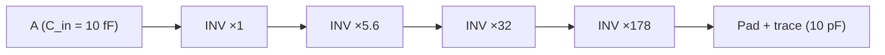

::: basics
### In plain words
CMOS builds logic from pairs of transistors that work as opposites. A PMOS network connects the output to the supply, and an NMOS network connects it to ground. For any steady input, exactly one network is on. A CMOS buffer is two inverters in a row, which cleans up a signal and adds drive strength.

### Picture it
Imagine a see-saw with a person at each end. When one end is down touching the ground, the other end is up. They are never both down. A CMOS stage is like that: either the output is tied up to the supply or tied down to ground, and never both at once (apart from a brief moment while it switches). This is why no steady current flows from supply to ground.

### Words you need
- **CMOS**: complementary metal-oxide-semiconductor, using both PMOS and NMOS together.
- **Inverter**: a gate whose output is the opposite of its input.
- **Pull-up / pull-down**: connecting the output to the supply, or to ground.
- **Rail**: a supply line, $V_{DD}$ or ground.
- **Buffer**: a stage that outputs the same logic value, with more drive strength.

### The simplest example
Use a 3.3 V supply. In the inverter, an input of 3.3 V turns the NMOS on and the PMOS off, so the output goes to 0 V. An input of 0 V turns the PMOS on and the NMOS off, so the output goes to 3.3 V. Now chain two inverters. The first flips the signal and the second flips it back, so the output equals the input. The second one is often bigger, so it can drive a heavier load.

That is the whole idea. The rest of this page shows the transistor-level drawing, the static power argument, and how buffer sizing works.
:::

::: testing
Whether you actually understand what "complementary" means at the transistor level, not just that CMOS is "the chip technology". The interviewer wants to see:

1. You can draw a CMOS inverter correctly: PMOS on top with source at $V_{DD}$, NMOS on the bottom with source at ground, gates tied together as the input, drains tied together as the output.
2. You know a **buffer is two inverters in series**, and you can explain *why* you can't just build a one-stage non-inverting CMOS buffer.
3. You can say what the buffer is *for*: restoring logic levels, adding drive strength, isolating a weak node from a heavy load.
:::

::: why
Every digital IC, every MCU GPIO, every clock tree and every gate driver predriver is built from CMOS inverters. When you debug a slow edge, a hot chip, a glitchy clock or a GPIO that can't drive a long cable, you're reasoning about the pull-up PMOS and pull-down NMOS inside a buffer. This question also opens the rest of the CMOS section: why CMOS dominates ([[q0106]]), why the PMOS is on top ([[q0107]]), shoot-through ([[q0109]]), power ([[q0110]]) and what happens when you drive loads ([[q0113]]). Getting the drawing wrong here undermines everything after it.
:::

::: concepts
- **Enhancement-mode NMOS and PMOS**: an NMOS conducts when $V_{GS} > V_{tn}$; a PMOS conducts when $V_{GS} < -|V_{tp}|$, i.e. when its gate is pulled well below its source. See [[q0097]] and [[q0099]].
- **Complementary pull-up / pull-down networks**: for every input state exactly one network conducts, so the output is always actively driven to a rail and there is no static path from $V_{DD}$ to ground.
- **Inverter as the basic cell**: the simplest CMOS gate is one PMOS plus one NMOS. Every other static CMOS gate is an inverter with series/parallel networks.
- **Buffer = two inverters**: a single static CMOS stage is inherently inverting, so a non-inverting buffer needs two stages.
- **Drive strength and $W/L$**: wider transistors have lower on-resistance and can charge a bigger capacitance faster. See [[q0103]].
- **Voltage transfer curve (VTC)**: $V_{out}$ vs $V_{in}$ of the gate; its steep middle region gives gain and noise margins.
:::

::: answer
"CMOS stands for complementary metal-oxide-semiconductor. The 'complementary' part is the key idea: every gate is built from a pull-up network of PMOS transistors to $V_{DD}$ and a mirror-image pull-down network of NMOS transistors to ground, and they're driven by the same inputs so that for any steady input exactly one of them is on.

The simplest case is the inverter: a PMOS with its source on $V_{DD}$, an NMOS with its source on ground, gates tied together as the input and drains tied together as the output. Input high, the NMOS turns on and the PMOS is off, so the output is pulled to ground. Input low, the reverse, output goes to $V_{DD}$. Because one transistor is always off, there's no DC path between the rails, so static power is basically just leakage.

A single CMOS stage always inverts, so a buffer is just two inverters in series. The first inverts, the second inverts back, so $Y = A$. In practice the second stage is usually sized bigger, a few times wider, so a small input capacitance can drive a large load. That's the point of a buffer: it doesn't change the logic, it restores clean rail-to-rail levels and adds drive strength, like a GPIO output stage or a clock buffer."
:::

::: technical
**Definition.** CMOS is a logic family/process that places n-channel and p-channel enhancement MOSFETs on the same die and uses them as complementary switches. A static CMOS gate has a PMOS pull-up network (PUN) between $V_{DD}$ and the output and an NMOS pull-down network (PDN) between the output and $V_{SS}$. The PDN implements $\overline{F}$, the PUN is its dual (series ↔ parallel), so in steady state exactly one network conducts.

**Inverter.** $M_P$: source $V_{DD}$, gate $A$, drain $Y$. $M_N$: source GND, gate $A$, drain $Y$. Bulk of $M_P$ at $V_{DD}$, bulk of $M_N$ at GND.
- $A = 0$: $V_{GS,N} = 0 < V_{tn}$ (off), $V_{GS,P} = -V_{DD}$ (on) → $Y = V_{DD}$.
- $A = V_{DD}$: $M_N$ on, $M_P$ off → $Y = 0$.

Outputs swing fully rail-to-rail ($V_{OH} = V_{DD}$, $V_{OL} = 0$ with no DC load), static current is leakage only.

**Switching threshold.** Equating saturation currents $\frac{k_n}{2}(V_M - V_{tn})^2 = \frac{k_p}{2}(V_{DD} - V_M - |V_{tp}|)^2$ gives
$$V_M = \frac{V_{tn} + r\,(V_{DD} - |V_{tp}|)}{1 + r},\qquad r = \sqrt{k_p/k_n}.$$
Because hole mobility is roughly 2–3× lower than electron mobility, the PMOS is typically drawn 2–3× wider to get $r \approx 1$ and $V_M \approx V_{DD}/2$.

**Buffer.** $Y = \overline{\overline{A}}$: inverter 1 drives inverter 2. To drive a large $C_L$ from a small input capacitance $C_{in}$, the stages are tapered: each stage is about $f \approx 3$–$5$ times wider than the previous, and the optimal number of stages is $N \approx \ln(C_L/C_{in})/\ln 4$, rounded to an even number for a non-inverting buffer.

**Variants.** Tri-state buffers add an enable that turns both output FETs off (high-Z). Schmitt-trigger buffers add hysteresis for slow or noisy inputs. Open-drain buffers omit the PMOS ([[q0785]]).
:::

::: short
"CMOS means complementary MOS: every gate has a PMOS pull-up network to $V_{DD}$ and an NMOS pull-down network to ground, driven by the same inputs, so exactly one side is on at a time and there's no static current. The basic cell is the inverter: PMOS on top, NMOS on the bottom, gates tied as input, drains tied as output. A single stage always inverts, so a buffer is two inverters in series, usually with the second one sized up to drive a heavier load."
:::

::: long
"CMOS stands for complementary metal-oxide-semiconductor, and the 'complementary' is the whole idea. You build every logic gate from two networks: a pull-up network of PMOS transistors between $V_{DD}$ and the output, and a pull-down network of NMOS transistors between the output and ground. They're driven by the same inputs and are logical duals of each other, so for any steady input exactly one network conducts.

Let me draw the simplest one, the inverter. PMOS on top, source on $V_{DD}$. NMOS on the bottom, source on ground. Gates tied together are the input, drains tied together are the output. If the input is low, the NMOS has zero $V_{GS}$ and is off, while the PMOS has its gate a full $V_{DD}$ below its source, so it's on and pulls the output up to $V_{DD}$. Input high, it flips: NMOS on, PMOS off, output at ground.

Two nice consequences. First, there's no DC path from supply to ground in either state, so static power is just leakage. Second, the output goes all the way to the rails, which gives big noise margins.

Now the buffer. A single static CMOS stage is always inverting, because NMOS pulls down when its gate goes high and PMOS pulls up when its gate goes low. So to get $Y = A$ I just cascade two inverters. The first inverts, the second inverts back.

Why bother with a gate that doesn't change the logic? Drive strength and isolation. If a tiny internal node has to drive a big load, like a long PCB trace or a clock net, I make the second inverter several times wider so its on-resistance is lower. For really big loads you taper it, each stage roughly four times bigger than the last. That's exactly what's inside an MCU's GPIO output or a clock buffer chip."
:::

::: terms
- **CMOS**: complementary MOS; logic built from paired PMOS pull-up and NMOS pull-down networks.
- **Pull-up network (PUN)**: PMOS transistors connecting the output to $V_{DD}$.
- **Pull-down network (PDN)**: NMOS transistors connecting the output to ground.
- **Inverter**: one PMOS + one NMOS; the fundamental static CMOS gate.
- **Buffer**: non-inverting gate, two cascaded inverters; restores levels and adds drive.
- **Switching threshold $V_M$**: the input voltage where $V_{out} = V_{in}$; ideally $V_{DD}/2$.
- **Drive strength**: how much current the output stage can source/sink, set by $W/L$ and $V_{DD}$.
- **Tapered buffer**: chain of inverters each a fixed factor larger than the previous, used to drive big capacitive loads quickly.
- **Rail-to-rail output**: $V_{OH} = V_{DD}$, $V_{OL} = 0$ with no DC load.
:::

::: exceptional
**Average answer:** "CMOS uses NMOS and PMOS. A buffer is two inverters." Possibly with the PMOS drawn on the bottom.

**Exceptional answer:**
- Draws the inverter with correct terminal placement (PMOS source at $V_{DD}$, NMOS source at ground, drains as the output) and labels which device is on for each input state.
- Explains *why* a single static stage must invert, so the buffer must be two stages.
- Explains why the second stage is bigger (drive strength vs input capacitance), and mentions tapering by a factor of about 3–5 per stage.
- Mentions why the PMOS is wider (hole mobility is 2–3× lower) and that this centres the switching threshold at about $V_{DD}/2$.
- Connects it to real hardware: GPIO output drivers, clock buffers, gate-driver predrivers.
:::

::: mistakes
- **PMOS on the bottom, NMOS on top.** That gives a degraded, non-inverting source follower, not a CMOS gate. See [[q0114]] and [[q0107]].
- **Drawing a buffer as one inverter with "the output taken from the other node".** There is only one output node. A non-inverting buffer needs two stages.
- **Saying CMOS draws zero power.** Static power is near zero (leakage only), but dynamic power $\alpha C V_{DD}^2 f$ dominates whenever it switches. See [[q0110]].
- **Calling the gate the "input current".** The gate is a capacitor. DC input current is essentially leakage (pA–nA), but the input still draws charging current on every edge.
- **Equal-sized NMOS and PMOS assumed to be symmetric.** With equal $W/L$ the PMOS is weaker, so the rising edge is slower and $V_M$ shifts below $V_{DD}/2$.
:::

::: deep
## Why "complementary"?

A MOSFET is a voltage-controlled switch. An NMOS turns on when its gate is at least $V_{tn}$ above its source, so it's naturally good at connecting a node to **ground** (its source sits at 0 V, and a gate at $V_{DD}$ gives the full $V_{GS} = V_{DD}$). A PMOS turns on when its gate is at least $|V_{tp}|$ *below* its source, so it's naturally good at connecting a node to **$V_{DD}$** (source at $V_{DD}$, gate at 0 V, $V_{GS} = -V_{DD}$). The detailed reason the roles can't be swapped is [[q0107]].

Before CMOS, NMOS-only logic used a single pull-down transistor and a resistor (or depletion load) as the pull-up. That works, but whenever the output is low, current flows continuously from $V_{DD}$ through the load into the transistor. CMOS replaces the passive pull-up with an *active* PMOS that switches off exactly when the NMOS switches on. That's the complementary idea in one sentence.

## The inverter

```circuit
{"caption":"CMOS inverter","elements":[
 {"t":"pmos","at":[4,3],"label":"M_P"},
 {"t":"nmos","at":[4,7],"label":"M_N"},
 {"t":"rail","at":[6,1],"label":"V_{DD}","dir":"up"},
 {"t":"gnd","at":[6,9]},
 {"t":"wire","pts":[[4,3],[3,3],[3,7],[4,7]]},
 {"t":"wire","pts":[[0,5],[3,5]]},{"t":"dot","at":[3,5]},
 {"t":"term","at":[0,5],"label":"A","side":"left"},
 {"t":"wire","pts":[[6,5],[10,5]]},{"t":"dot","at":[6,5]},
 {"t":"term","at":[10,5],"label":"Y = Ā","side":"right"},
 {"t":"text","at":[13,2.5],"text":"A = 0: M_P on, M_N off → Y = V_{DD}","anchor":"start","muted":true},
 {"t":"text","at":[13,7.5],"text":"A = 1: M_N on, M_P off → Y = 0","anchor":"start","muted":true}
]}
```
Figure: PMOS source on V_DD, NMOS source on ground, gates shorted together as the input, drains shorted together as the output. For either steady input, one transistor is off, so there is no DC path between the rails.

Walk through it like a truth table:

| $A$ | $V_{GS}$ of $M_N$ | $V_{GS}$ of $M_P$ | $M_N$ | $M_P$ | $Y$ |
|---|---|---|---|---|---|
| 0 V | 0 | $-V_{DD}$ | off | on | $V_{DD}$ |
| $V_{DD}$ | $V_{DD}$ | 0 | on | off | 0 V |

Since the on transistor carries no DC current (the only load is the next gate's capacitance), it has $V_{DS} = 0$ in steady state. So $V_{OH}$ is exactly $V_{DD}$ and $V_{OL}$ is exactly 0 V. Compare this with a resistor-load inverter, where $V_{OL}$ is set by a resistive divider between the load and the transistor's on-resistance.

## Why a single stage always inverts

In static CMOS, NMOS devices only sit in the pull-down network and PMOS devices only sit in the pull-up network. Raising an input can only turn NMOS devices *on* (pulling the output *down*) and PMOS devices *off*. So a rising input can only ever make the output fall. Every single-stage static CMOS gate is therefore **negative-unate**: INV, NAND, NOR, AOI and OAI are natural, while AND, OR and BUF all need a second inverting stage.

## The buffer: two inverters

```circuit
{"caption":"CMOS buffer: two cascaded inverters","elements":[
 {"t":"pmos","at":[4,3],"label":"M_{P1}"},
 {"t":"nmos","at":[4,7],"label":"M_{N1}"},
 {"t":"rail","at":[6,1],"label":"V_{DD}","dir":"up"},
 {"t":"gnd","at":[6,9]},
 {"t":"wire","pts":[[4,3],[3,3],[3,7],[4,7]]},
 {"t":"wire","pts":[[1,5],[3,5]]},{"t":"dot","at":[3,5]},
 {"t":"term","at":[1,5],"label":"A","side":"left"},
 {"t":"wire","pts":[[6,5],[11,5]]},{"t":"dot","at":[6,5]},
 {"t":"text","at":[8.5,4.4],"text":"Ā","anchor":"middle"},
 {"t":"pmos","at":[12,3],"label":"M_{P2} (wide)"},
 {"t":"nmos","at":[12,7],"label":"M_{N2} (wide)"},
 {"t":"rail","at":[14,1],"label":"V_{DD}","dir":"up"},
 {"t":"gnd","at":[14,9]},
 {"t":"wire","pts":[[12,3],[11,3],[11,7],[12,7]]},{"t":"dot","at":[11,5]},
 {"t":"wire","pts":[[14,5],[18,5]]},{"t":"dot","at":[14,5]},
 {"t":"term","at":[18,5],"label":"Y = A","side":"right"}
]}
```
Figure: The first inverter produces Ā; the second inverts it back. The second stage is drawn wider because it drives the external load, while the small first stage keeps the input capacitance low.

The logic is trivial ($Y = \overline{\overline{A}} = A$), so what is the buffer actually *doing*?

1. **Level restoration.** A weak or degraded signal (slow edge, a level a few hundred mV off a rail) enters the high-gain middle of the first inverter's transfer curve and comes out as a clean rail-to-rail signal. Two stages square it up even more.
2. **Drive strength.** The output stage's on-resistance is roughly $R_{on} \approx \frac{1}{k'(W/L)(V_{DD} - V_t)}$. Making $M_{P2}$ and $M_{N2}$ 10× wider gives about 10× lower $R_{on}$, so 10× faster edges into the same capacitance.
3. **Isolation.** The input only sees the small gate capacitance of stage 1, no matter how heavy the load on $Y$ is.

```plot
{"title":"Transfer curves: inverter vs two-stage buffer (illustrative, V_DD = 3.3 V)","x":{"label":"V_in","unit":"V","min":0,"max":3.3},"y":{"label":"V_out","unit":"V","min":0,"max":3.4},
 "vars":{"vdd":3.3,"vm":1.65,"g":4},
 "series":[{"label":"inverter","fn":"vdd/2*(1-tanh(g*(x-vm)))"},{"label":"buffer (inv → inv)","fn":"vdd/2*(1-tanh(g*(vdd/2*(1-tanh(g*(x-vm)))-vm)))","color":"orange"},{"label":"V_out = V_in","fn":"x","dashed":true,"color":"muted"}],
 "vlines":[{"at":"vm","label":"V_M","color":"muted"}]}
```
Figure: The inverter's curve crosses V_out = V_in at the switching threshold V_M. Cascading two stages multiplies the gains, so the buffer's transition is much sharper and inputs anywhere outside a narrow middle band are snapped to clean rails. The tanh shape is illustrative; real curves come from the transistor I–V equations.

## Centring the switching threshold

At $V_{in} = V_M$ both transistors are in saturation and carry the same current:
$$\frac{k_n}{2}(V_M - V_{tn})^2 = \frac{k_p}{2}(V_{DD} - V_M - |V_{tp}|)^2$$
Taking square roots and solving:
$$V_M = \frac{V_{tn} + r\,(V_{DD} - |V_{tp}|)}{1 + r},\qquad r = \sqrt{\frac{k_p}{k_n}} = \sqrt{\frac{\mu_p (W/L)_p}{\mu_n (W/L)_n}}$$

**Worked example.** $V_{DD} = 3.3$ V, $V_{tn} = |V_{tp}| = 0.5$ V.
- Equal $W/L$ and $\mu_n/\mu_p = 2.5$: $r = \sqrt{0.4} = 0.632$, so $V_M = \frac{0.5 + 0.632\cdot 2.8}{1.632} \approx 1.39$ V. The threshold has shifted low because the PMOS is weaker.
- Make the PMOS 2.5× wider: $r = 1$ and $V_M = 1.65$ V $= V_{DD}/2$. The rise and fall times also become roughly equal.

> [!UNCERTAIN]
> The electron/hole mobility ratio in a real MOS channel depends on process, strain engineering and crystal orientation. 2–3× is a typical textbook range for planar bulk silicon; some advanced processes use strain to narrow the gap considerably.

## Experiment with it

```sim
{"id":"cmos-inverter","view":"vtc","vdd":3.3,"ratio":1}
```
Figure: Change the kp/kn ratio from 1 to 0.4 and watch the switching threshold V_M slide toward ground and the noise margins become lopsided. Then look at the shoot-through current trace: it peaks at V_M, where both FETs are on.

## Sizing a buffer for a big load

If a gate with input capacitance $C_{in} = 10$ fF has to drive $C_L = 10$ pF (a pad plus a PCB trace), the total "electrical effort" is $F = C_L/C_{in} = 1000$. One giant inverter would load the previous stage 1000×; one small inverter would take forever to charge 10 pF. The textbook result (logical effort, or the classic Mead–Conway tapered buffer analysis) is to use $N$ stages each scaled by $f = F^{1/N}$, with the delay minimized near $f \approx 4$ once realistic self-loading is included:
$$N \approx \frac{\ln F}{\ln 4} = \frac{\ln 1000}{\ln 4} \approx 5$$
A *non-inverting* buffer needs an even count, so you'd choose 4 stages ($f = 1000^{1/4} \approx 5.6$) or 6 stages ($f \approx 3.2$). Ignoring self-loading, the delay is proportional to $N f$: 22.5 units for 4 stages and 19.0 for 6, versus 63 for 2 stages and 1000 for one. That is why I/O pads and clock drivers contain chains of progressively larger inverters.


Figure: A 4-stage tapered buffer. Each stage is about 5.6× wider than the one before, so every stage sees the same capacitance ratio and contributes roughly the same delay.

## What it looks like in real hardware

- **MCU GPIO output**: the final PMOS/NMOS pair *is* a CMOS buffer driven by a predriver. "Drive strength" or "speed" register settings enable extra parallel output fingers. See [[q0783]].
- **Logic buffers**: single-gate buffers such as the 74LVC1G17 (with Schmitt input) and 74LVC1G125 (tri-state) are used to clean up and fan out signals.
- **Clock buffers / fanout buffers** distribute a crystal oscillator output to many loads with matched delays.
- **Gate-driver ICs** for power MOSFETs use the same structure scaled up to amps of peak current.
:::

::: applications
- **GPIO output stages** in every microcontroller: a predriver plus a wide PMOS/NMOS pair, often with selectable drive strength.
- **74-series buffers** (e.g. 74LVC1G17, 74HC244) to restore slow or degraded edges and fan a signal out to many inputs.
- **Clock distribution**: on-chip clock trees are built from carefully sized CMOS buffers to minimize skew.
- **I/O pads**: tapered inverter chains drive off-chip loads of several pF to tens of pF.
- **Gate drivers**: a low-power logic signal is buffered up to amps of peak current to switch a power MOSFET quickly.
- **Tri-state bus drivers**: a buffer with an enable lets several chips share one bus line.
:::

::: assumptions
- **Static CMOS, enhancement-mode devices** with $V_{DD} > V_{tn} + |V_{tp}|$, so there is a well-defined switching region. Dynamic logic, pass-transistor logic and transmission gates behave differently.
- **Capacitive (no DC) load**: only then are $V_{OH} = V_{DD}$ and $V_{OL} = 0$ exact. With a resistive load, the output sits at a divider of the load and the FET's $R_{on}$.
- **Square-law model** for $V_M$. Short-channel devices follow a velocity-saturated law, so the numbers shift, but the conclusion (wider PMOS to centre $V_M$) holds.
- "Buffer" here means a non-inverting logic buffer. In analog contexts "buffer" usually means a unity-gain op-amp follower ([[q0125]]), which is a different circuit. Some interviewers will also accept a tri-state or Schmitt buffer as long as you explain the core two-inverter structure.
:::

::: followups
### Why is the PMOS usually drawn wider than the NMOS?
Holes have roughly 2–3× lower mobility than electrons in a silicon channel, so for the same $W/L$ the PMOS has 2–3× higher on-resistance. Making it 2–3× wider equalizes the pull-up and pull-down strength. That gives symmetric rise and fall times and puts the switching threshold near $V_{DD}/2$, which balances the noise margins.

### Why not build a non-inverting buffer in one stage by putting the NMOS on top?
Then the NMOS is a source follower: its source is the output, so it turns off once the output reaches $V_{DD} - V_{tn}$ (worse with body effect). The PMOS on the bottom similarly stops at $|V_{tp}|$. You get a non-inverting stage with degraded levels, weak drive and no gain. See [[q0114]].

### What's the static power of a CMOS inverter?
Ideally zero, since one device is always off. In reality it's leakage: subthreshold, gate and junction leakage, typically pA to nA per gate in older processes, but significant in aggregate on a large modern chip with billions of transistors. Most power in an active chip is dynamic: $\alpha C V_{DD}^2 f$. See [[q0110]].

### How would you make the buffer tri-state?
Add an enable that can turn both output transistors off at the same time. A common implementation drives the output PMOS gate from a NAND of $A$ and $EN$ and the output NMOS gate from a NOR of $A$ and $\overline{EN}$. When $EN = 0$ the PMOS gate is forced high and the NMOS gate low, so both are off and the output floats (high-Z).

### What if the input sits at $V_{DD}/2$ for a long time?
Both transistors are partially on, so a "crowbar" current flows from $V_{DD}$ to ground continuously, and the output sits in the middle where it could be read as either logic level. This is why floating CMOS inputs are dangerous and why slow inputs go into Schmitt-trigger buffers. See [[q0109]].
:::

::: references
- Sedra & Smith, *Microelectronic Circuits*: chapter on CMOS digital logic circuits (the CMOS inverter, VTC, noise margins, switching threshold).
- Rabaey, Chandrakasan & Nikolić, *Digital Integrated Circuits: A Design Perspective*: chapter on the CMOS inverter (static and dynamic behaviour, sizing a chain of inverters).
- Weste & Harris, *CMOS VLSI Design*: chapters on static CMOS logic and logical effort (tapered buffer sizing).
- Horowitz & Hill, *The Art of Electronics*, 3rd ed.: chapters on digital logic families and CMOS gates.
:::

::: rubric
- Expands CMOS as complementary MOS and explains the PMOS pull-up / NMOS pull-down idea :: The word "complementary" is the core concept the question is checking.
- Draws the inverter with PMOS source at V_DD, NMOS source at ground, tied gates as input and tied drains as output :: A wrong drawing (swapped devices, sources on the output) is the most common and most visible error.
- Explains which transistor conducts for each input state and that there's no static path between rails :: Shows you understand operation, not just the picture.
- Draws the buffer as two cascaded inverters :: The direct answer to the second half of the question.
- Explains why one stage can't be non-inverting :: Shows understanding of why the second stage is needed.
- States the purpose of a buffer: level restoration, drive strength, isolation; second stage larger :: Connects the drawing to why engineers use buffers in real designs.
- Mentions PMOS sizing (mobility) or tapered buffers :: Signals deeper device-level understanding.
:::

::: quiz
```json
[
 {"type":"mcq","level":"fundamental","q":"In a CMOS inverter, which terminals are tied together to form the output?","options":["The two sources","The two gates","The two drains","The PMOS drain and the NMOS source"],"answer":2,"explain":"The gates are tied together as the input. The sources go to the rails (PMOS source to V_DD, NMOS source to ground). The drains meet at the output node."},
 {"type":"mcq","level":"fundamental","q":"Why does a non-inverting CMOS buffer need two stages?","options":["To double the supply voltage","Because a single static CMOS stage is inherently inverting","Because PMOS transistors can only drive other PMOS transistors","To halve the propagation delay"],"answer":1,"explain":"A rising input can only turn NMOS pull-downs on and PMOS pull-ups off, so the output can only fall. To get a non-inverting function you invert twice."},
 {"type":"numeric","level":"intermediate","q":"$V_{DD} = 3.3$ V, $V_{tn} = |V_{tp}| = 0.5$ V and $k_p/k_n = 0.4$ (equal W/L, PMOS weaker). Using the square-law model, what is the switching threshold $V_M$?","answer":1.39,"tolerance":0.02,"unit":"V","explain":"$r = \\sqrt{0.4} = 0.632$. $V_M = (0.5 + 0.632\\cdot 2.8)/(1.632) = 1.39$ V. The weaker PMOS pulls the threshold below $V_{DD}/2$."},
 {"type":"truefalse","level":"intermediate","q":"With only a capacitive load, a CMOS inverter's output high level is exactly V_DD in steady state.","answer":true,"explain":"Once the load capacitance is charged, no current flows through the on PMOS, so $V_{DS} = 0$ and the output equals V_DD. A resistive load would cause an $I\\cdot R_{on}$ drop."},
 {"type":"numeric","level":"advanced","q":"A tapered buffer must drive 10 pF from a 10 fF input with 4 equal-ratio stages. What is the per-stage size ratio $f$?","answer":5.62,"tolerance":0.02,"unit":"","explain":"$F = C_L/C_{in} = 1000$, so $f = 1000^{1/4} \\approx 5.62$. Four stages is even, so the buffer stays non-inverting."}
]
```
:::
