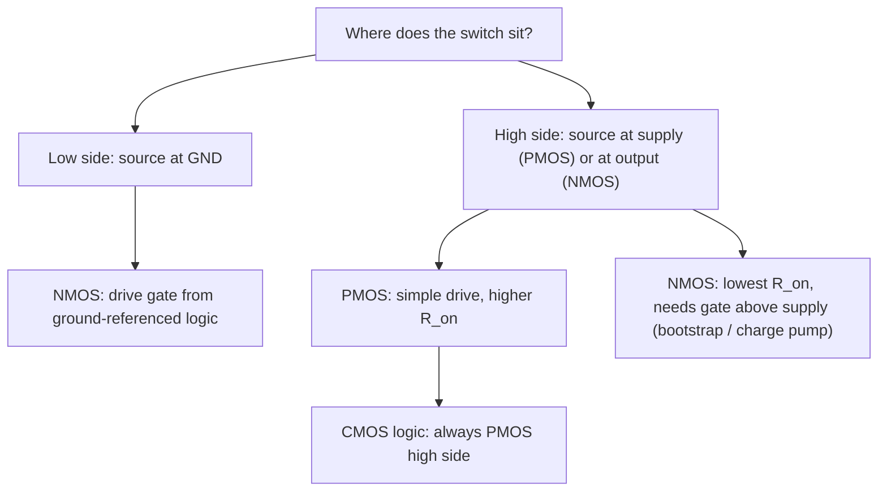

::: testing
Whether you reason about a MOSFET by **where its source is**, not by memorized rules. Specifically:

1. You know a MOSFET is controlled by $V_{GS}$, so a device's ability to turn fully on depends on its source potential.
2. You can explain why an NMOS with its source at ground and a PMOS with its source at $V_{DD}$ can both be driven fully on and off by plain 0 / $V_{DD}$ logic signals.
3. You know what goes wrong if you swap them: threshold loss ("weak 1 / weak 0"), source-follower behaviour.
4. For power and motor circuits, you know the twist: the low side is almost always NMOS, but the high side is often NMOS too, at the cost of a bootstrap or charge-pump gate driver, because NMOS has lower on-resistance.
:::

::: why
This decision shows up in every design that switches a load: CMOS logic outputs, GPIO stages, load switches, buck converters, half-bridges and H-bridges for motors. Choose the wrong device for the high side and the FET only half turns on, runs hot, or never turns off. It's also the root of several later questions: high-side NFET vs PFET in a buck ([[q0204]]), driving a high-side NFET ([[q0206]], [[q0427]]), and what happens if you swap the CMOS devices ([[q0114]]). Interviewers like it because a memorized answer ("PMOS on top") falls apart under the follow-up "why?".
:::

::: concepts
- **$V_{GS}$ control**: an NMOS needs $V_{GS} > V_{tn}$; a PMOS needs $V_{GS} < -|V_{tp}|$. The gate voltage only matters relative to the source. See [[q0099]].
- **Source location**: in an NMOS, current flows drain → source, so on the low side the source is at ground. In a PMOS, current flows source → drain, so on the high side the source is at $V_{DD}$. See [[q0097]].
- **Source follower**: an NMOS whose source is the output follows the gate minus $V_t$, so it can't pull the output to the gate voltage.
- **Strong vs weak levels**: NMOS passes a strong 0 and a weak 1; PMOS passes a strong 1 and a weak 0.
- **Mobility**: electrons are ~2–3× more mobile than holes, so an NMOS has lower $R_{DS(on)}$ for the same area.
- **Gate-drive circuits**: bootstrap and charge pumps lift a high-side NMOS gate above the supply. See [[q0206]].
:::

::: answer
"In CMOS logic the PMOS goes on the high side and the NMOS on the low side, and the reason comes down to where the source sits.

A MOSFET is controlled by gate-to-source voltage. On the low side, the NMOS source is at ground, so putting $V_{DD}$ on the gate gives it the full $V_{DD}$ of $V_{GS}$; it turns hard on and pulls the output all the way to 0 V. On the high side, the PMOS source is at $V_{DD}$, so pulling its gate to 0 V gives $V_{GS} = -V_{DD}$; it turns hard on and pulls the output all the way to $V_{DD}$. Both are driven by the same 0-to-$V_{DD}$ signal.

If you swapped them, the NMOS on top would be a source follower: its source is the output, so it turns off once the output gets within a threshold of the gate, and you only get about $V_{DD} - V_t$. People say NMOS passes a strong 0 and a weak 1, and PMOS passes a strong 1 and a weak 0.

In power circuits it's a bit different. The low side is still NMOS. For the high side, a PMOS is easy to drive, but NMOS has two to three times lower on-resistance for the same size because electrons are more mobile. So at higher currents you use an NMOS on the high side too, and pay for it with a bootstrap or charge-pump gate driver to get its gate above the supply."
:::

::: technical
**Rule:** a switch should have its **source on a fixed rail** so the control signal can produce a full, constant $|V_{GS}|$.

| Position | Device | Source at | Gate for ON | $|V_{GS}|$ when ON | Passes |
|---|---|---|---|---|---|
| Low side | NMOS | GND | $V_{DD}$ | $V_{DD}$ | strong 0 |
| High side | PMOS | $V_{DD}$ | 0 V | $V_{DD}$ | strong 1 |
| High side | NMOS | output | $V_{DD}$ | $V_{DD} - V_{out}$ → falls to $V_t$ | weak 1: $V_{out,max} = V_{DD} - V_{tn}(V_{SB})$ |
| Low side | PMOS | output | 0 V | $V_{out}$ → falls to $|V_t|$ | weak 0: $V_{out,min} = |V_{tp}|$ |

**Threshold loss with body effect.** For an on-chip NMOS with bulk at ground, $V_{tn} = V_{t0} + \gamma\left(\sqrt{2\phi_F + V_{SB}} - \sqrt{2\phi_F}\right)$. Solving $V_{out} = V_{DD} - V_{tn}(V_{out})$ with $V_{DD} = 3.3$ V, $V_{t0} = 0.5$ V, $\gamma = 0.4\ \text{V}^{1/2}$, $2\phi_F = 0.7$ V gives $V_{tn} \approx 0.87$ V and $V_{out} \approx 2.43$ V.

**Speed.** As the follower's output approaches $V_{DD}-V_t$ its overdrive vanishes; in saturation $C\,dV/dt = \frac{k}{2}(V_{DD}-V_t-V)^2$, giving a hyperbolic (not exponential) approach and then a subthreshold crawl.

**Strength.** $R_{on} \approx \frac{1}{\mu C_{ox}(W/L)(|V_{GS}|-|V_t|)}$. With $\mu_n/\mu_p \approx 2$–$3$, the PMOS is made 2–3× wider for equal strength.

**Power switching.** Low side: NMOS (lowest $R_{DS(on)}$, ground-referenced drive). High side: PMOS for simple, low-voltage, low-current or 100%-duty designs (load switches, small H-bridges, LDO pass devices); NMOS for higher current/efficiency, which requires $V_G \approx V_{IN} + 5$–$12$ V via bootstrap, charge pump or isolated driver.
:::

::: short
"PMOS on the high side, NMOS on the low side, because a MOSFET is controlled by $V_{GS}$ and you want each source tied to a fixed rail. The NMOS source sits at ground, so a gate at $V_{DD}$ turns it fully on; the PMOS source sits at $V_{DD}$, so a gate at 0 V turns it fully on. Swap them and each becomes a source follower that loses a threshold voltage. In power stages, though, the high side is often an NMOS anyway for its lower on-resistance, using a bootstrap driver."
:::

::: long
"The short answer is PMOS on the high side and NMOS on the low side. The reason is that a MOSFET responds to its gate-to-source voltage, so what matters is where each source ends up.

Take the low side first. An NMOS conducts from drain to source, so on the low side its source is tied to ground. If I put the logic high, $V_{DD}$, on its gate, it sees the full $V_{DD}$ as $V_{GS}$, turns on hard, and pulls the output right down to 0 V. Now the high side: a PMOS conducts from source to drain, so its source sits on $V_{DD}$. Pull its gate to 0 V and it sees $V_{GS} = -V_{DD}$, so it's fully on and pulls the output to $V_{DD}$. Both are controlled by the same 0-to-$V_{DD}$ signal, and that's the complementary pair in a CMOS inverter.

What if I put an NMOS on the high side? Its source is now the output node. As the output rises, $V_{GS}$ shrinks, and once the output is a threshold below the gate the transistor shuts off. So the best you get is $V_{DD}$ minus $V_t$, and with body effect on-chip that can be close to a volt lost. Same story mirrored for a PMOS on the low side: it can't pull below about $|V_t|$. That's where 'NMOS passes a strong zero, PMOS passes a strong one' comes from.

In power electronics there's a twist. The low side is basically always an NMOS. But on the high side, NMOS has two to three times lower $R_{DS(on)}$ for the same die size, because electrons are more mobile than holes, and NMOS parts are cheaper and have less gate charge for the same resistance. So for a buck converter or a motor half-bridge at real currents, people use a high-side NMOS and drive its gate above the supply with a bootstrap capacitor or a charge pump. A PMOS high side is still great when simplicity matters: a load switch, a small H-bridge, or a regulator that needs 100% duty cycle."
:::

::: terms
- **High side / low side**: a switch between the supply and the load vs between the load and ground.
- **Threshold loss (threshold drop)**: the $V_t$ lost when a MOSFET passes a level toward the rail its source should be on.
- **Source follower**: a MOSFET whose source is the output; $V_{out} \approx V_G - V_t$.
- **Body effect**: $V_t$ increases as source-to-bulk voltage increases, making threshold loss worse on-chip.
- **Strong / weak level**: a level a device can drive all the way to the rail vs one it can only approach within $V_t$.
- **$R_{DS(on)}$**: on-resistance of a fully enhanced MOSFET; lower for NMOS at the same area.
- **Bootstrap / charge pump**: circuits that generate a gate voltage above the supply to fully enhance a high-side NMOS.
- **Transmission gate**: an NMOS and PMOS in parallel, passing strong 0 and strong 1.
:::

::: exceptional
**Average answer:** "PMOS on top, NMOS on the bottom, because that's how CMOS works."

**Exceptional answer:**
- Reasons from $V_{GS}$: the source of each device sits on a fixed rail, so the logic swing gives full $|V_{GS}| = V_{DD}$ for both.
- Explains what breaks if swapped (source follower, $V_{DD}-V_t$, body effect making it worse) with a number, e.g. 3.3 V → ~2.4 V.
- Adds speed: the follower's overdrive collapses as the output rises, so the last part of the edge is very slow.
- Brings in mobility and $R_{DS(on)}$ to explain why NMOS is preferred when performance matters.
- Separates the **logic** answer (PMOS high side) from the **power** answer (NMOS high side with bootstrap is common), and says when a PMOS high side is still the right choice.
:::

::: mistakes
- **"PMOS is on top because it's for positive voltages."** The 'P' refers to the channel carriers (holes), not the supply polarity. The real reason is $V_{GS}$ referenced to the source.
- **Thinking an NMOS high side with gate at $V_{DD}$ is "on" so the output is $V_{DD}$.** It settles near $V_{DD} - V_t$ and sits in the linear/saturation region, dissipating power if it carries current.
- **"NMOS is always better."** NMOS has lower $R_{DS(on)}$, but on the high side it needs a gate voltage above the supply. For simple, low-current or 100%-duty designs a PMOS can be the better engineering choice.
- **Forgetting the source moves.** For a high-side NMOS the source is the switch node, which swings from ground to $V_{IN}$. The gate drive has to ride on top of it ([[q0206]]).
- **Ignoring the body diode orientation** in discrete parts. A high-side PMOS's body diode points from drain (output) to source (supply); put it in backwards and the load is always powered through the diode. See [[q0101]].
:::

::: deep
## Everything is relative to the source

A MOSFET's channel is controlled by the field between the gate and the channel, so the controlling quantity is $V_{GS}$, never the gate voltage relative to ground. Keep that in mind and the rule writes itself.

- **NMOS** conducts drain → source (conventional current) when $V_{GS} > V_{tn}$. Its source is the more negative terminal. Put it on the **low side** and the source is at ground: any gate voltage above $V_{tn}$ referenced to ground turns it on, and that reference never moves.
- **PMOS** conducts source → drain when $V_{GS} < -|V_{tp}|$. Its source is the more positive terminal. Put it on the **high side** and the source is at $V_{DD}$: pulling the gate to 0 V gives $V_{GS} = -V_{DD}$, and that reference never moves either.

```circuit
{"caption":"Correct placement: each source on a fixed rail","elements":[
 {"t":"pmos","at":[4,3],"label":"M_P"},
 {"t":"nmos","at":[4,7],"label":"M_N"},
 {"t":"rail","at":[6,1],"label":"V_{DD}","dir":"up"},
 {"t":"gnd","at":[6,9]},
 {"t":"wire","pts":[[4,3],[3,3],[3,7],[4,7]]},
 {"t":"wire","pts":[[0,5],[3,5]]},{"t":"dot","at":[3,5]},
 {"t":"term","at":[0,5],"label":"in","side":"left"},
 {"t":"wire","pts":[[6,5],[9,5]]},{"t":"dot","at":[6,5]},
 {"t":"term","at":[9,5],"label":"out","side":"right"},
 {"t":"text","at":[11,2.5],"text":"in = 0 V: V_{GS,P} = −V_{DD} (fully on)","anchor":"start","muted":true},
 {"t":"text","at":[11,7.5],"text":"in = V_{DD}: V_{GS,N} = +V_{DD} (fully on)","anchor":"start","muted":true}
]}
```
Figure: The PMOS source is pinned to V_DD and the NMOS source is pinned to ground, so a plain 0/V_DD gate signal always gives the on device the full |V_GS| = V_DD, no matter what the output is doing.

## What goes wrong if you put an NMOS on the high side

Now the source is the output. Drive the gate to $V_{DD}$ with the output starting at 0 V: initially $V_{GS} = V_{DD}$ and it conducts strongly. But as the output rises, $V_{GS} = V_{DD} - V_{out}$ shrinks. Once $V_{out} = V_{DD} - V_{tn}$, the device is at threshold and current stops. This is a **source follower**.

On-chip it's worse, because the NMOS bulk is tied to ground and the source rises, so the **body effect** raises $V_{tn}$:
$$V_{tn} = V_{t0} + \gamma\left(\sqrt{2\phi_F + V_{SB}} - \sqrt{2\phi_F}\right)$$
With $V_{DD} = 3.3$ V, $V_{t0} = 0.5$ V, $\gamma = 0.4\ \text{V}^{1/2}$ and $2\phi_F = 0.7$ V, solving $V_{out} = V_{DD} - V_{tn}(V_{SB} = V_{out})$ iteratively gives $V_{tn} \approx 0.87$ V and $V_{out} \approx 2.43$ V. A "logic 1" of 2.43 V on a 3.3 V system leaves the next stage's PMOS partly on (its $|V_{GS}| = 0.87$ V > $|V_{tp}|$), so it draws static current. See [[q0114]] for the full swap analysis.

It's also slow. With the follower in saturation charging a capacitance $C$:
$$C\frac{dV}{dt} = \frac{k}{2}\left(V_{DD} - V_t - V\right)^2 \;\Rightarrow\; V(t) = (V_{DD}-V_t) - \frac{1}{\frac{1}{V_{DD}-V_t} + \frac{k t}{2C}}$$
The gap to the final value shrinks only as $1/t$, unlike the exponential approach of a properly placed PMOS.

```plot
{"title":"Charging 1 pF to 3.3 V: PMOS pull-up vs NMOS on the high side (same k = 1 mA/V², V_t = 0.7 V)","x":{"label":"t","unit":"s","min":0,"max":"5e-9"},"y":{"label":"V_out","unit":"V","min":0,"max":3.5},
 "vars":{"vdd":3.3,"vt":0.7,"k":"1e-3","c":"1e-12"},
 "series":[
  {"label":"NMOS source follower (high side)","fn":"(vdd-vt) - 1/(1/(vdd-vt) + k*x/(2*c))","color":"red"},
  {"label":"PMOS pull-up (correct)","color":"blue","points":[[0,0],[1e-10,0.338],[2e-10,0.676],[3e-10,1.013],[4e-10,1.339],[5e-10,1.645],[6e-10,1.924],[7e-10,2.171],[8e-10,2.384],[9e-10,2.564],[1e-9,2.714],[1.1e-9,2.836],[1.2e-9,2.935],[1.3e-9,3.014],[1.4e-9,3.077],[1.5e-9,3.126],[1.6e-9,3.165],[1.7e-9,3.195],[1.8e-9,3.219],[1.9e-9,3.237],[2e-9,3.252],[2.2e-9,3.271],[2.4e-9,3.283],[2.6e-9,3.29],[2.8e-9,3.294],[3e-9,3.296],[3.5e-9,3.299],[4e-9,3.3],[5e-9,3.3]]}],
 "hlines":[{"at":"vdd-vt","label":"V_DD − V_t = 2.6 V (follower limit)","color":"muted"}]}
```
Figure: Same device strength, different placement. The PMOS (numerically integrated square-law model) reaches 90% of V_DD in about 1.25 ns and settles at 3.3 V. The high-side NMOS is still only at 2.25 V after 5 ns and can never exceed 2.6 V (less with body effect). Placement, not device strength, makes the difference.

The mirror-image argument applies to a PMOS on the low side: its source is the output, and it stops conducting when $V_{out}$ falls to $|V_{tp}|$. Hence the slogan: **NMOS passes a strong 0 and a weak 1; PMOS passes a strong 1 and a weak 0.** That's also why a **transmission gate** puts one of each in parallel: together they pass both levels cleanly.

## Why not use NMOS everywhere anyway?

Because, in a channel, electron mobility is roughly 2–3× hole mobility. For the same $W/L$ and $|V_{GS}|$:
$$R_{on} \approx \frac{1}{\mu C_{ox}\frac{W}{L}(|V_{GS}|-|V_t|)} \;\Rightarrow\; \frac{R_{on,P}}{R_{on,N}} \approx \frac{\mu_n}{\mu_p} \approx 2\text{–}3$$
On-chip, the fix is simply to make the PMOS wider. Area is cheap at that scale and the logic benefit of a ground- and $V_{DD}$-referenced pair is enormous.

## The power-electronics twist

For discrete power MOSFETs switching amps, the same physics leads to a different trade-off:

| | High-side PMOS | High-side NMOS |
|---|---|---|
| Gate drive | Pull gate to $V_{IN} - V_{GS}$; simple level shifter | Need $V_G \approx V_{IN} + 5$–$12$ V: bootstrap, charge pump or isolated driver |
| $R_{DS(on)}$ for same die/cost | Higher (roughly 2–3×) | Lower |
| Gate charge for same $R_{DS(on)}$ | Higher | Lower |
| 100% duty cycle | Easy | Bootstrap needs refresh; charge pump needed |
| Typical use | Load switches, battery reverse-polarity protection, small H-bridges, low-$V$ bucks | Synchronous bucks, motor half-bridges, anything efficiency-critical |

> [!UNCERTAIN]
> The 2–3× $R_{DS(on)}$ penalty for P-channel parts is a typical rule of thumb comparing similar packages and voltage ratings. The real ratio varies by manufacturer, voltage class and technology generation; compare actual datasheets for your design.

```circuit
{"caption":"Discrete switches: high-side PMOS load switch and low-side NMOS switch","elements":[
 {"t":"rail","at":[6,0],"label":"V_{IN} = 12 V","dir":"up"},
 {"t":"wire","pts":[[6,0],[6,2]]},
 {"t":"wire","pts":[[6,1],[2,1]]},{"t":"dot","at":[6,1]},
 {"t":"R","a":[2,1],"b":[2,4],"label":"R_{GS}","labelSide":"other"},
 {"t":"pmos","at":[4,4],"label":"Q_1"},
 {"t":"wire","pts":[[2,4],[4,4]]},{"t":"dot","at":[2,4]},
 {"t":"nmos","at":[0,6],"label":"Q_2"},
 {"t":"term","at":[-2,6],"label":"EN (3.3 V)","side":"left"},
 {"t":"wire","pts":[[-2,6],[0,6]]},
 {"t":"gnd","at":[2,8]},
 {"t":"R","a":[6,6],"b":[6,9],"label":"Load"},
 {"t":"gnd","at":[6,9]},
 {"t":"rail","at":[16,0],"label":"V_{IN}","dir":"up"},
 {"t":"R","a":[16,0],"b":[16,4],"label":"Load"},
 {"t":"nmos","at":[14,6],"label":"Q_3"},
 {"t":"term","at":[11,6],"label":"GPIO","side":"left"},
 {"t":"wire","pts":[[11,6],[14,6]]},
 {"t":"gnd","at":[16,8]}
]}
```
Figure: Left: a high-side PMOS load switch. Q1's source sits on V_IN, R_GS holds it off, and a small NMOS Q2 pulls the gate down to switch it on, so a 3.3 V EN can control a 12 V rail (keep V_GS within its rating, e.g. with a divider or Zener if V_IN is high). Right: a low-side NMOS switch, driven directly from a GPIO because its source is at ground.

**Worked example: why the swap hurts at power levels.** Suppose you naively drive a high-side NMOS's gate from the same 12 V rail it switches, with a 2 A load. The FET settles where $V_{GS}$ is just enough to carry 2 A, say around 4 V for a typical logic-unfriendly part, so the load sees only about 8 V and the FET dissipates roughly $4\text{ V}\times 2\text{ A} = 8$ W. That's a burnt TO-220 without a heatsink. A bootstrap driver that puts the gate at ~22 V gives $V_{GS} \approx 10$ V and, with a 10 mΩ part, only $2^2 \times 0.01 = 40$ mW of conduction loss. See [[q0206]] and [[q0427]].

## How it shows up on the bench

You can usually spot a misplaced device with a multimeter. A high-side NMOS "switch" driven from the same rail gives an output a volt or more below the supply that sags further as load current rises, and the FET gets warm even at modest current because it's operating in its saturation region with several volts across it. A PMOS used as a low-side switch shows the mirror image: the load's low side never gets closer to ground than a threshold or so. In both cases the fix is the same: put the source on the rail, or provide a gate drive that's referenced to the moving source.

## Summary picture


Figure: In CMOS logic the choice is fixed (PMOS high, NMOS low). In power stages, the high-side choice is a trade-off between drive complexity and on-resistance.
:::

::: applications
- **CMOS logic and GPIO push-pull outputs**: PMOS pull-up, NMOS pull-down, both driven from the core supply.
- **Load switches** (e.g. powering a sensor rail from a battery): a high-side PMOS controlled by a small NMOS or the MCU, with the load's ground left intact.
- **Low-side LED/relay/solenoid drivers**: a logic-level NMOS directly on a GPIO, with a flyback diode for inductive loads.
- **Synchronous buck converters**: integrated converters often use NMOS on both sides with a bootstrap capacitor on the BST pin. See [[q0204]].
- **Motor H-bridges**: small hobby bridges sometimes use PMOS high-side/NMOS low-side pairs; higher-power bridges use four NMOS with a gate-driver IC.
- **Reverse-polarity protection**: a PMOS in the positive supply line, oriented so its body diode conducts first and then the channel shorts it out.
:::

::: assumptions
- For logic, I'm assuming enhancement-mode devices with a single supply and gate signals that swing only between 0 and $V_{DD}$. If you have a gate voltage above $V_{DD}$ available (bootstrapped word lines in DRAM, charge-pumped drivers), a high-side NMOS works fine.
- On-chip, body effect applies because NMOS bulks are tied to ground. Discrete MOSFETs have body tied to source internally, so they have no body effect but do have a body diode.
- Square-law numbers are illustrative; short-channel devices differ quantitatively, not qualitatively.
- For power stages, the "right" answer depends on voltage, current, duty-cycle range and cost. Both "PMOS high side for simplicity" and "NMOS high side with bootstrap for efficiency" are valid, and a strong answer says when each applies.
:::

::: followups
### What is the output high level if an NMOS pulls up a node to a 3.3 V gate?
About $V_{DD} - V_{tn}$. Without body effect and with $V_{tn} = 0.7$ V, that's 2.6 V. On-chip, the source rises above the grounded bulk, so $V_{tn}$ increases: with $V_{t0} = 0.5$ V, $\gamma = 0.4\ \text{V}^{1/2}$, $2\phi_F = 0.7$ V you get about 2.43 V. And it approaches that value slowly, as $1/t$.

### How do you drive a high-side NMOS in a buck converter?
With a bootstrap: a capacitor between a BST pin and the switch node is charged to about $V_{CC}$ through a diode while the low side is on. When the high side turns on, the switch node rises to $V_{IN}$ and the capacitor rides on top, so the gate sits at roughly $V_{IN} + V_{CC}$. It needs periodic refresh, which limits maximum duty cycle unless a charge pump is added. See [[q0206]].

### Why is electron mobility higher than hole mobility?
Electrons in the conduction band of silicon have a lower effective mass than holes in the valence band and scatter differently, so they drift faster for the same field. Typical bulk values are around 1400 cm²/V·s for electrons and 450 cm²/V·s for holes at low doping; in an inversion layer both are lower but the ratio stays roughly 2–3.

### When would you choose a PMOS for the high side of a motor driver?
When the supply is low (say under 20–30 V), currents are modest, you need 100% duty cycle or want to avoid a gate-driver IC, and cost or board space matters more than the last few percent of efficiency. The PMOS gate just needs to be pulled a safe $V_{GS}$ below the supply, often with a small NMOS or NPN level shifter.

### What if the high-side PMOS's gate is driven directly by a 3.3 V GPIO on a 12 V rail?
It never turns off. At GPIO high (3.3 V) its $V_{GS} = 3.3 - 12 = -8.7$ V, so it's fully on; at GPIO low it's even more on. You need a level shifter (a small NMOS or NPN pulling the gate down, with a pull-up resistor to the 12 V rail), and you must check that $|V_{GS}|$ stays within the gate rating. See the load-switch figure above.
:::

::: references
- Sedra & Smith, *Microelectronic Circuits*: chapters on MOSFETs (body effect, source follower) and CMOS digital logic (pass-transistor logic and transmission gates).
- Rabaey, Chandrakasan & Nikolić, *Digital Integrated Circuits: A Design Perspective*: sections on pass-transistor logic and threshold drop, and the CMOS inverter.
- Horowitz & Hill, *The Art of Electronics*, 3rd ed.: chapter on FETs, including power switching, high-side drive and load switches.
- Texas Instruments application literature on gate drivers (e.g. "Fundamentals of MOSFET and IGBT Gate Driver Circuits", SLUA618) for bootstrap high-side NMOS drive.
:::

::: rubric
- States PMOS high side, NMOS low side for CMOS :: The direct answer to the question.
- Explains via $V_{GS}$: each source on a fixed rail so the logic swing fully turns each device on :: The "why" is what the question is really testing.
- Explains threshold loss if swapped: NMOS source follower gives $V_{DD} - V_t$, PMOS on the bottom stops at $|V_t|$ :: Demonstrates understanding beyond memorization.
- Mentions strong/weak levels or body effect :: Signals deeper device-level knowledge.
- Mentions mobility and that NMOS has lower $R_{on}$ per area, so PMOS is made wider :: Connects device physics to sizing.
- Distinguishes the power-switching case: high-side NMOS with bootstrap/charge pump vs simple PMOS :: Shows practical design judgment for buck converters and motor drivers.
:::

::: quiz
```json
[
 {"type":"mcq","level":"fundamental","q":"Why is a PMOS used as the pull-up in a CMOS inverter?","options":["PMOS transistors are faster than NMOS","Its source sits on V_DD, so a 0 V gate gives the full V_GS = −V_DD and it pulls the output all the way to V_DD","PMOS has lower on-resistance","Holes are more mobile than electrons"],"answer":1,"explain":"The PMOS source is fixed at V_DD, so a 0 V gate fully enhances it regardless of the output voltage. PMOS is actually slower and higher-resistance per area because holes are less mobile."},
 {"type":"numeric","level":"intermediate","q":"An NMOS with $V_t = 0.7$ V (ignore body effect) is used as a high-side switch with its gate at 5 V. What is the maximum output voltage it can pull up to?","answer":4.3,"tolerance":0.01,"unit":"V","explain":"As a source follower it stops conducting when $V_{GS} = V_t$: $V_{out,max} = 5 - 0.7 = 4.3$ V."},
 {"type":"mcq","level":"intermediate","q":"Which statement is correct?","options":["NMOS passes a strong 1 and weak 0","PMOS passes a strong 0 and weak 1","NMOS passes a strong 0 and PMOS passes a strong 1","Both pass both levels equally well"],"answer":2,"explain":"An NMOS stops conducting when its source rises to V_G − V_t, so it degrades a 1 but passes 0 fully. A PMOS is the mirror image."},
 {"type":"truefalse","level":"advanced","q":"In a high-current synchronous buck converter, using an NMOS as the high-side switch is common even though it needs a gate voltage above V_IN.","answer":true,"explain":"NMOS has lower R_DS(on) and gate charge per cost, so efficiency-critical bucks use a high-side NMOS with a bootstrap or charge pump to drive the gate above V_IN."},
 {"type":"mcq","level":"advanced","q":"A 12 V high-side PMOS has its gate driven directly by a 3.3 V push-pull GPIO. What happens?","options":["It switches normally","It is always on, because V_GS is −8.7 V even when the GPIO is high","It is always off, because the GPIO can't reach 12 V","It oscillates"],"answer":1,"explain":"With the GPIO high, $V_{GS} = 3.3 - 12 = -8.7$ V, well beyond the threshold, so the PMOS is on; with the GPIO low it is $-12$ V, also on. It never turns off. A level shifter must pull the gate up to 12 V to turn it off."}
]
```
:::
