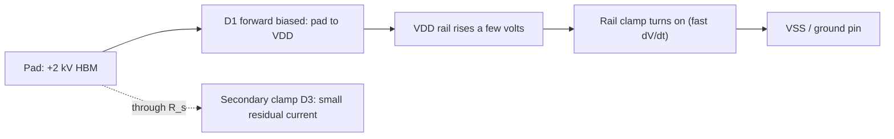

::: basics
### In plain words
CMOS inputs are fragile because their gate oxide is very thin. A static zap can push amps for a few nanoseconds at thousands of volts. Protection gives that current a safe path to the supply or ground before it can hurt the gate. It works in layers: on-chip diodes, a small series resistor, and extra parts on the board.

### Picture it
Picture a sluice gate beside a dam. When a flood arrives, the spillway diverts the water around the delicate machinery instead of through it. Diodes at the pin are the spillways. The series resistor is a narrow channel that slows what is left. The cost is that the spillway and channel slow down normal traffic.

### Words you need
- **ESD**: electrostatic discharge, a brief high-voltage static pulse. See [[q0102]].
- **Clamp diode**: a diode that conducts when the pin goes above the supply or below ground.
- **Rail clamp**: a big device between supply and ground that carries ESD current away.
- **TVS diode**: an external part that clamps surges at a connector.
- **Series resistor**: limits current into the clamp diodes.

### The simplest example
Say a 3.3 V chip's pin is accidentally driven to 12 V. The upper clamp diode holds the pin near 4 V, about one diode drop above the supply. A 3.3 kΩ series resistor then sees about 8 V, so the current is about $8/3.3\text{ k}\Omega\approx2.4$ mA. That is a small, safe fault current.

That is the whole idea. The rest of this page shows the on-chip layers, the board-level parts, and the speed cost of the resistor.
:::

::: testing
Whether you can **design** a protection scheme and reason about it, not just name "diodes to the rails". The interviewer is looking for:

1. What you're protecting (the thin gate oxide, about 10 MV/cm) and from what (ESD: short, high-current, very high voltage; versus DC overvoltage: slow, lower voltage, sustained).
2. A layered structure: **primary clamps at the pad**, a **series resistor**, a **secondary clamp**, and a **power-rail clamp** to carry the current to the other pin.
3. Design numbers: peak ESD current (HBM about 1.3 A for 2 kV), the series resistance vs bandwidth trade-off, and the board-level equivalents (series R, TVS).
4. Side effects: pin capacitance, leakage, latch-up, and the fact that a 5 V signal on a 3.3 V pin turns the clamp diode on.
:::

::: why
ESD kills chips quietly: a bench technician's finger, a cable plugged in, a hot-plugged connector. Every IC pin has protection on-die, but your board adds the connectors, and you have to choose external TVS diodes, series resistors and layout to survive IEC-level events. And for DC overvoltage (a 5 V or 12 V signal on a 3.3 V pin) the on-chip structures are not designed to take sustained current, so you must design the interface. Knowing both levels is a classic hardware-engineer skill.
:::

::: concepts
- **Gate oxide breakdown**: a few volts over nanometres of oxide is already at the limit. See [[q0102]].
- **PN diodes and the body diode**: junction clamps conduct at about 0.6-0.7 V forward and block in reverse. See [[q0101]].
- **ESD models**: HBM (100 pF through 1.5 kΩ), IEC 61000-4-2 (150 pF through 330 Ω), CDM (charged device).
- **Series resistance and RC delay**: a protection resistor forms a low-pass with pin capacitance.
- **Rail clamp**: an active device between $V_{DD}$ and ground that shunts ESD current between rails.
- **CMOS input stage**: the inverter's gate is the exposed node. See [[q0105]].
:::

::: answer
"I'd treat it in layers. The thing to protect is the gate oxide of the input transistors, which can only take a few volts. An ESD event is a nanosecond-scale pulse of a couple of amps at kilovolts, so the structure has to shunt that current somewhere harmless, not just limit voltage.

At the pad I put two diodes: one from the pad up to $V_{DD}$ and one from ground up to the pad. If the pin goes above $V_{DD}$ plus a diode drop, the upper diode steers the current into the supply rail; if it goes below ground minus a diode drop, the lower one conducts. Those diodes have to be big because they carry amps. Then a series resistor, a few hundred ohms of poly, drops the remaining voltage and limits current into a smaller secondary clamp right next to the gate. Between $V_{DD}$ and ground there's a rail clamp, a big NMOS triggered by an RC, which carries the current to the ground pin so the supply doesn't blow up.

On the board I'd add a TVS diode at the connector for IEC-level events and a series resistor, sized so the DC clamp current stays small for overvoltage. For a 12 V fault on a 3.3 V pin, a 3.3 kΩ resistor limits the clamp current to about 2.5 mA. The cost is RC bandwidth and extra capacitance, so I'd check that against signal speed."
:::

::: technical
**Threat models**

| Model | Network | 2 kV example |
|---|---|---|
| HBM (human body) | 100 pF through 1.5 kΩ | $I_{pk}=2000/1500=1.33$ A, $\tau=150$ ns, charge 200 nC |
| IEC 61000-4-2 (system level) | 150 pF through 330 Ω (generator) | 8 kV contact: standard peak about 30 A (the simple RC model gives 24 A) |
| CDM | charged package discharging through one pin | very fast (sub-ns), tens of amps, low energy |
| DC overvoltage | sustained signal beyond the rail | mA, limited by source and series R |

**On-chip structure (classic two-stage).**
1. **Primary clamps at the pad:** $D_1$ (pad to $V_{DD}$) and $D_2$ (ground to pad), large-area junctions. A positive strike steers into $V_{DD}$, then the **rail clamp** takes it to $V_{SS}$; a negative strike flows through $D_2$ directly.
2. **Series resistor $R_s$** (about 100-500 Ω, poly or diffusion) between the pad and the gate.
3. **Secondary clamp** (small diodes or a grounded-gate NMOS) at the gate, to handle the voltage that still gets through, a few volts.
4. **Rail clamp** (big NMOS with RC-triggered gate) between $V_{DD}$ and $V_{SS}$, turning on for fast $dV/dt$ events and sinking amps.

**Voltage the gate sees.** Roughly $V_{gate}\approx V_{DD}+V_{D1}$ (forward drop at ESD current, perhaps 1-3 V) on a positive strike, passed through the $R_s$-secondary clamp divider. The target is to stay well below the oxide breakdown (a few volts above the rail for thin-oxide devices).

**DC/board-level overvoltage design.** If a source can exceed the rail, the clamp diode conducts: $I=\dfrac{V_{fault}-V_{DD}-V_F}{R_{series}}$. For a 12 V fault on a 3.3 V pin with $V_F\approx0.5$ V: $R=1$ kΩ gives 8.2 mA; 3.3 kΩ gives 2.5 mA; 10 kΩ gives 0.82 mA. Compare with the datasheet's maximum injection current (varies; often a few mA, check the pin spec). With 10 pF of pin and trace capacitance, $\tau=RC$ is 10 ns, 33 ns, 100 ns respectively, so choose by the signal bandwidth.

**System-level (IEC) protection.** TVS diode at the connector (low capacitance for high-speed lines, a few pF), series resistor or ferrite bead, short low-inductance path to ground; the TVS clamp voltage times peak current sets the residual stress (for example 30 A through 0.5 Ω dynamic resistance adds 15 V above breakdown).

> [!UNCERTAIN]
> ESD waveforms, clamp voltages, and the pin injection-current limits vary by standard version, vendor and process. Use the datasheet's absolute-maximum and "injection current" tables and the standard's published waveforms; the numbers here are for design intuition.
:::

::: short
"I'd use layers. At the pad, two big diodes steer ESD current to $V_{DD}$ or ground, with a rail clamp between the rails to sink it. Then a series resistor of a few hundred ohms and a small secondary clamp at the gate, which see only what leaks through. On the board, a TVS at the connector for IEC-level events, and a series resistor sized so that a DC overvoltage only pushes a milliamp or two through the clamp diode. The cost is added capacitance and RC delay, so I check it against the signal speed."
:::

::: long
"First, what are we protecting and from what? The gate oxide of the input transistors, which breaks down at a few volts across a few nanometres. The threats are ESD, which is a nanosecond-scale pulse, a human body model of 2 kV is about 1.3 amps peak, and the board-level IEC model at 8 kV is tens of amps, and DC overvoltage, where a connected signal is simply above the supply for a long time.

The standard on-chip answer is a two-stage network. At the pad, two large diodes: one to $V_{DD}$ and one to ground. A positive pulse forward-biases the upper one and dumps current into the supply rail, a negative pulse forward-biases the lower. Because the upper diode puts the current onto $V_{DD}$, you need a power clamp, usually a big NMOS triggered by an RC that sees the fast $dV/dt$ and turns on to carry the current to ground. Then comes a series resistor, a few hundred ohms, and a small secondary clamp right at the gate to catch what gets through. The resistor is what keeps the secondary clamp small. The price is some input capacitance and an RC delay.

On the board I deal with two scales. For connectors exposed to people, a TVS diode at the connector with a short path to ground handles the IEC pulses, with a series resistor or ferrite to share the energy. For DC overvoltage, I size a series resistor so the clamp current stays within the pin's injection spec: a 12 V signal into a 3.3 V pin with 3.3 kΩ gives about 2.5 mA. If the signal is fast I check the $RC$.

Side effects: the protection adds capacitance and leakage, can inject current into the supply if the supply is off, and a badly placed clamp can trigger latch-up."
:::

::: terms
- **ESD (electrostatic discharge)**: transfer of static charge, a fast high-current pulse.
- **HBM / CDM / IEC 61000-4-2**: human body, charged device and system-level ESD test models.
- **Primary / secondary clamp**: the first (large, at the pad) and second (small, at the gate) protection stages.
- **Rail clamp (power clamp)**: active device shunting current between $V_{DD}$ and ground during ESD.
- **TVS (transient voltage suppressor)**: a diode designed to clamp transients at a defined voltage.
- **GGNMOS (grounded-gate NMOS)**: an NMOS with gate, source and body grounded that uses its parasitic BJT to shunt ESD.
- **Injection current**: current forced into a pin beyond the rails; limited by datasheet specs.
- **Latch-up**: parasitic thyristor in CMOS triggered by injected current, causing a supply short.
:::

::: exceptional
An average answer says "put a diode to VDD and ground and a resistor." An exceptional answer:

- Distinguishes **ESD** (fast, high current, short) from **DC overvoltage** (slow, mA) and designs for each.
- Describes the complete path: pad diodes, **rail clamp**, series resistor, secondary clamp, with the roles of each.
- Gives numbers: HBM 1.33 A at 2 kV, IEC about 30 A at 8 kV, clamp current $=(V_{fault}-V_{DD}-V_F)/R$, $RC$ delay.
- Names trade-offs: capacitance, leakage, input range limited to the rails (can't exceed $V_{DD}+0.5$ V), hot-plug back-feed into an unpowered chip, and latch-up.
- Covers the board level too: TVS selection (working voltage, capacitance), layout (TVS at the connector, short ground path).
- Notes that 5 V-tolerant inputs need a different structure (no diode to $V_{DD}$, or a well-switched one).
:::

::: mistakes
- **A single series resistor as the whole protection.** It limits current but without a clamp the voltage at the gate rises until the oxide breaks.
- **Forgetting the rail clamp.** The upper diode puts the energy onto the $V_{DD}$ net; without a path to ground the supply voltage spikes.
- **Clamping to a floating rail.** If the chip is unpowered, a signal into the pin forward-biases the diode and powers the chip through the pin (back-feeding).
- **Putting the TVS far from the connector.** Trace inductance adds $L\,di/dt$: 10 nH at $di/dt=30$ A/ns is 300 V.
- **Using high-capacitance TVS on a fast line.** A 100 pF part kills a USB or HDMI signal; choose low-capacitance (below a few pF) devices.
- **Ignoring the injection current limit.** A DC 12 V into a 3.3 V pin through a small resistor will overheat the clamp diode and can latch up the IC.
:::

::: deep
## Two different problems

**ESD** is a fast event: rise time under a nanosecond (HBM about 10 ns, IEC under 1 ns), peak current amps to tens of amps, duration 100 ns or less, energy small (HBM at 2 kV stores $\tfrac12CV^2=200$ µJ). The protection must shunt the current within the time the oxide can tolerate and keep the voltage across the gate below breakdown. **DC overvoltage** is slow and low-energy per unit time but sustained; the problem is heating and latch-up in structures never designed to carry continuous current. They need different parts: on-chip clamps for ESD, external resistors/clamps/protection ICs for DC faults.

```circuit
{"caption":"Two-stage input protection: pad diodes, series resistor, secondary clamp, CMOS input inverter","elements":[
 {"t":"wire","pts":[[4,4],[17,4]]},{"t":"dot","at":[4,4]},{"t":"dot","at":[12,4]},{"t":"dot","at":[10,4]},
 {"t":"rail","at":[10,4],"label":"V_{DD}","dir":"up"},
 {"t":"term","at":[0,10],"label":"PAD","side":"left"},{"t":"wire","pts":[[0,10],[6,10]]},
 {"t":"D","a":[4,10],"b":[4,6],"label":"D_1","labelSide":"other"},{"t":"wire","pts":[[4,6],[4,4]]},
 {"t":"D","a":[4,14],"b":[4,10],"label":"D_2","labelSide":"other"},{"t":"wire","pts":[[4,14],[4,16]]},
 {"t":"dot","at":[4,10]},
 {"t":"R","a":[6,10],"b":[10,10],"label":"R_s","value":"200 Ω"},
 {"t":"wire","pts":[[10,10],[14,10]]},{"t":"dot","at":[12,10]},
 {"t":"D","a":[12,10],"b":[12,6],"label":"D_3","labelSide":"other"},{"t":"wire","pts":[[12,6],[12,4]]},
 {"t":"D","a":[12,14],"b":[12,10],"label":"D_4","labelSide":"other"},{"t":"wire","pts":[[12,14],[12,16]]},
 {"t":"wire","pts":[[15,8],[14,8],[14,12],[15,12]]},{"t":"dot","at":[14,10]},
 {"t":"pmos","at":[15,8],"label":"M_P"},{"t":"nmos","at":[15,12],"label":"M_N"},
 {"t":"wire","pts":[[17,6],[17,4]]},{"t":"dot","at":[17,4]},
 {"t":"wire","pts":[[17,10],[21,10]]},{"t":"term","at":[21,10],"label":"to core","side":"right"},
 {"t":"wire","pts":[[17,14],[17,16]]},
 {"t":"wire","pts":[[4,16],[17,16]]},{"t":"dot","at":[12,16]},{"t":"dot","at":[10,16]},{"t":"gnd","at":[10,16]}
]}
```
Figure: $D_1$ and $D_2$ are the big primary clamps at the pad (anode of $D_2$ at ground, cathode of $D_1$ at $V_{DD}$). $R_s$ separates them from the small secondary clamps $D_3$/$D_4$ at the gate. If the pad goes above $V_{DD}$ + a diode drop the current goes into $V_{DD}$; below ground, out of ground.

## How a positive ESD strike flows


Figure: The main path never goes through $R_s$ or the core. The clamp network gives the 1.3 A a short, low-impedance route to the ground pin. The gate sees only the diode drop plus the small current through $R_s$.

**Why diodes alone aren't enough.** The upper diode puts current on the $V_{DD}$ net, whose own impedance and the decoupling in the chip hold the rail to a few volts at most only if a clamp or enough capacitance carries it away. A rail clamp, typically a wide NMOS whose gate is driven by an RC-delay inverter, turns on during fast rises (nanoseconds) but stays off during normal power-up (microseconds to milliseconds), so it doesn't short the supply.

**Negative strikes.** $D_2$ conducts with the pad about 0.7-1.5 V below ground, and the current returns through the substrate, so no extra path is needed. The note here is that large forward currents injecting minority carriers into the substrate can trigger latch-up in nearby circuits; guard rings collect those carriers.

## Sizing numbers

**Primary diode.** For 1.33 A HBM the diodes must be large-area junctions sized from the foundry's measured current-per-width limit. The forward drop at 1.3 A, including series resistance, may reach 2-3 V, so the pad reaches about $V_{DD}+3$ V and the gate resistor plus secondary clamp limit what the gate itself sees.

> [!UNCERTAIN]
> Clamp sizing and HBM/CDM design windows are process-specific. Rely on the foundry's ESD design rules, and treat the voltages here as illustrative.

**Series resistor.** $R_s$ with the gate and parasitic capacitance $C$ forms a low-pass: $f_c=1/(2\pi R_sC)$. For $R_s=200$ Ω and a pin plus pad capacitance of 3 pF: $f_c=265$ MHz, which is fine for most inputs but kills multi-GHz receivers (they use inductive or distributed protection with minimal resistance).

**Capacitance.** Each clamp adds junction capacitance (about 0.3-1 pF per diode for small pins, more for large ones), which sets maximum data rate. High-speed SerDes pins use very small clamp structures or special low-capacitance dual-diode ESD protection devices at the board level.

## Board-level protection

At the connector:

| Element | Role | Typical choice |
|---|---|---|
| TVS diode (unidirectional) | clamp positive transients at $V_{clamp}$, low-impedance path to ground | working voltage just above max signal level; low capacitance for fast lines |
| Series resistor / ferrite bead | share energy, limit current to IC | 22-330 Ω depending on signal speed |
| Shunt RC | slow the edge, absorb energy | low-speed lines |
| Layout | TVS right at the connector, short wide ground return, no stub | key |

**Clamp voltage matters.** A TVS with 5.5 V breakdown and a dynamic resistance of 0.5 Ω carrying 30 A clamps about $5.5+15=20$ V, which the IC pin may not tolerate. The series resistor then limits the current into the IC clamp: $(20-3.3-0.7)/R$; with 100 Ω that is 160 mA, still high, so board-level protection usually combines a good TVS and a resistor of several hundred ohms on slow signals, while fast signals need a very-low-clamping part and tight layout. The exact protection level is verified against the standard's test.

## DC overvoltage and sustained faults

For a pin that may see 12 V while the supply is 3.3 V, compute the clamp current: $I=(12-3.3-0.5)/R$. 3.3 kΩ gives 2.5 mA, and the clamp diode simply sinks it into the rail; the rail must be able to absorb that current. If the load on $V_{DD}$ is smaller than the injected current, the rail rises, which is dangerous for a lightly loaded rail (a regulator can't sink current). So either add a Zener on the rail, size the resistor so the injected current is below the quiescent load, or use a purpose-built overvoltage-tolerant input or a protection IC/level translator.

Other approaches: use a pin that's **5 V tolerant** by design (no diode to $V_{DD}$, an n-well switching circuit and a thick-oxide input device); a comparator/divider input with a Zener clamp; or a series FET protection switch that opens for overvoltage.

## Latch-up

CMOS contains a parasitic PNPN structure. Injecting current into a pin beyond the rails (or forward-biasing wells) can trigger it, shorting $V_{DD}$ to ground until power is cycled. Guard rings, adequate spacing and limiting injection current (series resistance!) reduce the risk. This is another reason to keep fault current into any CMOS pin to a few mA.

## Real hardware

- A lab ESD gun hit on a USB connector shell: a TVS at the connector, a ferrite and a short ground to chassis is the standard fix.
- Many ICs list "ESD HBM ±2 kV, CDM ±500 V" in the datasheet; those are test results for the pin protection, not guarantees for system-level IEC events, which are usually much more severe.
- Powered-off hot-plug: a signal driving an unpowered CMOS input will forward-bias the clamp to $V_{DD}$ and back-power the chip. Use a power-off-protected buffer or isolate with a series resistor and diode.
:::

::: applications
- **Every IC pin**: on-die ESD structures (diodes + rail clamp), as part of the I/O cell.
- **USB, HDMI and Ethernet ports**: low-capacitance TVS arrays near the connector.
- **Industrial inputs (24 V logic into a 3.3 V MCU)**: series resistor, clamp and divider or an input-conditioning IC.
- **Sensor and analog front-ends**: series resistors and clamps ahead of op-amps or ADCs, with the injection-current limit in mind.
- **MCU GPIO to the outside world** (buttons, headers): RC filter plus TVS.
- **Power-off-protected interfaces** in hot-swappable modules.
:::

::: assumptions
- **Standard bulk-CMOS input** with thin oxide and an N-well/P-substrate structure. Thick-oxide I/O devices, SOI and FinFET processes use variations on the same principles.
- **ESD models** are idealized RC networks; real waveforms (IEC 61000-4-2) have a fast initial spike and are more demanding.
- **Clamp numbers** are illustrative; consult the datasheet for each device's injection-current and ESD ratings.
- **A rail that can absorb the injected current** is assumed for DC overvoltage; otherwise the supply will be pumped up.
- For **RF/high-speed** inputs, series resistance may be unacceptable and lower-capacitance structures (stacked diodes, inductive peaking) are used.
:::

::: followups
### Why not just put a Zener from the pin to ground and be done?
A Zener clamps positive excursions only to its breakdown voltage and its negative side conducts at 0.7 V, so it can work as a unidirectional board-level clamp. On-chip, though, a simple diode to the rail clamps closer to the supply and with much lower dynamic resistance, and you need the path back to the other rail. A single Zener may clamp at a voltage above the oxide limit for a thin-gate input.

### How big should the series resistor be?
Large enough to limit the secondary clamp's current and DC fault current (for example 12 V fault, 2.5 mA limit: 3.3 kΩ), small enough that $RC$ doesn't break the signal. For a 10 MHz digital input with 10 pF, $f_c=1/(2\pi\cdot3.3\text{k}\cdot10\text{ p})=4.8$ MHz, too slow. So you'd choose maybe 1 kΩ for 10 MHz or add a proper clamp rather than rely on $R$.

### What does the HBM rating of 2 kV tell you about IEC 8 kV performance?
Very little. HBM is 100 pF/1.5 kΩ, about 1.3 A at 2 kV; IEC 8 kV contact is specified at about 30 A with a sub-ns spike, so about 20x the current. System-level protection (TVS) is always needed for exposed ports.

### How does the protection change for a 5 V-tolerant input on a 3.3 V chip?
The diode to $V_{DD}$ would conduct when the pin exceeds 3.3 V + 0.7 V, so it is removed or replaced with a structure referenced to a switched well/higher rail, and the input device uses thick oxide. The rail clamp and ground diode remain.

### Harder: a hot-plugged peripheral powers up your unpowered MCU through its I/O pins. Explain and fix.
The peripheral drives 3.3 V on a pin; the pad diode to $V_{DD}$ forward-biases and charges the MCU's supply rail (about 2.6 V), partially powering it into a bad state. Fix with power-off-protected buffers (no clamp to $V_{DD}$), series resistors that limit the injection, a load-switch to sequence power, or an isolation buffer powered from the peripheral's supply.

### Scenario: a product passes HBM testing but dies at a trade-show demo from static. What do you check?
System-level ESD (IEC 61000-4-2 style) hits the exposed connectors, which can put 10-30 A on a pin, and the IC's HBM rating doesn't cover it. Check TVS placement and clamp voltage, series resistor values, ground path (chassis bond), and the PCB layout (return path); test with an ESD gun and look at which pin fails.
:::

::: references
- Amerasekera & Duvvury, *ESD in Silicon Integrated Circuits*: on-chip protection structures, rail clamps and models.
- IEC 61000-4-2, *Electrostatic discharge immunity test* (by name): system-level waveform and test levels; JEDEC and ESDA documents for the HBM and CDM models (by name).
- Sedra & Smith, *Microelectronic Circuits*: diode clamps and CMOS input considerations.
- Ott, *Electromagnetic Compatibility Engineering*: ESD protection at the system level (chapter on ESD).
- TI and other TVS diode datasheets: clamping voltage, dynamic resistance and capacitance specifications.
:::

::: rubric
- Identifies the gate oxide as the vulnerable element and ESD vs DC overvoltage as different threats :: Frames the design correctly.
- Describes pad diodes to $V_{DD}$/ground plus a rail clamp :: This is the core on-chip structure.
- Includes a series resistor and secondary clamp :: Shows understanding of staged protection.
- Gives numbers (HBM/IEC currents, clamp current $=(V-V_{DD}-V_F)/R$, $RC$) :: Demonstrates quantitative design.
- Addresses board-level protection (TVS placement, series R, layout) :: This is what an engineer actually controls.
- Notes side effects: capacitance, leakage, back-feeding, latch-up :: Shows mature judgment.
:::

::: quiz
```json
[
 {"type":"mcq","level":"fundamental","q":"What does a diode from the pad to $V_{DD}$ do in an input protection circuit?","options":["It blocks the input at all times","It conducts when the pin rises more than about 0.7 V above $V_{DD}$, steering the current into the supply rail","It limits the current into the gate to 1 mA","It pulls the pad up to $V_{DD}$"],"answer":1,"explain":"The diode is reverse biased in normal operation and forward biases when the pad exceeds $V_{DD}$ plus a diode drop, sending the surge into the supply rail (where the rail clamp carries it away)."},
 {"type":"numeric","level":"fundamental","q":"HBM model: 100 pF charged to 2 kV discharged through 1.5 kΩ. What is the peak current?","answer":1.333,"tolerance":0.02,"unit":"A","explain":"$I=V/R=2000/1500=1.33$ A."},
 {"type":"numeric","level":"intermediate","q":"A 12 V fault is applied through $R=3.3$ kΩ to a 3.3 V pin whose clamp diode drops 0.5 V. What current flows into the clamp?","answer":2.48,"tolerance":0.03,"unit":"mA","explain":"$I=(12-3.3-0.5)/3300=2.48$ mA."},
 {"type":"numeric","level":"intermediate","q":"A series protection resistor of 200 Ω works with 3 pF of input capacitance. What is the corner frequency?","answer":265,"tolerance":0.03,"unit":"MHz","explain":"$f_c=1/(2\\pi RC)=1/(2\\pi\\times200\\times3\\text{ pF})=265$ MHz."},
 {"type":"truefalse","level":"advanced","q":"A part rated for 2 kV HBM will survive an 8 kV IEC 61000-4-2 contact discharge at its pins without external protection.","answer":false,"explain":"The IEC pulse carries about 20 times the current of a 2 kV HBM pulse with a much faster edge. External TVS/series protection is needed for exposed pins."},
 {"type":"multi","level":"advanced","q":"Which problems can an input clamp diode to $V_{DD}$ cause? Select all that apply.","options":["Back-feeding an unpowered chip from a driven pin","Limiting inputs to about $V_{DD}$ + 0.7 V","Added pin capacitance and leakage","Increasing the gate oxide thickness"],"answer":[0,1,2],"explain":"The clamp conducts into the supply if the chip is off (back-powering), limits the input range and adds junction capacitance/leakage. It has no effect on oxide thickness."}
]
```
:::
