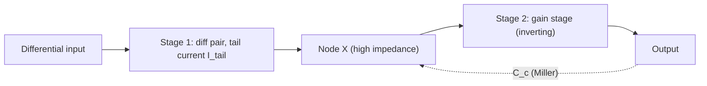

::: basics
### In plain words
Slew rate and rise time are two different speed limits. Slew rate is the largest rate the output can change, set by how much current is available to charge a capacitor. Rise time is how long a small, well-behaved step takes, set by bandwidth. Which one limits you depends on the size of the step.

### Picture it
Picture filling a bathtub through a valve that opens smoothly. For a small top-up, the level eases in at a pace set by how quickly the valve responds. For a big fill, the valve is wide open and you are limited by the most water the pipe can carry per second, so the level climbs in a straight line. The valve's response is the bandwidth limit, and the pipe's maximum flow is the slew limit.

### Words you need
- **Slew rate**: the maximum rate of change of the output, in volts per microsecond (V/µs; a microsecond is a millionth of a second). See [[q0111]].
- **Rise time**: the time for the output to go from 10% to 90% of a step.
- **Bandwidth**: roughly the highest frequency the amplifier handles well (its −3 dB point). It sets the rise time of small signals. See [[q0116]].
- **Tail current ($I_{tail}$)**: the fixed current the op-amp's first (input) stage runs on.
- **Compensation capacitor ($C_c$)**: the capacitor inside the op-amp that the current charges.

### The simplest example
Say an op-amp has 10 µA of tail current and a 20 pF compensation capacitor. The slew rate is $I/C=10\text{ µA}/20\text{ pF}=0.5$ V/µs. A big 10 V step then ramps in a straight line for $10/0.5=20$ µs. Its rise time, the middle 8 V from 10% to 90%, is $8/0.5=16$ µs, however much bandwidth the part has. A tiny step stays under the slew limit, so only the bandwidth sets how fast it moves.

That is the whole idea. The rest of this page shows how to tell which limit applies, the rise-time formulas, and what happens to sine waves that are too fast.
:::

::: testing
Whether you can separate two limits that people constantly confuse: **slew rate** (a *large-signal* limit set by a current charging a capacitor) and **rise time** (a *small-signal* limit set by bandwidth). A strong answer includes:

1. $SR=I/C$: in an op-amp $SR=I_{tail}/C_c$; in a driver it is $I_{drive}/C_{load}$.
2. Rise time from bandwidth: $t_r\approx0.35/f_{-3dB}$ for a single-pole system, $2.2RC$ for an RC.
3. How to tell which one limits a given edge: compare the signal's required $dV/dt$ with SR, and note that for large steps the slew-limited rise time is $0.8\,\Delta V/SR$.
4. The consequences: distortion (a sine turning into a triangle), full-power bandwidth, and what to change.
:::

::: why
Slew limiting is a classic cause of mysterious distortion: the circuit has plenty of bandwidth on the small-signal Bode plot but clips edges on a big signal. It also appears in digital drivers, gate drivers and regulators during load steps. An engineer who can say "your amplifier is slewing, not bandwidth-limited, here's the evidence on the scope and the fix" saves days. It's also the basis for the next question on the trade-offs of fast and slow edges ([[q0118]]).
:::

::: concepts
- **Capacitor equation**: $i=C\,dv/dt$, so charging a capacitor with a limited current gives a limited slope. See [[q0022]].
- **Op-amp compensation capacitor ($C_c$)**: sets the dominant pole and the slew rate. See [[q0116]].
- **Bandwidth and rise time**: $t_r=0.35/f_{BW}$ for a single pole; RC step response. See [[q0028]].
- **Small-signal vs large-signal**: linear models (bandwidth) hold only while the amplifier isn't current-limited.
- **Full-power bandwidth**: the largest-amplitude sine an amplifier can reproduce without slewing.
- **Output stage limits**: output current and load capacitance also set $dV/dt$. See [[q0111]].
:::

::: answer
"Slew rate and rise time come from two different limits. Slew rate is a large-signal limit: it's the maximum rate of change of the output, and it's set by how much current the circuit can use to charge a capacitor. In a two-stage op-amp the input stage has a fixed tail current, and it has to charge the internal compensation capacitor, so slew rate is $I_{tail}$ divided by $C_c$. With 10 µA and 20 pF that's 0.5 V/µs. In a digital driver or a gate driver it's the drive current divided by the load capacitance.

Rise time is a small-signal limit set by bandwidth. For a first-order system, rise time is about 0.35 divided by the -3 dB bandwidth, or 2.2 RC, and the amplifier behaves linearly, with an exponential edge.

Which one applies depends on the step size. If the step is small enough that the exponential edge's steepest slope is less than the slew rate, it's bandwidth-limited. If it's larger, the output ramps at the slew rate, a straight line, until it gets near the end, and the rise time is about 0.8 times the step divided by the slew rate. For a 10 V step at 0.5 V/µs that's 16 µs, far slower than the bandwidth would suggest. And for sine waves, if $2\pi fV_p$ exceeds the slew rate, the output turns into a triangle with distortion."
:::

::: technical
**Slew rate in an op-amp (two-stage Miller-compensated).** The first-stage differential pair has tail current $I_{tail}$. For a large differential input, all of the tail current flows into one side and charges the compensation capacitor $C_c$:
$$SR=\frac{dV_{out}}{dt}\Big|_{max}=\frac{I_{tail}}{C_c}$$
and $GBW=\dfrac{g_{m1}}{2\pi C_c}$. For a bipolar pair $g_m=I_{tail}/(2V_T)$ so $SR=2\pi\,GBW\cdot 2V_T$, i.e. for GBW $=1$ MHz: $SR=2\pi\times10^6\times0.0517=0.325$ V/µs; for MOS pairs $g_m=I_{tail}/V_{ov}$ so SR is *higher* by the ratio $V_{ov}/(2V_T)$. Example: $I_{tail}=10$ µA, $C_c=20$ pF: $SR=0.5$ V/µs.

**Small-signal rise time.** For a single pole, $f_c$: $v(t)=\Delta V(1-e^{-t/\tau})$, $\tau=1/(2\pi f_c)$, $t_r(10\text{-}90\%)=2.2\tau=\dfrac{0.35}{f_c}$. A gain-of-10 stage using a 1 MHz GBW op-amp: $f_c=100$ kHz, $t_r=3.5$ µs.

**When does slewing occur?** The steepest slope of the exponential step is at $t=0$: $\Delta V/\tau$. Slewing starts if $\Delta V/\tau>SR$, i.e. $\Delta V>SR\cdot\tau$. With $SR=0.5$ V/µs and $\tau=1.59$ µs ($f_c=100$ kHz): $\Delta V>0.80$ V at the output. A 10 V step would slew for most of the transition.

**Slew-limited rise time:** $t_r\approx\dfrac{0.8\,\Delta V}{SR}$. 10 V step at 0.5 V/µs: 16 µs, versus 3.5 µs from bandwidth alone. Total delay for the cascade of independent limits: $t_r\approx\sqrt{t_{r1}^2+t_{r2}^2}$ (e.g. a 2 µs scope or driver edge combined with a 3.5 µs amplifier edge gives 4.0 µs).

**Sine waves.** A sine $V_p\sin(2\pi ft)$ has maximum slope $2\pi fV_p$. No slew distortion requires
$$2\pi fV_p\le SR\ \Rightarrow\ f\le f_{FPBW}=\frac{SR}{2\pi V_p}$$
(full-power bandwidth). Example: $SR=0.5$ V/µs, $V_p=10$ V: $f_{FPBW}=7.96$ kHz. A 100 kHz, 5 V peak sine needs $SR\ge3.14$ V/µs.

**Other contexts.** For a digital driver: $SR=I/C_L$ and $t_r\approx2.2R_{on}C_L$ ([[q0111]], [[q0113]]). Class-AB output stages are limited by the output current into the load capacitance: $SR_{out}=I_{out,max}/C_L$. Slew rates can differ for rising and falling edges.
:::

::: short
"Slew rate is the largest-signal limit: the maximum dV/dt, set by the current available to charge a capacitor. In an op-amp it's the input stage tail current divided by the compensation capacitor, $I/C_c$, like 10 µA over 20 pF gives 0.5 V/µs. Rise time is the small-signal limit from bandwidth, about 0.35 over the -3 dB bandwidth, or 2.2 RC. Small steps are bandwidth-limited exponentials; big steps ramp linearly at the slew rate, taking about 0.8 times the step over SR, and big fast sines get distorted into triangles."
:::

::: long
"Both limit how fast an output can change, but for different reasons, and they act in different regimes.

Slew rate is a current limit. The equation $i=C\,dv/dt$ says if the current is capped at some maximum, the voltage on the capacitor can't change faster than I over C. In a typical two-stage op-amp, the first stage is a differential pair fed by a tail current source, and it drives the compensation capacitor. For a big differential input, the whole tail current goes one way and charges that capacitor at a fixed rate: $SR=I_{tail}/C_c$. With 10 µA and 20 pF, that's 0.5 volts per microsecond. For digital outputs and gate drivers it's the same idea: the drive current over the load capacitance.

Rise time is a small-signal, linear bandwidth effect. If the amplifier is acting like a single-pole low-pass at $f_c$, a step gives an exponential with a 10 to 90 percent rise time of 0.35 over $f_c$. A gain of 10 on a 1 MHz op-amp gives $f_c$ of 100 kHz and a 3.5 µs rise.

Which one you see depends on step size. An exponential's steepest slope is at the start, $\Delta V$ over $\tau$. If that's less than the slew rate, you see the exponential. If it's more, the output ramps in a straight line at the slew rate until it gets close to the target, then rounds off. With 0.5 V/µs and a 100 kHz bandwidth, the crossover is about 0.8 V. A 10 V step is slew-limited and takes 16 µs, not 3.5.

For sine waves the peak slope is $2\pi fV_p$, so above the full-power bandwidth, $SR/(2\pi V_p)$, the sine becomes a triangle with the amplitude cut back. At 0.5 V/µs and 10 V peak that's only 8 kHz, though the small-signal bandwidth might be 100 kHz.

To fix slew limiting: pick an op-amp with a higher slew rate, run at a smaller amplitude, or reduce the step. In my own design I'd compare the required $2\pi fV_p$ with the datasheet slew rate, with margin."
:::

::: terms
- **Slew rate (SR)**: maximum rate of change of the output voltage, in V/µs.
- **Rise time ($t_r$)**: time for the output to go from 10% to 90% of a step.
- **Bandwidth ($f_c$)**: -3 dB frequency; for a single pole $t_r=0.35/f_c$.
- **Full-power bandwidth**: $SR/(2\pi V_p)$, the largest sine the amplifier can reproduce undistorted.
- **Tail current ($I_{tail}$)**: the bias current of the input differential pair.
- **Compensation capacitor ($C_c$)**: capacitor setting the dominant pole in a two-stage op-amp.
- **Slewing**: the output ramping at the slew limit instead of following the input.
- **Settling time**: time to get within a specified error band of the final value.
:::

::: exceptional
An average answer says "slew rate is how fast the output can change and rise time is how long a step takes." An exceptional answer:

- Derives $SR=I/C$ and identifies which current and capacitor (tail current and $C_c$ in an op-amp; drive current and load capacitance in a driver).
- States $t_r=0.35/f_c$ and $2.2\tau$, and **explains why a large step is slew-limited, with the crossover amplitude** $\Delta V=SR/(2\pi f_c)$.
- Gives the **slew-limited rise time** $0.8\,\Delta V/SR$ and **full-power bandwidth** $SR/(2\pi V_p)$ with numbers.
- Mentions the relation between SR and GBW ($SR\propto GBW\times V_{ov}$ or $2V_T$), and that high-GBW parts don't automatically slew faster.
- Describes how to diagnose on the scope: a triangle-shaped sine, straight-line edges, amplitude-dependent rise time.
- Notes asymmetry (rise vs fall) and load-capacitance limits at the output stage.
:::

::: mistakes
- **"Rise time is just bandwidth."** For large steps the rise time is set by slew rate and grows with step size; for small steps it's set by bandwidth.
- **Using GBW to predict large-signal behavior.** GBW is small-signal. A 10 MHz GBW amplifier with 1 V/µs slew rate only reproduces a 10 V peak sine up to 16 kHz.
- **Forgetting that rise time depends on amplitude** in slewing; the same edge measured at two amplitudes gives different times.
- **Mixing up units**: V/µs vs V/s; 0.5 V/µs = $5\times10^5$ V/s.
- **Ignoring the load.** Output current limit into $C_L$ can cut slew below the datasheet value.
- **Confusing slew-induced distortion with clipping.** The sine's peaks are intact until the slope limit reduces amplitude; the waveform becomes a triangle, not a flat top.
:::

::: deep
## Why $SR=I/C$ in an op-amp

A two-stage op-amp has a first stage (differential pair with tail current $I_{tail}$) that drives a second, inverting gain stage with a Miller compensation capacitor $C_c$ across it.


Figure: The compensation capacitor connects the output of the second stage back to the high-impedance node between the stages. The first stage must supply (or sink) the current that charges $C_c$.

For a small input difference, the first stage delivers $i=g_{m1}v_d$ to $C_c$, which the Miller capacitor integrates, giving the single-pole behaviour with $GBW=g_{m1}/(2\pi C_c)$. For a *large* input, the pair is fully steered: one side carries the whole $I_{tail}$ and the other none, so the current into $C_c$ saturates at $I_{tail}$, and the voltage across it (which mirrors the output) ramps at $I_{tail}/C_c$.

Because $GBW=g_{m1}/(2\pi C_c)$ and $SR=I_{tail}/C_c$:

$$\frac{SR}{2\pi\,GBW}=\frac{I_{tail}}{g_{m1}}$$

For a BJT pair each side has $g_{m1}=I_{tail}/(2V_T)$ so $SR=2\pi\,GBW\times2V_T\approx0.33$ V/µs per MHz of GBW; a MOS pair has $g_m=I_{tail}/V_{ov}$ (for each side at $I_{tail}/2$ and overdrive $V_{ov}$), so $SR=2\pi\,GBW\times V_{ov}$, higher when $V_{ov}>2V_T$ (about 52 mV). Designers raise SR by increasing the tail current, using degeneration resistors (which cut $g_m$ but not the current), choosing a MOS or JFET input, or adding class-AB slew boosting.

> [!UNCERTAIN]
> The exact relation between $SR$ and $GBW$ depends on the topology (single-stage folded cascode, three-stage, class-AB). The $SR=I/C_c$ and $SR/(2\pi GBW)=I_{tail}/g_m$ relations are for the textbook two-stage Miller op-amp.

## Small step vs large step

```plot
{"title":"Step response of a gain-10 stage (f_c = 100 kHz, SR = 0.5 V/µs): small vs large output step","x":{"label":"time","unit":"s","min":0,"max":3e-5},"y":{"label":"output (fraction of final value)","unit":"","min":0,"max":1.1},
 "vars":{"tau":1.59e-6,"s":5e4,"tsw":1.84e-5},
 "series":[
  {"label":"0.5 V step: bandwidth-limited exponential","fn":"1-exp(-x/tau)","color":"green"},
  {"label":"10 V step: slews at 0.5 V/µs, then settles","fn":"x<tsw ? x*s : 1-0.0796*exp(-(x-tsw)/tau)","color":"red"}],
 "hlines":[{"at":0.1,"label":"10%","color":"muted"},{"at":0.9,"label":"90%","color":"muted"}]}
```
Figure: The green curve is the small-signal exponential with a 3.5 µs 10-90% rise time. The red curve for a 10 V output step ramps in a straight line at 0.5 V/µs (5%/µs of the final value) until it reaches 92%, where the exponential's slope falls below the slew rate, then rounds off. Its 10-90% time is $0.8/0.05=16$ µs. The same op-amp has a 3.5 µs rise on a small step and 16 µs on a large one.

**Where the crossover is.** The slope of the exponential at $t=0$ is $\Delta V/\tau$; slewing begins if that exceeds SR:
$$\Delta V>SR\cdot\tau=\frac{SR}{2\pi f_c}=\frac{5\times10^5}{2\pi\times10^5}=0.80\text{ V}.$$
Below 0.8 V of output swing the response is the linear exponential; above it, slew dominates. Note the crossover depends on the closed-loop bandwidth: a higher gain (lower $f_c$) raises the crossover amplitude.

## Sine waves: the triangle

```plot
{"title":"A 100 kHz, 5 V-peak sine through an amplifier with SR = 0.5 V/µs","x":{"label":"time","unit":"s","min":0,"max":2.5e-5},"y":{"label":"output","unit":"V","min":-5.5,"max":5.5},
 "vars":{"vp":5,"f":1e5,"a":1.25},
 "series":[
  {"label":"ideal input sine","fn":"vp*sin(2*pi*f*x)","color":"muted"},
  {"label":"slew-limited output (triangle, ±1.25 V)","fn":"(2*a/pi)*atan2(sin(2*pi*f*x), sqrt(max(1-sin(2*pi*f*x)^2,0)))","color":"red"}],
 "hlines":[{"at":1.25,"label":"±1.25 V: slope = SR","color":"orange"}]}
```
Figure: A 5 V peak, 100 kHz sine needs $2\pi fV_p=3.14$ V/µs, six times the 0.5 V/µs available. The output becomes a triangle whose slope is the slew rate and whose peak is only $SR/(4f)=1.25$ V, 75% below the intended amplitude. (The simple triangle approximation ignores the initial transient.) The full-power bandwidth for 5 V is $SR/(2\pi V_p)=15.9$ kHz.

```sim
{"id":"amp-bandwidth","view":"slew","gbw":1e6,"sr":0.5e6,"gain":10}
```
Figure: Raise the frequency or amplitude until the output turns into a triangle; then try a higher slew rate. Switch to the `step` view to compare small and large step rise times.

## Digital drivers and rise time

For a digital output driving $C_L$: $SR=I_{drive}/C_L$ while the driver is in saturation, then the end of the edge follows $R_{on}C_L$. Rise time $t_r\approx2.2R_{on}C_L$ ([[q0111]], [[q0113]]). With several independent limits (driver, trace, receiver, scope), edges add in quadrature: $t_r=\sqrt{t_1^2+t_2^2+\dots}$. With a 2 ns driver edge and a 3 ns RC the result is 3.6 ns; a 1 GHz scope (0.35 ns) adds a negligible amount. This is also how a scope's bandwidth limits the measurement of fast edges.

## How to diagnose it on the bench

1. **Edges are straight lines** on a large step and the time per volt is constant: slewing.
2. **Rise time scales with amplitude** (bigger step, longer edge): slewing. Bandwidth-limited rise time is amplitude-independent.
3. **A sine turns into a triangle** at high frequency/amplitude; the output amplitude falls as you raise the input amplitude.
4. **Change the load.** If the edge slows with a large capacitive load, the output stage current limit is the cause.

Fixes: a higher-SR op-amp; lower amplitude or gain; a smaller $C_c$ or higher tail current in a custom design; a buffer/booster output stage for capacitive loads.

## Real hardware

- General-purpose op-amps from decades past have 0.5-1 V/µs slew rates; modern high-speed op-amps range from tens to thousands of V/µs, with slew rate typically specified for a stated step and load.
- Datasheets specify SR with a given step amplitude, gain and load; the rise and fall slew rates can differ.
- High-voltage output swings (±10 V) need much higher SR than 3.3 V single-supply circuits for the same frequency.
- Audio: a 20 kHz, 10 V peak signal needs $2\pi\times20\text{ kHz}\times10=1.26$ V/µs at minimum; designers often target 5-10x that for headroom.

## Worked example: sizing a first stage for a target slew rate

Suppose you are designing the input stage of a two-stage CMOS amplifier and the system needs $SR=10$ V/µs with a compensation capacitor of 5 pF (small enough to fit on die). The tail current follows directly from $SR=I_{tail}/C_c$:

$$I_{tail}=SR\cdot C_c=10^{7}\ \text{V/s}\times5\times10^{-12}\ \text{F}=50\ \mu\text{A}$$

With an overdrive of $V_{ov}=0.2$ V on each input device, the pair's transconductance is $g_{m1}=I_{tail}/V_{ov}=250$ µS, so the amplifier gets

$$GBW=\frac{g_{m1}}{2\pi C_c}=\frac{2.5\times10^{-4}}{2\pi\times5\times10^{-12}}=7.96\ \text{MHz}$$

Check with the ratio derived earlier: $SR/(2\pi\,GBW)=10^7/(5\times10^7)=0.2$ V, which is exactly $V_{ov}$. The example also shows the design tension. Slew rate and GBW both want a small $C_c$, but a small $C_c$ pushes the second pole closer and costs phase margin ([[q0116]]). To raise SR without changing GBW you raise $I_{tail}$ and $V_{ov}$ together (or degenerate the pair); to raise GBW without changing SR you raise $g_m$ at fixed current, which is only possible by lowering $V_{ov}$ or using a bipolar pair.

## Settling time: slewing plus linear tail

Real specs are usually stated as settling time to some error band, and a large step combines both regimes. Take the 10 V output step on the gain-of-10 stage ($\tau=1.59$ µs, $SR=0.5$ V/µs) and ask for 0.1% accuracy (10 mV):

1. Slewing ends when the remaining error equals $SR\cdot\tau=0.795$ V, after $(10-0.795)/0.5=18.4$ µs.
2. The exponential then starts at 0.795 V of error and must decay to 0.01 V: $\tau\ln(0.795/0.01)=1.59\ \mu\text{s}\times4.38=6.96$ µs.
3. Total: about 25.4 µs.

For comparison, a small 0.5 V step never slews and needs $\tau\ln(1000)=10.98$ µs. So the big step is slower by a factor of only 2.3, even though its slewing portion alone is 18 µs: the linear tail is a fixed cost and slewing adds on top of it. In an ADC driver or DAC buffer, this total, not the small-signal $0.35/f_c$, is what must fit inside the sample window.

## Limiting cases

- **Tiny signals.** For $\Delta V\ll SR/(2\pi f_c)$ the amplifier never slews and SR is irrelevant. Instrumentation front-ends working at millivolt levels can use a part with a modest slew rate.
- **Very large steps.** The slewing term dominates and settling approaches $\Delta V/SR$ plus a constant, so doubling the step nearly doubles the time.
- **Very high closed-loop gain.** A lower $f_c$ raises the crossover amplitude $SR/(2\pi f_c)$, so a high-gain stage slews less often than a follower. Counterintuitively, the unity-gain buffer is the configuration that slews most easily for a given output step.
- **Slew-induced overshoot.** While the input stage is saturated the loop is open, so the feedback error builds up. When the output catches up, the integrator state in the compensation capacitor can overshoot, which shows up as overshoot and a longer recovery than the linear model predicts, much like integrator windup in a control loop.

## Bench verification of slew rate

Use the amplifier as a unity-gain follower (or the gain you care about) and drive it with a large square wave, for example 10 Vpp at 10 kHz, from a source whose own edge is much faster than the amplifier's. Put the scope cursors on the 20% and 80% points, read $\Delta V/\Delta t$, and compare with the datasheet. A 6 V swing between those points at 0.5 V/µs should take 12 µs. Then halve the amplitude: if the edge slope in V/µs stays the same you are slewing, and if the edge time stays the same you are looking at bandwidth. A 10x probe puts roughly 10 pF on the output and a long ground lead adds ringing, so use the short ground spring and, for output stages that are sensitive to capacitance, repeat the measurement with the load disconnected.

> [!UNCERTAIN]
> Datasheets define slew rate over different portions of the edge (10-90%, 20-80%, or the steepest section) and at a stated gain, load and step size, so a "0.5 V/µs" part can look a few tens of percent different on your scope. Match the conditions before concluding the part is out of spec.

:::

::: applications
- **Op-amp selection for large signals**: ADC drivers, DAC output buffers, audio power amplifiers and function generators.
- **Comparators and oscillators**: rise/fall time sets timing accuracy and jitter.
- **Gate drivers**: slew rate of the output sets $dV/dt$ at the switching node and switching losses.
- **Digital interfaces**: edge-rate selection for EMI and signal integrity ([[q0111]]).
- **Scope measurements**: the measured rise time combines the signal's and instrument's rise times.
- **Regulator load-step response**: output stage slew limit sets the recovery time for large load transients.
:::

::: assumptions
- **Two-stage Miller-compensated op-amp** for $SR=I_{tail}/C_c$; other topologies (folded cascode, current-feedback, class-AB with slew boosting) have different formulas but the same $I/C$ concept.
- **Single-pole closed-loop response** for $t_r=0.35/f_c$; multi-pole systems and peaking change the factor (e.g. 0.35-0.45).
- **Resistive load, small capacitive load**; heavy capacitive loads limit slew via output current.
- **Slew-limited rise time** uses the 10-90% points of a ramp ($0.8\,\Delta V/SR$); a 0-100% ramp takes $\Delta V/SR$.
- **Rising and falling slew rates are taken as equal**; real amplifiers may differ.
:::

::: followups
### An op-amp has SR = 2 V/µs. What's the maximum frequency of a 10 V peak sine without slew distortion?
$f=SR/(2\pi V_p)=2\times10^6/(2\pi\times10)=31.8$ kHz. Above that the output becomes triangular.

### How long does a 5 V output step take (10-90%) on an amp with SR = 0.5 V/µs?
If slew-limited: $0.8\times5\text{ V}/0.5\text{ V/µs}=8$ µs. Check that it's slew-limited: the crossover step is $SR/(2\pi f_c)$; for $f_c=100$ kHz it's 0.8 V, so a 5 V step is slew-limited.

### Does increasing GBW always increase the slew rate?
No. SR depends on tail current over compensation capacitor; GBW is $g_m/(2\pi C_c)$. A part can have high GBW with a small tail current if $g_m$ is high (BJT input). The relation $SR/(2\pi GBW)=I_{tail}/g_m$ shows MOS/JFET inputs and degeneration give higher SR per unit GBW.

### What limits the slew rate of a digital output?
The output stage drive current into the load capacitance: $SR=I/C_L$, plus the RC tail of the edge. A stronger drive setting (or wider output FETs) increases it; see [[q0111]].

### Harder: your op-amp circuit shows a rise time that gets longer as the output step gets bigger. Is that bandwidth or slew rate?
Slew rate. A bandwidth-limited linear system has the same rise time for any step size. A rise time that grows proportionally to amplitude means constant $dV/dt$. Verify: edge slope in V/µs is constant and matches the datasheet SR.

### Scenario: a 100 kHz, 3 V peak sine from a function generator through your gain-of-2 op-amp stage looks triangular at the output. What do you check?
Required slope at the output (6 V peak): $2\pi\times10^5\times6=3.8$ V/µs. Check the op-amp's SR; a 1 V/µs part can't do it. Switch to a faster amplifier (SR comfortably above 4-8 V/µs), or reduce amplitude, and also check the load capacitance on the output.
:::

::: references
- Sedra & Smith, *Microelectronic Circuits*: operational amplifier chapter, section on slew rate and full-power bandwidth.
- Razavi, *Design of Analog CMOS Integrated Circuits*: slew rate in two-stage op-amps.
- Horowitz & Hill, *The Art of Electronics*, 3rd ed.: op-amp limitations (slew rate, full-power bandwidth) in the op-amp chapters.
- Texas Instruments, *Op Amps for Everyone* (Mancini, ed.): slew rate and large-signal behaviour.
:::

::: rubric
- States slew rate as a maximum dV/dt set by $I/C$ and identifies $I_{tail}/C_c$ :: Core definition with the physical mechanism.
- Distinguishes large-signal slew from small-signal bandwidth-limited rise time :: The central insight of the question.
- Gives $t_r=0.35/f_c$ (or $2.2RC$) :: Standard small-signal relation.
- Gives slew-limited rise time and full-power bandwidth with numbers :: Shows practical application.
- Explains how to tell which limit applies (step size, amplitude dependence) :: Debugging ability.
- Mentions digital/driver analogues (drive current over load capacitance) :: Links the concept beyond op-amps.
:::

::: quiz
```json
[
 {"type":"numeric","level":"fundamental","q":"An op-amp's input stage has $I_{tail}=10$ µA and $C_c=20$ pF. What is the slew rate?","answer":0.5,"tolerance":0.02,"unit":"V/µs","explain":"$SR=I/C=10\\text{ µA}/20\\text{ pF}=5\\times10^5$ V/s $=0.5$ V/µs."},
 {"type":"numeric","level":"intermediate","q":"What is the full-power bandwidth for SR = 0.5 V/µs and a 10 V peak sine?","answer":7.96,"tolerance":0.02,"unit":"kHz","explain":"$f=SR/(2\\pi V_p)=5\\times10^5/(2\\pi\\times10)=7.96$ kHz."},
 {"type":"numeric","level":"intermediate","q":"A stage has $f_c=350$ kHz (single pole). What is the small-signal 10-90% rise time?","answer":1,"tolerance":0.02,"unit":"µs","explain":"$t_r=0.35/f_c=0.35/350\\text{ kHz}=1$ µs."},
 {"type":"numeric","level":"intermediate","q":"With SR = 2 V/µs, how long does a slew-limited 10 V output step take between 10% and 90% points?","answer":4,"tolerance":0.02,"unit":"µs","explain":"$t=0.8\\,\\Delta V/SR=8\\text{ V}/2\\text{ V/µs}=4$ µs."},
 {"type":"mcq","level":"intermediate","q":"The measured rise time of an op-amp stage grows in proportion to the output step size. This indicates:","options":["Bandwidth limiting","Slew-rate limiting","A thermal effect","Input offset"],"answer":1,"explain":"A linear bandwidth-limited system has an amplitude-independent rise time. Rise time proportional to amplitude means a constant $dV/dt$: slew limiting."},
 {"type":"truefalse","level":"advanced","q":"An op-amp with a higher gain-bandwidth product always has a higher slew rate.","answer":false,"explain":"SR $=I_{tail}/C_c$ while GBW $=g_m/(2\\pi C_c)$; the ratio $SR/(2\\pi GBW)=I_{tail}/g_m$ depends on the input device type and degeneration, so GBW and SR are not locked together."}
]
```
:::
