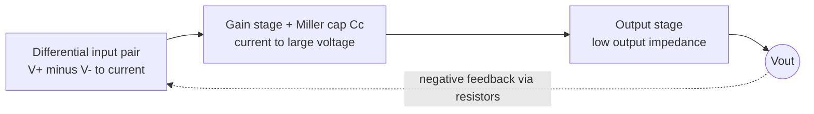

::: testing
Whether you understand an op-amp as a **building block with a specific job**, not as a magic triangle. The interviewer is listening for four things:

1. The definition: a high-gain **differential** voltage amplifier with high input impedance and low output impedance, $V_{out} = A\,(V_+ - V_-)$.
2. The key insight that with an enormous $A$ the op-amp is useless on its own (it just rails) and becomes useful only with **negative feedback**, which sets the gain with passive parts.
3. A rough picture of what is inside (input pair, gain stage, output stage, compensation).
4. That you know real op-amps have limits: finite gain, finite bandwidth, supply rails.
:::

::: why
The op-amp is the most reused analog part there is. Sensor front ends, ADC drivers, active filters, reference buffers, current-sense amplifiers, regulator error amplifiers and compensation networks are all op-amp circuits, or are op-amps in disguise. If you can explain why feedback turns a wildly inaccurate high-gain device into a precise, resistor-defined amplifier, you understand the idea behind half of analog design, and the same idea (feedback trades gain for accuracy) returns in power-supply control loops and PLLs ([[q0135]]). It is also the starting point for every other op-amp question in this list.
:::

::: concepts
- **Differential amplifier**: it amplifies only the difference between its two inputs and (ideally) ignores what they share. See [[q0115]].
- **Open-loop gain $A$**: the gain with no feedback, typically $10^5$ to $10^6$ (100 to 120 dB) at DC for general-purpose parts. See [[q0126]].
- **Negative feedback**: a fraction $\beta$ of the output is subtracted from the input. The closed-loop gain becomes about $1/\beta$. See [[q0124]].
- **Saturation**: the output cannot exceed the supply rails, so open-loop the op-amp acts like a comparator. See [[q0127]].
- **Gain-bandwidth product**: gain falls as frequency rises, so you trade gain for bandwidth. See [[q0116]].
- **Input/output impedance**: the inputs draw almost no current and the output behaves like a stiff voltage source.
:::

::: answer
"An op-amp, short for operational amplifier, is a high-gain differential voltage amplifier. It has two inputs, inverting and non-inverting, and one output, and the output is the difference between the inputs times a huge number, $V_{out} = A(V_+ - V_-)$, where $A$ is something like a hundred thousand or a million at DC.

Inside, there's a differential input pair that takes the difference, a high-gain stage, and an output stage that can drive a load, plus a small compensation capacitor that rolls the gain off so it stays stable.

On its own that gain is too big to be useful. A millivolt of input difference would try to put hundreds of volts on the output, so it just slams into a supply rail. The trick is negative feedback: I feed part of the output back to the inverting input. Now the op-amp adjusts its output until the two inputs are almost equal, and the gain of the whole circuit is set by the feedback resistors, not by the op-amp's own sloppy gain. That's how you get a precise gain of 10 out of a part whose raw gain might be anywhere from 100 thousand to a million."
:::

::: technical
**Definition.** An ideal op-amp is a voltage-controlled voltage source with infinite differential gain, infinite input resistance, zero output resistance, infinite bandwidth and zero offset. A real one is a differential-input, single-ended-output amplifier:

$$V_{out} = A(f)\,(V_+ - V_-),\qquad A(f)\approx\frac{A_0}{1 + jf/f_p}$$

with $A_0 \approx 10^5$ to $10^6$ and a dominant pole $f_p$ often only 5 to 100 Hz in a general-purpose part. The product $A_0 f_p$ is the gain-bandwidth product (GBW).

**Output limits.** $V_{out}$ is clipped between the rails (or a bit inside them). The linear region is only $|V_+ - V_-| < V_{sat}/A_0$, which is on the order of 100 µV for a 12 V swing.

**Negative feedback.** If a fraction $\beta$ of the output returns to the inverting input, $V_- = \beta V_{out}$ and $V_{out} = A(V_{in} - \beta V_{out})$, so

$$\frac{V_{out}}{V_{in}} = \frac{A}{1 + A\beta}\;\xrightarrow{A\beta\gg 1}\;\frac{1}{\beta}$$

The closed-loop gain depends on resistor ratios. The error is about $1/(A\beta)$.

**Internal structure (typical two-stage op-amp).** (1) A differential pair with an active (current-mirror) load converts $V_+-V_-$ to a current. (2) A second gain stage converts that to a large voltage swing, with a Miller compensation capacitor $C_c$ around it that creates the dominant pole. (3) A class-AB output stage gives low output impedance. Overall DC gain is the product of the stage gains, and GBW is roughly $g_{m1}/(2\pi C_c)$.

**Real-world limits.** Finite gain and GBW, input offset voltage (µV to mV), input bias current (fA to µA depending on input type), slew rate, output swing, common-mode input range, supply current, noise.
:::

::: short
"An op-amp is a high-gain differential amplifier: the output is a huge gain, around $10^5$ or more, times the difference between its two inputs. Open-loop it just saturates, so you wrap negative feedback around it. Then it forces the two inputs to nearly the same voltage, and the closed-loop gain is set by external resistors, roughly $1/\beta$, instead of by the op-amp's own loose gain. Inside it's an input differential pair, a gain stage with a compensation capacitor, and an output stage."
:::

::: long
"An operational amplifier is a differential voltage amplifier with very high gain, very high input impedance, and low output impedance. It has an inverting input, a non-inverting input, and an output, and the output is the gain times the difference between the two inputs, $V_{out} = A(V_+ - V_-)$. For a typical general-purpose part $A$ is around a hundred thousand to a million at DC.

Inside, there's a differential input pair that senses the difference and turns it into a current, a second gain stage that turns that into a large voltage, and an output stage that can drive a load. There's usually a small compensation capacitor in the second stage that creates a dominant pole, so the gain rolls off at 20 dB per decade and the amplifier stays stable when you close the loop.

The important thing is what you do with all that gain. Open-loop, a tiny difference of a hundred microvolts is enough to saturate the output, so the op-amp acts as a comparator. To make a linear amplifier, I use negative feedback: I feed a fraction $\beta$ of the output back to the inverting input. The op-amp then adjusts its output until the two inputs are nearly equal. Working through the algebra, the closed-loop gain is $A/(1+A\beta)$, which is just $1/\beta$ when $A\beta$ is large. So the gain is set by a resistor ratio, which is cheap and accurate, instead of by the transistors, which are neither.

The price is bandwidth. The open-loop gain falls with frequency, so the gain-bandwidth product is roughly constant. A gain of 10 on a 1 MHz GBW part gives about 100 kHz of bandwidth. Real parts also have offset, bias current, slew-rate and output-swing limits, which I'd check against the application."
:::

::: terms
- **Op-amp (operational amplifier)**: a DC-coupled, high-gain differential voltage amplifier meant to be used with external feedback.
- **Inverting / non-inverting input**: the $-$ input has an output of opposite polarity; the $+$ input has the same polarity.
- **Open-loop gain ($A_0$)**: gain with no feedback, often quoted in V/mV or dB.
- **Closed-loop gain**: gain with feedback applied, $A/(1+A\beta)\approx 1/\beta$.
- **Loop gain ($A\beta$)**: the gain once around the feedback loop. Large loop gain means accurate, resistor-defined behavior.
- **Virtual short**: with negative feedback the inputs sit at nearly the same voltage even though no wire connects them. See [[q0124]].
- **Dominant pole / compensation**: the deliberate low-frequency pole that keeps the loop stable.
- **GBW (gain-bandwidth product)**: the frequency where open-loop gain falls to 1.
- **Rail / saturation**: the output limit set by the supply voltages.
:::

::: exceptional
**An average answer** says "it amplifies the difference between two inputs, with very high gain" and lists the ideal properties.

**An exceptional answer**:
- Says right away that the raw gain is *useless on its own* and that **negative feedback** is what makes it an amplifier, and derives $A/(1+A\beta)\to 1/\beta$ in one line.
- Explains the virtual short as a *consequence* of high gain plus feedback, not as an axiom.
- Describes the inside in three blocks (input pair, gain stage with compensation, output stage) and knows why the compensation capacitor exists.
- Volunteers the trade-off: gain traded for bandwidth through GBW, with a number (GBW 1 MHz, gain 10, about 100 kHz).
- Mentions what breaks in practice: rails, offset, bias current, slew rate.
:::

::: mistakes
- **Calling the op-amp's gain "infinite" and stopping.** Real $A_0$ is finite and varies a lot part to part and with temperature. Feedback makes the *circuit* insensitive to it. Say that.
- **Thinking the output tracks the inputs.** The op-amp amplifies only the *difference*. With no feedback, tiny offsets drive it to a rail.
- **Forgetting negative vs positive feedback.** Feedback to the $+$ input makes the circuit a regenerative latch or Schmitt trigger, not a linear amplifier. See [[q0127]].
- **Believing the output can drive anything.** It is limited by the rails, by short-circuit current (typically 10s of mA for general-purpose parts) and by slew rate.
- **Treating the virtual short as a real short.** Current does not flow between the inputs. The inputs are essentially open circuits that happen to sit at the same voltage.
- **Ignoring supplies.** An op-amp has power pins ([[q0123]]) and its output cannot exceed them.
:::

::: deep
## What problem is an op-amp solving?

A transistor makes a decent amplifier, but its gain depends on temperature, bias point and process. Resistors, on the other hand, are cheap, linear and can be matched to 0.1% or better. An op-amp is the bridge: a block with so much gain that, once you close a feedback loop around it, the only thing left that determines the circuit's behavior is the passive network. You get precision from resistors and brute-force gain from silicon.

```circuit
{"caption":"Op-amp symbol with power pins","elements":[
 {"t":"opamp","at":[4,6],"supply":true,"label":"A"},
 {"t":"wire","pts":[[0,5],[4,5]]},{"t":"term","at":[0,5],"label":"V_-","side":"left"},
 {"t":"wire","pts":[[0,7],[4,7]]},{"t":"term","at":[0,7],"label":"V_+","side":"left"},
 {"t":"wire","pts":[[8,6],[11,6]]},{"t":"term","at":[11,6],"label":"V_{out}","side":"right"},
 {"t":"text","at":[10,9.4],"text":"V_{out} = A (V_+ - V_-)","anchor":"middle","color":"accent"}
]}
```
Figure: Two inputs, one output, and two supply pins. The output is the gain times the voltage difference between the inputs, limited by the supplies.

## How it works: one stage at a time

A common two-stage architecture has three pieces.


Figure: Input pair, gain stage with a compensation capacitor that sets the dominant pole, and a buffer-like output stage. The dashed arrow is the external feedback that you add.

1. **Input pair.** Two matched transistors share a tail current. If $V_+ > V_-$, more tail current steers through one side. A current mirror load turns that imbalance into a single-ended signal current, $i = g_{m1}(V_+ - V_-)$.
2. **Gain stage.** That current charges a high-impedance node. A second transistor adds more gain, so overall $A_0 \approx g_{m1}R_1\cdot g_{m2}R_2$, easily $10^5$ and up.
3. **Output stage.** A class-AB follower gives a low output impedance so the output can supply or sink load current. Without it, the high-impedance gain node could not drive anything.

A small capacitor $C_c$ across the gain stage forms the **dominant pole**, forcing the gain to cross 0 dB while the phase is still well above $-180^\circ$. For $g_{m1} = 0.5$ mS and $C_c = 5$ pF, the GBW is $g_{m1}/(2\pi C_c)\approx 15.9$ MHz.

## Why open-loop it just slams to a rail

With $A_0 = 10^5$ and a 12 V supply, the linear region is only $12/10^5 = 120$ µV wide.

```plot
{"title":"Open-loop transfer: A = 1e5, rails ±12 V","x":{"label":"V+ − V−","unit":"V","min":-0.0004,"max":0.0004},"y":{"label":"V_out","unit":"V","min":-14,"max":14},
 "vars":{"a":100000,"vs":12},
 "series":[{"label":"V_out = clamp(A·Vd)","fn":"clamp(a*x,-vs,vs)"}],
 "points":[{"x":0.00012,"y":12,"label":"+120 µV already hits +12 V"}]}
```
Figure: The only linear part of the curve is a sliver about 240 µV wide. A typical input offset is already comparable to that, so without feedback the output sits at a rail.

## Negative feedback turns it into an amplifier

Sample a fraction $\beta$ of $V_{out}$ and subtract it from the input. Let $V_d = V_+ - V_-$.

$$V_{out} = A V_d,\quad V_d = V_{in} - \beta V_{out}\;\Rightarrow\; V_{out} = \frac{A}{1 + A\beta}V_{in}$$

The physical story is a self-correcting loop. Say $V_{out}$ is too high. Then $\beta V_{out}$ is too high, so $V_d$ falls, so $V_{out}$ falls. The loop settles where $V_d = V_{out}/A$, a few µV. That is why the inputs are "virtually shorted". Let me see how accurate it is for a non-inverting gain of 10 ($\beta = 0.1$):

| Open-loop $A$ | Closed-loop gain | Gain error |
|---|---|---|
| 1,000 | 9.901 | 0.99% |
| 100,000 | 9.9990 | 0.010% |
| 1,000,000 | 9.99990 | 0.0010% |

A tenfold change in $A$ moves the closed-loop gain by only about 0.01%. That insensitivity is the whole point.

## Bandwidth: the price of gain

The open-loop gain is flat only up to a very low frequency, then falls 20 dB/decade.

```bode
{"systems":[{"label":"Open-loop A(s), A0 = 1e5, GBW = 1 MHz","num":["1e5"],"den":["1/(2*pi*10)",1]}],"vars":{},"f":{"min":0.1,"max":1e7},"marks":[{"f":10,"label":"f_p = 10 Hz"},{"f":1e6,"label":"GBW = 1 MHz"}],"show":"both","magRange":[-20,110]}
```
Figure: DC gain is 100 dB (1e5), the pole is at 10 Hz, and the curve crosses 0 dB at 1 MHz. Closing the loop at gain 10 moves you up to the point on this line where open-loop gain is 10, near 100 kHz, which is your closed-loop bandwidth.

## Try it

```sim
{"id":"opamp-lab","config":"noninverting","r1":1000,"r2":9000,"vin":0.5,"wave":"sine","f":1000,"real":false}
```
Figure: Gain should read 10. Switch on `real` and raise the input frequency to see GBW and rail limits eat the gain. Then change the config to `comparator` to see what the same part does with no feedback.

## Real hardware

- **Offset voltage** (typically 10 µV for precision parts up to a few mV for cheap ones) is amplified by the noise gain.
- **Input bias current** flows through the source resistance and makes an error.
- **Slew rate** limits large fast signals ([[q0117]]).
- **Output swing** may stop 1 to 2 V short of the rails unless it is "rail-to-rail".
- **Stability** with capacitive loads can require an isolating resistor.
:::

::: applications
- **Sensor and thermocouple amplifiers**: a non-inverting stage with a gain of 100 to 1000 to bring microvolts up to ADC range.
- **ADC driver / buffer**: unity-gain buffer so a high-impedance node can charge a SAR ADC's sampling capacitor.
- **Active filters**: Sallen-Key and multiple-feedback filters use an op-amp plus RC networks.
- **Regulator error amplifier**: inside every LDO and many buck controllers an amplifier compares the feedback divider to the reference.
- **Transimpedance amplifier**: converts photodiode current to voltage with a feedback resistor.
- **Precision comparator thresholds / Schmitt triggers**: using the op-amp with positive feedback or open-loop.
:::

::: assumptions
The "$A\beta \gg 1$" shortcut assumes **negative** feedback and a loop gain much larger than 1 at the frequency of interest. At high frequency the loop gain drops to 1 at the GBW crossover, and the clean $1/\beta$ answer degrades. I treated the input as a differential pair with no offsets. Real offsets add a DC error. I assumed a **voltage-feedback** op-amp. Current-feedback amplifiers have different input impedances (low at the inverting input) and bandwidth that depends mostly on the feedback resistor, not on gain. I also assumed linear operation inside the rails. If the interviewer's "op-amp" means the ideal model, the answer is that of $V_{out}=A(V_+-V_-)$ with $A\to\infty$, which gives the virtual short.
:::

::: followups
### Why can't you just use the op-amp's gain directly without feedback?
Because $A$ is huge, imprecise and temperature dependent. With $A = 10^5$ and 12 V rails, a difference of just 120 µV drives it to the rail, and typical input offset voltages are already as big or bigger. Even if you could bias it into the linear region, the gain could vary by a factor of 2 or more between parts. Feedback replaces it with a resistor ratio accurate to 0.1% or better.

### Derive the closed-loop gain of a non-inverting amplifier using $A/(1+A\beta)$.
The feedback network is a divider from the output to the inverting input: $\beta = R_g/(R_g + R_f)$. Closed-loop gain is $A/(1 + A\beta)\to 1/\beta = 1 + R_f/R_g$. For $R_f = 90$ kΩ and $R_g = 10$ kΩ that is 10, and with $A = 10^5$ the exact value is $9.9990$.

### What is the gain-bandwidth product and how do you use it?
For a voltage-feedback op-amp with a single dominant pole, gain times bandwidth is constant and equals the unity-gain frequency. A 1 MHz GBW part at gain 10 gives about 100 kHz bandwidth; at gain 100, about 10 kHz. It is the first filter I use when picking an op-amp. See [[q0116]].

### What happens if you accidentally connect the feedback to the non-inverting input?
That is positive feedback. A small disturbance gets amplified and pushed in the same direction, so the output is driven to a rail and stays there, which makes a latch. With deliberate resistor-set thresholds it is a Schmitt trigger with hysteresis. It is not a linear amplifier.

### An op-amp circuit works at DC but oscillates when you add a long cable to the output. Why?
The cable capacitance and the op-amp's output resistance form an extra pole inside the loop. It adds phase lag near the crossover frequency and erodes phase margin, so the loop peaks or oscillates. The fix is a small series isolation resistor (10 to 50 Ω is a typical starting point) with feedback taken before it or through a small capacitor, or a different op-amp that is rated for capacitive loads.
:::

::: references
- Sedra & Smith, *Microelectronic Circuits*: the chapter on operational amplifiers (ideal op-amp, inverting and non-inverting configurations) and the chapter on feedback.
- Horowitz & Hill, *The Art of Electronics*, 3rd ed.: the op-amp chapter, "the golden rules" and negative feedback.
- Razavi, *Design of Analog CMOS Integrated Circuits*: the chapters on operational amplifiers and frequency compensation.
- Texas Instruments, "Op Amps for Everyone" (design reference, Ron Mancini, ed.).
:::

::: rubric
- Defines an op-amp as a high-gain differential voltage amplifier, $V_{out} = A(V_+ - V_-)$ :: This is the core definition; everything else builds on it.
- Says that gain is far too large to use open-loop (it saturates) :: Shows you know why an op-amp circuit without feedback is a comparator, not an amplifier.
- Explains negative feedback and that the gain is then $\approx 1/\beta$, set by passives :: This is the actual "how does it work" insight interviewers want.
- Mentions the virtual short as a consequence of high gain plus negative feedback :: Connects the model to the circuit-analysis tool used for every other op-amp question.
- Sketches the internal blocks: differential pair, gain stage with compensation, output stage :: Shows you have looked beyond the black box.
- Mentions finite GBW, rails or other real limits :: Demonstrates that you can use the part on a real board.
:::

::: quiz
```json
[
 {"type":"mcq","level":"fundamental","q":"What does an ideal op-amp output depend on?","options":["The average of its two inputs","The difference between its two inputs times the gain","Only the voltage at the non-inverting input","The supply voltage only"],"answer":1,"explain":"The op-amp amplifies the differential input, $V_{out} = A(V_+ - V_-)$. The common (average) part is ideally rejected."},
 {"type":"numeric","level":"fundamental","q":"An op-amp has $A_0 = 10^5$ and runs from ±12 V rails. How large a differential input, in µV, takes the output to the +12 V rail?","answer":120,"tolerance":0.02,"unit":"µV","explain":"$V_d = V_{sat}/A_0 = 12/10^5 = 120\\ \\mu$V. Open-loop, a signal this small already saturates the output."},
 {"type":"truefalse","level":"fundamental","q":"With negative feedback, the closed-loop gain is set mostly by the op-amp's open-loop gain, so a high-quality op-amp is needed for an accurate gain.","answer":false,"explain":"With large loop gain the closed-loop gain is about $1/\\beta$, set by the resistor ratio. Open-loop gain only needs to be large, not precise."},
 {"type":"numeric","level":"intermediate","q":"A non-inverting amplifier has $\\beta = 0.1$ and the op-amp has $A = 10^4$. What is the exact closed-loop gain $A/(1+A\\beta)$?","answer":9.99,"tolerance":0.005,"unit":"V/V","explain":"$A/(1+A\\beta) = 10^4/(1+1000) = 9.990$. The ideal value is 10, so the error is about 0.1%, which is $1/(1+A\\beta)$ relative."},
 {"type":"mcq","level":"intermediate","q":"A 1 MHz GBW op-amp is used at a closed-loop gain of 50. What is the approximate small-signal bandwidth?","options":["1 MHz","50 MHz","20 kHz","500 kHz"],"answer":2,"explain":"Bandwidth is about GBW/gain = 1 MHz/50 = 20 kHz. Gain and bandwidth trade off along a −20 dB/decade line."},
 {"type":"multi","level":"advanced","q":"Select all effects that make a real op-amp circuit deviate from the ideal $1/\\beta$ gain.","options":["Finite open-loop gain at the operating frequency","Input offset voltage","Resistor values being exactly equal to the nominal","Output saturation near the supply rails"],"answer":[0,1,3],"explain":"Finite loop gain, offset (a DC error added to the output) and rail limits all cause deviations. Exact resistor values give the nominal ratio, so they are not an error source."}
]
```
:::
