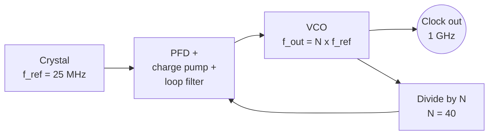

::: testing
This question looks like a one-word trivia ("a PLL"), but it is really testing whether you know **why** you'd multiply a clock and what the alternatives and costs are:

1. The headline answer: a **phase-locked loop (PLL)** used as a **frequency multiplier** or synthesizer, $f_{out} = N f_{ref}$.
2. Why not simply use a faster crystal or oscillator, and what other techniques exist (harmonic multipliers, delay-locked loops, ring oscillators).
3. The trade-offs of a higher clock: power ($\propto f$), timing margin, EMI, jitter.
4. Basic numbers: reference frequency, multiplication factor, resulting output.
:::

::: why
Almost every chip clocks its core much faster than the crystal feeding it: a 25 MHz crystal becomes a 1 GHz CPU clock, a 2.4 GHz radio local oscillator, or a 10 Gb/s SerDes clock. Crystals give excellent stability and low cost at low frequency, and PLLs give you a flexible, programmable multiple of that reference. Knowing the options also lets you choose sensibly when a design needs a clean, fixed, fast clock (use an oscillator), a flexible one (use a PLL or clock synthesizer), or a simple 2× (use a doubler). The follow-up questions in this section ([[q0135]] to [[q0139]]) all build on the PLL answer.
:::

::: concepts
- **Phase-locked loop (PLL)**: a feedback system that locks an output clock's phase/frequency to a multiple of a reference. See [[q0135]].
- **Feedback divider ($N$)**: dividing the output by $N$ and locking it to the reference gives $f_{out}=Nf_{ref}$.
- **Crystal oscillator**: a stable, low-jitter reference, typically in the kHz to tens-of-MHz range.
- **Frequency multiplier/doubler**: a non-linear circuit that generates harmonics, followed by a filter.
- **DLL (delay-locked loop)**: aligns clock edges using delay lines; can generate multi-phase or multiplied clocks.
- **Dynamic power**: $P\approx\alpha CV^2f$ rises linearly with clock frequency. See [[q0105]].
:::

::: answer
"The standard tool is a PLL, a phase-locked loop, used as a frequency multiplier. You start with a stable, low-frequency reference like a crystal, say 25 megahertz, and the PLL has an oscillator, a VCO, running at the high frequency, with a divide-by-N in the feedback path. The loop forces the divided-down VCO to line up with the reference, so the VCO runs at N times the reference. With N equal to 40, that 25 megahertz crystal becomes a 1 gigahertz clock.

Why not just buy a gigahertz crystal? Crystals don't make fundamental frequencies that high with good stability and low cost, and you want one cheap, quiet reference that a programmable PLL can scale to whatever the chip needs. A PLL also lets software change the clock on the fly.

There are other options. A simple frequency doubler can use an XOR of the clock with a delayed copy of itself. You can use a higher-frequency oscillator, like a MEMS or SAW oscillator, or an overtone crystal. A DLL can create multiplied or multi-phase clocks too. But for general-purpose multiplication, the PLL is the answer.

And I'd add that a faster clock isn't free: dynamic power goes up linearly with frequency, timing margins shrink, and the PLL adds jitter, so you only go as fast as the logic and the power budget allow."
:::

::: technical
**PLL multiplier.** A charge-pump PLL has a phase-frequency detector (PFD), charge pump, loop filter, VCO and feedback divider ($\div N$). In lock, $f_{ref} = f_{vco}/N$, so
$$f_{out}=N\,f_{ref}.$$
With a reference divider $R$ and an output divider $M$: $f_{out}=\frac{N}{R\,M}f_{in}$. A **fractional-N** PLL uses a sigma-delta modulator to dither $N$ between integers so that $N_{eff}=N+K/F$, giving fine frequency steps.

Example: $f_{ref}=25$ MHz, $N=96$ gives $f_{vco}=2.4$ GHz. $f_{ref}=25$ MHz, $N=40$ gives 1 GHz.

**Alternatives.**

| Method | How it works | Pros | Cons |
|---|---|---|---|
| PLL (integer/fractional-N) | Feedback loop locks VCO to $N f_{ref}$ | Arbitrary ratio, programmable, any output frequency, clean reference | Jitter from VCO, loop; lock time; area/power |
| Higher-frequency oscillator (overtone crystal, SAW, BAW, MEMS) | Oscillates directly at high frequency | Simple, no PLL jitter from loop | Fixed frequency, cost, stability trade-offs |
| Frequency doubler (XOR with delayed copy) | Edge detection doubles transitions | Tiny, instant | Depends on duty cycle and delay accuracy; spurs; fixed ×2 |
| Harmonic multiplier (non-linear device + band-pass filter) | Generate harmonics, filter the one you want | RF use, fixed multiples | Filtering needed; low efficiency |
| DLL-based multiplier | Delay line edges combined | No VCO phase accumulation, fast lock | Limited multiplication, delay-line mismatch |

**Cost of a higher clock.** Dynamic power $P=\alpha CV^2f$ scales linearly with $f$ (and quadratically with $V$); setup/hold margin per cycle shrinks as $T=1/f$; EMI and signal-integrity demands rise; PLL jitter becomes a larger fraction of the period.

> [!UNCERTAIN]
> Practical upper limits for fundamental-mode crystals depend on cut and process (typically tens of MHz, with overtone parts and other resonator technologies going higher); I give no single number. Check the manufacturer's range for the specific resonator technology.
:::

::: short
"A PLL, used as a frequency multiplier. A stable low-frequency reference like a crystal feeds a loop containing a VCO and a divide-by-N in the feedback path. The loop locks the divided VCO to the reference, so the output is N times the reference: 25 MHz times 40 gives 1 GHz. It's preferred over a very high-frequency crystal because it's flexible and the reference is clean and cheap. Simpler options exist, like an XOR-based doubler or a higher-frequency oscillator, but a faster clock costs power, timing margin and jitter."
:::

::: long
"The standard answer is a phase-locked loop used as a clock multiplier. You take a low-frequency reference, for instance a 25 MHz crystal. Crystals are great references: accurate, stable, low phase noise, and cheap. Inside the PLL there's a voltage-controlled oscillator that can run at hundreds of MHz or GHz, and its output is divided by N and compared with the reference by a phase detector. The error, through a charge pump and loop filter, steers the VCO until the divided clock lines up with the reference in phase and frequency. At that point the VCO is running at exactly N times the reference. With N equal to 40 that's 1 GHz from 25 MHz. A fractional-N PLL does the same with non-integer ratios so you can synthesize any frequency in small steps.

You might ask why not just use a GHz crystal. You can't get fundamental crystals that fast with good stability and cost, and a PLL gives you flexibility: one reference, many output frequencies, and software control, for example for dynamic frequency scaling. You also get a clock that inherits the reference's accuracy.

There are alternatives. If I just need twice the frequency, I can XOR the clock with a delayed copy, an edge-doubling trick, though it depends on duty cycle and delay accuracy. Overtone crystals, SAW or MEMS oscillators give higher fixed frequencies directly. A delay-locked loop can produce multiple phases and be combined to make a multiplied clock, and in RF you can use non-linear harmonic multipliers with filters.

Finally, a good engineer remembers what a faster clock costs. Dynamic power scales linearly with frequency, so doubling the clock roughly doubles the switching power at the same voltage. The cycle gets shorter, so setup and hold margins shrink, and jitter from the PLL becomes a bigger fraction of the cycle. And there's more EMI. So you pick the clock the logic needs, not the fastest one."
:::

::: terms
- **PLL (phase-locked loop)**: a feedback loop that locks the phase and frequency of an oscillator to a reference.
- **VCO (voltage-controlled oscillator)**: an oscillator whose frequency is set by a control voltage.
- **Divider ratio ($N$)**: the factor by which the feedback clock is divided, so $f_{out}=Nf_{ref}$.
- **Reference clock**: the stable low-frequency clock (often a crystal) the PLL locks to.
- **Fractional-N**: PLL architecture permitting non-integer $N$ using a sigma-delta modulator.
- **Frequency multiplier**: a circuit whose output is an integer multiple of its input frequency.
- **DLL (delay-locked loop)**: loop aligning edges with a delay line instead of an oscillator.
- **Clock synthesizer**: an IC that makes several output frequencies from one reference, usually PLL-based.
- **Jitter**: short-term timing variation of clock edges.
:::

::: exceptional
**An average answer** says "a PLL" and perhaps "it multiplies the frequency".

**An exceptional answer**:
- Names the PLL and states $f_{out}=N f_{ref}$ with a **numeric example** (25 MHz × 40 = 1 GHz).
- Explains **why a PLL instead of a fast crystal**: stability, cost, flexibility and programmability.
- Lists **alternatives with their trade-offs** (higher-frequency oscillator, XOR doubler, DLL, harmonic multiplier).
- Mentions **fractional-N** and the reference/output dividers.
- Raises the **costs of going faster**: $P\propto f$, setup/hold margins, jitter, EMI, and lock time or startup.
- Points to the next questions: how a PLL works, blocks, lock dynamics ([[q0135]], [[q0136]], [[q0138]]).
:::

::: mistakes
- **Saying "a faster crystal" or "an amplifier".** Amplifiers don't multiply frequency; a crystal fundamental is limited, and the clock still needs to be flexible.
- **Believing the PLL output is as clean as the reference.** It adds VCO and loop noise, and in-band reference noise is multiplied by $N^2$ in power ($20\log N$ dB).
- **Forgetting the lock time and the need to wait for lock** before using the output as a system clock.
- **Ignoring the power cost**: dynamic power scales with $f$, and often voltage must also rise at higher frequency (superlinear cost).
- **Confusing a PLL with a DLL.** A DLL has no oscillator and doesn't generate arbitrary frequency; it aligns/delays edges.
- **Assuming any multiplication ratio is possible**: the VCO range, PFD frequency and divider limits constrain $N$, as does spur performance in fractional-N designs.
:::

::: deep
## The basic idea: a clock multiplier from feedback

You want $f_{out}$ high, but the only quiet, accurate source you have is a low-frequency crystal. The trick is to build a *high-frequency oscillator* whose frequency isn't accurate by itself (the VCO), and then *continually correct* it against the crystal. To compare them, you divide the VCO down to the reference's frequency and compare edges. If the divided VCO runs late, speed it up; if early, slow it down. In lock, the divided VCO matches the reference in both phase and frequency.


Figure: The VCO output is divided by N and compared with the reference. When they match, $f_{out}/N=f_{ref}$, so the output is exactly N times the crystal frequency, with the crystal's long-term accuracy.

A feature of this arrangement: the output frequency accuracy equals the reference accuracy (±20 ppm of a typical crystal gives ±20 kHz at 1 GHz), regardless of the VCO's uncontrolled drift.

```timing
{"signals":[{"name":"REF (f)","wave":"1.......0.......","color":"muted"},{"name":"OUT (4f)","wave":"1.0.1.0.1.0.1.0.","color":"accent"}],"hscale":1.2}
```
Figure: One period of the reference contains four periods of the output: a ×4 multiplier. Every 4th output edge lines up with a reference edge, which is what the PFD checks.

## Choosing N and the reference

Output frequency steps are set by the PFD frequency: with an integer-N PLL, the output can only change in steps of $f_{ref}$ (after any reference divider). If you need 1 MHz channel spacing, the PFD runs at 1 MHz or lower. A lower PFD frequency means a narrower loop bandwidth is needed (typically at most $f_{PFD}/10$) and the in-band noise is multiplied by a larger $N$: $20\log_{10}N$ dB.

| $f_{ref}$ | $N$ | $f_{out}$ | In-band noise multiplication ($20\log N$) |
|---|---|---|---|
| 25 MHz | 40 | 1 GHz | 32 dB |
| 25 MHz | 96 | 2.4 GHz | 39.6 dB |
| 100 MHz | 10 | 1 GHz | 20 dB |

For the same output, a higher reference frequency means a smaller $N$ and less in-band noise, one reason high-end synthesizers use high-frequency references. Fractional-N lets you use a high $f_{PFD}$ and still get fine steps, at the cost of sigma-delta quantization noise and fractional spurs.

## What increasing the clock costs

```sim
{"id":"cmos-inverter","view":"power","vdd":1.8,"cl":1e-12,"f":1000000000}
```
Figure: Dynamic power $P=\alpha CV^2f$ for a 1 pF load at 1.8 V and 1 GHz is about 3.2 mW per switching node at activity $\alpha=1$. Slide the frequency up and down: power scales linearly with $f$ and quadratically with $V_{DD}$. Short-circuit and leakage terms are shown too.

- **Power**: $P\propto f$ at fixed $V$. Reaching a higher $f$ often needs a higher $V$ as well, so the cost is roughly $f^2$ to $f^3$ in practice.
- **Timing margin**: the period $T=1/f$ shrinks. At 1 GHz you have 1 ns for clock-to-Q, logic, setup, skew and jitter combined.
- **Jitter**: a PLL with 2 ps rms jitter is 0.2% of a 1 GHz period, but 2% of a 10 GHz period.
- **EMI and SI**: faster edges and higher harmonics need better termination, decoupling and layout.
- **Startup and lock time**: you wait for lock before releasing the clock to the system.

## Alternatives in more detail

**Edge-combining doubler.** XOR a clock with a delayed copy of itself, with delay of a quarter period. The XOR output toggles on every edge of the input, giving double the frequency. It's tiny and instant, but works only if the delay is correct (so the duty cycle is 50%), so it is calibrated with a DLL in practice.

**Higher-frequency oscillators.** Overtone crystals, SAW and BAW resonators and MEMS oscillators can give 100s of MHz directly, with various jitter/stability trade-offs. They give a fixed frequency and cost more than a standard crystal. LC oscillators at GHz are the on-chip VCO itself.

**Harmonic generation.** In RF, a non-linear stage creates harmonics of a lower frequency, and a filter selects the desired one. It is common for microwave local oscillators, where the filter is the main design effort.

**DLL.** A delay-locked loop locks the delay of a line to one clock period and taps it to make multiple clock phases, from which a multiplied clock can be constructed. Because there's no oscillator accumulating phase error, it doesn't suffer from jitter accumulation and locks quickly. It can't generate arbitrary frequencies.

## When the PLL is on-chip

Most processors, FPGAs and SoCs contain PLLs for the core clock, memory interface clocks and peripheral clocks, each with a dedicated analog supply. A PLL on an FPGA, for instance, takes a board-level 50 MHz clock and produces several outputs at different multiples with programmable phase. The PLL's analog supply needs quiet filtering, because supply noise on the VCO becomes jitter.

## Worked example: one crystal, two related clocks

Suppose an 8 MHz crystal must produce a 120 MHz CPU clock and a 48 MHz peripheral clock, and the PLL's VCO is specified for 240 to 480 MHz with a PFD input range of 1 to 8 MHz (assumed limits for illustration; real parts publish their own). The procedure is the one you would follow with a vendor's clock-tree tool:

1. Find a VCO frequency that is an integer multiple of both outputs. The least common multiple of 120 and 48 is 240 MHz, and 480 MHz is the next multiple, both inside the VCO range.
2. Choose the highest allowed PFD frequency, 8 MHz, so the reference divider is $R=1$ and the feedback divider is $N=480/8=60$.
3. Divide the VCO down with separate output dividers: $480/4=120$ MHz for the CPU and $480/10=48$ MHz for the peripheral.

Both outputs share one VCO, so they are phase-related and inherit the crystal's accuracy: a ±20 ppm crystal gives ±2.4 kHz at 120 MHz and ±0.96 kHz at 48 MHz. Why take $R=1$ and not run the PFD at 1 MHz with $R=8$, $N=480$? Because in-band noise from the reference and PFD is multiplied by $20\log_{10}N$ at the VCO: 35.6 dB at $N=60$ versus 53.6 dB at $N=480$. The output dividers take the same amount off either way, so what reaches each output is set by $f_{out}/f_{PFD}$: at 120 MHz that is $20\log_{10}15=23.5$ dB with an 8 MHz PFD versus $20\log_{10}120=41.6$ dB with 1 MHz. Running the PFD as fast as allowed saves 18 dB of in-band phase noise. (Picking 240 MHz rather than 480 MHz for the VCO halves $N$, but the in-band noise at each output is unchanged because the output dividers halve too.) A higher PFD rate also allows a wider loop bandwidth, which helps lock time, and pushes reference spurs further out where the loop filter attenuates them more.

## What the faster clock really costs: a numeric comparison

Take a block that burns 150 mW at 100 MHz and 1.0 V. Raising the clock to 200 MHz at the same voltage doubles the power to 300 mW. But 200 MHz often will not close timing at 1.0 V, and if the supply must rise to 1.1 V the power is $150\times2\times1.1^2=363$ mW, a factor of 2.42 for a factor of 2 in speed. Timing also gets harder in a way the power number hides: if clock skew and jitter together take 0.3 ns of the period, a 10 ns cycle keeps 97% usable but a 5 ns cycle keeps only 94%, and the logic itself needs to be faster. So the cost per hertz rises as you push. In a real project the question to ask is not "how fast can the PLL run?" but "what is the lowest clock that meets the throughput requirement?", because power, heat and EMI all scale with it.

## Limiting cases of the multiplier

- **$N=1$.** The loop locks the VCO to the reference at the same frequency, which is a use of the PLL as a jitter cleaner or phase aligner (zero-delay buffer), not a multiplier.
- **Very large $N$.** The loop gain falls as $1/N$, the VCO's phase noise outside the loop bandwidth dominates, and lock takes longer. Reference and charge-pump noise at the output grow as $N^2$ in power.
- **Reference spur.** The PFD updates once per reference cycle, so ripple on the control voltage appears as sidebands at $\pm f_{ref}$ around the output. A higher $f_{ref}$ pushes these sidebands further out where the loop filter can attenuate them.
- **Not locking.** If the requested $N f_{ref}$ lies outside the VCO's range the loop rails: the control voltage saturates and the output sits at the VCO's edge frequency, with the lock-detect flag low.

## Verifying a multiplied clock on the bench

First check frequency: a counter referenced to a good timebase should read $N\times f_{ref}$ to within the reference's ppm error; if it reads a different multiple, the dividers are programmed wrongly or the loop has locked to a harmonic. Second, check lock status through the part's lock-detect output and by triggering the scope on the reference while watching the output, which should be stable with no drifting phase. Third, measure jitter on the actual output with the scope's period or time-interval-error histogram, and compare it against the scope's own noise floor (a few picoseconds for many mid-range scopes, vendor-dependent), because a PLL with 1 ps rms jitter cannot be measured with an instrument that adds 5 ps. Finally, vary the supply voltage and temperature, watch the lock-detect and the jitter, and look at the analog supply pins of the PLL for noise in the loop-bandwidth range, since that noise goes straight onto the VCO.

:::

::: applications
- **Microcontrollers and SoCs**: a 8 to 25 MHz crystal multiplied up to tens or hundreds of MHz for the CPU core.
- **FPGAs**: on-chip PLLs/MMCMs create multiple clock domains with programmable multiplication and phase.
- **Radios and wireless chips**: PLL synthesizers make GHz local-oscillator signals from a TCXO reference.
- **High-speed serial links**: a PLL multiplies a reference clock up to the bit rate for SerDes transmitters.
- **Memory interfaces (DDR)**: the clock and strobes are generated by PLL/DLL circuitry.
- **Audio**: a PLL derives a master clock (256× or 512× the sample rate) from a system clock.
:::

::: assumptions
I treated the question as asking for a generic way to *increase* the clock frequency, and answered with the PLL as the primary tool. If the context were an FPGA or microcontroller, "PLL/clock multiplier" is the specific block. If the question means "what in a design *limits* how high you can push the clock", the answer would shift to critical path delay, setup/hold margins and power. I assumed an integer or fractional-N charge-pump PLL with a crystal reference. I did not discuss overclocking via supply voltage and thermal headroom, which is a system question. The numbers are illustrative.
:::

::: followups
### You have a 12 MHz crystal and need 96 MHz. What do you configure?
$N=96/12=8$ with the reference divider $R=1$. If the PLL's VCO needs to run higher (e.g., 400 to 800 MHz), run the VCO at a multiple of 96 MHz and divide at the output: for example $N=64$ gives 768 MHz, and an output divide-by-8 gives 96 MHz. Check the PFD frequency (12 MHz) is within the allowed range and that the VCO range is satisfied.

### Does a PLL make a clock more accurate than the crystal?
No. The long-term frequency accuracy equals the reference's (e.g. ±20 ppm), scaled to the output frequency. The PLL can *clean up* the short-term jitter of a noisy reference if its loop bandwidth is low and the VCO is clean, but it can't improve accuracy.

### What happens to the reference's phase noise at the output of a PLL multiplier?
Within the loop bandwidth, the reference noise (and the PFD/charge-pump noise) is multiplied by $N$ in amplitude, i.e. $20\log_{10}N$ dB in power: ×40 means +32 dB. Outside the loop bandwidth, the VCO's own noise dominates. That's why high-multiplication PLLs need excellent references.

### Why not make the VCO run at 1 GHz free-running without a reference?
A free-running VCO drifts with temperature, supply and process, by percent-level amounts, and has much more phase noise at low offsets than a crystal. The reference-locked loop gives crystal-level accuracy and low-frequency stability while the VCO provides the high-frequency edge. It also allows the frequency to be programmed.

### Harder: your system's clock is generated by a PLL and the product fails timing at high temperature only. Could the PLL be the issue?
Yes. At high temperature the VCO's gain and center frequency shift, the PLL's jitter can rise, and the loop might have less margin. Also check whether the clock frequency is the same (the PLL should lock to $N f_{ref}$ regardless) but the *logic* is slower at high temperature, so the same clock has less timing margin. Measure: output frequency (should be unchanged), jitter, and check logic timing at the corner condition.
:::

::: interpretations
"What can you use increase clock frequency?" has a missing word ("to increase"). The intended answer is a **PLL** (phase-locked loop) as a frequency multiplier. Given its place in the PLL section, ([[q0135]] onward), the interviewer is leading in to "how does it work". I also covered alternatives (doublers, higher-frequency oscillators, DLLs) because a wider view is stronger.
:::

::: references
- Razavi, *Design of Analog CMOS Integrated Circuits*: the chapter on phase-locked loops (basic PLL, charge-pump PLLs, frequency synthesis).
- Gardner, "Charge-Pump Phase-Lock Loops", IEEE Transactions on Communications, 1980.
- Gardner, *Phaselock Techniques*: PLL fundamentals and frequency synthesis.
- Egan, *Phase-Lock Basics*, and Banerjee, *PLL Performance, Simulation, and Design*: introductory treatments of PLLs and frequency synthesizers.
:::

::: rubric
- Names the PLL (phase-locked loop) as the answer :: This is the expected key word.
- States $f_{out}=Nf_{ref}$ and explains the feedback divider :: Shows you know the mechanism, not just the name.
- Gives a numeric example (reference × N) :: Makes the answer concrete.
- Explains why not just use a high-frequency crystal :: Demonstrates understanding of why PLLs exist.
- Mentions at least one alternative (doubler, higher-frequency oscillator, DLL) :: Breadth and engineering judgment.
- Mentions costs of a higher clock: power, timing, jitter :: Shows system-level thinking.
:::

::: quiz
```json
[
 {"type":"mcq","level":"fundamental","q":"Which circuit is most commonly used to generate a high-frequency clock from a low-frequency crystal reference?","options":["Amplifier","Phase-locked loop (PLL)","Voltage regulator","Low-pass filter"],"answer":1,"explain":"A PLL with a divider in the feedback path multiplies the reference frequency by N."},
 {"type":"numeric","level":"fundamental","q":"A PLL has a 25 MHz reference and a feedback divider $N=48$. What is the output frequency in MHz?","answer":1200,"tolerance":0.01,"unit":"MHz","explain":"$f_{out}=Nf_{ref}=48\\times25=1200$ MHz."},
 {"type":"numeric","level":"intermediate","q":"You need 2.4 GHz from a 25 MHz reference with an integer-N PLL (no extra dividers). What value of $N$ is required?","answer":96,"tolerance":0.01,"unit":"","explain":"$N=f_{out}/f_{ref}=2400\\text{ MHz}/25\\text{ MHz}=96$, so the VCO runs at 96 times the reference."},
 {"type":"numeric","level":"intermediate","q":"By how many dB is in-band reference/PFD phase noise raised at the output of a PLL with $N=40$?","answer":32,"tolerance":0.02,"unit":"dB","explain":"$20\\log_{10}40=32.0$ dB."},
 {"type":"mcq","level":"intermediate","q":"Doubling the clock frequency of a CMOS circuit at fixed supply voltage and activity changes its dynamic power by approximately:","options":["No change","×√2","×2","×4"],"answer":2,"explain":"$P=\\alpha CV^2f$, so power is proportional to frequency: ×2 at fixed $V$ (more if the voltage must also rise)."},
 {"type":"truefalse","level":"advanced","q":"A PLL multiplier improves the long-term frequency accuracy of the output compared with its reference crystal.","answer":false,"explain":"The output accuracy (in ppm) is inherited from the reference. A PLL can filter short-term jitter but cannot improve the accuracy of the reference."}
]
```
:::
