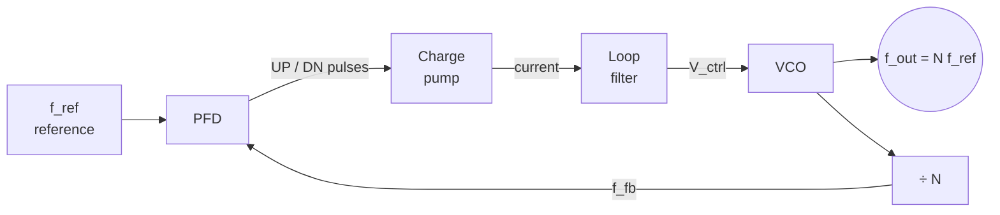

::: testing
Whether you can explain a **feedback loop on phase**, not just recite block names:

1. The loop in words: compare the phase of a reference with the phase of the divided VCO output, convert the error to a control voltage, steer the VCO until the error stops changing.
2. The key insight: the VCO converts voltage to **frequency**, but the loop compares **phase**, and phase is the *integral* of frequency; that integrator is why a PLL can lock with zero static phase error.
3. What "lock" means: equal frequency (so $f_{out}=Nf_{ref}$) and constant phase offset.
4. Basic loop dynamics: bandwidth, damping, lock time, and where noise comes from.
:::

::: why
PLLs are in nearly every digital system: CPU and memory clocks, SerDes, radios, clock-data recovery, audio clock generation, motor-speed control, even in power electronics (grid synchronization). When a clock is noisy, a link won't train, or a frequency change takes too long, the cause is usually a PLL parameter. An interviewer who asks "how does a PLL work?" wants to see you can reason about it as a control loop with a clear picture of each stage, a notion of what limits it, and no hand-waving about "it just locks".
:::

::: concepts
- **Phase vs. frequency**: $\phi(t)=\int 2\pi f\,dt$. Frequency is the derivative of phase, so a VCO is an integrator from control voltage to phase.
- **Phase-frequency detector (PFD)**: outputs pulses whose width is the phase error (and whose sign says which edge leads).
- **Charge pump + loop filter**: converts pulses to a smooth control voltage; the capacitor is an integrator. See [[q0136]].
- **VCO and gain $K_{VCO}$**: frequency per volt (Hz/V or rad/s/V).
- **Divider $N$**: makes the loop compare $f_{out}/N$ with $f_{ref}$.
- **Negative feedback and stability**: loop bandwidth, damping and phase margin set lock time and noise. See [[q0138]].
:::

::: answer
"A PLL is a feedback loop that forces the phase of an oscillator to track the phase of a reference. The pieces are a phase-frequency detector, a charge pump with a loop filter, a voltage-controlled oscillator, and a divider in the feedback path.

Here's the loop. The VCO produces the output clock. I divide it by N and send that to the phase detector, which compares it with the reference. If the divided clock is late, the detector outputs 'up' pulses whose width is proportional to the phase error, and the charge pump dumps charge into the loop filter capacitor. The control voltage rises, so the VCO speeds up, which pulls the phase back toward the reference. If it's early, it outputs 'down' pulses and the VCO slows. When the divided output has the same frequency as the reference and a fixed phase offset, the error pulses shrink to nearly nothing, the control voltage stops changing, and the loop is locked. At that point the output frequency is exactly N times the reference.

The neat trick is that the VCO integrates: a constant control voltage gives a constant frequency, which is a phase that keeps growing. So the loop can hold a frequency offset with zero phase error, as long as there's an integrator, the capacitor, in the loop.

It's a second-order feedback system. Its bandwidth sets how fast it locks and how much reference noise versus VCO noise appears on the output, and the damping sets the overshoot."
:::

::: technical
**Loop.** Reference phase $\theta_{ref}$; feedback phase $\theta_{fb}=\theta_{out}/N$. PFD + charge pump output current $I_{cp}\cdot\frac{\theta_{ref}-\theta_{fb}}{2\pi}$ (average), so the detector gain is $K_\phi=I_{cp}/2\pi$ A/rad. Loop filter impedance $Z(s)$ turns current into voltage. VCO: $\omega_{out}=\omega_0+K_{vco}V_c$, so $\theta_{out}(s)=K_{vco}V_c(s)/s$.

**Open-loop gain.**
$$G(s)=\frac{I_{cp}}{2\pi}\,Z(s)\,\frac{K_{vco}}{s}\,\frac1N$$
With $Z(s)=\frac{1}{sC_1}+R$ (series $R$–$C_1$; ignore the small shunt $C_2$):
$$G(s)=\frac{I_{cp}K_{vco}}{2\pi NC_1}\cdot\frac{1+sRC_1}{s^2}.$$
Two integrators at DC (type II): one from the VCO, one from the filter capacitor.

**Closed loop.** $\dfrac{\theta_{out}}{\theta_{ref}}=N\,\dfrac{2\zeta\omega_ns+\omega_n^2}{s^2+2\zeta\omega_ns+\omega_n^2}$ with
$$\omega_n=\sqrt{\frac{I_{cp}K_{vco}}{2\pi NC_1}},\qquad \zeta=\frac{RC_1\omega_n}{2}.$$
Low-pass from the reference to the output (gain $N$ at DC), high-pass from VCO noise to the output.

**Worked example.** $I_{cp}=100$ µA, $K_{vco}=2\pi\cdot20$ MHz/V, $N=10$, target $f_n=50$ kHz, $\zeta=0.7$. Then $C_1=\frac{I_{cp}K_{vco}}{2\pi N\omega_n^2}=2.03$ nF and $R=\frac{2\zeta}{\omega_nC_1}=2.2$ kΩ. The closed-loop −3 dB bandwidth is $\omega_n\sqrt{1+2\zeta^2+\sqrt{(1+2\zeta^2)^2+1}}\approx2.05\,\omega_n=102$ kHz and the 2% settling time for a phase step is about $4.9/\omega_n\approx16$ µs.

**Lock.** Frequency lock: $f_{out}=Nf_{ref}$. Phase lock: constant (ideally zero) phase difference between $\theta_{ref}$ and $\theta_{out}/N$. A PFD (not an XOR) detects frequency differences, so the loop acquires from any starting condition within the VCO range.

**Stability limit.** The PFD samples the phase once per reference cycle, adding delay; the loop bandwidth is kept well below $f_{ref}$ (a common rule of thumb is $f_{ref}/10$ or lower).
:::

::: short
"A PLL is a feedback loop that locks an oscillator's phase to a reference. A phase-frequency detector compares the reference to the VCO output divided by N and generates pulses proportional to the phase error. A charge pump and loop filter turn that into a control voltage, which steers the VCO. When the divided clock has the same frequency as the reference and a constant phase offset, the control voltage stops changing: it's locked, and the output frequency is N times the reference. The VCO's integration of frequency into phase is why the loop can lock with zero phase error."
:::

::: long
"A PLL is a negative-feedback system whose controlled quantity is phase. There are four main blocks: a phase-frequency detector, a charge pump with a loop filter, a voltage-controlled oscillator, and a divide-by-N in the feedback path.

The VCO generates the output clock. The divider scales it down by N, and the phase-frequency detector compares those edges with the reference clock's edges. If the divided clock is late, the PFD outputs an up pulse whose width equals the time error, and if it's early it outputs a down pulse. The charge pump converts the pulses into small bursts of current, and the loop filter, usually a resistor in series with a capacitor, integrates that into a control voltage. A rising control voltage speeds the VCO up, a falling one slows it down. So a late clock gets sped up and an early one gets slowed down: negative feedback.

When the loop is locked, the divided output has the same frequency as the reference, with a constant phase offset, the error pulses are tiny, and the control voltage holds steady. Then the VCO frequency is exactly N times the reference.

A subtle point is why the phase error goes to zero rather than a constant. The VCO takes a voltage and produces a frequency, and phase is the integral of frequency. So the VCO itself is an integrator from voltage to phase, and the loop filter capacitor adds a second integrator. With integrators in the loop, a constant frequency offset needs no steady error, so it's zero in steady state, with the filter capacitor holding the control voltage.

From a control perspective it's a second-order system with a natural frequency and damping ratio set by the charge-pump current, VCO gain, divider and filter. The bandwidth sets lock time, typically tens of microseconds for a few tens of kHz, and also decides noise: inside the loop bandwidth the output follows the reference, so reference noise gets through multiplied by N, and outside it the VCO's own noise dominates. Loop bandwidth must stay well below the reference frequency for stability, normally a tenth or less."
:::

::: terms
- **PFD (phase-frequency detector)**: compares edges of two clocks and outputs UP/DOWN pulses.
- **Charge pump**: switched current sources that deposit or remove charge on the loop filter capacitor.
- **Loop filter**: low-pass network (R–C) setting the loop dynamics and filtering ripple.
- **VCO**: oscillator whose frequency is $f_0+K_{vco}V_c/2\pi$.
- **Feedback divider ($N$)**: divides the VCO output frequency before the PFD.
- **Lock**: equal frequency and constant phase difference between reference and feedback.
- **Natural frequency ($\omega_n$) and damping ($\zeta$)**: second-order loop parameters.
- **Lock time**: time to settle within a tolerance after a change.
- **Capture / pull-in range**: initial frequency error from which the loop can still acquire lock.
:::

::: exceptional
**An average answer** lists the blocks and says "it locks the output to the input".

**An exceptional answer**:
- Walks through **one corrective cycle** (late clock → UP pulse → charge → higher $V_c$ → faster VCO).
- States **why a PLL locks with zero phase error**: the VCO integrates frequency to phase; the filter capacitor adds a second integrator.
- Defines **lock** (frequency equal, phase constant) and gets **$f_{out}=Nf_{ref}$**.
- Gives the loop as a **second-order system** with $\omega_n$ and $\zeta$, and a worked example with numbers.
- Explains the **noise picture**: reference/PFD noise low-passed and multiplied by $N$; VCO noise high-passed.
- Mentions the **bandwidth ≤ $f_{ref}/10$** stability rule, lock time, and what a PFD adds over an XOR.
:::

::: mistakes
- **Saying the PLL compares frequency only.** The loop locks phase; frequency lock follows because phase can't keep drifting.
- **Forgetting the divider**, then saying the output equals the reference.
- **Treating the VCO as a voltage-to-voltage block.** It's voltage-to-frequency (so voltage-to-phase integrator).
- **Calling the loop filter "just a filter".** It sets the loop dynamics and the damping; no filter, no stable lock.
- **Believing a bigger bandwidth is always better.** It lets in more reference noise and spurs and can destabilize a sampled loop. See [[q0138]].
- **Assuming lock is instantaneous.** There is an acquisition period; use a lock-detect before using the clock.
- **Ignoring the supply on the VCO**: noise on the control voltage or supply becomes jitter.
:::

::: deep
## The picture: a servo on phase

Think of cruise control: measure speed, compare with the set speed, adjust the throttle. A PLL is the same with one twist: the thing being compared is *phase* (position), not frequency (speed). It's more like a servo that follows the *position* of a rotating reference shaft, with a motor (the VCO) that you drive by *velocity*. Because velocity integrates to position, as long as the follower's position is off, you keep correcting its velocity, until the position matches. That's why phase errors go away and frequencies match exactly.


Figure: The classic charge-pump PLL. The closed path VCO → ÷N → PFD → charge pump → loop filter → VCO is a negative-feedback loop. Locked, $f_{fb}=f_{ref}$ and so $f_{out}=Nf_{ref}$.

## The PFD: turning edges into error pulses

The PFD is a small state machine of two flip-flops with a reset. If the reference edge comes first, UP goes high until the feedback edge arrives (then both reset); if the feedback edge comes first, DN goes high until the reference edge arrives.

```timing
{"signals":[{"name":"REF","wave":"110011001100110011001100","color":"muted"},{"name":"FB","wave":"011001100110100110011001","color":"orange"},{"name":"UP","wave":"100010001000000000000000","color":"green"},{"name":"DN","wave":"000000000000000100010001","color":"red"}],"hscale":0.8}
```
Figure: In the first half the feedback clock lags the reference by one time step, so the UP output pulses once per cycle for that duration (speed the VCO up). In the second half FB leads and DN pulses instead (slow it down). Pulse width equals the phase error. When locked, both pulses are very narrow (a dead-time reset pulse), and the average charge pumped is zero.

Unlike an XOR or multiplier phase detector, the PFD's output depends on **frequency** error too: if FB is much slower, UP stays high for long periods, ramping the VCO up. That's why a PFD can acquire lock from any initial condition, with no false locks at harmonics.

## Charge pump and loop filter

```circuit
{"caption":"Charge-pump output and the classic loop filter (R–C1 with C2)","elements":[
 {"t":"term","at":[6,-1.5],"label":"UP / DN from PFD","side":"top"},
 {"t":"wire","pts":[[6,-1.5],[6,0]]},
 {"t":"I","a":[6,0],"b":[6,4],"label":"I_{cp}"},
 {"t":"wire","pts":[[6,4],[6,5]]},{"t":"dot","at":[6,5]},
 {"t":"wire","pts":[[6,5],[16,5]]},{"t":"term","at":[16,5],"label":"V_{ctrl} to VCO","side":"right"},
 {"t":"C","a":[6,5],"b":[6,9],"label":"C_2","value":"small"},{"t":"gnd","at":[6,9]},
 {"t":"wire","pts":[[10,5],[10,6]]},{"t":"dot","at":[10,5]},
 {"t":"R","a":[10,6],"b":[10,10],"label":"R"},
 {"t":"C","a":[10,10],"b":[10,14],"label":"C_1"},{"t":"gnd","at":[10,14]}
]}
```
Figure: The charge pump sources or sinks $I_{cp}$ into node $V_{ctrl}$. $C_1$ integrates the current into a voltage (the second integrator in the loop), and $R$ in series adds a zero that provides phase margin. The small $C_2$ filters the ripple at $f_{ref}$ but adds a third pole, kept well above the loop bandwidth.

## Loop dynamics, with numbers

With $K_\phi=I_{cp}/2\pi$, $K_{vco}$, $N$ and the filter, the closed loop is second order (ignoring $C_2$):

$$\omega_n=\sqrt{\frac{I_{cp}K_{vco}}{2\pi NC_1}},\quad\zeta=\frac{R C_1\omega_n}{2}$$

**Example.** Reference 10 MHz, $N=10$ (output 100 MHz), $I_{cp}=100$ µA, $K_{vco}=2\pi\cdot20$ MHz/V. Choosing $f_n=50$ kHz and $\zeta=0.7$ gives $C_1=2.03$ nF, $R=2.2$ kΩ. The closed-loop bandwidth is about 102 kHz.

```plot
{"title":"PLL output phase after a unit phase step at the reference (f_n = 50 kHz)","x":{"label":"time","unit":"s","min":0,"max":0.00006},"y":{"label":"output phase / final value","min":0,"max":1.5},
 "vars":{"fn":50000,"wn":"2*pi*fn","z":0.7,"s":"z*wn","wd":"wn*sqrt(1-z*z)"},
 "series":[{"label":"ζ = 0.7: 21% overshoot, settles in ~16 µs","fn":"1-exp(-s*x)*(cos(wd*x)-(s/wd)*sin(wd*x))","color":"accent"}],
 "hlines":[{"at":1,"label":"final value","color":"muted"},{"at":1.02,"color":"muted"},{"at":0.98,"color":"muted"}]}
```
Figure: When the reference phase jumps, the output follows with a second-order response. With $\zeta=0.7$ the response overshoots by about 21% (it is higher than the textbook 4.6% because of the zero from $R$) and settles inside ±2% in about $4.9/\omega_n\approx 16$ µs.

## Where the noise goes

- **Reference, PFD and charge-pump noise** enter at the input: low-passed by the loop and amplified by $N$ (+$20\log N$ dB).
- **VCO noise** enters at the output: high-passed by the loop, so it's suppressed *inside* the loop bandwidth and dominates *outside*.
- **Loop filter resistor noise** and supply noise on the VCO control line add at the control voltage.

This is why PLL bandwidth is chosen at the crossing of the reference-noise and VCO-noise curves for minimum total jitter. See [[q0138]].

## Try it

```sim
{"id":"pll-lab","fref":10000000,"n":10,"bw":100000,"zeta":0.7}
```
Figure: Watch the VCO frequency settle to $N f_{ref}=100$ MHz. Apply a reference phase step, and see the overshoot with $\zeta=0.7$. Lower `zeta` for more ringing, raise `bw` and observe how a faster loop locks sooner (but see [[q0138]] for the downsides).

## Acquisition and lock detect

On power-up the VCO is at some random frequency. The PFD's frequency discrimination makes the charge pump drive $V_{ctrl}$ in the right direction continuously until the frequencies match (pull-in), then the loop switches to the phase-locking behaviour (lock-in). Chips provide a **lock-detect** output that asserts when the PFD pulses are narrower than a threshold for several cycles, and downstream logic is held in reset until it asserts.

> [!NOTE]
> Cycle slipping: if the reference phase changes too quickly (or the loop is too slow), the phase error can exceed $\pm2\pi$ and the PFD flips polarity. The loop may "slip a cycle" before re-locking, causing a glitch in the output frequency.
:::

::: applications
- **Clock multiplication** in CPUs, FPGAs and microcontrollers: a 25 MHz crystal to a GHz-class core clock ([[q0134]]).
- **Clock and data recovery (CDR)**: a PLL locked to the transitions of a serial data stream.
- **RF frequency synthesizers**: channel selection by programming $N$ in a fractional-N PLL.
- **Audio systems**: generating a master clock locked to an incoming I²S/word clock.
- **Motor speed control and tachometer tracking**, using a PLL-style loop to lock to encoder frequency.
- **Grid-tied inverters**: a software PLL that tracks mains phase for synchronization.
:::

::: assumptions
The model assumes a **charge-pump PLL** in the linear (small-signal) regime, with the loop sampling rate high compared to the loop bandwidth, so the continuous-time equations are valid. Real charge-pump PLLs are sampled systems with additional poles (the $C_2$ pole, VCO and divider delays), which reduce phase margin when $f_{BW}$ approaches $f_{ref}/10$. Other architectures exist: **analog PLLs** with a mixer/multiplier phase detector, **all-digital PLLs** using time-to-digital converters and digitally controlled oscillators, **delay-locked loops** (no oscillator), and **software PLLs**. The closed-loop formulas assume a type-II second-order loop. The worked example values are illustrative; do not assume they match any real part. The 21% overshoot figure is for a phase step in the reference with the stated ratio, not for a frequency step.
:::

::: followups
### Why can a PLL achieve zero steady-state phase error while the output frequency is different from the VCO's free-running frequency?
Because the VCO is an integrator from voltage to phase and the loop filter capacitor is another one. To hold a different frequency than free-running, the control voltage must have a non-zero value, which is held by the charge on the filter capacitor. The charge pump only needs a net zero average current at the end, meaning zero average phase error. The capacitor's stored voltage supplies the frequency offset.

### What does a PFD do that an XOR phase detector can't?
It senses the sign of the phase error over a full $\pm2\pi$ range and, critically, the frequency difference, so the loop can pull in from any initial frequency without getting stuck at harmonic lock points. An XOR has a limited range, depends on duty cycle and can lock at wrong frequencies.

### What limits how large the loop bandwidth can be?
The PFD samples phase once per reference cycle, which adds a delay of roughly half a period; the loop's phase margin falls as the bandwidth approaches $f_{ref}$. Hence the rule $f_{BW}\lesssim f_{ref}/10$. Also, the charge pump ripple and reference spurs get through more at higher bandwidth.

### A PLL has $f_{ref}=10$ MHz and $N=10$; the reference jumps in phase by 0.1 cycle. What happens at the output?
The output has to shift by $N\times$ the phase change in output cycles, i.e., 0.1 cycle of the *reference* is $0.1\times10=1$ cycle of the output (the output phase scales by $N$). The loop corrects in a few $1/\omega_n$, and during the transient the instantaneous output frequency deviates from nominal, with overshoot as in the step-response plot.

### Harder: your PLL locks fine on the bench but occasionally loses lock when a nearby switching regulator turns on. Why and how do you fix it?
Supply or ground noise couples into the VCO control line or supply, creating jitter and, if big enough, cycle slips. Remedies: dedicated, filtered analog supply (LDO or LC/ferrite filter) for the PLL; shorter, shielded control-voltage routing; guard rings and separate grounds on-chip; reduce loop-filter node leakage and sensitivity (lower $K_{vco}$ where possible); widen loop bandwidth if the noise is low-frequency (VCO noise suppression) or narrow it if it's reference-borne.
:::

::: interpretations
"How does a PLL work?" asks for the loop operation. Interviews in this list follow it with block names ([[q0136]]), a block diagram drawing ([[q0137]]), and loop bandwidth effects ([[q0138]]), so I kept this answer at the level of the loop and its mathematics and left the detailed block descriptions to the next question. Some interviewers may expect an **analog PLL** with a multiplier; the principle (phase error → control voltage → VCO) is the same.
:::

::: references
- Razavi, *Design of Analog CMOS Integrated Circuits*: the PLL chapter (phase detectors, charge-pump PLLs, loop dynamics).
- Gardner, "Charge-Pump Phase-Lock Loops", IEEE Trans. Communications, 1980; and *Phaselock Techniques* (Wiley).
- Egan, *Phase-Lock Basics* (Wiley-IEEE), and Banerjee, *PLL Performance, Simulation, and Design*: accessible introductions with design examples.
- Horowitz & Hill, *The Art of Electronics*, 3rd ed.: the discussion of phase-locked loops and phase detectors.
:::

::: rubric
- Describes the loop: detect phase error, convert to control voltage, adjust VCO, feed back through ÷N :: This is the basic operation.
- States lock means equal frequency and constant phase, with $f_{out}=Nf_{ref}$ :: Connects the loop to the multiplier function.
- Explains the VCO as an integrator (voltage → frequency → phase) and zero phase error :: The key conceptual insight.
- Names the PFD, charge pump, loop filter, VCO, divider and their roles :: Shows vocabulary and structure.
- Mentions second-order dynamics, bandwidth and damping :: Shows control-loop understanding.
- Notes the noise filtering picture (reference low-pass, VCO high-pass) :: Practical design insight.
- Mentions the bandwidth limit relative to $f_{ref}$ and lock detect :: Practical stability/system aspects.
:::

::: quiz
```json
[
 {"type":"mcq","level":"fundamental","q":"In a locked PLL, which condition holds?","options":["The VCO frequency equals the reference frequency","The divided VCO frequency equals the reference frequency, with constant phase offset","The VCO runs at its free-running frequency","The phase error is increasing linearly"],"answer":1,"explain":"Lock means $f_{out}/N=f_{ref}$ with a constant (ideally zero) phase difference; the output is therefore $Nf_{ref}$."},
 {"type":"mcq","level":"fundamental","q":"If the divided feedback clock lags the reference, the PFD asserts:","options":["DOWN, to slow the VCO","UP, to speed up the VCO","Nothing","Both UP and DOWN permanently"],"answer":1,"explain":"A lagging feedback clock means the VCO is too slow, so the PFD outputs UP pulses; the charge pump raises $V_{ctrl}$ and the VCO speeds up."},
 {"type":"numeric","level":"intermediate","q":"A type-II PLL has $I_{cp}=200$ µA, $K_{vco}=2\\pi\\times10$ MHz/V, $N=20$ and $C_1=1$ nF. What is the natural frequency $f_n=\\omega_n/2\\pi$ in kHz?","answer":50.4,"tolerance":0.03,"unit":"kHz","explain":"$\\omega_n^2=\\frac{I_{cp}K_{vco}}{2\\pi NC_1}=\\frac{200\\ \\mu\\text{A}\\times10^{7}}{20\\times1\\ \\text{nF}}=10^{11}$, so $\\omega_n=3.16\\times10^5$ rad/s and $f_n=\\omega_n/2\\pi=50.3$ kHz."},
 {"type":"numeric","level":"intermediate","q":"With $\\omega_n=2\\pi\\cdot50$ kHz and $C_1=2$ nF, what resistor R gives $\\zeta=0.7$? Give the answer in kΩ.","answer":2.23,"tolerance":0.03,"unit":"kΩ","explain":"$\\zeta=RC_1\\omega_n/2\\Rightarrow R=2\\zeta/(\\omega_nC_1)=1.4/(3.14\\times10^5\\cdot2\\times10^{-9})=2.23$ kΩ."},
 {"type":"truefalse","level":"intermediate","q":"The VCO acts as an integrator in the PLL's phase-domain model.","answer":true,"explain":"Control voltage sets frequency; phase is the integral of frequency, so $\\theta_{out}(s)=K_{vco}V_c(s)/s$."},
 {"type":"mcq","level":"advanced","q":"Within the PLL's loop bandwidth, VCO phase noise at the output is:","options":["Amplified by N","Suppressed by the loop (high-pass behavior)","Unchanged","Converted into reference noise"],"answer":1,"explain":"The loop corrects VCO phase errors within its bandwidth, so VCO noise reaches the output through a high-pass response; reference noise goes through a low-pass response multiplied by N."}
]
```
:::
