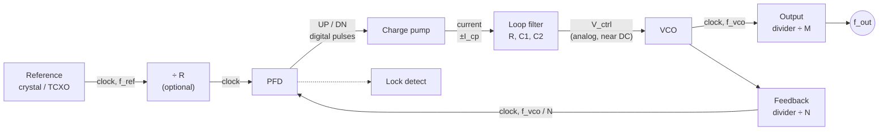

::: testing
Whether you can name the PLL's blocks **and say what each does, what goes wrong with it and how it shows up at the output**. Beyond the list, strong candidates give:

1. The five core blocks: **phase-frequency detector (PFD), charge pump, loop filter, VCO, feedback divider**, plus the reference input (crystal, optional ÷R) and the output divider.
2. The signal type at each node (edges, current pulses, a DC-ish control voltage, a clock).
3. One key spec and one non-ideality per block (dead zone and charge-pump mismatch, filter ripple, VCO gain and phase noise, divider jitter).
4. Variants: fractional-N with a sigma-delta modulator, all-digital PLLs, DLLs.
:::

::: why
Debugging a PLL is a block-by-block exercise: spurs at the reference frequency point to the charge pump and filter, a lock-time problem points to loop bandwidth, high phase noise away from the carrier points to the VCO, and a wrong output frequency points to the divider setting. Interviewers ask for the blocks to see if you know which one is responsible for what. It also separates someone who memorized a diagram from someone who can use the diagram to predict behaviour.
:::

::: concepts
- **Reference oscillator**: stable crystal or TCXO; sets accuracy and in-band noise. See [[q0134]].
- **PFD**: compares reference and feedback edges; produces UP/DN pulses. See [[q0135]].
- **Charge pump (CP)**: converts UP/DN pulses into current into the loop filter.
- **Loop filter (LF)**: R–C network; sets bandwidth, damping and ripple rejection.
- **VCO**: converts control voltage to output frequency; sets high-frequency noise.
- **Feedback divider ($\div N$)**: sets the multiplication; can be integer or fractional.
:::

::: answer
"A standard charge-pump PLL has five blocks in a loop. First, a reference, usually a crystal oscillator, sometimes with a divide-by-R. Then the phase-frequency detector, which compares the reference edges to the feedback edges and outputs up or down pulses whose width is the timing error. Next the charge pump, which turns those pulses into current pulses into the loop filter. The loop filter, a resistor and capacitors, integrates the current into a smooth control voltage and sets the loop's bandwidth and damping. The control voltage drives the VCO, the voltage-controlled oscillator, which generates the output clock. And the VCO output goes through a divide-by-N feedback divider back to the phase detector, closing the loop.

Each has a typical failure. The PFD can have a dead zone; the charge pump's up and down currents may be mismatched, giving reference spurs; the loop filter sets the stability; the VCO adds phase noise and has a gain that varies across its range; and the divider sets the ratio. In a fractional-N PLL the divider is modulated by a sigma-delta modulator to get non-integer ratios. And often there's an output divider after the VCO to reach lower frequencies, and a lock-detect circuit that tells the system when it's safe to use the clock."
:::

::: technical
| Block | Input → output | Function and key parameters | Typical non-idealities |
|---|---|---|---|
| Reference (XO/TCXO, optional $\div R$) | — → clock at $f_{ref}$ | Accuracy (ppm) and phase noise set the output's accuracy and in-band noise | Reference jitter, spurs from supply |
| PFD | Two clocks → UP/DN pulses | Detects phase *and* frequency error; zero-error pulses reset after a short delay | Dead zone (if no reset delay), delay mismatch |
| Charge pump | UP/DN → current $\pm I_{cp}$ | $K_\phi=I_{cp}/2\pi$ A/rad | UP/DN current mismatch (static phase offset, reference spur), leakage, charge injection, thermal noise |
| Loop filter | Current → voltage $V_{ctrl}$ | $Z(s)$ sets $\omega_n,\zeta$, ripple rejection | Leakage, resistor thermal noise, component tolerance |
| VCO | $V_{ctrl}$ → $f_{vco}$ | Tuning range, $K_{vco}$ (Hz/V), phase noise, supply sensitivity | Non-constant $K_{vco}$, supply/temperature sensitivity, pulling, phase noise |
| Feedback divider ($\div N$) | $f_{vco}$ → $f_{fb}=f_{vco}/N$ | Sets $N$; integer, dual-modulus (prescaler) or fractional | Divider jitter, fractional spurs and quantization noise (ΔΣ) |
| Output divider(s) | $f_{vco}$ → $f_{out}$ | Reach lower output frequencies; keeps VCO at a convenient range | Added jitter, duty-cycle |
| Lock detector | PFD pulses → LOCK flag | Asserts when phase error is below a threshold | False/missed lock |

**Loop transfer.** $G(s)=\frac{I_{cp}}{2\pi}Z(s)\frac{K_{vco}}{s}\frac{1}{N}$; see [[q0135]].

**Fractional-N.** The divider alternates between $N$ and $N+1$, controlled by a sigma-delta modulator, giving $N_{eff}=N+K/F$. Quantization noise is pushed to high frequency and filtered by the loop; residual fractional spurs appear.

**Other architectures.** *Analog PLL*: multiplier phase detector. *All-digital PLL*: time-to-digital converter, digital loop filter and digitally controlled oscillator. *DLL*: voltage-controlled delay line instead of an oscillator.

> [!UNCERTAIN]
> Block names and exact partitioning vary by vendor and textbook (e.g. some designs merge the PFD and charge pump, some call the divider the "N counter" and the reference divider the "R counter"). The functional roles are the same.
:::

::: short
"A charge-pump PLL has a reference oscillator, a phase-frequency detector, a charge pump, a loop filter, a VCO, and a divide-by-N feedback divider. The PFD turns the timing error between reference and divided VCO into UP/DOWN pulses, the charge pump turns those into current, the loop filter integrates it into a control voltage, the VCO converts that to frequency, and the divider feeds it back. Fractional-N adds a sigma-delta modulator on the divider, and there's usually an output divider and a lock detector."
:::

::: long
"A typical PLL has six blocks.

First is the reference, usually a crystal oscillator, possibly followed by a divide-by-R. It sets the long-term accuracy and the noise at low offsets.

Second is the phase-frequency detector, which compares the reference edges to the feedback edges. It outputs an UP pulse if the feedback is late and a DOWN pulse if it's early, with width equal to the timing error. It also detects frequency differences, so the loop can acquire lock from anywhere.

Third is the charge pump, which turns those pulses into current pulses into the loop filter. Its main issues are mismatch between the up and down currents and leakage, which show up as reference spurs.

Fourth is the loop filter, usually a resistor in series with a capacitor with a small second capacitor to ground. It integrates the current into the control voltage and sets the loop bandwidth and damping, which determine lock time, stability and how much reference ripple reaches the VCO.

Fifth is the VCO, which converts the control voltage to the output frequency. Its important specs are tuning range, gain in hertz per volt, and phase noise. Ring oscillators are wide-range and compact but noisy, and LC oscillators are narrower and larger but much cleaner.

Sixth is the feedback divider, which divides by N and closes the loop. For fractional ratios it's driven by a sigma-delta modulator that dithers N between integers.

Around these, there's usually an output divider after the VCO, so the VCO can run in its sweet spot while the output is lower, and a lock detector to tell the rest of the chip when the clock is valid. All-digital PLLs replace the PFD, charge pump and filter with a time-to-digital converter and digital logic, but the structure is the same."
:::

::: terms
- **PFD (phase-frequency detector)**: edge-triggered detector producing UP/DN pulses.
- **Charge pump (CP)**: current source/sink pair controlled by UP/DN.
- **Loop filter (LF)**: passive or active R–C network integrating CP current into $V_{ctrl}$.
- **VCO (voltage-controlled oscillator)**: ring or LC oscillator tuned by $V_{ctrl}$.
- **$K_{vco}$**: VCO gain in Hz/V (or rad/s/V).
- **Feedback divider**: divides the VCO frequency by $N$ (integer or fractional).
- **Sigma-delta modulator**: digital block that dithers $N$ to give an average fractional ratio.
- **Dead zone**: a phase-error range where the PFD output is too narrow to have effect.
- **Reference spur**: tone at $f_{ref}$ offsets on the output caused by charge-pump ripple.
- **Lock detect**: signal indicating the loop has locked.
:::

::: exceptional
**An average answer** lists the blocks: PFD, charge pump, loop filter, VCO, divider.

**An exceptional answer**:
- Gives the blocks **in loop order with the signal type** at each node (edges → pulses → current → voltage → frequency → edges).
- States a **function plus one key spec or failure** for each (dead zone, mismatch/spurs, filter bandwidth/damping, $K_{vco}$ and phase noise, divider jitter).
- Mentions the **reference divider, output divider, lock detect and fractional-N ΣΔ**.
- Notes **how noise maps to blocks**: reference/PFD/CP noise low-passed and multiplied by $N$; VCO noise high-passed.
- Mentions **variants** (all-digital PLL, DLL) and that names vary by vendor.
- Can say **which block to inspect for each symptom**.
:::

::: mistakes
- **Leaving out the feedback divider**, which is the thing that makes the PLL a multiplier.
- **Calling the PFD a "multiplier/mixer".** That is the analog phase detector; the PFD is digital and also senses frequency.
- **Forgetting the loop filter**, or saying it only filters noise. It determines loop dynamics and stability.
- **Treating the VCO gain as constant.** $K_{vco}$ varies over the tuning range, changing loop bandwidth and damping.
- **Believing the PLL output is as clean as the crystal.** The VCO adds noise and the loop multiplies in-band reference noise by $N^2$ (in power).
- **Ignoring lock detect and the output divider** in real chips.
- **Mixing up the roles of the reference divider R and feedback divider N.** $f_{out}=N f_{ref}/R$ (for output divider $M$: divide again).
:::

::: deep
## The blocks in loop order


Figure: Each arrow is labelled with the *type* of signal. The PFD is the only place where the digital (edge) domain is converted to the analog (charge/voltage) domain via the charge pump. Locked: $f_{vco}/N = f_{ref}/R$.

## PFD and charge pump

The PFD is two D flip-flops with a reset AND gate. UP and DN pulses are produced when the edges arrive; if both edges arrive simultaneously, both outputs are brief and cancel in the charge pump. A **dead zone** occurs if the reset path is so fast that pulses are too narrow for the charge pump switches to turn on; a small intentional delay in the reset path (a few hundred ps) forces both UP and DN on for a minimum time and linearizes the characteristic.

```plot
{"title":"Ideal PFD + charge pump: average output current vs phase error","x":{"label":"phase error (ref − fb), in cycles","min":-1,"max":1},"y":{"label":"average I_out (units of I_cp)","min":-1.1,"max":1.1},
 "series":[{"label":"ideal (linear over ±2π)","fn":"x","color":"accent"},{"label":"dead zone ±0.05 cycle","fn":"x*step(abs(x)-0.05)","color":"red","dashed":true}],
 "vlines":[{"at":0,"color":"muted"}]}
```
Figure: The ideal detector has a linear gain $K_\phi=I_{cp}/2\pi$ A/rad through zero. A dead zone (red dashed) flattens the curve near zero, so small phase errors are not corrected, and the loop wanders randomly within the dead zone, adding jitter.

**Mismatch.** If the UP and DN currents differ by $\Delta I$, the loop locks with a small static phase offset so that net average current is zero; the narrow current pulses each cycle appear as ripple on $V_{ctrl}$ at $f_{ref}$, generating **reference spurs** at $\pm f_{ref}$ offsets from the output.

## Loop filter

A passive series R–$C_1$ with shunt $C_2$ is standard. $C_1$ integrates (giving the zero-phase-error type-II behavior), $R$ adds a zero for phase margin and $C_2$ rolls off ripple at $f_{ref}$ (a third pole). The chosen values set $\omega_n$ and $\zeta$ ([[q0135]]). On-chip filters save pins and area; off-chip filters give larger capacitors and lower noise. An active filter (op-amp) is used when the VCO needs a wider control range than the charge pump can provide.

## VCO

The VCO sets the output frequency vs. control voltage.

```plot
{"title":"A realistic VCO tuning curve: gain K_vco is not constant","x":{"label":"control voltage V_ctrl","unit":"V","min":0,"max":3.3},"y":{"label":"output frequency","unit":"Hz","min":0,"max":2000000000},
 "vars":{"f0":1000000000,"fs":800000000},
 "series":[{"label":"f_vco(V)","fn":"f0+fs*tanh((x-1.65)/1.2)","color":"accent"}],
 "points":[{"x":1.65,"y":1000000000,"label":"K_vco ≈ 670 MHz/V"},{"x":0.3,"y":352559143,"label":"K_vco ≈ 230 MHz/V"}]}
```
Figure: The slope of the curve is $K_{vco}$. It is about 670 MHz/V in the middle and only about 230 MHz/V near the ends of this assumed curve, nearly a factor of three. Since $\omega_n\propto\sqrt{K_{vco}}$ and $\zeta\propto\sqrt{K_{vco}}$ ($\zeta\propto C_1\omega_n R$), the loop bandwidth and damping change across the tuning range, a major PLL design concern.

| VCO type | Pros | Cons |
|---|---|---|
| Ring oscillator | Wide tuning range, small area, easy to integrate, multi-phase | Higher phase noise and supply sensitivity |
| LC oscillator | Much lower phase noise, high frequency | Narrow tuning range (needs switched capacitor banks), larger area (inductor) |

## Feedback divider

Integer-N: a counter. For high VCO frequencies a dual-modulus prescaler ($\div P/(P+1)$) and a pulse-swallow counter are used. Fractional-N: the division ratio alternates between $N$ and $N+1$ under ΣΔ control so the average is $N+K/F$; for instance 26 MHz × (92 + 4/13) = 2.4 GHz. The ΣΔ shaping moves quantization noise to high frequencies where the loop filter attenuates it, but some remains as fractional spurs.

```sim
{"id":"clock-divider","n":4}
```
Figure: A divide-by-4 block: four input cycles per output cycle. The PLL's feedback divider does this at gigahertz speeds, and it is the block that turns a 1 GHz VCO into a 250 MHz comparison against the reference when $N=4$.

## Noise mapping, by block

- **Reference/PFD/charge pump/divider noise** → *low-pass* to the output, multiplied by $N$ (+$20\log N$ dB).
- **Loop filter resistor noise, VCO control-line pickup** → mostly via $K_{vco}$ to the output, band-pass-like.
- **VCO noise** → *high-pass*: suppressed inside the loop bandwidth.

So the total output noise is the reference-related noise below the loop bandwidth and VCO noise above it. That is the basis of choosing loop bandwidth (see [[q0138]]).

## Lock detect and gating

A **lock detector** monitors the PFD pulse widths (or a digital phase comparison); when the error stays below a limit for some number of cycles, it asserts LOCK. System logic holds the PLL output gated, or the chip in reset, until lock is asserted, to avoid running logic on a clock whose frequency is still slewing ([[q0139]]).

## All-digital and other variants

An **ADPLL** replaces the PFD/CP/LF/VCO with a time-to-digital converter, digital loop filter and digitally controlled oscillator (DCO). It scales well with process and is programmable; the structure is the same loop. A **DLL** has a voltage-controlled delay line in place of the VCO and a PFD, and locks the output to the reference by adjusting delay instead of frequency, with no phase accumulation and therefore no jitter accumulation and unconditional stability (first-order loop), but it cannot multiply frequency.
:::

::: applications
- **CPU/SoC clocking**: reference × N core PLLs plus separate PLLs for memory and peripherals.
- **FPGA clock management**: PLL/MMCM blocks with programmable $N$, $R$ and output dividers.
- **RF transceivers**: fractional-N synthesizers with LC VCOs for channel tuning.
- **SerDes and clock-data recovery**: PLL/DLL blocks that lock to data-edge transitions.
- **Audio codecs**: PLL deriving master clock from word clock.
- **Spread-spectrum clock generators**: a PLL whose reference or divider is modulated slightly to spread EMI.
:::

::: assumptions
I described a **charge-pump PLL with a PFD**, the most common architecture in integrated circuits. Older or simple designs use an XOR or mixer phase detector with an active or passive filter and no charge pump. **All-digital PLLs** change the block names but not the function. The table lists typical non-idealities, which depend on process, supply and design. The partitioning of "PFD" and "charge pump" differs between textbooks, and some designs combine them or include additional blocks (lock detect, VCO calibration, band selection, power-down). For a **fractional-N** PLL, the sigma-delta modulator and its dither add a block and a noise term. Gain figures like the tuning curve are illustrative, not from a specific part.
:::

::: followups
### What's the difference between the reference divider R and the feedback divider N?
R divides the reference before the PFD (lowering the comparison frequency, which can help with channel spacing); N divides the VCO output before the PFD. In lock, $f_{vco}/N=f_{ref}/R$, so $f_{vco}=(N/R)f_{ref}$. A bigger N or smaller PFD frequency increases the in-band noise multiplication $20\log N$.

### Why does a PFD have a dead-zone problem and how is it avoided?
If the PFD's reset is so quick that both UP and DN pulses are narrower than the charge-pump switches' turn-on time, small phase errors produce no corrective current, so the loop doesn't respond within the dead-zone range and jitter increases. The fix is a delay in the reset path so both pulses are on for a minimum width every cycle, which keeps the charge pump in its linear region.

### Which block is responsible for reference spurs, and what do you do about it?
Mainly the charge pump (UP/DN current mismatch and leakage) and the loop filter's limited rejection at $f_{ref}$. Remedies: improve CP matching, reduce leakage, increase the $C_2$/third-pole filtering, lower the loop bandwidth, or use a higher PFD frequency (spurs move farther from the carrier and are filtered more).

### Why might a designer prefer a LC VCO over a ring VCO?
Phase noise: an LC tank has a high Q and therefore much lower phase noise and supply sensitivity, which matters in RF and high-speed links. Ring oscillators are smaller and have wide tuning, which is suitable for digital clock generation where jitter requirements are modest.

### Harder: the PLL locks to the right frequency but with high jitter. Which blocks do you suspect first, and how do you tell them apart?
Look at the phase-noise spectrum. If the excess noise is *inside* the loop bandwidth, suspect the reference, PFD/CP or divider (multiplied by N): measure the reference alone and try a lower $N$. If it's *outside* the loop bandwidth, suspect the VCO or its supply: try a wider loop or a cleaner supply. Spurs at $f_{ref}$ offsets point to the charge pump and filter; broad humps at the loop bandwidth suggest low phase margin (peaking).
:::

::: interpretations
"What blocks does a PLL have?" expects the list **PFD, charge pump, loop filter, VCO, divider** (the standard answer). The question after it, [[q0137]], asks to draw the block diagram, so this page covers the *roles and parameters* of each block while [[q0137]] covers *drawing* the diagram. Some interviewers describe a simpler "phase detector, low-pass filter, VCO" PLL; that is the same loop with the charge pump folded into the filter, and I'd mention that alternative.
:::

::: references
- Razavi, *Design of Analog CMOS Integrated Circuits*: PLL chapter, covering PFDs, charge pumps, VCOs and dividers.
- Gardner, "Charge-Pump Phase-Lock Loops", IEEE Transactions on Communications, 1980.
- Banerjee, *PLL Performance, Simulation, and Design*: block-by-block treatment, including loop filter design.
- Egan, *Phase-Lock Basics*: introductory treatment of PLL blocks and frequency synthesizers.
:::

::: rubric
- Lists PFD, charge pump, loop filter, VCO, feedback divider (and reference) :: The core list the question asks for.
- Gives each block's function in one line :: Shows understanding, not memorization.
- States the signal type at each node :: Shows you understand the loop as a signal chain.
- Names one non-ideality per major block (dead zone, mismatch/spurs, $K_{vco}$ variation) :: Shows design awareness.
- Mentions fractional-N, output divider, lock detect :: Real chips contain these.
- Connects block to noise or spur behavior :: Shows debugging ability.
:::

::: quiz
```json
[
 {"type":"mcq","level":"fundamental","q":"Which block closes the PLL feedback loop and makes the output a multiple of the reference?","options":["Charge pump","Loop filter","Feedback divider (÷N)","Crystal"],"answer":2,"explain":"The divider scales the VCO frequency down by N before comparing it to the reference, so lock requires $f_{out}=Nf_{ref}$."},
 {"type":"mcq","level":"fundamental","q":"What does the charge pump do?","options":["Divides the VCO frequency","Converts UP/DN pulses into current into the loop filter","Generates the reference clock","Supplies the VCO's power"],"answer":1,"explain":"The charge pump sources or sinks current for the duration of the UP or DN pulse, charging or discharging the loop filter capacitor."},
 {"type":"numeric","level":"intermediate","q":"A PLL has $f_{ref}=26$ MHz, reference divider $R=1$ and fractional ratio $N=92+4/13$. What is the VCO frequency in MHz?","answer":2400,"tolerance":0.005,"unit":"MHz","explain":"$26\\times(92+4/13)=26\\times92.3077=2400$ MHz."},
 {"type":"mcq","level":"intermediate","q":"Mismatch between the charge pump's UP and DN currents mainly causes:","options":["A change in VCO tuning range","A static phase offset and reference spurs","Faster lock time","Lower in-band noise"],"answer":1,"explain":"The loop settles at a phase offset where net current averages to zero, and the narrow correction pulses ripple the control voltage at $f_{ref}$, giving spurs."},
 {"type":"truefalse","level":"intermediate","q":"The VCO gain $K_{vco}$ is constant across the tuning range, so the PLL loop bandwidth does not change with the output frequency.","answer":false,"explain":"$K_{vco}$ usually varies with control voltage, so $\\omega_n$ and $\\zeta$ vary across the tuning range, which can affect stability and lock time."},
 {"type":"multi","level":"advanced","q":"Select all statements that are true about noise in a charge-pump PLL.","options":["Reference/PFD/CP noise is low-passed to the output and multiplied by N","VCO noise is suppressed inside the loop bandwidth","The PLL removes all noise of the reference","Total output noise is dominated by reference-related noise below the loop bandwidth and VCO noise above it"],"answer":[0,1,3],"explain":"Reference-path noise appears at the output with gain N within the loop bandwidth; VCO noise is high-passed; the PLL cannot remove the reference's own noise."}
]
```
:::
