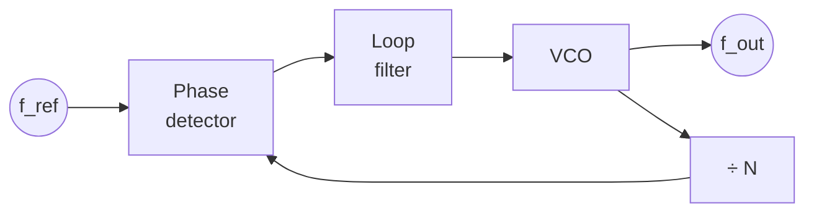
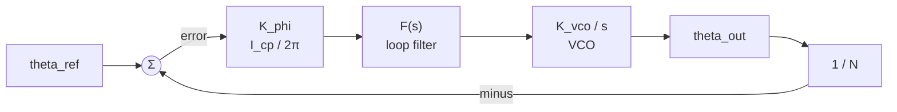
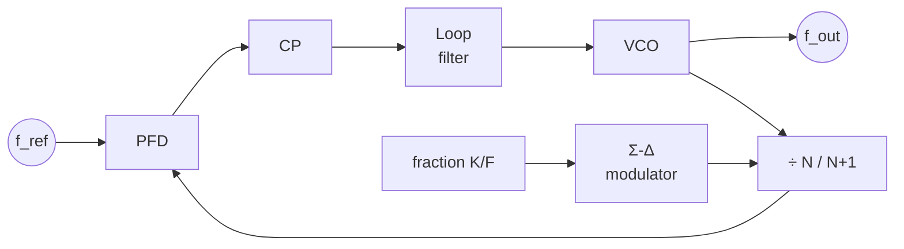

::: basics
### In plain words
A PLL block diagram is a loop of boxes with one signal going around. The reference goes in, the output comes out, and a copy of the output (divided down) goes back to be compared with the reference. Drawing it means putting the right boxes in the right order and labeling the signals.

### Picture it
Picture a roundabout with five exits in order: phase detector, charge pump, loop filter, VCO, and divider. Traffic only goes one way around. The reference clock enters the roundabout at the first exit, and the output leaves from after the VCO. Everything going around the loop is the correction signal that keeps the output in step.

### Words you need
- **$f_{ref}$**: the reference clock frequency that enters the loop.
- **Feedback path**: the branch that carries the divided output back to the detector.
- **UP / DOWN pulses**: the detector's outputs telling the VCO to speed up or slow down.
- **Control voltage** ($V_{ctrl}$): the smoothed voltage that sets the VCO's frequency.
- **Lock condition**: $f_{out}/N = f_{ref}$. See [[q0135]].

### The simplest example
The smallest version has four things in words: a phase detector, a loop filter, a VCO, and a divide-by-$N$ in the return path. The reference enters the detector. The detector output goes through the filter into the VCO. The VCO output is the PLL output, and it is also divided by $N$ and sent back to the detector. With $f_{ref} = 10$ MHz and $N = 5$, locked output is 50 MHz. That is the whole idea. The rest of this page shows the full drawing with a charge pump, signal labels, and the control-system version.
:::

::: testing
This is a drawing question, so the interviewer watches **how you draw and what you say while drawing**:

1. The loop, in order and with correct arrow directions: reference → PFD → charge pump → loop filter → VCO → output, with the **divider in the feedback path** returning to the PFD.
2. Labels on the *signals* (not only the blocks): $f_{ref}$, UP/DN, $I_{cp}$, $V_{ctrl}$, $f_{out}$, $f_{out}/N$.
3. The lock condition written next to the diagram: $f_{out}=Nf_{ref}$.
4. Flexibility: a simpler three-block version if asked, the phase-domain (control) model, or variants (fractional-N, output divider, CDR).
:::

::: why
A block diagram is how you communicate a feedback system: it shows where the loop closes, which block converts which signal type, and where noise enters. On a whiteboard the diagram is also how you answer the next questions: loop bandwidth, spurs, what happens when the loop is too fast or slow. An interviewer who sees a clean diagram, narrated well, can quickly judge whether you understand the loop or have just memorized names. See [[q0135]] for the operation and [[q0136]] for each block's role.
:::

::: concepts
- **Negative feedback loop**: output (via divider) is subtracted from the reference at the PFD. See [[q0135]].
- **Block roles**: PFD, charge pump, loop filter, VCO, divider. See [[q0136]].
- **Signal types**: edges (digital) → current pulses → voltage → frequency → edges.
- **Lock condition**: $f_{out}/N=f_{ref}$.
- **Phase-domain model**: $K_\phi$, $F(s)$, $K_{vco}/s$, $1/N$.
- **Variants**: fractional-N, output divider, analog (mixer) PLL, DLL.
:::

::: answer
"I'll draw it left to right as a loop. On the far left, a reference clock, f ref, coming from a crystal. It goes into a phase-frequency detector, the PFD. The PFD has a second input that comes from the feedback path. Its outputs, UP and DOWN pulses, go into a charge pump, which outputs current into a loop filter, then a resistor and capacitor to ground. The loop filter's output, the control voltage, goes into the VCO. The VCO's output is the PLL output, f out. Then I take a branch off that output and send it back through a divide-by-N block, and the divided clock goes into the second input of the phase detector. That closes the loop.

I'd label the signals as I go: f ref, UP and DOWN, current from the charge pump, V control, f out, and f out over N. And next to it I write the lock condition: when locked, f out over N equals f ref, so f out equals N times f ref.

If they want a simpler version, I can collapse the PFD, charge pump and filter into 'phase detector' and 'low-pass filter', so it's just three blocks around the loop: phase detector, loop filter, VCO, plus the divider. And I can redraw it as a control block diagram, with the phase detector gain, the filter, the VCO as an integrator, K vco over s, and the divide-by-N in the feedback path."
:::

::: technical
**Hardware block diagram (charge-pump PLL).**

$f_{ref}\to$ [PFD] $\to$ UP/DN $\to$ [Charge pump] $\to I_{cp}\to$ [Loop filter] $\to V_{ctrl}\to$ [VCO] $\to f_{out}$; $f_{out}\to$ [$\div N$] $\to f_{fb}=f_{out}/N\to$ PFD (second input).

**Signals and domains.** $f_{ref}$, $f_{fb}$: digital clocks. UP/DN: digital pulses of width $\propto$ phase error. $I_{cp}$: current pulses ($\pm I_{cp}$). $V_{ctrl}$: slowly varying analog voltage. $f_{out}$: clock.

**Phase-domain (linear) model.** $\theta_{ref}\to(\Sigma)\to K_\phi=I_{cp}/2\pi\to F(s)\to K_{vco}/s\to\theta_{out}$; feedback $\theta_{out}\to1/N\to\Sigma$ (subtract). Open-loop gain $G(s)=K_\phi F(s)\frac{K_{vco}}{s}\frac1N$, closed loop $\theta_{out}/\theta_{ref}=N\frac{G}{1+G}$.

**Lock condition.** $f_{out}=N\,f_{ref}$. With a reference divider $R$ the VCO runs at $\frac{N}{R}f_{ref}$, and with an output divider $M$ after the VCO, $f_{out}=\frac{N}{RM}f_{ref}$.

**Simplified (analog) version.** Phase detector (multiplier or XOR) $\to$ low-pass filter $\to$ VCO, with VCO output (through $\div N$) returning to the phase detector.

**What to annotate.** Direction of every arrow; negative feedback sign at the PFD; the node where the loop is closed; the domain change from digital to analog at the charge pump; where noise enters (reference/PFD/CP at the input, VCO at the output).
:::

::: short
"Left to right: reference clock into a phase-frequency detector; its UP and DOWN outputs drive a charge pump; that feeds a loop filter, an R–C network; the filter's control voltage drives the VCO, whose output is f out. A divide-by-N block takes f out and feeds it back to the second input of the PFD, closing the loop. I'd label f ref, UP/DOWN, the pump current, V control, f out and f out over N, and write f out equals N times f ref as the lock condition."
:::

::: long
"I draw it as a loop, starting on the left with the reference, a crystal oscillator, labelled f ref. That feeds the first input of a box labelled PFD, the phase-frequency detector. The PFD has two outputs, UP and DOWN, which go to a charge pump box. The charge pump outputs a current, I cp, which goes to the loop filter. I draw the filter as a box and might sketch the resistor-capacitor network inside it, a resistor in series with a capacitor to ground, and a small capacitor in parallel. The filter output is the control voltage, V control, which goes to the VCO box. The VCO output is the clock output, f out.

To close the loop, I put a dot on the VCO output and run a wire down and back to the left through a box labelled divide-by-N, and into the second input of the PFD. So the PFD compares the reference with f out divided by N. I'll mark the sign at the PFD as a negative feedback.

Then I annotate. The signals before the charge pump are digital edges and pulses, after it is an analog current and then a voltage, and then the VCO converts back to a clock. I write the lock condition below: when the loop is locked, f out over N equals f ref, so f out equals N times f ref. I might add a note on where noise enters: the reference and phase detector noise gets multiplied by N and low-passed by the loop, and VCO noise is high-passed.

If the interviewer wants a simpler version, I'd show the three-block analog PLL: phase detector, low-pass filter, VCO, with the divider in the feedback. And for the control-system view, I'd redraw it with K phi, the loop filter F of s, the VCO as K vco over s, and one over N in the feedback. That's the form I use to calculate bandwidth and damping. And if they ask for a fractional-N version, I'd add a sigma-delta modulator controlling the divider."
:::

::: terms
- **Block diagram**: boxes for functions and arrows for signal flow.
- **Feedback path**: the divider route from the output back to the PFD.
- **Reference clock ($f_{ref}$)**: the low-frequency input clock.
- **UP/DN**: PFD outputs indicating whether the feedback is late or early.
- **$I_{cp}$**: charge-pump current.
- **$V_{ctrl}$**: loop-filter output driving the VCO.
- **$f_{fb}$**: the divided VCO clock returned to the PFD.
- **Phase-domain model**: linear model in which every block is a gain or transfer function acting on phase.
- **Lock condition**: $f_{fb}=f_{ref}$, i.e. $f_{out}=Nf_{ref}$.
:::

::: exceptional
**An average answer** draws five boxes and arrows with the feedback line.

**An exceptional answer**:
- Draws a **clean left-to-right loop with arrowheads and labelled signals** ($f_{ref}$, UP/DN, $I_{cp}$, $V_{ctrl}$, $f_{out}$, $f_{out}/N$), and places the divider in the **feedback** path.
- Writes the **lock condition** $f_{out}=Nf_{ref}$ and marks the **negative** feedback sign.
- Narrates **domains** (digital edges → current → voltage → frequency → edges) while drawing.
- Offers the **phase-domain version** ($K_\phi$, $F(s)$, $K_{vco}/s$, $1/N$) and says what it's for.
- Adds **real-chip extras** briefly (reference divider $R$, output divider $M$, lock detect, ΣΔ for fractional-N) and where noise enters.
:::

::: mistakes
- **Putting the divider in the forward path** (after the reference) instead of the feedback path: that makes a divider, not a multiplier.
- **Drawing the feedback to the wrong place**: it returns to the PFD's second input, not to the VCO or loop filter.
- **No arrowheads, or arrows that point the wrong way** (e.g. VCO output feeding the crystal).
- **Omitting the loop filter or charge pump** as "just a wire". They set the dynamics.
- **Not labelling the output node** or the divided clock; the diagram becomes ambiguous.
- **Forgetting the lock condition** and the role of $N$.
- **Drawing the VCO as taking a frequency input.** It takes a voltage and produces a frequency.
:::

::: deep
## The diagram

```circuit
{"caption":"Charge-pump PLL: hardware block diagram","elements":[
 {"t":"box","at":[0,0],"w":4,"h":4,"label":"Reference\nXTAL","pins":[{"side":"right","pos":2,"name":""}]},
 {"t":"wire","pts":[[4,2],[6,2]]},{"t":"text","at":[5,1.2],"text":"f_ref","anchor":"middle","color":"accent"},
 {"t":"box","at":[6,0],"w":4,"h":6,"label":"PFD","pins":[{"side":"left","pos":2,"name":"REF"},{"side":"left","pos":4,"name":"FB"},{"side":"right","pos":1,"name":"UP"},{"side":"right","pos":5,"name":"DN"}]},
 {"t":"wire","pts":[[10,1],[12,1]]},{"t":"wire","pts":[[10,5],[12,5]]},
 {"t":"box","at":[12,0],"w":4,"h":6,"label":"Charge\npump","pins":[{"side":"left","pos":1,"name":""},{"side":"left","pos":5,"name":""},{"side":"right","pos":3,"name":""}]},
 {"t":"wire","pts":[[16,3],[18,3]]},{"t":"text","at":[17,2.2],"text":"I_cp","anchor":"middle","color":"accent"},
 {"t":"box","at":[18,1],"w":4,"h":4,"label":"Loop\nfilter","pins":[{"side":"left","pos":2,"name":""},{"side":"right","pos":2,"name":""}]},
 {"t":"wire","pts":[[22,3],[24,3]]},{"t":"text","at":[23,2.2],"text":"V_ctrl","anchor":"middle","color":"accent"},
 {"t":"box","at":[24,1],"w":4,"h":4,"label":"VCO","pins":[{"side":"left","pos":2,"name":""},{"side":"right","pos":2,"name":""}]},
 {"t":"wire","pts":[[28,3],[33,3]]},{"t":"dot","at":[30,3]},{"t":"term","at":[33,3],"label":"f_out = N f_ref","side":"right"},
 {"t":"wire","pts":[[30,3],[30,10],[28,10]]},
 {"t":"box","at":[24,8],"w":4,"h":4,"label":"÷ N","pins":[{"side":"right","pos":2,"name":""},{"side":"left","pos":2,"name":""}]},
 {"t":"wire","pts":[[24,10],[5,10],[5,4],[6,4]]},{"t":"text","at":[14,11],"text":"f_fb = f_out / N","anchor":"middle","color":"accent"},
 {"t":"arrow","a":[4.6,2],"b":[6,2]},{"t":"arrow","a":[10.6,1],"b":[12,1]},{"t":"arrow","a":[10.6,5],"b":[12,5]},{"t":"arrow","a":[16.6,3],"b":[18,3]},{"t":"arrow","a":[22.6,3],"b":[24,3]},{"t":"arrow","a":[30,10],"b":[28.1,10]},{"t":"arrow","a":[5,4.8],"b":[5,4.1]},{"t":"arrow","a":[28.6,3],"b":[33,3]},
 {"t":"text","at":[16,-1.2],"text":"digital edges → analog current → voltage → frequency","anchor":"middle","muted":true}
]}
```
Figure: The loop reads left to right through the forward path (PFD → charge pump → loop filter → VCO) and returns along the bottom through the divider. The signals are labelled on the wires. When locked, $f_{fb}=f_{ref}$ and so $f_{out}=Nf_{ref}$.

**How I'd draw it in 60 seconds**
1. Five boxes in a row: reference, PFD, charge pump, loop filter, VCO.
2. Arrowheads on the forward path, with signal labels on the wires.
3. A dot on the VCO output; run a line down, left, through a ÷N box.
4. Return the line to the PFD's second input.
5. Write "locked: $f_{out}=Nf_{ref}$" and the negative-feedback sign.

## Simplified three-block version

If the interviewer just says "draw a PLL", this is the minimum:


Figure: The classic three-block PLL: phase detector, low-pass (loop) filter, VCO, with a divider in the feedback path to make it a multiplier. Without the divider the loop just makes a clean copy of the reference.

## The control-systems view (phase domain)

For calculating bandwidth, damping and noise, redraw the same loop as a linear feedback diagram where every signal is a phase.


Figure: Each block now has a transfer function. The VCO is $K_{vco}/s$ (an integrator), the PFD+CP gain is $K_\phi=I_{cp}/2\pi$, the filter $F(s)=R+1/(sC_1)$ (seen as impedance), and the feedback is $1/N$. Open-loop gain $G=K_\phi F K_{vco}/(sN)$ and the closed loop is $\theta_{out}/\theta_{ref}=N\,G/(1+G)$.

## What you'd see at each node

| Node | Signal | What to expect when locked |
|---|---|---|
| $f_{ref}$ | digital clock | Stable, e.g. 25 MHz |
| $f_{fb}$ | digital clock | Same frequency, small constant phase offset |
| UP / DN | narrow digital pulses | Very narrow, a few hundred ps every cycle |
| $I_{cp}$ | current pulses | Net average ≈ 0 |
| $V_{ctrl}$ | slow analog voltage | Near-constant DC (e.g. 1.0 V) with small ripple at $f_{ref}$ |
| $f_{out}$ | digital/analog clock | $N f_{ref}$, with jitter |

If the reference frequency steps from 10 MHz to 10.1 MHz with $N=10$ and $K_{vco}=20$ MHz/V, the output must step from 100 to 101 MHz, so $V_{ctrl}$ must shift by $1\text{ MHz}/20\text{ MHz/V}=50$ mV. The loop's response follows the second-order step response:

```plot
{"title":"V_ctrl after a +1% reference-frequency step (N = 10, K_vco = 20 MHz/V, f_n = 50 kHz, ζ = 0.7)","x":{"label":"time","unit":"s","min":0,"max":0.00006},"y":{"label":"V_ctrl","unit":"V","min":0.98,"max":1.07},
 "vars":{"fn":50000,"wn":"2*pi*fn","z":0.7,"sg":"z*wn","wd":"wn*sqrt(1-z*z)","v0":1.0,"dv":0.05},
 "series":[{"label":"V_ctrl(t)","fn":"v0+dv*(1-exp(-sg*x)*(cos(wd*x)-(sg/wd)*sin(wd*x)))","color":"accent"}],
 "hlines":[{"at":1.05,"label":"new DC value 1.050 V","color":"muted"}]}
```
Figure: The control voltage settles from 1.000 V to 1.050 V (a 50 mV change) with about 21% overshoot (peak about 1.060 V) and settles within ±2% in roughly 16 µs. The shape is the same as the phase-step response, because frequency is the derivative of a phase ramp. If you probe $V_{ctrl}$ on a scope and see ringing like this, that is the loop's damping on display.

## Variants worth being able to sketch

**Fractional-N.** Add a sigma-delta modulator that drives the divider modulus so $N$ toggles between integers.


Figure: The ΣΔ modulator dithers the divider between $N$ and $N+1$ so that on average $N_{eff}=N+K/F$. Quantization noise is shaped to high frequency, where the loop filter removes it.

**With reference and output dividers.** Add a $\div R$ between the crystal and the PFD, and a $\div M$ after the VCO: $f_{out}=\frac{N}{R\,M}f_{ref}$.

**Clock-and-data recovery.** The reference is replaced by the incoming data and the PFD by a (bang-bang or Alexander) phase detector; the loop recovers a clock aligned with the data transitions.

**DLL.** A voltage-controlled delay line replaces the VCO and no divider is used: a first-order loop that aligns output phase to the reference.

## Try it

```sim
{"id":"pll-lab","fref":10000000,"n":10,"bw":50000,"zeta":0.7}
```
Figure: The lab draws the lock process for the diagram above: $V_{ctrl}$ and VCO frequency converge to $N f_{ref}=100$ MHz. Compare the settling with the plot above and then change `bw` and `zeta` to see how the waveform at the control node changes.

## Worked example: filling in the boxes for a specific target

A diagram is only useful if you can put numbers in it, and interviewers like to hear that step. Suppose the job is a 156.25 MHz clock from a 25 MHz crystal. Use $f_{out}=\dfrac{N}{R\,M}f_{ref}$ and assume the VCO covers 600 to 1200 MHz (an assumed range).

1. **Find the ratio.** $156.25/25=6.25=25/4$. That is not an integer, so either use a fractional-N loop or choose dividers cleverly. With an integer-N PLL, $R=4$ makes the PFD run at $25/4=6.25$ MHz and the ratio becomes an integer.
2. **Place the VCO in range.** The VCO must be a multiple of 156.25 MHz inside 600 to 1200 MHz: 625 MHz ($M=4$) works. Then $N=625/6.25=100$.
3. **Write the boxes.** Reference 25 MHz; $\div R$ with $R=4$; PFD at 6.25 MHz; VCO at 625 MHz; feedback $\div N$ with $N=100$; output $\div M$ with $M=4$. Check: $625/100=6.25=25/4$ ✓ and $625/4=156.25$ ✓.
4. **Size the filter from the same diagram.** Take $I_{cp}=200$ µA and an assumed $K_{vco}=2\pi\times300$ MHz/V. For $f_n=100$ kHz (well below $f_{PFD}/10=625$ kHz) and $\zeta=0.7$, the formulas of [[q0135]] give $C_1=\dfrac{I_{cp}K_{vco}}{2\pi N\omega_n^2}=1.52$ nF and $R=\dfrac{2\zeta}{\omega_nC_1}=1.47$ kΩ. For the third pole, a common rule of thumb is $C_2\approx C_1/20=76$ pF, which puts it at $1/(2\pi RC_2)=1.43$ MHz, about 14 times the loop's natural frequency, so it adds little phase lag while still attenuating the 6.25 MHz ripple.

Notice that this design needed all of the boxes: the reference divider, the output divider and the feedback divider are three different dials, and the diagram shows exactly where each one sits relative to the loop. The rule is that anything inside the loop changes the ratio the loop enforces, and anything after the VCO only scales the output.

## Limiting cases and sign checks

A quick way to verify that your diagram is a negative-feedback loop is to follow a disturbance around it. Say the VCO runs a little fast: $f_{fb}$ edges come early, the PFD asserts DN, the charge pump removes charge, $V_{ctrl}$ falls and the VCO slows. If at any step the sign flips, the diagram is wrong or the loop is regenerative. Two real-hardware twists to know:

- **VCOs with negative gain.** Some VCOs lower their frequency as the control voltage rises. Then the loop sign is wrong unless the charge-pump polarity is reversed. Synthesizer chips often have a polarity bit for exactly this reason, and an incorrectly set bit makes the VCO rail at one end of its range and never lock.
- **Dividers in the loop at high speed.** The feedback divider must run at the full VCO frequency, which is why a high-speed first stage (a prescaler) often sits in that path. The prescaler's delay is part of the loop and is usually negligible compared with the reference period, but its jitter is not.

At the extremes: $N=1$ turns the diagram into a jitter cleaner at the same frequency. A very large $N$ (usually the result of a low PFD rate chosen to get fine integer-N frequency steps, since each step of $N$ moves the VCO by $f_{PFD}$) multiplies reference noise by $20\log_{10}N$ and lowers the loop gain, which is why the loop bandwidth is generally scaled with $N$ or the PFD rate is raised.

## Verifying the diagram on a real board

The diagram doubles as a probing plan. Put one scope channel on the reference and another on the divided feedback (many parts bring out a divider test pin, or you can probe the PFD's input). When locked the two edges have a fixed delay and no drift; a slowly sliding phase means you are out of lock or the frequencies differ. Check $V_{ctrl}$ with a high-impedance probe: if it sits at a rail, the VCO cannot reach the target, which points at a wrong divider setting, a polarity error or a VCO range problem. Then break the loop on purpose, by disabling the charge pump or disconnecting the filter, and watch the VCO drift away from the target; if the part lets you force $V_{ctrl}$ (or the VCO's coarse tuning), step it to a couple of known values and confirm the tuning slope and its sign. If a datasheet provides lock-detect, confirm it deasserts during this experiment and reasserts when the loop is closed.

:::

::: applications
- **Whiteboard explanations of clocking** in CPU, FPGA and SoC interviews.
- **Datasheet reading**: PLL/clock-synthesizer data sheets use this diagram to explain registers (R, N, charge-pump current, loop filter pins).
- **Loop-filter design** from the block diagram with $K_\phi$, $K_{vco}$ and $N$.
- **Troubleshooting**: probe each node (UP/DN, $V_{ctrl}$, $f_{fb}$) to localize a fault.
- **Communicating architecture**: system-level clock trees show reference → PLL → dividers → peripherals.
- **Simulation setups** (behavioural PLL models) are built from these blocks.
:::

::: assumptions
I drew a **charge-pump PLL with a PFD** and a single feedback divider, the version most interviewers expect. Variants (analog PLL with a multiplier phase detector, ADPLL, DLL, fractional-N, CDR) differ in the blocks but share the loop structure. For the **phase-domain model**, the PFD+CP is treated as a linear gain $K_\phi$ (valid for small errors and loop bandwidths well below $f_{ref}$). The numbers in the $V_{ctrl}$ plot assume a linear VCO with $K_{vco}=20$ MHz/V and a type-II second-order loop; real VCO gain varies and $C_2$ adds a third pole. Where I put the output divider (after the VCO, outside the loop) matters: dividers inside the loop change $N$; outside, they scale the output.
:::

::: followups
### Where would you add a second output at half the frequency?
After the VCO, outside the feedback path: a ÷2 block on the VCO output (or on a branch of it) gives $f_{out}/2=N f_{ref}/2$ without affecting the loop. Putting the extra divider in the feedback path would change $N$ and the output frequency.

### Redraw it for a PLL that must generate 100 MHz from a 25 MHz crystal. What values go in the boxes?
No reference divider needed ($R=1$), feedback divider $N=4$, so the VCO runs at 100 MHz. The PFD compares 25 MHz with 100/4 = 25 MHz. If the VCO's range is 400 MHz to 800 MHz, set $N=24$ (VCO at 600 MHz, mid-range) and an output divider $M=6$ to get 100 MHz, keeping $f_{PFD}$ = 25 MHz.

### Where would you insert a lock-detect block?
It takes the PFD's UP/DN outputs (or compares the two PFD input clocks) and asserts LOCK when the pulse width is below a threshold for a number of consecutive cycles. Its output goes to the rest of the system, which holds reset or gates the clock until lock.

### How do you show negative feedback on the diagram?
Put a summing node (a circle with + and − signs) in the phase-domain diagram, with the reference as + and the divided output as −. In the hardware diagram, the sign is implicit in the PFD: if the feedback is late, UP speeds up the VCO. Check by following the loop: a faster VCO makes the feedback earlier, reducing the error.

### Harder: if I accidentally put the divider in the forward path (between the crystal and the PFD) and feed the VCO straight back, what does the circuit do?
The PFD then compares $f_{ref}/N$ with $f_{out}$, so the loop locks with $f_{out}=f_{ref}/N$: it has become a frequency *divider*, not a multiplier. To multiply, the divider has to sit in the feedback path from the VCO to the PFD so that the loop must run the VCO N times faster to make the divided clock match the reference.
:::

::: interpretations
"Draw a block diagram." in the PLL section refers to the PLL block diagram. It follows [[q0136]] (blocks), so it's testing the *arrangement and the feedback path*, rather than the role of each block. Depending on the interviewer, "block diagram" may mean the three-block analog PLL, the five-block charge-pump PLL, or the control-system (phase-domain) version. I drew all three, starting with the charge-pump version.
:::

::: references
- Razavi, *Design of Analog CMOS Integrated Circuits*: the PLL chapter with block diagrams of simple and charge-pump PLLs.
- Gardner, *Phaselock Techniques* (Wiley): the classic treatment of the phase-domain loop model.
- Horowitz & Hill, *The Art of Electronics*, 3rd ed.: the section on phase-locked loops.
- Egan, *Phase-Lock Basics* (Wiley-IEEE): basic block diagrams and frequency-synthesizer variants.
:::

::: rubric
- Draws the loop with PFD, charge pump, loop filter, VCO and divider in the correct order :: The central deliverable.
- Places the divider in the feedback path back to the PFD :: This is the most common error to get right.
- Labels signals ($f_{ref}$, UP/DN, $I_{cp}$, $V_{ctrl}$, $f_{out}$, $f_{out}/N$) :: Shows understanding of what flows where.
- Writes the lock condition $f_{out}=Nf_{ref}$ :: Connects the diagram to function.
- Notes negative feedback sign :: A control-loop essential.
- Can give a simplified or phase-domain version on request :: Shows flexibility and control understanding.
:::

::: quiz
```json
[
 {"type":"mcq","level":"fundamental","q":"In a PLL block diagram, where does the divide-by-N block go?","options":["Between the reference and the PFD, in the forward path","In the feedback path from the VCO output back to the PFD","Between the loop filter and the VCO","After the VCO output only, outside the loop"],"answer":1,"explain":"The divider is in the feedback path, so the PFD compares $f_{out}/N$ with $f_{ref}$ and locks at $f_{out}=Nf_{ref}$."},
 {"type":"mcq","level":"fundamental","q":"Which is the correct forward-path order in a charge-pump PLL?","options":["VCO → PFD → loop filter → charge pump","PFD → charge pump → loop filter → VCO","Charge pump → PFD → VCO → loop filter","Loop filter → VCO → PFD → charge pump"],"answer":1,"explain":"Phase error is detected by the PFD, converted to current by the charge pump, integrated by the loop filter, then tunes the VCO."},
 {"type":"numeric","level":"intermediate","q":"A PLL has $f_{ref}=20$ MHz, a reference divider $R=2$, feedback divider $N=50$ and no output divider. What is the output frequency in MHz?","answer":500,"tolerance":0.01,"unit":"MHz","explain":"$f_{PFD}=20/2=10$ MHz, and $f_{out}=N f_{PFD}=50\\times10=500$ MHz."},
 {"type":"numeric","level":"intermediate","q":"A reference step of +1 MHz at the PLL input (N = 20, $K_{vco}$ = 40 MHz/V) requires the output to step by 20 MHz. By how much must $V_{ctrl}$ change in volts?","answer":0.5,"tolerance":0.02,"unit":"V","explain":"$\\Delta f_{out}=20\\text{ MHz}$, so $\\Delta V=20/40=0.5$ V."},
 {"type":"truefalse","level":"intermediate","q":"In the phase-domain model, the VCO is represented by $K_{vco}/s$ because phase is the integral of frequency.","answer":true,"explain":"A control voltage sets frequency; output phase is its integral, giving $\\theta_{out}=K_{vco}V_c/s$."},
 {"type":"mcq","level":"advanced","q":"Where should an extra ÷2 block be placed to get a second output at half the PLL output frequency without changing the lock?","options":["In the feedback path","Between the PFD and charge pump","On the VCO output, outside the feedback loop","Between the crystal and the PFD"],"answer":2,"explain":"A divider on the output branch outside the loop scales the output but doesn't change what the PFD compares."}
]
```
:::
