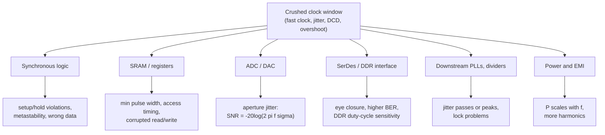

::: basics
### In plain words
The "clock window" is the time you get in each clock cycle to send data through the logic and have it caught safely at the other end. If you shrink that window, by running faster or by letting the clock wobble, the data may not arrive in time. Then the chip makes errors.

### Picture it
Picture a relay race where each runner has one second to carry the baton and hand it over. The hand-over only works if the next runner is ready. If the runner takes longer, or the starting signal comes at a slightly different time each lap, then some hand-overs fail. The track doesn't care about the average lap; it only cares about the worst one.

### Words you need
- **Setup time**: how long data must be steady before the clock edge arrives.
- **Jitter**: cycle-to-cycle variation in the clock edge timing. See [[q0138]].
- **Skew**: a difference in clock arrival time between two flip-flops.
- **Metastability**: a flip-flop output hovering between 0 and 1 because the data changed too close to the clock edge.
- **Duty cycle**: the fraction of each period the clock is high.

### The simplest example
A 1 GHz clock gives a 1 ns window. The flop's clock-to-output takes 0.2 ns, the logic 0.5 ns, setup 0.1 ns, and skew plus jitter 0.1 ns. That totals 0.9 ns, so the margin is 0.1 ns. Now let the PLL add another 0.15 ns of jitter. The total becomes 1.05 ns, which is more than the window, so the margin is -0.05 ns and the data is captured wrong. That is the whole idea. The rest of this page adds the other things a squeezed window breaks, such as ADC sampling and DDR memory.
:::

::: testing
This is an open, slightly ambiguously worded question, and the interviewer wants to see you **define the term sensibly and then reason through consequences**. A strong answer:

1. Defines the "clock window" as the **timing budget per cycle** (the period minus clock-to-Q, logic delay, setup, skew and jitter) and the **clock pulse width** (high and low times), and says what "crushing" it means: a shorter period, more jitter, duty-cycle distortion, or a PLL that overshoots.
2. Explains the immediate failure modes: **setup/hold violations, metastability, minimum-pulse-width violations, runt pulses**.
3. Lists how it **impacts other circuits on the clock**: synchronous logic, memories, ADCs (aperture jitter), SerDes/DDR (eye closure), downstream PLLs, and power/EMI.
4. Mentions detection and mitigation: timing margin, STA with jitter uncertainty, clean supplies, duty-cycle correction, holding downstream logic until lock.
:::

::: why
Real systems fail at the edges of their timing window: a chip that works at room temperature and nominal supply but fails hot, at low voltage, or only after a frequency change is a classic timing-window problem. PLL-generated clocks are central to this, because the PLL sets frequency, jitter and, during retuning, transient frequency. Understanding that **every connected circuit sees the clock's worst-case cycle, not its average** is the key to diagnosing intermittent failures, and to specifying clocks for ADCs, memory and serial links.
:::

::: concepts
- **Setup and hold times**: data must be stable $t_{su}$ before and $t_h$ after the capture edge. See [[q0109]] for CMOS timing context.
- **Timing budget**: $T\ge t_{cq}+t_{logic}+t_{su}+t_{skew}+t_{jitter}$.
- **Jitter and skew**: random/deterministic edge variation and arrival differences across the clock tree.
- **Minimum pulse width / duty cycle**: sequential cells need the clock to be high and low for a minimum time.
- **Metastability**: a flip-flop whose input changes inside its setup/hold window may take an unbounded time to resolve.
- **PLL transients and jitter**: loop overshoot and noise shorten individual cycles. See [[q0138]].
:::

::: answer
"I read 'clock window' as the amount of time you have in each cycle to get data launched, through the logic, and captured safely: the period minus the flop's clock-to-Q, the logic delay, the setup time, clock skew and clock jitter. If you crush that window, by running the clock faster, by letting the PLL add jitter, by distorting the duty cycle, or by a PLL that overshoots when it retunes, the margin goes to zero and then negative.

When that happens, things connected to the clock break in a few ways. Synchronous logic can violate setup or hold, so flip-flops capture the wrong data or go metastable, with an output that hovers between levels for a while. Flops, latches and memories also have minimum clock pulse widths, so if the high or low time shrinks too much, they may not register the clock edge at all. Jitter hurts analog parts too: an ADC sampling with a jittery clock gets timing errors converted to noise, so SNR degrades with input frequency and jitter. Serial links and DDR memory lose eye opening, so bit errors go up, and a duty-cycle error especially hurts DDR because it uses both edges. And downstream PLLs inherit the jitter.

The important idea is that circuits see the worst cycle, not the average cycle. So a PLL with a nice average frequency but big cycle-to-cycle jitter or overshoot gives the logic occasional short cycles, which cause intermittent, hard-to-debug failures, typically at high temperature or low voltage. To avoid it, I'd budget the jitter in timing analysis, hold downstream logic in reset until the PLL is locked, and use clean supplies and low-jitter references."
:::

::: technical
**Setup budget (per cycle).**
$$T_{clk,min}\;\ge\;t_{cq}+t_{logic,max}+t_{su}+t_{skew}+t_{J}$$
where $t_J$ is the clock uncertainty from jitter (period jitter, cycle-to-cycle) and any duty-cycle effects for half-cycle paths. Slack $=T-(\text{sum})$; negative slack is a failure.

**Hold.** $t_{cq,min}+t_{logic,min}\ge t_h+t_{skew}+t_{J,hold}$ (independent of frequency, but eroded by skew and jitter).

**Worst cycle.** The shortest cycle is $T-J_{period,pk}$, not $T$. A PLL with 3σ period jitter of 40 ps at 1 GHz yields cycles as short as 960 ps.

**Pulse width.** A sequential cell requires $t_{high}\ge t_{PWH,min}$ and $t_{low}\ge t_{PWL,min}$. With duty-cycle distortion (DCD) $D$ the worst high time is $T(0.5-D)$. At 1.5 GHz ($T=667$ ps) and $D=10\%$, $t_{high}=267$ ps, which fails a (hypothetical) 300 ps minimum pulse-width spec.

**Metastability.** The probability of an unresolved output after time $t_r$ falls as $e^{-t_r/\tau}$ ($\tau$ is a flop-dependent time constant, typically on the order of tens of ps in modern CMOS; process-dependent). MTBF $=\dfrac{e^{t_r/\tau}}{T_wf_cf_d}$, so losing 100 ps of resolution time with $\tau=20$ ps divides MTBF by $e^5\approx148$.

**ADC aperture jitter.** For a full-scale sine of frequency $f_{in}$ and rms clock jitter $\sigma_j$: $\mathrm{SNR}_{jitter}=-20\log_{10}(2\pi f_{in}\sigma_j)$. 100 MHz with 1 ps → 64.0 dB (about 10.3 effective bits); with 5 ps → 50.1 dB.

**Power.** $P\propto f$; pushing frequency to the limit also raises dynamic power and heating, which slows logic further.

> [!UNCERTAIN]
> The term "clock window" is not a standard defined term in the way setup/hold or duty cycle are. I've interpreted it as the per-cycle timing window (budget and pulse width). See the interpretations section for other readings. Metastability time constants and minimum-pulse-width limits are process- and cell-specific; the numbers here are illustrative.
:::

::: short
"I take the clock window as the time you have each cycle for launch, logic, setup, skew and jitter. If you crush it, with a faster clock, jitter, duty-cycle error or PLL overshoot, you get setup and hold violations and metastability in synchronous logic, minimum-pulse-width failures in flops and memories, SNR loss in ADCs through aperture jitter, and eye closure and bit errors in serial links and DDR. Circuits see the worst cycle, not the average, so the failures are intermittent. You fix it with margin, cleaner clocks and holding logic in reset until lock."
:::

::: long
"I'd first say how I interpret it, because 'clock window' isn't a formal term. I take it as the time available in each clock cycle for everything that has to happen: launching data from one flop, propagating it through logic, and being captured by the next flop with setup time to spare, all minus skew and jitter. So the window is the period minus clock-to-Q, logic delay, setup, skew and jitter. There's a second meaning, the pulse widths: the high and low phases of the clock must each be long enough for flops, latches and memories. Crushing the window means shrinking either: a faster clock, more jitter, duty-cycle distortion, or a PLL that overshoots its target frequency when it retunes.

Why is it bad? The first effect is on the synchronous logic hanging on that clock. If the data arrives inside the setup window, the flop can capture the wrong value or go metastable, where its output sits at an intermediate level for an unpredictable time and may be read differently by different downstream gates. If the clock's high or low time is too short, the flop might not clock at all, or a latch won't open properly; a runt clock pulse can double-clock a counter. Those problems are frequency-sensitive, which is why they show up at high temperature and low supply, where logic is slow.

The second effect is on analog and mixed-signal blocks. An ADC samples at the clock edge, so jitter in that edge gets turned into voltage error proportional to the input slew. With a 100 megahertz input and one picosecond rms jitter you're limited to about 64 dB SNR, and five picoseconds gives you 50 dB, about eight bits. High-speed serial links and DDR memories use the clock to center the sampling point in the data eye, so jitter, skew and duty-cycle error shrink the eye, and the bit error rate climbs. DDR is particularly sensitive to duty cycle since both edges are used.

Third, other PLLs and clock buffers downstream inherit and sometimes amplify the jitter, and a faster clock also costs more power and EMI.

The important point is that every connected circuit sees the worst cycle, not the average one. A PLL can lock to the right average frequency and still produce a short cycle during retuning or from jitter, and that one short cycle breaks the logic intermittently. So I'd handle it with margin in static timing analysis including jitter uncertainty, a clean PLL supply, holding downstream logic in reset until the PLL is locked, and a glitch-free clock switch for frequency changes."
:::

::: terms
- **Clock period ($T$)**: $1/f$; the time available per cycle.
- **Setup time ($t_{su}$)**: how long data must be stable before the capture edge.
- **Hold time ($t_h$)**: how long data must remain stable after the capture edge.
- **Clock skew**: difference in clock arrival time at different flops.
- **Jitter**: deviation of clock edges from their ideal positions (period, cycle-to-cycle, accumulated).
- **Duty-cycle distortion (DCD)**: high time not equal to low time.
- **Minimum pulse width**: smallest high or low time a cell requires.
- **Metastability**: an unresolved state when setup/hold are violated.
- **Aperture jitter**: sampling-time uncertainty in an ADC.
- **Eye diagram**: overlay of data bits showing timing and voltage margin.
:::

::: exceptional
**An average answer** says "it causes timing violations and errors".

**An exceptional answer**:
- States an **explicit interpretation** and gives the **timing-budget equation** with a numeric example.
- Distinguishes **setup/hold** failures from **minimum-pulse-width** and **runt-pulse** failures, and says why **metastability** is probabilistic with an exponential dependence.
- Lists **specific downstream circuits** and their failure mode (logic, memory, ADC aperture jitter with the SNR formula, SerDes/DDR eye, downstream PLLs).
- Points out that circuits see the **worst cycle**, and that PLL **overshoot during lock** or retune can shorten cycles.
- Mentions **detection and fixes**: STA with clock uncertainty, shmoo plots across V/T, clean PLL supply, duty-cycle correction, lock-detect gating, glitch-free switching.
:::

::: mistakes
- **Using the average period** to judge timing. Jitter and overshoot make the worst cycle shorter than $T$.
- **Thinking hold violations are fixed by slowing the clock.** Hold depends on skew and delays, not on frequency.
- **Believing metastability is either "fails" or "works".** It's probabilistic; margin changes the MTBF exponentially.
- **Ignoring duty cycle.** Dual-edge interfaces (DDR) and half-cycle paths depend on it; so do pulse-width limits.
- **Assuming only digital logic cares.** ADCs, DACs, PLLs and RF mixers are very sensitive to clock jitter.
- **Using a PLL output the instant it starts.** During acquisition the frequency can be wrong or overshoot.
- **Treating clock jitter as just a spec on the oscillator** and forgetting power-supply-induced jitter on buffers and clock trees.
:::

::: deep
## What is the "window"?

Every clock cycle in a synchronous design is a race. Data launched by one flip-flop at the clock edge must travel through logic and arrive at the next flip-flop a setup time before the next edge, while everything about the clock itself (skew, jitter) eats into the margin. What's left over is the "window".

```svg
<svg viewBox="0 0 660 170" xmlns="http://www.w3.org/2000/svg" font-family="Inter, sans-serif" font-size="12">
  <text x="20" y="22" fill="var(--d-ink)" font-size="13">One 1 ns clock period (drawn to scale, 0.6 px per ps)</text>
  <rect x="20" y="36" width="72" height="40" fill="var(--d-box)" stroke="var(--d-blue)" stroke-width="1.5"/>
  <text x="56" y="60" text-anchor="middle" fill="var(--d-ink)">t_cq 120</text>
  <rect x="92" y="36" width="360" height="40" fill="var(--d-box)" stroke="var(--d-orange)" stroke-width="1.5"/>
  <text x="272" y="60" text-anchor="middle" fill="var(--d-ink)">logic 600 ps</text>
  <rect x="452" y="36" width="36" height="40" fill="var(--d-box)" stroke="var(--d-purple)" stroke-width="1.5"/>
  <rect x="488" y="36" width="24" height="40" fill="var(--d-box)" stroke="var(--d-red)" stroke-width="1.5"/>
  <rect x="512" y="36" width="30" height="40" fill="var(--d-box)" stroke="var(--d-red)" stroke-width="1.5"/>
  <rect x="542" y="36" width="78" height="40" fill="var(--d-box)" stroke="var(--d-green)" stroke-width="2"/>
  <text x="581" y="60" text-anchor="middle" fill="var(--d-green)">slack 130</text>
  <line x1="470" y1="76" x2="470" y2="96" stroke="var(--d-purple)"/><text x="470" y="110" text-anchor="middle" fill="var(--d-ink)">t_su 60</text>
  <line x1="500" y1="76" x2="500" y2="126" stroke="var(--d-red)"/><text x="500" y="140" text-anchor="middle" fill="var(--d-ink)">skew 40</text>
  <line x1="527" y1="76" x2="527" y2="96" stroke="var(--d-red)"/><text x="548" y="110" text-anchor="middle" fill="var(--d-ink)">jitter 50</text>
  <line x1="20" y1="150" x2="620" y2="150" stroke="var(--d-muted)"/>
  <text x="320" y="165" text-anchor="middle" fill="var(--d-muted)">T = 1000 ps  (budget uses 870 ps)</text>
</svg>
```
Figure: One 1 ns cycle drawn to scale. Launch clock-to-Q (120 ps), logic (600 ps), setup (60 ps), skew (40 ps) and jitter (50 ps) add to 870 ps, leaving 130 ps of slack. Crushing the window means eating that green slack.

Numbers: $120+600+60+40+50=870$ ps, slack $=1000-870=130$ ps.

## Ways the window gets crushed

1. **Faster clock.** At 1.1 GHz, $T=909$ ps.
2. **More jitter.** If the PLL's jitter doubles (50 → 100 ps), that costs another 50 ps. Combine with the faster clock: $120+600+60+40+100=920$ ps against 909 ps leaves **−11 ps** of slack: the design now fails.
3. **Slower logic.** High temperature, low voltage, aging, or supply droop (a droop of 5% can add several percent to delay).
4. **Skew.** Unbalanced clock trees or different loading.
5. **Duty-cycle distortion.** Hurts half-cycle paths and pulse widths.
6. **PLL overshoot or cycle slip.** During retuning the instantaneous frequency can exceed the target (see below).

```plot
{"title":"Setup slack vs clock frequency for the 1 GHz example","x":{"label":"clock frequency","unit":"Hz","min":800000000,"max":1300000000},"y":{"label":"slack","unit":"s","min":-0.0000000003,"max":0.0000000004},
 "vars":{"fixed":0.00000000082},
 "series":[{"label":"jitter 50 ps: fails above 1.149 GHz","fn":"1/x-(fixed+0.00000000005)","color":"accent"},{"label":"jitter 100 ps: fails above 1.087 GHz","fn":"1/x-(fixed+0.0000000001)","color":"red"}],
 "hlines":[{"at":0,"label":"zero slack","color":"muted"}],
 "vlines":[{"at":1000000000,"label":"1 GHz"}]}
```
Figure: Slack falls as frequency rises (the curve is $1/f$ minus the fixed 820 ps overhead plus jitter). Doubling the jitter moves the point of failure from 1.149 GHz to 1.087 GHz. In this model, the design has 130 ps (13%) margin at 1 GHz with 50 ps jitter, but 80 ps with 100 ps jitter. Many field failures are a small increase in jitter or a slight slowdown in logic that pushes a path through zero.

## The worst cycle matters

Timing analysis checks every cycle. A PLL with an excellent average frequency but with period jitter of ±40 ps (peak) produces some cycles that are only 960 ps long. The logic must be fast enough for that cycle, which is why clock uncertainty is subtracted in static timing analysis.

## PLL overshoot: a crushed window with an average that looks fine

```sim
{"id":"pll-lab","fref":10000000,"n":10,"bw":300000,"zeta":0.3}
```
Figure: A fast, lightly damped loop: during lock the VCO frequency overshoots the 100 MHz target before settling. For these few microseconds the clock's period is shorter than nominal, so the timing window downstream is crushed even though the final frequency is correct. Compare with `zeta` = 1. See [[q0138]] for how loop bandwidth and damping set this behaviour.

For a frequency change from 800 MHz to 1 GHz, 21% overshoot gives a transient 1.042 GHz clock; at $\zeta=0.3$, 45% gives about 1.09 GHz. The logic designed with 130 ps of slack at 1 GHz has $T=917$ ps at 1.09 GHz: only 47 ps of slack is left, and if the PLL's jitter is also at the doubled 100 ps during the transient, the path needs 920 ps and the slack goes negative. This is why SoCs hold logic in reset or gate the clock until the PLL reports lock, and why they change frequency in steps.

## Pulse width and duty cycle

Flip-flops, latches, SRAMs and clock-gating cells have minimum high and low times. With period $T$ and duty-cycle error $D$ (fractional deviation from 50%), the worst-case high time is $T(0.5-D)$.

| Frequency | $T$ | Half period | Worst high time with 10% DCD |
|---|---|---|---|
| 1.0 GHz | 1000 ps | 500 ps | 400 ps |
| 1.5 GHz | 667 ps | 333 ps | 267 ps |
| 2.0 GHz | 500 ps | 250 ps | 200 ps |

If a cell requires, say, 300 ps minimum pulse width, it passes at 1 GHz but fails at 1.5 GHz with this distortion. Failures show up as flops missing clocks or latches not opening, and a runt pulse (shorter than the minimum) on a clock gate or counter clock can cause double-counting or an undefined state.

## What each connected circuit sees


Figure: Every consumer of the clock fails differently, and they fail at different margins, so a design can look healthy in logic but have a bad ADC, or vice versa.

**ADC example.** Aperture jitter converts timing noise into amplitude error: $\mathrm{SNR}=-20\log_{10}(2\pi f_{in}\sigma_j)$.

```plot
{"title":"ADC SNR limit from clock jitter","x":{"label":"rms clock jitter","unit":"s","min":0.00000000000001,"max":0.0000000001,"log":true},"y":{"label":"SNR limit","unit":"dB","min":20,"max":120},
 "vars":{"pi2":"2*pi"},
 "series":[{"label":"f_in = 10 MHz","fn":"-20*log10(pi2*10000000*x)","color":"green"},{"label":"f_in = 100 MHz","fn":"-20*log10(pi2*100000000*x)","color":"accent"},{"label":"f_in = 1 GHz","fn":"-20*log10(pi2*1000000000*x)","color":"red"}],
 "hlines":[{"at":74,"label":"≈ 12-bit (74 dB)","color":"muted"}]}
```
Figure: At 100 MHz input a 1 ps rms jitter caps SNR at 64 dB (about 10.3 bits). A 12-bit converter (74 dB) needs about 0.3 ps rms at 100 MHz, or 0.03 ps at 1 GHz. A PLL clock with 5 ps jitter pushes the ADC down to about 8 bits at 100 MHz. This is why high-speed ADCs use low-jitter clock chips and a clean, narrow-band PLL, and why jitter budgets are specified at the *sampling clock*.

## Metastability: the exponential

If data changes inside the flop's setup/hold window, the flop output may linger near the threshold. The probability that it hasn't resolved after a time $t_r$ drops as $e^{-t_r/\tau}$. Crushing the window removes resolution time: if the clock gets 100 ps shorter and $\tau=20$ ps, MTBF falls by $e^{5}\approx148\times$. A design with centuries of MTBF can drop to months. That's why metastability failures are rare and intermittent, and why synchronizers use two or more flops.

## Fixes and checks

- **Budget it**: STA with realistic clock uncertainty (jitter + skew + margin) at slow and fast corners; include supply droop.
- **Clean the clock**: low-jitter reference, quiet PLL supply, short clock routes; duty-cycle correctors for DDR/dual-edge.
- **Gate until lock**: use the PLL lock-detect to release resets; change frequency in steps; glitch-free clock switching.
- **Reduce the load**: pipeline long paths, lower the clock, or use more parallel logic.
- **Measure**: jitter and duty cycle at the consumer (not only at the PLL), shmoo plots over voltage and temperature to find where it fails.
:::

::: applications
- **Processor and SoC frequency scaling**: ensuring logic has timing margin during PLL retuning.
- **High-speed ADC/DAC clocking**: jitter-limited SNR; clock cleaning and low-jitter distribution.
- **DDR memory and SerDes**: duty-cycle and jitter budgets for both clock edges and eye-diagram margins.
- **FPGA and ASIC timing closure**: clock uncertainty and pulse-width checks in STA.
- **Clock-gating and multi-clock systems**: glitch-free clock multiplexers and lock-gated resets.
- **Overclocking and margining**: shmoo plots mapping the pass/fail boundary in frequency, voltage and temperature.
:::

::: assumptions
I interpreted "crushing the clock window" as squeezing the **per-cycle timing budget** (and pulse widths) available to circuits connected to the clock. The numbers are illustrative: a 1 GHz synchronous path with typical-looking delays, not data from a specific process. I assumed edge-triggered flip-flops and a single clock domain; across clock domains, synchronizers and clock-domain-crossing analysis govern. The ADC SNR formula assumes a full-scale sine and only jitter noise (other noise sources add). The metastability exponent assumes a single time constant $\tau$. Also note that **jitter measurements depend on bandwidth and on whether period, cycle-to-cycle or accumulated jitter is meant**; check which the datasheet uses. Static timing analysis tools handle this with clock-uncertainty values and corner analysis.
:::

::: followups
### If a design passes timing at 1 GHz with 130 ps of slack, how much can PLL jitter grow before it fails?
With 130 ps of slack, the jitter allowance could in principle grow from 50 ps to about 180 ps before slack reaches zero (everything else unchanged). If your margin policy keeps at least 10% of the period (100 ps) as slack, only about 30 ps of additional jitter is allowed. In practice, keep more headroom for temperature, voltage and aging.

### Why does running at lower voltage make it fail even though the clock frequency is unchanged?
Lower supply voltage slows the gates, increasing $t_{cq}$ and $t_{logic}$, which shrinks the slack; the setup path may now exceed the period. It also increases the delay variation and the sensitivity to noise. That is why frequency-voltage scaling is done together, and why shmoo plots show pass/fail regions bounded by both axes.

### How can a PLL with correct average frequency still crush the window of other circuits?
Through jitter and transients. Cycle-to-cycle and period jitter produce cycles shorter than the average period, and overshoot during lock or retuning makes the frequency temporarily higher. Logic is timed against the shortest cycle, so failures are intermittent. Supply noise on the PLL or clock buffers also modulates edge timing.

### Does a hold violation get worse or better if you slow the clock?
Neither: hold checks compare the data change against the *same* capture edge, so they don't depend on the period. They depend on min path delay, skew and jitter. Slowing the clock doesn't fix hold violations (you fix them by adding delay to the short path or reducing skew). That is one reason hold failures are fatal across all frequencies.

### Harder: an ADC board works with a clean lab clock but loses 6 dB of SNR when its clock comes from a PLL clock-synthesizer chip. How do you diagnose?
First compute the implied jitter from the SNR loss (for example 6 dB means twice the jitter: from 1 ps to 2 ps at 100 MHz). Measure the clock's phase noise or jitter at the ADC's clock pin, integrated over the relevant offset range (the ADC cares about jitter from near-carrier to the Nyquist band). Check the PLL loop bandwidth: a wide loop passes reference and charge-pump noise; the VCO noise and spurs matter outside. Check the PLL supply noise, the buffer's slew rate (jitter is noise divided by slew), and add a low-pass/band-pass filter or a lower-jitter clock cleaner. Verify with the formula $-20\log_{10}(2\pi f_{in}\sigma_j)$.
:::

::: interpretations
"Why is crushing the clock window bad?" is ambiguous and not standard terminology. Possible readings:

1. **The per-cycle timing window** (setup/hold/budget) squeezed by a faster clock, jitter, skew or overshoot. *My main reading, since it follows the PLL-speed questions in this section ([[q0134]], [[q0138]]).*
2. **The clock pulse-width window** (high/low time) shrunk by duty-cycle distortion or a very fast clock, causing minimum-pulse-width failures and runt pulses. I covered this too.
3. **The frequency/lock window**: forcing the PLL beyond its VCO range or lock-in range. The consequence is the same: the output isn't the intended clock.
4. **The data-valid eye**: the window for sampling data at the receiver, which closes as clock and data jitter increase.

The second sentence, "How can this impact other circuits that may be connected to the clock?", points to the downstream consumers, which is how I structured the answer. For the loop dynamics that cause overshoot or noise, see [[q0138]].
:::

::: references
- Johnson & Graham, *High-Speed Digital Design: A Handbook of Black Magic*: timing budgets, skew and jitter in clock distribution.
- Weste & Harris, *CMOS VLSI Design: A Circuits and Systems Perspective*: sequencing, setup/hold, clock skew and metastability chapters.
- Kester (ed.), *The Data Conversion Handbook* and Analog Devices tutorials on aperture jitter and ADC SNR: the jitter-limited SNR relationship $-20\log_{10}(2\pi f\sigma_j)$.
- Razavi, *Design of Analog CMOS Integrated Circuits*: the PLL chapter, jitter and phase noise.
- Gardner, "Charge-Pump Phase-Lock Loops", IEEE Transactions on Communications, 1980, for the sampled-loop dynamics relevant to overshoot.
:::

::: rubric
- Defines the clock window (per-cycle timing budget and/or pulse width) and what "crushing" means :: The term is ambiguous, so stating your interpretation is essential.
- Gives the budget equation and shows how reduced margin leads to setup/hold failure :: Shows quantitative timing understanding.
- Mentions metastability and minimum-pulse-width/runt-pulse failure :: Core digital failure modes.
- Names effects on other circuits (ADC jitter SNR, SerDes/DDR eye, downstream PLLs, power) :: Directly answers the second sentence.
- States that circuits see the worst cycle (jitter, PLL overshoot), not the average :: Key insight explaining intermittent failures.
- Gives mitigations (margin in STA, clean supply, lock-gated reset, duty-cycle correction) :: Shows engineering judgment.
:::

::: quiz
```json
[
 {"type":"numeric","level":"fundamental","q":"A path has $t_{cq}=100$ ps, logic 550 ps, setup 50 ps, skew 30 ps and jitter 40 ps. At 1.2 GHz ($T=833$ ps), what is the setup slack in ps?","answer":63,"tolerance":0.03,"unit":"ps","explain":"Overhead $=100+550+50+30+40=770$ ps; $T=1/1.2\\text{ GHz}=833$ ps; slack $=833-770=63$ ps."},
 {"type":"mcq","level":"fundamental","q":"Which problem is NOT fixed by reducing the clock frequency?","options":["Setup violation","Hold violation","A path that is slightly too slow","Minimum-pulse-width violation caused by a very short period"],"answer":1,"explain":"Hold is checked against the same capture edge and doesn't depend on the period; it depends on minimum path delay, skew and jitter."},
 {"type":"numeric","level":"intermediate","q":"An ADC samples a 200 MHz sine with a clock having 0.5 ps rms jitter. What is the jitter-limited SNR in dB?","answer":64,"tolerance":0.02,"unit":"dB","explain":"$-20\\log_{10}(2\\pi\\cdot2\\times10^8\\cdot0.5\\times10^{-12})=-20\\log_{10}(6.28\\times10^{-4})=64.0$ dB."},
 {"type":"numeric","level":"intermediate","q":"A 2 GHz clock has a duty-cycle distortion of ±8% (worst high time $=T(0.5-0.08)$). What is the worst-case high time in ps?","answer":210,"tolerance":0.02,"unit":"ps","explain":"$T=500$ ps; $t_{high}=500\\times0.42=210$ ps."},
 {"type":"mcq","level":"intermediate","q":"A PLL retunes from 800 MHz to 1 GHz and overshoots by 30%. What is the peak transient frequency?","options":["1.06 GHz","1.20 GHz","1.30 GHz","1.03 GHz"],"answer":0,"explain":"Step = 200 MHz; 30% overshoot = 60 MHz; peak = 1.06 GHz, so logic timed for 1 GHz sees a shorter period than nominal."},
 {"type":"truefalse","level":"advanced","q":"With a metastability time constant $\\tau$, losing $3\\tau$ of resolution time reduces MTBF by a factor of about 20.","answer":true,"explain":"MTBF $\\propto e^{t_r/\\tau}$, so losing $3\\tau$ divides it by $e^3\\approx20$."}
]
```
:::
