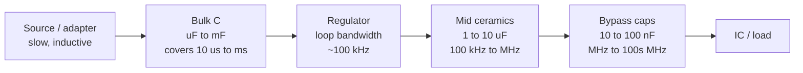

::: basics
### In plain words
Bulk capacitance is a large capacitor, tens to thousands of microfarads, placed where power enters a board or at a regulator. It is a local energy tank. It covers the slower, bigger demands that the regulator needs a few microseconds to catch up with.

### Picture it
Think of a water tower in a town. The pump at the reservoir cannot change speed instantly. When demand surges, the tower's stored water covers the gap until the pump catches up. A tower is too big and too far away to handle quick flicker at each tap, though. For that you need the small local buckets, which are the small ceramic capacitors.

### Words you need
- **Bulk capacitor**: a big capacitor that holds a large reserve of charge. See [[q0032]].
- **Droop**: the dip in voltage when a load suddenly asks for more current.
- **Hold-up**: keeping the output alive during a brief loss of input power.
- **ESL**: a tiny built-in inductance (a resistance to fast changes in current) in every real capacitor. It makes big capacitors poor at handling very fast changes.
- **Capacitance**: how much charge a capacitor stores per volt. See [[q0022]].
- **Loop bandwidth**: how quickly the regulator's feedback reacts. A 100 kHz loop needs roughly 1.6 µs to respond.

### The simplest example
A load suddenly asks for 2 A more. A regulator with a 100 kHz loop needs about $1/(2\pi \times 100\text{ kHz}) \approx 1.6$ µs to react. During that gap the capacitor alone supplies the extra current, and its voltage sags. The sag is roughly current times time divided by capacitance. To keep it under 0.1 V you need $C \approx 2 \times 1.6\ \mu\text{s}/0.1\ \text{V} \approx 32$ µF. Twice the capacitance halves the droop. That is the whole idea. The rest of this page writes this as the sizing rule $\Delta I/(2\pi f_c \Delta V)$, adds the other jobs of bulk capacitance, and explains why ceramics sit next to it.
:::

::: testing
Whether you can define bulk capacitance by its **job** (low-frequency energy storage at a rail or board entry), not just "big capacitor", and distinguish it from bypass/decoupling capacitance. The interviewer is listening for: why it is needed (regulator and cable can't respond instantly, hold-up, input ripple, hot-plug), how to size it from $C=I\Delta t/\Delta V$ or from energy, the technology trade-offs (electrolytic, polymer, tantalum, ceramic) and the fact that it is *not* effective at high frequency, which is why small caps are also needed.
:::

::: why
Every power design has a bulk capacitor somewhere: at the regulator input and output, at a connector where power enters the board, at a motor driver. Too little and the rail sags on a load step or when the source is momentarily interrupted. Too much and you get large inrush current, slow start-up, and capacitors that dominate cost and area. Choosing the right technology (ripple current rating, ESR, DC bias, polarity, lifetime) is a common board-bring-up and reliability issue. This question is also a building block for [[q0142]] (why the bank of capacitors has many values).
:::

::: concepts
- **Capacitor charge and energy**: $Q=CV$, $i=C\,dv/dt$, $E=\tfrac12CV^2$. See [[q0022]].
- **Bulk vs bypass**: bulk handles lower-frequency, larger energy needs; bypass/decoupling handles high-frequency transients. See [[q0032]].
- **ESR/ESL and SRF**: large capacitors have more ESR and ESL, so their useful band is low. See [[q0030]].
- **Load-step droop**: during a step, $\Delta V\approx\Delta I\,\Delta t/C+\Delta I\cdot ESR$ until the regulator catches up.
- **Hold-up energy**: $E=\tfrac12C(V_1^2-V_2^2)$ keeps a load running when input power drops.
- **Ripple current**: capacitors must handle the RMS current of the converter they serve without overheating.
:::

::: answer
"Bulk capacitance is the large-value capacitance, typically tens to thousands of microfarads, that you put at the point where power enters a board or at a regulator's input or output. It acts as a local energy tank for the slower and bigger part of the load's demands.

It does a few things. When a load suddenly asks for more current, the regulator takes a few microseconds to respond, so the bulk cap supplies the difference and limits the droop. It smooths ripple on a converter input, since a buck draws pulsed current from its input. It provides hold-up, so a brief interruption of the source doesn't reset the system. And at a connector it helps damp the inductance of the cable so a hot-plug doesn't ring.

You size it by charge or energy. For a 2 amp step where the regulator loop has a 100 kilohertz bandwidth and I can tolerate 100 millivolts, I need roughly $\Delta I/(2\pi f_c\Delta V)$, about 32 microfarads.

What bulk capacitance doesn't do is fast transients. Big capacitors have high ESL, so above maybe a hundred kilohertz to a megahertz they look inductive. That's why bulk sits alongside smaller ceramics, which cover the high-frequency end."
:::

::: technical
**Definition.** Bulk capacitance is the large-value (typically 10 µF to several mF) capacitance at a regulator input/output or board power entry whose job is to supply or absorb *low-frequency* current (sub-MHz) and store energy. Bypass/decoupling capacitance (typically 10 nF-10 µF ceramics near the load) handles higher frequencies. The split is by function, and the boundary is set by where each part's self-resonant frequency falls.

**Sizing methods.**
1. *Load step with a finite-bandwidth regulator.* Charge missing before the loop reacts is roughly $\Delta Q\approx\Delta I\cdot t_{resp}$ with $t_{resp}\approx1/(2\pi f_c)$, so
$$C\approx\frac{\Delta I}{2\pi f_c\,\Delta V}$$
Example: $\Delta I=2$ A, $f_c=100$ kHz, $\Delta V=100$ mV gives $C\approx32$ µF. Add the ESR drop, $\Delta I\cdot ESR$, separately.
2. *Hold-up energy.* To hold a load of power $P$ for time $t$ while the bus decays from $V_1$ to $V_2$: $C=\dfrac{2Pt}{V_1^2-V_2^2}$. A 24 W load, 12 V falling to 9 V, 10 ms: $C=\dfrac{2\cdot24\cdot0.01}{144-81}=7.6$ mF.
3. *Input ripple.* A buck draws pulsed current; the input capacitor must supply $I_{Cin,rms}=I_{out}\sqrt{D(1-D)}$. For 2 A out at $D=0.275$ this is 0.89 A RMS.
4. *Cable/hot-plug damping.* A supply cable with $L$ and bulk $C$ forms an LC with $Z_0=\sqrt{L/C}$. An undamped step can overshoot to nearly $2V_{in}$. Keep the bulk capacitor's ESR comparable to $Z_0$, or add a damping network.

**Technologies.** Aluminium electrolytic (cheap, high $C$, high ESR/ESL, lifetime depends on temperature and ripple current), polymer/hybrid (lower ESR, long life), tantalum/polymer-tantalum (stable, but surge-sensitive and can fail short), MLCC (very low ESR, but capacitance falls with DC bias and temperature, and can ring with cable inductance).

> [!UNCERTAIN]
> Typical ESR, ESL and lifetime figures differ by manufacturer series and temperature. Use the datasheet's ripple-current, ESR-versus-frequency and endurance specifications.
:::

::: short
"Bulk capacitance is the large capacitance, tens to thousands of microfarads, at a board's power entry or a regulator's input or output. It's the local energy tank: it supplies load steps while the regulator catches up, smooths converter input ripple, and provides hold-up. You size it from $C = I\Delta t/\Delta V$ or from energy. It's slow, though. Big capacitors are inductive above a few hundred kilohertz, so small ceramics handle the fast stuff."
:::

::: long
"Bulk capacitance is the big capacitance you put where power comes into a board, or on a regulator's input and output. Typically tens of microfarads up to a few thousand. Compared with the small decoupling capacitors next to each IC, the bulk handles the slower, larger energy demands.

There are a few reasons you need it. The first is load steps. If the load jumps by 2 amps, the regulator takes some microseconds to respond. During that time the output capacitor supplies the charge, and the voltage droops by about $\Delta I/(2\pi f_c C)$ plus the ESR drop. With a 100 kHz loop and a 100 millivolt budget that gives roughly 32 microfarads. The second is input ripple: a buck pulls pulsed current from its input, with an RMS of $I_{out}\sqrt{D(1-D)}$, and the bulk capacitor supplies that so the source doesn't see it. Third is hold-up, where the capacitor has to keep the system running through a brief outage. Energy is half C times the difference of V-squared, so 24 watts for 10 milliseconds from 12 down to 9 volts needs about 7.6 millifarads. Fourth, at a cable or connector the bulk capacitor works with the cable inductance, and you need enough ESR or damping to avoid ringing on hot-plug.

Choosing the type is a trade-off. Electrolytics are cheap with large capacitance, but ESR and lifetime depend on temperature and ripple current. Polymers have low ESR and long life. Tantalums are compact but dislike surges. Ceramics have the lowest ESR but lose capacitance with DC bias.

And what bulk doesn't do is high frequency. Its package inductance makes it useless above maybe a megahertz, which is why you also put small ceramics near the loads."
:::

::: terms
- **Bulk capacitor**: large-value capacitor at a rail entry or regulator terminal for low-frequency energy storage.
- **Bypass / decoupling capacitor**: small capacitor near a load pin for high-frequency current. See [[q0032]].
- **Hold-up time**: how long a supply keeps the load alive after input power is lost.
- **ESR**: equivalent series resistance; causes $I\cdot ESR$ droop and heating.
- **Ripple current rating**: the RMS (or peak) AC current a capacitor may carry for its rated life.
- **Inrush current**: surge when charging an uncharged bulk capacitor, $C\,dV/dt$.
- **DC-bias derating**: the loss of effective capacitance of class-2 ceramics with applied voltage.
- **Load transient response**: droop and overshoot of the rail after a load step.
:::

::: exceptional
**An average answer** says "it's a big capacitor that stores charge and smooths the supply."

**An exceptional answer**:
- Defines bulk by *function and frequency range* and contrasts it with bypass capacitors.
- Gives three or four reasons (load step, input ripple, hold-up, cable damping) rather than only "smoothing".
- Sizes it with a formula and numbers: $C\approx\Delta I/(2\pi f_c\Delta V)$ or $2Pt/(V_1^2-V_2^2)$.
- Discusses technology trade-offs (ESR, ripple current rating, DC bias, tantalum surge risk, electrolytic lifetime).
- Mentions inrush at hot-plug and why too much bulk is also a problem.
:::

::: mistakes
- **"Bulk capacitors filter high-frequency noise."** Large parts have high ESL; they work at low frequency. Small ceramics handle high frequency.
- **Sizing only by the capacitance value.** The ripple current rating and ESR drop can matter more than $C$.
- **Forgetting DC-bias derating.** A 22 µF 6.3 V 0805 ceramic at 5 V may be under 10 µF.
- **Ignoring inrush.** An uncharged 1000 µF capacitor on a 12 V rail can draw amps at plug-in, and the source or connector may trip or arc.
- **Hot-plugging a ceramic bulk cap onto a long cable.** The cable inductance and low-ESR capacitor ring, and the voltage can reach about twice the supply. Use damping or a bulk electrolytic with the right ESR.
- **Placing the bulk capacitor far from the regulator or load.** Its benefit shrinks if the path between it and the load is inductive.
:::

::: deep
## What problem does bulk capacitance solve?

Any real source has limits. A regulator has a control loop with bandwidth $f_c$ (maybe 50-500 kHz for a buck), a cable has inductance (about 1 µH per metre or so) and a battery or adapter has internal resistance. None of these can change the current in a nanosecond or microsecond. A load, however, can. Bulk capacitance fills the time gap between "the load asked" and "the source can deliver".


Figure: The capacitor hierarchy. Each stage covers a time (or frequency) band: bulk covers microseconds to milliseconds, ceramics the nanoseconds to microseconds. The regulator's own bandwidth defines where bulk takes over from the loop.

## Sizing from a load step

When the load steps by $\Delta I$, the regulator output current is still the old value until the loop reacts, roughly $t_{resp}\approx1/(2\pi f_c)$. The capacitor supplies the missing current, so

$$\Delta V\approx\frac{\Delta I}{2\pi f_c C}+\Delta I\cdot ESR$$

Solving for $C$ with $\Delta I=2$ A, $f_c=100$ kHz, $\Delta V=100$ mV (neglecting ESR):

$$C\approx\frac{2}{2\pi\cdot10^5\cdot0.1}=31.8\ \mu\text{F}$$

Round up and derate for DC bias: a 47 µF part rated for the rail is reasonable. If the capacitor is an electrolytic with 30 mΩ of ESR, the ESR step alone is $2\times0.03=60$ mV, so you may need a polymer or ceramic with lower ESR, or several in parallel.

```plot
{"title":"Droop vs output capacitance for a 2 A step (f_c = 100 kHz)","x":{"label":"Output capacitance C","unit":"F","min":0.00001,"max":0.001,"log":true},"y":{"label":"Capacitive droop","unit":"V","min":0.001,"max":3,"log":true},
 "vars":{"di":2,"fc":100000},
 "series":[{"label":"ΔV = ΔI / (2π f_c C)","fn":"di/(2*PI*fc*x)"}],
 "hlines":[{"at":0.1,"label":"100 mV budget","color":"orange"}],
 "points":[{"x":0.0000318,"y":0.1,"label":"32 µF"}]}
```
Figure: Droop falls inversely with $C$. The 100 mV budget needs about 32 µF at $f_c=100$ kHz; a slower loop (say 20 kHz) would need five times more, which is why a fast loop can substitute for capacitance.

```sim
{"id":"buck-control","l":4.7e-6,"c":47e-6,"esr":0.005,"fc":100000,"pm":60,"istep":2}
```
Figure: Change the output capacitance and the crossover frequency and watch the undershoot after the load step. Smaller $C$ or lower $f_c$ increases the droop, as the formula predicts.

## Hold-up time

When input power disappears, the bulk capacitor supplies the load until the voltage falls to the minimum the downstream converter can work from. The energy available is $\tfrac12C(V_1^2-V_2^2)$ and the load takes $P\cdot t$ (ideal, ignoring converter efficiency). Therefore

$$C=\frac{2Pt}{V_1^2-V_2^2}$$

For a 24 W load, 12 V falling to 9 V, over 10 ms: $C=\dfrac{2\cdot24\cdot0.01}{144-81}=7.6$ mF. A switching converter downstream draws *more* current as the voltage falls (constant power), so the real value needs efficiency and margin. Hold-up requirements appear for brownout ride-through, memory write-back, and controlled shutdown.

## Input bulk for a buck

A buck's input current is a train of pulses (the current is on only while the high-side FET conducts). The RMS current in the input capacitor is $I_{Cin,rms}=I_{out}\sqrt{D(1-D)}$, which is at most $I_{out}/2$ at $D=0.5$. For 3.3 V from 12 V ($D=0.275$) and 2 A: $0.89$ A RMS. The capacitor must carry that without overheating, which is a *ripple current rating* check, not only a capacitance check. See [[q0193]] for the input capacitor of a buck.

## Hot-plug, inrush and cable ringing

Connecting a power supply to an uncharged capacitor draws a surge. With a stiff source, $I\approx C\,dV/dt$ limited only by the cable resistance and ESR. For 1000 µF charging to 12 V in 10 ms the average current is $1000\ \mu F\times12/0.01=1.2$ A, but if it charges in 100 µs it is 120 A. Energy stored is $\tfrac12CV^2=72$ mJ.

The cable inductance forms an LC with the capacitor. With 1 µH and 100 µF, $Z_0=\sqrt{L/C}=0.1\ \Omega$ and $f_0=15.9$ kHz. If the capacitor's ESR and the cable resistance are much smaller than $Z_0$, a voltage step rings and can overshoot to nearly $2V_{in}$, which can destroy 16 V parts on a 12 V bus. The remedies are controlled turn-on (hot-swap controller, soft-start), an electrolytic whose ESR is near $Z_0$ in parallel with the ceramics, or an RC damping branch.

## Choosing the technology

| Type | Strengths | Watch out for |
|---|---|---|
| Aluminium electrolytic | Cheap, large $C$ and high voltage | High ESR/ESL, drying out with temperature and ripple |
| Polymer / hybrid | Low ESR, long life | More expensive, voltage limits |
| Tantalum / polymer-Ta | Compact, stable | Surge-current sensitivity, can fail short; derate voltage |
| MLCC | Very low ESR, no polarity | DC-bias capacitance loss, microphonics, cable-ringing risk |

## Where it sits on the board

Put bulk capacitors at the power entry point (to protect the board from the cable) and close to each regulator's input and output (to supply the loop gap). It does not need to be right at each IC. Keeping it near the regulator minimises the inductive path between the bulk and the converter it supports; the ICs get small ceramics instead. The same bulk capacitors usually dominate the board's "capacitive start-up" behaviour, so sequencing and inrush limiters are chosen with them in mind.

## Capacitors are not capacitors above their self-resonance

The ideal formula $\Delta V=\Delta I/(2\pi f_cC)$ treats $C$ as a pure capacitor. A real part is a series $R$-$L$-$C$ with impedance

$$|Z(f)|=\sqrt{ESR^2+\left(2\pi fL_{esl}-\frac{1}{2\pi fC}\right)^2}$$

Below the self-resonant frequency $f_{SRF}=1/(2\pi\sqrt{L_{esl}C})$ it behaves like a capacitor, above it like an inductor, and at resonance it is just the ESR. For a 47 µF electrolytic with an assumed 30 mΩ ESR and 10 nH ESL, $f_{SRF}\approx232$ kHz, and the ESR "corner" $1/(2\pi\,ESR\,C)$ is about 113 kHz. That is the same band as a 100 kHz loop crossover, so the electrolytic's ESR, not its capacitance, sets the droop at the moment the load steps. A bank of four 22 µF MLCCs (assumed 2 mΩ and 1.5 nH for the bank, including mounting) has a much lower floor.

```plot
{"title":"Impedance of a 47 µF electrolytic vs a 4×22 µF ceramic bank (assumed parasitics)","x":{"label":"Frequency","unit":"Hz","min":1000,"max":10000000,"log":true},"y":{"label":"|Z|","unit":"Ω","min":0.001,"max":10,"log":true},
 "vars":{"w":6.2832},
 "series":[{"label":"47 µF electrolytic (ESR 30 mΩ, ESL 10 nH)","fn":"sqrt(0.03^2+(w*x*10e-9-1/(w*x*47e-6))^2)","color":"red"},
           {"label":"~44 µF effective MLCC bank (ESR 2 mΩ, ESL 1.5 nH)","fn":"sqrt(0.002^2+(w*x*1.5e-9-1/(w*x*44e-6))^2)","color":"blue"}],
 "vlines":[{"at":100000,"label":"100 kHz loop crossover","color":"muted"}]}
```
Figure: Both curves fall at -20 dB/decade where capacitance dominates, then flatten at the ESR and finally rise as the ESL takes over. At 100 kHz the two are similar because capacitance still dominates, but above roughly 200 kHz the electrolytic sits on its 30 mΩ ESR floor while the ceramic bank dips to a few milliohms near its resonance. That is why polymer or ceramic is chosen for fast load steps and for the edges of a transient.

## A complete worked example

Rail: 12 V, load steps 0 A to 2 A, loop crossover 100 kHz, droop budget 100 mV, capacitance-only requirement of 31.8 µF effective.

1. A 22 µF, 25 V X5R ceramic can lose a large fraction of its capacitance at 12 V of bias. Assume 50% loss as a conservative planning number, so each part is worth 11 µF.
2. Three parts give only 33 µF effective, with no margin. Four parts give 44 µF effective and a predicted capacitive droop of $2/(2\pi\cdot10^5\cdot44\times10^{-6})=72$ mV.
3. ESR adds $2\times(2\ \text{mΩ})=4$ mV, and the ESL adds $L\,di/dt=1.5\ \text{nH}\times2\ \text{A}/1\ \mu\text{s}\approx3$ mV. Total predicted droop is about 80 mV, inside the 100 mV budget.
4. If you used the 47 µF electrolytic alone, the capacitive droop is 68 mV but the ESR step is $2\times0.03=60$ mV, for 128 mV total, which misses the budget even though the capacitance looked sufficient.

> [!UNCERTAIN]
> DC-bias loss depends on dielectric, voltage rating, case size and vendor. 50% at 12 V on a 25 V rated 0805 is plausible, but read the manufacturer's DC-bias curve for the exact part. Do not trust the nominal value on the label.

## Limiting cases

If $C\to0$ the droop is set by the loop and ESL alone and the regulator becomes the only thing between the load and the cable, so the rail can collapse in microseconds. If $C\to\infty$ the droop vanishes but start-up inrush grows ($I=C\,dV/dt$), the hot-plug event gets harsher, and some regulators lose phase margin or fail to start inside their soft-start window. Some LDOs and older buck controllers specify a *minimum* ESR or a maximum capacitance, so more bulk is not automatically safer.

## Verifying on the bench

- Measure capacitance with an LCR meter, but remember it measures near zero DC bias and will not show ceramic bias loss. Check the manufacturer's bias curve or measure with a bias tee.
- Apply a load step with an electronic load in fast-transient mode (1 A/µs or faster) and probe the capacitor pads directly with a tip-and-barrel connection, 20 MHz bandwidth limit off for the edge and on for the settled value. The droop and recovery should match the prediction.
- Check hot-plug ringing with the actual cable, a current probe on the supply lead, and single-shot capture. Overshoot well above the nominal rail means the LC is under-damped.
- Run a ripple-current check on the input bank: measure case temperature after thermal soak at full load. A 0.89 A RMS ripple through 30 mΩ is about 24 mW, small, but electrolytic life roughly halves per 10 °C rise by the usual rule of thumb.
:::

::: applications
- **Power-entry bulk on a 12 V board**: a 100-470 µF polymer or electrolytic at the barrel jack or connector, to damp the cable and supply low-frequency demand.
- **Buck converter input**: ceramic 10-22 µF per amp-ish of ripple current, with an electrolytic or polymer in parallel to damp the source.
- **Motor drives**: bulk capacitors on the DC link absorb regenerative energy and supply current spikes during PWM.
- **Server and storage backup**: bulk or supercapacitor hold-up allows write-back of cache to flash after a power loss.
- **LED and camera flash drivers**: a bulk capacitor stores the energy for short, high-current pulses.
:::

::: assumptions
- **Linear, ideal capacitor** for the sizing formulas. Real capacitors have DC-bias loss, ESR and ESL, which change the result.
- **Regulator loop modelled as a first-order response** at crossover $f_c$. Real loops have phase margin and nonlinear large-signal behaviour, so simulate or measure.
- **Constant power downstream** in the hold-up calculation. With converter efficiency below 100% you need more capacitance.
- **Terminology is not fully standard.** Some designers call any capacitor above ~10 µF "bulk"; others reserve it for the electrolytic/polymer at the board entry. The functional definition (low-frequency energy tank) is the safest one to state.
- **Alternative valid answer.** In power-supply design, "bulk capacitor" can also mean the main DC-link capacitor after a rectifier, which sets ripple and hold-up for the whole supply.
:::

::: followups
### How is bulk capacitance different from a decoupling capacitor?
Bulk capacitors are large (tens of µF to mF), sit at the regulator or board entry, and cover low-frequency, high-energy needs. Decoupling capacitors are small (nF to µF), sit next to the IC power pins, and cover fast transients. Bulk parts have high ESL, so they're ineffective above about a megahertz, which is why both are used. See [[q0032]].

### How would you size bulk capacitance for a 3.3 V rail with a 2 A step and a 100 mV droop budget?
With a 100 kHz loop, $C\approx\Delta I/(2\pi f_c\Delta V)=32$ µF. I'd add ESR drop, derate ceramics for bias, and then use something like 2×47 µF (or 100 µF at the output), and verify with a load-step test or simulation.

### What happens if you use too much bulk capacitance?
Larger inrush current at start-up or hot-plug, slower start-up, possible tripping of a current limit or a hot-swap controller, higher cost and area, and in switching regulators a change in the output pole that may affect loop stability. Some regulators specify a maximum output capacitance.

### Why is ESR important for bulk capacitors?
ESR creates a voltage step $\Delta I\cdot ESR$ at the beginning of a load transient and dissipates $I_{rms}^2\cdot ESR$ as heat. In an electrolytic, that heating shortens the lifetime. On the other hand, a little ESR provides damping for cable/LC resonances. So you pick it according to the role.

### Hold-up: if the bus falls from 12 V to 9 V over 10 ms for a 24 W load, how much capacitance?
$C=2Pt/(V_1^2-V_2^2)=2\cdot24\cdot0.01/63=7.6$ mF (ideal). Allow for converter efficiency (say 90%), which gives about 8.5 mF, and for capacitor tolerance and ageing, so I'd specify more like 10 mF.

### Scenario: your 12 V board resets when you plug in the adapter, but works if you power it from a bench supply with long leads. What might be going on?
Likely cable-inductance ringing or inrush. A short adapter cable with low-ESR ceramics at the input can ring above the nominal voltage or dip below the UVLO threshold due to the surge. I'd scope the input at the connector in single-shot mode, check for overshoot beyond the absolute maximum rating, and add a damping electrolytic or hot-swap/soft-start circuit.
:::

::: interpretations
"Bulk capacitance" is used in two ways: (1) the *function*, large low-frequency charge storage on a rail (this page), and (2) the *component*, a specific large capacitor, often electrolytic/polymer. The related questions [[q0032]] (bulk vs bypass) and [[q0553]] (routing decoupling and bulk capacitors) cover the comparison and the layout, and [[q0142]] covers why the bank of smaller capacitors exists.
:::

::: references
- Texas Instruments, "Basic Calculation of a Buck Converter's Power Stage" (SLVA477): input and output capacitor selection and ripple.
- Erickson & Maksimovic, *Fundamentals of Power Electronics*: converter input/output filtering and capacitor ripple current.
- Johnson & Graham, *High-Speed Digital Design*: power-system decoupling, bulk vs local capacitors.
- Capacitor manufacturers' datasheets and application notes for ripple current, ESR vs frequency, endurance and DC-bias curves.
:::

::: rubric
- Defines bulk capacitance as large-value capacitance for low-frequency energy storage at a rail or board entry :: This is the definition the question asks for and distinguishes it from bypass capacitors.
- Gives at least two roles (load-step support, input ripple, hold-up, cable damping) :: Shows you understand why it is there, not just that it exists.
- Sizes it with $C=I\Delta t/\Delta V$ or an energy formula with numbers :: Interviewers want engineering quantification.
- Explains that it is ineffective at high frequency because of ESL, so ceramics are also needed :: Links back to the bypass/decoupling hierarchy.
- Discusses technology trade-offs (ESR, ripple current, DC bias, tantalum surge) :: Practical component selection knowledge.
- Mentions inrush/hot-plug or maximum capacitance limits :: Shows awareness of the downside of too much bulk capacitance.
:::

::: quiz
```json
[
 {"type":"mcq","level":"fundamental","q":"Which description best matches bulk capacitance?","options":["A tiny capacitor next to an IC pin for GHz noise","A large capacitor at a regulator or power entry that supplies slower, larger energy demands","A capacitor in series with a signal to block DC","A capacitor used as a memory element"],"answer":1,"explain":"Bulk capacitance is large, low-frequency energy storage. Tiny capacitors next to pins are bypass/decoupling parts."},
 {"type":"numeric","level":"fundamental","q":"What is the energy stored in a 1000 µF capacitor charged to 12 V?","answer":72,"tolerance":0.02,"unit":"mJ","explain":"$E=\\tfrac12CV^2=0.5\\times10^{-3}\\times144=0.072$ J = 72 mJ."},
 {"type":"numeric","level":"intermediate","q":"A regulator with a 100 kHz crossover feeds a 2 A load step. With a 100 mV budget, what output capacitance is needed using $C=\\Delta I/(2\\pi f_c\\Delta V)$?","answer":31.8,"tolerance":0.03,"unit":"µF","explain":"$C=2/(2\\pi\\cdot10^5\\cdot0.1)=3.18\\times10^{-5}$ F = 31.8 µF (before ESR and DC-bias derating)."},
 {"type":"numeric","level":"intermediate","q":"A 24 W load must be held up for 10 ms while the bus falls from 12 V to 9 V. What capacitance is needed (ideal, 100% efficient)?","answer":7.62,"tolerance":0.03,"unit":"mF","explain":"$C=2Pt/(V_1^2-V_2^2)=2\\cdot24\\cdot0.01/(144-81)=7.62$ mF."},
 {"type":"truefalse","level":"intermediate","q":"A 1000 µF electrolytic with 10 nH ESL is an effective high-frequency decoupling capacitor at 100 MHz.","answer":false,"explain":"At 100 MHz its reactance is $2\\pi f L\\approx6.3$ Ω, so it is inductive and ineffective. Small ceramics with low ESL are needed there."},
 {"type":"mcq","level":"advanced","q":"A 12 V supply with a 1 µH cable is hot-plugged onto a 10 µF ceramic with almost no ESR. What is the most likely problem?","options":["The capacitor charges slowly and never reaches 12 V","The LC resonance rings and the input can overshoot toward about 24 V","The capacitor acts as an open circuit","Nothing, because ceramics are always safe"],"answer":1,"explain":"With little damping, the cable L and capacitor C form an underdamped LC whose step response can reach nearly $2V_{in}$. Add damping (higher-ESR bulk part, RC branch) or a hot-swap controller."}
]
```
:::
