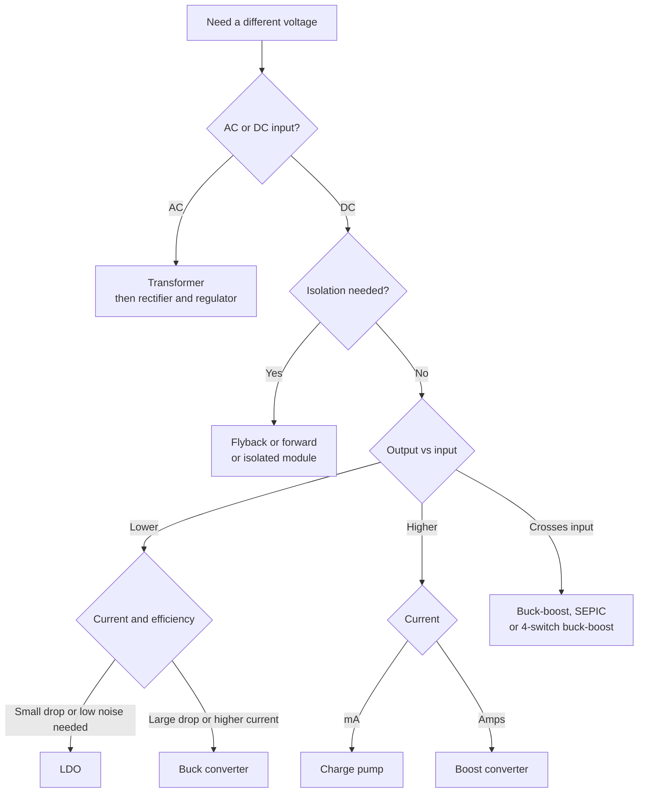

::: testing
Whether you have a **map of the power-conversion options** and can pick one for a given job, rather than only knowing "buck and boost". The interviewer wants the DC-DC set (divider, Zener/shunt, linear/LDO, buck, boost, buck-boost/SEPIC, charge pump, isolated flyback/forward), plus the AC option (transformer), and then the key judgment for a **power rail**: why you use a regulator (LDO or switching) and not a divider or Zener. Efficiency numbers and trade-offs (noise, size, cost, current) are what turn a list into an answer.
:::

::: why
Every board has a power tree: a battery or adapter voltage turned into 3.3 V, 1.8 V, 1.0 V and sometimes a boosted 5 V or bias rail. Choosing the wrong converter wastes watts, overheats the board, injects noise into sensitive circuits or drains a battery. The question is a gateway to the rest of the power section ([[q0156]], [[q0157]], [[q0161]], [[q0167]]) and to the follow-up "why can't I just use a voltage divider?" ([[q0148]]).
:::

::: concepts
- **Voltage divider**: sets a ratio but only for negligible load current. See [[q0008]].
- **Linear regulator (LDO)**: a pass element drops the excess voltage; efficiency $\approx V_{out}/V_{in}$. See [[q0157]].
- **Switching regulator**: switches and an inductor transfer energy; efficiency is typically 85-95%. See [[q0173]] for buck basics.
- **Inductor energy transfer**: $v=L\,di/dt$ lets an inductor produce a voltage higher or lower than the input. See [[q0039]].
- **Charge pump**: switched capacitors move charge to double, invert or divide, with no inductor.
- **Transformer**: AC voltage scaling by turns ratio and isolation; with rectification gives AC-DC. See [[q0159]].
:::

::: answer
"There are a handful of ways. To step down: a resistor divider, a Zener or shunt regulator, a linear regulator or LDO, or a buck converter. To step up: a boost converter, a charge pump, or a transformer-based converter. If I need to go either way I'd use a buck-boost, SEPIC or a four-switch buck-boost. And if I need isolation, a flyback or forward converter, or just a transformer for AC.

For a power rail specifically, a divider or Zener is out, because the output depends on the load current and it wastes power. So I'd use a regulator. For step-down it's the LDO versus buck decision. An LDO is simple, quiet and small, but its efficiency is $V_{out}/V_{in}$ and the lost power is $(V_{in}-V_{out})I$. Going from 12 V to 3.3 V at 2 amps is only 27.5% efficient, 17 watts of heat. A buck does that at maybe 90%, wasting under a watt, but needs an inductor, makes switching ripple and EMI, and is more complex.

For step-up it's a boost converter for amps, or a charge pump for small currents when I want to avoid an inductor, like a bias rail or a 3.3-to-5 V for a sensor. I'd pick by current, efficiency, noise, size and cost. A common solution is a buck for efficiency followed by an LDO for a clean low-noise rail."
:::

::: technical
**Step-down (buck-type) options**

| Method | $V_{out}$ | Efficiency | Notes |
|---|---|---|---|
| Resistor divider | $V_{in}R_2/(R_1+R_2)$ | poor, load-dependent | Only for negligible load current ([[q0148]], [[q0149]]) |
| Zener / shunt regulator | $\approx V_Z$ | poor | Needs series resistor sized for worst-case load and input; wastes current always |
| Linear regulator / LDO | fixed or adjustable | $\eta\approx V_{out}/V_{in}$ (minus $I_q$) | Quiet, simple; $P_{loss}=(V_{in}-V_{out})I_{out}+V_{in}I_q$ |
| Buck converter | $V_{out}=DV_{in}$ (CCM) | 85-95% | Inductor, ripple, EMI |
| Switched-capacitor (divide-by-2) | $\approx V_{in}/2$ | high at fixed ratios | No inductor; fixed ratios |
| Transformer (AC) | $V_2=V_1N_2/N_1$ | high | AC only; add rectifier and regulator |

**Step-up options**

| Method | $V_{out}$ | Notes |
|---|---|---|
| Boost converter | $V_{out}=V_{in}/(1-D)$ | Inductor and diode/switch; input current $\approx I_{out}V_{out}/(\eta V_{in})$ |
| Charge pump (doubler/inverter) | $\approx2V_{in}$ or $-V_{in}$ | Low current; droop $\approx I_{out}/(f\,C)$ |
| Buck-boost / SEPIC / Cuk / 4-switch | any relation | For batteries whose voltage crosses the output |
| Flyback / forward | any, plus isolation | Transformer-based; isolation |
| Transformer (AC) | by turns ratio | AC mains and AC-DC adapters |

**Worked comparison: 12 V to 3.3 V at 2 A (6.6 W out).**
- LDO: $P_{loss}=(12-3.3)\times2=17.4$ W, $\eta=27.5\%$.
- Buck at 90%: $P_{in}=6.6/0.9=7.33$ W, loss 0.73 W, $I_{in}\approx0.61$ A.

**Boost example, 3.7 V to 5 V at 1 A, 90% efficient.** Ideal duty $D=1-3.7/5=0.26$, with losses $D\approx1-0.9\cdot3.7/5=0.33$; input current $I_{in}=\dfrac{5\cdot1}{0.9\cdot3.7}=1.5$ A.

**Choosing.** Dropout small and current small: LDO. Large step-down and any significant current: buck. Low noise rail from a switcher: buck then LDO. Step up: boost for amps, charge pump for milliamps. Input range spans output: buck-boost. Isolation: flyback/forward or isolated module.

> [!UNCERTAIN]
> Efficiency values (85-95% for a buck) depend on load current, input voltage, frequency and components; they are typical figures, not guarantees. Check the datasheet efficiency curve for the operating point.
:::

::: short
"To step down you can use a divider, a Zener, a linear regulator or LDO, or a buck converter. To step up, a boost converter, a charge pump, or a transformer-based converter; buck-boost and SEPIC when the input crosses the output. For a power rail you don't use a divider or Zener since the output moves with load and wastes power. You use an LDO when the drop and current are small and you want low noise, because efficiency is $V_{out}/V_{in}$, and a buck when you need efficiency. Boost or charge pump to step up."
:::

::: long
"Broadly there are three families: passive or dissipative, linear, and switching.

For stepping down, the simplest is a resistor divider, or a Zener with a series resistor. They work for tiny, constant currents, like a reference or a bias, but not for a rail. Then you have the linear regulator, an LDO. It drops the excess voltage across a pass transistor, so efficiency is just output over input and the lost power is the voltage difference times the current. Going from 12 to 3.3 at 2 amps wastes 17.4 watts, only 27.5% efficient, but it's tiny, quiet and cheap. And the buck converter chops the input with a switch and filters with an inductor and capacitor, giving $V_{out}=D\cdot V_{in}$. At 90% efficiency the same job wastes about 0.7 watts.

For stepping up, you need energy storage. A boost converter charges an inductor from the input, then dumps it to a higher output: $V_{out}=V_{in}/(1-D)$. A charge pump does it with switched capacitors, a doubler or inverter, no inductor, so it's small but only for low currents. If the input can go above and below the output, like a Li-ion battery feeding 3.3 V, I'd use a buck-boost, SEPIC or four-switch buck-boost. For isolation, a flyback or forward with a transformer. For AC, a transformer.

For a power rail I choose by current, efficiency, noise and size. High current, big step: buck. Small step or a very quiet analogue or RF rail: an LDO, often after a buck so the LDO only drops a little. Small boosted bias or a sensor rail: charge pump. Higher power boost: inductor-based boost. And I'd never use a divider or Zener for a rail, because the output moves with load and wastes power."
:::

::: terms
- **Buck converter**: switching step-down converter, $V_{out}=DV_{in}$ in CCM.
- **Boost converter**: switching step-up converter, $V_{out}=V_{in}/(1-D)$.
- **Buck-boost / SEPIC / Cuk**: converters that can produce an output above or below the input.
- **LDO (low-dropout regulator)**: linear regulator that works with a small $V_{in}-V_{out}$.
- **Charge pump**: switched-capacitor converter that multiplies, inverts or divides voltage.
- **Dropout voltage**: minimum $V_{in}-V_{out}$ at which a linear regulator still regulates.
- **Quiescent current ($I_q$)**: current the regulator itself draws. See [[q0165]].
- **Isolated converter**: uses a transformer (flyback, forward) so input and output do not share a ground.
:::

::: exceptional
**An average answer** lists buck, boost, LDO and maybe "voltage divider" with one-line descriptions.

**An exceptional answer**:
- Organises the answer by **function and family** (dissipative, linear, switching, switched-capacitor, magnetics/isolated) and says which direction each works.
- Quantifies the main decision with the worked 12 V to 3.3 V at 2 A example: LDO 17.4 W lost versus buck about 0.7 W.
- Explicitly rules out divider/Zener for rails and says why (load dependence, waste), linking to [[q0148]].
- Mentions that the best solution is often a **combination** (buck then LDO for a clean rail) and gives the criteria: current, efficiency, noise, size, cost, input range, isolation.
- Mentions the input-current consequence for boost ($I_{in}>I_{out}$) and the charge-pump current limit.
:::

::: mistakes
- **Suggesting a voltage divider for a power rail.** The output sags with load and the divider burns power. See [[q0148]].
- **Using an LDO for a large step-down at high current.** Heat is $(V_{in}-V_{out})I$, so 12 V to 3.3 V at 2 A is 17.4 W; check thermal limits.
- **Thinking a boost converter makes power.** $P_{out}=\eta P_{in}$, so input current is *higher* than output current by $V_{out}/V_{in}$.
- **Forgetting the output current of a charge pump** and its droop $I_{out}/(fC)$ and output impedance.
- **Assuming a switcher is always better.** In noise-sensitive analogue or RF rails, or at tiny currents with small drops, an LDO can be the right choice.
- **Using a plain buck when the input drops below the output** (a battery discharging below 3.3 V). That needs a buck-boost.
:::

::: deep
## A map of the options


Figure: A first-pass decision tree. The question that really drives the branch is "what is the load current, and what efficiency can I afford?", because it separates the linear options from the switching ones.

## Dissipative options: divider and Zener

A **voltage divider** (see [[q0008]]) gives $V_{out}=V_{in}R_2/(R_1+R_2)$ only when the load draws negligible current; a load in parallel with $R_2$ pulls the output down. A **Zener or shunt regulator** holds $V_Z$ using a series resistor $R_s=(V_{in}-V_Z)/(I_Z+I_L)$. To make 5.1 V from 12 V for a load of up to 20 mA with 5 mA of Zener current, $R_s=(12-5.1)/0.025=276\ \Omega$ and the circuit wastes $6.9\times0.025=0.17$ W *regardless* of the load. They are fine for references, bias and signal-level rails, not for power. See [[q0149]] for when a divider is acceptable.

## Linear regulation: the pass element drops the difference

An LDO senses the output with a divider, compares it with an internal reference and drives a pass transistor so that the output stays at the target. The load current flows through the pass transistor, so the regulator dissipates

$$P_{loss}=(V_{in}-V_{out})I_{out}+V_{in}I_q$$

and has efficiency $\eta\approx V_{out}/V_{in}$ (minus the quiescent-current term). The input current equals the output current. Benefits: no switching noise, low output noise and high PSRR at low frequency, tiny external component count, fast response. Cost: heat and a dropout voltage limit. See [[q0157]] and [[q0158]].

## Switching regulation: energy transfer through an inductor

A switching converter moves energy in packets: the inductor is connected to the input, stores $\tfrac12LI^2$, then discharges to the output. Because energy, not voltage, is being moved, the output can be lower (buck), higher (boost) or either (buck-boost) than the input, and the only losses are conduction, switching and magnetics.

For an ideal buck in CCM, $V_{out}=DV_{in}$. For a boost, $V_{out}=V_{in}/(1-D)$. Power is conserved: $P_{in}=P_{out}/\eta$, so the boost input current is higher than the output current.

```plot
{"title":"Efficiency vs output/input voltage ratio: LDO vs typical buck","x":{"label":"V_out / V_in","unit":"","min":0.05,"max":1},"y":{"label":"Efficiency","unit":"","min":0,"max":1.05},
 "series":[{"label":"LDO: η ≈ V_out/V_in","fn":"x","color":"red"},{"label":"Buck: ~90% (illustrative)","fn":"0.9","color":"blue","dashed":true}],
 "points":[{"x":0.275,"y":0.275,"label":"12 V to 3.3 V LDO: 27.5%"},{"x":0.275,"y":0.9,"label":"12 V to 3.3 V buck: ~90%"}]}
```
Figure: The LDO's efficiency falls linearly with the voltage ratio, while a buck's stays roughly flat (it depends on load and frequency in practice). The crossover is near $V_{out}/V_{in}\approx0.9$, where a dropout-limited LDO becomes competitive. See [[q0158]].

```sim
{"id":"regulator-compare","mode":"compare","vin":12,"vout":3.3,"iout":2}
```
Figure: Compare LDO and buck efficiency across load current and input voltage. Find where the LDO wins (light load, tiny dropout), and note how its heat grows with $V_{in}-V_{out}$.

## Charge pumps and switched capacitors

A **charge pump** charges a flying capacitor from the input, then reconnects it in series with the input (doubler) or reversed (inverter), with no inductor. It produces $V_{out}\approx2V_{in}$ or $-V_{in}$ minus drops, at limited current. Output droop per cycle is about $I_{out}/(f\,C_{fly})$: at 20 mA, 500 kHz and 1 µF, 0.04 V. Great for small bias rails (LCD bias, op-amp negative rails, a 5 V for a sensor from 3.3 V), poor for amps. See the charge-pump simulation:

```sim
{"id":"charge-pump","mode":"doubler","vin":3.3,"f":500000,"cfly":1e-6,"cout":1e-5,"iout":0.02,"rsw":1}
```
Figure: Change load current and switching frequency; watch output voltage fall below $2V_{in}$ and ripple grow as the load rises. The output behaves like a source with a series resistance.

## Boost, buck-boost and others

A boost converter from a single Li-ion cell (3.7 V) to 5 V at 1 A needs ideal $D=0.26$ (real about 0.33) and draws about 1.35-1.5 A from the cell. When the battery falls below 3.3 V and you need a regulated 3.3 V rail, neither pure buck nor pure boost works; use a buck-boost, SEPIC or four-switch buck-boost. Inverting buck-boost produces a negative rail, with $|V_{out}|=V_{in}D/(1-D)$.

## Transformer-based

AC power uses a **transformer**: $V_2/V_1=N_2/N_1$. A 230 V to 12 V step-down needs a turns ratio of about 19:1, followed by rectification and regulation. In DC-DC, a **flyback** or **forward** converter uses a high-frequency transformer to provide isolation as well as step-up/down, and is the base of most small AC-DC adapters. The assumption in this question's section is DC-DC (the section note says AC power supplies are rarely asked).

## Rails in practice

A common power tree is: adapter or battery, then a buck (or buck-boost) to a main rail, then LDOs for noise-sensitive rails. For example 12 V to 3.3 V with a buck, then 3.3 V to 1.8 V with a low-dropout linear regulator for an analog block. The LDO drops 1.5 V, so its loss at 200 mA is just 0.3 W, and its output is quiet. See [[q0167]] and [[q0169]] for multi-rail architectures.
:::

::: applications
- **Laptop and phone PMICs**: multiple bucks and LDOs derived from a battery, with boost for USB or backlights.
- **Single-cell Li-ion devices**: buck-boost converters hold 3.3 V as the cell goes from 4.2 V down to about 3.0 V.
- **Op-amp or LCD bias**: charge pumps create ±5 V or higher from a 3.3 V logic rail.
- **12 V industrial or automotive boards**: buck converters to 5 V and 3.3 V, with LDOs for ADC and sensor rails.
- **USB chargers**: an isolated flyback from mains, plus synchronous rectification.
:::

::: assumptions
- **DC-DC, non-isolated** unless stated. The section note says to assume DC-DC.
- **Typical efficiency numbers** (about 90% for a buck) are illustrative and depend on load, frequency and component choices.
- **"Power rail"** means a regulated supply for ICs, with moderate current. For milliamp-level references a divider or Zener can be acceptable.
- **Ignoring dropout and quiescent current** in simple LDO efficiency estimates. These matter at light load and small headroom.
- **Alternative valid answers.** Some candidates also include the switched-capacitor converters used in phones, hybrid or multi-level converters, and resonant converters (LLC) for high-power isolated step-down; all fit the "ways to step voltage" if tied to use cases.
:::

::: followups
### Why is an LDO often placed after a buck converter?
A buck is efficient but produces switching ripple and noise. Feeding an LDO from a slightly higher buck output (say 3.3 V buck output feeding a 3.0 V LDO, or a 1.9 V buck output feeding a 1.8 V LDO) gives a quiet rail while the LDO only dissipates $(V_{in}-V_{out})I$, a small headroom. It combines the efficiency of the switcher with the cleanliness of the linear regulator.

### What's the difference between a boost converter and a charge pump?
Both step up. A boost converter uses an inductor to store energy and can deliver amps with a continuously variable output ratio ($1/(1-D)$) and regulation. A charge pump uses capacitors only, usually gives a fixed multiple (2×, -1×), and is limited to lower current because the flying capacitor must supply all the charge. Charge pumps are small and have little EMI; boosts handle more power.

### Why does a boost converter draw more input current than it delivers?
Power is conserved: $P_{in}=P_{out}/\eta$. If the output voltage is higher than the input, the input current must be larger by $V_{out}/(\eta V_{in})$. For 3.7 V to 5 V at 1 A and 90% efficiency, $I_{in}=1.5$ A. This matters for sizing the battery, fuse and wiring.

### What do you use if the input voltage range straddles the output voltage?
A buck-boost topology: SEPIC, four-switch buck-boost (which operates as a buck when $V_{in}>V_{out}$ and a boost when $V_{in}<V_{out}$), or a non-inverting buck-boost IC. A Li-ion cell (4.2 V to 3.0 V) powering a 3.3 V rail is the classic case.

### When is a Zener regulator acceptable?
For small, nearly constant currents where you don't need precision: reference voltages, bias, or clamping. The series resistor dissipates $(V_{in}-V_Z)I$ and the Zener must carry the minimum current at worst-case input and load. For a 5.1 V rail at 20 mA from 12 V, that's 0.17 W in the circuit, all the time.

### Scenario: your 12 V to 3.3 V LDO design at 1 A gets too hot. What are your options?
The LDO dissipates $(12-3.3)\times1=8.7$ W, far beyond a small package. Options: replace it with a buck (about 1.0 W loss at 85-90% efficiency); or use a buck to an intermediate 5 V rail and then a 5 V to 3.3 V LDO (1.7 W); or add a series dropping resistor or heatsink, which just moves the heat around. A buck followed by a small LDO is the standard compromise.
:::

::: interpretations
"Ways to step up/down voltage" could mean generic electrical methods (transformer, divider, regulators) or the specific DC-DC converter topologies. The section note says to assume DC-DC, so this page leads with DC-DC and mentions the transformer for AC. "What about for a power rail?" narrows the answer to regulators able to supply real current: LDO, buck, boost, buck-boost, charge pump. The related comparison and efficiency questions are [[q0157]] and [[q0158]].
:::

::: references
- Erickson & Maksimovic, *Fundamentals of Power Electronics*: basic converter topologies (buck, boost, buck-boost) and efficiency.
- Horowitz & Hill, *The Art of Electronics*: voltage regulators, linear and switching, and charge pumps.
- Texas Instruments, "Basic Calculation of a Buck Converter's Power Stage" (SLVA477), for buck component selection.
- Manufacturer LDO and DC-DC datasheets (efficiency curves, dropout, quiescent current).
:::

::: rubric
- Lists step-down options (divider/Zener, LDO, buck) and step-up options (boost, charge pump, transformer) :: The question asks "what are some ways", so breadth matters.
- Says which are appropriate for a power rail and which are not :: The second half of the question specifically concerns rails.
- Quantifies LDO vs buck (efficiency $V_{out}/V_{in}$, loss $(V_{in}-V_{out})I$) :: Shows engineering judgement with numbers.
- Mentions buck-boost/SEPIC when input straddles output :: A real battery problem and a common follow-up.
- Notes the trade-offs (noise, size, cost, complexity, current) and combos like buck + LDO :: Shows you can choose rather than list.
- Mentions input current for boost and charge-pump current limits :: Shows you understand power conservation and limits.
:::

::: quiz
```json
[
 {"type":"mcq","level":"fundamental","q":"Which method is least suitable for supplying a 3.3 V, 500 mA rail from 12 V?","options":["Buck converter","LDO (with heat sinking)","Resistor voltage divider","Buck followed by LDO"],"answer":2,"explain":"A divider's output depends on load current and the divider would need tiny resistors that waste far more power than the load. Regulators (buck, LDO) hold the output."},
 {"type":"numeric","level":"fundamental","q":"An LDO drops 12 V to 3.3 V at 2 A. What power does it dissipate (ignoring quiescent current)?","answer":17.4,"tolerance":0.02,"unit":"W","explain":"$P=(V_{in}-V_{out})I=(12-3.3)\\times2=17.4$ W; efficiency is $3.3/12=27.5\\%$."},
 {"type":"numeric","level":"intermediate","q":"A buck converter at 90% efficiency delivers 3.3 V at 2 A from 12 V. What is the average input current?","answer":0.611,"tolerance":0.02,"unit":"A","explain":"$P_{out}=6.6$ W, $P_{in}=6.6/0.9=7.33$ W, $I_{in}=7.33/12=0.611$ A."},
 {"type":"numeric","level":"intermediate","q":"A boost converter makes 5 V at 1 A from a 3.7 V battery at 90% efficiency. What input current does it draw?","answer":1.5,"tolerance":0.02,"unit":"A","explain":"$I_{in}=V_{out}I_{out}/(\\eta V_{in})=5/(0.9\\times3.7)=1.50$ A."},
 {"type":"mcq","level":"intermediate","q":"A Li-ion cell (4.2 V to 3.0 V) must supply a regulated 3.3 V rail. Which converter type is needed?","options":["Buck only","Boost only","Buck-boost (or SEPIC / 4-switch)","LDO only"],"answer":2,"explain":"The input is above 3.3 V when fully charged and below it when depleted, so the converter has to step down and up. A plain buck or LDO fails below 3.3 V plus dropout; a plain boost can't step down."},
 {"type":"truefalse","level":"advanced","q":"A charge pump is a good choice for supplying several amps at a 5 V rail from 3.3 V.","answer":false,"explain":"Charge pumps are limited to low currents: droop and output resistance grow with load ($\\Delta V\\approx I/(fC)$), and large flying capacitors and switches are needed. An inductor-based boost handles amps."}
]
```
:::
