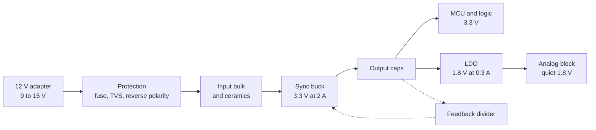

::: basics
### In plain words
Designing a power supply means turning a source (such as a 12 V adapter) into the steady voltages your circuit needs. The design follows from the requirements: input range, output voltages, currents, and how clean the output must be. So the first step is always asking questions, then picking the converter type that fits.

### Picture it
Think of planning a trip. You first decide where you are going, how many people are coming, and how much luggage you have. Only then do you choose a car or a train. A supply design works the same way: needs first, parts second. The trip picture breaks down because supply parts also need protection against accidents, like short circuits.

### Words you need
- **Requirements**: input range, output voltage and current, ripple limit, efficiency target.
- **Buck converter**: a switching step-down converter. See [[q0173]].
- **Duty cycle**: the fraction of time the buck's switch is on. For an ideal buck it equals $V_{out}/V_{in}$.
- **Ripple**: the small leftover wiggle on the output.
- **Protection**: current limit, soft start, under-voltage lockout, thermal shutdown.

### The simplest example
The requirement is 3.3 V at 2 A from 12 V. The output power is 6.6 W. A linear regulator would waste $(12 - 3.3) \times 2 \approx 17$ W, so choose a buck. Its duty cycle is $3.3/12 = 0.275$. At 90% efficiency it wastes only about 0.7 W. That is the whole idea. The rest of this page adds the real component values (inductor, capacitors, feedback divider), the protection parts, and how to test the finished supply.
:::

::: testing
Whether you can run a design **process**, not just name a topology. The interviewer wants to hear you ask for requirements first (input range, outputs, current, accuracy, ripple, efficiency, size, cost, isolation, environment), choose an architecture with a reason (LDO vs buck vs boost), do the key calculations (duty cycle, inductor, capacitors, losses, thermals, feedback divider), add protection and start-up behaviour, and plan how you would verify it. A strong answer thinks aloud, states assumptions, and finishes with trade-offs and risks.
:::

::: why
"Design a power supply" is an open-ended question because it is what hardware engineers actually do: take a vague need ("power this board from a 12 V adapter") and turn it into a robust, efficient, testable design. Interviewers use it to see your structure, your sense of magnitude (is 1 W of loss acceptable? is a 10 µH inductor sensible?), and how you handle the unglamorous parts: protection, start-up, thermal limits and verification. The same process underlies [[q0166]] (power architecture from a spec) and [[q0153]] (specs to check).
:::

::: concepts
- **Requirements and specs**: input range, output voltage and tolerance, load current and steps, ripple/noise, efficiency, environment. See [[q0153]].
- **Topology selection**: LDO vs buck vs boost vs isolated. See [[q0147]] and [[q0157]].
- **Buck design equations**: $D=V_{out}/V_{in}$, $L=\dfrac{V_{out}(1-D)}{\Delta I\,f_{sw}}$, ripple formulas. See [[q0173]] and [[q0212]].
- **Feedback divider**: $V_{out}=V_{FB}(1+R_1/R_2)$. See [[q0223]].
- **Loss and thermal budget**: conduction, switching, magnetics, quiescent. See [[q0162]].
- **Protection and sequencing**: UVLO, current limit, soft start, thermal shutdown, reverse polarity, TVS. See [[q0171]].
:::

::: answer
"I'd start by asking what it needs to do, because the design follows from the requirements. What's the input: a 12 volt adapter, a battery, mains? What outputs, voltages and currents, how much ripple or noise can the loads tolerate, any load steps, efficiency or size targets, and the environment, like temperature and whether there's hot-plugging?

Say it's a 12 volt input, plus or minus 25 percent, and I need 3.3 volts at 2 amps for a microcontroller and some digital logic. The step down is big and the current is real, so a linear regulator would waste $(12-3.3)\times2=17$ watts. I'd use a synchronous buck converter. Duty cycle is about 0.275 at 12 volts. At 500 kilohertz and 30% inductor ripple I get about 8 microhenries, so an 8.2 microhenry inductor with saturation current above the current limit, say 4 amps. Output capacitance of about 40 microfarads of ceramic keeps ripple in the single millivolts and load-step droop around 75 millivolts. Input capacitors carry about 0.9 amp RMS. A divider from the output to the 0.6 volt feedback pin sets the voltage: 45.3 kilohms over 10 kilohms.

Then the unglamorous parts: soft start, current limit, under-voltage lockout, thermal shutdown, input protection like a TVS and reverse-polarity protection, and an LDO after it if any analogue load needs a quiet rail.

Finally verification: efficiency versus load, ripple, load-step response, start-up, line transients and thermals, and the stability margin from a loop measurement. The estimate is about 93% efficient, around half a watt of loss."
:::

::: technical
**Step 1: Requirements (example).** $V_{in}=12$ V ±25% (9-15 V), $V_{out}=3.3$ V ±3%, $I_{out}=2$ A with 1 A load steps, ripple <20 mV pk-pk, efficiency >90% at full load, ambient to 60 °C, no isolation.

**Step 2: Architecture.** LDO loss $(V_{in}-V_{out})I=17.4$ W is unacceptable, so a synchronous buck. If a quiet analogue rail is needed (e.g. 1.8 V at 300 mA), add an LDO from the 3.3 V rail: loss $(3.3-1.8)\times0.3=0.45$ W.

**Step 3: Key calculations (500 kHz, synchronous buck).**
- Duty: $D=V_{out}/V_{in}$: 0.367 (9 V), 0.275 (12 V), 0.22 (15 V).
- Inductor: choose ripple $\Delta I\approx0.3I_{out}=0.6$ A at max $V_{in}$: $L=\dfrac{V_{out}(1-D)}{\Delta I\,f_{sw}}=\dfrac{3.3\times0.78}{0.6\times5\times10^5}=8.6$ µH, so 8.2 µH. Actual $\Delta I=0.63$ A (15 V), peak $=I_{out}+\Delta I/2=2.31$ A, RMS $\approx2.0$ A. Saturation current ≥ current limit (~4 A) with margin.
- Output capacitor: ripple $\Delta V\approx\dfrac{\Delta I}{8f_{sw}C}+\Delta I\cdot ESR$. With $C_{eff}=42$ µF (after DC-bias derating) and low ESR: 3.7 mV. Load-step droop for 1 A at 50 kHz crossover: $\Delta V\approx\dfrac{\Delta I}{2\pi f_cC}=76$ mV.
- Input capacitor: RMS $I_{Cin}=I_{out}\sqrt{D(1-D)}=0.89$ A at 12 V (0.96 A worst at 9 V). Ceramic ripple $\approx\dfrac{I_{out}D(1-D)}{f_{sw}C}$: 77 mV with 12 µF effective at 9 V; add bulk for source damping.
- Feedback: $V_{FB}=0.6$ V, $R_2=10$ kΩ, $R_1=45.3$ kΩ gives 3.318 V.
- Soft start: 1 ms gives charging current $C\,dV/dt=42\ \mu\text{F}\times3.3/1\text{ ms}=0.14$ A.

**Step 4: Losses.** With $R_{DS(on)}$ of 30 mΩ (high-side), 15 mΩ (low-side), 15 mΩ inductor DCR: conduction $\approx I^2(DR_H+(1-D)R_L+DCR)=0.14$ W; switching, gate drive, controller quiescent current, dead time, core and AC losses add roughly the same again. A budget of about 0.5 W gives $\eta\approx6.6/(6.6+0.5)=93\%$. With $\theta_{JA}=40$ °C/W for the IC the rise is of order 10-20 °C.

**Step 5: Protection and extras.** UVLO via EN divider, cycle-by-cycle current limit and hiccup, thermal shutdown, power-good, input TVS and reverse-polarity protection, fuse, output discharge, optional enable sequencing ([[q0171]]).

**Step 6: Verification.** Efficiency vs load and line, ripple/noise (short ground spring), load-step response, start-up/shut-down, line transients, short-circuit and thermal tests, loop gain/phase margin (>45°-60°), EMI pre-scan.

> [!UNCERTAIN]
> Component values ($R_{DS(on)}$, DCR, switching times) are typical assumptions, not a specific part. Real efficiency depends on the chosen controller, layout and temperature. Always verify with the manufacturer's design tool and bench measurements.
:::

::: short
"I'd start with requirements: input range, outputs, currents, ripple, efficiency, environment. For 12 V to 3.3 V at 2 A I'd use a synchronous buck rather than an LDO, which would waste 17 W. At 500 kHz that gives about D = 0.275, an 8.2 µH inductor, about 40 µF of ceramic output capacitance, and a feedback divider for the 0.6 V reference. Then I'd add soft start, current limit, UVLO, thermal protection and input protection, and verify efficiency, ripple, load steps and stability on the bench."
:::

::: long
"I'd begin by pinning down requirements, because a power supply isn't one design, it's whatever the spec makes it. What's the input source and range, which outputs and currents, what tolerance and ripple, any load steps, efficiency or size targets, temperature, and do I need isolation?

Let me assume a 12 volt adapter, plus or minus 25%, feeding 3.3 volts at 2 amps for a microcontroller and logic. Linear is out: dropping 8.7 volts at 2 amps is 17 watts of heat. So I'd pick a synchronous buck converter.

The design equations are straightforward. Duty cycle is Vout over Vin, so 0.275 at 12 volts, from 0.22 up to 0.37 over the input range. I'd choose a switching frequency, say 500 kilohertz, a compromise between size and loss. For inductor ripple I'd take about 30 percent of the output current, so 0.6 amps at the worst case, which gives L equals Vout times 1 minus D over delta I times f, about 8.6 microhenries, so an 8.2 microhenry part. Its saturation current has to exceed the current limit, say 4 amps, with peak current in normal operation about 2.3.

For the output capacitor, ripple is tiny with ceramics, around 4 millivolts, so the load step sets the size: a one amp step with a 50 kilohertz loop needs about delta I over 2 pi f C, so around 40 microfarads effective. I'd put in more nominal capacitance, because ceramics lose capacitance with DC bias. The input capacitor must carry about 0.9 amps RMS. The feedback divider for a 0.6 volt reference is 45.3 kilohms over 10 kilohms.

Then the robustness features: soft start so inrush is limited to a fraction of an amp, cycle-by-cycle current limit, under-voltage lockout on the enable divider, thermal shutdown, a TVS and reverse-polarity protection at the input, and an LDO off the 3.3 volt rail for any analogue block that wants a quiet supply.

Loss budget is conduction plus switching plus quiescent, about half a watt, so around 93% efficiency and a modest temperature rise. Then I'd verify: efficiency curves, ripple, load-step response, start-up, line transients, short-circuit behaviour and loop gain, targeting 45 to 60 degrees of phase margin."
:::

::: terms
- **Requirements/spec**: input range, output voltage and current, tolerance, ripple, efficiency, environment.
- **Synchronous buck**: buck converter using a low-side FET instead of a diode for rectification.
- **Duty cycle ($D$)**: fraction of the period the high-side switch is on; $V_{out}=DV_{in}$ in CCM.
- **Inductor ripple current ($\Delta I$)**: peak-to-peak inductor current ripple, $\Delta I=\dfrac{V_{out}(1-D)}{Lf_{sw}}$.
- **Saturation current ($I_{sat}$)**: inductor current at which inductance falls substantially; must exceed the current limit.
- **Soft start**: controlled ramp of the output at start-up to limit inrush.
- **UVLO**: under-voltage lockout; disables the converter below a set input voltage.
- **Phase margin**: stability measure of the control loop; 45-60° or more is typical.
:::

::: exceptional
**An average answer** picks a buck, draws a block diagram and says "add some capacitors".

**An exceptional answer**:
- **Asks clarifying questions** and then states explicit assumptions, since the design depends on them.
- Justifies the topology with numbers (LDO would lose 17.4 W; buck about 0.5 W) and mentions where an LDO still belongs.
- Does the sizing calculations out loud (duty, $L$, $C_{out}$, $C_{in}$ RMS, divider) and checks them against current limit and saturation.
- Includes protection, start-up, thermal and layout concerns as part of the design, not afterthoughts.
- Ends with a **verification plan** and the main risks (stability, EMI, ceramic derating, layout of the switch node).
:::

::: mistakes
- **Starting with the topology.** Without requirements you can't justify the choice. Ask first.
- **Using nominal capacitance.** Ceramics lose 30-70% at DC bias; use the effective value.
- **Choosing an inductor by inductance only.** Saturation current, DCR and RMS current rating matter, as does shielding.
- **Ignoring input-side issues**: input capacitor RMS rating, source impedance, hot-plug overshoot and reverse polarity.
- **Forgetting start-up and protection**: no soft start causes inrush and overshoot; no current limit means a short destroys the board.
- **Skipping verification and layout.** The switch-node loop and feedback routing decide whether a paper design works. See PCB layout questions.
- **Over-engineering**: asking for 99% efficiency or 1 mV ripple with no justification. State what the loads need.
:::

::: deep
## Step 0: ask before you design

In an interview, say the clarifying questions out loud. They show process and they let you scope the problem.

| Question | Why it matters | Assumption for this walkthrough |
|---|---|---|
| Input source and range? | Sets topology, ratings, protection | 12 V adapter, 9-15 V |
| Outputs: voltage, current, tolerance? | Sets size and loop | 3.3 V ±3%, 2 A |
| Load behaviour: steps, sleep modes? | Sets transient design and light-load efficiency | 1 A steps, MCU sleeps at µA |
| Ripple/noise tolerance? | Sets filtering and whether a post-LDO is needed | <20 mV pk-pk; one 1.8 V analog rail |
| Efficiency, size, cost targets? | Sets frequency, parts | >90%, small, low cost |
| Environment? | Temperature, hot-plug, EMC | 0-60 °C ambient, cable hot-plug |
| Isolation or safety standards? | Different design if mains | None |

## Step 1: architecture


Figure: The power tree. Protection and bulk at the input, an efficient buck as the workhorse, and a small LDO downstream only where low noise is needed. The dashed path is the feedback sense of the output voltage.

**Why not a linear regulator?** The dissipation is $(12-3.3)\times2=17.4$ W (27.5% efficient), which needs a large heatsink. **Why not a diode (asynchronous) buck?** At 3.3 V and 2 A a 0.5 V Schottky drop dissipates $\approx(1-D)\times0.5\times2=0.72$ W, which is more than all the other losses combined; a synchronous low-side FET drops about 30 mV.

## Step 2: power stage calculations (500 kHz)

Switching frequency is a trade: higher means smaller $L$ and $C$ and faster loop, lower means less switching loss and EMI. 500 kHz is a common middle ground for 12 V inputs.

**Duty cycle** (ideal CCM): $D=V_{out}/V_{in}$.

**Inductor.** Choose ripple around 20-40% of $I_{out}$ (30% here). The ripple is largest at maximum $V_{in}$ (15 V, $D=0.22$):

$$L=\frac{V_{out}(1-D)}{\Delta I\,f_{sw}}=\frac{3.3\times0.78}{0.6\times5\times10^5}=8.6\ \mu\text{H}\ \Rightarrow\ 8.2\ \mu\text{H (nearest standard)}$$

With 8.2 µH, ripple is $\Delta I=0.63$ A at 15 V, 0.58 A at 12 V and 0.51 A at 9 V. Peak current in normal operation is $2+0.63/2=2.31$ A. Set the controller's current limit to about 3.5-4 A, and choose an inductor with $I_{sat}$ above that (≥4.5 A) and RMS rating ≥2.0 A. See [[q0212]] and [[q0046]].

```circuit
{"caption":"Synchronous buck power stage","elements":[
 {"t":"V","a":[0,2],"b":[0,16],"label":"V_{in}","value":"9 to 15 V","labelSide":"other"},
 {"t":"wire","pts":[[0,2],[0,0],[8,0]]},{"t":"dot","at":[3,0]},
 {"t":"C","a":[3,2],"b":[3,7],"label":"C_{in}","labelSide":"other"},
 {"t":"wire","pts":[[3,0],[3,2]]},{"t":"wire","pts":[[3,7],[3,16]]},
 {"t":"nmos","at":[6,2],"label":"Q_1","flip":false},
 {"t":"wire","pts":[[8,4],[8,6]]},{"t":"dot","at":[8,5]},
 {"t":"nmos","at":[6,8],"label":"Q_2"},
 {"t":"wire","pts":[[8,10],[8,16]]},
 {"t":"wire","pts":[[0,16],[22,16]]},{"t":"dot","at":[3,16]},{"t":"dot","at":[8,16]},
 {"t":"wire","pts":[[8,5],[11,5]]},
 {"t":"L","a":[11,5],"b":[17,5],"label":"L","value":"8.2 µH"},
 {"t":"wire","pts":[[17,5],[17,7]]},{"t":"dot","at":[17,5]},
 {"t":"C","a":[17,7],"b":[17,12],"label":"C_{out}","value":"3 × 22 µF"},
 {"t":"wire","pts":[[17,12],[17,16]]},{"t":"dot","at":[17,16]},
 {"t":"wire","pts":[[17,5],[22,5],[22,7]]},{"t":"dot","at":[22,5]},
 {"t":"I","a":[22,7],"b":[22,12],"label":"load","value":"2 A"},
 {"t":"wire","pts":[[22,12],[22,16]]},{"t":"dot","at":[22,16]},
 {"t":"wire","pts":[[4.8,2],[6,2]]},{"t":"term","at":[4.8,2],"label":"G1","side":"top"},
 {"t":"wire","pts":[[4.8,8],[6,8]]},{"t":"term","at":[4.8,8],"label":"G2","side":"top"},
 {"t":"text","at":[9.2,3.4],"text":"SW","anchor":"start","muted":true},
 {"t":"term","at":[19,5],"label":"V_{out} 3.3 V","side":"top"}
]}
```
Figure: The synchronous buck power stage. Q1 (high-side) connects the switch node SW to $V_{in}$; Q2 (low-side) connects it to ground and replaces the diode. The LC filter averages the SW pulses to $DV_{in}$. Gate drivers, dead time and the control IC are omitted for clarity.

**Output capacitor.** Ripple $\Delta V\approx\dfrac{\Delta I}{8f_{sw}C}+\Delta I\cdot ESR$. A 22 µF X7R/X5R part at 3.3 V might retain only 60-70% of its value (use the manufacturer's DC-bias curve); three of them give about 42 µF effective: $\Delta V\approx0.63/(8\times5\times10^5\times42\times10^{-6})=3.7$ mV (ESR of ceramics is milliohms, so that adds a couple of mV). Load-step droop is what usually sets $C$: for a 1 A step and a 50 kHz crossover, $\Delta V\approx1/(2\pi\times5\times10^4\times42\times10^{-6})=76$ mV, within ±3% = ±99 mV. See [[q0143]] for the bulk-capacitance logic.

**Input capacitor.** $I_{Cin,rms}=I_{out}\sqrt{D(1-D)}$: 0.83 A (15 V), 0.89 A (12 V), 0.96 A (9 V). The capacitor ripple voltage at 9 V with 12 µF effective ceramic is $I_{out}D(1-D)/(f_{sw}C)=2\times0.367\times0.633/(5\times10^5\times12\times10^{-6})\approx77$ mV. Add a bulk polymer/electrolytic (e.g. 100 µF) to damp the cable inductance during hot-plug ([[q0143]]).

**Feedback.** $V_{FB}=0.6$ V: $R_2=10$ kΩ, $R_1=10\text{ k}(3.3/0.6-1)=45$ kΩ, so 45.3 kΩ gives 3.318 V (+0.5%); with 1% resistors total tolerance is about ±2.5% worst case including the reference. Use 0.1% resistors if tighter accuracy is required. See [[q0223]].

```sim
{"id":"buck-lab","vin":12,"vout":3.3,"l":8.2e-6,"c":4.4e-5,"esr":0.003,"fsw":500000,"iout":2,"sync":true,"view":"waveforms"}
```
Figure: The designed buck at 12 V in. Check the inductor current ripple (about 0.58 A pk-pk), the ripple on the output and the efficiency tab. Then lower $L$ or $C$ and see ripple grow, or lower $I_{out}$ to see where the converter enters DCM.

## Step 3: loss and thermal budget

| Loss | Estimate (assumed values) |
|---|---|
| High-side conduction ($R_H=30$ mΩ) | $I^2DR_H=4\times0.275\times0.03=33$ mW |
| Low-side conduction ($R_L=15$ mΩ) | $I^2(1-D)R_L=4\times0.725\times0.015=44$ mW |
| Inductor DCR (15 mΩ) | $I^2R=60$ mW |
| Switching (tr+tf ≈ 10 ns) | $\tfrac12V_{in}I\,t_{sw}f=60$ mW |
| Gate charge, controller $I_q$ | ~25 mW |
| Dead time, core and AC losses, margin | ~250 mW |
| **Total (budget)** | **≈ 0.5 W** |

Efficiency $\eta=6.6/(6.6+0.5)\approx93\%$. If the controller's losses are about 0.3 W with $\theta_{JA}=40$ °C/W, the die rises about 12 °C; check against the maximum junction temperature at 60 °C ambient. Input current is about $6.6/0.93/12=0.59$ A average.

```plot
{"title":"Estimated efficiency vs load current (assumed loss model)","x":{"label":"Load current","unit":"A","min":0.01,"max":2.5,"log":true},"y":{"label":"Efficiency","unit":"","min":0.5,"max":1},
 "vars":{"vo":3.3},
 "series":[{"label":"η(I) = P_out / (P_out + 0.06 I² + 0.12 I + 0.04)","fn":"vo*x/(vo*x+0.06*x*x+0.12*x+0.04)"}],
 "points":[{"x":2,"y":0.927,"label":"≈93% at 2 A"}]}
```
Figure: A simple loss model (fixed 40 mW, a term proportional to current for switching, and an $I^2$ conduction term) shows the familiar shape: efficiency falls at light load because fixed losses dominate and flattens at high load. The numbers are assumptions; the shape is what matters. If the product spends most of its life in sleep, a power-save mode with low $I_q$ matters more than the peak-load efficiency.

## Step 4: protection, start-up and sequencing

- **UVLO and enable**: a divider on EN (see [[q0149]]) turns on at e.g. 8.5 V and off at 7.5 V so the converter doesn't chatter on a sagging input.
- **Soft start**: ramp over ~1 ms: charging current $C\,dV/dt=42\ \mu\text{F}\times3.3\text{ V}/1\text{ ms}=0.14$ A.
- **Current limit and short-circuit**: cycle-by-cycle limit and hiccup mode.
- **Thermal shutdown**.
- **Input protection**: TVS rated above the max operating voltage, reverse-polarity PFET or Schottky, a fuse. Automotive-like environments need load-dump consideration.
- **Power-good** to sequence downstream rails ([[q0171]]).
- **Output discharge** so the rail doesn't float after shutdown.

## Step 5: noise-sensitive rails

Switching ripple on the 3.3 V rail is a few mV at 500 kHz with spikes at the switching edges. An ADC reference or PLL may need cleaner supplies: use an LDO with good PSRR, plus a small LC or ferrite filter. A 1.8 V LDO from 3.3 V at 0.3 A dissipates $(3.3-1.8)\times0.3=0.45$ W, small enough for a SOT-223 or small DFN with copper area. See [[q0168]] and [[q0169]] for the "same voltage, different noise" and "high dropout but clean rail" patterns.

## Step 6: layout and verification

Layout decides whether the paper design works: keep the input capacitor, Q1, Q2 loop as small as possible (the hot loop), keep the SW node copper small, route the feedback divider away from SW and close to the IC's FB pin, and use a solid ground plane under the converter.

Verification checklist:
1. **Efficiency** vs load at 9, 12 and 15 V.
2. **Output ripple and noise** with a short ground spring on a 20 MHz bandwidth-limited scope.
3. **Load transients**: 0.2 A to 1.2 A steps at 1 A/µs; check droop and overshoot against ±3%.
4. **Start-up and shutdown** monotonic, no overshoot, with the real load capacitance.
5. **Line transients and hot-plug**: peak input voltage below the rated maximum.
6. **Short-circuit and over-current** behaviour; thermal imaging at full load.
7. **Loop stability**: measure gain/phase margin (>45° at worst case) with a network analyzer or injection.
8. **EMI pre-scan** if applicable.

```sim
{"id":"buck-control","l":8.2e-6,"c":4.2e-5,"esr":0.003,"fc":50000,"pm":60,"istep":1}
```
Figure: Compare the load-step undershoot (about 75 mV predicted) with the simulated response. Lower the phase margin and watch ringing appear; this is why you check stability at the worst-case input and load.

## What I'd say about alternatives

- A **buck with an integrated controller/FETs** (a "power module") if size and time are priorities; a controller with external FETs if efficiency or current is demanding.
- A **wider input range** (automotive 6-36 V, with load dump) changes the part, ratings and protection.
- For **isolated or mains** designs, a flyback or LLC with certification concerns, which is a different question.
:::

::: applications
- **Embedded boards**: a 12 V or 5 V rail to 3.3 V and 1.8 V for an MCU/FPGA board using a buck plus LDOs.
- **Single-board computers and routers**: adapter input, multi-rail PMIC or discrete bucks with sequencing.
- **Industrial sensors and PLCs**: wide-input bucks with surge protection.
- **Battery-powered devices**: buck-boost or low-$I_q$ buck plus load switches.
- **Lab bench supplies**: a pre-regulator buck followed by a linear post-regulator for low noise.
:::

::: assumptions
- **DC-DC, non-isolated, single main rail** with 12 V ±25% input. The section note says to assume DC-DC.
- **Continuous conduction mode** at full load; at light load the converter may enter DCM or pulse-skipping.
- **Component values are assumed** typical for a 500 kHz buck: FET resistances, inductor DCR and switching times. Use real datasheets for a real design.
- **Ceramic derating** assumed 60-70% retained capacitance at 3.3 V; check the specific part.
- **Alternative valid answers.** A different candidate may choose a battery-powered or mains-powered example, an LDO for a small drop, or a multiphase or isolated converter. The process (requirements, topology, calculations, protection, verification) is what is being assessed.
:::

::: followups
### Why 500 kHz and not 2 MHz?
Higher frequency shrinks $L$ and $C$ but switching loss ($\tfrac12VIt_{sw}f$, gate-drive and core loss) rises in proportion and the minimum on-time limits $V_{in}/V_{out}$ range. At 12 V to 3.3 V the on-time at 2 MHz is $0.275/2\text{ MHz}=137$ ns at 12 V, but only 110 ns at 15 V ($D=0.22$), which is close to the minimum on-time of many controllers. 500 kHz is a comfortable compromise; for a battery product, lower still may be right. See [[q0220]].

### How would you choose the inductor?
Inductance for 20-40% ripple at max $V_{in}$ (8.2 µH), saturation current above the current limit with margin, RMS current ≥ 2 A with acceptable heating, low DCR (it is a direct loss), shielded construction for EMI and size. Compare with the saturation behaviour in [[q0046]].

### How would you handle a 3 A load requirement later?
Re-evaluate: the inductor and FET current ratings, input RMS current, and thermal. If the controller's FETs can't handle it, move to a controller with external FETs or a multiphase design. Scale $L$, $C$ and current limit, and confirm the loop.

### What changes if the input is a battery (3.0-4.2 V) instead of 12 V?
Duty cycle becomes 0.8-1.0 for 3.3 V, so a buck would hit dropout; a buck-boost is needed. Quiescent current and light-load efficiency become the dominant concerns, so a low-$I_q$ topology with power-save mode matters more than full-load efficiency.

### What do you check if the output oscillates or rings on a load step?
Phase margin is too low: output capacitance effective value smaller than assumed (ceramic derating), compensation values wrong, ESR zero in an unexpected place, or noisy layout in the feedback. Measure the loop, check the DC-bias curve for the capacitors, and compare with the manufacturer's recommended compensation.

### Scenario: the board works on a bench supply but resets when connected to the real 12 V adapter through a long cable. Why?
Inrush and cable inductance: the adapter's cable inductance with the low-ESR input ceramics can ring above the TVS/absolute-maximum rating or the input can droop below UVLO during the surge. Add bulk damping capacitance (polymer/electrolytic), hot-swap/inrush limiting, and verify the first 100 µs of the input waveform with a scope.
:::

::: interpretations
"Design a power supply" is deliberately open-ended and the section note says to assume DC-DC. This page uses a representative case (12 V to 3.3 V at 2 A) and shows the *process*. If the interviewer specifies a different spec (battery, high voltage, multiple rails, isolation), re-run the same steps; [[q0166]] covers the multi-rail "design power architecture from a spec" version, and [[q0153]] covers which specs to check.
:::

::: references
- Texas Instruments, "Basic Calculation of a Buck Converter's Power Stage" (SLVA477): inductor, capacitor and ripple calculations.
- Erickson & Maksimovic, *Fundamentals of Power Electronics*: converter analysis, losses and control.
- Horowitz & Hill, *The Art of Electronics*: switching and linear regulators, power-supply design considerations.
- Buck controller/regulator manufacturer datasheets and design tools (inductor, capacitor and compensation selection guidance for the specific part).
:::

::: rubric
- Asks clarifying questions / states requirements (input, output, current, ripple, efficiency, environment) :: A design is only correct relative to a spec; interviewers want to see this first.
- Chooses and justifies a topology with numbers (buck vs LDO loss) :: Shows engineering judgement.
- Calculates duty cycle, inductor, capacitors and feedback divider :: The core design calculations demonstrate competence.
- Addresses efficiency and thermal budget :: Real supplies are limited by heat and efficiency.
- Includes protection and start-up (UVLO, current limit, soft start, TVS/reverse polarity) :: Robustness is a large part of a real design.
- Plans verification (efficiency, ripple, transients, stability, thermals) and mentions layout :: Shows you know a design isn't finished until measured.
:::

::: quiz
```json
[
 {"type":"numeric","level":"fundamental","q":"What is the ideal duty cycle of a buck converter producing 3.3 V from 12 V?","answer":0.275,"tolerance":0.01,"unit":"","explain":"$D=V_{out}/V_{in}=3.3/12=0.275$ in continuous conduction mode, ignoring losses."},
 {"type":"numeric","level":"fundamental","q":"An LDO drops 12 V to 3.3 V at 2 A. How much power does it dissipate?","answer":17.4,"tolerance":0.02,"unit":"W","explain":"$P=(12-3.3)\\times2=17.4$ W, which is why a buck is chosen."},
 {"type":"numeric","level":"intermediate","q":"Using $L=V_{out}(1-D)/(\\Delta I\\,f_{sw})$ with $V_{in}=15$ V, $V_{out}=3.3$ V, $\\Delta I=0.6$ A and $f_{sw}=500$ kHz, what inductance is needed?","answer":8.58,"tolerance":0.03,"unit":"µH","explain":"$D=3.3/15=0.22$; $L=3.3\\times0.78/(0.6\\times5\\times10^5)=8.58\\ \\mu\\text{H}$, so use an 8.2 µH standard value."},
 {"type":"numeric","level":"intermediate","q":"What is the RMS input-capacitor current of a buck delivering 2 A at D = 0.275 (using $I_{out}\\sqrt{D(1-D)}$)?","answer":0.893,"tolerance":0.02,"unit":"A","explain":"$\\sqrt{0.275\\times0.725}=0.4465$; times 2 A gives 0.893 A."},
 {"type":"numeric","level":"intermediate","q":"A regulator has $V_{FB}=0.6$ V. With $R_2=10$ kΩ and $R_1=45.3$ kΩ, what is the output voltage?","answer":3.318,"tolerance":0.01,"unit":"V","explain":"$V_{out}=0.6(1+45.3/10)=0.6\\times5.53=3.318$ V."},
 {"type":"mcq","level":"advanced","q":"Which statement about sizing the output capacitor of this buck is most accurate?","options":["Use the nominal capacitance printed on the ceramic capacitors","Ripple usually sets it, so load transient response can be ignored","Use the effective capacitance after DC-bias derating; the load step often dominates","ESR is irrelevant for ceramics at all frequencies"],"answer":2,"explain":"Ceramic capacitance falls substantially with DC bias, and the load-step droop $\\Delta I/(2\\pi f_cC)$ usually sets the minimum $C$, not the tiny steady-state ripple."}
]
```
:::
