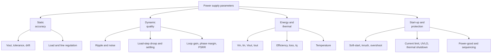

::: basics
### In plain words
A power supply has many numbers worth tracking. They fall into groups: how accurate the output voltage is, how clean and steady it is, how efficient it is, how hot it gets, and how it behaves during start-up and faults. You track different numbers during design and in the running product.

### Picture it
Think of a health check-up. The doctor does not look at one number. Temperature, pulse, and blood pressure each say something different, and together they show whether you are healthy. A supply's output voltage, ripple, efficiency, and temperature are its vital signs.

### Words you need
- **Load regulation**: how much the output changes as the load current changes.
- **Line regulation**: how much the output changes as the input voltage changes.
- **Ripple and noise**: small unwanted wiggles on the output.
- **Efficiency**: output power divided by input power. See [[q0162]].
- **Quiescent current**: what the supply draws with no load.

### The simplest example
A supply takes 12 V at 0.5 A, so the input power is 6 W. It delivers 5 V at 1 A, which is 5 W. The efficiency is $5/6 \approx 83\%$, and 1 W becomes heat. If the output reads 5.00 V with no load and 4.95 V at full load, the load regulation is 1%. That is the whole idea. The rest of this page adds the dynamic numbers (transient response, stability), protection and start-up behavior, and what to monitor while running.
:::

::: testing
Whether you can think like someone who has to **characterize, debug and monitor** a supply, not just design it. The interviewer is looking for a structured list: DC accuracy (output voltage, load and line regulation), dynamic behaviour (ripple/noise, transient response, stability), energy (efficiency, input/output current, power, quiescent current), thermal (temperature), protection and health (current limit, UVLO, power-good, faults), start-up (soft-start time, inrush, sequencing), and how each is measured. A strong answer separates "design/characterization parameters" from "runtime telemetry" and says *why* each matters for the load.
:::

::: why
A supply that "outputs 3.3 V" on a DMM can still crash a system: too much ripple, a droop on load steps, overshoot at start-up, a thermal shutdown at 60 °C, or an efficiency that drains the battery in a day. In validation you write a test plan around exactly these parameters, and in production firmware (or a PMBus/PMIC interface) you track a subset to detect faults and optimize power. Being able to list and justify them shows you understand what a supply must deliver and how it fails. It is the "monitor" counterpart of [[q0153]] ("what specs to look for when choosing").
:::

::: concepts
- **DC accuracy**: initial set-point error, and drift with temperature, line and load. See [[q0008]] for feedback divider tolerance.
- **Regulation**: load regulation $\Delta V_{out}/\Delta I_{out}$ and line regulation $\Delta V_{out}/\Delta V_{in}$.
- **Ripple and noise**: switching ripple at $f_{sw}$, plus broadband noise and spikes. See [[q0218]].
- **Transient response**: droop/overshoot and settling after a load step. See [[q0151]].
- **Efficiency and loss**: $\eta=P_{out}/P_{in}$ and heat. See [[q0162]].
- **Stability**: loop gain crossover and phase/gain margin; the converter must not oscillate.
:::

::: answer
"I'd group them. First, the DC numbers: output voltage and its accuracy, including drift over temperature, line and load, so load regulation and line regulation. Second, how clean and how steady it is dynamically: output ripple and noise, the transient response to a load step, meaning how far it droops and how long to settle, and loop stability, so crossover frequency and phase margin.

Third, power: input voltage and current, output voltage and current, and from those the efficiency and loss, plus the quiescent current at no load, which dominates battery life in standby. Fourth, thermal: the temperature of the regulator and inductor, because losses become heat.

Then the protection and start-up behaviour: current limit and short-circuit response, under-voltage lockout thresholds, soft-start time and inrush current, overshoot at start-up, power-good thresholds and sequencing, and thermal shutdown.

If it's something I'm monitoring at runtime, I'd track the subset that tells me the system is healthy: input voltage, output voltage, output current, temperature, power-good and fault flags, maybe via a PMBus or an ADC. For validation I'd measure everything on the bench with the right setup, like a short ground spring for ripple."
:::

::: technical
**Static (DC) parameters**
- *Output voltage accuracy*: initial error plus reference drift plus feedback-resistor tolerance. For a 0.6 V reference with 1% resistors the ratio error is about ±1.6% (see [[q0149]]).
- *Load regulation*: $\dfrac{V_{NL}-V_{FL}}{V_{nom}}\times100\%$. Example: 3.300 V no load, 3.282 V at 2 A gives 0.545%, an equivalent output resistance of $18\text{ mV}/2\text{ A}=9$ mΩ.
- *Line regulation*: $\dfrac{\Delta V_{out}}{V_{nom}\,\Delta V_{in}}$; e.g. 3.303 V to 3.297 V over 9-15 V is 0.03%/V.
- *Dropout voltage* (LDO), *minimum input voltage*, *maximum duty cycle / minimum on-time*.

**Dynamic parameters**
- *Ripple and noise*: peak-to-peak at $f_{sw}$ and noise bandwidth-limited (often 20 MHz); spikes at switching edges. Specify bandwidth and probe method.
- *Load transient*: droop and overshoot for a given step ($\Delta I$, slew rate), settling time. See [[q0151]].
- *Line transient*: output response to step in input.
- *PSRR* (for LDOs): e.g. 60 dB turns 100 mV of input ripple into 0.1 mV.
- *Stability*: loop-gain crossover frequency, phase margin (45-60° or more), gain margin; output impedance versus frequency.

**Energy and thermal**
- *Input voltage/current, output voltage/current*, $\eta=\dfrac{V_{out}I_{out}}{V_{in}I_{in}}$. Example: 12 V × 0.612 A in and 3.3 V × 2 A out gives 89.9% and 0.744 W loss.
- *Quiescent current ($I_q$)* and *shutdown current*; light-load efficiency; efficiency across load and line.
- *Temperature* of the IC, inductor and FETs; thermal rise $\Delta T=P_{loss}\theta$ (0.744 W × 40 °C/W ≈ 30 °C).

**Start-up and protection**
- *Soft-start time*, inrush current, start-up overshoot, monotonicity into pre-biased loads.
- *Current limit* threshold and behaviour (cycle-by-cycle, foldback, hiccup), short-circuit current.
- *UVLO/OVLO* thresholds and hysteresis, thermal shutdown threshold, power-good thresholds and delay, sequencing relationships ([[q0171]]).
- *Switching frequency* and its variation (and sync).

**Runtime telemetry** (PMBus/PMIC): $V_{in}$, $V_{out}$, $I_{out}$, temperature, power, fault/status flags, power-good.

> [!UNCERTAIN]
> Which parameters are exposed and how they are specified (ripple bandwidth, transient step rates, PSRR frequencies) differs between vendors and application standards. Use the specific datasheet's test conditions when comparing parts.
:::

::: short
"I'd track output voltage and its regulation against load and line, ripple and noise, transient response and loop stability, then input and output voltage and current to get efficiency and loss, plus quiescent current and temperature. Beyond that, start-up behaviour like soft-start and inrush, and protection thresholds: current limit, under-voltage lockout, thermal shutdown and power-good. At runtime I'd monitor voltage, current, temperature and fault flags."
:::

::: long
"I'd think about it in groups: static accuracy, dynamic behaviour, energy and heat, and start-up and protection.

Static: output voltage and its accuracy, which includes the reference, feedback-divider tolerance and temperature drift. Load regulation is how much it changes from no load to full load, line regulation is how much it moves over the input range. For example, 3.300 volts unloaded and 3.282 at 2 amps is 0.55% load regulation, or about 9 milliohms of output resistance.

Dynamic: ripple and noise at the output, including switching spikes, measured with a short ground connection and a stated bandwidth, since the number depends on the measurement. The load transient response, how far it droops and overshoots and how long it takes to settle for a given current step. And loop stability: crossover frequency and phase margin, since a low phase margin shows up as ringing. For an LDO, add PSRR.

Energy and heat: input voltage and current, output voltage and current, so efficiency and loss. With 12 volts and 0.612 amps in and 3.3 volts at 2 amps out, that's about 90% and 0.74 watts of heat, so a 30 degree rise at 40 degrees per watt. And quiescent and shutdown current, because they dominate battery life in standby, along with light-load efficiency.

Start-up and protection: soft-start time and inrush, any start-up overshoot, current limit and short-circuit behaviour, UVLO thresholds and hysteresis, thermal shutdown, and the power-good thresholds and sequencing relative to other rails.

At runtime I'd monitor a subset through PMBus or ADCs: input and output voltage, output current, temperature, power-good and fault flags. During validation I'd measure the full list, across corners of input voltage, load and temperature."
:::

::: terms
- **Load regulation**: change in output voltage from no load to full load, often in % or mV/A.
- **Line regulation**: change in output voltage over the input-voltage range.
- **Ripple**: periodic output variation at the switching frequency; **noise**: broadband components.
- **Transient response**: droop, overshoot and settling after a load or line step.
- **PSRR**: ratio of input ripple to output ripple (dB) for a linear regulator.
- **Phase margin**: how far the loop phase is from -180° at crossover; indicates damping.
- **Quiescent current ($I_q$)**: current the regulator itself draws at no load. See [[q0165]].
- **Power-good (PG)**: flag that shows the output is within regulation.
:::

::: exceptional
**An average answer** lists "voltage, current, efficiency, ripple, temperature."

**An exceptional answer**:
- Organizes by **category** (static, dynamic, energy/thermal, start-up/protection) and explains what failure each parameter prevents.
- Gives **definitions and numbers** (load regulation 0.55%, 9 mΩ effective output resistance; $\eta=89.9\%$ from measured $V$ and $I$).
- Notes that **measurement conditions matter**: ripple bandwidth, probe grounding, step slew rate, temperature and input/output corners.
- Distinguishes **design/characterization** parameters (loop gain, PSRR, EMI) from **runtime monitoring** (PMBus telemetry, power-good, fault flags).
- Mentions **corner testing** (min/max input, no load/full load, hot/cold) and that quiescent and light-load efficiency matter for battery products.
:::

::: mistakes
- **Reporting only DC output voltage.** A good DMM reading hides ripple, transients and start-up behaviour.
- **Measuring ripple with a long ground lead or full-bandwidth scope** and getting misleading numbers; use a ground spring and stated bandwidth.
- **Computing efficiency from the wrong places.** Measure $V_{in}$ and $V_{out}$ at the converter terminals, with a 4-wire connection, or cable and shunt drops distort the result.
- **Ignoring no-load or light-load behaviour**: quiescent current, pulse-skipping ripple and output rise at no load.
- **Testing only at room temperature and nominal input.** Corners often decide pass/fail.
- **Forgetting stability.** A loop with 20° phase margin may appear fine in a static test but ring badly on a load step.
:::

::: deep
## Why categories help

A supply has to do four jobs: hold the **voltage** (DC accuracy), keep it **clean** (ripple, noise, transients), do it **efficiently** without overheating (energy, thermal), and **behave** at the edges (start-up, faults). Each parameter you track answers a question about one of those jobs.


Figure: A checklist tree. In an interview, speak branch by branch; each leaf names a parameter you would measure or monitor. The right-hand side of every branch is a question about the load: is the voltage right, clean, cool and safe?

## Static accuracy: regulation

**Load regulation** measures how stiff the output is:
$$\text{Load reg.}=\frac{V_{NL}-V_{FL}}{V_{nom}}\times100\%$$
For $V_{NL}=3.300$ V and $V_{FL}=3.282$ V at 2 A, that is 0.545%, and the equivalent output resistance is $\Delta V/\Delta I=18\text{ mV}/2\text{ A}=9\ \text{m}\Omega$. This is what the load actually "sees" as it ramps from idle to full.

**Line regulation** is the sensitivity to the input: 6 mV of change over 9 to 15 V is 0.18% total, or 0.03%/V. A switching regulator's DC line regulation is typically excellent (the loop has high DC gain); the interesting line behaviour is dynamic (line transients, PSRR at high frequency).

**Total accuracy** adds reference tolerance, feedback-divider ratio error, temperature drift, and load/line effects. If the load needs ±5% and the feedback divider alone contributes ±1.6%, you must account for it ([[q0149]]).

```plot
{"title":"Load regulation: Vout vs load current (3.300 V no-load, 9 mΩ output resistance)","x":{"label":"Load current","unit":"A","min":0,"max":2.5},"y":{"label":"V_out","unit":"V","min":3.2,"max":3.33},
 "vars":{"v0":3.3,"ro":0.009},
 "series":[{"label":"V_out(I) = V_0 − R_o·I","fn":"v0-ro*x"}],
 "points":[{"x":2,"y":3.282,"label":"3.282 V at 2 A (0.545%)"}]}
```
Figure: Load regulation is the slope of this line, the converter's DC output resistance. It's a small number for a feedback-regulated supply. Compare the divider's 31 Ω slope in [[q0148]].

## Dynamic behaviour: what the load feels in time

- **Ripple and noise.** Switching ripple at $f_{sw}$ (a few mV for a ceramic-filtered buck) plus switching-edge spikes of tens of mV and high-frequency noise. Always specify the measurement bandwidth (commonly 20 MHz) and probing method (tip and barrel, ground spring). Compare with what the load tolerates ([[q0151]], [[q0218]]).
- **Transient response.** For a load step $\Delta I$, record the droop, overshoot and settling time to within a band (e.g. ±1%). First-order estimate: $\Delta V\approx\Delta I/(2\pi f_cC)+\Delta I\cdot ESR$.
- **Stability.** Loop gain crossover $f_c$ and phase margin (>45°-60° at worst case). A low phase margin means ringing on every load step and large peaking in output impedance.
- **PSRR** for LDOs: $\text{PSRR}=20\log_{10}(v_{in,ripple}/v_{out,ripple})$; 60 dB reduces 100 mV to 0.1 mV, but typically falls with frequency.

```sim
{"id":"buck-lab","vin":12,"vout":3.3,"l":8.2e-6,"c":4.4e-5,"esr":0.003,"fsw":500000,"iout":2,"view":"ripple"}
```
Figure: The ripple view shows the output ripple compared with the analytic estimate. Lower the capacitance or raise ESR to see the ripple and its sawtooth/step shape change; this is the quantity you would measure with a scope and a ground spring.

## Energy and heat: efficiency, loss and quiescent current

Measure $V_{in},I_{in},V_{out},I_{out}$ at the converter terminals:

$$\eta=\frac{V_{out}I_{out}}{V_{in}I_{in}},\qquad P_{loss}=V_{in}I_{in}-V_{out}I_{out}$$

Example: 12.00 V × 0.612 A = 7.34 W in, 3.30 V × 2.00 A = 6.60 W out, $\eta=89.9\%$, loss 0.744 W. With $\theta_{JA}=40$ °C/W the die is about 30 °C above ambient. Measure efficiency at several loads and inputs, not just full load. For battery products, **quiescent current** ([[q0165]]) and **light-load efficiency** set standby life: 50 µA at 3.7 V is about 0.19 mW, but 5 mA would be 18.5 mW.

Also track **temperature** of the regulator, inductor and FETs. Thermal limits (junction temperature, inductor saturation current falling with heat, capacitor life) define derating.

```sim
{"id":"regulator-compare","mode":"viio","vin":12,"vout":3.3,"iout":2}
```
Figure: Enter any three of $V_{in}$, $I_{in}$, $V_{out}$, $I_{out}$ (with an efficiency) and read the fourth; see also [[q0155]].

## Start-up and protection parameters

| Parameter | What it tells you | Typical check |
|---|---|---|
| Soft-start time | Rate of rise, inrush | Charging current $C\,dV/dt$ at start |
| Start-up overshoot | Stress on the load | Scope single-shot at power-up |
| UVLO threshold and hysteresis | When it turns on/off | Slow input ramp up and down |
| Current limit and short-circuit behaviour | Protection of FETs, inductor, supply | Short the output; hiccup or foldback |
| Thermal shutdown threshold | Self-protection | Heat/derate test |
| Power-good threshold and delay | Sequencing downstream rails | Compare with the load's reset requirements |
| Switching frequency and spread | EMI, interference with sensitive circuits | Spectrum or scope |

These interact with other rails: the sequencing questions ([[q0171]]) rely on PG thresholds and delays.

## Runtime telemetry: what to monitor in the field

Many PMICs and digital power controllers (PMBus/I²C) expose $V_{in}$, $V_{out}$, $I_{out}$, temperature, power, and fault/status registers. A simpler system may just read $V_{out}$ and PG with an ADC or GPIO. The goals:
- **Health**: detect overheating, over-current and failing capacitors (rising ripple or ESR).
- **Control**: adjust voltage in DVFS, throttle on over-temperature.
- **Efficiency**: log power for optimization; battery SOC.
- **Diagnostics**: after a reset, record which rail dipped.

> [!INTERVIEW]
> After you list the parameters, tie each to a failure: "I care about ripple because the ADC reference sits on this rail, load transients because the FPGA has ±3%, quiescent current because it's a coin-cell device." That shows you prioritise by the load rather than reciting a checklist.

## Test conditions are part of the parameter

A number without conditions is meaningless: ripple at which load and bandwidth? Efficiency at which input voltage and temperature? Transient at which slew rate? The corners that usually matter are minimum and maximum input voltage, no-load and full-load, and hot and cold. Report min/typ/max, not only typical.
:::

::: applications
- **Bench validation of a new board**: efficiency curves, ripple, load-step and start-up captures across corners before release.
- **Production test**: measure output voltage, current and PG at a few loads to catch assembly defects.
- **Server and telecom power**: PMBus telemetry of voltage, current, power and temperature for management and logging.
- **Battery devices**: tracking quiescent and shutdown current to meet standby-life targets.
- **Safety and reliability**: monitoring temperature, ripple growth (capacitor degradation) and fault counters.
:::

::: assumptions
- **DC-DC, non-isolated** converter context (section note), typically a buck or LDO.
- **Parameter importance is application-dependent.** A motor supply cares less about ripple; an ADC reference supply cares a lot.
- **"Track" could mean monitor at runtime or measure during design**; both are covered, with runtime telemetry as a subset.
- **Numbers are examples** from a 12 V to 3.3 V, 2 A buck; measure for the actual part.
- **Alternative valid answers.** For AC supplies, add power factor, harmonic distortion and hold-up time; for isolated supplies, isolation voltage and leakage current. These are valid extensions if the interviewer broadens the scope.
:::

::: followups
### What's the difference between load regulation and transient response?
Load regulation is the *static* change in output voltage from one steady load level to another (the DC slope, an effective output resistance). Transient response is the *dynamic* behaviour as the load changes: droop, overshoot, ringing and settling time. A supply can have excellent load regulation yet poor transient response if the loop is slow or the output capacitance small.

### How would you measure ripple correctly?
Use a short ground spring or a tip-and-barrel connection directly at the output capacitor, 20 MHz bandwidth limit (state it), AC coupling or offset to see the ripple, and adequate sample rate. A long ground lead picks up the switching edge and shows false spikes. See [[q0151]].

### Why does quiescent current matter more than peak efficiency for some products?
If a device is asleep 99% of the time, the average power is dominated by standby draw: 50 µA at 3.7 V is 0.185 mW while the load might use 2 µA. A regulator with 5 mA $I_q$ would drain the battery in days. Peak efficiency at full load hardly matters.

### How would you check that a buck converter is stable?
Measure loop gain with a network analyzer by injecting a small signal across a resistor in the feedback path; check crossover frequency and phase margin (≥45-60°), and gain margin (≥10 dB) at worst-case input, load and temperature. A quick check: a load step response with minimal ringing, and output impedance with no sharp peaks.

### Efficiency measurements: 12.0 V, 0.60 A in; 3.3 V, 1.9 A out. What's efficiency and loss?
$P_{in}=7.2$ W, $P_{out}=6.27$ W; $\eta=87.1\%$, loss $0.93$ W. Check the measurement points: at the converter terminals, with a decent ammeter or shunt that doesn't drop much voltage.

### Scenario: a supply passes all DC tests but the system reboots randomly in the field. What other parameters do you check?
Transient response and ripple under the actual workload (at the load pins), start-up and brown-out behaviour at low battery or hot, input-line transients, thermal and current-limit behaviour at high temperature, and PG/UVLO thresholds interplay with the reset logic. Log voltage and fault flags if telemetry is available.
:::

::: interpretations
"Parameters you would want to track in a power supply" can mean (a) what to measure during design/validation or (b) what to monitor at runtime. This page covers both, giving the full list for (a) and the typical telemetry subset for (b). The sibling [[q0153]] is the buyer/designer's *spec* view (what to look for when choosing a supply), and [[q0155]] covers the arithmetic relation between $V$ and $I$ at the input and output.
:::

::: references
- Texas Instruments and Analog Devices power-supply application notes on measuring ripple/noise, load/line regulation and efficiency (use the specific parts' datasheet test conditions).
- Erickson & Maksimovic, *Fundamentals of Power Electronics*: converter regulation, efficiency and control-loop stability.
- Horowitz & Hill, *The Art of Electronics*: regulator specifications (load and line regulation, ripple rejection, dropout).
- PMBus specification, for standard telemetry and fault-status commands in digitally managed supplies.
:::

::: rubric
- Lists DC accuracy, load regulation and line regulation :: These are the basic static parameters of any supply.
- Includes ripple/noise and transient response :: The load cares about dynamic behaviour, not just DC.
- Includes efficiency/loss from $V_{in},I_{in},V_{out},I_{out}$ and quiescent current :: The question's power-focused half; important for heat and batteries.
- Includes thermal/temperature and protection (current limit, UVLO, thermal shutdown) :: Reliability and safety parameters.
- Mentions start-up behaviour (soft-start, inrush, overshoot, power-good/sequencing) :: A common source of real failures.
- Mentions stability (phase margin) and test conditions/corners :: Distinguishes experienced engineers from list-reciters.
:::

::: quiz
```json
[
 {"type":"mcq","level":"fundamental","q":"Which parameter describes how much the output voltage changes between no load and full load?","options":["Line regulation","Load regulation","PSRR","Dropout voltage"],"answer":1,"explain":"Load regulation is the change of output voltage with load current. Line regulation concerns input voltage changes."},
 {"type":"numeric","level":"fundamental","q":"A supply reads 3.300 V at no load and 3.282 V at 2 A. What is the load regulation as a percentage of 3.3 V?","answer":0.545,"tolerance":0.03,"unit":"%","explain":"$(3.300-3.282)/3.3=0.00545=0.545\\%$."},
 {"type":"numeric","level":"intermediate","q":"Input measurements are 12.0 V and 0.612 A; output is 3.3 V and 2.0 A. What is the efficiency?","answer":89.9,"tolerance":0.02,"unit":"%","explain":"$P_{in}=7.344$ W, $P_{out}=6.6$ W, $\\eta=6.6/7.344=0.899$."},
 {"type":"numeric","level":"intermediate","q":"For the same supply, how much power is lost as heat?","answer":0.744,"tolerance":0.02,"unit":"W","explain":"$P_{loss}=7.344-6.6=0.744$ W."},
 {"type":"numeric","level":"intermediate","q":"An LDO has 60 dB PSRR at 1 kHz. A 100 mV ripple at that frequency on the input appears as what output ripple?","answer":0.1,"tolerance":0.03,"unit":"mV","explain":"60 dB is a factor of 1000 in amplitude: $100\\text{ mV}/1000=0.1$ mV."},
 {"type":"multi","level":"advanced","q":"Select the items that are start-up or protection parameters.","options":["Soft-start time","Current-limit threshold","Load regulation","Thermal-shutdown threshold"],"answer":[0,1,3],"explain":"Soft-start, current limit and thermal shutdown concern start-up and protection behaviour; load regulation is a static accuracy parameter."}
]
```
:::
