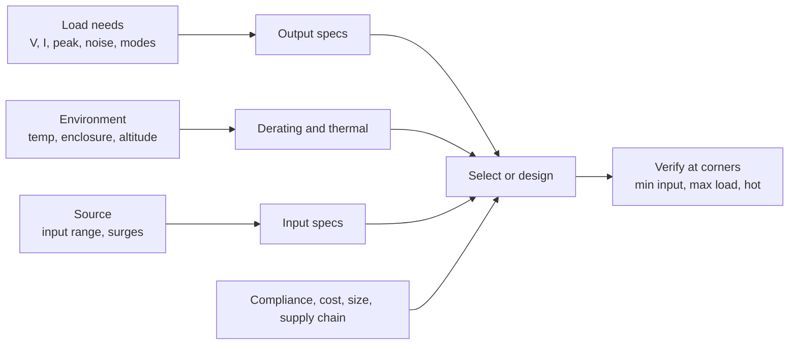

::: testing
Whether you can translate **load needs into supply specs** and then *derate and verify*. The interviewer is looking for the input side (voltage range, current, inrush, power factor/hold-up if AC), the output side (voltage, tolerance, continuous and peak current, ripple/noise, transient response), efficiency and standby power, protections, thermal/derating, size/cost/availability and certifications. A strong answer shows prioritisation (what matters for *this* load) and practical judgement, such as headroom, cable drop and the difference between a datasheet's typical and worst-case numbers.
:::

::: why
Choosing or specifying a supply is one of the first decisions in any hardware project, and a poor choice causes the most annoying failures: a supply that is fine on the bench and fails under the real peak load, a rail that is noisy enough to ruin an ADC, a "5 V 3 A" brick that collapses when two motors start, or an adapter that overheats in an enclosure. It also appears in procurement and compliance (safety standards, EMC, energy efficiency rules). The skill is mapping spec lines to failure modes. It pairs with [[q0152]] (what to measure) and [[q0150]] (designing one).
:::

::: concepts
- **Load analysis**: continuous, peak and transient current; inrush; operating modes. See [[q0006]] for power.
- **Output quality specs**: voltage tolerance, ripple/noise, load/line regulation, transient response. See [[q0152]] and [[q0151]].
- **Efficiency and standby**: $\eta$ vs load; no-load power; heat. See [[q0162]] and [[q0165]].
- **Input specs**: voltage range, surge/transient tolerance, inrush, power factor (AC), hold-up time.
- **Protection**: over-current, over-voltage, short-circuit, over-temperature, reverse polarity.
- **Derating**: ratings at temperature, altitude and enclosure; margin for tolerance and ageing.
:::

::: answer
"I start from the load, because the supply spec is just the load's requirements with margin. What voltage and tolerance does it need, what's the continuous current, what's the peak and for how long, and how sensitive is it to ripple and noise?

On the output I look at: the voltage and its accuracy, continuous and peak current rating, with the peak having a duration, ripple and noise, load and line regulation, and the transient response to load steps. Then efficiency, both at my typical load and at no load, because a supply that's 90% at full load can be 60% at 5% load, and no-load power matters for battery or always-on products.

On the input: the voltage range, and that includes surges and dips, inrush current at plug-in, and for AC input the power factor and hold-up time.

Then protection and robustness: over-current, short-circuit, over-voltage, over-temperature, and what each does, latch or hiccup. Thermal: derating curves versus ambient temperature and airflow, because a '60 watt' supply may only give 40 in a sealed box. Then certifications, like safety and EMC, size and cost, availability, and lifetime or MTBF.

As a rule I'd size the continuous current at about 70 to 80 percent of the rating and make sure the peak is covered, then check the real thing under the worst-case load, input and temperature, on the bench."
:::

::: technical
**Start from the load.** For each load: voltage range, tolerance, continuous and peak current, duty cycle of peaks, inrush (capacitive loads), sensitivity to noise, sequencing, and wiring (cable drop).

**Output specs**
- *Voltage and tolerance*: initial accuracy + line + load + temperature must fit the load's window. Include remote sense if wiring drop matters.
- *Current*: continuous, peak (value and duration), current-limit behaviour (constant current, foldback, hiccup). Capacitive loads: inrush $I\approx C\,dV/dt$.
- *Ripple and noise*: mV pk-pk with a stated bandwidth (e.g. 20 MHz); high-frequency spikes.
- *Transient response*: droop/overshoot and recovery for a step (e.g. 25-75%).
- *Regulation*: load and line regulation.
- *Hold-up time* (AC-DC): how long the output survives a mains dropout.

**Efficiency and standby.** Curve vs load; $\eta=P_{out}/P_{in}$; no-load input power and quiescent current. Heat $=P_{in}-P_{out}$.

**Input specs.** Voltage range (min/max, including brownout/surge), frequency, input current and inrush, power factor and harmonics (AC input; mains-connected equipment commonly has regulatory limits), reverse polarity, transient/surge immunity.

**Protection.** Over-current, short-circuit, over-voltage, over-temperature, under-voltage lockout, and the response (latch, hiccup, auto-restart).

**Environment and reliability.** Operating temperature, derating curve, cooling (convection, forced air), humidity, altitude, MTBF method and conditions (e.g. Telcordia or MIL-HDBK-217 models), lifetime of electrolytics.

**Compliance.** Safety (e.g. IEC/UL 62368-1 for audio/video and IT equipment, medical standards when applicable), EMC emissions and immunity (e.g. CISPR/EN 55032 or FCC limits), energy-efficiency regulations for external power supplies, isolation voltage/creepage.

**Practical.** Form factor, connectors, cable length, cost, availability, second source, lead time, vendor support.

**Worked sizing example.** A board needs 12 V ±5%, 2 A continuous, 3.5 A for 100 ms, in a 40 °C enclosure, 5 m cable (round trip about $2\times5\times0.0529\ \Omega/\text{m}=0.53$ Ω for 22 AWG).
- Continuous at 80%: $2/0.8=2.5$ A minimum; peak 3.5 A means choose 4 A (48 W), giving 50% continuous utilisation and 87.5% at peak. Check that the unit's peak/current-limit behaviour allows the 3.5 A burst without folding back.
- Cable drop at 3.5 A: $3.5\times0.53=1.85$ V, so the board sees 10.2 V from a 12.0 V supply, outside ±5%. Use remote sense, a thicker cable, or a higher distribution voltage with a local regulator.
- Standby: 0.1 W no-load draw is 0.88 kWh per year, small, but 1 W is nearly 9 kWh.

> [!UNCERTAIN]
> Standards, limits and test conditions differ by region, product class and edition. Check the applicable edition and your target markets before claiming compliance.
:::

::: short
"I'd start from the load and spec the output voltage and tolerance, continuous and peak current, ripple and noise, regulation and transient response. Then efficiency including no-load power, the input range and surge/inrush behaviour, protections like over-current and over-temperature, thermal derating, and certifications and cost. I'd size continuous current at about 70-80% of the rating, cover the peak, and verify under worst-case load, input and temperature."
:::

::: long
"I'd work from the load outward, because every spec line should trace back to something the load needs.

For the output: voltage and tolerance, and whether the total, including line, load, temperature and cable drop, stays inside the load's window. Then current: continuous, peak and for how long. A motor or a radio might need three times its average for 100 milliseconds, so I'd check how the supply's current limit behaves, whether it folds back or hiccups. Then ripple and noise, with the bandwidth stated, since an ADC reference or a radio cares much more than a motor. Then load and line regulation and the transient response to a load step.

Efficiency matters twice: at my typical load, because it sets heat and battery life, and at light or no load, since efficiency curves fall off at the low end and no-load power adds up in always-on products.

On the input: the voltage range including surges and dips, the inrush at plug-in, and for AC supplies the power factor and hold-up time.

Protection: over-current, short-circuit, over-voltage, over-temperature, and whether it latches or recovers.

Then the environmental things: the derating curve versus ambient temperature and airflow, because a supply rated at 60 watts at 25 degrees might deliver 40 inside a sealed enclosure, plus lifetime of electrolytic capacitors and MTBF. Then compliance, safety and EMC for the markets I sell in, and form factor, cost and availability.

My rule of thumb is to run continuous load at about 70 to 80 percent of the rating and cover the peak, then confirm on the bench at the corners: minimum input, maximum load, high temperature."
:::

::: terms
- **Continuous vs peak current**: sustained rating versus short-duration allowance.
- **Derating**: reduction in allowed output with temperature, altitude or enclosure.
- **Ripple and noise**: output AC components, specified pk-pk with a defined bandwidth.
- **Hold-up time**: duration the output stays in regulation after input loss.
- **Inrush current**: surge when charging capacitors at start-up.
- **No-load power**: input power with the output unloaded (standby loss).
- **Remote sense**: sense lines that regulate at the load rather than at the supply terminals.
- **MTBF**: mean time between failures, a prediction depending on the method and conditions.
:::

::: exceptional
**An average answer** says "voltage, current, efficiency, size and cost."

**An exceptional answer**:
- Starts from the **load** and traces each spec to a failure mode (ripple ruins the ADC, peak current collapses the rail, no-load power drains the battery).
- Distinguishes **continuous vs peak** current and asks about current-limit behaviour (foldback, hiccup).
- Includes **cable/connector drop** and remote sense, and the tolerance **stack-up** (initial, line, load, temperature).
- Covers **efficiency curves and no-load power**, **derating vs temperature/enclosure**, and **input** specs (range, surge, inrush, hold-up, PFC for AC).
- Mentions **safety/EMC certification**, MTBF and availability, and says how they'd **verify** at the corners.
:::

::: mistakes
- **Choosing the supply rated exactly at the load's maximum current.** No margin means heat, shortened life and collapse at tolerance corners. Use 20-30% headroom.
- **Reading "typical" specs as guaranteed.** Look at min/max, and at the test conditions (load, bandwidth, temperature).
- **Ignoring the peak.** A supply that can deliver 2 A continuously may fold back at 3.5 A for 100 ms.
- **Forgetting cable and connector drop.** Several volts can be lost on a long thin cable at high current.
- **Quoting ripple without bandwidth or probe method.** The number depends on how it is measured.
- **Overlooking inrush and capacitive loads,** which can trip current limits or the upstream breaker at start-up.
- **Ignoring thermal derating**, particularly in sealed enclosures, and standby/no-load power.
:::

::: deep
## Start with the load, not the supply

A supply spec is a negotiation between the load's needs and the supply's capabilities. Write down for each load:

| Load attribute | Why it matters |
|---|---|
| Voltage and allowed tolerance | Defines the output window; stack-up of tolerances must fit |
| Continuous current | Sizing, heat, efficiency point |
| Peak current and duration | Current-limit behaviour, bulk capacitance, supply peak rating |
| Inrush / capacitive loading | Start-up current limit, soft-start |
| Noise sensitivity | Ripple/noise, need for post-regulation |
| Operating modes (sleep vs active) | Light-load efficiency, quiescent current |
| Sequencing, power-good | Supervisory features, enable/PG pins |


Figure: A spec comes from four directions: the load, the source, the environment and non-technical constraints. Selection or design happens in the middle; verification at the corners closes the loop.

## Output specifications in depth

**Voltage tolerance stack-up.** The load window must contain the sum of: initial set-point accuracy, line regulation, load regulation, temperature drift, ripple, and the drop in cables and connectors. For a 12 V rail with ±5% (11.4-12.6 V): if the supply's regulated tolerance is ±2% there is only ±3% left (±0.36 V) for cable drop, ripple and transients. A 5 m 22 AWG round trip is about 0.53 Ω, so 2 A costs 1.06 V and 3.5 A costs 1.85 V, which blows the budget on its own; the options are remote sense, heavier gauge, a shorter cable, or a higher transmission voltage with a local converter (see [[q0007]] on why losses scale with current).

**Current: continuous and peak.** Continuous rating is thermally limited; peak rating (often "for 100 ms" or a percentage of the time) depends on how the supply's current limit works. Behaviour options: constant-current limiting (the voltage falls to hold current), foldback (current reduces further at lower output voltage), hiccup (shuts off and retries), or latch-off. A motor or capacitive load may start in current limit and then fail to start in a foldback supply.

**Ripple and noise.** Specified as pk-pk (and sometimes rms) with a bandwidth (20 MHz is common), and often measured with a particular probe and capacitor arrangement at the output. Mains-line-frequency ripple, switching ripple and high-frequency spikes are different things. A supply with 100 mV of ripple may be fine for a motor and unusable for a 16-bit ADC reference. See [[q0151]].

**Regulation and transient response.** Load and line regulation determine the DC window; load-step response (droop, overshoot, recovery time for a specified step and slew rate) determines the dynamic window. These are often listed for specific conditions (e.g. 25% to 75% step).

**Hold-up (AC-DC).** The bulk capacitor energy ride-through time (milliseconds) for mains dropouts. Compare with the load's reset behaviour. Energy needed is $P\cdot t$, supplied by $\tfrac12C(V_1^2-V_2^2)$ ([[q0143]]).

## Efficiency and standby

Efficiency changes with load, input voltage and temperature. A typical supply peaks at moderate-to-high load and falls at light load because fixed losses (controller, switching, gate drive) dominate.

```plot
{"title":"Illustrative efficiency vs load for a 60 W supply (assumed loss model)","x":{"label":"Load","unit":"fraction of rated","min":0.02,"max":1,"log":true},"y":{"label":"Efficiency","unit":"","min":0.5,"max":1},
 "series":[{"label":"η = P/(P + 0.8 W + 3 W·(load)²)","fn":"60*x/(60*x+0.8+3*x*x)"}],
 "points":[{"x":0.05,"y":0.788,"label":"5% load: ~79%"},{"x":0.5,"y":0.951,"label":"50% load: ~95%"},{"x":1,"y":0.94,"label":"100%: ~94%"}]}
```
Figure: A fixed 0.8 W loss plus a loss that grows with load squared gives the classic shape: poor at light load, peak around mid load, slightly lower at full load. The numbers are an assumed model, not a product; use the vendor's curve. It shows why sizing a supply at 50% utilisation can be more efficient than at 100%, and why standby draw matters for always-on devices.

```sim
{"id":"regulator-compare","mode":"eff","vin":12,"vout":3.3,"iout":2}
```
Figure: Use the efficiency mode to convert between input power, output power and efficiency, and read off the heat that must be removed.

- **No-load input power**: 0.1 W is 0.88 kWh per year; 1 W is 8.8 kWh. For battery devices, no-load or standby current (quiescent current, [[q0165]]) sets shelf life. Efficiency regulations for external power supplies set limits on average efficiency and no-load power (check the current rules for your market).
- **Heat** equals input power minus output power: at 90% efficiency, a 48 W output dissipates 5.3 W inside the supply.

## Input specifications

- **Voltage range**: min and max in normal operation, plus *dips* and *surges* the source can produce (automotive load dump, brown-outs); is there protection?
- **Inrush current**: a large bulk capacitor behind the input charges at power-on, with a peak that can trip breakers or fuses unless limited (NTC, soft start).
- **Power factor and harmonics** (AC): active PFC reduces harmonic current; equipment on the mains typically has to comply with harmonic-current regulations.
- **Hold-up and dropout behaviour**: as above.
- **Reverse polarity and transient protection** for DC inputs.

## Protection features

| Feature | Question to ask |
|---|---|
| Over-current / short-circuit | Does it limit, fold back, hiccup or latch? Is it safe indefinitely? |
| Over-voltage | Is there crowbar or clamp? What is the trip level? |
| Over-temperature | Shutdown level, hysteresis, auto-restart? |
| UVLO | Turn-on and turn-off thresholds, hysteresis |
| Reverse polarity | Built-in or external? |
| Output discharge / power-good / enable | Needed for sequencing |

## Thermal, environment and reliability

Specified power is usually at a given ambient and airflow. Derating curves reduce output power above a temperature (e.g. a 60 W supply derated linearly above 40 °C). A sealed enclosure increases local ambient. Electrolytic capacitor life roughly halves for every 10 °C rise (a common rule of thumb), so internal temperature drives lifetime. MTBF figures depend on the prediction method and assumed conditions, so compare like with like. Also consider altitude (cooling and creepage), humidity and vibration.

## Compliance, size, cost and supply chain

Safety approvals (e.g. IEC/UL 62368-1-type standards for IT/AV equipment, other standards for medical or industrial), EMC emission limits (CISPR/FCC type), isolation rating, creepage and clearance. A certified off-the-shelf supply often saves months compared with designing and certifying your own. Also: footprint, height, connector, cable length, price at volume, second source, lead time, vendor support and long-term availability.

## Buying vs designing

| Buy (module/brick/adapter) | Design (discrete or controller-based) |
|---|---|
| Faster, certified, known risk | Optimised cost/size/efficiency at volume |
| Less control of noise/spec | Full control and customisation |
| Check derating, ripple, certification | Need design, layout, validation, certification |

Either way, **verify with the real load** at the corners (min input, max load, high temperature) and with the real cable, rather than trusting the label.

## A compact checklist

1. Output: $V$, tolerance, $I_{cont}$, $I_{peak}$ (duration), ripple/noise (bandwidth), regulation, transient.
2. Input: range, surges, inrush, PF/hold-up (AC).
3. Efficiency curve, no-load power, heat.
4. Protection and fault behaviour.
5. Thermal derating and environment, lifetime/MTBF.
6. Compliance, form factor, cost, availability.
7. Verification plan at corners.
:::

::: applications
- **Choosing an adapter for an embedded board**: 12 V, 4 A for a 2 A continuous/3.5 A peak load with cable drop and remote sense considered.
- **Bench power supplies and lab equipment**: low-noise, programmable current limit, remote sense for precision measurements.
- **Industrial control cabinets**: DIN-rail supplies with high efficiency, wide temperature derating, and surge protection.
- **Battery-powered products**: low quiescent current and light-load efficiency drive the spec.
- **Medical, automotive and telecom**: dedicated safety, EMC and surge standards shape the selection.
:::

::: assumptions
- **DC output supply** feeding electronics (the section note says to assume DC-DC unless stated); AC-DC adds PFC, hold-up and safety specs.
- **"Buying/designing"** covers both modules and custom designs; the same spec lines apply, though the verification burden differs.
- **Margins** (70-80% utilisation) are rules of thumb, not standards; different industries use different derating policies.
- **Standards named** are examples of categories, and applicable editions depend on product and market.
- **Alternative valid answers.** Some emphasise a short list (voltage, current, efficiency, ripple, protections); others add cost and certification. Any structured list that is justified from the load is acceptable.
:::

::: followups
### Why not buy a supply rated exactly at your maximum load?
No margin for tolerances, ageing, high temperature, and peaks; it runs hot at full rating, reducing lifetime (capacitor life, thermal limits), and might fold back at transient peaks. Commonly continuous load is held to about 70-80% of rating, with checks of the peak and the derating curve at the operating temperature.

### Ripple spec says 50 mV. Is that enough for my ADC?
It depends on the ADC's PSRR and resolution and the frequency of the ripple. For a 12-bit, 3.3 V ADC (LSB = 0.8 mV), 50 mV of switching ripple on its reference would be a disaster unless attenuated by filtering or a post-regulator with high PSRR. For a motor, the same ripple is irrelevant. Match the spec to the load.

### What's the difference between peak current and current limit?
Peak current is what the supply can deliver for a short time (e.g. 150% for 100 ms) while still regulating; the current limit is the threshold where protection engages, and the behaviour beyond it (constant current, foldback, hiccup) is a separate spec. Loads with large inrush or motor starts can fail to start with foldback.

### How do cable and connector drops affect the spec?
They subtract from the supply's regulated voltage at the load and add ripple/noise coupling. For 3.5 A through 0.53 Ω you lose 1.85 V; remote sense wires let the supply compensate, or you use a higher distribution voltage and a local regulator.

### How would you decide between an off-the-shelf brick and a custom design?
Volume, size, efficiency and noise requirements, certification schedule and cost. For a prototype or low volume, a certified brick; for high volume with tight size/efficiency or special rails, a custom design with a dedicated certification plan.

### Scenario: your product works on the bench supply but fails in the field with a cheap adapter. What specs do you suspect?
Peak current capability and current-limit behaviour (foldback) when the product starts or bursts, output ripple/noise, cable drop and connector resistance, poor transient response, no-load or standby behaviour, and thermal derating of the adapter in the enclosure. I'd scope the rail at the board during the failing event.
:::

::: interpretations
"When buying/designing a power supply, what specs do you look out for?" can be answered from the buyer's view (datasheet lines) or the designer's view (requirements you set). Both are covered. The sibling [[q0152]] focuses on what to *track* (measure and monitor); this page focuses on what to *specify and select*. AC-DC supplies add PFC, hold-up and safety standards, mentioned but not the focus per the section note.
:::

::: references
- Horowitz & Hill, *The Art of Electronics*: power supplies and regulator specifications.
- Erickson & Maksimovic, *Fundamentals of Power Electronics*: converter performance metrics.
- IEC 62368-1 (safety of audio/video, information and communication technology equipment) and CISPR 32 (EMC of multimedia equipment), as examples of applicable standards; check current editions.
- Power-supply manufacturers' datasheets and derating curves (the part-specific documents are the authority for ratings).
:::

::: rubric
- Starts from the load's needs (voltage, tolerance, continuous and peak current) :: Spec lines should trace to the load.
- Lists output quality specs (ripple/noise, regulation, transient response) :: These determine whether sensitive loads work.
- Covers efficiency, no-load power and thermal derating :: Heat, battery life and reliability depend on them.
- Covers input range, surge/inrush and hold-up (and PFC for AC) :: The source side is half of the specification.
- Covers protection features and their behaviour (limit, foldback, hiccup, latch) :: Fault behaviour determines safety and robustness.
- Mentions certifications, cost, size and margin/verification at corners :: Shows practical, complete engineering thinking.
:::

::: quiz
```json
[
 {"type":"mcq","level":"fundamental","q":"Which approach to sizing a supply is best?","options":["Choose a supply rated exactly at the load's maximum current","Choose continuous load at roughly 70-80% of the rating and cover the peak separately","Ignore peak current if the average is low","Choose the cheapest supply that has the right voltage"],"answer":1,"explain":"Headroom keeps the supply cool and in regulation at tolerance corners, and peak current must be verified separately including current-limit behaviour."},
 {"type":"numeric","level":"fundamental","q":"A load needs 2 A continuous and you want continuous utilisation of at most 80%. What minimum supply current rating do you need?","answer":2.5,"tolerance":0.02,"unit":"A","explain":"$2/0.8=2.5$ A (and then check the 3.5 A peak separately)."},
 {"type":"numeric","level":"intermediate","q":"A 5 m, 22 AWG cable has about 0.0529 Ω per metre per conductor. What is the voltage lost in the round trip at 3.5 A?","answer":1.85,"tolerance":0.03,"unit":"V","explain":"Round-trip resistance $=2\\times5\\times0.0529=0.529$ Ω; $V=3.5\\times0.529=1.85$ V."},
 {"type":"numeric","level":"intermediate","q":"A supply has 0.1 W no-load input power. How much energy does that waste per year (8760 h)?","answer":0.876,"tolerance":0.02,"unit":"kWh","explain":"$0.1\\text{ W}\\times8760\\text{ h}=876$ Wh $=0.876$ kWh."},
 {"type":"numeric","level":"intermediate","q":"A 48 W output supply runs at 90% efficiency. How much heat does it dissipate internally?","answer":5.33,"tolerance":0.03,"unit":"W","explain":"$P_{in}=48/0.9=53.33$ W, so loss $=5.33$ W."},
 {"type":"truefalse","level":"advanced","q":"A '60 W' supply rated at 25 °C can always deliver 60 W inside a sealed enclosure at 60 °C ambient.","answer":false,"explain":"Output power is derated above a rated ambient temperature; sealed enclosures raise local ambient further. Check the vendor's derating curve."}
]
```
:::
