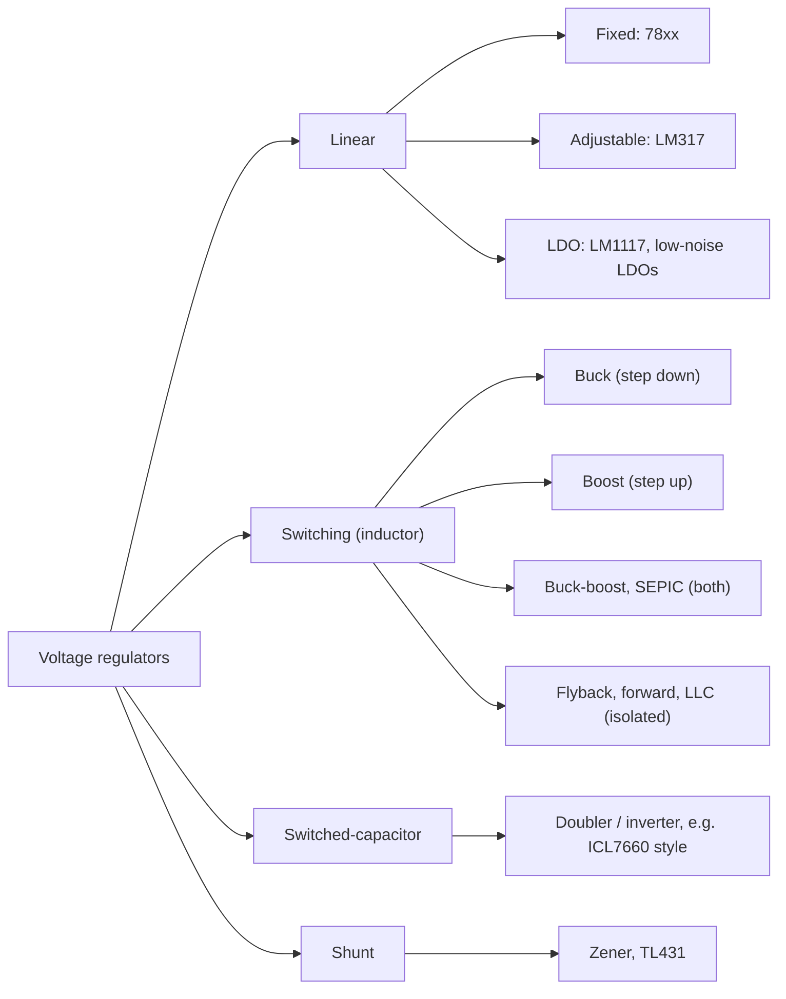

::: testing
Whether you have a mental map of the regulator "zoo" and not just one favourite part. A weak answer is "LDO and buck". A strong answer sorts regulators by *how they work* (linear, switching inductor-based, switched-capacitor, shunt), gives one or two real part families for each, and says in a sentence what each is good and bad at. The interviewer is also checking that you understand a regulator is something that holds the output constant against changes in input and load, so a plain voltage divider ([[q0148]]) does not qualify.
:::

::: why
Every board you will ever design has a power tree, and the first design decision is "which kind of regulator goes in each box?". Knowing the families and their typical parts lets you propose a sensible architecture quickly ([[q0166]]) and talk about trade-offs (efficiency, noise, cost, size) instead of reciting definitions. It is also a warm-up question: whatever you name, the next question is usually "so what's the difference between those two?" ([[q0157]]), so only name things you can defend.
:::

::: concepts
- **Regulation**: holding $V_{out}$ constant against input (line) and load changes using feedback against a reference. See [[q0147]].
- **Linear regulator**: a pass transistor acts as a variable resistor and burns the excess voltage as heat, so $\eta \approx V_{out}/V_{in}$.
- **Switching regulator**: a switch plus an inductor (or transformer) moves energy in packets, so it can step down, step up or invert at high efficiency.
- **Switched-capacitor (charge pump)**: capacitors are shuffled between series and parallel to multiply or invert voltage, with no inductor.
- **Shunt regulator**: a device in parallel with the load that absorbs the excess current (Zener, TL431-style).
- **Dropout voltage**: the minimum $V_{in} - V_{out}$ before a linear regulator falls out of regulation. See [[q0277]].
:::

::: answer
"I'd split them into a few families. The simplest are linear regulators: the old 7805 and LM317 style three-terminal parts, and LDOs like the LM1117 or the low-noise TPS7A and LT3042 style parts. They just drop the extra voltage across a pass transistor, so they're quiet and simple but waste power as heat.

Then there are switching regulators, which use an inductor and a switch. A buck steps down, like the LM2596 or any of the small synchronous bucks in a phone; a boost steps up; buck-boost and SEPIC handle a battery that goes above and below the output; and flyback or forward converters give you isolation from a transformer.

Third are charge pumps, switched-capacitor converters like the ICL7660 family that double or invert a voltage without an inductor, good for a small bias rail.

And there are shunt regulators like a Zener or a TL431, which hold a voltage by soaking up excess current.

In practice I'd pick them by trade-off: LDO when I need quiet and I have small headroom, buck when I have a big step-down and real current, boost or buck-boost when the battery can be lower than what I need."
:::

::: technical
Regulators are classified by how they control the energy path.

**Linear (series pass).** A pass element (BJT or MOSFET) in series with the load is driven by an error amplifier comparing a divided-down $V_{out}$ with a reference. Input current equals load current plus a small ground (quiescent) current, so
$$\eta = \frac{V_{out}I_{out}}{V_{in}(I_{out}+I_q)} \approx \frac{V_{out}}{V_{in}},\qquad P_{diss} \approx (V_{in}-V_{out})I_{out}.$$
Only steps *down*. Examples: LM7805/78xx fixed regulators, LM317 adjustable, LM1117-class "standard" LDOs, ultra-low-noise LDOs.

**Switching (inductor based).** The inductor is charged and discharged by switches at $f_{sw}$ (tens of kHz to a few MHz), and a duty cycle $D$ sets the conversion ratio: buck $V_{out}=DV_{in}$, boost $V_{out}=V_{in}/(1-D)$, inverting buck-boost $V_{out}=-V_{in}\,D/(1-D)$. Efficiency of 85–95% is typical, but there is switching ripple and EMI to manage.

**Switched-capacitor.** Flying capacitors are charged in parallel then stacked in series, giving ratios like $2\times$, $\tfrac12\times$, $-1\times$. Output resistance $R_{out}\approx 1/(f_{sw}C_{fly})$ (plus switch resistance) means the output droops with load, so they are used at low current.

**Shunt.** A Zener or an adjustable shunt reference (TL431) is placed across the output and fed from the input through a resistor. It regulates against input changes but dissipates the full headroom current even at no load.

> [!UNCERTAIN]
> Part numbers here are classic, widely used examples of each family, not a recommendation. Ratings (input range, current, dropout, noise) differ between manufacturers and revisions, and some parts are not recommended for new designs, so check the current datasheet before quoting a spec in an interview.
:::

::: short
"I'd group them by how they work. Linear regulators, like a 7805, LM317 or an LDO, burn the excess voltage as heat, so they're simple and quiet but only step down. Switching regulators use an inductor and a switch, buck to step down, boost to step up, buck-boost for both, flyback for isolation, and they hit roughly 90 percent efficiency. Charge pumps use capacitors to double or invert a voltage at low current. And shunt regulators like a Zener or TL431 hold a voltage by absorbing extra current."
:::

::: long
"The way I organize regulators is by how they move energy, because that decides everything else.

First, linear regulators. A pass transistor in series with the load acts like a variable resistor, and an error amp adjusts it so the output sits at the reference. The classics are the 78xx fixed regulators, like the 7805, and the LM317 adjustable. LDOs, low dropout regulators, are the modern version, from the LM1117 style parts up to ultra-low-noise ones like the TPS7A and LT3042 families. They only step down, and their efficiency is about Vout over Vin, so a 12 to 3.3 volt LDO is under 30 percent efficient. The upside is no switching noise, tiny part count, and fast transient response.

Second, switching regulators. A switch and an inductor move energy in packets, so the extra voltage isn't burned. Buck converters step down, like the LM2596 or the tiny synchronous bucks next to every processor. Boost converters step up. Buck-boost, SEPIC and four-switch topologies cover a battery that swings above and below the output. For isolation, there's flyback, forward and LLC with a transformer. They're typically 85 to 95 percent efficient, but you pay with ripple, EMI, an inductor and layout care.

Third, switched-capacitor converters, or charge pumps, like the ICL7660 style inverter, which make a doubled or negative rail from capacitors only. They're small and cheap but only good for low current.

And fourth, shunt regulators like a Zener or a TL431, which sit in parallel with the load.

So if someone asks me what to use: quiet and small headroom, LDO; big step-down or lots of current, buck; battery below the needed rail, boost or buck-boost."
:::

::: terms
- **Linear regulator / LDO**: a series pass element that drops the excess voltage. An LDO is one that works with a small $V_{in}-V_{out}$.
- **Switching regulator / SMPS**: a regulator that chops the input and filters with an inductor and capacitor.
- **Buck / boost / buck-boost**: step-down, step-up, and inverting or step-up-or-down switching topologies.
- **Charge pump**: a switched-capacitor converter that multiplies or inverts a voltage without an inductor.
- **Shunt regulator**: a regulator in parallel with the load (Zener, TL431).
- **Line regulation / load regulation**: change in $V_{out}$ per change in $V_{in}$ / $I_{out}$.
- **Dropout voltage**: minimum headroom a linear regulator needs.
- **PMIC**: a power management IC that integrates several regulators and sequencing.
:::

::: exceptional
**An average answer** lists "LDO, buck, boost" and stops.

**An exceptional answer**:
- Sorts regulators into families by mechanism (linear, inductive switching, switched-capacitor, shunt) and says what each family *cannot* do (an LDO cannot step up, a charge pump cannot supply high current).
- Names a real part for each family and one defining spec (e.g. 7805 is fixed 5 V and needs about 2 V of headroom; LM2596 is a buck at 150 kHz).
- Gives the efficiency rule: linear $\approx V_{out}/V_{in}$, switching 85–95%.
- Separates regulators from things that are not regulators (voltage divider, load switch, voltage reference).
- Ends with a one-line selection rule tied to a real constraint such as noise, headroom or battery range.
:::

::: mistakes
- **Calling a voltage divider a regulator.** A divider has no feedback and its output moves with the load ([[q0148]]).
- **Saying an LDO can step up.** A series pass element can only reduce voltage. Step-up needs a boost, charge pump or buck-boost.
- **Equating "switching" with "noisy and bad".** Switchers are the default for anything with real power. The noise is managed with filtering, layout and post-regulation ([[q0168]]).
- **Quoting efficiency numbers that are not tied to conditions.** Efficiency depends on $V_{in}$, load and frequency. Say "about 90% at mid-load".
- **Confusing a load switch or a reference with a regulator.** A load switch gates a rail and a reference (e.g. a bandgap) supplies almost no current.
- **Listing parts you cannot explain.** If you say TL431, expect to be asked how it works.
:::

::: deep
## What a regulator has to do

A regulator takes a poorly controlled input (a battery that sags from 4.2 V to 3.0 V, a wall adapter that sits at "12 V plus or minus 10%", a noisy automotive bus) and delivers a constant output that does not move with load. Three ideas make that possible: a **reference** (a bandgap or Zener) that defines "correct", **feedback** from the output through a divider to an error amplifier, and a **power stage** that the error amplifier controls. The families differ only in the power stage.


Figure: The same job (hold the output constant) done four ways. The branch tells you what is physically absorbing or moving the energy, which is what sets efficiency, noise and whether the output can be above the input.

## Linear regulators

A pass transistor sits in series with the load. If $V_{in}=12$ V and $V_{out}=3.3$ V at 1 A, the pass element has 8.7 V across it and 1 A through it, so it dissipates 8.7 W while delivering 3.3 W. That gives $\eta = 3.3/12 = 27.5\%$. The family:

- **78xx fixed regulators (e.g. 7805):** three pins, a couple of capacitors. Roughly 2 V of dropout, so a 5 V output wants 7 V or more at the input. Simple and robust, poor efficiency.
- **LM317 adjustable:** holds 1.25 V between its OUT and ADJ pins, so a two-resistor divider sets $V_{out}$ above that. Same drop-out class as the 78xx.
- **LDOs:** use a pass FET or PNP arranged so that dropout is hundreds of millivolts (or tens of millivolts for modern NMOS parts). Good for "3.6 V to 3.3 V" jobs and for post-regulating a noisy rail.
- **Low-noise, high-PSRR LDOs:** specialised parts for RF, PLL and ADC supplies where microvolts of noise matter. See [[q0168]].

## Switching regulators

Switchers store energy in an inductor, so instead of throwing the extra voltage away they trade voltage for current. In an ideal buck, $P_{in}=P_{out}$, so $V_{in}I_{in}=V_{out}I_{out}$: 3.3 V out at 1 A needs only 0.275 A from a 12 V input (about 0.30 A at 92% efficiency), versus the full 1 A an LDO would draw. The duty-cycle relations:

| Topology | Relation (CCM) | Output vs input |
|---|---|---|
| Buck | $V_{out}=DV_{in}$ | lower |
| Boost | $V_{out}=V_{in}/(1-D)$ | higher |
| Inverting buck-boost | $V_{out}=-V_{in}D/(1-D)$ | negative, either |
| SEPIC | $V_{out}=V_{in}D/(1-D)$ | positive, either |

An LM2596-style part is a classic non-synchronous buck: wide input (the family is rated into the tens of volts), a built-in switch and a freewheel diode on the outside. Modern designs use synchronous bucks with an integrated low-side FET for better efficiency. Isolated converters (flyback for tens of watts, forward and LLC for more) put a transformer in the path for safety isolation and big ratios ([[q0159]]).

## Switched-capacitor converters

A charge pump charges a flying capacitor $C_{fly}$ from $V_{in}$ in phase 1, then connects it in series or inverted in phase 2. A doubler gives $2V_{in}$ unloaded; an inverter gives $-V_{in}$. Under load, $V_{out}$ falls by about $I_{out}R_{out}$ with $R_{out}\approx 1/(f_{sw}C_{fly})$ plus switch resistance. For $f_{sw}=500$ kHz and $C_{fly}=1$ µF that is only $2\ \Omega$ plus switches, which is fine for 20 mA and useless for 2 A. Typical jobs: a $-3.3$ V op-amp rail from a 3.3 V supply, or a gate-drive supply.

```sim
{"id":"charge-pump","mode":"doubler","vin":3.3,"f":500000,"cfly":0.000001,"cout":0.00001,"iout":0.02,"rsw":1}
```
Figure: Increase the load current and watch the output droop and efficiency fall. This is why charge pumps live at milliamps, unlike inductor-based converters.

## Shunt regulators

A Zener (or an adjustable shunt such as the TL431) is placed across the load and fed through a series resistor $R_s$ from $V_{in}$. If the load takes less current, the shunt takes more, keeping $V_{out}$ nearly fixed. The current through $R_s$ is set by the worst case, so the power drawn from the source is almost constant ($\approx V_{in}I_{max}$) regardless of load. That is great for a simple reference and awful for power. TL431s are far more commonly used as an error amplifier plus reference inside an isolated supply's feedback loop than as a standalone rail regulator.

## Choosing quickly: efficiency versus headroom

```plot
{"title":"Efficiency vs input voltage for a 3.3 V output","x":{"label":"V_in","unit":"V","min":3.4,"max":15},"y":{"label":"Efficiency","min":0,"max":1.05},
 "vars":{"vo":3.3},
 "series":[{"label":"Linear / LDO (V_out / V_in)","fn":"vo/x"},{"label":"Buck (assume ~90%)","fn":"0.9","color":"green","dashed":true}],
 "points":[{"x":12,"y":0.275,"label":"12 V in: 27.5%"},{"x":3.6,"y":0.917,"label":"3.6 V in: 91.7%"}]}
```
Figure: The linear line falls as $1/V_{in}$ while the switcher stays roughly flat. At about 3.7 V in the two cross, so for a 3.6 to 3.3 V conversion the LDO is competitive ([[q0158]]); at 12 V it is not.

For a first pass at any rail ask three questions: *Is $V_{in}>V_{out}$ by a lot?* (buck, not LDO.) *Can $V_{in}$ drop below $V_{out}$?* (boost or buck-boost.) *Is noise below a few microvolts needed?* (LDO, possibly after a buck, see [[q0169]]).

## What is not a regulator

A **voltage divider** has no feedback ([[q0148]]); a **load switch** only gates a rail; a **voltage reference** (bandgap) is a precision source that delivers microamps to milliamps; a **battery** is a source whose voltage depends on state of charge. These come up in the same conversations but answering them as regulators is a flag.
:::

::: applications
- **LM7805-class linear regulator** powering a small 5 V logic board from a 9 V wall adapter at 100 mA (about 0.4 W lost, acceptable).
- **Synchronous buck regulator** feeding a 1.0 V processor core from 12 V at several amps.
- **Low-noise LDO** feeding a PLL or ADC reference after a buck converter.
- **Boost converter** making 5 V from a single Li-ion cell for a USB output.
- **Inverting charge pump** (ICL7660-style) creating $-3.3$ V for an analog front end from a 3.3 V rail.
- **Flyback converter** in a wall adapter, giving isolation and a regulated 5 V or 12 V from rectified mains.
- **TL431** as the reference and error amplifier in an optocoupler feedback loop.
:::

::: assumptions
- "Voltage regulator" is used in the broad sense (anything that outputs a controlled voltage from a different input), and DC-DC is assumed, following the section note that DC-DC is the default.
- Efficiency figures (90% for a buck) are typical mid-load numbers; real values depend on $V_{in}$, load current, switching frequency and inductor.
- Part numbers are illustrative examples of each family. Some are older designs and newer parts exist with better specs.
- An acceptable alternative answer lists purely by topology (buck, boost, buck-boost, flyback, LDO, charge pump). Another valid grouping is by *use*: point-of-load, battery, isolated, reference. If the interviewer is from a PMIC or SoC company, mention PMICs that integrate many of these.
:::

::: followups
### What is the difference between an LDO and a standard linear regulator like a 7805?
Both are series-pass linear regulators; the difference is dropout. A 78xx needs roughly 2 V of headroom because of its Darlington-style NPN pass stage, so a 5 V output wants about 7 V in. An LDO uses a PNP or a FET pass element and works with a few hundred millivolts, or less, of headroom. Efficiency is still about $V_{out}/V_{in}$ in both.

### Why would you ever use a linear regulator if switchers are more efficient?
Noise, simplicity and size. An LDO has no switching ripple, no inductor, one or two capacitors, and fast response. When headroom is small (3.6 V to 3.3 V) its efficiency is above 90% anyway, and when the load is a PLL, ADC or RF stage, the clean rail matters more than a few hundred milliwatts. See [[q0158]].

### How does an LM317 set its output voltage?
It regulates 1.25 V between OUT and ADJ, so with a resistor $R_1$ (typically 240 Ω) from OUT to ADJ, the current $1.25/R_1$ flows through $R_2$ to ground too (plus a small ADJ pin current). So $V_{out}=1.25(1+R_2/R_1)+I_{ADJ}R_2$. For $R_1=240\ \Omega$, $R_2=720\ \Omega$ gives $1.25\cdot4=5$ V, ignoring the tiny $I_{ADJ}$ term.

### Which regulator would you pick to make 5 V from a Li-ion cell (3.0–4.2 V)?
The input spans both sides of the output, so a buck is out and an LDO cannot work at all (it needs $V_{in}$ above 5 V plus dropout, and the cell never gets there). Use a boost, or a buck-boost/SEPIC if you want the output to stay regulated through the whole range with simple control. If current is only a few mA, a regulated charge pump doubler might do.

### What if the interviewer asks which regulator is "best"?
There is no best one, so say what you'd optimise: efficiency and current, buck; noise and headroom, LDO; isolation, flyback; tiny negative rail, charge pump. Then give a concrete example of the trade, such as 12 V to 3.3 V at 1 A being 27.5% for an LDO and about 90% for a buck.
:::

::: interpretations
"Name some voltage regulators" can mean *types* (linear, buck, boost) or *parts* (7805, LM317). The answer above gives both: types first, with a representative part under each. If the interviewer meant specific parts they like to hear, add a part you have actually used and say why you chose it. Its siblings in this section go deeper: [[q0157]] (buck vs LDO comparison) and [[q0167]] (multiple outputs from one input).
:::

::: references
- Horowitz & Hill, *The Art of Electronics*, 3rd ed.: chapters on voltage regulators and power conversion, covering linear regulators, switching converters and charge pumps.
- Erickson & Maksimovic, *Fundamentals of Power Electronics*: DC-DC converter topologies and conversion ratios.
- National Semiconductor (now TI), "Linear and Switching Voltage Regulator Fundamentals" application note: overview of regulator families.
- Manufacturer datasheets for the 78xx family, LM317, LM1117 and TL431: for specific dropout, reference and ratings.
:::

::: rubric
- Names at least three families (linear/LDO, switching, charge pump, shunt) :: Shows you see regulators as a set of mechanisms, not a list of part numbers.
- Gives a real example part for each family :: Concrete parts show you have seen real designs and are not guessing.
- States that linear efficiency is about $V_{out}/V_{in}$ and that it only steps down :: This is the key limitation that drives the choice of a switcher.
- States that switchers can step up, down or invert at roughly 85–95% efficiency :: Explains why they dominate high-power rails.
- Mentions the cost of switchers (ripple, EMI, inductor, layout) :: Balanced trade-offs are what the interviewer wants.
- Mentions charge pumps or shunt regulators briefly with their limits :: Shows breadth beyond the usual LDO/buck answer.
- Ends with a selection rule tied to a constraint (noise, headroom, battery range) :: Converts a list into engineering judgment.
:::

::: quiz
```json
[
 {"type":"mcq","level":"fundamental","q":"Which regulator type can only produce an output **lower** than its input?","options":["Boost converter","Charge pump doubler","Series linear regulator (LDO)","Inverting buck-boost"],"answer":2,"explain":"A series pass element can only drop voltage across itself, so $V_{out}<V_{in}$. Boost, charge-pump doublers and buck-boost converters can produce higher or inverted outputs."},
 {"type":"numeric","level":"fundamental","q":"A linear regulator converts 12 V to 3.3 V at 1 A. What is its approximate efficiency (ignore quiescent current)?","answer":27.5,"tolerance":0.02,"unit":"%","explain":"$\\eta \\approx V_{out}/V_{in} = 3.3/12 = 27.5\\%$. The other 8.7 W is dissipated in the pass element."},
 {"type":"truefalse","level":"fundamental","q":"A resistive voltage divider is a voltage regulator because it holds a fixed ratio between input and output.","answer":false,"explain":"A regulator uses feedback and a reference to hold the output against load and line changes. A divider's output moves with load and with $V_{in}$."},
 {"type":"mcq","level":"intermediate","q":"You need a negative 3.3 V bias rail at 10 mA from a +3.3 V rail, with minimum parts. Which is the best fit?","options":["Linear regulator","Inverting charge pump","Boost converter","TL431 shunt"],"answer":1,"explain":"An inverting switched-capacitor converter needs only capacitors and delivers a negative rail at low current. A linear regulator and boost cannot invert, and a shunt wastes power without inverting."},
 {"type":"numeric","level":"intermediate","q":"An LM317 has 240 Ω from OUT to ADJ and 720 Ω from ADJ to ground. Ignoring the ADJ pin current, what is $V_{out}$?","answer":5,"tolerance":0.02,"unit":"V","explain":"$V_{out}=1.25(1+R_2/R_1)=1.25(1+720/240)=1.25\\cdot4=5$ V."},
 {"type":"multi","level":"advanced","q":"Select all that are true of switched-capacitor (charge pump) converters.","options":["Output resistance is roughly $1/(f_{sw}C_{fly})$ plus switch resistance","They are best for high-current rails (tens of amps)","They can invert or multiply a voltage without an inductor","Output droops as load current increases"],"answer":[0,2,3],"explain":"Charge pumps behave like a source with a finite output resistance, so output droops with load and current levels are limited. They are used for low-current bias rails, not tens of amps."}
]
```
:::
