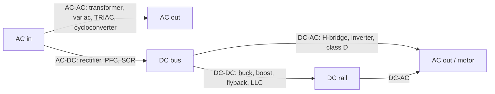

::: testing
Whether you know the four-way map of power conversion and can attach a real circuit to each box: transformers and phase control for AC-AC, rectifiers and PFC for AC-DC, buck/boost/flyback for DC-DC, and inverters (H-bridge with PWM) for DC-AC. It also tests whether you see that these are building blocks that chain together, as in a wall adapter (AC-DC then DC-DC) or a motor drive (AC-DC then DC-AC), and that many bridges are bidirectional.
:::

::: why
Every product is a chain of these conversions: mains to a bulk DC bus, bus to board rails, a battery to a motor. Knowing the four boxes lets you read any power block diagram, ask the right questions (isolated? bidirectional? power factor?) and recognise that the same H-bridge that drives a motor is a DC-AC inverter ([[q0201]]). The section note says DC-DC is the default in interviews, so the AC cases are usually asked at the breadth level, and a crisp table is what they want.
:::

::: concepts
- **Rectification**: turning AC into unidirectional current with diodes or synchronous switches ([[q0160]]).
- **Transformer**: couples AC magnetically, changing voltage by the turns ratio and providing isolation. It does not work on DC.
- **Switching conversion**: chopping DC with transistors and filtering with L and C ([[q0173]]).
- **Inversion**: synthesising AC from DC with a bridge of switches and PWM ([[q0145]]).
- **Isolation**: galvanic separation between input and output, needed for mains safety.
- **Bidirectional power flow**: many bridges can run in either direction (rectifier ↔ inverter).
:::

::: answer
"I think of it as a two-by-two grid by input and output type.

AC to AC is a transformer, which steps AC voltage up or down and isolates; an autotransformer or variac for variable AC; phase-angle control with a TRIAC like a lamp dimmer; and more elaborate ones like cycloconverters and matrix converters that change frequency.

AC to DC is a rectifier: diodes in a bridge, then a filter capacitor, and in modern supplies a PFC stage so it draws current in phase with the line. Controlled rectifiers use SCRs.

DC to DC is what we usually mean on a board: linear regulators and charge pumps, and switching converters like buck, boost, buck-boost and, for isolation, flyback, forward and LLC.

DC to AC is an inverter: an H-bridge or a three-phase bridge switched with PWM, followed by a filter or the motor's own inductance. Same hardware as a motor driver. Also oscillators and class-D amplifiers.

And they chain: a wall adapter is AC-DC and then DC-DC, a motor drive is AC-DC then DC-AC."
:::

::: technical
| Conversion | Typical circuits | Key relations / notes |
|---|---|---|
| **AC-AC** | Transformer; autotransformer / variac; TRIAC phase control (dimmer); cycloconverter; matrix converter; AC-DC-AC link (VFD) | Transformer: $V_s/V_p=N_s/N_p$, isolation; phase control chops each half-cycle, so $V_{rms}$ falls and harmonics and EMI rise |
| **AC-DC** | Half-wave, full-wave and bridge rectifier + filter capacitor; controlled rectifier (SCR); active PFC boost; offline flyback supply | Full-wave average $\approx 2V_p/\pi$; capacitor-input rectifiers draw narrow current pulses, giving poor power factor |
| **DC-DC** | Linear (LDO), charge pump, buck, boost, buck-boost, SEPIC, Cuk, flyback, forward, half/full bridge, LLC | Buck $V_o=DV_i$; boost $V_o=V_i/(1-D)$; isolated types add a transformer |
| **DC-AC** | Half-bridge, full (H) bridge, three-phase bridge, sine-PWM inverter, Royer/push-pull oscillator, class-D output stage | Output fundamental $\approx m\,V_{dc}/2$ per leg for modulation index $m\le1$; needs filtering |

**Phase control example (resistive load, firing angle $\alpha$):**
$$V_{rms}(\alpha)=V_{rms,0}\sqrt{1-\frac{\alpha}{\pi}+\frac{\sin 2\alpha}{2\pi}}.$$
At $\alpha=90^\circ$, $V_{rms}=0.707V_{rms,0}$ and the power delivered to a resistor is exactly half.

**Bidirectionality.** A diode rectifier is one-way. Replace the diodes with controlled switches and the same bridge works as an inverter, which is how regenerative drives, grid-tied solar inverters and electric-vehicle chargers work.

**Chaining.** A USB wall adapter is AC-DC (rectify to a DC bus of about 170 V on 120 V mains, or about 325 V on 230 V mains) then an isolated DC-DC flyback. A VFD is AC-DC (rectifier + DC link) then DC-AC (inverter). An AC-AC conversion that changes frequency is often done through a DC link, i.e. AC-DC-AC.
:::

::: short
"It's a grid by input and output. AC to AC is a transformer, variac, or TRIAC phase control. AC to DC is a rectifier, usually a diode bridge plus a filter capacitor, often with a PFC stage. DC to DC is linear regulators, charge pumps and switching converters like buck, boost and flyback. DC to AC is an inverter: an H-bridge or three-phase bridge with PWM. They chain: a wall adapter is AC-DC then DC-DC, and a motor drive is AC-DC then DC-AC."
:::

::: long
"The easiest way I organise this is a two-by-two grid with input type on one axis and output type on the other.

Starting with AC to AC. The simplest is a transformer. It steps voltage up or down by the turns ratio and gives isolation, but only works on AC. An autotransformer or variac gives an adjustable output. A TRIAC dimmer does phase-angle control: it only lets the AC through after a firing angle each half-cycle, which reduces RMS voltage, and 90 degrees gives half the power into a resistor. If you want to change frequency, you use a cycloconverter, a matrix converter, or more commonly go through a DC link.

AC to DC is the rectifier. A bridge of four diodes turns both half-cycles into the same polarity, and a bulk capacitor smooths it. For anything more than a few tens of watts you normally add active power factor correction, a boost stage that makes the current follow the voltage. SCR-based controlled rectifiers let you adjust the DC output.

DC to DC is the one on boards. Linear regulators and charge pumps for small jobs, and switching converters: buck to step down, boost to step up, buck-boost, SEPIC, and flyback, forward or LLC when you need isolation.

DC to AC is the inverter: switches in a half-bridge, H-bridge or three-phase bridge, driven with PWM so that the filtered output looks sinusoidal. That's UPS and solar inverters, motor drives, and class D audio.

The nice thing is they chain, and many are bidirectional. A phone charger is AC-DC then isolated DC-DC. A variable-frequency drive is AC-DC, a DC link, then DC-AC to the motor. And since an inverter bridge is just a rectifier with controlled switches, the same hardware can run backwards for regenerative braking."
:::

::: terms
- **Rectifier**: converts AC to DC (unidirectional current).
- **Inverter**: converts DC to AC with a switching bridge.
- **Converter**: general term for any power-conversion stage.
- **DC link / DC bus**: a capacitor-smoothed DC node between two conversion stages.
- **Power factor correction (PFC)**: shaping line current to follow line voltage.
- **Phase-angle control**: delaying turn-on in each AC half-cycle to reduce RMS.
- **Galvanic isolation**: no conductive path between input and output (transformer, optocoupler).
- **Cycloconverter / matrix converter**: direct AC-AC converters that synthesise another frequency.
:::

::: exceptional
**An average answer** lists one circuit for each box: "transformer, rectifier, buck, inverter."

**An exceptional answer**:
- Gives two or three circuits per box and says what each is good for (e.g. variac vs TRIAC vs cycloconverter).
- Points out that the boxes **chain** (AC-DC then DC-DC in an adapter; AC-DC-AC in a VFD) and that frequency-changing AC-AC usually goes through a DC link.
- Notes that bridges can be **bidirectional**, so an inverter is a rectifier run backwards.
- Mentions isolation and power factor as the practical issues in AC-DC.
- Gives a number: phase control at 90° gives half power, or full-wave average is $0.637V_p$.
:::

::: mistakes
- **Saying a transformer converts DC.** It only couples *changing* flux; DC saturates or does nothing.
- **Calling a rectifier "AC-DC converter" without a filter and regulator.** A bridge alone gives pulsating DC, not a usable rail ([[q0160]]).
- **Mixing up inverter and converter.** "Inverter" in power electronics means DC-AC, not a logic NOT gate or an inverting regulator.
- **Forgetting that DC-DC includes linear regulators.** Many people list only switching converters.
- **Ignoring isolation.** A mains-connected supply needs galvanic isolation (flyback, transformer) for safety, not just a buck.
- **Assuming a TRIAC dimmer is efficient AC-AC for any load.** It works well for resistive lamps and heaters but injects harmonics and misbehaves with some LED loads.
:::

::: deep
## A map of power conversion


Figure: Four conversions around one hub, the DC bus. Most real systems go AC to DC bus, then DC-DC for electronics or DC-AC for motors and grid-tied outputs. A frequency-changing AC-AC converter usually goes through the DC bus (AC-DC-AC).

## AC to AC

**Transformer.** Faraday's law gives $v=N\,d\Phi/dt$, so for a given flux the voltage per turn is the same on both windings and $V_s/V_p=N_s/N_p$. Ideal power is conserved ($V_pI_p=V_sI_s$). Only AC works because DC produces no changing flux. Mains-frequency transformers are big and heavy; high-frequency transformers inside switching supplies are small because the same flux needs fewer turns and less core at kHz–MHz.

**Phase-angle control (TRIAC dimmer).** The TRIAC is triggered at angle $\alpha$ after each zero crossing and conducts until the next one. With a resistive load, the waveform is a chopped sine.

```plot
{"title":"Phase-angle control, firing angle 45° of each half cycle","x":{"label":"time","unit":"cycles","min":0,"max":2},"y":{"label":"Load voltage (normalised)","min":-1.2,"max":1.2},
 "series":[{"label":"Line voltage","fn":"sin(2*PI*x)","color":"muted","dashed":true},{"label":"Load voltage after TRIAC","fn":"sin(2*PI*x)*step(mod(x,0.5)-0.125)","color":"accent"}],
 "vlines":[{"at":0.125,"label":"fires (alpha = 45°)"}]}
```
Figure: Each half-cycle starts at zero but the load sees nothing until the TRIAC fires. The sharp turn-on edge causes EMI and harmonics, which is why dimmers need a small filter inductor.

Using the RMS expression derived in the next section, for 120 V RMS mains and $\alpha=90^\circ$: $V_{rms}=120\times0.707=84.9$ V and the power into a resistor halves. At $\alpha=45^\circ$: $V_{rms}=120\sqrt{1-0.25+\sin(90^\circ)/(2\pi)}=120\sqrt{0.909}=114.4$ V.

**Cycloconverter / matrix converter.** Arrays of thyristors or bidirectional switches stitch together segments of the input waveform to make a lower-frequency output (cycloconverter) or any frequency with high-frequency PWM (matrix converter). They are used in some very large drives; most designs instead use AC-DC-AC for simplicity.

## AC to DC

**Half-wave** uses one diode ($V_{dc}\approx V_p/\pi$). **Full-wave / bridge** uses four diodes and gives $V_{avg}=2V_p/\pi=0.637V_p$ unfiltered; with a large capacitor the output rises toward $V_p-2V_f$ ([[q0160]]). For 120 V RMS the peak is 169.7 V, so a filtered bridge gives about 168 V minus a ripple, and the unfiltered average is 108 V.

A capacitor-input rectifier draws current only near the voltage peaks, so its current waveform is a series of narrow pulses with a poor power factor and large harmonics. Regulations require **power factor correction** above modest power levels. An active PFC stage is a boost converter controlled so that the average input current is a scaled copy of the line voltage, regulating the DC bus to around 380–400 V. SCR-based controlled rectifiers vary firing angle to control the DC output, still used in large DC drives and battery chargers.

## DC to DC

This is the section's default meaning and has its own questions ([[q0147]], [[q0156]], [[q0157]]). Linear regulators drop the excess; switching converters trade voltage for current using $D$; isolated topologies place a transformer between primary and secondary switches. An isolated converter is chosen when safety, ground separation or a large ratio is required, like 48 V telecom to 12 V ([[q0170]]).

## DC to AC

An H-bridge (four switches) connects the load to $+V_{dc}$, $-V_{dc}$ or zero. Pulse-width modulating the legs with a sine reference gives an output whose low-frequency content is a sine wave, with the PWM sidebands removed by an LC filter or by the motor's inductance. The fundamental amplitude is $m V_{dc}$ for a bridge (modulation index $0\le m\le1$), so a 400 V bus can produce a $\approx 283$ V RMS sine at $m=1$ ($400/\sqrt{2}$). Three-phase bridges (six switches) drive motors and grid inverters. Simpler square-wave inverters, such as a push-pull "Royer" oscillator, power fluorescent backlights. Class-D amplifiers are the same circuit with an audio reference. See [[q0201]] for the power-bridge details.

```sim
{"id":"h-bridge-lab","mode":"h"}
```
Figure: Toggle the four switches in the H-bridge sim: diagonal pairs give $\pm V$ across the load. Alternating the diagonals at a PWM rate with a sinusoidal duty pattern is a DC-AC inverter.

## Putting the boxes in order: a wall adapter

1. 120 V AC enters, a bridge rectifier and bulk capacitor make about 160 V DC (AC-DC).
2. A flyback converter chops that DC into a high-frequency transformer (DC-AC internally!).
3. The secondary is rectified and filtered to 5 V (AC-DC again, at high frequency).

So even a "DC-DC" isolated converter contains DC-AC and AC-DC stages internally. That is a good detail to volunteer.

```sim
{"id":"rectifier-lab","type":"bridge","vpk":17,"f":60,"c":0.001,"rl":50,"vf":0.7}
```
Figure: Switch between half-wave and bridge to see the AC-DC building block, and note how the ripple shrinks as the capacitor grows.

## Deriving what a phase-angle controller delivers

A TRIAC fires at angle $\alpha$ and the load sees $V_p\sin\theta$ from $\alpha$ to $\pi$ in each half cycle. For a resistive load the mean-square voltage over a half cycle is

$$V_{rms}^2=\frac1\pi\int_\alpha^\pi V_p^2\sin^2\theta\,d\theta=\frac{V_p^2}{2}\left(1-\frac{\alpha}{\pi}+\frac{\sin2\alpha}{2\pi}\right)$$

so with $V_p^2/2$ equal to the full-sine mean-square, the fraction of power delivered to a resistor is $p(\alpha)=1-\alpha/\pi+\sin2\alpha/(2\pi)$. For a 120 V, 60 W incandescent bulb ($R=240\ \Omega$), full power is $120^2/240=60$ W:

| $\alpha$ | $p(\alpha)$ | $V_{rms}$ | Bulb power |
|---|---|---|---|
| 0° | 1.000 | 120 V | 60 W |
| 45° | 0.909 | 114.4 V | 54.5 W |
| 90° | 0.500 | 84.9 V | 30 W |
| 135° | 0.091 | 36.2 V | 5.5 W |

```plot
{"title":"Fraction of full power delivered to a resistor vs firing angle","x":{"label":"Firing angle α","unit":"°","min":0,"max":180},"y":{"label":"P / P_full","unit":"","min":0,"max":1.05},
 "series":[{"label":"1 - α/π + sin(2α)/(2π)","fn":"1-x/180+sin(2*x*PI/180)/(2*PI)","color":"accent"}],
 "points":[{"x":90,"y":0.5,"label":"90°: half power"}]}
```
Figure: Power is not linear in firing angle. The slope is $dp/d\alpha=-2\sin^2\alpha/\pi$, so the curve is steepest at 90° (where power halves) and flat at both ends: the first 45° and the last 45° of firing angle each change the power by only about 9%. Most of the control range sits in the middle of the knob travel.

This model is for a resistive load. An LED driver or a transformer is not resistive, so the TRIAC may mis-fire, need a minimum holding current (a few to tens of milliamps for small TRIACs, check the part), or cause flicker. That is the reason LED lamps list "dimmable" compatibility.

## Why the AC-DC front end needs PFC: a numeric comparison

A bridge with a big capacitor charges only near the line peak, so the input current is a short, tall pulse. Take a 100 W supply drawing real power from the mains. With a power factor of about 0.6 (typical for a capacitor-input front end, assumed) the RMS line current is $100/(120\times0.6)=1.39$ A at 120 V, or $100/(230\times0.6)=0.72$ A at 230 V. With active PFC at a power factor of 0.99 the same real power needs only $100/(120\times0.99)=0.84$ A at 120 V, and $100/(230\times0.99)=0.44$ A at 230 V. Both draw the same real power, but the pulsed waveform needs 65% more RMS current at 120 V, which loads wiring and the utility and heats the bridge diodes more. Regulatory limits on harmonic current are what push designs to add PFC, typically from around 75 W upward for IT and general equipment, with lighting held to tighter limits at lower power (regulation and region dependent).

> [!UNCERTAIN]
> The exact power threshold and harmonic limits depend on the regulation (the EN/IEC class and region). Treat 75 W as a rule of thumb, not a legal statement.

## The chain adds up: a wall adapter budget

Efficiencies multiply through the chain: if the bridge and bulk stage are 98% efficient, the flyback stage is 86% and the output rectifier and filter are 95%, the total is $0.98\times0.86\times0.95=0.80$, so a 5 V, 2 A adapter (10 W out) draws 12.5 W and dissipates 2.5 W as heat. These stage efficiencies are assumed typical values, but the point of the calculation is that the chain is only as good as its least efficient stage. A modern adapter reaches the high 80s with synchronous rectification at the output.

## Bench verification, with a safety warning

Mains-referenced circuits can kill you and destroy a scope. Never ground-clip a scope probe to a point that is not at earth potential. Look at line-side waveforms through an isolation transformer, with a proper differential probe, or with a battery-powered isolated scope. A good bench check is to put the supply behind a plug-in power meter that displays real power, apparent power and power factor, then compare the readings with and without PFC, which should show the same real power with a very different VA number. Capture the input current on a current probe to see the narrow pulses of a capacitor-input rectifier, and watch the TRIAC chopped edge on a dimmer to confirm the firing angle against the formula.
:::

::: applications
- **Wall adapters and laptop chargers:** AC-DC (rectifier, PFC) then isolated DC-DC (flyback or LLC).
- **Lamp dimmers and heaters:** TRIAC phase control, a simple AC-AC converter.
- **Variable-frequency motor drives:** AC-DC rectifier, DC link, then three-phase DC-AC inverter.
- **Solar and battery inverters (grid-tied):** DC-AC with PWM and an output filter; bidirectional ones can also charge.
- **Class-D audio amplifier:** DC-AC stage whose output is an audio-rate PWM signal filtered at the speaker.
- **Phone USB charger:** AC-DC front end then flyback, then an on-device buck or charger IC for the battery.
- **Electric vehicle:** battery DC bus to traction inverter (DC-AC) and an on-board charger (AC-DC) that can be bidirectional.
:::

::: assumptions
- Single-phase mains at 50/60 Hz unless stated; the circuits generalise to three-phase.
- Ideal diodes/switches in the formulas; real converters have diode drops, switching losses and dead time.
- The section note says DC-DC is assumed for most power-supply questions, so this answer gives equal weight to each box only because the question asks for all four.
- If an interviewer asks for "the" circuit for each, give the simplest: transformer, bridge rectifier, buck, H-bridge. The extended list shows depth.
- Regulations on harmonic current and power factor (such as IEC 61000-3-2 for equipment) differ by region and product class; give them by name only if you are sure of the class limits.
:::

::: followups
### What's the difference between an inverter and a rectifier?
They move power in opposite directions: a rectifier takes AC in and gives DC; an inverter takes DC in and gives AC. With diodes the bridge is only a rectifier, but with controlled switches (MOSFETs or IGBTs) the same four-switch topology can do both, which is how regenerative drives and bidirectional chargers work.

### Why does a phone charger need a transformer if it just goes from 120 V AC to 5 V DC?
Isolation and ratio. Mains is dangerous, so the user-accessible output must be galvanically isolated from the line, and stepping from about 160 V DC to 5 V with a single switch would need a very low duty cycle. Chargers rectify first, then chop at high frequency into a small transformer (flyback), which provides both isolation and ratio.

### How would you make an adjustable AC voltage from mains for a resistive heater?
Phase control with a TRIAC (or two SCRs back-to-back) is cheap, with $V_{rms}$ set by firing angle; or a variac (autotransformer) for a clean sinusoid but big, mechanical and no isolation. For a heater, you can also do *burst-fire* control: switch whole cycles on and off at zero crossings, which avoids EMI from partial-cycle switching.

### What if the output of the rectifier must be a clean 12 V rail?
After the bridge and bulk capacitor, regulate: a buck for efficiency, or an LDO if the headroom is small and noise is critical. The unregulated rectifier output varies with line (for example plus or minus 10%) and load, and carries ripple at 2f (120 Hz for 60 Hz mains).

### Which conversions need PFC and why?
AC-DC with capacitor-input rectification, because the current pulses make the power factor poor (often around 0.5–0.7 without correction) and inject harmonics into the grid. Regulations (for example IEC 61000-3-2 for many products) limit harmonics, so supplies above a modest power level use an active boost PFC stage.
:::

::: interpretations
"What type of circuits can convert AC-AC/AC-DC/DC-DC/DC-AC?" asks for the circuit *families* behind each of the four arrows. Answer each with one or two named circuits, then mention that the stages chain. Because the section note says DC-DC is the default meaning of "power supply", the interviewer may mostly care that you can state the others quickly. For the DC-DC details see [[q0147]] and [[q0156]], and for the bridge rectifier specifically see [[q0160]].
:::

::: references
- Mohan, Undeland & Robbins, *Power Electronics: Converters, Applications, and Design*: overview chapters on the four types of conversion, rectifiers, phase control and inverters.
- Erickson & Maksimovic, *Fundamentals of Power Electronics*: DC-DC converter fundamentals and the introduction to power conversion.
- Rashid, *Power Electronics: Devices, Circuits, and Applications*: thyristor phase control, rectifiers, AC voltage controllers and inverters.
- IEC 61000-3-2 (harmonic current emissions for equipment), by name, for the PFC motivation.
:::

::: rubric
- Names a circuit for each of the four conversions :: Direct answer to the question; missing a box is an obvious gap.
- AC-AC: transformer/variac and phase control (and cycloconverter/matrix as advanced) :: Shows more than "transformer".
- AC-DC: bridge rectifier with filter, plus PFC or SCR :: Rectifier alone is the minimum; PFC shows system awareness.
- DC-DC: linear and switching (buck, boost, flyback for isolation) :: The default topic in this section.
- DC-AC: H-bridge or three-phase inverter with PWM and a filter :: Connects the question to motor drives and grid inverters.
- Notes that conversions chain (adapter: AC-DC then DC-DC; VFD: AC-DC-AC) :: Demonstrates system thinking.
- Notes bidirectionality or isolation as a practical consideration :: Distinguishes experienced answers from lists.
:::

::: quiz
```json
[
 {"type":"mcq","level":"fundamental","q":"Which circuit is a DC-to-AC converter?","options":["Bridge rectifier","Buck converter","H-bridge driven with sine-PWM","Transformer"],"answer":2,"explain":"An H-bridge switched with PWM synthesises an AC waveform from a DC bus. A bridge rectifier is AC-DC, a buck is DC-DC and a transformer is AC-AC."},
 {"type":"truefalse","level":"fundamental","q":"A transformer can be used to step DC voltage up or down.","answer":false,"explain":"A transformer needs changing flux ($v=N\\,d\\Phi/dt$). DC produces no induced voltage in steady state."},
 {"type":"numeric","level":"intermediate","q":"A TRIAC dimmer on 120 V RMS mains fires at $\\alpha=90^\\circ$ into a resistive lamp. What is the load RMS voltage?","answer":84.9,"tolerance":0.02,"unit":"V","explain":"$V_{rms}=120\\sqrt{1-0.5+\\sin(180^\\circ)/(2\\pi)}=120\\sqrt{0.5}=84.9$ V, so the lamp gets half the power."},
 {"type":"numeric","level":"intermediate","q":"What is the average value of a full-wave rectified sine with a 170 V peak (no filter, ideal diodes)?","answer":108.2,"tolerance":0.02,"unit":"V","explain":"$V_{avg}=2V_p/\\pi=2\\times170/\\pi=108.2$ V."},
 {"type":"multi","level":"intermediate","q":"Select all that are typical stages inside a USB wall charger.","options":["Bridge rectifier and bulk capacitor","A high-frequency isolation transformer","A cycloconverter","A switching converter (e.g. flyback)"],"answer":[0,1,3],"explain":"Chargers rectify mains (AC-DC), chop the DC bus into a small high-frequency transformer in a flyback, and rectify the secondary. Cycloconverters are for AC-AC at high power."},
 {"type":"mcq","level":"advanced","q":"Why can the same four-switch bridge be used for both a motor inverter and a regenerative rectifier?","options":["Because MOSFETs are symmetric diodes","Because with controlled switches the bridge can pass current in either direction, so power can flow DC to AC or AC to DC depending on control","Because the DC bus voltage is always zero","Because PWM is only used in rectifiers"],"answer":1,"explain":"Active switches with antiparallel diodes allow bidirectional power flow. Controlled one way they act as an inverter, the other way as an active rectifier (regenerative braking)."}
]
```
:::
