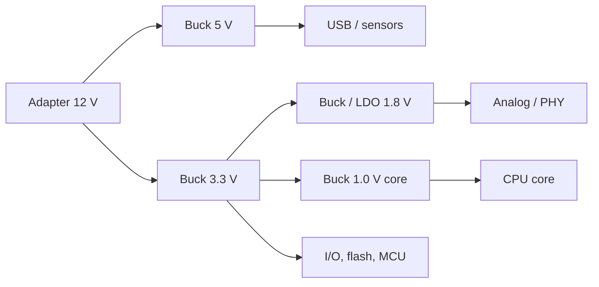

::: basics
### In plain words
Most power rails inside a device are stepped down from a higher voltage, because the sources are usually higher than what the chips need. Chip voltages keep falling, since lower voltage saves a lot of power. Moving power at high voltage and converting down near the load also wastes less in the wires.

### Picture it
Think of a water tower on a hill. It is easy to let water run down to many houses and lower its pressure with valves at each tap. Pushing water uphill needs a pump and extra work. Electronics is similar: getting from a high voltage down to a low one is the natural, simple direction.

### Words you need
- **Step-down**: output voltage lower than input.
- **Rail**: a supply line at a particular voltage.
- **$I^2R$ loss**: heat in a wire, which grows with the square of the current.
- **Chip switching power**: the power chips use to flip their tiny switches. It scales with $V^2$, so lower voltage means much lower power. See [[q0140]].
- **Boost converter**: a step-up converter, harder to design than a buck. See [[q0156]].

### The simplest example
A 10 W load at 1 V draws 10 A. At 12 V, the same power needs only about 0.83 A. Through a trace of 10 mΩ, the 10 A case loses $10^2 \times 0.01 = 1$ W, while the 0.83 A case loses about 0.007 W. So bring the power in at 12 V and convert down right next to the load. That is the whole idea. The rest of this page adds the sources and loads on each side, and why step-up converters are harder to build.
:::

::: testing
Whether you understand *why* power trees point downhill rather than just noticing that they do. The interviewer wants system-level reasons (supply voltages are higher than silicon wants; distributing at a high voltage reduces current and I²R loss; core voltages keep dropping to cut $CV^2f$ power) and converter-level reasons (boost and buck-boost are harder: pulsed output current, right-half-plane zero, no short-circuit protection, worse efficiency at large ratios). Bonus points for knowing the exceptions: battery products that go below the rail, LEDs, USB-from-battery.
:::

::: why
Designing a power tree starts from "what is the highest voltage I have, and what do my chips need?". If you instinctively know that most rails are derived by stepping down from a bus, you design faster ([[q0166]]), choose the right topology first time, and can explain why, for example, a 48 V to 12 V intermediate bus exists ([[q0170]]). It also helps you spot the cases where a step-up really is necessary and plan for its extra cost, such as input current and short-circuit behaviour.
:::

::: concepts
- **Dynamic power scaling**: CMOS power $P\approx\alpha CV^2f$, so lower supply voltage saves power quadratically and modern cores run near 1 V or below.
- **Power = V·I and $I^2R$ loss**: delivering the same power at a higher voltage needs less current, so less cable and trace loss ([[q0148]], [[q0143]]).
- **Buck topology**: $V_{out}=DV_{in}$ with continuous inductor current at the output ([[q0173]]).
- **Boost topology**: $V_{out}=V_{in}/(1-D)$ with a pulsed diode current into the output capacitor.
- **Input current**: $I_{in}=P_{out}/(\eta V_{in})$ is higher when $V_{in}$ is low.
- **Right-half-plane zero**: a feature of boost and buck-boost in CCM that limits loop bandwidth.
:::

::: answer
"Mostly because the voltages you have are higher than the voltages the chips want, and the trend keeps pushing chip voltages down.

On the supply side, the sources are things like a 12 volt adapter, 24 or 48 volt industrial bus, 5 volt USB, or a Li-ion cell at 3.7 to 4.2. On the load side, processors, memory and FPGAs run at 3.3, 1.8, 1.2, 1.0 volts or below, because CMOS dynamic power scales with V squared, so lower voltage cuts power a lot. So most rails are a step-down.

There's also a distribution reason. For the same power, a higher voltage means lower current, so cable and trace loss, I squared R, is much lower. That's why you bring power onto a board at a higher voltage and convert down near the load.

And step-down converters are just easier: a buck has a continuous output current so the output ripple is small, it has simple control, and an LDO is an even simpler option for small drops. A boost has input current that's higher than output current, a pulsed output, a diode path that means a short on the output isn't isolated from the input, and a right-half-plane zero that makes the loop harder.

Step-up exists, of course, when a battery sags below what the logic needs, or for 5 volt USB from one cell, but it's the exception."
:::

::: technical
**System-level reasons.**
1. *Source above load.* Typical sources (mains-derived 12/24/48 V, USB 5 V, Li-ion 3.0–4.2 V) are at or above typical rails (3.3, 1.8, 1.2, 1.0 V and below).
2. *Core voltage scaling.* $P_{dyn}\approx\alpha CV^2f$. Reducing a supply from 1.8 V to 1.0 V cuts dynamic power per switching event to $(1/1.8)^2=31\%$. Rails therefore trend downward with process nodes, and they must be supplied with higher currents.
3. *Distribution loss.* For the same delivered power, $I=P/V$ and $P_{loss}=I^2R$. Delivering 10 W through 50 mΩ of trace at 3.3 V gives $(10/3.3)^2\times0.05=0.46$ W; at 12 V it is $(10/12)^2\times0.05=0.035$ W. High-voltage distribution plus point-of-load step-down is the rule.

**Converter-level reasons.**
- *Output current continuity.* A buck's inductor feeds the output continuously, so output ripple is $\Delta V\approx\Delta I_L/(8f_{sw}C)$. A boost's diode only supplies current during the off-time, so the capacitor supplies the full load during the on-time: $\Delta V\approx I_{out}D/(f_{sw}C)$ (neglecting ESR). For 3.7 V to 5 V at 1 A, 1 MHz and 22 µF, a boost has about 11.8 mV of capacitive ripple, while a 5 V to 3.3 V buck (2.2 µH) has about 2.9 mV.
- *Input current.* $I_{in}=P_{out}/(\eta V_{in})$: 3.7 V to 5 V at 1 A and 90% needs 1.5 A of input, versus 0.72 A for 5 V to 3.3 V at 1 A.
- *Gain collapse.* Parasitic resistance limits the boost gain at high duty cycle (see the deep dive), so large ratios are inefficient.
- *Protection.* There is always a DC path from $V_{in}$ through the inductor and diode to $V_{out}$, so a boost cannot current-limit a shorted output or disconnect its load without extra switches.
- *Control.* The boost in CCM has a right-half-plane zero that limits crossover frequency; the buck does not.

**Exceptions** where step-up is needed: battery below the rail (single Li-ion, 2×AA), USB 5 V from a single cell, LED strings and displays, gate-drive and bias rails, backlights, energy harvesters. Buck-boost topologies cover batteries that cross the rail voltage.
:::

::: short
"Because supplies are usually higher than what the chips need, and chips keep going lower in voltage to save CV-squared-f power. Distributing at a higher voltage also means less current and less I-squared-R loss, so you convert down at the point of load. Step-down converters are also simpler: a buck has continuous output current and no right-half-plane zero, while a boost has higher input current, a pulsed output and no short-circuit isolation. Step-up shows up when a battery dips below the rail."
:::

::: long
"There are two layers to this: why the system wants to go down, and why step-down converters are the easier thing to build.

System first. The sources we have are usually 12 volt adapters, 24 or 48 volt buses, 5 volt USB, or a Li-ion at 3.0 to 4.2. The loads are processors, memories and FPGAs at 3.3, 1.8, 1.2, 1.0 volts and falling. CMOS dynamic power goes as C V squared f, so a lower voltage is the cheapest way to save power; going from 1.8 to 1.0 volts alone cuts switching energy by about 70 percent. So the natural flow is from high to low.

On top of that, distribution loss. For the same power, current is power over voltage, and the cable loss is I squared R. Moving 10 watts through 50 milliohms costs about half a watt at 3.3 volts but only 35 milliwatts at 12. So you'd rather bring the energy in at high voltage and step down next to the load, which is the idea behind intermediate bus architectures.

Second layer, the converters. A buck's inductor is in series with the output, so the output current is continuous and ripple is small, control is straightforward, and the input current is less than the output current. A boost is the reverse: the input current is bigger than the output, so for 3.7 to 5 volts at an amp it's about 1.5 amps in; the output current is pulsed so you need more output capacitance; there's always a path from input to output through the diode, so you can't short-circuit protect it without extra parts; and in continuous conduction it has a right-half-plane zero that limits loop bandwidth. At high boost ratios, parasitic resistance makes the gain collapse.

Step-up still has a job: a battery that discharges below your rail, 5 volt USB from a single cell, LED drivers, bias rails. In those cases I'd use a boost or buck-boost, but I'd try to arrange the architecture, like using a 2S battery, so a buck suffices."
:::

::: terms
- **Step-down (buck) / step-up (boost)**: converters with $V_{out}<V_{in}$ / $V_{out}>V_{in}$.
- **Point-of-load (POL)**: a regulator placed right next to the load.
- **Dynamic power**: $\alpha CV^2f$, the switching power of CMOS logic.
- **$I^2R$ loss**: resistive power loss in cables and traces.
- **Right-half-plane zero (RHPZ)**: a transfer-function zero in boost and buck-boost converters that adds phase lag and limits loop bandwidth.
- **Duty cycle ($D$)**: fraction of the switching period the main switch is on.
- **Input current**: $I_{in}=P_{out}/(\eta V_{in})$.
- **Buck-boost**: converter that can step up or down, used when $V_{in}$ crosses $V_{out}$.
:::

::: exceptional
**An average answer** says "because chips need lower voltages than the supply."

**An exceptional answer**:
- Gives both layers: the *system* reason (source above load, CMOS $CV^2f$, distribution loss) and the *circuit* reason (boost is harder).
- Quantifies one of each: e.g. 10 W in 50 mΩ is 0.46 W at 3.3 V vs 0.035 W at 12 V; 1.5 A vs 0.72 A input current.
- Names the specific boost penalties: higher input current, pulsed output current, no short-circuit isolation, RHPZ, gain collapse at high $D$.
- Acknowledges real exceptions (single-cell battery to 3.3/5 V, LED drivers, bias rails) and the buck-boost remedy.
- Mentions an architectural workaround, like using a 2S battery or a higher input so only bucks are needed.
:::

::: mistakes
- **Saying "boost converters are inefficient."** A good boost at moderate ratio is 90%+; the penalty grows at large ratio or high current.
- **Treating the reason as only "chips need low voltage".** That misses the distribution-loss reasoning behind high-voltage buses.
- **Forgetting input current.** A boost's input current is *higher* than the output current by $V_{out}/(\eta V_{in})$, which stresses the battery and the inductor.
- **Claiming a step-up is never needed.** Single-cell battery systems often must step up or buck-boost to hold a rail as the cell droops.
- **Mixing up "step-down regulators" with LDOs only.** Step-down includes both LDOs and bucks; the "more common" claim applies to both.
- **Believing lower voltage is always better.** Lower rail voltage means higher current for the same power and tighter noise margins ([[q0151]]).
:::

::: deep
## The system view: sources are high, loads are low

A typical embedded board is fed from one of: a wall adapter (5 V, 9 V, 12 V, 19 V or 24 V), a USB-C source (5 V up to 20 V in the Power Delivery case), a vehicle or industrial bus (12–48 V), or a battery (one Li-ion cell, 3.0–4.2 V, or a stack). It contains devices that want: 5 V for USB and some sensors, 3.3 V for I/O and flash, 1.8 V for I/O and analog, 1.2 V or 1.0 V and lower for processor cores and DDR. A typical tree therefore looks like this.


Figure: Almost every arrow is a step-down. The one place a step-up would appear is when a battery replaces the adapter and sags below the 3.3 V or 5 V rail.

## Why chip voltage keeps dropping

CMOS logic draws dynamic power $P\approx\alpha CV^2f$ (activity factor $\alpha$, switched capacitance $C$). Voltage enters squared, so it is the most effective lever. Going from 3.3 V to 1.0 V cuts energy per switching event to $(1/3.3)^2\approx9\%$ and 1.8 V to 1.0 V to about 31%. Smaller transistors also cannot tolerate the old voltages: thin gate oxides break down. So processors, memories and accelerators move to lower voltages generation after generation, while rails for I/O and legacy peripherals stay at 3.3 V or 1.8 V.

The consequence is more current per watt: a 100 W processor at 1 V needs 100 A. High-current, low-voltage rails are naturally made by step-down converters near the load, often multi-phase ([[q0236]]).

## The distribution argument

For fixed power $P$ and fixed delivery resistance $R$:
$$P_{loss}=\left(\frac{P}{V}\right)^2R.$$
Doubling $V$ quarters the loss. Delivering 10 W through 50 mΩ of cable or trace:

| Distribution voltage | Current | Loss in 50 mΩ | % of 10 W |
|---|---|---|---|
| 3.3 V | 3.03 A | 0.46 W | 4.6% |
| 5 V | 2.0 A | 0.20 W | 2.0% |
| 12 V | 0.83 A | 0.035 W | 0.35% |

The same idea scales up: telecom racks at 48 V, data-centre power at 48 V or higher, aircraft at 28 V DC or 115 V AC, and the intermediate-bus architecture ([[q0170]]). Everything is stepped down at the last moment, near the load, where the current is high but the distance is short.

## The converter view: why a buck is easier

A buck connects the inductor between the switch node and the output, so the inductor current *is* the output current (plus ripple). The input current is chopped (pulsed) instead, so the input capacitor carries the pulses. For a boost, it is reversed: the inductor is in series with the input, so the input current is continuous and the output current is the pulsed diode current.

Compare two cases at 1 A out, 1 MHz, 22 µF output:

| | Boost 3.7 V to 5 V | Buck 5 V to 3.3 V (2.2 µH) |
|---|---|---|
| Duty cycle | $1-3.7/5=0.26$ | $3.3/5=0.66$ |
| Input current at 90–92% | 1.50 A | 0.72 A |
| Inductor ripple | set by $L$ | $(5-3.3)(0.66)/(2.2\ \mu\text{H}\times1\ \text{MHz})=0.51$ A |
| Capacitor ripple (C only) | $ID/(fC)=11.8$ mV | $\Delta I/(8fC)=2.9$ mV |

So at the same $C$ the boost has about 4× the ripple, or needs about 4× the capacitance to match the buck.

### Gain collapse

An ideal boost has $M=V_{out}/V_{in}=1/(1-D)$, which grows without limit. Real boosts have inductor resistance $R_L$ (and switch, diode drops), giving approximately
$$M(D)\approx\frac{1}{1-D}\cdot\frac{1}{1+\dfrac{R_L}{R_{load}(1-D)^2}}.$$
For $R_L/R_{load}=0.02$ the gain peaks near $D=0.86$ at about 3.5 and falls beyond. That is why boost converters beyond about 4–5× are inefficient, and why high-ratio step-up uses a transformer (flyback), coupled inductor, or a cascade.

```plot
{"title":"Boost converter gain: ideal vs with 2% parasitic resistance","x":{"label":"Duty cycle D","min":0,"max":0.95},"y":{"label":"V_out / V_in","min":0,"max":12},
 "vars":{"r":0.02},
 "series":[{"label":"Ideal 1/(1-D)","fn":"1/(1-x)","color":"muted","dashed":true},{"label":"With R_L/R_load = 0.02","fn":"(1/(1-x))/(1+r/((1-x)^2))","color":"red"},{"label":"Buck: V_out/V_in = D","fn":"x","color":"green"}]}
```
Figure: The buck's gain is a straight line in $D$ and never misbehaves. The boost curve rises steeply, then bends over once parasitics take over, so pushing for large gain wastes power.

```sim
{"id":"boost-lab","vin":3.7,"d":0.26,"l":0.0000022,"c":0.000022,"iout":1,"fsw":1000000}
```
Figure: Look at the diode current: it is a pulsed waveform that exists only during the off-time, and the output capacitor ripple is visibly larger than the buck's. The input current is the smooth waveform.

### Protection and control

Every boost (without a load switch) has a DC path from the input through the inductor and rectifier diode to the output. A shorted output makes the input source supply unlimited current through the inductor and diode, so the control chip cannot limit it by turning off the main switch. Real parts add an input load switch or a true-shutdown FET at the cost of more resistance. A buck does not have this: switching off the high-side device disconnects the input.

In CCM, the boost's control-to-output transfer function has a right-half-plane zero at $\omega_{RHPZ}=R_{load}(1-D)^2/L$. The loop crossover must stay below roughly a third of that, limiting bandwidth and transient response. The buck's power stage does not have an RHP zero, so its crossover can go to a fifth or tenth of $f_{sw}$.

## When step-up is the right answer

- **Battery below the rail.** A single Li-ion cell at 3.0 V cannot make 3.3 V with a buck or LDO. Choices: a buck-boost (works through the crossover), a boost to 3.6–4 V followed by an LDO, or a 2S battery and a buck.
- **Alkaline/NiMH cells.** Two AA cells (about 3.2 V fresh, down to about 1.8 V at end of life, 0.9 V per cell) powering a 3.3 V MCU almost always need a boost or buck-boost. From a single 1.2 V NiMH cell, 3.3 V at 100 mA and 90% efficiency needs 0.31 A from the cell.
- **USB 5 V from a battery.** Power banks boost 3.7 V to 5 V.
- **LED strings, display bias, gate drives.** Voltage greater than the supply is needed.
- **Hybrid solution.** In some designs, a charge pump (doubler) is used when only 10–50 mA is needed ([[q0156]]).

> [!INTERVIEW]
> If you are asked "so when would you use a boost?", answer with a concrete constraint ("a one-cell product that has to make 5 V for USB") and mention its costs (input current 1.5× the output current, bigger output capacitor, short-circuit handling).
:::

::: applications
- **12 V adapter to 3.3 V/1.8 V/1.0 V** rails on an embedded board: all step-down bucks and LDOs.
- **USB-C PD at 20 V to 5 V** on a downstream device: buck.
- **Server and data-centre boards:** 48 V or 12 V bus stepped down to about 1 V cores at hundreds of amps with multiphase bucks.
- **Single Li-ion wearable:** a buck-boost or LDO for the 3.3 V rail, since the cell crosses the rail voltage.
- **Power bank:** boost converter from 3.7 V to 5 V (and bidirectional buck-boost for charging).
- **LED backlight or flash driver:** boost to the LED string voltage.
- **Electric vehicle accessories:** 12 V or 48 V bus down to logic rails.
:::

::: assumptions
- The question is about *rails in embedded systems* (microcontrollers, SoCs, sensors), where most sources exceed the logic voltage. In energy-harvesting, LED and battery-only products, step-up is much more common.
- "Step-down regulators" includes LDOs and bucks; the comparison with step-up regulators means boost, buck-boost-up-mode and charge-pump doublers.
- Boost numbers assume CCM, ideal components for the ripple formulas, and a lumped-parasitic gain model (inductor resistance only).
- If the interviewer is from a battery-device company, expect an emphasis on the buck-boost case. If from a data-centre or telecom company, emphasise distribution voltage and POL conversion.
- The $CV^2f$ argument holds for CMOS logic; analog and I/O rails have other constraints (headroom, signal swing) that keep them at 1.8–3.3 V.
:::

::: followups
### Why does a boost converter draw more input current than output current?
Power is roughly conserved: $V_{in}I_{in}\eta=V_{out}I_{out}$. Because $V_{out}>V_{in}$, $I_{in}=I_{out}V_{out}/(\eta V_{in})$. For 3.7 V to 5 V at 1 A and 90%, $I_{in}=1.5$ A. That means the battery sees more current than the load does, and the inductor must be rated above 1.5 A plus ripple.

### Why can't a boost converter current-limit a short on its output?
There is a direct path from input to output through the inductor and the rectifier diode, even if the main switch is off. A shorted output draws current from the input directly. Parts that need short-circuit protection add a series disconnect FET (true shutdown) or use synchronous topologies with an output load switch, costing efficiency and area.

### A single Li-ion cell must power a 3.3 V MCU. What do you use?
Options: an LDO (simple, runs from 4.2 V down to about 3.5 V, then dropout, wasting the last bit of capacity); a buck-boost (works across the full range, more complex, a little less efficient); or a boost to a rail slightly above 4.2 V followed by an LDO. If the cell is only used from 4.2 V to 3.6 V, the LDO is fine and cheap. A common choice is a buck-boost for the full capacity and stable regulation.

### What if the load is 1 V at 100 A?
That is step-down at its limits. The converter would be multiphase (e.g., 6–8 phases with coupled or discrete inductors) fed from a 12 V or 48 V bus, with very low-resistance FETs and layout. The input current from 12 V at 90% is about $100\times1/(0.9\times12)=9.3$ A, which is much more manageable than delivering 100 A at 1 V over long distances.

### Is step-up ever more common than step-down?
In certain product classes, yes: LED lighting, energy harvesting, single-cell AA devices, and displays. For general embedded boards it is the exception because the main source (adapter, USB, or a stacked battery) is above the logic rail.
:::

::: interpretations
"Step-down regulators" is read as *any* regulator with $V_{out}<V_{in}$, which includes LDOs and bucks, and "step-up regulators" as boost, buck-boost in boost mode, charge-pump doublers and SEPIC. The answer addresses both the supply-and-load voltage reasons (system) and the converter reasons (circuit). Compare with [[q0147]] (ways to step voltage up or down) and [[q0170]] (why high-voltage buses with POL conversion exist).
:::

::: references
- Erickson & Maksimovic, *Fundamentals of Power Electronics*: buck and boost converter analysis, effect of parasitic elements on the conversion ratio, right-half-plane zero.
- Rabaey, Chandrakasan & Nikolic, *Digital Integrated Circuits*: dynamic power $\alpha CV^2f$ and voltage scaling.
- Texas Instruments, "Basic Calculation of a Boost Converter's Power Stage" (SLVA372) and SLVA477 for the buck: ripple and component calculations (check current document numbers on the TI site).
- Horowitz & Hill, *The Art of Electronics*, 3rd ed.: switching regulators chapter.
:::

::: rubric
- Gives the supply-versus-load voltage reason (sources higher than chip rails) :: This is the primary and most direct answer.
- Explains $CV^2f$ so that chip voltages keep falling :: Shows you know why the trend persists.
- Explains distribution loss ($I^2R$) and why a high-voltage bus plus POL conversion wins :: The system-architecture reason that interviewers like.
- Names at least two circuit-level penalties of boost (input current, pulsed output, no short protection, RHPZ, gain collapse) :: Shows converter-level understanding.
- Quantifies one example (e.g. 1.5 A vs 0.72 A input current, or loss at 3.3 V vs 12 V) :: Numbers make the explanation convincing.
- Acknowledges legitimate step-up needs (battery below rail, USB from battery, LEDs) :: Avoids an absolute claim.
- Mentions an architectural remedy (2S battery, buck-boost, charge pump) :: Demonstrates judgment.
:::

::: quiz
```json
[
 {"type":"mcq","level":"fundamental","q":"Which is the main system-level reason most embedded rails are produced by step-down regulators?","options":["Step-up regulators cannot be built on silicon","Supplies (adapters, USB, batteries) are usually higher in voltage than the rails the chips need","Chips need more current than voltage","Boost converters cannot regulate"],"answer":1,"explain":"Typical sources (12 V, 5 V, 3.7–4.2 V) are above typical logic rails (3.3, 1.8, 1.0 V), so converting down is the common case."},
 {"type":"numeric","level":"fundamental","q":"A boost converter delivers 5 V at 1 A from a 3.7 V input at 90% efficiency. What input current does it draw?","answer":1.5,"tolerance":0.02,"unit":"A","explain":"$I_{in}=P_{out}/(\\eta V_{in})=5/(0.9\\times3.7)=1.50$ A."},
 {"type":"numeric","level":"intermediate","q":"10 W is delivered through 50 mΩ of cable. What is the cable loss if the distribution voltage is 12 V (vs 3.3 V)?","answer":0.0347,"tolerance":0.03,"unit":"W","explain":"$I=10/12=0.833$ A, so $P=I^2R=0.694\\times0.05=0.0347$ W. At 3.3 V it would be 0.46 W, about 13× more."},
 {"type":"numeric","level":"intermediate","q":"A 1.0 V rail replaces a 1.8 V rail with the same logic activity, capacitance and frequency. What fraction of the original dynamic power remains?","answer":30.9,"tolerance":0.02,"unit":"%","explain":"$P\\propto V^2$, so the ratio is $(1.0/1.8)^2=0.309$."},
 {"type":"truefalse","level":"intermediate","q":"A boost converter can shut off its switch to interrupt the current from the input to a shorted output.","answer":false,"explain":"With the main switch off, current still flows from the input through the inductor and the rectifier diode into the output. Protection needs an extra series switch."},
 {"type":"multi","level":"advanced","q":"Select all that are real penalties of a boost compared with a buck of similar power.","options":["Pulsed output (diode) current, so more output capacitance for the same ripple","Right-half-plane zero in CCM that limits loop bandwidth","Output voltage can never exceed the input","Parasitic losses reduce gain badly at high duty cycle"],"answer":[0,1,3],"explain":"A boost's output *can* exceed its input, that is its purpose. The pulsed output current, the RHPZ, and gain collapse at high $D$ are genuine drawbacks."}
]
```
:::
