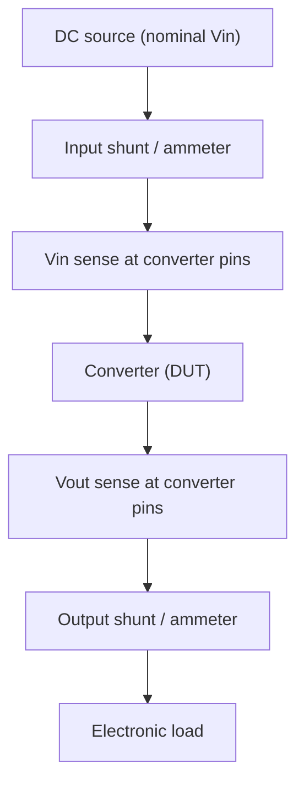

::: basics
### In plain words
Efficiency is the share of the energy you take from a source that actually reaches the load. It is output power divided by input power. Whatever does not reach the load is loss, and it all turns into heat. Efficiency tells you how warm the supply gets and how long a battery lasts.

### Picture it
Imagine pouring water from a jug into a leaky bucket. Whatever arrives in the bucket is the useful part, and the rest spills. Efficiency is the ratio of what arrives to what you poured. To measure it you have to measure both flows at the same time, and not just once, since the leak changes with how fast you pour.

### Words you need
- **Efficiency** ($\eta$): $P_{out}/P_{in}$, often given as a percentage. See [[q0155]].
- **Power loss**: $P_{in} - P_{out}$, which becomes heat.
- **Electronic load**: a bench instrument that draws a set current from the output.
- **Load sweep**: repeating the test at many load levels.
- **Four-wire sensing**: measuring voltage with separate leads so the drop in the current-carrying leads does not count.

### The simplest example
A supply gives 5 V at 2 A, so $P_{out} = 10$ W. It takes 12 V at 0.926 A, so $P_{in} \approx 11.1$ W. Efficiency is $10/11.1 = 90\%$, and the loss is about 1.1 W. If it were 70% efficient instead, the loss would be 4.3 W, nearly four times as much heat. That is the whole idea. The rest of this page adds how to set up the bench measurement properly, and why a curve over load and input voltage is better than a single number.
:::

::: testing
Whether you can define efficiency precisely ($P_{out}/P_{in}$), say how you would *actually* measure it on a bench without fooling yourself (right instruments, right connection points, steady state, a sweep across load and line), and explain why it matters beyond "less heat": battery life, thermal design, cost, size, reliability and regulation. The measurement part separates people who have done it from people who have only read the definition.
:::

::: why
Efficiency decides how big the heatsink is, how long the battery lasts, whether a thermal shutdown trips in a hot enclosure, and whether the product passes energy standards. In interviews it connects every power question: LDO vs buck ([[q0157]]), loss budgeting, thermal limits ([[q0164]]), and light-load behaviour ([[q0165]]). Also, a dishonest efficiency measurement (probing the wrong node, ignoring ripple, measuring cold) is a classic way to be wrong by several percent, and engineers who know that are trusted with validation.
:::

::: concepts
- **Power**: $P=VI$ for DC; for periodic signals the *average* of $v(t)i(t)$. See [[q0001]].
- **Efficiency**: $\eta=P_{out}/P_{in}$, a dimensionless ratio between 0 and 1 (or 0–100%).
- **Loss**: $P_{loss}=P_{in}-P_{out}=P_{out}(1/\eta-1)$.
- **Sources of loss**: conduction ($I^2R$), switching, magnetic core loss, gate drive, controller quiescent current, diode drops ([[q0165]]).
- **Kelvin (four-wire) sensing**: separate sense leads at the converter pins so cable drop is not counted.
- **Efficiency curve**: $\eta$ varies with load, input voltage, temperature and frequency, so a single number is incomplete.
:::

::: answer
"Efficiency is output power divided by input power, so it tells you what fraction of the energy you take from the source actually gets to the load. The rest, input minus output, is loss, and it all turns into heat.

To measure it, I measure four things at the same time: input voltage and current, and output voltage and current, then compute Vout times Iout over Vin times Iin. On the bench that's two or four multimeters, or a power analyzer, with an electronic load on the output. I'd sense the voltages right at the converter's pins with separate sense leads, because the drop in the leads can be a percent or two. I'd let it warm up to steady state, and I'd sweep the load from very light to full and repeat at the minimum, nominal and maximum input voltage, because efficiency is a curve, not a number. For switching converters where ripple matters, I use true-RMS or averaging meters or a scope with math for the average of v times i.

It matters for heat: at 10 watts out, 90 percent means 1.1 watts of loss, 70 percent is 4.3 watts. It also sets battery life, size and cost of the thermal solution, and reliability, since temperature drives failures. For some products it's a regulatory number as well."
:::

::: technical
**Definition.**
$$\eta=\frac{P_{out}}{P_{in}}=\frac{V_{out}I_{out}}{V_{in}I_{in}},\qquad P_{loss}=P_{in}-P_{out}=P_{out}\left(\frac1\eta-1\right)=P_{in}(1-\eta).$$
For periodic non-DC waveforms use the cycle averages $P=\frac1T\int v\,i\,dt$. At DC, the product of averaged voltage and averaged current is exact if one of the two is constant; with ripple on both, use a true power meter or math on a scope.

**Measurement.**
1. Source: a bench supply with remote sensing or a battery, set to the specified $V_{in}$.
2. Meters: voltmeter across $V_{in}$ at the converter's *input pins*, ammeter (or shunt plus voltmeter) in the input line; same at the output. Use Kelvin connections so the sense leads do not carry load current.
3. Load: an electronic load in constant-current mode, swept from near zero to full scale.
4. Conditions: warm up (5–10 min at each point or until the temperature is stable), fixed ambient, firmware idle or defined.
5. Sweep: load at minimum/nominal/maximum $V_{in}$; plot $\eta$ vs $I_{out}$; also report no-load input current ([[q0165]]).
6. Cross-check by measuring loss thermally (thermocouple or camera) or by comparing with a loss model.

**Uncertainty.** Each of four readings has an error. With 0.5% on each, a quadrature estimate for $\eta$ is $\sqrt{4}\times0.5\%=1\%$, about ±0.9 points at 92%. An input cable drop of 40 mV (20 mΩ at 2 A) on a 5 V input is 0.8% in $P_{in}$ if you measure at the supply instead of the converter pins.

**Why it matters.** (a) Heat: $P_{loss}$ must be removed, $\Delta T=P_{loss}\theta$. (b) Battery run time. (c) Size/cost of heatsinks, inductors and capacitors. (d) Reliability: temperature accelerates failure mechanisms. (e) Regulation and labelling for external and server power supplies (for example ENERGY STAR and 80 PLUS programmes define efficiency requirements at specified loads).

> [!UNCERTAIN]
> Specific limit values for energy-efficiency programmes change between versions and regions. Quote the programme by name and say you would check the current requirements.
:::

::: short
"Efficiency is output power over input power, so it's the fraction of source energy that reaches the load; the rest is loss and becomes heat. I measure Vin, Iin, Vout and Iout together, with Kelvin sensing at the converter pins, an electronic load, and a warmed-up unit, and I sweep load and input voltage because efficiency is a curve. It matters for heat, battery life, size and cost, reliability, and regulations."
:::

::: long
"Efficiency is the ratio of power delivered to the load to power taken from the source: eta equals Vout Iout over Vin Iin. Whatever isn't delivered is loss, and it all ends up as heat. So if I deliver 10 watts at 90 percent, I'm drawing 11.1 watts and burning 1.1. At 70 percent I'd burn 4.3 watts and be in trouble.

To measure it properly, I need all four quantities at once. I'd set up a bench supply at the nominal input, put a DMM or a shunt in the input line to get current, and a second one for the output, with an electronic load on the output. The biggest practical issue is where you measure voltage. If I measure at the supply or the load rather than at the converter's pins, the cable and connector drop gets included, which can be a percent or two, so I use separate sense leads, the Kelvin connection, right at the pins. I let it warm up, because MOSFET resistance and inductor losses change with temperature, and I take care with ripple: for a switching converter I use averaging, or a power analyzer, or compute the mean of v times i on a scope.

Then I don't take just one point. I sweep load from microamps to full scale, and at minimum, nominal and maximum input voltage. The curve typically rises with load as fixed losses get amortized, peaks, and droops at high current due to I squared R. The no-load input current gives me the quiescent loss.

Why it matters: heat and the thermal design, battery life, since 90 versus 80 percent is about 12 percent more run time on a given battery, the size of heatsinks and magnetics, reliability, and compliance with efficiency programmes."
:::

::: terms
- **Efficiency ($\eta$)**: $P_{out}/P_{in}$.
- **Power loss**: $P_{in}-P_{out}$, dissipated as heat.
- **Kelvin sensing / four-wire**: separate force and sense paths so lead resistance is excluded from the voltage reading.
- **Shunt resistor**: a small precision resistor used to measure current via its voltage drop.
- **Electronic load**: an instrument that sinks a programmable current, voltage or power.
- **Power analyzer**: instrument that multiplies instantaneous $v$ and $i$ and averages.
- **Quiescent current**: current drawn from the input with no load ([[q0165]]).
- **Efficiency curve**: $\eta$ plotted vs load current (or power), usually at several $V_{in}$.
:::

::: exceptional
**An average answer** gives $\eta=P_{out}/P_{in}$ and "use a multimeter".

**An exceptional answer**:
- Defines loss as $P_{in}-P_{out}$, converts it to heat, and shows the nonlinear effect: 10 W out at 90% loses 1.1 W, at 70% loses 4.3 W.
- Describes the four-simultaneous-measurement setup with Kelvin sensing at the converter pins and an electronic load.
- Warns about ripple, averaging, thermal steady state, and the shunt/ammeter burden voltage.
- States that efficiency is a *family of curves* (load, $V_{in}$, temperature) and that light-load/no-load loss matters.
- Gives a quantitative reason it matters (battery life, thermal rise, cost).
:::

::: mistakes
- **Measuring input voltage at the bench supply instead of at the converter.** Cable and connector drop inflates $P_{in}$ and understates $\eta$.
- **Using an ammeter with large burden voltage.** The meter's drop reduces the voltage the converter sees and adds an error; use a low-burden shunt or a current probe with correction.
- **Quoting a single peak efficiency.** Datasheet "up to 95%" is one point; the real operating point may be 80%.
- **Forgetting to let it warm up.** MOSFET $R_{DS(on)}$ rises roughly 0.5%/°C (it often nearly doubles from 25 °C to 150 °C), so a cold measurement is optimistic.
- **Treating $\eta>100\%$ as great.** It means a measurement error (often a bad ground, a missing current term, or a timing mismatch in a scope calculation).
- **Mixing up percent points and percent.** Going from 80% to 90% is 10 points, but loss drops from 25% to 11% of $P_{out}$, about 55% less heat.
:::

::: deep
## Definition and the loss view

Efficiency compares what you get with what you pay:
$$\eta=\frac{P_{out}}{P_{in}}\in[0,1].$$
Because every watt not delivered becomes heat, the **loss** is often the more useful number:
$$P_{loss}=P_{in}-P_{out}=P_{out}\left(\frac{1}{\eta}-1\right).$$

| $\eta$ | Loss for 10 W out | Heat per watt delivered |
|---|---|---|
| 95% | 0.53 W | 0.053 W |
| 90% | 1.11 W | 0.111 W |
| 80% | 2.50 W | 0.250 W |
| 70% | 4.29 W | 0.429 W |
| 50% | 10.0 W | 1.00 W |

The function $1/\eta-1$ is steep, so going from 90% to 95% cuts the loss in half (1.11 W to 0.53 W) even though the efficiency number "only" rose 5 points. This is why power engineers chase the last few percent.

Where does the loss go? For a typical buck:

- **Conduction:** $I^2R_{DS(on)}$ in both FETs, $I^2\,\mathrm{DCR}$ in the inductor, trace resistance.
- **Switching:** overlap of voltage and current at each transition ($\approx\tfrac12V_{in}I\,(t_r+t_f)f_{sw}$), $C_{oss}$ charging, dead-time body-diode conduction.
- **Gate drive:** $Q_gV_{dr}f_{sw}$ per FET.
- **Magnetic core loss** in the inductor.
- **Controller quiescent power:** $V_{in}I_q$ ([[q0165]]).

A simple loss model (fixed + linear + quadratic in current) reproduces the typical efficiency curve:
$$\eta(I)=\frac{V_oI}{V_oI+P_0+k_sI+R\,I^2}.$$

```plot
{"title":"Typical buck efficiency vs load (simple loss model, 3.3 V out)","x":{"label":"Load current","unit":"A","min":0.001,"max":5,"log":true},"y":{"label":"Efficiency","min":0,"max":1},"vars":{"vo":3.3,"p0":0.03,"ks":0.12,"r":0.08},"series":[{"label":"η(I) = V·I / (V·I + P0 + ks·I + R·I²)","fn":"vo*x/(vo*x+p0+ks*x+r*x^2)","color":"accent"}],"points":[{"x":0.01,"y":"vo*0.01/(vo*0.01+p0+ks*0.01+r*0.0001)","label":"10 mA"},{"x":"sqrt(p0/r)","y":"vo*sqrt(p0/r)/(vo*sqrt(p0/r)+p0+ks*sqrt(p0/r)+p0)","label":"peak"},{"x":5,"y":"vo*5/(vo*5+p0+ks*5+r*25)","label":"5 A"}],"params":[{"name":"p0","label":"Fixed loss P₀","min":0.005,"max":0.2,"value":0.03,"log":true,"unit":"W"},{"name":"ks","label":"Switching loss k_s","min":0,"max":0.3,"value":0.12,"unit":"W/A","step":0.01},{"name":"r","label":"Conduction R","min":0.02,"max":0.3,"value":0.08,"log":true,"unit":"Ω"}],"readouts":[{"label":"Peak current √(P₀/R)","expr":"sqrt(p0/r)","unit":"A"},{"label":"Efficiency at 10 mA","expr":"100*vo*0.01/(vo*0.01+p0+ks*0.01+r*0.0001)","unit":"%"},{"label":"Efficiency at 5 A","expr":"100*vo*5/(vo*5+p0+ks*5+r*25)","unit":"%"}]}
```
Figure: At light load the fixed loss $P_0$ (30 mW in this model) dominates, so efficiency collapses; the peak sits where fixed loss and quadratic loss are equal, at $I=\sqrt{P_0/R}$ (the linear term lowers the peak but does not move it, because it costs the same fraction of power at every current); past the peak, $I^2R$ erodes efficiency. Model parameters are illustrative, not a specific part. Drag P₀ down to 5 mW and the efficiency at 10 mA rises from 51% to above 80%. Drag R up and the peak moves left and the full-load efficiency drops.

## Measuring it properly


Figure: Four numbers measured simultaneously. The voltage sense points sit at the converter's pins, not at the supply or load, so cable drops are excluded. The ammeters are placed so their burden voltage is outside the sensed voltage (or accounted for).

**Step by step**
1. **Set conditions.** Nominal $V_{in}$ (also min/max later), ambient fixed, firmware idle or defined, same switching frequency and mode.
2. **Connect Kelvin sense.** Use separate thin wires from the converter's input and output pins to the voltmeters. The force leads carry current; the sense leads carry essentially none.
3. **Choose current measurement.** A DMM current range has a *burden voltage* (the meter's own drop, often tens to hundreds of millivolts at full scale; check the meter's spec), which changes the voltage seen by the DUT. A shunt of known value plus a voltmeter is better; a current probe is convenient but has offset and limited accuracy at low current.
4. **Warm up.** Run each load point until the case temperature stops changing. Efficiency typically drops a point or two from cold to hot.
5. **Sweep load and line.** For example 1 mA to full load in decades or steps, at $V_{in}$ = min, nominal, max. Record $V_{in}$, $I_{in}$, $V_{out}$, $I_{out}$ at each point.
6. **Compute** $\eta=V_{out}I_{out}/(V_{in}I_{in})$ at each point and plot.

**Worked measurement.** $V_{in}=12.00$ V, $I_{in}=0.842$ A, $V_{out}=3.30$ V, $I_{out}=2.80$ A:
$$P_{in}=10.10\ \text{W},\ P_{out}=9.24\ \text{W},\ \eta=91.4\%,\ P_{loss}=0.86\ \text{W}.$$

**What if the input is a pulsed current?** For a buck the input current is chopped; a DMM in DC mode averages it for you, but the input capacitor must be before the meter or the meter's lead inductance and the pulsing will confuse it. For waveforms where voltage also has ripple, use a power analyzer or scope with $\overline{v\cdot i}$ math at adequate bandwidth.

**Alternative: thermal (calorimetric) measurement.** For very high efficiency (above 98%), measuring $P_{in}$ and $P_{out}$ separately gives a difference of two big numbers with large relative error in the loss: 0.5% error on each of two 1 kW readings is 5 W per reading, about 7 W combined, on a loss of only 15–20 W. Then, measure loss directly by calorimetry (heat flow into a chamber), or with a differential method.

## Uncertainty budget

If $P_{in}$ and $P_{out}$ each come from the product of two measurements with relative error 0.5%, each power has about $\sqrt2\times0.5\%=0.7\%$ error, and $\eta$ has $\sqrt2\times0.7\%=1\%$ relative error. At 92% that is ±0.9 points. A 20 mΩ cable at 2 A on a 5 V input gives 40 mV (0.8%) of error if you measure at the source rather than at the converter pins, which is as large as everything else combined. A one-percentage-point difference between two designs is within the noise of a sloppy measurement.

```sim
{"id":"regulator-compare","mode":"eff","vin":12,"vout":3.3,"iout":1}
```
Figure: Enter any two of input power, output power and efficiency to get the third and the loss, and use it to check your bench numbers. See [[q0163]] for the calculations.

## Why it matters

**Heat.** Loss turns into temperature rise: $\Delta T=P_{loss}\theta_{JA}$. At 10 W out, an 80% converter dissipates 2.5 W, and a part with $\theta_{JA}=40$ °C/W rises 100 °C ([[q0164]]). At 95% it would be 0.53 W and 21 °C.

**Battery life.** For a 1000 mAh, 3.7 V cell (3.7 Wh) and a 1 W load, a 90% efficient converter runs for $3.7/(1/0.9)=3.33$ h; at 80%, $3.7/(1/0.8)=2.96$ h, about 11% less, and the 80% converter also heats the device.

**Size and cost.** Lower loss means smaller heatsinks, no fans, smaller enclosures; higher frequency or better FETs cost more but can pay for themselves.

**Reliability.** Component life falls with temperature (a common rule of thumb is about a halving of electrolytic-capacitor life per 10 °C, which varies by capacitor series; use the manufacturer's life model).

**Compliance.** External power supplies and servers are subject to energy-efficiency programmes that define minimum efficiency at specific load points, often including no-load consumption.

> [!INTERVIEW]
> Mention that you would measure at four load points (for example 10%, 25%, 50%, 100%) and at min/nominal/max input, and ask whether the product's real operating point is mostly light load: for many devices that is where the battery spends most of its time, so light-load efficiency is the important number ([[q0165]]).
:::

::: applications
- **Battery-powered products:** efficiency across the typical duty profile (sleep, idle, active) sets the real battery life.
- **Server and data-centre supplies:** each percentage point of efficiency at scale is large energy and cooling savings, and is tested at several load points.
- **Phone chargers and adapters:** efficiency at 10%/25%/50%/100% loads plus no-load power are regulatory metrics.
- **LDO selection:** efficiency $\approx V_{out}/V_{in}$ makes it an easy first-pass thermal check ([[q0157]]).
- **Motor drives and EV inverters:** efficiency over a drive cycle matters more than a peak number.
- **Validation labs:** automated efficiency sweeps with electronic loads and power analyzers are standard for new converter boards.
:::

::: assumptions
- DC input and DC output, with steady-state operation after warm-up; for AC-DC supplies, input power must be measured as true (real) power with a power analyzer, not $V_{rms}I_{rms}$, since power factor is below 1.
- Efficiency is defined as electrical output power over electrical input power; for supplies with auxiliary rails or fans, define whether fan power and auxiliary rails are included.
- The loss model (fixed + linear + quadratic) is illustrative; real parts have additional dependencies on $V_{in}$ and frequency.
- Uncertainty estimates assume independent random errors; systematic errors (burden, cable drop) add directly.
- Efficiency can also be defined at the *system* level (battery to load), including the battery's internal resistance and conversion stages in cascade ([[q0163]]).
:::

::: followups
### Why does efficiency drop at very light load?
Fixed losses (controller $I_q$, gate drive, switching of the main FET each cycle, core loss) do not scale with load, while $P_{out}$ does, so $\eta=P_{out}/(P_{out}+P_{fixed}+\ldots)$ falls. With 30 mW of fixed loss and 33 mW of output (10 mA at 3.3 V), $\eta$ is about 51%. Converters add pulse-skipping or PFM modes to cut the fixed loss at light load.

### How do you measure efficiency if input current is very small (µA)?
A DMM burden or shunt drop becomes a problem. Use a low-current picoammeter or a source-measure unit that reads current while sourcing voltage (no burden). Make sure the input capacitor leakage and meter lead leakage are negligible, and wait for settling since charging currents of large capacitors can last seconds.

### Two designs have 94% and 95% measured efficiency. Is the 95% one really better?
Not necessarily. The 1-point difference is inside typical measurement uncertainty (about 1 point for four 0.5% readings), and the results may be at different temperatures, loads or voltages. I'd rerun both with the same setup, repeat the measurement, and compare the loss, in watts, at the product's real operating points.

### Scenario: your efficiency measurement shows 102%. What went wrong?
Efficiency over 100% is physically impossible, so check the measurement: the input voltage sense might be at the converter pin while the input current is measured with a meter that is reading low (or the burden drop is hidden), the scope's $v\cdot i$ product might be misaligned in time by probe delay, the shunt value may be wrong, or the output voltage might be measured at a node with a remote-sense offset. Time skew between voltage and current probes matters for pulsed waveforms.

### Efficiency of two cascaded converters?
Multiply: $\eta_{total}=\eta_1\eta_2$. A 12 V to 5 V buck at 92% feeding a 5 V to 3.3 V buck at 90% gives 82.8% overall, so each stage added to the chain compounds the loss. This is why cascading converters is avoided where one stage would do ([[q0166]]).
:::

::: interpretations
The question has three parts: define efficiency, say how it is measured, and say why it matters. The answer covers each in turn. For an AC-DC supply, "efficiency" must also use real power at the input, and no-load power is often a separate requirement. For the calculations (given two of $P_{in}$, $P_{out}$, $\eta$) see [[q0163]], and for where the lost power goes see [[q0164]].
:::

::: references
- Erickson & Maksimovic, *Fundamentals of Power Electronics*: efficiency and loss modelling of DC-DC converters.
- Horowitz & Hill, *The Art of Electronics*, 3rd ed.: power-supply efficiency, heat and measurement practice; and the discussion of burden voltage in the measurement sections.
- Texas Instruments application notes on measuring converter efficiency (search by "how to measure efficiency of a DC/DC converter"; confirm the current document before citing a number).
- Energy-efficiency programmes by name: ENERGY STAR, 80 PLUS, and regional external-power-supply regulations, for the compliance motivation.
:::

::: rubric
- Defines $\eta=P_{out}/P_{in}$ and loss $=P_{in}-P_{out}$ :: The base definition and the link to heat.
- Describes measuring $V_{in}$, $I_{in}$, $V_{out}$, $I_{out}$ simultaneously with a load :: The core of the "how can it be measured" part.
- Mentions Kelvin sensing at the converter pins and burden voltage :: Shows practical experience and avoids the most common error.
- Mentions steady state/thermal warm-up and sweeping load and line :: Efficiency is a curve; a single number is a red flag.
- Notes averaging or power-analyzer use for ripple/pulsed waveforms :: Required for switching converters.
- Gives reasons it matters: heat, battery life, size/cost, reliability, compliance :: Completes the "why important" part.
- Provides a number (e.g. 10 W at 90% loses 1.1 W; 80% loses 2.5 W) :: Quantification makes the argument concrete.
:::

::: quiz
```json
[
 {"type":"numeric","level":"fundamental","q":"A converter delivers 10 W at 90% efficiency. How much power is lost as heat?","answer":1.11,"tolerance":0.02,"unit":"W","explain":"$P_{in}=10/0.9=11.11$ W, so loss $=11.11-10=1.11$ W."},
 {"type":"mcq","level":"fundamental","q":"Where should the voltage sense leads be connected for an efficiency measurement?","options":["At the bench supply output terminals","At the converter's input and output pins (Kelvin connection)","At the electronic load terminals","Anywhere, voltage is the same in the whole circuit"],"answer":1,"explain":"Cable and connector drops are not part of the converter. Sensing at the converter pins excludes them. Sensing at the supply or load adds I·R error, which can be a percent or more."},
 {"type":"numeric","level":"intermediate","q":"Measured: $V_{in}=12$ V, $I_{in}=0.842$ A, $V_{out}=3.3$ V, $I_{out}=2.8$ A. What is the efficiency?","answer":91.4,"tolerance":0.01,"unit":"%","explain":"$P_{out}=9.24$ W, $P_{in}=10.104$ W, $\\eta=9.24/10.104=91.4\\%$."},
 {"type":"numeric","level":"intermediate","q":"A 1000 mAh, 3.7 V battery powers a 1 W load through a converter. How many hours does it run at 80% efficiency (ignore cutoff)?","answer":2.96,"tolerance":0.02,"unit":"h","explain":"Energy $=3.7$ Wh. Input power $=1/0.8=1.25$ W. Runtime $=3.7/1.25=2.96$ h."},
 {"type":"truefalse","level":"intermediate","q":"Increasing efficiency from 90% to 95% reduces the power loss for a given output by roughly half.","answer":true,"explain":"Loss $=P_{out}(1/\\eta-1)$: 0.111$P_{out}$ at 90% vs 0.0526$P_{out}$ at 95%, i.e. 53% less."},
 {"type":"mcq","level":"advanced","q":"Why is it risky to measure a 98.5% efficient converter by taking $P_{out}/P_{in}$ from separate meters?","options":["Meters cannot measure above 90%","The loss is a small difference of two large numbers, so small relative errors in each reading produce a large error in the loss","Efficiency can't be above 95% in practice","Meters only measure input power"],"answer":1,"explain":"With 0.5% error on each of $P_{in}$ and $P_{out}$ at 1 kW, the loss (15 W) has about ±7 W of uncertainty. Very high efficiency often needs calorimetry or a differential method."}
]
```
:::
