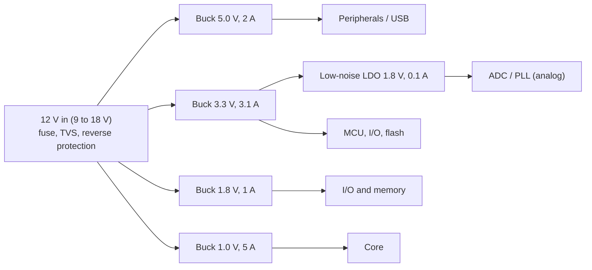

::: basics
### In plain words
A power architecture is the plan for how one input source is turned into all the rails a product needs. You list every rail's voltage and current, add up the power, then choose a regulator for each. Big drops and big currents get switching converters. Small, noise-sensitive loads get low-noise LDOs.

### Picture it
Think of plumbing in a building. One main pipe comes in, and branches go to each floor. Each branch has its own valve sized for what that floor needs. A heavy user, like a boiler, gets its own large pipe. A delicate instrument gets a filtered line. You size everything from the total demand.

### Words you need
- **Power budget**: the sum of every rail's output power. See [[q0163]].
- **Rail**: one supply voltage in the system.
- **Cascading**: feeding one regulator from another. It costs efficiency, as stage efficiencies multiply.
- **Sequencing**: turning rails on and off in a required order.
- **Buck / LDO**: see [[q0157]].

### The simplest example
Take three rails from the spec on this page: 5 V at 2 A, 3.3 V at 3 A, and 1.0 V at 5 A, all from 12 V. The output powers are 10 W, 9.9 W, and 5 W, a total of 24.9 W. With bucks at about 90%, the input is about 27.7 W, or 2.3 A at 12 V. An LDO for the 1.0 V rail would burn $(12 - 1) \times 5 = 55$ W, so it must be a buck. That is the whole idea. The rest of this page adds sizing the parts, a quiet analog rail, sequencing, protection, and how to verify it.
:::

::: testing
Whether you can run a structured design process on an open-ended spec instead of jumping to a part number: ask clarifying questions (input range, accuracy, noise, ripple, sequencing, thermal and cost limits, battery or mains), build a **power budget**, choose a topology for each rail by calculation (buck vs LDO vs others), decide whether to feed rails from the input or cascade them, check the input current at minimum voltage, thermal loss and sequencing, and say how you would verify it. Interviewers care about your reasoning and trade-offs far more than the exact answer.
:::

::: why
Every board needs a power tree and the first draft usually decides cost, efficiency, noise performance and heat. Getting it wrong (an LDO that cooks, a buck feeding an ADC with no filtering, rails that power up in a damaging order) costs a board spin. The question is the generalised form of "design a power supply" ([[q0150]]): the interview is a conversation, and the strongest candidates walk through requirements, estimate losses with numbers, and explain where they would deviate from a first guess.
:::

::: concepts
- **Power budget**: $P_{out}=\sum V_kI_k$ per rail, then $P_{in}=\sum P_k/\eta_k$ ([[q0163]]).
- **Buck vs LDO selection**: loss $(V_{in}-V_{out})I$ versus conversion efficiency ([[q0157]], [[q0158]]).
- **Cascade vs direct conversion**: efficiencies multiply, so feeding rails from the input is usually better unless there is a reason.
- **Input current at minimum $V_{in}$**: $I_{in}=P_{in}/V_{in,min}$ sizes fuse, connectors, inductors and input capacitors.
- **Rail quality**: noise, ripple, accuracy, transient response drive filtering and post-regulation ([[q0168]]).
- **Sequencing and protection**: power-up order, UVLO, current limit, reverse-polarity and surge protection ([[q0171]]).
:::

::: answer
"I'd start by asking questions so I know what I'm designing for: where's the input coming from and what's its range and worst-case behaviour, how tight do the outputs have to be, which loads are noise-sensitive, are there sequencing requirements, and what's the budget for efficiency, heat and cost.

Then take a concrete spec: 12 volts in, 9 to 18, and rails of 5 volts at 2 amps, 3.3 at 3, 1.8 at 1, 1.0 at 5 amps for the core, and a clean 1.8 volts at 100 milliamps for analog. First I build the power budget: that's about 27 watts of output. With a buck for each big rail at roughly 88 to 93 percent efficiency, the input is around 29.5 watts, about 91 percent overall, so 2.5 amps at 12 volts and 3.3 amps at 9. The 1.0 volt, 5 amp core is a buck for sure, an LDO would dissipate 55 watts, which is impossible. The clean 1.8 volts at 100 milliamps I'd make with a low-noise LDO from the 3.3 volt rail, which only wastes 0.15 watts and avoids switching noise.

I'd feed the bucks directly from the input rather than cascading, because cascading through 5 volts would cost me about four points of efficiency. Then I'd check sequencing, input protection, inductor and capacitor sizing, the thermal loss per part, and plan a verification: efficiency sweep, load transients, ripple and noise measurements, and power-up and power-down sequencing on a scope."
:::

::: technical
**Step 0: Clarify.** Input source (adapter, battery, bus), $V_{in,min/typ/max}$, transients and surges; each rail's $V$, $I_{typ}$, $I_{max}$, accuracy (typically ±2–5%), ripple/noise limits, load step size; sequencing; sleep/standby current; thermal/space limits; cost; EMI/regulatory constraints.

**Example spec.** $V_{in}=12$ V (9–18 V). Rails: 5.0 V/2 A, 3.3 V/3 A, 1.8 V/1 A, 1.0 V/5 A (core, ±3%), analog 1.8 V/0.1 A (low noise).

**Step 1: choose topologies** ($V_{in}-V_{out}$ is large on every rail, so bucks for any rail above about 0.3 A; LDO only for the small clean rail):

| Rail | Load | $P_{out}$ | Type | Assumed $\eta$ | $P_{in}$ | Loss | $D$ at 12 V |
|---|---|---|---|---|---|---|---|
| 5.0 V | 2 A | 10.0 W | buck | 92% | 10.87 W | 0.87 W | 0.417 |
| 3.3 V | 3 A + 0.1 A (LDO) | 10.23 W | buck | 93% | 11.00 W | 0.77 W | 0.275 |
| 1.8 V digital | 1 A | 1.80 W | buck | 90% | 2.00 W | 0.20 W | 0.150 |
| 1.0 V core | 5 A | 5.00 W | buck | 88% | 5.68 W | 0.68 W | 0.083 |
| 1.8 V analog | 0.1 A | 0.18 W | LDO from 3.3 V | 54.5% | (inside 3.3 V) | 0.15 W | n/a |

**Step 2: totals.** $P_{out}=26.88$ W useful, $P_{in}=29.55$ W, $\eta=91.0\%$, total loss 2.67 W. Input current: 2.46 A at 12 V, **3.28 A at 9 V**, 1.64 A at 18 V.

**Step 3: first-pass component sizing** (500 kHz, 30% ripple current, $L=\frac{(V_{in}-V_{out})D}{\Delta I f_{sw}}$): 5 V rail 9.7 µH, 3.3 V rail 5.2 µH, 1.8 V rail 10 µH, 1.0 V rail 1.2 µH. Input capacitor RMS current $I_{out}\sqrt{D(1-D)}$: 0.99 A, 1.38 A, 0.36 A, 1.38 A (they add partially if unsynchronised). The 1.0 V rail at 18 V in needs $t_{on}=D/f_{sw}=111$ ns at 500 kHz (56 ns at 1 MHz), so check the controller's minimum on-time.

**Step 4: alternatives.** Cascading everything through a 5 V buck (then 5 V to 3.3, 1.8, 1.0 V) gives $P_{in}=30.9$ W, 87.1% overall, 1.3 W worse. Using an LDO for the 1.8 V digital rail from 3.3 V would waste $(3.3-1.8)\times1=1.5$ W instead of 0.2 W.

**Step 5: system items.** Input protection (fuse, reverse-polarity, TVS or surge clamp), UVLO and EN thresholds, soft-start, power-good and sequencing ([[q0171]], [[q0172]]), decoupling per rail, thermal check ($\Delta T=P\theta$ per IC), EMI filtering and layout ([[q0168]]).

> [!UNCERTAIN]
> Efficiency values are typical assumptions for mid-load synchronous bucks at 500 kHz. Use the datasheet efficiency curve at the actual $V_{in}$, load and temperature, and treat the totals as an estimate with ±3–5 points of uncertainty. Minimum on-time varies between controllers (tens to a hundred-plus nanoseconds); check the part.
:::

::: short
"I'd clarify input range, accuracy, noise, sequencing and thermal limits first, then build a power budget. For a 12 volt input with 5, 3.3, 1.8 and 1 volt rails plus a clean analog 1.8, it's about 27 watts out. I'd use a buck on each rail, fed directly from the input, around 90 percent efficient overall, with a low-noise LDO from 3.3 volts for the analog rail. Then I'd check input current at minimum voltage, sizing, thermals, sequencing and protection, and verify with efficiency, transient and noise measurements."
:::

::: long
"For an open-ended spec like this, I'd start with questions. What's the input source and its range, including worst-case transients? What accuracy and ripple does each rail need, and which loads are noise-sensitive? Are there power-up order requirements? And what are the constraints on efficiency, heat, size and cost? Let's say the answer is a 12 volt input from 9 to 18, with rails of 5 volts at 2 amps, 3.3 at 3, 1.8 at 1, a 1.0 volt, 5 amp core, and a clean 1.8 volt, 100 milliamp analog rail.

Step one is a power budget: 10 watts, 10 watts, 1.8, 5 and 0.18, about 27 watts of output. Step two is a topology for each rail. The headroom from 12 volts is huge, so for anything above a few hundred milliamps it's a buck: an LDO from 12 to 1 volt at 5 amps would dissipate 55 watts. The only LDO candidate is the small analog rail, and it's fed from the 3.3 volt rail so it only wastes 1.5 volts times 100 milliamps, 0.15 watts, while giving a quiet output.

Step three is the totals. Assuming 88 to 93 percent for the bucks I get about 29.5 watts in, 91 percent overall, 2.7 watts of heat. Input current is 2.5 amps at 12 and 3.3 amps at 9 volts, which sets the fuse, connector and input inductor sizing. I'd feed all bucks directly from the input: cascading through a 5 volt buck would add about 1.3 watts of loss.

Fourth, sizing: at 500 kilohertz and 30 percent ripple, the inductors come to roughly 10 microhenries for the 5 volt rail down to 1.2 for the 1.0 volt core, and I'd check the minimum on-time for the core, about 110 nanoseconds at 18 volts in, against the controller. Then sequencing, protection, thermal margins, and decoupling.

Finally, validation: efficiency across load and line, load-step response, ripple and noise at the sensitive loads, power-up and power-down order on a scope, and thermal imaging at full load."
:::

::: terms
- **Power tree / power architecture**: the arrangement of converters from source to loads.
- **Point-of-load (POL) converter**: a regulator placed next to its load.
- **Power budget**: the table of rail powers, efficiencies and input power.
- **Headroom**: $V_{in}-V_{out}$ available to a linear stage.
- **Minimum on-time**: the shortest high-side pulse a buck controller can produce, limiting $D_{min}$ and $f_{sw}$.
- **UVLO**: under-voltage lockout that holds a converter off until the input is high enough.
- **Power good (PG)**: a flag indicating the output is within regulation.
- **Post-regulation**: an LDO following a switcher for low noise.
:::

::: exceptional
**An average answer** says "use a buck for each rail and an LDO for the clean one."

**An exceptional answer**:
- Starts with clarifying questions and states assumptions.
- Builds a power budget with a table, computes $P_{in}$, overall $\eta$, loss and input current at the *minimum* input voltage.
- Justifies buck vs LDO per rail with numbers ($(V_{in}-V_{out})I$ vs buck loss) and justifies direct vs cascaded feed with the cascade product.
- Checks second-order issues: minimum on-time at high $V_{in}$, input ripple current, inductor sizing, thermal loss per device.
- Includes sequencing, protection, decoupling and a verification plan, and names where the first design might change (e.g. a PMIC, IBC, noise filtering).
:::

::: mistakes
- **Starting with part numbers.** Without requirements and a budget you cannot justify any choice.
- **Sizing for typical $V_{in}$ only.** Input current peaks at minimum $V_{in}$; at 9 V the example needs 3.3 A, not 2.5 A.
- **Using an LDO for a big step-down.** Check $(V_{in}-V_{out})I_{out}$ first.
- **Cascading rails without reason.** Efficiency multiplies; deriving every rail from a 5 V rail loses efficiency and adds load to that first stage.
- **Forgetting the LDO's load on its parent rail.** The analog LDO's 0.1 A is part of the 3.3 V buck's load.
- **Ignoring sequencing and protection.** A power tree is not complete until it says what happens at power-up, power-down, brownout, reverse polarity and short circuit.
:::

::: deep
## Process: requirements before architecture

A hardware interviewer for a power-architecture question wants to see the order of thought more than the answer. A good order is:

1. **Source:** type (adapter, battery, bus), $V_{in,min/nom/max}$, source impedance, transients (surge, load dump, hot-plug), current limit.
2. **Loads:** per rail $V$, $I_{typ}$, $I_{max}$, load step $\Delta I/\Delta t$, tolerance (e.g. ±3% at the load, including ripple and transient), noise requirements and sensitivity (ADC, PLL, RF), sequencing and sleep currents.
3. **System constraints:** efficiency or thermal limit, size, cost, EMI, battery life, safety (isolation).
4. **Architecture:** which converters, in what order (direct from input or cascaded), which rails get post-regulation, filtering, or a load switch.
5. **Calculations:** budget, input current, thermal, component sizing.
6. **Protection and control:** UVLO, soft-start, PG, sequencing, fuse, reverse polarity, TVS, current limit.
7. **Validation:** how each requirement is measured.

## Worked design: 12 V in, five rails

**Requirements.** 12 V nominal input, 9–18 V; rails: 5.0 V/2 A, 3.3 V/3 A, 1.8 V/1 A, 1.0 V/5 A (core), analog 1.8 V/0.1 A with low noise.

### Architecture


Figure: Four bucks feed directly from the input (parallel branches), and one LDO is fed from the 3.3 V buck for the quiet analog rail. Parallel branches keep efficiencies from multiplying and keep a fault in one rail from taking down the others.

### Why a buck on every big rail

Compare loss on the 1.0 V, 5 A core:

- LDO from 12 V: $P=(12-1.0)\times5=55$ W, $\eta=8.3\%$. Not possible.
- Buck at 88%: $5/0.88-5=0.68$ W.

Even the 1.8 V, 1 A rail from 12 V in an LDO would be $(12-1.8)\times1=10.2$ W, versus 0.2 W in a buck. Every rail clears the threshold where a switcher is mandatory. The analog rail is the exception: 0.1 A and a noise requirement; dropping from 3.3 V costs $1.5\times0.1=0.15$ W, and the LDO provides roughly 60–70 dB of ripple rejection at low frequency (part-dependent; check at $f_{sw}$) and low noise.

### Power budget

| Rail | $P_{out}$ | $\eta$ | $P_{in}$ | Loss |
|---|---|---|---|---|
| 5.0 V, 2 A | 10.00 W | 92% | 10.87 W | 0.87 W |
| 3.3 V, 3.1 A (incl. LDO) | 10.23 W | 93% | 11.00 W | 0.77 W |
| 1.8 V, 1 A | 1.80 W | 90% | 2.00 W | 0.20 W |
| 1.0 V, 5 A | 5.00 W | 88% | 5.68 W | 0.68 W |
| LDO (1.8 V, 0.1 A) | 0.18 W | in 3.3 V buck | 0.33 W | 0.15 W |
| **Total** | **26.88 W** | | **29.55 W** | **2.67 W** |

Overall efficiency 91.0%. The input current at 12 V is 2.46 A, and **3.28 A at 9 V**, so the input fuse might be 5 A (slow-blow), the connector and traces are sized for at least 4 A, and the input inductor/ferrite bead for the same.

```plot
{"title":"Input current vs input voltage for 29.55 W (constant power load)","x":{"label":"V_in","unit":"V","min":9,"max":18},"y":{"label":"I_in","unit":"A","min":0,"max":4},
 "vars":{"p":29.55},
 "series":[{"label":"I_in = P_in / V_in","fn":"p/x","color":"accent"}],
 "points":[{"x":9,"y":3.283,"label":"9 V: 3.28 A"},{"x":12,"y":2.4625,"label":"12 V: 2.46 A"},{"x":18,"y":1.642,"label":"18 V: 1.64 A"}]}
```
Figure: A switching regulator is a constant-power load, so the input current *rises* as the input voltage falls. Size the fuse, input filter and connector for the minimum input voltage, and the regulator's UVLO so it does not brown out into an unstable region. (Efficiency also changes with $V_{in}$, so the real curve is slightly different; this is the first-order estimate.)

### Cascade vs direct

If the 3.3, 1.8 and 1.0 V rails were fed from the 5 V buck instead of the input:

- Assuming 94%, 92% and 90% for the 5 V to 3.3 V, 1.8 V and 1.0 V stages, the 5 V buck must supply its own 10 W plus the three downstream stages (about 18.4 W, so 28.4 W at its output), so the 12 V input power is 30.9 W: overall 87.1%, 1.3 W more loss than the direct design.
- The 5 V buck would need to deliver 5.6 A instead of 2 A, increasing size.
- However, a cascaded design lowers the step-down ratio for the lower rails: from 5 V the 1.0 V core has $D=0.2$ rather than 0.083, relaxing minimum on-time and allowing higher $f_{sw}$ and a smaller inductor. That is the one reason to cascade: **when the conversion ratio is extreme** (like 48 V to 1 V; see [[q0170]]) or when the first stage provides isolation.

### First-pass sizing, e.g. the core rail

For the 1.0 V, 5 A rail at 500 kHz with 30% ripple ($\Delta I=1.5$ A):
$$L=\frac{(V_{in}-V_{out})D}{\Delta I f_{sw}}=\frac{11\times0.0833}{1.5\times500\ \text{k}}=1.22\ \mu\text{H},$$
so select about 1.2 µH, with a saturation current above $5+0.75=5.75$ A plus margin. Input capacitor RMS current is $I_{out}\sqrt{D(1-D)}=5\sqrt{0.0833\times0.9167}=1.38$ A, so use multiple ceramic capacitors. The on-time at 18 V in is $(1/18)/500$ kHz $=111$ ns, which most controllers can do; at 1 MHz it's 56 ns, which may violate the minimum on-time of some parts, so for this ratio you either lower $f_{sw}$, choose a part with a low minimum on-time, or add an intermediate stage.

```sim
{"id":"buck-lab","vin":12,"vout":1.0,"l":0.0000012,"c":0.0001,"esr":0.002,"fsw":500000,"iout":5,"sync":true,"view":"waveforms"}
```
Figure: The core-rail buck at 12 V to 1.0 V and 5 A. Check the duty cycle (about 8%), the inductor ripple (about 1.5 A p-p) and the output ripple. Try raising $f_{sw}$ to 2 MHz and see how the on-time shrinks.

### Transients and decoupling

The core's load step (say 3 A in 1 µs) needs output capacitance and loop bandwidth: $\Delta V\approx\Delta I/(2\pi f_cC_{out})$ for a loop crossing at $f_c$, so with $f_c=50$ kHz and a 3 A step to stay within 30 mV needs $C_{out}\approx3/(2\pi\times50\times10^3\times0.03)=318\ \mu$F of effective capacitance, combining bulk and local decoupling (see [[q0142]] and [[q0143]]).

### Protection and control

- **Input:** fuse, reverse-polarity protection (P-FET), TVS sized for the expected surge, bulk capacitor and inrush limiting.
- **UVLO / enable:** set via a resistor divider on EN so the converter starts above 8.5 V and stops below 7.5 V, hysteresis to prevent chatter at the low end.
- **Soft-start:** limits inrush into output capacitors ($I=C\,dV/dt$).
- **Power-good and sequencing:** core and I/O rails typically have a required order ([[q0171]], [[q0172]]). Use EN/PG chaining or a sequencer.
- **Current limit and thermal shutdown** per converter; hiccup mode for short circuits.
- **Layout:** compact hot loops, solid ground, thermal vias under exposed pads, analog rail and its LDO away from inductors.

### Verification plan

| Check | How |
|---|---|
| Efficiency | sweep load 5%–100% at 9, 12, 18 V ([[q0162]]) |
| Regulation | static line and load regulation per rail |
| Load transient | step each rail, measure droop and recovery |
| Ripple/noise | 20 MHz bandwidth-limited scope with short ground spring; analog rail with a low-noise probe |
| Sequencing | scope all EN, PG and rails during power-up, power-down and brownout |
| Thermal | steady state at full load, worst-case ambient, thermal camera |
| Protection | short-circuit, over-current, reverse polarity, hot-plug surge |

## Where I might change the design

- **More rails or tighter space:** use a PMIC or a multi-output buck module ([[q0167]]).
- **Higher input (24–48 V):** add an intermediate bus converter first ([[q0170]]).
- **Very clean analog rails:** buck followed by LDO plus filtering ([[q0168]], [[q0169]]).
- **Battery input:** consider the discharge range, $I_q$ and buck-boost options ([[q0161]], [[q0165]]).
- **Cost-sensitive, low power:** a few LDOs may beat more bucks (a 12 V to 3.3 V LDO at 50 mA wastes only 0.44 W).
:::

::: applications
- **Embedded Linux or SoC boards:** a 12 V or 5 V input with buck regulators for DDR, core and I/O rails, usually via a PMIC.
- **FPGA boards:** multiple low-voltage, high-current rails with strict sequencing and ripple limits.
- **Industrial controllers:** 24 V input, buck to 5 V and 3.3 V, with surge and reverse-polarity protection.
- **Battery-powered instruments:** buck-boost front end plus LDOs for analog sections.
- **Automotive modules:** 12 V battery with load-dump protection and wide-input bucks.
- **Mixed-signal data-acquisition systems:** separate digital and analog supplies with post-regulation.
:::

::: assumptions
- DC input of 12 V (9–18 V), no isolation requirement, no battery, and ambient up to about 50–70 °C.
- Efficiencies are typical mid-load values for synchronous bucks at 500 kHz; actual values depend on part, frequency and operating point.
- Rails sequence-independent in this first pass; the actual sequence follows the loads' datasheets ([[q0171]]).
- The ±3% accuracy on the core and the noise requirement on the analog rail are assumptions the candidate would confirm with the interviewer.
- If the interviewer changes the spec (e.g. 48 V in, or a single-cell battery in), the architecture changes: add an intermediate bus converter for large ratios, or use buck-boost topologies for a battery that crosses the rail voltage.
:::

::: followups
### The input is now 48 V. What changes?
A single-stage 48 V to 1 V buck has $D\approx2\%$, a few tens of nanoseconds on-time at 500 kHz to 1 MHz, which is hard and inefficient. I'd add an intermediate bus converter to 12 V or 5 V, then POL bucks: for example, 96% × 90% = 86% for the 1 V rail. The higher bus voltage also reduces distribution current ([[q0170]]).

### How would you decide between a PMIC and discrete converters?
If the SoC vendor offers a PMIC matched to it (with the right rails, sequencing and DVS), use it: fewer parts, correct sequencing, validated. Discrete converters win when current exceeds the PMIC's capability, when custom rails are needed, or for cost on simple designs. I'd compare total cost, board area, and risk.

### Your 3.3 V buck must also supply an LDO for the analog rail. What does that change?
Add the LDO's input current to the 3.3 V buck's load (0.1 A in the example), and check that the LDO's PSRR at the buck's switching frequency is enough: if the buck has 20 mV of ripple and the analog rail must stay below 50 µV, I need about 52 dB of rejection at $f_{sw}$, which may require an LC filter before the LDO ([[q0168]]).

### What if the input can drop to 6 V for a few hundred milliseconds (cold crank)?
The 5 V buck's headroom is too small at 6 V, so it needs 100% duty (low-dropout) operation or a boost pre-stage. I'd also check UVLO, hold-up capacitance, and what each rail does during the dip: rails must either stay in regulation or fail in a controlled order so that the core rail does not stay up without the I/O rail.

### How much margin do you design in?
Ripple + accuracy + transient droop must stay within the load tolerance: for ±3% on 1.0 V that is ±30 mV total. Currents: size converters at 120–150% of $I_{max}$, inductors with saturation current above peak plus margin, fuse at about 150–200% of maximum steady input current (but below connector and trace ratings), and keep junction temperatures 20–30 °C below the limit at worst-case ambient.
:::

::: interpretations
"Given a supply spec (input supply voltage, output supply voltage(s), output current(s)), design power architecture" is deliberately generic, so the answer provides the *method* and works one concrete example (12 V in, five rails). In the interview the spec will differ; keep the same sequence: requirements, budget, topology per rail, direct vs cascaded, protection/sequencing, verification. See [[q0150]] for the generic "design a power supply" question, [[q0167]] for multiple output voltages from one input and [[q0168]] for same-voltage rails with different noise needs.
:::

::: references
- Texas Instruments, *Power Management Guide* and Analog Devices power-design selection guides: example architectures and selection criteria (use the current versions).
- TI SLVA477, "Basic Calculation of a Buck Converter's Power Stage": inductor, input and output capacitor calculations used above.
- Erickson & Maksimovic, *Fundamentals of Power Electronics*: converter design and the constant-power behaviour of regulators.
- Horowitz & Hill, *The Art of Electronics*, 3rd ed.: power-supply design, linear versus switching regulators and thermal considerations.
:::

::: rubric
- Asks clarifying questions (input range, tolerances, noise, sequencing, thermal/cost) :: An open-ended spec cannot be designed without constraints.
- Builds a power budget with rails, efficiency and total input power :: The foundation for sizing everything else.
- Chooses buck vs LDO per rail with a loss calculation :: Shows quantitative topology selection.
- Considers direct vs cascaded feed and quantifies the efficiency impact :: Architectural judgment beyond picking converters.
- Computes input current at minimum $V_{in}$ and sizes fuse/inductors/capacitors accordingly :: Real designs fail at the corner conditions.
- Mentions sequencing, UVLO, soft-start, protection and decoupling :: A power tree is more than converters.
- Gives a verification plan (efficiency, transients, noise, thermal, power-up) :: Closes the loop from design to validation.
- Notes how the design would change for different inputs or requirements :: Shows flexibility and depth.
:::

::: quiz
```json
[
 {"type":"numeric","level":"fundamental","q":"A rail delivers 3.3 V at 3 A from a buck that is 93% efficient. What input power does it draw?","answer":10.65,"tolerance":0.02,"unit":"W","explain":"$P_{out}=3.3\\times3=9.9$ W; $P_{in}=9.9/0.93=10.65$ W."},
 {"type":"numeric","level":"fundamental","q":"What power would an LDO dissipate making 1.0 V at 5 A from a 12 V input?","answer":55,"tolerance":0.01,"unit":"W","explain":"$(V_{in}-V_{out})I=(12-1.0)\\times5=55$ W, which is why the core rail is always a switching regulator."},
 {"type":"numeric","level":"intermediate","q":"The example system draws 29.55 W from its input. What is the input current at the minimum input voltage of 9 V?","answer":3.28,"tolerance":0.02,"unit":"A","explain":"$I_{in}=P_{in}/V_{in}=29.55/9=3.28$ A. Regulators are constant-power loads, so current is highest at minimum voltage."},
 {"type":"numeric","level":"intermediate","q":"A 12 V to 1.0 V buck at 500 kHz, 5 A, with 30% ripple current (1.5 A p-p). What inductance is needed (in µH)?","answer":1.22,"tolerance":0.03,"unit":"µH","explain":"$D=1/12=0.0833$. $L=(12-1)(0.0833)/(1.5\\times500\\text{k})=1.22$ µH."},
 {"type":"mcq","level":"intermediate","q":"Why feed the 3.3 V, 1.8 V and 1.0 V buck converters directly from the 12 V input instead of cascading them from a 5 V buck?","options":["Cascading is impossible","Efficiencies multiply in a cascade, so the direct feed has lower total loss (here about 1.3 W less)","Direct feeding gives lower ripple","The 5 V rail cannot supply any current"],"answer":1,"explain":"In the example the cascade gives about 87.1% overall vs 91.0% direct. Cascading is justified only for extreme ratios or isolation."},
 {"type":"mcq","level":"advanced","q":"The input range becomes 36–60 V and a 1.0 V, 5 A rail is needed. Which approach best addresses the very large step-down ratio?","options":["A single LDO","A single-stage buck at 2 MHz","An intermediate bus converter to 12 V or 5 V followed by a POL buck","A passive resistor divider"],"answer":2,"explain":"At $D\\approx2\\%$ a single stage needs tens of nanoseconds on-time and is inefficient; a two-stage approach with a bus converter keeps each stage in a comfortable ratio. An LDO would dissipate tens of watts."}
]
```
:::
