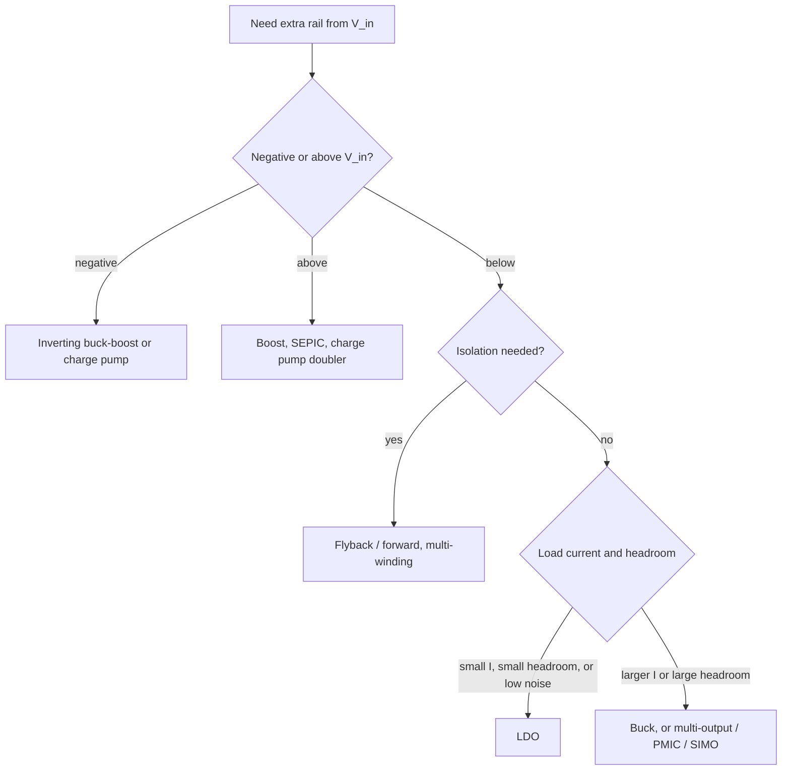

::: basics
### In plain words
To get several voltages from one supply, you give each one its own converter. A buck makes each lower rail, a boost makes any higher rail, and an LDO makes small or quiet ones. Special parts, such as a PMIC or a transformer with several windings, can bundle several outputs together. Pick by current, efficiency, noise, isolation, and cost.

### Picture it
Picture a single water main in a house with a pressure-reducing valve at every tap. Each tap gets the pressure it needs, and they do not affect each other much. The extra pressure in each branch has to go somewhere, though. In a linear regulator, it becomes heat. A switching converter would be a cleverer valve that saves most of that energy.

### Words you need
- **PMIC**: power-management IC, one chip with several regulators inside.
- **LDO**: a linear regulator. Its input current equals its load current. See [[q0157]].
- **Cross-regulation**: how one output of a multi-winding supply is disturbed by the load on another.
- **Charge pump**: makes extra or negative voltages without an inductor.
- **Isolated converter**: a flyback or forward converter with a transformer. See [[q0156]].

### The simplest example
From a 5 V input, make 3.3 V at 0.5 A and 1.8 V at 0.2 A with two LDOs. The output power is $1.65 + 0.36 = 2.01$ W. The input current is $0.5 + 0.2 = 0.7$ A, so the input power is 3.5 W. That is only about 57% efficient, and 1.49 W is lost. Two small bucks at 90% would lose about 0.2 W. That is the whole idea. The rest of this page adds the multi-output chips, the isolated option, and why you avoid dividers for anything that carries current.
:::

::: testing
Whether you know the full menu of ways to derive several rails from one input and can pick among them with numbers: separate switching converters, linear regulators (direct or cascaded), multi-output and single-inductor multiple-output (SIMO) ICs and PMICs, multi-winding transformers (flyback/forward) for isolated rails, and charge pumps or inverting converters for negative and higher rails. The hidden points are the efficiency arithmetic (a cascade of LDOs does not reduce total loss) and the practical trade-offs: cost, area, noise, cross-regulation and isolation.
:::

::: why
Almost no board has a single rail. A typical embedded design has a processor core, I/O, memory, analog and USB or peripheral rails, all from one adapter or battery. How you split them decides efficiency, cost and board area, and a wrong split (all LDOs from 12 V, or a single flyback with poor cross-regulation feeding a sensitive rail) shows up as heat, noise or failed sequencing. This is the "menu" question that precedes the specific design walk-through in [[q0166]].
:::

::: concepts
- **Buck / boost / buck-boost per rail**: independent switching regulators ([[q0156]]).
- **LDO from input or from another rail**: simple, quiet, only steps down ([[q0157]]).
- **Multi-output and SIMO converters**: one controller (and possibly one inductor) feeding several outputs.
- **PMIC**: a single IC integrating several regulators and sequencing ([[q0171]]).
- **Multi-winding transformer**: flyback or forward with several secondaries; outputs ratio by turns, with cross-regulation.
- **Charge pump / inverting converter**: producing a negative or doubled rail ([[q0156]]).
:::

::: answer
"There are a handful of standard approaches, and I'd pick by current, efficiency, noise, isolation, and cost.

The default is one switching regulator per rail: a buck for each rail below the input, a boost or buck-boost for any rail above, and an inverting buck-boost or charge pump for a negative rail. It's efficient and each rail is independent, at the cost of an inductor per rail.

For low current or low noise rails I'd use an LDO, either straight from the input or from another rail that's a little higher. One thing to remember is that a linear regulator's input current equals its load current, so cascading LDOs doesn't reduce total loss, it only moves the heat around.

To save space, a multi-output regulator, a PMIC, or a SIMO converter that time-shares one inductor between outputs is common in battery and SoC designs.

If I need isolation or many rails from mains, a flyback or forward converter with multiple secondary windings gives one rail per winding, with the turns ratio setting the voltages, but the unregulated secondaries have cross-regulation errors, so I'd post-regulate the sensitive ones with LDOs or small bucks.

I'd avoid resistive dividers for anything that carries current."
:::

::: technical
**Options and when to use them**

| Approach | Typical use | Efficiency | Noise | Notes |
|---|---|---|---|---|
| Independent buck per rail | $V_{in}-V_{out}$ large, $I>0.3$ A | 85–95% | switching ripple | most common default |
| Boost, buck-boost, SEPIC | rail above/around input | 80–95% | switching ripple | for batteries crossing the rail |
| LDO from input | small $I$, small headroom, clean rail | $\approx V_{out}/V_{in}$ | very low | cheap and tiny |
| LDO cascaded from another rail | same | same total loss as from input | low | shifts heat to a different part |
| Multi-output buck / PMIC | SoC/FPGA with 4–10 rails | 85–95% | switching | integrated sequencing, DVS |
| SIMO (single inductor) | battery, low-power SoCs | 80–90% | switching, controlled | one inductor, time-multiplexed ([[q0177]]) |
| Multi-winding flyback/forward | isolated or mains-fed multi-rail | 75–90% | switching | rails set by turns ratio; cross-regulation |
| Charge pump / inverting converter | negative rail, small bias rails | 70–90% at low $I$ | low–medium | no inductor for pumps |
| Resistor divider / Zener | reference only | poor | n/a | not for power ([[q0148]]) |

**Efficiency arithmetic: LDO chains.** An LDO draws input current equal to its output current (plus $I_q$), so total input power from a source $V_{in}$ feeding any tree of LDOs is $V_{in}\sum I_{load}$. Example: 3.3 V at 0.5 A and 1.8 V at 0.3 A from 5 V: $P_{in}=5\times0.8=4.0$ W, $P_{out}=2.19$ W, $\eta=54.8\%$, loss 1.81 W. Making 1.8 V from the 3.3 V rail instead changes the loss split (1.36 W in the first LDO plus 0.45 W in the second) but the total is 1.81 W either way. A buck at 90% would give $2.19/0.9-2.19=0.24$ W.

**Multi-winding transformer.** Secondary voltages follow turns ratios: $V_{s}\approx(V_{ref}+V_f)\,N_s/N_{ref}-V_f$. For a regulated 12 V main output and an auxiliary 5 V output, ignoring drops $N_{5}/N_{12}=5/12\approx0.42$; including 0.5 V diode drops it is $(5+0.5)/(12+0.5)=0.44$. Only the sensed output is tightly regulated; the others vary with their own load and leakage inductance (cross-regulation), commonly several percent or worse (part and layout dependent).

**Negative and higher rails.** Inverting buck-boost ($V_{out}=-V_{in}D/(1-D)$), charge-pump inverter (about $-V_{in}$ with $R_{out}\approx1/(f_{sw}C_{fly})$ + switch resistance), or a boost/doubler for $V_{out}>V_{in}$.

> [!UNCERTAIN]
> Cross-regulation, SIMO efficiency and PMIC capabilities vary a lot between products. Treat the ranges in the table as typical orders of magnitude and check the datasheet for the specific part.
:::

::: short
"Per-rail switching regulators are the default: bucks for rails below the input, boost or buck-boost for ones above, and an inverting converter or charge pump for negative rails. LDOs suit small, clean rails, but their input current equals output current, so cascading them doesn't cut total loss. For compact designs I'd use a PMIC, multi-output buck or SIMO converter, and for isolated or mains-fed rails a multi-winding flyback with post-regulation for sensitive rails. I'd avoid dividers for anything carrying current."
:::

::: long
"There's a menu, and I choose from it based on current, efficiency, noise, isolation, area and cost.

The default is one switching regulator per rail. Bucks for rails below the input, boost or buck-boost where I need a rail above or crossing the input, and an inverting buck-boost or charge pump for a negative rail. It's efficient and each rail is independent, which also makes sequencing and fault isolation easy, but each one costs an inductor and board area.

For low-current or noise-sensitive rails I'd use an LDO. An LDO's input current equals its load current, so if I make 3.3 volts at half an amp and 1.8 at 0.3 amps from 5 volts, the input draws 0.8 amps, 4 watts, for 2.2 watts out, whether I feed the 1.8 from 5 volts or from the 3.3 rail. Cascading just moves where the heat is, it doesn't reduce it. So I'd use LDOs only where the loss is small or the noise matters, and a buck otherwise, which would be around 0.24 watts of loss for that example.

When there are many rails, say an FPGA or application processor, I'd use a PMIC or multi-output regulator, which integrates sequencing, soft-start and voltage scaling and saves area. In battery systems a SIMO converter shares one inductor between outputs by time-multiplexing, saving the biggest component.

For isolation, or mains-fed supplies, a flyback or forward with several secondary windings gives one rail per winding with voltage set by turns ratio. Only one output is regulated directly, so the others suffer cross-regulation, and I'd add post-regulators on anything sensitive.

And I'd never use a resistive divider or a Zener to feed a load that draws real current."
:::

::: terms
- **Rail**: a regulated supply voltage line.
- **Cross-regulation**: change in an unsensed output when another output's load changes.
- **PMIC**: power management IC with multiple regulators and control.
- **SIMO**: single-inductor multiple-output converter.
- **Post-regulator**: an LDO or small converter that cleans or regulates a rail from a pre-regulated rail.
- **Turns ratio**: $N_s/N_p$, which sets transformer secondary voltages.
- **Dynamic voltage scaling (DVS)**: changing a rail voltage on the fly for power savings.
- **Inverting converter**: produces a negative output from a positive input.
:::

::: exceptional
**An average answer** says "use multiple regulators, one for each voltage."

**An exceptional answer**:
- Lays out several approaches (independent bucks/boosts, LDOs, PMIC/multi-output, SIMO, multi-winding flyback, charge pump) with one-line trade-offs.
- Gives the LDO-chain insight with numbers: input current equals load current, so cascading doesn't reduce loss.
- Explains cross-regulation in multi-winding transformers and the usual fix (post-regulate).
- Mentions negative and higher-than-input rails and the matching topologies.
- Ends with a selection rule and a decision on a specific example (current, noise, isolation, cost).
:::

::: mistakes
- **Using a resistive divider to make a second rail.** It's not regulated and wastes power ([[q0148]]).
- **Believing a cascade of LDOs improves efficiency.** Total input current is the sum of load currents, so total loss is unchanged.
- **Using one converter for everything with heavy rails and sensitive rails mixed.** A noisy high-current buck shared with an ADC rail couples noise.
- **Ignoring the transformer's cross-regulation.** Unsensed secondaries sag or rise when the main output is loaded or unloaded.
- **Forgetting the parent rail's load.** A rail that feeds LDOs must supply their input current too.
- **Assuming PMICs fit everything.** Check current capability, sequencing and flexibility; some designs need extra discrete converters.
:::

::: deep
## The design space

Given one input $V_{in}$ and outputs $V_1, V_2,\dots$ with currents $I_1, I_2,\dots$, you must pick, for each, a mechanism: *switching*, *linear*, *switched-capacitor* or *magnetic multi-output*. The selection is driven by five questions:

1. Is $V_k$ below, above or of opposite sign to $V_{in}$?
2. How big is $I_k$ (and the headroom $V_{in}-V_k$ if linear)?
3. How noisy can the rail be?
4. Is isolation needed?
5. What is the cost, area and complexity budget?


Figure: A first-pass decision tree. The branches are about direction (below, above, negative), isolation, then current and headroom. Noise requirements then decide whether an LDO or filter is added after a switcher ([[q0168]]).

## Independent switching regulators

One converter per rail is the baseline. Advantages: each rail is isolated from the others (a short on one rail does not disturb the rest), each converter is optimised for its load, and sequencing is easy using EN and PG pins ([[q0172]]). Disadvantages: one inductor, input and output capacitors and controller per rail, with correspondingly more area and cost. The input capacitor and EMI filter can be shared, but the converters' input current pulses overlap, so stagger or synchronise switching (e.g. interleaving phases) to reduce input ripple.

**Example (2 rails from 12 V):** 3.3 V at 2 A and 5 V at 1 A. Two synchronous bucks at 92% give $P_{in}=6.6/0.92+5/0.92=12.6$ W; the input current at 12 V is 1.05 A.

## Linear regulators

LDOs give clean rails with only a few parts. The rule that surprises many people: an LDO's input current equals its load current, so the supply sees the same current whether the 1.8 V LDO is fed from 5 V or from the 3.3 V rail.

```plot
{"title":"Total regulator loss for 3.3 V at 0.5 A and 1.8 V at 0.3 A","x":{"label":"Input voltage","unit":"V","min":4,"max":12},"y":{"label":"Total loss","unit":"W","min":0,"max":8},
 "vars":{"po":2.19},
 "series":[{"label":"Two LDOs (direct or cascaded): 0.8·V_in − P_out","fn":"0.8*x-po","color":"red"},{"label":"Two bucks at 90%","fn":"po/0.9-po","color":"green","dashed":true}],
 "points":[{"x":5,"y":1.81,"label":"5 V in: 1.81 W (LDOs) vs 0.24 W (bucks)"}]}
```
Figure: The LDO line is $V_{in}\sum I-P_{out}$, because linear regulators pass their load current straight through. It grows with $V_{in}$, whereas the switching option stays low. Cascading the 1.8 V LDO from the 3.3 V rail does not change this line; it only redistributes the dissipation (1.36 W in the 5 V to 3.3 V LDO and 0.45 W in the 3.3 V to 1.8 V LDO at 5 V in).

So LDOs are fine when the headroom is small (a 3.3 V rail from 3.6 V), the current is small, or the noise requirement is hard. The cascaded arrangement is good for thermal management (spread heat between two packages) and for a clean rail made from a nearby intermediate rail with lower headroom, as in the buck-then-LDO scheme ([[q0169]]).

## Multi-output ICs, PMICs and SIMO

A **PMIC** integrates several bucks, LDOs and sometimes a boost/charger, with programmable voltages, sequencing, supervisors and an I²C interface. Pros: smallest board area, validated sequencing, dynamic voltage scaling for processors. Cons: less flexibility, a shared fault or thermal limit, and finite current per rail.

A **SIMO** converter uses *one* inductor time-multiplexed among several outputs: the inductor current is charged and then directed in turn to each output depending on which needs energy. It saves several inductors (the biggest and costliest parts in low-power rails) at the price of more complex control, cross-regulation handled by the controller and slightly higher ripple ([[q0177]]).

## Magnetic multi-output: flyback and forward

In a multi-winding transformer, each secondary gives an output proportional to its turns count:
$$V_{s,k}\approx\frac{N_k}{N_{ref}}\,(V_{ref}+V_f)-V_f.$$

The converter regulates only the sensed output (the "master"). The others follow, but leakage inductance and diode drops mean that when a slave output is heavily loaded, its voltage sags relative to the master, and vice versa. Typical cross-regulation is a few percent to 10% or worse, depending on the design and winding structure. Solutions: use a coupled-inductor or tight windings, sense a weighted combination, add a *post-regulator* (LDO or small buck) on the secondary of the sensitive rail, or put dummy-load or lightly-loaded slaves on a quieter rail. This approach shines when isolation is required or when many low-power rails come from mains (such as the housekeeping rails in an appliance).

## Negative and above-input rails

- **Negative rail from a positive input:** inverting buck-boost (needs an inductor, high current), or a charge-pump inverter (no inductor, tens of mA). An op-amp front end often needs ±5 V or ±12 V.
- **Higher than input:** boost, SEPIC, or a charge-pump doubler for low current.

```sim
{"id":"charge-pump","mode":"inverter","vin":3.3,"f":500000,"cfly":0.000001,"cout":0.00001,"iout":0.02,"rsw":1}
```
Figure: An inverting charge pump makes about $-V_{in}$ minus a droop of $I_{out}R_{out}$. Increase the load and see the droop and efficiency: this works for tens of milliamps of bias current, not amps.

## Putting it together on an example

Suppose a 12 V adapter powers: 5 V at 1 A (USB), 3.3 V at 2 A (MCU, radio), 1.8 V at 0.5 A (memory), 1.2 V at 3 A (core), +/-5 V at 20 mA (analog), and the radio demands low noise. A reasonable split:

- 5 V, 3.3 V, 1.2 V and 1.8 V: synchronous bucks directly from 12 V (or a PMIC for the SoC rails).
- $\pm5$ V analog: an LDO cannot make +5 V from the 5 V rail (no headroom), so use a low-noise LDO straight from 12 V for +5 V (only $7\times0.02=0.14$ W at 20 mA). For −5 V, use a small inverting buck-boost (or a charge-pump inverter rated for the input voltage) to about −6 V, followed by a negative LDO.
- Radio supply: low-noise LDO from the 3.3 V buck ([[q0168]]).

If isolation were required (e.g. a medical or industrial front end), one multi-output flyback with post-regulators would replace most of this.

> [!INTERVIEW]
> When asked "what are some solutions", offer the menu in one breath and then ask the interviewer for the constraint that picks the winner: current, noise, isolation or battery? Showing that the answer depends on the constraint is itself a strong signal.
:::

::: applications
- **Embedded SoC boards:** PMIC generating core, DDR, I/O and analog rails from a 5 V or battery input.
- **FPGA boards:** several bucks (core, auxiliary, I/O banks), plus LDOs for transceiver analog rails.
- **Wearables and IoT:** SIMO converters to power multiple domains from one coin cell or Li-ion cell with one inductor.
- **Mains appliances:** multi-winding flyback giving 12 V, 5 V and 3.3 V auxiliary rails with post-regulation.
- **Instrumentation:** ±12 V or ±5 V analog rails from a single 5 V or 12 V input, with charge-pump inverters and LDOs.
- **LCD displays:** boost for the source drivers, inverting converter for the negative gate voltage, and bucks for logic.
:::

::: assumptions
- DC input and the question treats "different voltages" as above, below, or opposite to the input; isolation is only considered where noted.
- Efficiency figures are typical values for mid-load operation; the LDO figures are exact from $V_{out}/V_{in}$ and equal input/output current.
- Cross-regulation numbers in multi-output magnetics are indicative; it depends heavily on the transformer and the regulation scheme.
- "Single input supply" excludes the use of several independent input sources; with a battery plus an adapter, the architecture can change.
- The answer is a menu, not a prescription: the right choice depends on the constraint the interviewer adds.
:::

::: followups
### Why doesn't cascading LDOs improve efficiency?
Because an LDO's input current is essentially its output current plus a small $I_q$. A tree of LDOs from a single source draws $\sum I_{load}$ from that source at $V_{in}$, so the total input power is $V_{in}\sum I_{load}$ regardless of arrangement. Cascading only changes which LDO dissipates how much. For 5 V in: 3.3 V at 0.5 A and 1.8 V at 0.3 A give 4.0 W in either way.

### What is cross-regulation and how do you deal with it?
In a multi-output transformer, only the sensed output is regulated by feedback. If another output is loaded, its diode and leakage-inductance drops increase and its voltage sags, and the energy it draws lowers the master's behaviour as well. Fixes: tight winding coupling, sensing a weighted combination of outputs, a minimum load on the unsensed outputs, and post-regulation (an LDO or buck) for tight rails.

### You have 12 V in and need 3.3 V at 100 mA, 5 V at 3 A. What do you choose?
A buck for the 5 V rail. For the 3.3 V, 100 mA rail: from 12 V an LDO would burn $(12-3.3)\times0.1=0.87$ W, too much for a small package. Better: make 3.3 V from the 5 V rail with an LDO, dropping only $1.7\times0.1=0.17$ W, while the 5 V buck supplies that extra 0.1 A. Total loss is lower because the 5 V buck is efficient and the LDO's headroom is small. If space allows, a small buck from 12 V is also fine.

### How would you generate -5 V for an op-amp from a 5 V rail?
An inverting charge pump (about 20–50 mA, small, cheap), optionally followed by a negative LDO for lower ripple. For more current, an inverting buck-boost converter. Check the op-amp's PSRR and the allowable ripple, and sequencing so the negative rail does not lag the positive by more than the device allows.

### A PMIC is giving you an overheating warning. What do you check?
Which rails are LDOs inside it (heat $(V_{in}-V_{out})I$), how much total current is drawn, whether the rail allocation could move high-loss rails to external bucks, thermal vias and copper under the part, and whether average vs peak current is the problem (a burst load can heat spots).
:::

::: interpretations
"Multiple output supplies of different voltages from a single input supply" can include negative or higher-than-input outputs (the answer covers them), and "solutions" invites a menu rather than a single design. It is distinct from [[q0168]] (same voltage, different noise) and [[q0169]] (high dropout with high efficiency and clean output), and is the general version of the worked example in [[q0166]].
:::

::: references
- Erickson & Maksimovic, *Fundamentals of Power Electronics*: converter topologies including inverting, SEPIC and multiple-output converters.
- Horowitz & Hill, *The Art of Electronics*, 3rd ed.: voltage regulators, switching supplies and flyback converters.
- Pressman, Billings & Morey, *Switching Power Supply Design*: multi-output flyback and forward converters and cross-regulation.
- Manufacturer PMIC, SIMO and multi-output regulator datasheets and reference designs for the actual specs.
:::

::: rubric
- Names separate switching regulators per rail as the default :: It is the most common and easily defended answer.
- Names LDOs and states when they fit (small headroom, small current, low noise) :: Shows trade-off awareness.
- Notes that LDO input current equals load current, so cascading doesn't reduce loss :: A key insight that many miss.
- Mentions multi-output ICs/PMICs and SIMO converters :: Shows knowledge of integrated and compact solutions.
- Mentions multi-winding flyback/forward and cross-regulation (isolation case) :: Covers the magnetics-based approach.
- Mentions negative and higher rails (inverting, charge pump, boost) :: Completes the "different voltages" scope.
- Selects with criteria (current, noise, isolation, area, cost) :: Turns the list into a decision.
:::

::: quiz
```json
[
 {"type":"mcq","level":"fundamental","q":"Which is the most common way to create several different rails below the input voltage at significant current?","options":["A resistive divider per rail","One buck regulator per rail (or a PMIC)","A Zener diode per rail","A single LDO with multiple taps"],"answer":1,"explain":"Switching regulators are efficient at significant current. Dividers and Zeners are unregulated or wasteful, and an LDO has one output."},
 {"type":"numeric","level":"fundamental","q":"From a 5 V input, two LDOs supply 3.3 V at 0.5 A and 1.8 V at 0.3 A. What is the total input power?","answer":4,"tolerance":0.01,"unit":"W","explain":"Input current equals the sum of load currents: $0.5+0.3=0.8$ A, so $P_{in}=5\\times0.8=4.0$ W."},
 {"type":"numeric","level":"intermediate","q":"For the previous question, what is the total power lost in the two LDOs?","answer":1.81,"tolerance":0.02,"unit":"W","explain":"$P_{out}=3.3\\times0.5+1.8\\times0.3=2.19$ W, so loss $=4.0-2.19=1.81$ W (the same whether the 1.8 V LDO is fed from 5 V or from 3.3 V)."},
 {"type":"truefalse","level":"intermediate","q":"Feeding the 1.8 V LDO from the 3.3 V rail (instead of the 5 V input) reduces the total power drawn from the 5 V input.","answer":false,"explain":"The 3.3 V LDO must supply the extra 0.3 A, and every LDO passes its load current to its input, so the 5 V source still supplies 0.8 A. Only the heat distribution changes."},
 {"type":"mcq","level":"intermediate","q":"What is the main drawback of an unsensed secondary output of a multi-winding flyback converter?","options":["It cannot supply current","Cross-regulation: its voltage varies with the loads on the other outputs","It always has negative polarity","It needs no diode"],"answer":1,"explain":"Only the sensed output is directly regulated. Others vary with loading due to leakage inductance and diode drops, so sensitive rails get post-regulation."},
 {"type":"mcq","level":"advanced","q":"A single-cell battery product needs several low-power rails and board area is critical. Which approach saves the most inductor area?","options":["Independent bucks, one per rail","A SIMO converter that shares one inductor among outputs","A multi-winding flyback","LDOs from a boost converter, each with their own inductor"],"answer":1,"explain":"A SIMO time-multiplexes a single inductor between the outputs, removing the other inductors, usually the largest components in low-power rails."}
]
```
:::
