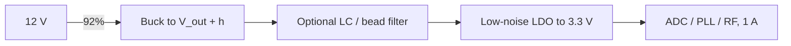

::: basics
### In plain words
When the input is much higher than the output, but the output also has to be clean, use two stages. A buck takes the big drop efficiently down to just above the target. A low-noise LDO then takes the last few hundred millivolts and cleans away the buck's ripple. You get most of the buck's efficiency and the LDO's quiet.

### Picture it
Think of sanding a rough board. You start with coarse sandpaper to remove most of the wood quickly. Then you finish with fine sandpaper for a smooth surface. The coarse paper is the buck: fast and a bit rough. The fine paper is the LDO: slow, but it leaves a clean finish. Using only fine paper would take forever, and using only coarse leaves scratches.

### Words you need
- **Dropout**: the smallest input-to-output gap an LDO needs to keep regulating.
- **Headroom**: the gap you give the LDO. See [[q0158]].
- **PSRR**: how much the LDO rejects ripple from the buck. See [[q0168]].
- **Ripple**: the switching wiggle left on the buck's output.
- **Two-stage regulator**: a buck followed by an LDO.

### The simplest example
Make a clean 3.3 V at 1 A from 12 V. An LDO alone takes 12 W and wastes 8.7 W. A buck alone is efficient but leaves ripple. So set the buck at 3.6 V with 92% efficiency, and follow it with the LDO. The LDO wastes $0.3 \times 1 = 0.3$ W. The buck's input power is $3.6/0.92 \approx 3.9$ W, so the total loss is about 0.6 W, and efficiency is about 84%. That is the whole idea. The rest of this page adds how to pick the headroom, plus extras like an LC filter or a tracking pre-regulator.
:::

::: testing
Whether you recognise the classic two-stage answer (buck to just above the target, then an LDO) and can *optimise* it: choosing the headroom as a trade between efficiency (loss $=h\,I$ in the LDO) and PSRR at the switching frequency, adding LC or bead filtering when the LDO's PSRR is not enough, and thinking about alternatives (low-noise switchers, tracking pre-regulators, filter-only for small currents). The candidate must also quantify why a single stage fails: an LDO alone at a large drop burns watts, and a buck alone is not clean.
:::

::: why
A large input-to-output drop (12 V to 3.3 V, 24 V to 5 V, 48 V to anything) rules out a simple LDO on thermal grounds, yet the rail often feeds an ADC, PLL or RF stage that cannot tolerate a buck's ripple. Real boards (precision instrumentation, RF, audio, sensors on industrial buses) solve exactly this with a buck followed by a post-regulator. It is the intersection of the efficiency question ([[q0157]], [[q0158]]) and the noise question ([[q0168]]), and a good test of whether a candidate can balance both in one design.
:::

::: concepts
- **LDO dissipation**: $P=(V_{in}-V_{out})I_{out}$; with a pre-regulator the headroom is small ([[q0157]]).
- **Chain efficiency**: $\eta_{total}=\eta_{buck}\times\dfrac{V_{out}}{V_{out}+h}$ (headroom $h$), ignoring $I_q$.
- **PSRR**: LDO rejection of ripple, which depends on frequency and headroom ([[q0277]]).
- **Dropout voltage**: minimum headroom the LDO needs at the load current.
- **LC / bead filter**: passive attenuation between stages ([[q0168]]).
- **Conducted noise**: ripple, spikes and harmonics from the switching stage.
:::

::: answer
"The standard solution is a two-stage regulator: a buck converter takes the big drop efficiently, down to just above the target, and a low-noise LDO takes the last few hundred millivolts and cleans the output.

For example 12 volts to a clean 3.3 volts at an amp. An LDO alone would be 27 percent efficient and burn 8.7 watts. A buck alone is 92 percent efficient but has maybe tens of millivolts of ripple at its switching frequency. So I set the buck to about 3.6 volts and follow it with an LDO to 3.3. The LDO only drops 0.3 volts, so it dissipates 0.3 watts, and the chain is around 84 percent efficient, with the LDO rejecting the ripple.

The design choice is the headroom. Less headroom is more efficient, but PSRR gets worse as you approach dropout, so I pick the smallest headroom where the datasheet PSRR at the switching frequency still meets my noise budget. If one LDO isn't enough, I add an LC or ferrite filter between them. Other options are a low-noise buck, a tracking pre-regulator that sets its own headroom, and for tiny currents just an RC filter. And I'd keep the layout separate and the hot loop small."
:::

::: technical
**Two-stage architecture.** Buck: $V_{in}\to V_{pre}=V_{out}+h$; LDO: $V_{pre}\to V_{out}$ at $I_{out}$.

**Efficiency (ignoring $I_q$).**
$$\eta_{total}=\eta_{buck}\,\frac{V_{out}}{V_{out}+h},\qquad P_{loss}=\underbrace{V_{pre}I\left(\tfrac1{\eta_{buck}}-1\right)}_{\text{buck}}+\underbrace{hI}_{\text{LDO}}.$$
Example: 12 V to 3.3 V at 1 A, $\eta_{buck}=92\%$:

| Option | Efficiency | Loss at 1 A | Noise |
|---|---|---|---|
| LDO only (12 V to 3.3 V) | 27.5% | 8.7 W | excellent |
| Buck only | 92% | 0.29 W | switching ripple |
| Buck to 3.8 V + LDO ($h=0.5$ V) | 79.9% | 0.83 W | clean |
| Buck to 3.6 V + LDO ($h=0.3$ V) | 84.3% | 0.61 W | clean |
| Buck to 3.45 V + LDO ($h=0.15$ V) | 88.0% | 0.45 W | clean if PSRR holds |

**Noise budget.** Convert the load's limit to dB at $f_{sw}$, e.g. 30 mV p-p ripple versus a 20 µV limit: $20\log(30\text{ mV}/20\ \mu\text{V})=63.5$ dB. Compare with LDO PSRR at $f_{sw}$ *at headroom $h$ and the load current* plus filter attenuation.

**Headroom optimisation.** Lower $h$ raises efficiency but lowers PSRR (as the pass device nears the edge of saturation or the ohmic region). Choose the smallest $h$ with margin (typically dropout plus 100–300 mV, verified on the PSRR-vs-headroom graph).

**Alternatives.** (1) Buck + LC/bead + LDO for extreme noise requirements. (2) A **low-noise (low-EMI) switching regulator** whose ripple is already small enough for tolerant loads. (3) A **tracking pre-regulator** that automatically holds its output $h$ above $V_{out}$ (available as integrated parts) so efficiency stays high across line and load. (4) For small currents (a few mA) an **RC filter** or capacitor multiplier after the buck instead of an LDO. (5) For the rail that only needs filtering at a few frequencies, an LC trap tuned to $f_{sw}$.

> [!UNCERTAIN]
> Typical LDO PSRR at hundreds of kHz to MHz and the dependence on headroom vary widely between parts (and with output capacitor ESR/ESL). The 84% and 88% figures assume the buck stays at 92% when its output is moved from 3.3 V to 3.45–3.8 V, which is only approximately true, and ignore LDO $I_q$.
:::

::: short
"A buck takes the big drop efficiently, down to just above the target, and then a low-noise LDO takes the last few hundred millivolts and cleans the rail. For 12 to 3.3 volts at an amp, the buck goes to about 3.6 volts and the LDO drops 0.3 volts, so it only dissipates 0.3 watts and the chain is around 84 percent efficient. I choose the headroom as the smallest value that still gives enough PSRR at the switching frequency, and add an LC or bead filter between them if needed."
:::

::: long
"Two requirements are in tension here: a large drop wants a switching regulator, and a very clean rail wants a linear one. The standard resolution is to use both in series.

Take 12 volts to a clean 3.3 volts at 1 amp. The LDO alone would be 27.5 percent efficient and dissipate 8.7 watts, which I can't cool in a normal package. A buck alone would be about 92 percent efficient, but leaves ripple at its switching frequency and spikes that a sensitive load might not tolerate.

So the buck makes the big step down, but only to just above the target, say 3.6 volts, and a low-noise LDO takes the last 300 millivolts to 3.3. The LDO now dissipates 0.3 volts times 1 amp, 0.3 watts, which is easy, and overall the buck dissipates about 0.31 watts and so the chain's loss is about 0.6 watts, an efficiency of 84 percent. The LDO also provides the ripple rejection and low noise.

The main design decision is the headroom. More headroom means more heat and less efficiency: at 0.5 volts the chain is 80 percent; at 0.15 volts it's 88. But PSRR is poor close to dropout and falls with frequency. I'd look at the datasheet PSRR curve at the switching frequency for my headroom and load current, compare it with the attenuation I need, say 60-plus decibels for an ADC reference, and take the smallest headroom with margin. If one stage isn't enough I'd add a ferrite bead or LC filter between them, with damping.

Other options: a low-noise switching regulator for moderately sensitive loads, an integrated tracking pre-regulator that adjusts the buck output to keep the LDO headroom constant, and for just a few milliamps an RC filter instead of an LDO. And I'd handle layout: small buck hot loop, filter and LDO near the load, and separate returns."
:::

::: terms
- **Dropout voltage**: minimum $V_{in}-V_{out}$ at which the LDO still regulates.
- **Headroom ($h$)**: the actual $V_{in}-V_{out}$ chosen for the post-regulator.
- **Pre-regulator**: the switching stage that feeds the LDO.
- **Post-regulator**: the LDO that cleans a switcher's output.
- **PSRR**: ripple rejection, in dB, vs frequency.
- **Tracking pre-regulator**: switcher whose output follows $V_{out}+h$ automatically.
- **Capacitor multiplier**: active circuit that emulates a large capacitance for filtering a small current.
- **Low-EMI / quiet switcher**: converter with reduced hot-loop noise and edge-rate control.
:::

::: exceptional
**An average answer** says "buck then LDO".

**An exceptional answer**:
- Explains why neither alone works with numbers (8.7 W vs ripple).
- Gives the chain efficiency formula and the loss split (buck loss plus $h\,I$ in the LDO), and picks a headroom with a rationale.
- Brings up PSRR *at the switching frequency and at that headroom*, and the filter between stages when PSRR isn't enough.
- Lists alternatives (low-noise buck, tracking pre-regulator, passive filtering at low current) and when each wins.
- Mentions layout, thermal limit of the LDO ($h\,I$) and how the design scales if current becomes large.
:::

::: mistakes
- **Choosing 1–2 V of headroom "to be safe".** It wastes efficiency (at $h=1$ V the chain is 71%); the LDO needs dropout plus margin, not volts.
- **Choosing the minimum headroom with no PSRR check.** Near dropout, PSRR collapses and the ripple appears at the output.
- **Using the LDO's DC PSRR.** The buck's frequency is what matters.
- **Forgetting the LDO's thermal limit at higher current.** At 5 A and 0.3 V headroom, it dissipates 1.5 W.
- **Letting the buck's pre-regulated rail droop under load.** The buck must hold $V_{out}+h$ with its own tolerance and transient response so the LDO never falls into dropout.
- **Saying "just add a big capacitor".** A bulk capacitor does not filter spikes or give isolation, and the LDO is the part that regulates against load steps.
:::

::: deep
## The problem in numbers

We need a clean 3.3 V at 1 A from 12 V. Two requirements are in conflict.

**Efficiency.** A linear regulator dissipates $(12-3.3)\times1=8.7$ W for 3.3 W out (27.5%). Even a large heatsinked part is poor, and the whole point is a high-efficiency solution.

**Cleanliness.** A buck has a ripple of $\Delta V\approx\Delta I_L/(8f_{sw}C)+\Delta I_L\,\mathrm{ESR}$ plus switching spikes. With a 0.5 A p-p inductor ripple, 500 kHz, 22 µF and 5 mΩ ESR: 5.7 mV + 2.5 mV, roughly 8 mV of ripple and tens of mV of high-frequency spikes. If the load tolerates 20 µV, the required attenuation is 52 dB at 500 kHz or more.

The resolution is to divide the job: the switching stage does the heavy conversion; a linear stage handles the last few hundred millivolts, where its loss is small.


Figure: The buck absorbs almost all of the voltage drop (efficiently); the LDO sees only $h$, so it dissipates $hI$ and its job reduces to rejecting the buck's residual ripple and regulating load steps. The optional filter adds attenuation at $f_{sw}$ if the LDO's PSRR there is not enough.

## Choosing the headroom

The loss of the chain is the buck's loss (set by $V_{pre}I$ and $\eta_{buck}$) plus the LDO's $hI$. Chain efficiency
$$\eta_{total}=\eta_{buck}\,\frac{V_{out}}{V_{out}+h}.$$

```plot
{"title":"Chain efficiency vs LDO headroom (3.3 V out, buck 92%)","x":{"label":"Headroom h","unit":"V","min":0.05,"max":2},"y":{"label":"Efficiency","min":0.4,"max":1},
 "vars":{"vo":3.3,"eb":0.92},
 "series":[{"label":"η_total = 0.92·V_out/(V_out + h)","fn":"eb*vo/(vo+x)","color":"accent"}],
 "hlines":[{"at":0.275,"label":"LDO alone from 12 V: 27.5% (off the chart)","color":"muted"},{"at":0.92,"label":"buck alone: 92%","color":"green"}],
 "points":[{"x":0.15,"y":0.88,"label":"h = 0.15 V: 88%"},{"x":0.3,"y":0.843,"label":"h = 0.3 V: 84.3%"},{"x":0.5,"y":0.799,"label":"h = 0.5 V: 79.9%"},{"x":1,"y":0.706,"label":"h = 1 V: 70.6%"}]}
```
Figure: Efficiency falls smoothly with headroom, so every 100 mV of margin costs about 2.5 points at this rail voltage. The curve also shows the cost of the clean rail relative to a buck alone (about 8 points at $h=0.3$ V), and how much better it is than an LDO alone.

On the other side of the trade, PSRR depends on headroom:

- Near dropout the pass device is in its ohmic region, with little gain, so PSRR at all frequencies falls.
- At comfortable headroom (typically a few hundred mV above dropout), PSRR reaches its datasheet value.

So the workflow is: (1) read the LDO's dropout at your load current, (2) read its PSRR vs frequency at a few headroom values, (3) compute the required attenuation at $f_{sw}$, (4) choose the smallest $h$ that meets it with margin (including the buck's output accuracy and transient droop, since the LDO must never reach dropout), (5) add filtering if no value of $h$ gives enough.

**Example.** The buck leaves 30 mV p-p at 1 MHz, and the load needs 20 µV p-p: 63.5 dB required. A typical LDO might give 40 dB at 1 MHz at healthy headroom; a one-pole bead-plus-capacitor filter (or an LC filter with its resonance well below $f_{sw}$) could supply another 25 dB or more, meeting the target with about a decibel of margin only, so I'd want a bit more filtering or an LDO with higher high-frequency PSRR.

```sim
{"id":"ldo-lab","vin":3.6,"vout":3.3,"iout":1,"vdo":0.2,"iq":0.00005,"theta":60}
```
Figure: With 0.3 V of headroom and 1 A, the LDO dissipates 0.3 W (about an 18 °C rise at $\theta_{JA}=60$ °C/W). Raise $V_{in}$ to 5 V and see the dissipation jump to 1.7 W: the headroom trade in action. The PSRR sketch shows how rejection falls at high frequency.

## Options beyond "buck plus LDO"

| Option | When it wins | Cost |
|---|---|---|
| Buck + LDO (+ filter) | clean rail, moderate current, large drop | ~$hI$ loss, two parts |
| Low-noise or low-EMI buck alone | load tolerates tens of µV to mV of ripple | usually bigger or pricier converter, still more noise than an LDO |
| Tracking pre-regulator + LDO | want constant small headroom over line/load | specialised part, tuning |
| Buck + LC filter only | small PSRR-free filtering is enough, current moderate | no load-step isolation; needs damping ([[q0168]]) |
| Buck + RC / capacitor multiplier | currents of a few mA (bias lines, references) | IR drop, only low current |
| Multi-stage (buck, then LDO, then local RC) | extreme low-noise requirements (RF, precision ADC) | area, cost |
| Charge pump + LDO | low current, moderate ratio | efficiency falls off at high current |

**Why a tracking pre-regulator?** If the input, load or temperature vary, a fixed pre-regulator voltage must have enough margin for the worst case, wasting efficiency in the typical case. A pre-regulator that senses the LDO's headroom (or its dropout) and adjusts its own output keeps $h$ small and constant. It is a more complex part, but it is how some high-end low-noise supplies keep both efficiency and cleanliness.

## Thermal and current scaling

The LDO's dissipation is $hI$: 0.3 W at 1 A and 0.3 V headroom, 1.5 W at 5 A. With $\theta_{JA}=40$ °C/W at 70 °C ambient and a 125 °C limit, the maximum is 1.4 W, so 5 A at 0.3 V is at the edge. At higher currents, the options are lower headroom (using a very-low-dropout part), paralleling LDOs, a quieter switcher alone with filtering, or accepting more noise on that rail.

## Layout

- Keep the buck's **hot loop** (input cap, high-side and low-side FET) very small, and place the inductor away from the sensitive section.
- Put the **LDO and its output capacitor right at the load**, with the bead/filter immediately before the LDO.
- Provide a clean **return path** for the sensitive rail's currents; do not share copper with digital returns.
- Use **Kelvin sensing** of the LDO output at the load if tight accuracy matters.
- Verify with a bandwidth-limited, short-ground probe and a spectrum measurement ([[q0162]]).
:::

::: applications
- **Precision ADC/DAC and reference supplies** on industrial 24 V systems: buck to 5.3 V then a low-noise LDO to 5 V.
- **RF transceivers and PLLs** powered from a 12 V or battery bus.
- **Audio DAC analog stages** from a switching adapter.
- **Sensor and bridge excitation** for strain-gauge and thermocouple front ends.
- **Test and measurement instruments** where noise floor specifications dominate.
- **Camera image sensors**, where supply ripple appears as image banding.
:::

::: assumptions
- Large dropout (about 9 V in the example) and a clean-rail requirement in the µV range; if the noise requirement is tens of mV, the buck alone may be enough.
- The buck efficiency stays near 92% when its output rises from 3.3 V to 3.6–3.8 V, and the LDO's $I_q$ is negligible at 1 A. Neither assumption is exact.
- The example numbers (30 mV ripple, 40 dB PSRR at 1 MHz) are illustrative, not from a particular part.
- Linear regulators are assumed to be low-noise types with good PSRR; general-purpose LDOs may have 10× the output noise.
- If the interviewer wants the "most efficient" answer, say the buck alone with better layout may suffice; if they want the "cleanest", add filtering and perhaps a second linear stage.
:::

::: followups
### How much headroom would you give the LDO and why?
Dropout at my load current plus margin for the buck's tolerance and load transient droop, typically 150–300 mV above the dropout spec, verifying on the PSRR-vs-headroom curve that rejection at the switching frequency still meets the noise budget. Larger headroom adds cost in efficiency: 0.5 V instead of 0.15 V at 3.3 V costs about 8 points (79.9% vs 88%).

### The LDO PSRR at your switching frequency is only 30 dB, but you need 60 dB. What do you do?
Options: add an LC or bead-plus-capacitor filter between the stages (40 dB at 500 kHz from 1 µH and 10 µF, if damped); raise the switching frequency so the filter is more effective and the LDO ripple is smaller; select an LDO with better high-frequency PSRR; or reduce the buck's ripple at the source with more output capacitance or inductance.

### Why not use a bigger LC filter alone after the buck?
It gives only a fixed attenuation above its corner frequency, offers no regulation against load steps, can have a resonance that needs damping, and the output follows the buck's DC accuracy and load regulation. An LDO adds regulation, isolation from load transients and high-frequency PSRR. The two can be combined.

### The clean rail needs 5 A. What changes?
The LDO's loss $hI=0.3\times5=1.5$ W is borderline. Options: very-low-dropout parts with ~100–150 mV headroom (0.5–0.75 W), several LDOs in parallel with ballast, a low-noise buck with substantial filtering, or a different split (a quiet multiphase buck whose ripple is naturally low) with only a small post-filter.

### How is this different from the same-voltage, different-noise question?
That question ([[q0168]]) is about serving *two* rails at the same voltage and which techniques isolate them. This one is about one rail that needs *both* high efficiency despite a large input-output difference *and* low noise, so the buck-then-LDO headroom optimisation is the core. The techniques overlap (filtering, PSRR) but the constraint driving the architecture is different.
:::

::: interpretations
"High dropout voltage" means a large difference between input and output ($V_{in}-V_{out}$ is big), not the LDO's dropout specification. The phrase "very clean output supply rail" implies a low-noise requirement the buck alone cannot meet. The answer is therefore a hybrid, not a single regulator. Compare with [[q0211]] (why bucks are more efficient than LDOs) and [[q0283]] (LDO efficiency analysis), and the broader menu in [[q0167]].
:::

::: references
- Texas Instruments, application notes on powering noise-sensitive loads with a buck followed by an LDO and on LDO PSRR vs headroom and frequency (use the current document list).
- Analog Devices (Linear Technology) application notes and datasheets for ultralow-noise LDOs and for tracking pre-regulation; check document numbers before citing.
- Horowitz & Hill, *The Art of Electronics*, 3rd ed.: regulators, switching supplies, and low-noise design.
- Erickson & Maksimovic, *Fundamentals of Power Electronics*: efficiency of cascaded converters.
:::

::: rubric
- Says why neither a lone LDO nor a lone buck satisfies both requirements, with numbers :: Establishes the need for a hybrid design.
- Proposes buck pre-regulator to $V_{out}+h$ followed by a low-noise LDO :: The standard correct solution.
- Gives the efficiency/loss: buck loss plus $hI$ in the LDO, and a chain efficiency :: Shows you can quantify the cost of cleanliness.
- Explains headroom as a trade between efficiency and PSRR/dropout margin :: The key engineering judgment.
- Checks PSRR at the switching frequency and mentions an LC/bead filter if insufficient :: Where most designs go wrong.
- Mentions alternatives (low-noise buck, tracking pre-regulator, RC for low current) :: Shows breadth.
- Mentions thermal limit ($hI$) and layout :: Completes a practical design.
:::

::: quiz
```json
[
 {"type":"numeric","level":"fundamental","q":"A 12 V to 3.3 V LDO-only regulator supplies 1 A. How much power does it dissipate?","answer":8.7,"tolerance":0.01,"unit":"W","explain":"$P=(12-3.3)\\times1=8.7$ W, which is why a buck pre-regulator is used."},
 {"type":"numeric","level":"intermediate","q":"A buck (92% efficient) feeds an LDO with 0.3 V of headroom to make 3.3 V. What is the chain efficiency (ignoring $I_q$)?","answer":84.3,"tolerance":0.01,"unit":"%","explain":"$\\eta=0.92\\times3.3/(3.3+0.3)=0.92\\times0.9167=84.3\\%$."},
 {"type":"numeric","level":"intermediate","q":"For the same design at 1 A, how much power does the LDO dissipate?","answer":0.3,"tolerance":0.02,"unit":"W","explain":"$P_{LDO}=hI=0.3\\times1=0.3$ W."},
 {"type":"numeric","level":"intermediate","q":"The buck leaves 30 mV p-p ripple and the load needs 20 µV p-p. How much attenuation is needed?","answer":63.5,"tolerance":0.02,"unit":"dB","explain":"$20\\log_{10}(30\\text{ mV}/20\\ \\mu\\text{V})=20\\log_{10}1500=63.5$ dB."},
 {"type":"mcq","level":"intermediate","q":"What is the main risk of choosing the minimum possible headroom for the LDO?","options":["Higher efficiency","PSRR collapses and the LDO may drop out during transients, passing the ripple through","The LDO cannot supply any current","The buck stops switching"],"answer":1,"explain":"Close to dropout the pass device loses gain, so rejection falls at all frequencies and a transient droop of the buck output can push the LDO out of regulation."},
 {"type":"mcq","level":"advanced","q":"The clean rail current rises to 5 A at 0.3 V headroom with $\\theta_{JA}=40$ °C/W in a 70 °C enclosure (125 °C max junction). What happens?","options":["Fine, the LDO dissipates 0.3 W","The LDO dissipates 1.5 W, above the 1.375 W limit, so it needs better thermal design or less headroom","The LDO dissipates 15 W","Nothing, LDOs have no thermal limit"],"answer":1,"explain":"$P=0.3\\times5=1.5$ W, while $(125-70)/40=1.375$ W is the maximum allowed. Reduce headroom (very-low-dropout part), improve cooling, parallel devices, or change architecture."}
]
```
:::
