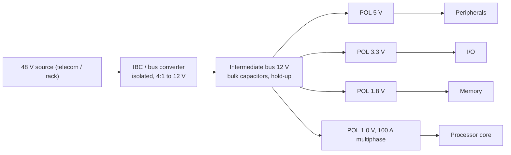

::: basics
### In plain words
An intermediate bus converter is the first, big step-down in a two-stage power system. It takes a high input voltage (say 48 V) and makes a middle voltage (say 12 V), the "bus". Small converters sitting next to each chip then make the final low voltages. The point is to move power over the board at high voltage, where the current is small.

### Picture it
Think of a delivery company. Long-haul trucks carry everything to a local depot in bulk, then small vans drive to each house. Trucks are efficient over distance, and vans are efficient for the last stretch. In the same way, a high-voltage bus carries power cheaply, and the converters at each chip finish the job. The analogy does not show the main electrical reason: wire loss depends on the current squared.

### Words you need
- **Bus voltage**: the shared middle voltage that is distributed around the board.
- **Point-of-load (POL) converter**: a small converter placed beside the chip it feeds.
- **$I^2R$ loss**: heat wasted in wires and traces; it grows with the square of the current ([[q0161]]).
- **Isolation**: no direct electrical connection between input and output, often added at this first stage.
- **Cascaded efficiency**: with two stages in a row, you multiply their efficiencies ([[q0163]]).

### The simplest example
A board needs 300 W, and its power wiring has 10 mΩ of resistance. At 12 V the current is 25 A, so the wiring loses $25^2 \times 0.01 = 6.25$ W. At 48 V the current is 6.25 A, so the loss is $6.25^2 \times 0.01 \approx 0.39$ W. Four times the voltage means one quarter of the current and one sixteenth of the loss. That is the whole idea. The rest of this page shows the other reasons for a bus converter, when you need one, and what the extra stage costs you.
:::

::: testing
Whether you understand the intermediate bus architecture as a *response to physics*: distributing power at a higher voltage to cut $I^2R$ loss, followed by point-of-load (POL) converters near the load, with a bus converter in between to take the large first step efficiently and often provide isolation. A strong answer states when it is needed (large input-to-load ratio, high power, many POLs, isolation or hold-up needs) and when it is *not* (small ratio, low power), and mentions the costs: an extra conversion stage, bus capacitance, and stability issues between cascaded converters.
:::

::: why
Telecom, data-centre, industrial and automotive boards often receive 24–48 V (or more) and must feed processors at about 1 V and hundreds of amps. A single-stage conversion at that ratio is hard (very short on-times), and carrying hundreds of amps at 1 V from the connector would melt copper. Architects therefore split the job into a bus stage and POL stages. It is the system-level answer to "why step-down is dominant" ([[q0161]]) and the architecture counterpart of the worked design in [[q0166]].
:::

::: concepts
- **$I^2R$ distribution loss**: for fixed power, current scales as $1/V$, so loss scales as $1/V^2$ ([[q0161]]).
- **Point-of-load (POL) converter**: a buck placed beside its load that makes a low, high-current rail.
- **Conversion ratio and duty cycle**: $D\approx V_{out}/V_{in}$; extreme ratios mean extremely short on-times ([[q0173]]).
- **Isolation**: galvanic separation of the bus from the input line, often required at the first stage.
- **Cascaded efficiency**: stage efficiencies multiply ([[q0163]]).
- **Negative input resistance of a POL**: a constant-power load can destabilise the bus converter feeding it.
:::

::: answer
"An intermediate bus converter is the first stage in a two-stage power architecture. It takes a high input voltage, say 48 volts from a telecom or data-centre supply, and converts it to a lower intermediate bus voltage, like 12 or 9.6 or 5 volts, often with a fixed ratio and with isolation. Then smaller point-of-load converters next to each chip convert that bus down to the 3.3, 1.8 or 1 volt rails.

Why bother? First, distribution loss. Power is current times voltage, so at 48 volts the same 300 watts needs a quarter of the current that 12 volts does, and I squared R loss falls by a factor of 16. Second, converter limits. Going from 48 volts to 1 volt in one step needs a duty cycle of about 2 percent, which at a megahertz is a 20 nanosecond on-time. That's very hard to do efficiently. Splitting the ratio into 4:1 and 12:1 keeps each stage in a comfortable range and lets each be optimised. Third, isolation: the bus converter can provide the isolation barrier once, so the POLs don't need to.

It's needed when the input is high, the power or rail count is high, or isolation is required. When the input is already 12 or 5 volts and the ratio is modest, you don't need it, since the extra stage just costs efficiency and area."
:::

::: technical
**Architecture.** Source (48 V telecom, 24/28 V industrial/aircraft, 400 V DC data-centre, etc.) → **IBC** (isolated or non-isolated, regulated or fixed-ratio "bus converter") → **intermediate bus** (commonly 12 V, sometimes 9.6 V or 5 V) → multiple **POL converters** (bucks) → loads.

**Why: distribution loss.** At fixed power $P$ and path resistance $R$, $P_{loss}=(P/V)^2R$. For 300 W through 5 mΩ: at 12 V, $I=25$ A and loss 3.1 W; at 48 V, $I=6.25$ A and loss 0.195 W (16× lower).

**Why: conversion-ratio limits.** In a buck $D\approx V_{out}/V_{in}$ and $t_{on}=D/f_{sw}$. For 48 V to 1 V: $D=2.1\%$, $t_{on}=42$ ns at 500 kHz and 21 ns at 1 MHz; for 12 V to 1 V: $D=8.3\%$, 167 ns at 500 kHz and 83 ns at 1 MHz. Controllers have a minimum on-time (tens of ns for fast parts, longer for others); extreme ratios force low $f_{sw}$ (large inductors), poor efficiency, or ripple-prone operation. Also, a 48 V-rated FET has higher $R_{DS(on)}\cdot Q_g$ than a 12 V-rated one, so the high-ratio single stage pays a loss penalty.

**Efficiency trade.** Cascading costs: e.g. a 96% bus stage times a 90% POL gives 86.4% overall. 300 W at the POL requires 333 W at the bus and 347 W at 48 V (7.2 A). A single-stage design is only better if its efficiency beats this; at high ratios it often does not, which is the motivation for the architecture. (Example only; real figures depend on the parts.)

**When needed.** Large $V_{in}/V_{out}$ (above roughly 5–10:1), high power, multiple POLs, isolation or hold-up requirements (the bus stage can hold energy), or a requirement to distribute power over a distance.

**When not.** Input already around 12 V (or 5 V) with a modest ratio; low power (a few watts); cost and area sensitive designs; battery products.

**Costs.** Extra conversion loss, extra components and area, bus bulk capacitance, and *interaction stability*: a POL is a constant-power load with negative incremental input resistance $R_{in}=-V^2/P$ (about $-1.4\ \Omega$ for 100 W at 12 V), which can destabilise the converter that feeds it unless its output impedance is much lower than $|R_{in}|$ over the relevant frequency range (Middlebrook criterion).

> [!UNCERTAIN]
> Common intermediate bus voltages (12 V, 9.6 V, 5 V), fixed conversion ratios and the market trend toward 48 V distribution differ by industry and over time. State them as examples, and check the application area (telecom, server, automotive) for the current convention.
:::

::: short
"An intermediate bus converter is the first stage of a two-stage architecture: it steps a high input like 48 volts down to an intermediate bus like 12, often isolated and fixed-ratio, and point-of-load buck converters near each chip then make the final rails. It's needed because distributing at high voltage cuts I-squared-R loss, and because a single stage from 48 volts to 1 volt needs a duty cycle near 2 percent, which is hard to do efficiently. It's not needed when the input is already low, since the extra stage costs efficiency."
:::

::: long
"An intermediate bus converter, or IBC, is the first stage in a two-stage power architecture. It converts a high input voltage, say 48 volts, to an intermediate bus such as 12 volts, usually isolated and often with a fixed conversion ratio like 4 to 1, because a fixed ratio is the most efficient. Then point-of-load, or POL, converters, mostly buck converters, sit next to each processor, FPGA or memory and make the final low rails, 3.3, 1.8, 1 volt.

There are three reasons for the split. One is distribution loss. For a fixed power, current is power over voltage, and loss is I squared R. 300 watts through 5 milliohms is 3.1 watts at 12 volts but 0.2 watts at 48 volts. So you deliver power at the highest convenient voltage and step it down right at the load, where the current is high but the path is short.

The second is the conversion ratio. A buck's duty cycle is about Vout over Vin, so 48 to 1 volt is about a 2 percent duty cycle, which is a 21 nanosecond on-time at 1 megahertz. That's near the limit of controllers and forces low switching frequency or lossy operation, and you'd need high-voltage FETs with higher losses. Splitting the ratio into 4 to 1 then 12 to 1 gives each stage a comfortable duty cycle.

The third is isolation and system convenience. The bus converter can be the single isolation barrier, and POLs can be added and removed per board. It also gives a place for hold-up capacitance.

The costs are an extra conversion loss, a 96 percent stage times a 90 percent stage is about 86 percent overall, extra area, and stability: POL converters look like negative resistances to the bus, so I need to check the interaction, with input filters or damping.

So I'd use an IBC with a high input, high power, many rails, or isolation, and skip it for something like a 12 volt input with a modest ratio, where it would just add loss."
:::

::: terms
- **IBC / bus converter**: first-stage converter producing an intermediate voltage bus.
- **Intermediate bus architecture (IBA)**: IBC plus multiple POL converters.
- **POL converter**: regulator located at the load.
- **Fixed-ratio converter**: a (usually isolated) converter with a set $V_{out}/V_{in}$, often unregulated.
- **Regulated bus converter**: IBC that regulates its output voltage.
- **Minimum on-time**: shortest switch-on pulse a buck controller can produce.
- **Constant-power load**: load whose current rises as its input voltage falls, giving negative incremental resistance.
- **Hold-up**: energy storage that keeps the rails alive during input dropouts.
:::

::: exceptional
**An average answer** says "it steps 48 V to 12 V for the POL converters".

**An exceptional answer**:
- Gives the two quantitative reasons: $I^2R$ (with a number) and the duty-cycle/min on-time limit (with a number).
- States when it is *not* worth it (low ratio, low power, battery) and costs the extra stage in efficiency.
- Distinguishes regulated and fixed-ratio, isolated and non-isolated bus converters and says where isolation sits.
- Mentions stability interaction (negative input resistance, Middlebrook) and the bus capacitor/hold-up role.
- Ties it to examples: telecom, server racks, industrial 24 V, 48 V automotive/hybrid.
:::

::: mistakes
- **Saying the IBC is for "regulation".** Many bus converters are fixed-ratio and unregulated; regulation happens in the POLs.
- **Ignoring the cost of the extra stage.** The architecture only wins when the single-stage alternative is worse; compute it.
- **Forgetting isolation.** Telecom and data-centre input stages often must isolate, and the IBC is the natural place.
- **Neglecting stability.** A POL's negative input resistance can oscillate with the bus converter; check output impedance vs $|R_{in}|$.
- **Using an IBC for a 12 V to 3.3 V board.** The ratio is small; use a buck directly.
- **Assuming 12 V is always the bus.** Bus voltages vary by industry (5, 9.6, 12 V and higher).
:::

::: deep
## The two forces: distribution loss and conversion ratio

### Distribution

Every watt that crosses a connector, cable, trace or plane experiences $I^2R$ loss. For a given power:
$$I=\frac{P}{V},\qquad P_{loss}=\left(\frac{P}{V}\right)^2R.$$

```plot
{"title":"Distribution loss for 300 W through 5 mΩ vs bus voltage","x":{"label":"Bus voltage","unit":"V","min":3,"max":60},"y":{"label":"Loss in 5 mΩ","unit":"W","min":0,"max":30,"log":false},
 "vars":{"p":300,"r":0.005},
 "series":[{"label":"P_loss = (P/V)²·R","fn":"(p/x)^2*r","color":"red"}],
 "points":[{"x":12,"y":3.125,"label":"12 V: 3.1 W"},{"x":48,"y":0.195,"label":"48 V: 0.2 W"}]}
```
Figure: Loss falls with the *square* of the bus voltage. Quadrupling from 12 V to 48 V cuts the loss 16-fold. At 1 V and 300 A the same 5 mΩ path would dissipate $300^2\times0.005=450$ W, more than the power being delivered, which is why low-voltage rails are generated right at the load.

A processor drawing 100 A at 1 V from a 12 V rail needs only about 9.3 A at the 12 V bus ($100/0.9/12$) and about 2.4 A at 48 V after a 96% bus stage ($100/0.9/0.96/48$). The high currents exist only over centimetres, on the POL's output planes.

### Conversion ratio

In a buck, $V_{out}=DV_{in}$ and the high-side switch is on for $t_{on}=D/f_{sw}$. As $V_{in}/V_{out}$ grows, $t_{on}$ shrinks.

```plot
{"title":"High-side on-time for a 1 V output vs input voltage","x":{"label":"Input voltage","unit":"V","min":3,"max":60},"y":{"label":"On-time","unit":"s","min":0,"max":4e-7},
 "vars":{"vo":1},
 "series":[{"label":"t_on at 500 kHz","fn":"vo/x/500e3","color":"accent"},{"label":"t_on at 1 MHz","fn":"vo/x/1e6","color":"orange"}],
 "points":[{"x":12,"y":8.33e-8,"label":"12 V, 1 MHz: 83 ns"},{"x":48,"y":2.08e-8,"label":"48 V, 1 MHz: 21 ns"}]}
```
Figure: At 48 V in, a 1 V output needs just 21 ns at 1 MHz or 42 ns at 500 kHz. Many buck controllers specify a minimum on-time of tens of nanoseconds, so a single stage must run at low frequency (big inductor, slow transient) or accept extra loss. At 12 V the on-time is four times longer.

Other penalties of a 48 V-to-1 V single stage: the high-side FET must block more than 48 V (60–100 V parts have higher $R_{DS(on)}\cdot Q_g$ than 20–30 V parts), the inductor sees a large volt-second product, and the output current at 1 V is large. A bus converter takes the first, big step at a fixed ratio with near-optimal efficiency and a transformer if needed, then 12 V-rated devices in the POL run at a comfortable duty cycle.

```sim
{"id":"buck-lab","vin":48,"vout":1,"l":0.0000047,"c":0.0001,"esr":0.002,"fsw":500000,"iout":5,"sync":true,"view":"efficiency"}
```
Figure: At 48 V to 1 V the duty cycle is only 2% and the efficiency breakdown is dominated by switching losses at high $V_{in}$. Change $V_{in}$ to 12 V and compare the loss breakdown.

## The architecture


Figure: Each POL regulates its own load; the bus converter provides isolation, the first big step-down and the shared bus. In a fixed-ratio design the bus voltage follows the input (e.g. 36–60 V in gives 9–15 V out), so the POLs must tolerate a wide input range.

## Efficiency: does the extra stage pay?

Take 300 W at the POL outputs from 48 V.

- Two-stage: POL 90%, IBC 96% gives $0.9\times0.96=86.4\%$, $P_{in}=347$ W, $I_{in}=7.2$ A.
- Single-stage 48 V to 1 V at, say, 85% (an illustrative figure for a high-ratio buck at low frequency): $P_{in}=353$ W.

The advantage here is small but real, and the two-stage version also reduces the 48 V current, allows 12 V-rated FETs and compact inductors in the POLs, and simplifies adding rails. If the single stage can reach 90%+ (for example with a good intermediate-ratio topology), the advantage disappears, which is why alternatives (multi-phase coupled-inductor bucks, transformer-based single-stage 48 V solutions) are an active area. Do not state a universal winner; compute for the target.

## Regulated vs fixed-ratio, isolated vs non-isolated

| Type | Pros | Cons |
|---|---|---|
| Isolated, regulated IBC | safety isolation and regulated bus | more complex, lower efficiency |
| Isolated, fixed-ratio (unregulated) bus converter | highest efficiency and power density, simple | bus follows $V_{in}$; POLs need wide input range |
| Non-isolated (buck-type) IBC | simple, cheap, efficient | no isolation; limited ratio |
| Hybrid (a non-isolated 4:1 switched-capacitor/hybrid stage) | high efficiency at fixed ratio, small | new technology, fixed ratio, limited regulation |

Isolation is a requirement in many telecom and medical systems (safety extra-low-voltage domain), so the IBC is placed where the barrier must be, and the POLs can be non-isolated.

## Stability between cascaded converters

A tightly regulated POL draws constant power: if its input voltage drops, its input current rises. Its incremental input resistance is negative:
$$R_{in}=-\frac{V_{bus}^2}{P}.$$
For $P=100$ W at 12 V, $R_{in}=-1.44\ \Omega$. If the bus converter's output impedance $Z_{out}$ is not much smaller than $|R_{in}|$ at frequencies where the loops interact, the combination can oscillate (Middlebrook's criterion: $|Z_{out}|\ll|Z_{in,load}|$). Mitigation: lower the bus impedance with bulk capacitance, add damping, filter at each POL input, stagger the loop bandwidths, and verify with injection measurements.

## Hold-up and bulk capacitance

During a brief input dropout, bus capacitors supply energy $E=\tfrac12C(V_{start}^2-V_{min}^2)$. A higher bus voltage stores more energy per farad ($\propto V^2$), so a 48 V bus needs less capacitance than a 12 V one for the same hold-up time, one more reason telecom holds energy at the high-voltage side.

> [!INTERVIEW]
> If asked "when is it needed?", answer with a ratio and a power: "If I'm going from 48 V down to 1 V at tens or hundreds of amps, yes; from 12 V to 3.3 V on a small board, no." And mention that you'd compare the two-stage efficiency with the best single-stage option.
:::

::: applications
- **Telecom and networking boards:** -48 V (or 48 V) input, isolated bus converter to 12 V, POLs for ASICs, FPGAs and memory.
- **Data-centre servers:** 12 V or 48 V rack distribution, with multiphase buck POLs for processors.
- **Industrial automation:** 24 V field bus to 12 V or 5 V, then local POLs.
- **Aerospace and avionics:** 28 V DC bus with isolated converters and POLs.
- **Electric and hybrid vehicles:** 48 V mild-hybrid systems with DC-DC to 12 V loads.
- **High-current FPGA/ASIC boards:** an IBC feeds 100 A-class core rails produced by multiphase POLs ([[q0236]]).
:::

::: assumptions
- High input (24–48 V) and low, high-current output rails (1 V at tens to hundreds of amps) are the context; for low-ratio or low-power designs the answer changes.
- Efficiency numbers (96% for the IBC, 90% for the POL, 85% for a hypothetical single stage) are illustrative, not from a specific product.
- Minimum on-time limits and switching frequencies depend on the controller; the figures in the plot are physical $D/f_{sw}$, not part limits.
- "IBC" is used in the usual sense for the first conversion stage; some architectures use a regulated bus ("regulated IBA") and others a fixed ratio.
- Newer topologies (48 V direct-to-point-of-load, hybrid switched-capacitor stages, "factorised" architectures) challenge the classic two-stage view; mention them as alternatives, not as universally better.
:::

::: followups
### Why not just convert 48 V to 1 V in one step?
The duty cycle would be about 2% (21 ns at 1 MHz), which is near controller minimum on-time limits, so you must drop frequency (large inductor, slow response) or pay loss. The high-side FET also needs a 60–100 V rating, with higher $R_{DS(on)}Q_g$. A bus stage splits the ratio so both stages operate near their sweet spot. Single-stage 48 V designs exist (e.g., with transformers or coupled inductors), but they are specialised.

### What's the difference between a regulated and an unregulated (fixed-ratio) bus converter?
A fixed-ratio converter has $V_{out}=K\cdot V_{in}$, running near 50% duty with minimal losses and high efficiency and density, but the bus voltage follows the input. A regulated one holds the bus constant, at lower efficiency and more complexity. In a fixed-ratio system, the POLs must accept the wider bus range.

### How do you avoid oscillation between the bus converter and the POLs?
Keep $|Z_{out,bus}|\ll|R_{in,POL}|=V^2/P$ across the frequency range where loops interact: add bulk capacitance on the bus, damp the input filters, stagger bandwidths, and measure with a frequency-response analyser or step the load and watch the bus.

### What would you do if the input is 12 V and you need 1 V at 50 A?
No IBC. A 12-to-1 multiphase buck at $D=8\%$ with, say, 4 phases (12.5 A each) is standard ([[q0236]]), fed with a good input capacitor bank. Adding a bus stage would only reduce efficiency.

### Your bus converter's output droops during a 50% load step on a POL. Why?
The bus converter's loop is slow, and the bulk capacitance supplies the step until it catches up: $\Delta V\approx\Delta I\,Z_{out}$, with $Z_{out}$ determined by the capacitors and loop bandwidth. Fixes are more bus capacitance, a faster loop, or a feed-forward from the POL, but also check that the bus does not violate the POLs' minimum input voltage.
:::

::: interpretations
"What is an intermediate bus converter and when is it needed?" asks for a definition and a decision criterion. Defend the criterion with numbers (loss and duty cycle) and show when not to use it. Terms such as "IBC", "bus converter" and "IBA" overlap; I use IBC for the first-stage converter and IBA for the architecture. Compare with [[q0161]] (why step-down dominates, including the distribution argument) and [[q0166]] (a complete architecture example).
:::

::: references
- Erickson & Maksimovic, *Fundamentals of Power Electronics*: input-filter interaction and the negative input resistance of regulated converters (Middlebrook's criteria, chapter on input filter design).
- Middlebrook, R. D., "Input Filter Considerations in Design and Application of Switching Regulators" (IEEE IAS Annual Meeting, 1976): the original treatment of converter-filter stability.
- Texas Instruments and Analog Devices power-architecture guides covering intermediate bus architecture; check the current versions for the product-specific bus voltages and ratios.
- Horowitz & Hill, *The Art of Electronics*, 3rd ed.: power distribution and switching regulators.
:::

::: rubric
- Defines the IBC as a first-stage converter producing an intermediate voltage for POL converters :: Direct answer to "what is it".
- Gives the $I^2R$ distribution argument with numbers :: The main system reason.
- Gives the duty-cycle/min on-time argument for large ratios :: The main converter reason.
- States isolation (and hold-up) as additional drivers :: Shows industry awareness.
- States when it's needed (high input, high power, many POLs) and when not (small ratio, low power) :: The "when is it needed" half of the question.
- Notes cost: extra stage efficiency, area, bus capacitance :: Balanced engineering view.
- Mentions stability between cascaded converters (negative input resistance) :: Advanced insight that earns credit.
:::

::: quiz
```json
[
 {"type":"numeric","level":"fundamental","q":"300 W is delivered through 5 mΩ of cable. What is the cable loss at a 48 V bus?","answer":0.195,"tolerance":0.03,"unit":"W","explain":"$I=300/48=6.25$ A; $P=I^2R=39.06\\times0.005=0.195$ W."},
 {"type":"mcq","level":"fundamental","q":"What is the main reason for distributing power at a higher intermediate bus voltage?","options":["Higher voltages are safer","Lower current for the same power, so much lower $I^2R$ loss","POL converters need higher voltage to operate","It makes ripple smaller"],"answer":1,"explain":"$P_{loss}=(P/V)^2R$. Quadrupling the bus voltage cuts distribution loss by 16."},
 {"type":"numeric","level":"intermediate","q":"A buck makes 1 V from 48 V at 1 MHz. What is the high-side on-time?","answer":20.8,"tolerance":0.03,"unit":"ns","explain":"$D=1/48=0.0208$; $t_{on}=D/f_{sw}=0.0208/10^6=20.8$ ns."},
 {"type":"numeric","level":"intermediate","q":"An IBC is 96% efficient and the POL is 90% efficient. What is the overall efficiency?","answer":86.4,"tolerance":0.01,"unit":"%","explain":"$0.96\\times0.90=0.864$."},
 {"type":"numeric","level":"advanced","q":"A POL draws 100 W from a 12 V bus. What is its incremental input resistance magnitude $V^2/P$?","answer":1.44,"tolerance":0.02,"unit":"Ω","explain":"A constant-power load has $R_{in}=-V^2/P=-144/100=-1.44\\ \\Omega$; the bus source impedance must be much smaller than 1.44 Ω for stability."},
 {"type":"truefalse","level":"advanced","q":"A 12 V input powering a 3.3 V rail at 2 A should use an intermediate bus converter to get the best efficiency.","answer":false,"explain":"The ratio is small and a single buck handles it efficiently; an extra stage would just multiply efficiencies and add area. IBCs pay off for large ratios, high power, isolation or many POLs."}
]
```
:::
