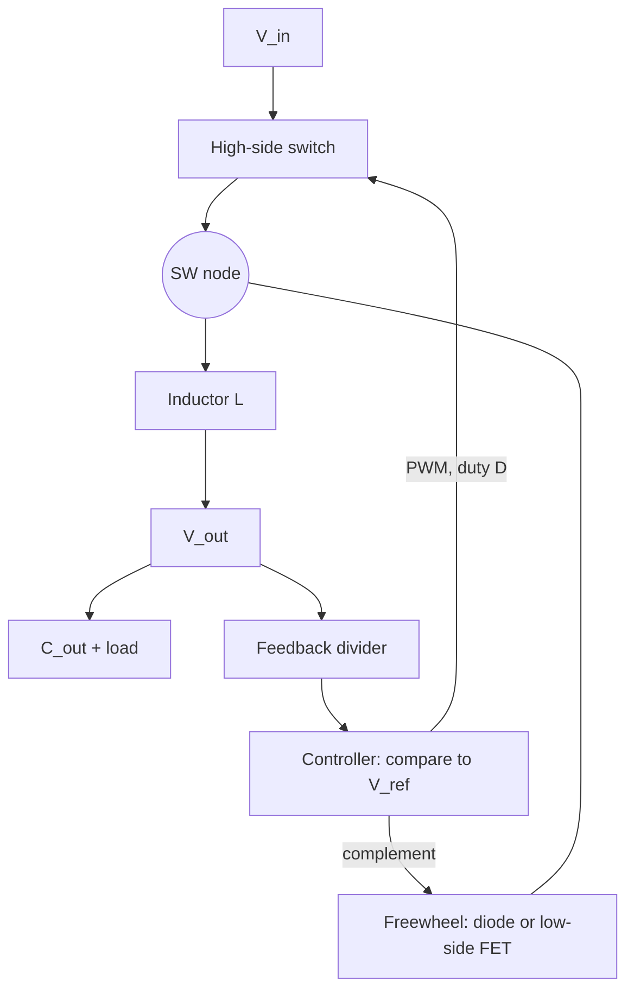

::: basics
### In plain words
A buck converter makes a lower DC voltage from a higher one, and wastes very little energy doing it. A transistor switch turns the input on and off very fast. An inductor and a capacitor then smooth those pulses into a steady, lower voltage. A controller sets how long the switch stays on to get the output it wants.

### Picture it
Imagine filling a bathtub by flicking the tap on and off many times a second. If the tap is on one quarter of the time, the tub fills as if the tap ran at one quarter strength. The tub's water level barely wobbles because the tub is big. The inductor adds something the tub does not show: it acts like a heavy flywheel that keeps the current going while the tap is off.

### Words you need
- **Switch**: a transistor that is either fully on or fully off, so it wastes little power.
- **Duty cycle ($D$)**: the fraction of each cycle that the switch is on ([[q0179]]).
- **Inductor**: a coil that resists sudden changes in current ([[q0041]]).
- **Capacitor**: a part that stores charge and holds the voltage steady.
- **Efficiency**: output power divided by input power.

### The simplest example
Feed the buck 12 V and keep the switch on for one quarter of each cycle. The point after the switch is 12 V for a quarter of the time and 0 V for the rest. Its average is $0.25 \times 12 = 3$ V, and the inductor and capacitor pass that average to the output. So the output is about 3 V. That is the whole idea. The rest of this page shows why this is far more efficient than a resistor or linear regulator, how the controller holds the output steady, and what a buck cannot do.
:::

::: testing
Whether you can explain a switching regulator in plain terms **without just saying "it steps voltage down"**. The interviewer wants to hear three things:

1. The *idea*: chop the input with a switch, then average it with an inductor-capacitor filter, so the output is roughly $D\cdot V_{in}$.
2. *Why* anyone bothers: a buck is efficient because the parts doing the work (a switch and an inductor) dissipate almost nothing, unlike a resistor, divider or linear regulator that burns the voltage difference as heat.
3. That you know the boundaries: it only steps **down**, it is not isolated, and it creates switching noise and ripple that a linear regulator does not.
:::

::: why
Almost every board has a buck converter on it somewhere. Batteries and 12 V, 24 V or USB rails get turned into 5 V, 3.3 V, 1.8 V and sub-1 V rails for processors and FPGAs, and doing that with heat-producing linear regulators would cook the board or kill the battery life. A whole section of the interview list (Q173 to Q269) is about buck converters, so this question is the entry point. A candidate who can say *why* it is efficient, and write $V_{out} = D\,V_{in}$ with the right caveats, sets the tone for everything that follows. See [[q0157]] for buck vs LDO and [[q0148]] for why a divider cannot do this job.
:::

::: concepts
- **Switching and averaging**: a switch toggling between $V_{in}$ and 0 produces a pulse train whose *average* is $D\,V_{in}$. A low-pass filter keeps the average. See [[q0145]] for PWM.
- **Inductor continuity** ($v = L\,di/dt$): the inductor current cannot jump, so it ramps up while the switch is on and ramps down while it is off. See [[q0041]] and [[q0043]].
- **Capacitor as the output reservoir**: it holds $V_{out}$ nearly constant while the inductor current wiggles.
- **Energy conservation / efficiency**: $P_{in} = P_{out}/\eta$. A lossless buck behaves like a "DC transformer" with ratio $D$. See [[q0006]] and [[q0155]].
- **Duty cycle**: the fraction of each period the switch is on. See [[q0179]].
- **Freewheel path**: a diode or second FET gives the inductor current somewhere to go when the high-side switch opens.
:::

::: answer
"A buck converter is a switching DC-DC regulator that steps a higher input voltage down to a lower, regulated output voltage, and it does it efficiently. The trick is that it never drops the extra voltage across a resistive element. Instead a transistor switch chops the input on and off, say 500 thousand times a second, and an inductor and a capacitor average that chopped waveform.

If the switch is on a fraction $D$ of each period, the average voltage at the switch node is $D\cdot V_{in}$, and the LC filter passes that average to the output. So $V_{out} \approx D\,V_{in}$. A controller watches the output through a feedback divider and adjusts the duty cycle to hold the target voltage as the load and input change.

The reason it's efficient is that the switch is either fully on, with almost no voltage across it, or fully off, with no current through it, so it dissipates very little. The inductor and capacitor are close to lossless, too. For something like 12 V to 3.3 V at 2 A, a buck might hit 90 percent plus, where a linear regulator would be at 27.5 percent and burn 17 watts as heat.

The limits are that it only steps down, it's not isolated, and it generates switching ripple and EMI, so layout and filtering matter."
:::

::: technical
**Topology.** A switch (high-side FET) connects the input to a *switch node* SW. A second element, a diode (asynchronous) or low-side FET (synchronous), connects SW to ground. An inductor $L$ connects SW to the output, and capacitor $C_{out}$ sits across the load.

**Operation in continuous conduction mode (CCM).**
- On-state (time $DT$): SW $\approx V_{in}$, so the inductor sees $V_{in}-V_{out}$ and $i_L$ ramps up at $(V_{in}-V_{out})/L$.
- Off-state (time $(1-D)T$): SW $\approx 0$, the inductor sees $-V_{out}$, and $i_L$ ramps down at $V_{out}/L$.

**Steady-state (volt-second balance).** The average inductor voltage over a period must be zero:
$$(V_{in}-V_{out})\,DT = V_{out}\,(1-D)\,T \;\Rightarrow\; V_{out} = D\,V_{in}$$

**Input/output currents.** Power balance for a lossless converter gives $V_{in}I_{in} = V_{out}I_{out}$, so $I_{in,avg} = D\,I_{out}$. The converter is a DC transformer with turns ratio $D$. The input current is a chopped waveform, which is why a buck needs a good input capacitor.

**Ripple (CCM).**
$$\Delta I_L = \frac{(V_{in}-V_{out})\,D}{L\,f_{sw}},\qquad \Delta V_{out} \approx \frac{\Delta I_L}{8\,f_{sw}C_{out}}\ (\text{capacitive part only})$$

**Example.** $V_{in}=12$ V, $V_{out}=3.3$ V, $I_{out}=2$ A, $f_{sw}=500$ kHz, $L=4.7$ µH: $D = 0.275$, $t_{on}=550$ ns, $\Delta I_L \approx 1.02$ A (peak-to-peak), $I_{in,avg}=0.55$ A.

**Limits.** $V_{out}\le V_{in}$. No galvanic isolation. In practice $D$ is bounded by the minimum on-time and minimum off-time of the controller and FETs. Light loads can push the converter into discontinuous mode or pulse skipping ([[q0229]]).
:::

::: short
"A buck converter is an efficient switching regulator that steps a voltage down. A transistor chops the input on and off at a fixed frequency, and an inductor and capacitor average it, so the output is the input times the duty cycle. A feedback loop adjusts the duty cycle to hold the output constant. It's efficient because the switch is either fully on or fully off, so almost no power is lost, unlike a linear regulator that burns the voltage difference as heat. Its limits are that it only steps down and it creates switching ripple and noise."
:::

::: long
"A buck converter is a step-down DC-DC switching regulator. Say I have 12 volts and I need 3.3 volts at 2 amps. A resistor or divider can't do it because the load current changes. An LDO would work, but it drops the 8.7 volt difference across a pass transistor at 2 amps, so it burns 17.4 watts to deliver 6.6, which is 27.5 percent efficiency. A buck gets the same job done at roughly 90 percent.

Here's the structure. There's a high-side switch from the input to a switch node, a freewheel path from that node to ground, which is a diode or a second FET, then an inductor from the switch node to the output, and a capacitor across the load. The controller turns the high-side switch on for a fraction $D$ of each cycle.

When the switch is on, the inductor sees $V_{in}-V_{out}$ across it and its current ramps up, storing energy and feeding the load. When it turns off, the inductor current can't change instantly, so the switch node swings down, the freewheel path conducts, and the inductor current ramps down, still feeding the load. The capacitor smooths the ripple.

In steady state the inductor's average voltage has to be zero, so $(V_{in}-V_{out})D = V_{out}(1-D)$, which gives $V_{out}=D\,V_{in}$. Here $D$ is 27.5 percent. A feedback divider and an error amplifier trim $D$ to hold the output as load and input move around.

The efficiency comes from the switch being fully on or fully off, so it has either almost no voltage or no current. The remaining losses are conduction, switching, inductor and gate-drive losses.

The trade-offs are that it only steps down, there's no isolation, and it produces ripple and EMI, so layout, filtering and component choice matter."
:::

::: terms
- **Step-down (buck) converter**: a DC-DC converter whose output is lower than its input, $V_{out} = D\,V_{in}$ in the ideal case.
- **Switch node (SW)**: the pulsed node between the switches and the inductor. It swings between about $V_{in}$ and 0.
- **Duty cycle ($D$)**: the fraction of the switching period the high-side switch is on, $D = t_{on}/T$.
- **Switching frequency ($f_{sw}$)**: how many on/off cycles per second, typically hundreds of kHz to a few MHz.
- **Freewheel path / catch diode**: the diode or low-side FET that carries inductor current when the high-side switch is off.
- **CCM / DCM**: continuous or discontinuous conduction mode, depending on whether inductor current stays above zero for the whole period.
- **Ripple**: the small AC component riding on the inductor current and the output voltage.
- **Efficiency ($\eta$)**: $P_{out}/P_{in}$.
- **Volt-second balance**: in steady state the average voltage across an inductor is zero.
:::

::: exceptional
**An average answer** says "it steps voltage down using a switch, inductor and capacitor" and gives $V_{out}=DV_{in}$.

**An exceptional answer**:
- Frames it as *chop then average*, and explains why that beats dissipating the difference (the LDO number: 17.4 W lost for 6.6 W delivered).
- Explains *why the switch is efficient*: $V\approx 0$ when on, $I=0$ when off.
- Derives $D$ from volt-second balance in one line, and states the "DC transformer" result $I_{in}=D\,I_{out}$.
- Mentions the feedback loop adjusting $D$, since the output is *regulated*, not just scaled.
- Volunteers the costs: ripple, EMI, pulsed input current, component count, and that it only steps down.
- Gives a concrete example with numbers (12 V to 3.3 V, 2 A, 500 kHz).
:::

::: mistakes
- **"It works like a voltage divider."** A divider wastes the difference and collapses under load. A buck delivers the current efficiently; it is a switching *power* converter.
- **Saying the inductor "drops" the voltage.** In steady state the inductor has zero average voltage. The *switching* does the stepping; the inductor stores and releases energy so the average carries through.
- **Believing the switch dissipates $V\times I$ all the time.** In an ideal switch, either V or I is zero. Real losses come from $R_{DS(on)}$ and the short transitions.
- **Claiming $V_{out} = D\,V_{in}$ always holds.** It holds in CCM. In DCM, at light load, the output is higher for the same $D$ ([[q0183]]).
- **Forgetting the input side.** The buck's input current is pulsed, so it needs a decent input capacitor close to the switches.
- **Saying buck converters are always better than LDOs.** For tiny dropout or very light load, or when you need ultra-low noise, an LDO can win ([[q0158]]).
:::

::: deep
## The problem: dropping 8.7 V at 2 A without making a space heater

You have 12 V and a load that wants 3.3 V at 2 A (6.6 W). What are the options?

- **Resistor in series**: the voltage on the load depends on its current, so it isn't a regulator at all.
- **Voltage divider**: a divider has a Thevenin resistance, so the output sags with load ([[q0148]]).
- **Linear regulator (LDO)**: it holds 3.3 V by acting as a variable resistor in series with the load. All 2 A flows through it with $12-3.3 = 8.7$ V across it, so it dissipates $8.7\times2 = 17.4$ W. Efficiency is $V_{out}/V_{in} = 27.5\%$. See [[q0157]].

The linear regulator's flaw is that it *dissipates* the excess voltage. The buck's idea is to **never put the excess voltage across something that carries current continuously**.

## Idea: chop it, then average it

Take a switch that connects the load to 12 V for a fraction $D$ of each period and to 0 V for the rest. The load sees a rectangular pulse train. Its average is $D\cdot 12$ V. If $D = 0.275$, the average is 3.3 V.

```circuit
{"caption":"A switch alone creates the right average, but the load sees a pulse train","elements":[
 {"t":"V","a":[0,1],"b":[0,5],"label":"V_{in}"},
 {"t":"wire","pts":[[0,1],[0,0],[3,0]]},
 {"t":"SW","a":[3,0],"b":[8,0],"label":"S"},
 {"t":"wire","pts":[[8,0],[11,0],[11,1]]},
 {"t":"R","a":[11,1],"b":[11,5],"label":"R_{load}"},
 {"t":"wire","pts":[[0,5],[0,6],[11,6],[11,5]]},{"t":"gnd","at":[5.5,6]},
 {"t":"text","at":[5.5,-2.4],"text":"switching at 500 kHz","muted":true,"anchor":"middle"}
]}
```
Figure: With just a switch, the average voltage is right but the load sees full-amplitude pulses (0 or 12 V). Real loads (a processor, a sensor) need a smooth DC voltage. We need to remove the pulsing without wasting power.

Two problems remain. The pulses need smoothing, and when the switch opens an inductive or any real load wiring would see a current interruption. The fix is an **LC low-pass filter** plus a path for the current when the switch is off.

## Adding the LC filter and the freewheel path

An inductor in series with the output resists changes in current, and a capacitor across the load resists changes in voltage. Together they form a second-order low-pass filter with cutoff

$$f_0 = \frac{1}{2\pi\sqrt{LC}}$$

For $L=4.7$ µH and $C=22$ µF, $f_0 \approx 15.7$ kHz, much lower than the 500 kHz switching frequency, so the filter passes the DC average and attenuates the switching component (about $(f_0/f_{sw})^2$, roughly $-60$ dB at the fundamental). The ripple is whatever is left.

But there's a catch. When the switch opens, the inductor current can't stop. If nothing gives it a path, the inductor drives the switch node to a large negative voltage until something conducts (that's the **inductive kick**, [[q0144]]). The solution is a **freewheel path** from ground to the switch node: a diode (asynchronous buck) or a second FET (synchronous buck). It conducts only while the high-side switch is off, so the inductor current keeps flowing in the same direction.


Figure: The power path (switch, switch node, inductor, output capacitor) plus the control path (feedback, reference compare, PWM). Q175 draws the complete schematic.

## The ideal transfer function

In steady state the inductor current at the start of a period equals the current at the end, so the **average inductor voltage is zero** (volt-second balance, derived properly in [[q0174]]):

$$(V_{in}-V_{out})\,D\,T = V_{out}\,(1-D)\,T \;\Rightarrow\; \boxed{V_{out}=D\,V_{in}}$$

Because the converter is lossless in the ideal case, power in equals power out:
$$V_{in}\,I_{in,avg} = V_{out}\,I_{out}\;\Rightarrow\; I_{in,avg} = D\,I_{out}$$

For our 12 V to 3.3 V, 2 A example: $D = 3.3/12 = 0.275$, $I_{in,avg} = 0.55$ A. The input draws **0.55 A average**, not 2 A, so the 12 V supply sees one quarter of the current, the opposite of the LDO, which draws 2 A from the input. That's the "DC transformer" behaviour: a buck trades voltage for current like a transformer with ratio $D$, without any iron.

## Why it is efficient

The key is what each part dissipates:

| Element | Power dissipated (ideal) | Real-world loss |
|---|---|---|
| High-side switch | $V\!\cdot\!I = 0$ (V≈0 when on, I=0 when off) | $I^2 R_{DS(on)}$ + brief overlap during transitions |
| Freewheel diode/FET | same logic | diode: $V_f\!\cdot\!I$, FET: $I^2 R_{DS(on)}$ |
| Inductor | stores and returns energy | winding resistance (DCR/ACR) and core loss |
| Capacitor | stores and returns charge | ESR ripple loss |
| Controller | none | quiescent current, gate drive |

Everything on the list that handles real power is either lossless in principle or only loses through small parasitic resistances. A typical well-designed buck at 2 A reaches roughly 88 to 95 percent.

For 12 V to 3.3 V at 2 A:

| | LDO | Buck (assume 92 %) |
|---|---|---|
| Output power | 6.6 W | 6.6 W |
| Input power | 24 W | 7.17 W |
| Lost as heat | 17.4 W | 0.57 W |
| Input current | 2.0 A | 0.60 A |

> [!UNCERTAIN]
> The 92% buck efficiency is an illustrative, typical value for a good synchronous buck in this operating range, not a specific part's number. Real efficiency depends on the IC, FETs, inductor DCR, switching frequency and load current.

```plot
{"title":"Efficiency of an LDO vs. an assumed 92% buck, 12 V input","x":{"label":"Output voltage V_out","unit":"V","min":0.8,"max":11},"y":{"label":"Efficiency","unit":"%","min":0,"max":100},
 "vars":{"vin":12},
 "series":[{"label":"LDO: V_out / V_in","fn":"100*x/vin","color":"red"},{"label":"Buck (assumed 92%)","fn":"92","color":"green"}],
 "points":[{"x":3.3,"y":27.5,"label":"LDO at 3.3 V: 27.5%"}]}
```
Figure: The LDO's efficiency falls linearly as the gap between input and output grows. The buck's efficiency stays roughly flat (here an assumed 92%) because it doesn't dissipate the voltage difference.

## Experiment with it

```sim
{"id":"buck-lab","vin":12,"vout":3.3,"iout":2,"fsw":500000,"l":4.7e-6,"c":22e-6}
```
Figure: Watch the switch-node waveform and inductor current. Change $V_{out}$ and note that the duty cycle follows $V_{out}/V_{in}$. Then raise the load current and flip between synchronous and diode rectification in the efficiency view to see where the losses go.

## What a buck cannot do

- **Step up.** $D\le 1$ means $V_{out}\le V_{in}$. Boost converters ([[q0270]]) and buck-boost converters do that.
- **Isolate.** Input and output share a ground. Isolated supplies use flyback, forward or LLC topologies.
- **Stay quiet.** The switch node jumps by $V_{in}$ in a few nanoseconds, which radiates EMI. The input current is chopped. Layout (the "hot loop") matters.
- **Respond instantly.** Its dynamics are set by an LC filter with a feedback loop around it ([[q0244]]).

## Where the name comes from

"Buck" is generally explained as short for *bucking* the source, meaning opposing it to reduce the voltage, in contrast with a *boost* that adds to it. It's the same idea as a "bucking transformer."
:::

::: applications
- **Point-of-load (POL) rails**: stepping a 12 V or 5 V board rail down to 3.3 V, 1.8 V, 1.2 V or about 0.9 V for FPGAs, SoCs and DDR memory.
- **Battery-powered devices**: a Li-ion cell at 3.0 to 4.2 V stepped down to 1.8 V or 1.2 V for a microcontroller or sensor, where efficiency directly sets runtime.
- **Automotive and industrial 12/24 V buses** stepped down to 5 V or 3.3 V logic rails (with surge protection ahead).
- **USB-powered products**: the 5 V bus (or higher USB-C voltages) stepped down to local rails.
- **LED drivers**: a buck run as a *constant-current* source, regulating LED current instead of voltage.
- **Pre-regulator in front of an LDO**: a buck drops most of the voltage efficiently and an LDO cleans up the last bit for a quiet analog rail ([[q0169]]).
:::

::: assumptions
- **Ideal components**: lossless switches, inductor and capacitor. Real parasitics shift $V_{out}$ slightly and set the efficiency.
- **CCM** (inductor current never reaches zero). $V_{out}=DV_{in}$ is a CCM result. In DCM the output depends on the load as well ([[q0183]]).
- **Steady state**: the averages are constant from cycle to cycle. Transients are covered in the controls questions ([[q0248]]).
- **Closed loop**: in a real regulator $D$ is not chosen by the designer; the feedback loop sets it to hit $V_{ref}(1+R_1/R_2)$.
- **"Buck converter" means voltage-mode DC-DC step-down.** Current-regulating bucks (LED drivers) use the same power stage with a different feedback quantity.
:::

::: followups
### Why does a buck converter need an inductor? Could you use a resistor and a capacitor to average the pulses?
An RC low-pass would also average the pulses, but the resistor would dissipate power continuously and drop voltage under load, so you'd lose the whole point. An inductor stores energy in its magnetic field when the switch is on and gives it back when the switch is off, with only small winding losses. It's the energy-storage element that lets average power move from the high-voltage side to the low-voltage side without being burned.

### What happens if the load current goes to zero?
In a synchronous buck with forced PWM, the inductor current ripple stays and it swings negative, circulating energy. In a diode-based buck, or a synchronous one with diode emulation, the inductor current hits zero each cycle and the converter enters discontinuous mode, then often pulse skipping, to stay efficient. Either way $V_{out}=DV_{in}$ no longer holds exactly without feedback ([[q0229]]).

### Why can't a buck output more than its input?
The output is the average of a pulse train that never exceeds $V_{in}$ (ideal switches), so the average is at most $V_{in}$ at $D=1$. To exceed $V_{in}$ you need a topology that stores energy in the inductor and adds it on top of the input, i.e. a boost converter.

### Your buck is 90% efficient at 2 A out. What happens to the other 10%?
It becomes heat in the FETs, the inductor, the capacitors and the controller. At 6.6 W out, 90% efficiency means 7.33 W in and 0.73 W of heat. That's modest, but concentrated in a few small parts, so thermal design still matters ([[q0164]]).

### Scenario: your 12 V to 3.3 V buck's efficiency is 70% at 2 A when the datasheet says 92%. Where do you look?
Check the inductor first: wrong DCR or a saturating inductor shows up as extra loss and a hotter coil. Then look at the switch-node waveform with a good probe for ringing or shoot-through, check the actual switching frequency (a very high frequency inflates switching loss), and confirm the output current isn't higher than you think. Measure input and output voltage and current directly and compute where the loss is, instead of guessing.
:::

::: interpretations
"What is a buck converter?" is an open definitional question. Good answers cover: what it does (step down), how (switch + LC filter), why it's efficient, and the basic equation. It's usually the first question of a series ([[q0174]] to [[q0184]]), so don't dive into compensation or layout yet unless asked. "Buck converter" can also refer to a current-regulating buck used as an LED driver; the power stage is identical.
:::

::: references
- Erickson & Maksimović, *Fundamentals of Power Electronics*: the DC-DC converters chapter (buck converter in CCM, inductor volt-second balance and charge balance).
- Mohan, Undeland & Robbins, *Power Electronics: Converters, Applications, and Design*: DC-DC switch-mode converters chapter.
- Texas Instruments application report SLVA477, "Basic Calculation of a Buck Converter's Power Stage".
- Horowitz & Hill, *The Art of Electronics*, 3rd ed.: switching regulators and the inductor-based step-down converter.
:::

::: rubric
- Says a buck is a switching DC-DC converter that steps the voltage down efficiently :: This is the basic definition; leaving out "efficiently" misses the reason it exists.
- Explains the chop-then-average mechanism with a switch and an LC filter :: Shows you understand how it works rather than reciting a name.
- Gives $V_{out}=D\,V_{in}$ and says what $D$ is :: The key equation; the interviewer expects it immediately.
- Explains why it's efficient (switch is fully on or off; inductor and capacitor are nearly lossless) vs. an LDO's dissipation :: This is the real engineering insight.
- Mentions the feedback loop that adjusts the duty cycle to regulate $V_{out}$ :: A regulator holds its output; $V_{out}=DV_{in}$ alone is just a scaler.
- Names the limits: step-down only, no isolation, ripple and EMI :: Shows judgment about when a buck is the right tool.
- Uses a numeric example (e.g., 12 V to 3.3 V, 27.5% duty) :: Numbers make the explanation checkable and memorable.
:::

::: quiz
```json
[
 {"type":"numeric","level":"fundamental","q":"An ideal buck converter steps 5 V down to 1.8 V in CCM. What is the duty cycle, in percent?","answer":36,"tolerance":0.02,"unit":"%","explain":"$D = V_{out}/V_{in} = 1.8/5 = 0.36$, which is 36%."},
 {"type":"mcq","level":"fundamental","q":"Why is a buck converter much more efficient than a linear regulator for a large $V_{in}-V_{out}$?","options":["It uses a larger pass transistor","It does not dissipate the voltage difference; its switch is either fully on (no voltage) or fully off (no current)","It runs the output at a lower current than the load needs","It uses a resistor with a very low value"],"answer":1,"explain":"A linear regulator drops $V_{in}-V_{out}$ at the full load current, so its loss is $(V_{in}-V_{out})I_{out}$. A buck's switch has about zero voltage when on and zero current when off, and the L and C are nearly lossless."},
 {"type":"numeric","level":"intermediate","q":"An LDO regulates 12 V down to 5 V at 1 A. How much power does it dissipate, in watts?","answer":7,"tolerance":0.02,"unit":"W","explain":"$P = (V_{in}-V_{out})\\,I = (12-5)\\times1 = 7$ W. Efficiency is only $5/12 \\approx 42\\%$."},
 {"type":"numeric","level":"intermediate","q":"A lossless buck converts 24 V to 6 V and delivers 3 A to the load. What is the average input current, in amps?","answer":0.75,"tolerance":0.02,"unit":"A","explain":"$D = 6/24 = 0.25$, and $I_{in} = D\\,I_{out} = 0.25\\times3 = 0.75$ A. Check with power: $6\\times3 = 18$ W $= 24\\times0.75$ W."},
 {"type":"truefalse","level":"fundamental","q":"A standard buck converter can produce an output voltage higher than its input voltage.","answer":false,"explain":"The output is the average of a pulse train whose peak is $V_{in}$, so $V_{out} = D\\,V_{in} \\le V_{in}$. Stepping up needs a boost or buck-boost topology."},
 {"type":"mcq","level":"advanced","q":"In steady-state CCM, the average voltage across the buck's inductor is zero. Which statement follows?","options":["$V_{out} = V_{in}/D$","$(V_{in}-V_{out})D = V_{out}(1-D)$, so $V_{out}=D\\,V_{in}$","$V_{out}$ equals $V_{in}$ at any duty cycle","The inductor current must be constant with no ripple"],"answer":1,"explain":"The inductor sees $V_{in}-V_{out}$ for $DT$ and $-V_{out}$ for $(1-D)T$. Setting the volt-seconds to balance gives $V_{out}=DV_{in}$. The current still ripples; it is the *average voltage* that is zero."}
]
```
:::
