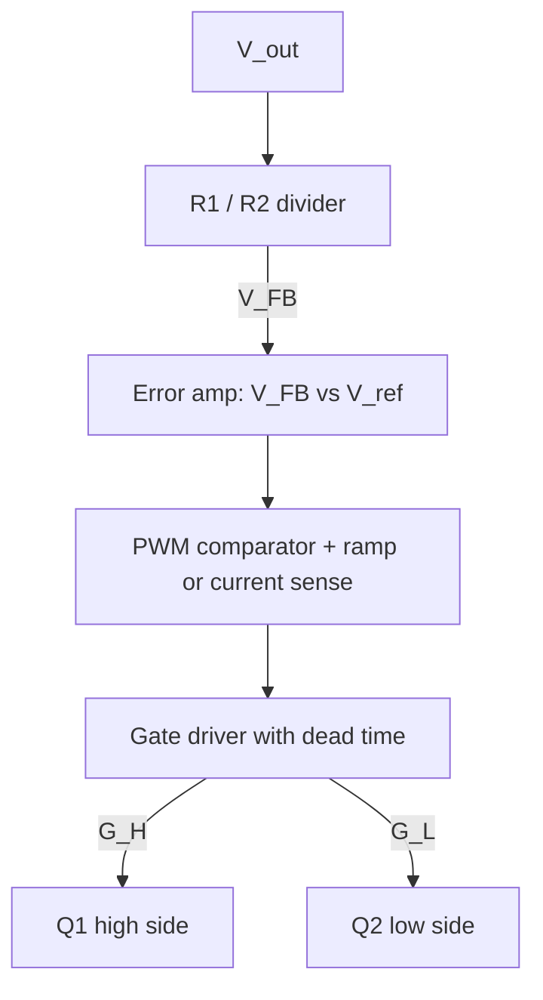

::: testing
Whether you can put a correct buck power stage on a whiteboard **from memory, in the right order, with every part justified**. The interviewer is checking:

1. The topology is right: switch from the input to a switch node, freewheel element from the switch node to ground, inductor *in series* with the output, capacitor across the load.
2. You know *why* each part exists, not just where it goes (see [[q0173]] and [[q0174]]).
3. You can upgrade the sketch when asked: replace the diode with a synchronous low-side FET, add the input capacitor, the feedback divider, and a controller or gate driver.
4. You label the switch node and get orientations right: diode cathode to the switch node, current direction in the inductor, and the ground reference.
:::

::: why
"Draw a buck" is the buck-converter equivalent of "draw a voltage divider" ([[q0008]]). It is the first thing an interviewer asks on any power-electronics loop because it exposes right away whether you can reason about the circuit or are reciting a name. A common failure is putting the inductor in the wrong place, flipping the diode, or drawing a buck with no input capacitor. Being able to draw both the asynchronous and synchronous versions, then talk through the on-state and off-state current paths on your own drawing, usually carries the next five minutes of the interview.
:::

::: concepts
- **High-side switch**: connects $V_{in}$ to the switch node when on. In a drawing it is an NMOS (or PMOS) between the input rail and SW. See [[q0204]].
- **Freewheel element**: a diode (asynchronous) or low-side FET (synchronous) from ground to SW. It gives the inductor current a path when the high-side switch is off. See [[q0202]] and [[q0203]].
- **Series inductor**: from SW to the output node. It sets the current ramps and averages the pulse train. See [[q0041]].
- **Output capacitor and load**: $C_{out}$ in parallel with the load smooths the voltage.
- **Input capacitor**: supplies the pulsed input current locally so the source doesn't see it.
- **Feedback and control**: a divider from $V_{out}$ to the controller, which drives the gates ([[q0223]]).
:::

::: answer
"Sure. I'd start with the input source, $V_{in}$, and put a capacitor across it, since the buck draws pulsed current. From the top of the input rail I draw the high-side switch, an NMOS with its drain on $V_{in}$ and its source on the switch node, which I'll label SW.

From SW I draw a diode to ground, with the cathode at SW and the anode on ground, so it conducts when the switch node tries to go negative. Then from SW I draw the inductor going right to the output node. From the output node I put the output capacitor to ground and the load in parallel with it.

For the control side I add a resistor divider from $V_{out}$ to the feedback pin of a controller, and the controller drives the gate of the high-side FET with a PWM signal.

Then I'd say that the diode is the simplest version, and that a modern one replaces it with a low-side NFET driven complementary to the high-side, which is a synchronous buck, so it doesn't waste $V_f \times I$ in the diode. And I'd talk through the paths. When the high-side is on, current goes input, FET, inductor, load. When it's off, the inductor current continues through the diode or low-side FET, back through the load."
:::

::: technical
**Asynchronous buck (diode).**
- $V_{in}$ and $C_{in}$ between the input rail and ground.
- High-side switch $Q_1$: drain to $V_{in}$, source to SW.
- Diode $D_1$: anode to ground, cathode to SW (reverse-biased while $Q_1$ is on, forward-biased when SW swings below ground by $V_f$).
- Inductor $L$: SW to $V_{out}$.
- $C_{out}$ and the load from $V_{out}$ to ground.

**Synchronous buck.** Replace $D_1$ with a low-side NFET $Q_2$: drain at SW, source at ground. $Q_1$ and $Q_2$ are driven complementary with a short **dead time** so they are never on simultaneously (shoot-through, [[q0207]]). The body diode of $Q_2$ carries current during the dead time.

**Control path.** $V_{out} \to R_1/R_2$ divider $\to$ feedback pin ($V_{FB}=V_{ref}$ at regulation) $\to$ error amp and PWM comparator $\to$ gate driver. Output voltage: $V_{out}=V_{ref}(1+R_1/R_2)$.

**Current directions.** Inductor current flows from SW toward the output in both states. On-state: $V_{in}\to Q_1\to L\to$ load. Off-state: ground $\to D_1$ (or $Q_2$) $\to L\to$ load.

**Key voltages.** SW toggles between about $V_{in}$ and about $0$ (or $-V_f$ for a diode). Voltage across $L$: $V_{in}-V_{out}$ in the on-state and $-V_{out}$ in the off-state.

**Sanity example for the drawing.** $V_{in}=12$ V, $V_{out}=3.3$ V, $I_{out}=2$ A, $f_{sw}=500$ kHz: $D=0.275$, $L=4.7$ µH, $C_{out}=22$ µF gives $\Delta I_L\approx1.02$ A and a capacitive output ripple near 12 mV. You can quote these on the diagram if asked for typical values.
:::

::: short
"I'd draw the input source with a capacitor across it, then a high-side NFET from the input rail to a switch node. From the switch node, a diode down to ground with the cathode at the node, and an inductor going right to the output. At the output, a capacitor to ground in parallel with the load. A feedback divider goes back to the controller, which drives the FET gate with PWM. For a synchronous buck I replace the diode with a low-side NFET driven complementary to the top one."
:::

::: long
"I'll start from the left. There's the input source with a capacitor across it, because the buck pulls current in chunks and that capacitor supplies them locally. From the top of the rail I draw the high-side switch. I'd draw it as an NMOS with the drain on the input and the source on the switch node, and I'd label that node SW.

Then from SW I put in the freewheel element. Simple version: a diode, anode at ground and cathode at SW. When the switch turns off, the inductor wants to keep its current going, SW swings down, and the diode conducts. Then from SW the inductor goes to the output node. From there I draw the output capacitor to ground and the load in parallel.

To make it a regulator I add the feedback: a divider from $V_{out}$ to ground, the midpoint going to a controller's feedback pin. The controller compares it against a reference, makes a PWM signal and drives the high-side gate, with a driver that might use a bootstrap capacitor, since an NFET on top needs a gate voltage above the input.

Then I'd show the synchronous version: swap the diode for an NFET with drain at SW and source at ground, driven in opposite phase from the top FET, with dead time between them. That removes the diode's roughly 0.5 V drop times the current, which matters at low output voltages. The trade-off is you need a second gate drive and must avoid shoot-through.

And I'd close by tracing the current: in the on-state, input through the high-side FET and inductor to the load; in the off-state, ground through the diode or low-side FET and the inductor to the load. The inductor current always flows left to right."
:::

::: terms
- **Switch node (SW)**: the junction of the high-side switch, the freewheel element and the inductor. It is the noisiest node on the board.
- **High-side switch**: the transistor between $V_{in}$ and SW.
- **Low-side switch / freewheel diode**: the element between SW and ground that carries the inductor current when the high-side switch is off.
- **Asynchronous buck**: uses a diode as the freewheel element.
- **Synchronous buck**: uses a second FET, driven complementary, instead of the diode.
- **Dead time**: the short gap in which both FETs are off, preventing shoot-through.
- **Bootstrap capacitor**: a capacitor charged when SW is low, used to raise the high-side gate drive above $V_{in}$.
- **Feedback divider**: $R_1/R_2$ network that scales $V_{out}$ down to the reference voltage $V_{ref}$.
- **Hot loop**: the loop of $C_{in}$, high-side FET and low-side FET/diode, carrying fast, high-current edges. Keep it small.
:::

::: exceptional
**An average answer** draws switch, diode, inductor and capacitor in roughly the right places.

**An exceptional answer**:
- Draws a clean, labelled schematic: ground reference, labelled SW node, diode orientation correct, and $C_{in}$ included.
- Narrates the on-state and off-state current paths *on the drawing*, with arrows.
- Upgrades unprompted to the synchronous version and says why (diode drop loss, efficiency at low $V_{out}$), including dead time and shoot-through.
- Adds the control path: feedback divider, reference, PWM and gate driver, and mentions the bootstrap supply for a high-side NFET.
- Mentions layout in one sentence: the $C_{in}$, high-side and low-side loop must be tiny because that is where the fast edges live.
:::

::: mistakes
- **Putting the inductor in the wrong place.** The inductor is *in series* between SW and the output, not across the load or in the input line.
- **Flipping the diode.** The anode goes to ground and the cathode to SW. A diode with its cathode to ground would short the input through $Q_1$ when it turns on.
- **Omitting the input capacitor.** Without it the source (or the supply's wiring inductance) has to supply fast current pulses, causing droop and ringing.
- **Drawing the output capacitor in series** or forgetting the ground return of the load.
- **Drawing a PMOS high-side switch with an NMOS gate polarity** (or the opposite) without noting the drive requirements ([[q0204]]). A high-side NFET needs a gate voltage above $V_{in}$, which is why bootstrap or charge-pump drive exists.
- **Calling it "a diode, an inductor and a capacitor"** with no switch, or drawing the switch in series with the load *after* the inductor.
:::

::: deep
## Build it one part at a time

A good way to draw a buck from memory is to build it in the order the energy flows.

**Step 1: the source and the switch.** Draw $V_{in}$ and a switch from its positive terminal. Call the other side of the switch SW.

**Step 2: the freewheel path.** The inductor current must never be interrupted, so give SW a path to ground that opens when the switch closes and closes when the switch opens. The simplest option is a diode with the cathode at SW.

**Step 3: the inductor.** From SW to the output node. Because the inductor is in series with the load path in both states, the load current never sees an interruption.

**Step 4: the output capacitor and load.** $C_{out}$ from the output node to ground. The load goes in parallel.

**Step 5: the input capacitor.** $C_{in}$ across the input, as close as possible to the switch and diode/low-side FET.

**Step 6: the control.** A feedback divider and a controller driving the gate.

## The asynchronous buck

```circuit
{"caption":"Asynchronous (diode) buck converter power stage","elements":[
 {"t":"V","a":[0,2],"b":[0,10],"label":"V_{in}"},
 {"t":"wire","pts":[[0,2],[11,2]]},
 {"t":"C","a":[5,2],"b":[5,14],"label":"C_{in}"},
 {"t":"dot","at":[5,2]},{"t":"dot","at":[5,14]},
 {"t":"wire","pts":[[0,10],[0,14],[28,14]]},
 {"t":"nmos","at":[9,4],"label":"Q_1"},
 {"t":"wire","pts":[[7,4],[9,4]]},
 {"t":"term","at":[7,4],"label":"G_H","side":"left"},
 {"t":"wire","pts":[[11,6],[11,8],[14,8]]},{"t":"dot","at":[11,8]},
 {"t":"D","a":[11,14],"b":[11,8],"label":"D_1"},
 {"t":"dot","at":[11,14]},
 {"t":"text","at":[10.4,7.2],"text":"SW","anchor":"end","color":"accent"},
 {"t":"L","a":[14,8],"b":[20,8],"label":"L"},
 {"t":"wire","pts":[[20,8],[28,8]]},
 {"t":"C","a":[24,8],"b":[24,14],"label":"C_{out}"},
 {"t":"dot","at":[24,8]},{"t":"dot","at":[24,14]},
 {"t":"R","a":[28,8],"b":[28,14],"label":"Load"},
 {"t":"arrow","a":[15,6.4],"b":[19,6.4],"label":"I_L"},
 {"t":"text","at":[24,6.8],"text":"V_{out}","color":"accent","anchor":"middle"},
 {"t":"gnd","at":[14,14]}
]}
```
Figure: Read the schematic left to right. $Q_1$ connects $V_{in}$ to the switch node SW; the diode's cathode sits on SW so it is reverse-biased while $Q_1$ conducts; the inductor carries current left to right in both states; $C_{in}$ sits right at the switch.

## The synchronous buck

```circuit
{"caption":"Synchronous buck converter power stage: the diode is replaced by a low-side NFET","elements":[
 {"t":"V","a":[0,2],"b":[0,10],"label":"V_{in}"},
 {"t":"wire","pts":[[0,2],[11,2]]},
 {"t":"C","a":[5,2],"b":[5,14],"label":"C_{in}"},
 {"t":"dot","at":[5,2]},{"t":"dot","at":[5,14]},
 {"t":"wire","pts":[[0,10],[0,14],[28,14]]},
 {"t":"nmos","at":[9,4],"label":"Q_1","bodyDiode":true},
 {"t":"wire","pts":[[7,4],[9,4]]},
 {"t":"term","at":[7,4],"label":"G_H","side":"left"},
 {"t":"nmos","at":[9,10],"label":"Q_2","bodyDiode":true},
 {"t":"wire","pts":[[7,10],[9,10]]},
 {"t":"term","at":[7,10],"label":"G_L","side":"left"},
 {"t":"wire","pts":[[11,6],[11,8],[14,8]]},{"t":"dot","at":[11,8]},
 {"t":"wire","pts":[[11,12],[11,14]]},{"t":"dot","at":[11,14]},
 {"t":"text","at":[12.3,6.6],"text":"SW","anchor":"start","color":"accent"},
 {"t":"L","a":[14,8],"b":[20,8],"label":"L"},
 {"t":"wire","pts":[[20,8],[28,8]]},
 {"t":"C","a":[24,8],"b":[24,14],"label":"C_{out}"},
 {"t":"dot","at":[24,8]},{"t":"dot","at":[24,14]},
 {"t":"R","a":[28,8],"b":[28,14],"label":"Load"},
 {"t":"arrow","a":[15,6.4],"b":[19,6.4],"label":"I_L"},
 {"t":"text","at":[24,6.8],"text":"V_{out}","color":"accent","anchor":"middle"},
 {"t":"gnd","at":[14,14]}
]}
```
Figure: The low-side NFET $Q_2$ has its drain on SW and source on ground. Its gate $G_L$ is driven complementary to $G_H$, with dead time. During dead time the body diodes carry the inductor current.

## Adding the control path

A regulator needs more than a power stage. The control system is:


Figure: The feedback loop closes from the output back to the gates. The divider sets $V_{out}=V_{ref}(1+R_1/R_2)$. For example $V_{ref}=0.8$ V and $V_{out}=3.3$ V needs $R_1/R_2=3.125$, e.g. 31.25 kΩ over 10 kΩ (31.6 kΩ in practice).

A quick check of that number: $3.3/0.8 - 1 = 3.125$, so with $R_2=10$ kΩ, $R_1=31.25$ kΩ, and the nearest 1% value is 31.6 kΩ, giving $V_{out}=0.8(1+3.16)=3.328$ V. See [[q0223]] for how the divider is sized.

## Why each component is where it is

| Part | Position | What would go wrong if it were missing or misplaced |
|---|---|---|
| $Q_1$ | $V_{in}\to$ SW | No way to chop the input |
| $D_1$ / $Q_2$ | SW $\to$ GND | Inductor current has no path when $Q_1$ opens: SW spikes negative until something breaks down ([[q0202]]) |
| $L$ | SW $\to V_{out}$, in series | No energy storage or current continuity; the output would be a pulse train |
| $C_{out}$ | $V_{out}\to$ GND | Large output ripple; the load sees the inductor ripple current directly |
| $C_{in}$ | $V_{in}\to$ GND, at the switches | Input droop, ringing and EMI from pulsed current |
| Divider | $V_{out}\to$ FB | No regulation: $D$ would be fixed |

## The three loops you should point at

On a good drawing, trace three current loops:

1. **On-state loop**: $V_{in}\to Q_1\to L\to$ load/$C_{out}\to$ GND $\to V_{in}$.
2. **Off-state loop**: GND $\to D_1$ (or $Q_2$) $\to L\to$ load/$C_{out}\to$ GND.
3. **Hot loop**: $C_{in}\to Q_1\to$ SW $\to D_1$/$Q_2\to C_{in}$. It carries the *pulsed* current with fast edges and no inductor to slow it, so it is the one to make small on the PCB (layout is in the PCB section of this list).

> [!INTERVIEW]
> When you finish drawing, say "the switch node and the input-capacitor loop are the noisy part, so I'd keep them tight in layout." It takes five seconds and shows you've built one.

## Diode vs synchronous: the one-line comparison

At 2 A with a 0.5 V Schottky drop, the diode burns $0.5\times2\times(1-D)=0.725$ W at $D=0.275$. A synchronous FET with $R_{DS(on)}=10$ mΩ burns $I^2R\,(1-D)= 4\times0.01\times0.725 = 0.029$ W. That is 25 times less. The synchronous version costs a second FET and a driver, plus the dead-time design. See [[q0203]].

## Experiment with it

```sim
{"id":"buck-lab","vin":12,"vout":3.3,"iout":2,"sync":false}
```
Figure: Start with the diode (asynchronous) version and look at the diode current and the efficiency breakdown. Then set `sync` on in the simulation and compare the loss split.
:::

::: applications
- **Textbook and datasheet reference designs**: nearly every buck IC datasheet shows this schematic with the FETs integrated and an external inductor, $C_{in}$, $C_{out}$ and a feedback divider.
- **Classic asynchronous parts** such as the LM2596 family keep the freewheel diode external and are still widely used in hobby modules.
- **Modern synchronous point-of-load regulators** integrate both FETs and the gate drive. The designer supplies $L$, caps and the divider.
- **Controller-plus-external-FET designs** for high current (tens of amps) where the FETs, inductor and heat sinking are chosen separately.
- **Whiteboard exercises** that ask you to modify the drawing into a boost or buck-boost by moving the switch, inductor and diode.
:::

::: assumptions
- **The drawing is the power stage plus a minimal control path.** In a real design you'd also add an enable pin, soft start, compensation network, bootstrap capacitor, current sense and UVLO.
- **An NMOS high-side switch with a bootstrap supply** is the usual drawing. A PMOS high-side is simpler to drive but has higher $R_{DS(on)}$ per area ([[q0204]]).
- **Single-phase, single-output, non-isolated.** Multiphase and SIMO versions are variations ([[q0177]]).
- **Ground-referenced load.** A "high-side load" arrangement is possible but unusual.
- **Inductor placement.** Some textbooks draw the load returning to $V_{in}$ rather than ground in a "high-side buck" or LED-driver variant. For a standard voltage buck, the load goes to ground.
:::

::: followups
### Draw the same circuit but make it synchronous. What new problems appear?
Replace $D_1$ with an NFET $Q_2$ (drain at SW, source at ground) and drive $G_L$ complementary to $G_H$. New problems: shoot-through if both are on at once (so you add dead time), body-diode conduction and reverse recovery during dead time, and the need for a second gate driver. The payoff is lower conduction loss than a diode, which matters especially at low $V_{out}$ and high current ([[q0207]], [[q0208]]).

### Where does the current flow in the inductor when $Q_1$ is off?
In the same direction as before. The inductor current can't reverse instantly, so the switch node drops until the diode (or $Q_2$ body diode/channel) turns on. Current then flows from ground up through the diode into SW, through $L$ and into the load and $C_{out}$, ramping down at $V_{out}/L$.

### How do you turn this into a boost converter?
Rotate the roles: put the inductor in series with the input, the switch from the inductor's far end to ground, and the diode from that node to the output with the capacitor after it. The switch now charges the inductor from the input, and the diode releases that energy on top of the input. See [[q0272]].

### What does the drawing look like if the high-side switch is a PMOS?
The source goes to $V_{in}$ and the drain to SW. The gate is driven between $V_{in}$ and $V_{in}-V_{GS}$ with a level shifter, rather than needing a boosted supply. It simplifies drive but PMOS FETs have higher on-resistance for a given die size, which is why high-current designs usually go with a bootstrapped NMOS.

### Scenario: you probe SW on your prototype and see it ring to $-5$ V when the high-side turns off in a 12 V diode buck. What's happening?
That's the diode (or body diode) forward voltage plus inductance ringing: the loop inductance of the freewheel path and the diode's forward recovery produce overshoot below ground. A slow diode, or a long hot-loop path, makes it worse. Fixes: tighter layout, a faster Schottky, a snubber or slower gate edges, and checking that the ringing doesn't exceed the controller's SW pin rating.
:::

::: interpretations
"Draw a circuit for a buck converter" is open-ended on purpose. Most interviewers expect the **asynchronous** version first and then ask for the synchronous upgrade, but starting with synchronous is fine if you mention the diode alternative. If the interviewer asks for the "full circuit", add the controller, feedback divider and gate drive as above. If they ask for a "simple circuit", the power stage alone is enough.
:::

::: references
- Erickson & Maksimović, *Fundamentals of Power Electronics*: the buck converter circuit and its switch-state equivalent circuits (DC-DC converter chapters).
- Texas Instruments application report SLVA477, "Basic Calculation of a Buck Converter's Power Stage".
- Mohan, Undeland & Robbins, *Power Electronics*: step-down (buck) converter circuit and waveforms.
- Horowitz & Hill, *The Art of Electronics*, 3rd ed.: switching regulator topologies, including the step-down converter.
:::

::: rubric
- Draws $V_{in}$, a high-side switch to a switch node, an inductor from SW to the output, a capacitor and load to ground :: This is the core topology; any placement error here changes the whole circuit.
- Puts a diode (anode at ground, cathode at SW) or a low-side FET from SW to ground :: Without the freewheel path the inductor current has nowhere to go.
- Includes the input capacitor and labels the switch node :: Shows practical awareness and sets up a discussion of current paths and layout.
- Traces on-state and off-state current paths on the drawing :: Demonstrates that you understand why the circuit works, not just what it looks like.
- Shows or describes the synchronous version, including dead time :: Modern designs are overwhelmingly synchronous.
- Adds the feedback divider and controller/gate driver (and mentions bootstrap for a high-side NFET) :: A regulator needs control, and the high-side drive is a classic follow-up.
- Mentions the hot loop (C_in, Q1, Q2 or D1) for layout :: A strong signal of practical experience.
:::

::: quiz
```json
[
 {"type":"mcq","level":"fundamental","q":"In a standard asynchronous buck, which connection is correct for the freewheel diode?","options":["Anode to the switch node, cathode to ground","Anode to ground, cathode to the switch node","Across the output capacitor","In series with the inductor, anode toward the output"],"answer":1,"explain":"The diode must be reverse-biased while the high-side switch is on (SW at $V_{in}$) and conduct when SW goes below ground. That puts the anode at ground and the cathode at SW."},
 {"type":"mcq","level":"fundamental","q":"Where is the inductor placed in a buck converter?","options":["In series between the switch node and the output","In parallel with the load","In series with the input source before the switch","Between the output capacitor and ground"],"answer":0,"explain":"The inductor connects SW to the output node, in series with the load path, so the load current is continuous. Parallel or input-side placement gives a different topology (e.g. boost has it on the input side)."},
 {"type":"numeric","level":"intermediate","q":"A buck controller has $V_{ref}=0.8$ V. With $R_2=10$ kΩ (bottom), what $R_1$ (top) gives $V_{out}=5$ V? Answer in kΩ.","answer":52.5,"tolerance":0.02,"unit":"kΩ","explain":"$V_{out}=V_{ref}(1+R_1/R_2)$ gives $R_1 = R_2(V_{out}/V_{ref}-1) = 10\\text{ k}\\times(6.25-1)=52.5$ kΩ."},
 {"type":"numeric","level":"intermediate","q":"At $D=0.275$ and $I_{out}=2$ A, a freewheel Schottky with $V_f=0.5$ V is conducting for $(1-D)$ of each cycle. What is its average power loss, in watts?","answer":0.725,"tolerance":0.02,"unit":"W","explain":"$P = V_f\\,I_{out}(1-D) = 0.5\\times2\\times0.725 = 0.725$ W (assuming the load current is the diode current, ignoring ripple)."},
 {"type":"truefalse","level":"intermediate","q":"In a synchronous buck, the high-side and low-side FETs should be driven with dead time so that both are never on at the same time.","answer":true,"explain":"If both conduct, $V_{in}$ is shorted to ground through two small $R_{DS(on)}$ values (shoot-through), causing large current spikes and loss. Dead time prevents this, with body-diode conduction covering the gap."},
 {"type":"multi","level":"advanced","q":"Select all components that are part of a minimal drawing of a *synchronous* buck power stage.","options":["High-side NFET","Low-side NFET (replacing the diode)","Inductor from SW to $V_{out}$","A transformer","Output capacitor to ground"],"answer":[0,1,2,4],"explain":"A synchronous buck has high-side and low-side FETs, a series inductor and an output capacitor. A transformer would make it an isolated topology (forward/flyback), not a buck."}
]
```
:::
