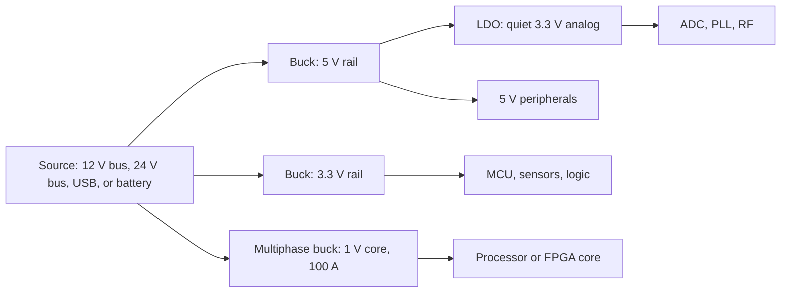

::: testing
Whether you know *when a buck is the right tool*, not just a list of products that contain one. The interviewer wants:

1. A few concrete applications spanning different regimes (battery, 12/24/48 V buses, high-current processor rails, LED/current regulation).
2. The *reason* the buck wins in each: a big step-down ratio, a battery to protect, a thermal budget, a high current.
3. The *contrast*: where a buck is a poor choice (tiny dropout, ultra-quiet analog, very light loads, needing a step-up).
4. That you can attach a number to the benefit, such as heat saved against an LDO.
:::

::: why
Applications are how interviewers check that your knowledge connects to real systems. If you say "a CPU core rail from 12 V", they'll ask why not an LDO, and the answer (100 W at 8% duty cycle, multiphase, fast transients) is exactly the material of the later buck questions. A good applications answer also shows design judgment: you can pick a buck, an LDO, or a buck-plus-LDO combination based on the requirements ([[q0157]], [[q0166]], [[q0169]]). For a real hardware job, choosing the regulator for each rail is among the first design decisions you'll make.
:::

::: concepts
- **Large step-down ratio**: efficiency of a linear regulator is $V_{out}/V_{in}$, so the bigger the ratio, the more the buck wins. See [[q0157]].
- **Power = heat budget**: loss $=P_{out}(1/\eta-1)$. Efficiency translates directly into temperature, battery life, and heat-sink cost. See [[q0162]] and [[q0164]].
- **Duty cycle**: $D=V_{out}/V_{in}$ sets the on-time, which limits how small a ratio a given controller can do at a given frequency ([[q0181]]).
- **Current regulation**: the same power stage can regulate current (LED drivers, battery chargers) by sensing current instead of voltage.
- **Noise trade-off**: bucks create switching ripple and EMI, so sensitive analog loads get an LC filter or a post-LDO ([[q0168]]).
- **Power architecture**: real systems cascade a bus converter, bucks and LDOs ([[q0166]], [[q0170]]).
:::

::: answer
"The buck shows up wherever you have a higher voltage and need a lower one efficiently. The most common case is point-of-load rails on a board: a 12 V or 5 V rail stepped down to 3.3, 1.8, 1.2 or even 0.9 V for processors, FPGAs and memory. Anything battery powered is another big one. A Li-ion cell at 3.7 V feeding a 1.8 V microcontroller is better served by a buck than an LDO because the efficiency, and so the runtime, is much higher.

Then there are the high-power ones. A CPU or GPU core rail is a multiphase buck taking 12 V down to about 1 V at tens or hundreds of amps, because a linear regulator at that current would be a heater. Automotive and industrial 12, 24 or 48 V buses get bucked down to 5 V or 3.3 V logic rails, and drone or robot batteries get bucked to 5 V for the compute board.

The same power stage also regulates current instead of voltage: LED drivers, battery chargers, and solar MPPT charge controllers are all buck-based.

I'd pick an LDO instead when the dropout is tiny, the load is very light, or the rail is noise-sensitive. A common compromise is a buck for the bulk drop followed by an LDO for a clean analog rail."
:::

::: technical
**Why a buck is chosen: the loss comparison.** For a given conversion, the loss of a linear regulator is $P_{LDO}=(V_{in}-V_{out})I_{out}$ (plus quiescent), while a buck's is $P_{buck}\approx P_{out}(1/\eta-1)$ with $\eta\approx0.85$ to $0.95$ over a wide range of ratios.

| Application | $V_{in}\to V_{out}$, $I_{out}$ | $D$ | LDO loss | Buck loss ($\eta=0.9$, assumed) |
|---|---|---|---|---|
| USB 5 V to 3.3 V logic | 5 V to 3.3 V, 0.5 A | 0.66 | 0.85 W | 0.18 W |
| Industrial bus to logic | 12 V to 5 V, 2 A | 0.42 | 14 W | 1.1 W |
| Drone 6S LiPo (22.2 V nominal) to compute | 22.2 V to 5 V, 3 A | 0.23 | 51.6 W | 1.7 W |
| CPU core rail | 12 V to 1 V, 100 A | 0.083 | 1100 W | about 11 W |

The CPU row shows why a linear regulator isn't even conceivable. At 12 V and 500 kHz the on-time for $D=0.083$ is about 167 ns, so the high-side FET, controller minimum on-time and gate drive have to cope with narrow pulses ([[q0181]]).

**Voltage-regulating vs current-regulating bucks.** In an LED driver the feedback is a sense resistor in series with the LED string, so the loop regulates $I_{LED}=V_{sense}/R_{sense}$. In a battery charger the loop switches between constant-current and constant-voltage targets.

**Scaling with power:** low power (below roughly 1 A) uses integrated-FET buck ICs; medium power (a few amps to tens of amps) uses synchronous bucks with external inductors; high power (tens to hundreds of amps) uses multiphase controllers with interleaved phases ([[q0236]]).
:::

::: short
"Bucks are everywhere you need an efficient step-down: point-of-load rails like 12 V or 5 V down to 3.3 V, 1.8 V or 1 V for processors, FPGAs and memory; battery-powered devices where efficiency sets runtime; automotive and industrial buses stepped down to logic rails; and CPU core rails, which are multiphase bucks. The same stage regulates current for LED drivers and chargers. I'd use an LDO instead for tiny dropout, very light loads or quiet analog rails."
:::

::: long
"I'd split the applications by what drives the choice.

First, general point-of-load conversion. A board has a 12 V or 5 V input and needs 3.3 V, 1.8 V, 1.2 V, and sub-1 V rails for processors, FPGAs and DDR. The step-down ratio is large, so a linear regulator would waste most of the input power. For 12 V to 5 V at 2 amps, an LDO burns 14 watts. A buck does it with about one watt.

Second, battery-powered products. A Li-ion cell is 3 to 4.2 volts, and a 1.8 V microcontroller rail from an LDO is only 43 to 60 percent efficient across the discharge curve. A buck, with a pulse-skipping mode for light load, keeps the efficiency high, so runtime goes up. Drones and robots are the high-voltage version: a 6S LiPo at about 22 volts bucked to 5 volts for the compute board.

Third, the high-power end. Processor core rails take 12 volts down to around 1 volt at 100 amps or more. That's a multiphase buck, with several interleaved phases sharing the current for efficiency, ripple and heat spreading.

Fourth, buses: automotive and industrial 12, 24 and 48 volts stepped down to logic rails, with protection ahead of the converter.

And the same power stage is used for current regulation: constant-current LED drivers, battery chargers, and solar charge controllers with MPPT.

I'd avoid a buck, or add an LDO after it, in three cases. The input is barely above the output, so an LDO is nearly as efficient and much quieter. The load is tiny, where a buck's quiescent current and switching noise aren't worth it. Or it's a noise-sensitive analog, RF or ADC rail, where I'd want the LDO to clean up the buck's ripple."
:::

::: terms
- **Point-of-load (POL) converter**: a regulator placed right next to the load it feeds, to minimize distribution losses and transient impedance.
- **Multiphase buck / VRM**: several interleaved buck phases sharing one output, used for processor core rails ([[q0236]]).
- **LDO**: low-dropout linear regulator; simple, quiet, and efficient only when $V_{in}\approx V_{out}$ ([[q0277]]).
- **Constant-current (CC) buck**: a buck whose feedback regulates inductor/load current, as in LED drivers.
- **MPPT**: maximum power point tracking, used in solar charge controllers (often a buck stage between panel and battery).
- **Battery eliminator circuit (BEC)**: hobby-electronics term for a regulator that provides 5 V from a flight battery; often a switching buck.
- **Pulse-skipping / PFM**: light-load mode that preserves efficiency ([[q0231]]).
- **Power tree**: the hierarchy of converters from the source down to each rail ([[q0166]]).
:::

::: exceptional
**An average answer** lists "phones, laptops, LED drivers, cars" with no reasons.

**An exceptional answer**:
- Organizes applications by *regime* (low-power battery, board-level POL, high-current processor rails, high-voltage buses, current regulation) and gives the *deciding reason* for each.
- Backs at least one with numbers: e.g. 12 V to 5 V at 2 A costs 14 W in an LDO versus about 1 W in a buck.
- Mentions the multiphase buck for CPU rails and why (current sharing, ripple cancellation, heat spreading).
- Notes that the same stage regulates current (LEDs, chargers, MPPT) when the feedback signal changes.
- Gives counter-examples (small dropout, very light load, quiet analog), and the standard compromise: buck followed by LDO.
:::

::: mistakes
- **Listing devices ("phones, laptops") with no reasoning.** The interviewer wants the *why*: efficiency, heat, battery life, ratio.
- **Saying bucks are always better than LDOs.** At tiny dropout or microamp loads an LDO can win, and for clean analog rails the buck's ripple is a problem ([[q0158]]).
- **Using a buck for step-up.** If $V_{in}$ can fall below $V_{out}$ (e.g. a Li-ion cell feeding 3.3 V), a buck will drop out; that needs a buck-boost or a boost ([[q0161]]).
- **Forgetting current-regulating bucks.** LED drivers and chargers are major buck uses, and they regulate current, not voltage.
- **Ignoring noise and EMI** when putting a buck next to a sensitive sensor, ADC or RF block.
- **Assuming efficiency is fixed.** It varies with load: light-load efficiency can be poor in forced-PWM operation ([[q0230]]).
:::

::: deep
## A map of where bucks live


Figure: A typical board power tree. Bucks do the bulk, efficient conversion; the LDO only trims a small step for a noise-sensitive rail. Q166 covers how to design this tree.

## Why the buck wins: the heat argument

The reason is simple arithmetic. If an LDO drops $V_{in}-V_{out}$ at the load current, the lost power is just the product, and the cost grows linearly with $V_{in}$:

```plot
{"title":"Power lost making 3.3 V at 1 A: LDO vs. buck (90% assumed)","x":{"label":"Input voltage V_in","unit":"V","min":3.5,"max":24},"y":{"label":"Power lost","unit":"W","min":0,"max":22},
 "vars":{"vo":3.3,"io":1,"eta":0.9},
 "series":[{"label":"LDO: (V_in − V_out)·I","fn":"(x-vo)*io","color":"red"},{"label":"Buck: P_out(1/η − 1)","fn":"vo*io*(1/eta-1)","color":"green"}],
 "points":[{"x":12,"y":8.7,"label":"12 V in: LDO 8.7 W"}]}
```
Figure: The LDO's loss climbs in a straight line with input voltage, while the buck's loss depends on the output power and efficiency, so it stays roughly flat. At 12 V in the LDO would dissipate 8.7 W at 1 A, enough to need a large heat sink, while the buck loses about 0.37 W.

> [!UNCERTAIN]
> The 90% buck efficiency is an assumption for illustration. Actual efficiency depends on the part, $V_{in}$, $V_{out}$, load current, switching frequency and inductor. Light loads (below about 10% of rated current) can be much worse unless a light-load mode is used ([[q0230]]).

## Application 1: board-level point-of-load rails

A modern board has many rails (3.3 V I/O, 1.8 V auxiliary, 1.2 V DDR, 0.9 V core), each from a buck off a 12 V, 5 V, or battery rail. Typical design drivers:

- **Ratio.** 12 V to 1.2 V gives $D=0.1$; at 1 MHz, the on-time is 100 ns. The controller's minimum on-time must be well below that, or the converter will skip pulses.
- **Transient response.** FPGAs and processors step load by amps in microseconds; the loop and output capacitors must hold the rail within tolerance ([[q0151]], [[q0248]]).
- **Sequencing.** Rails must come up in order ([[q0171]]).

## Application 2: battery-powered products

A Li-ion cell ranges from about 4.2 V full to about 3.0 V empty. For a 1.8 V rail:

| Cell voltage | LDO efficiency $1.8/V_{cell}$ |
|---|---|
| 4.2 V | 43% |
| 3.7 V | 49% |
| 3.0 V | 60% |

A buck with a light-load mode can stay near 85–90% at moderate load, so for a device that runs for days on a cell the runtime benefit is large. But there's a catch: a buck can only produce $V_{out}<V_{in}$. For a 3.3 V rail from a cell that dips to 3.0 V, a plain buck fails near end-of-discharge (dropout), so designers use a buck-boost or accept a lower usable cell voltage ([[q0161]]).

## Application 3: processor core rails (multiphase)

A CPU core might need 1.0 V at 100 A (100 W) from a 12 V input: $D\approx0.083$, average input current about $100\times0.083/0.9=9.3$ A. A single inductor can't carry 100 A, so the load is split across several phases, say four phases at 25 A each, interleaved 90° apart. That cancels ripple, spreads heat and speeds the transient response ([[q0236]], [[q0240]]). These designs also use a *load line* so the output droops slightly with current ([[q0184]]).

## Application 4: high-voltage buses

Automotive (nominal 12 V, with transients far beyond that), industrial 24 V, and telecom 48 V buses are bucked down to 5 V or 3.3 V. Challenges: wide $V_{in}$ range, surge/load-dump protection ahead of the converter, and thermal derating. A wide-input buck IC may handle tens of volts, but the exact limits are part-specific ([[q0170]] covers intermediate bus converters).

## Application 5: current-regulating bucks

Swap the feedback from output voltage to current and the same power stage becomes:

- **LED driver**: sense resistor in series with the LEDs. Example: three white LEDs in series at about 3.2 V each gives 9.6 V from 24 V, so $D=0.4$.
- **Battery charger**: constant-current phase, then constant-voltage phase, built around a synchronous buck.
- **Solar MPPT**: a buck stage between a higher-voltage panel (say 36 V) and the battery (say 14 V) with the controller adjusting duty to find the maximum power point. In this case $D=14/36=0.39$.

## Where not to use a buck

| Situation | Why a buck is a poor fit | Alternative |
|---|---|---|
| $V_{in}-V_{out}$ is small (say below 0.5 V) | An LDO is already efficient and simpler | LDO |
| Load below a few mA | The buck's quiescent current and switching noise dominate | LDO, or buck with ultra-low-$I_Q$ mode |
| Noise-sensitive analog/RF rail | Switching ripple and EMI couple in | Buck then LDO ([[q0168]], [[q0169]]) |
| $V_{out}>V_{in}$ at any time | A buck can't step up | Boost or buck-boost |
| Isolation required | A buck has no galvanic isolation | Flyback, forward, LLC |

## Experiment with it

```sim
{"id":"regulator-compare","mode":"compare","vin":12,"vout":3.3,"iout":1}
```
Figure: Sweep the input voltage and load current. Find where the LDO and buck efficiency curves cross, and note how light loads favour the LDO while large step-downs favour the buck.

## Worked example: battery runtime, and the light-load crossover

Take a device that runs a 1.8 V rail from a Li-ion cell (call it 3.7 V average) with a 2000 mAh capacity, so about $2\ \text{Ah}\times3.7\ \text{V}=7.4$ Wh of energy. At a steady 100 mA load, the output power is 180 mW.

- **LDO**: input current equals output current, so $P_{in}=3.7\times0.1=370$ mW and the runtime is $7.4/0.37=20$ h.
- **Buck at 88%**: $P_{in}=180/0.88=205$ mW, so the runtime is $7.4/0.205=36$ h. The buck wins by 80%.

Now look at the opposite end of the range. A sleeping sensor might draw only tens of microamps, and then the converter's own quiescent current decides the winner. Assume a buck whose quiescent current is 25 µA from the input and an LDO with 1 µA (representative orders of magnitude for low-power parts, not specific devices). Then:

$$P_{LDO}=V_{bat}(I_{out}+I_{q,LDO}),\qquad P_{buck}=\frac{V_{out}I_{out}}{\eta_{peak}}+V_{bat}I_{q,buck}$$

Setting them equal with $\eta_{peak}=0.9$: $3.7I+3.7\ \mu\text{W}=2I+92.5\ \mu\text{W}$, so $I=88.8\ \mu\text{W}/1.7\ \text{V}=52\ \mu\text{A}$. Below about 52 µA the LDO draws less from the battery, and above it the buck does.

```plot
{"title":"Battery power drawn vs load current: LDO vs buck (3.7 V in, 1.8 V out, assumed Iq)","x":{"label":"Load current","unit":"A","min":0.000001,"max":0.1,"log":true},"y":{"label":"Input power","unit":"W","min":0.000001,"max":1,"log":true},
 "series":[{"label":"LDO (Iq = 1 µA)","fn":"3.7*(x+0.000001)","color":"red"},{"label":"Buck (η = 90%, Iq = 25 µA)","fn":"1.8*x/0.9+3.7*0.000025","color":"green"}],
 "vlines":[{"at":0.0000522,"label":"crossover ≈ 52 µA","color":"muted"}]}
```
Figure: At the left the buck's flat quiescent floor makes it draw more. Above the crossover the lines diverge in the buck's favor, because the LDO's input power rises with the full battery voltage while the buck's rises with the output voltage.

> [!UNCERTAIN]
> Quiescent currents, light-load modes and the efficiency at low current vary a lot between parts, and some ultra-low-power bucks have quiescent currents of a few microamps. The crossover current is a property of the two specific parts, so recompute it from datasheet curves, not from these assumed values.

## How the input voltage and ratio limit a buck

Every buck has a minimum controllable on-time $t_{on,min}$ because the gate driver, the current-sense blanking and the comparator all take time. For a given conversion ratio this sets a maximum frequency, $f_{max}=D/t_{on,min}$. Check two cases with an assumed 60 ns minimum on-time:

- 12 V to 1.2 V: $D=0.1$, so $f_{max}=0.1/60\ \text{ns}=1.67$ MHz. A 1 MHz design works, a 2 MHz design would skip pulses.
- 48 V to 3.3 V: $D=0.069$, so $f_{max}=1.15$ MHz. At 500 kHz the on-time is 138 ns, comfortable, but at 2 MHz it would be 34 ns, below the limit.

There is a matching limit at high duty: the buck needs a minimum off-time to recharge the bootstrap capacitor, so the maximum duty is below 100%, which is why a buck that needs $V_{out}$ close to $V_{in}$ can drop out early.

> [!UNCERTAIN]
> Minimum on-time and off-time differ for each controller (tens to hundreds of nanoseconds across the market). The 60 ns above is a placeholder, so read the datasheet.

## Applications also impose different loop and noise rules

A processor core wants a very fast loop and a droop-friendly load line, a battery product wants a light-load mode, an LED driver wants a clean constant current, and an automotive supply wants wide input range and low EMI. The same power stage appears in all four, but the controller, the filter and the layout differ. When the interviewer asks "where are bucks used?", the strong answer names the constraint that selected the buck (heat, battery life, ratio) and not just the product.

## Verifying on the bench

- Measure efficiency across the whole load range, not just full load: sweep 10 µA to full scale with a source-measure unit on the input and a precision load on the output. Plot input power against load and look for the crossover.
- For battery life, log the current drawn over a representative duty cycle (sleep, wake, radio burst) with a current profiler or a scope and shunt, then integrate to get charge per cycle.
- At the application's extremes (lowest $V_{in}$, highest $V_{in}$, highest ambient) check dropout, minimum on-time pulse skipping and thermal shutdown. Pulse skipping shows up as a subharmonic on the SW node.
:::

::: applications
- **Point-of-load rails** on FPGA, SoC and memory boards (1 V to 3.3 V from 5 V or 12 V), typically integrated-FET synchronous buck ICs.
- **Processor VRMs**: multiphase bucks delivering core current in the tens to hundreds of amps for CPUs, GPUs and AI accelerators.
- **Mobile and wearable devices**: power-management ICs contain several bucks that supply CPU, memory and I/O rails from a single Li-ion cell.
- **Drones, robots and RC models**: 3S to 6S LiPo packs bucked to 5 V for flight controller, compute board and servos (often called a BEC or UBEC).
- **LED lighting and automotive lighting drivers** (constant-current buck).
- **Solar charge controllers (MPPT) and Li-ion battery chargers**, where the buck is the current-regulating stage.
- **Hobbyist DC-DC modules** such as LM2596-class adjustable boards, widely used for bench projects.
:::

::: assumptions
- **The efficiency figures are illustrative.** Replace the assumed 90% with a datasheet curve at your actual $V_{in}$, $V_{out}$, $I_{out}$ and frequency.
- **"Buck" means a step-down, hard-switched, inductor-based regulator.** Other step-down options (switched-capacitor, resonant, isolated) exist and may suit specific cases ([[q0147]]).
- **DC input.** AC-DC conversion is a separate front end; the buck usually sits after a rectifier or adapter.
- **Linear regulator comparison assumes the same load current** in and out (no quiescent current term).
- **Alternative good answers.** Interviewers may accept different application lists (telecom, EV auxiliary supplies, power tools, RF power amplifier bias). What matters is the reason attached to each.
:::

::: followups
### Why not use a linear regulator for a 12 V to 1 V, 100 A CPU rail?
It would dissipate $(12-1)\times100=1.1$ kW, which is absurd, and its efficiency would be 8.3%. A multiphase buck does the same job at about 90% efficiency, losing roughly 11 W spread across several phases. At that current, even distribution loss, copper and thermal design matter, which is why VRMs sit right next to the processor.

### Why would a battery-powered device use a buck instead of an LDO?
Efficiency translates directly into runtime. Powering a 1.8 V rail from a 3.7 V cell with an LDO wastes about half the energy as heat ($\eta = 1.8/3.7 = 49\%$). A buck at 85–90% extends the runtime by up to about 1.8 times, if the light-load efficiency is also managed with a PFM or pulse-skipping mode ([[q0231]]).

### An ADC board needs a very quiet 3.3 V from a 12 V input. How do you build the rail?
Buck first, LDO second. A buck from 12 V to about 3.8 V does the heavy lifting efficiently, then an LDO takes 3.8 V to 3.3 V, dropping only 0.5 V (so it dissipates little) while rejecting the buck's ripple through its PSRR. Pick the switching frequency so the buck ripple falls where the LDO's PSRR is still high ([[q0169]], [[q0168]]).

### Your battery drops to 3.0 V but your buck should deliver 3.3 V. What happens?
The converter reaches 100% duty and goes into dropout: $V_{out}\approx V_{in}-I(R_{DS(on)}+DCR)$, so below 3.3 V. The rail sags with the battery. A buck can't boost, so either accept a cutoff voltage above 3.3 V plus drops, or use a buck-boost converter ([[q0181]]).

### Scenario: your drone's 5 V buck gets hot when the battery is fully charged. Why?
At a higher input voltage the duty cycle is smaller, so the switch spends less time on but switching losses grow with $V_{in}$ ($\propto V_{in}\,I\,t_{sw}f_{sw}$), and with a diode-based buck the diode conducts more of the time. The efficiency is lower at the highest $V_{in}$. Check the datasheet's efficiency curve at the max input, thermal derating, and consider a lower switching frequency or a larger package/heat spreading.
:::

::: interpretations
"What are some applications?" sits under *Buck Converters* in the source list, directly after "Draw a circuit for a buck converter", so it means applications **of buck converters**. If the interviewer meant applications of *voltage regulators* in general, answer the same way but include LDOs ([[q0157]]). It's an open-ended question; the strong approach is to group by regime and attach a reason, as above.
:::

::: references
- Erickson & Maksimović, *Fundamentals of Power Electronics*: DC-DC converter applications and the role of switching converters versus linear regulators (introductory chapter).
- Horowitz & Hill, *The Art of Electronics*, 3rd ed.: linear versus switching regulators, including efficiency and heat comparisons.
- Texas Instruments SLVA477, "Basic Calculation of a Buck Converter's Power Stage".
- Mohan, Undeland & Robbins, *Power Electronics*: applications of DC-DC converters, including regulated power supplies and battery systems.
:::

::: rubric
- Names several distinct application regimes (POL rails, battery products, processor core rails, high-voltage buses) :: Breadth shows you've seen buck converters in more than one context.
- Gives the *reason* a buck is chosen for each (ratio, efficiency, heat, runtime, current) :: The interviewer is probing engineering judgment, not a memorized list.
- Quantifies the benefit vs. an LDO with at least one example :: Numbers make the argument credible.
- Mentions multiphase bucks for high-current processor rails :: It's the signature high-end application and leads naturally to follow-ups.
- Mentions current-regulating uses (LED drivers, chargers, MPPT) :: Shows you know the power stage is more general than a voltage regulator.
- States when *not* to use a buck (tiny dropout, light load, noise-sensitive analog, step-up) :: Knowing the limits is the sign of a design mindset.
- Mentions buck-plus-LDO as a standard architecture for clean rails :: Practical architecture knowledge that comes up in power-tree questions.
:::

::: quiz
```json
[
 {"type":"numeric","level":"fundamental","q":"An LDO makes 5 V from 12 V at 2 A. How much power does it dissipate, in watts?","answer":14,"tolerance":0.02,"unit":"W","explain":"$P=(V_{in}-V_{out})I=(12-5)\\times2=14$ W, with an efficiency of $5/12=41.7\\%$."},
 {"type":"mcq","level":"fundamental","q":"Which application is *least* well suited to a plain buck converter?","options":["12 V to 3.3 V for a microcontroller","Getting 5 V from a Li-ion cell that falls to 3.0 V","12 V to 1 V for an FPGA core","A constant-current LED driver from 24 V"],"answer":1,"explain":"A buck can only step down. When the cell voltage falls below 5 V (plus drops), the converter hits 100% duty and drops out. A boost or buck-boost is needed there."},
 {"type":"numeric","level":"intermediate","q":"A CPU rail delivers 1.0 V at 100 A from a 12 V input through an ideal buck. What is the duty cycle, in percent (to one decimal place)?","answer":8.3,"tolerance":0.02,"unit":"%","explain":"$D=V_{out}/V_{in}=1/12=0.0833$, so 8.3%. At 500 kHz this is an on-time of about 167 ns."},
 {"type":"numeric","level":"intermediate","q":"A 6S LiPo pack (22.2 V nominal) is bucked to 5 V at 3 A with 90% efficiency. What is the average input current, in amps (to two decimals)?","answer":0.75,"tolerance":0.03,"unit":"A","explain":"$P_{out}=15$ W, $P_{in}=15/0.9=16.67$ W, $I_{in}=16.67/22.2=0.751$ A."},
 {"type":"truefalse","level":"intermediate","q":"A buck followed by an LDO is a sensible way to get a quiet analog rail from a high input voltage.","answer":true,"explain":"The buck does the large, efficient step-down; the LDO drops only a small difference (so it dissipates little) and uses its power-supply rejection to suppress the buck's switching ripple."},
 {"type":"multi","level":"advanced","q":"Select all cases where an LDO is likely a better choice than a buck.","options":["$V_{in}=3.6$ V, $V_{out}=3.3$ V, 50 mA, noise-sensitive sensor","$V_{in}=24$ V, $V_{out}=5$ V, 3 A","Microamp-level standby load with a tiny dropout","$V_{in}=12$ V, $V_{out}=1$ V, 50 A"],"answer":[0,2],"explain":"With a 0.3 V dropout and 50 mA, LDO loss is only 15 mW and it is quiet. For a microamp load, a buck's quiescent current and switching overhead dominate. The 24 V to 5 V and 12 V to 1 V cases would waste tens of watts in an LDO."}
]
```
:::
