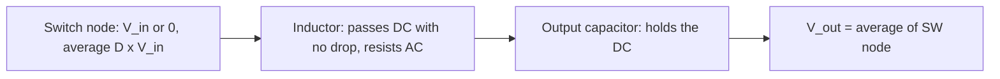
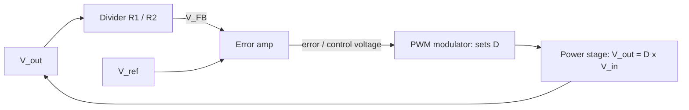

::: testing
Whether you can separate **two layers of "what determines $V_{out}$"** and explain the physics under both:

1. *Power-stage layer*: for a given duty cycle and input, the converter produces $V_{out}\approx D\,V_{in}$, because the inductor can't hold a DC voltage across it (volt-second balance).
2. *Regulator layer*: in a closed-loop converter, $V_{out}$ is actually fixed by the **reference and the feedback divider**, $V_{out}=V_{ref}(1+R_1/R_2)$, and the loop picks whatever $D$ makes that true.

Bonus points for knowing when the simple formula breaks (losses, DCM, dropout).
:::

::: why
"What determines the output voltage?" sounds trivial and is a good trap. Answering "the duty cycle" alone misses that the designer doesn't pick $D$; the feedback loop does. Answering "the feedback divider" alone misses *why* a duty cycle can set a voltage. Interviewers use the question to see whether you can hold both pictures at once and move between them. It also leads directly into debugging: when a converter outputs the wrong voltage, you need to know which layer to look at (a broken divider is a different failure from a loop that hit its duty limit).
:::

::: concepts
- **Volt-second balance**: in steady state, the average voltage across the inductor is zero, which forces $V_{out}=D\,V_{in}$ in CCM. See [[q0174]].
- **Duty cycle** $D=t_{on}/T$: the fraction of the period the high-side switch is on ([[q0179]]).
- **Feedback divider and reference**: $V_{FB}=V_{out}R_2/(R_1+R_2)$ is compared with $V_{ref}$; at regulation $V_{FB}=V_{ref}$. See [[q0008]] and [[q0223]].
- **Closed-loop regulation**: the error amplifier adjusts $D$ until the error is zero.
- **Conduction mode**: CCM vs DCM changes the relationship between $D$ and $V_{out}$ ([[q0229]]).
- **Losses**: switch resistance, diode drop and inductor DCR shift the required $D$ ([[q0180]]).
:::

::: answer
"There are two answers, and I'd give both. At the power-stage level, the output is set by the duty cycle and the input voltage: $V_{out}=D\,V_{in}$ in continuous conduction. The reason is that in steady state the inductor can't have a net DC voltage across it, otherwise its current would ramp forever. So the average of the switch-node waveform, which is $D\,V_{in}$, has to equal the output voltage.

But in a real regulator I don't choose $D$. The feedback loop does. A resistor divider scales the output down to a feedback voltage, an error amplifier compares it with an internal reference, and the loop adjusts $D$ until the two match. So the output voltage is really set by the reference and the divider: $V_{out}=V_{ref}(1+R_1/R_2)$. The duty cycle is just whatever number is needed to get there.

That means if $V_{in}$ drops, the duty cycle rises, and the output stays put. If the load increases, losses rise and the duty cycle creeps up a little. Where the formula breaks is at light load in discontinuous mode, where $D$ alone no longer fixes $V_{out}$, and at the extremes: the output can never exceed $V_{in}$ minus the drops."
:::

::: technical
**Open-loop power stage (CCM, ideal).** Volt-second balance on $L$: $(V_{in}-V_{out})DT=V_{out}(1-D)T\Rightarrow V_{out}=D\,V_{in}$.

**With losses (synchronous, CCM).** Averaging the switch-node voltage and subtracting the inductor DCR drop:
$$V_{out}=D\,V_{in}-I_{out}\big[D\,R_{hs}+(1-D)R_{ls}+R_{DCR}\big]$$
For an asynchronous buck with diode drop $V_f$: $V_{out}=D(V_{in}-I R_{hs})-(1-D)V_f-I R_{DCR}$.
Example: $D=0.28$, $V_{in}=12$ V, $I=2$ A, $R_{hs}=20$ mΩ, $R_{ls}=10$ mΩ, $R_{DCR}=15$ mΩ gives $V_{out}=3.36-0.0556=3.304$ V.

**DCM.** The current reaches zero before the cycle ends, and for a constant-current load $I_{out}$:
$$V_{out}=\frac{V_{in}}{1+\dfrac{2Lf_{sw}I_{out}}{V_{in}D^2}}$$
This exceeds $D\,V_{in}$ at light load (boundary at $I_{out}=V_{in}D(1-D)/(2Lf_{sw})$).

**Closed loop.** $V_{FB}=V_{out}\dfrac{R_2}{R_1+R_2}$; at regulation $V_{FB}=V_{ref}$, so
$$V_{out}=V_{ref}\left(1+\frac{R_1}{R_2}\right)$$
The controller sets $D\approx V_{out}/V_{in}$ (plus loss terms). Accuracy depends on $V_{ref}$ tolerance (often about 1%) and the divider resistor tolerances.

**Limits.** $V_{out}\le V_{in}-I(R_{hs}+R_{DCR})$ at 100% duty ([[q0181]]), and a minimum on-time limits how low $V_{out}$ can go at high $V_{in}$ and frequency.
:::

::: short
"In the power stage, the duty cycle and input set the output: $V_{out}=D\,V_{in}$ in continuous conduction, because the inductor can't sustain a DC voltage, so the average switch-node voltage must equal $V_{out}$. In a real regulator the feedback loop picks $D$: a divider scales $V_{out}$ to a reference, and the loop adjusts $D$ until they match, so $V_{out}=V_{ref}(1+R_1/R_2)$. The formula changes with losses and in discontinuous mode."
:::

::: long
"I think of it in two layers. The physics layer: what makes a switch-mode power stage produce a particular voltage. The control layer: what picks that voltage.

Physics first. In steady state, the inductor current at the end of a cycle equals the current at the start, so the average voltage across the inductor has to be zero. During the on-time it has $V_{in}-V_{out}$ across it, during the off-time $-V_{out}$. Setting those volt-seconds equal gives $V_{out}=D\,V_{in}$. Intuitively, the switch node is a rectangular wave with average $D\,V_{in}$, and the inductor-capacitor filter passes just the DC, so that's what appears at the output. That holds in continuous conduction. With real components I subtract the drops: the on-resistance of the FETs, the inductor's DC resistance, or the diode forward voltage, so the duty cycle has to be a bit higher than the ideal ratio.

Control next. In a regulator nobody sets $D$ directly. A divider $R_1$ and $R_2$ feeds back a fraction of $V_{out}$ to an error amplifier, which compares it with a reference, for instance 0.8 V. If the output is too low, the error pushes $D$ up; too high, it pulls $D$ down. At equilibrium, $V_{FB}=V_{ref}$, so $V_{out}=V_{ref}(1+R_1/R_2)$.

That's why a 12 V to 3.3 V converter holds 3.3 V when the input drops to 9 V: the duty cycle moves from 27.5 percent to 36.7 percent automatically.

Finally, where it breaks: at light load in DCM the output rises for a given $D$, so open-loop $D\,V_{in}$ isn't enough. And the output is capped by the input minus the drops, so at 100 percent duty the converter drops out. And if the feedback divider is broken, the loop can drive the output to the wrong place, for example up to $V_{in}$ if the top resistor opens."
:::

::: terms
- **Volt-second balance**: the average inductor voltage over a cycle is zero in steady state.
- **Duty cycle ($D$)**: $t_{on}/T$ for the high-side switch.
- **Reference voltage ($V_{ref}$)**: the internal precision voltage the feedback node is compared to, typically a few hundred mV to about 1 V.
- **Feedback divider**: $R_1$ (top) and $R_2$ (bottom) scaling $V_{out}$ to $V_{FB}$.
- **Line regulation**: how little $V_{out}$ changes as $V_{in}$ changes.
- **Load regulation**: how little $V_{out}$ changes with load current.
- **CCM / DCM**: continuous or discontinuous inductor current.
- **Dropout**: operation at the maximum duty cycle where $V_{out}$ follows $V_{in}$ minus drops.
:::

::: exceptional
**An average answer** says "the duty cycle: $V_{out}=D\,V_{in}$."

**An exceptional answer**:
- Splits the question into the *power-stage layer* (duty cycle and volt-second balance) and the *control layer* (reference and divider), and says the loop chooses $D$.
- Explains *why*: the inductor can't hold DC voltage, so the average switch-node voltage is forced onto the output.
- Gives $V_{out}=V_{ref}(1+R_1/R_2)$ with a real number (e.g. 0.8 V reference, 31.6 kΩ over 10 kΩ gives 3.33 V).
- Includes the loss terms and shows that $D$ rises slightly with load current.
- Mentions DCM, where $D$ no longer fixes $V_{out}$ by itself, and the dropout limit.
- Knows the debugging consequence: a broken divider can drive the output to $V_{in}$ or to $V_{ref}$.
:::

::: mistakes
- **Answering only "duty cycle."** In a regulator the reference and divider set the voltage; $D$ is the loop's output.
- **Answering only "the divider."** Without the volt-second explanation you haven't said *how* a switching stage can produce a voltage.
- **Claiming $V_{out}=D\,V_{in}$ in all conditions.** In DCM at light load, the output is higher for the same $D$.
- **Forgetting that losses shift the duty cycle.** Higher load current means higher $D$ for the same $V_{out}$ ([[q0180]]).
- **Thinking the inductor value sets $V_{out}$.** $L$ sets ripple and the CCM/DCM boundary, not the DC output.
- **Mixing up the divider formula**: $V_{out}=V_{ref}(1+R_1/R_2)$ with $R_1$ as the *top* resistor and $R_2$ as the bottom one ([[q0008]]).
:::

::: deep
## Layer 1: the power stage

Start with a buck driven at a fixed duty cycle (open loop) from $V_{in}$, ignoring all losses.

The switch node $v_{SW}(t)$ is $V_{in}$ for $DT$ and $0$ for $(1-D)T$. Its DC average is $D\,V_{in}$.

The output is formed from $v_{SW}$ through $L$ and $C$. At DC, an inductor is a short (zero volts, $v=L\,di/dt=0$ for constant current), and a capacitor is an open. So the *DC* part of $V_{out}$ equals the DC part of $v_{SW}$:

$$V_{out}=\overline{v_{SW}}=D\,V_{in}$$

This is volt-second balance again: $\overline{v_L}=\overline{v_{SW}}-V_{out}=0$. If $V_{out}$ were lower than $\overline{v_{SW}}$, the inductor would have a net positive voltage and its current would ramp up cycle after cycle, delivering more charge to $C_{out}$ until the output rose. If $V_{out}$ were higher, the current would ramp down. The output is pulled to the point where the inductor sees zero net voltage. That is "why".


Figure: The LC filter is a low-pass: it keeps the DC (average) of the switch-node waveform and rejects the switching component. The "inductor has zero DC volts" statement is exactly volt-second balance.

## Layer 2: the regulator

Open loop, $V_{out}$ would move with $V_{in}$ and with load (through losses and DCM). A regulator closes a loop:


Figure: The loop adjusts $D$ until $V_{FB}=V_{ref}$. In equilibrium the error is (nearly) zero, which makes $V_{out}=V_{ref}(1+R_1/R_2)$ regardless of what $V_{in}$ is doing.

At equilibrium $V_{FB}=V_{ref}$, so
$$V_{out}=V_{ref}\left(1+\frac{R_1}{R_2}\right)$$

Numbers: $V_{ref}=0.8$ V, $R_1=31.6$ kΩ, $R_2=10$ kΩ gives $V_{out}=0.8\times4.16=3.328$ V. A 1% error in $R_2$ moves the output by about 1% of the divider term: with $R_2=10.1$ kΩ, $V_{out}=3.303$ V.

So, what *determines* $V_{out}$ in a regulated converter is $V_{ref}$ and the ratio $R_1/R_2$. $V_{in}$ and the power stage determine only the duty cycle the loop settles at:

| Condition | What the loop does | Resulting $D$ | $V_{out}$ |
|---|---|---|---|
| $V_{in}=12$ V | Settles at ratio | 0.275 | 3.3 V |
| $V_{in}$ drops to 9 V | Raises $D$ | 0.367 | 3.3 V (unchanged) |
| $V_{in}$ rises to 15 V | Lowers $D$ | 0.22 | 3.3 V (unchanged) |
| Open loop, fixed $D=0.275$, $V_{in}=9$ V | Nothing | 0.275 | 2.475 V |

This is **line regulation**, and it is the point of feedback.

## Where $V_{out}=D\,V_{in}$ is not enough

### Losses

With real components, the average switch-node voltage is not exactly $D\,V_{in}$. For a synchronous buck, the high-side FET drops $I R_{hs}$ while on, the low-side FET drops $-I R_{ls}$ while on, and the inductor's DCR subtracts a further $I R_{DCR}$:

$$V_{out}=D\,V_{in}-I_{out}\big[D\,R_{hs}+(1-D)R_{ls}+R_{DCR}\big]$$

With the numbers above (20 mΩ, 10 mΩ, 15 mΩ), the bracket is $0.275\times0.02+0.725\times0.01+0.015=27.75$ mΩ. At 2 A that is 55.5 mV of droop at a fixed $D=0.275$: $V_{out}=3.3-0.0555=3.2445$ V. The closed loop compensates by raising $D$ to about 0.2796 (about 1.7% higher). For this reason $D$ is a function of load, not a constant ([[q0180]]).

### Discontinuous conduction

At light load the inductor current wants to go negative. A diode (or a diode-emulating FET) blocks it, so the current sits at zero for part of each period. In that case the average inductor voltage can't just be $D\,V_{in}-V_{out}$ over the whole period, and volt-second balance gives a different result:

$$V_{out}=\frac{V_{in}}{1+\dfrac{2Lf_{sw}I_{out}}{V_{in}D^2}}\qquad(\text{DCM})$$

```plot
{"title":"Open-loop V_out vs constant load current at fixed D = 0.275 (12 V in, L = 4.7 µH, 500 kHz)","x":{"label":"Load current","unit":"A","min":0.02,"max":3},"y":{"label":"V_out","unit":"V","min":0,"max":11},
 "vars":{"vin":12,"d":0.275,"l":"4.7e-6","f":500000,"ic":"vin*d*(1-d)/(2*l*f)"},
 "series":[{"label":"open-loop V_out","fn":"step(ic-x)*vin/(1+2*l*f*x/(vin*d*d)) + step(x-ic)*vin*d","color":"accent"}],
 "hlines":[{"at":"vin*d","label":"D·V_in = 3.3 V (CCM value)","color":"green"}],
 "vlines":[{"at":"ic","label":"CCM/DCM boundary, 0.51 A","color":"orange"}]}
```
Figure: Above 0.51 A the converter is in CCM and the output sits at $D\,V_{in}=3.3$ V (ideal). Below it, DCM makes the output rise steeply as the load lightens: at a constant 100 mA load the same duty cycle gives about 7.9 V (a 33 Ω resistor, whose current falls as the voltage rises, would settle at about 6.1 V, see [[q0182]]). A closed loop prevents this by cutting $D$ sharply at light load.

So at light load a closed-loop buck uses a much *smaller* duty cycle than $V_{out}/V_{in}$ suggests, or skips pulses altogether ([[q0231]]).

### Dropout and minimum on-time

The output can't exceed what 100% duty allows: $V_{out,max}\approx V_{in}-I_{out}(R_{hs}+R_{DCR})$ ([[q0181]]). At the other end, if the controller's minimum on-time is 100 ns at 500 kHz, the minimum duty cycle is 5%, which at 12 V limits $V_{out}$ to about 0.6 V without pulse skipping.

## Setting a real output voltage: the divider calculation

For a controller with $V_{ref}=0.8$ V and a target of 3.3 V:

$$\frac{R_1}{R_2}=\frac{3.3}{0.8}-1=3.125$$

Pick $R_2=10$ kΩ, $R_1=31.25$ kΩ. The nearest 1% value is 31.6 kΩ (output 3.328 V, +0.85%). Compounding with tolerances: 1% resistors and a ±1% reference could in principle move the output by about ±2 to 3% in the worst case. Datasheets usually specify a recommended resistor range, too large a value makes the feedback pin sensitive to its bias current and noise ([[q0224]]).

## Experiment with it

```sim
{"id":"buck-lab","vin":12,"vout":3.3,"iout":2,"fsw":500000,"l":4.7e-6,"c":22e-6}
```
Figure: The simulator picks the duty cycle for a target $V_{out}$. Change $V_{in}$ and watch $D$ move inversely while $V_{out}$ holds. Turn the load way down to see CCM become DCM and the converter's duty change character.

## Debugging view: which layer is broken?

- **Output too low, duty at maximum**: dropout (input too low, or drops too large), or current limit.
- **Output at $V_{in}$**: the loop sees a feedback voltage below $V_{ref}$ and commands maximum $D$; typical cause is an open top feedback resistor or a floating feedback pin. A well-designed IC has overvoltage protection but not all do.
- **Output sits at $V_{ref}$**: the bottom resistor is open or the top is shorted, so the feedback pin follows $V_{out}$ one-to-one.
- **Output wrong by a few percent**: divider resistor value or tolerance, reference tolerance, or load/line regulation.
:::

::: applications
- **Setting rail voltages with one resistor**: adjustable bucks get any $V_{out}$ above $V_{ref}$ by choosing $R_1$ ([[q0223]]).
- **Dynamic voltage scaling**: processors change the reference (or a trim DAC) so the buck's output follows ($V_{out}\propto V_{ref}$ for a fixed divider).
- **Margining and test**: engineers trim the feedback node to move a rail $\pm5\%$ during validation.
- **Fault diagnosis**: reading the duty cycle on the scope and comparing it to $V_{out}/V_{in}$ tells you whether the stage is lossy, in dropout, or in DCM.
- **LED/charger designs** where the feedback signal is a sense voltage and the converter regulates current by the same mechanism.
:::

::: assumptions
- **Steady state.** During transients the loop is catching up and the average inductor voltage isn't zero.
- **CCM for the simple formula.** In DCM, use the load-dependent relation above.
- **Ideal reference and divider** for the $V_{ref}(1+R_1/R_2)$ result. Real parts have tolerance, temperature drift and feedback-pin bias current.
- **Voltage-mode or current-mode doesn't matter** for the steady-state answer. The control method changes how fast and how stably the loop reaches it, not where it settles.
- **Fixed-frequency PWM.** In hysteretic or constant-on-time converters the "duty cycle" emerges from the control law, but the same voltage-setting logic (reference and divider) applies.
:::

::: followups
### If $V_{in}$ falls from 12 V to 9 V, what happens to $D$ and $V_{out}$ in a closed-loop converter?
$V_{out}$ stays at 3.3 V because the loop raises $D$ from 0.275 to $3.3/9=0.367$. Open loop at the same $D$ it would fall to $0.275\times9=2.475$ V. That's line regulation. The limit is when $V_{in}$ gets so low that $D$ hits 100% (dropout).

### How would you change a 3.3 V buck (0.8 V reference, 31.6 kΩ / 10 kΩ) to give 5 V?
$R_1=R_2(5/0.8-1)=10\text{ k}\times5.25=52.5$ kΩ, nearest 1% value 52.3 kΩ (output about 4.98 V). Check that the input is comfortably above 5 V plus dropout, and that the controller's maximum $D$ and $V_{in}$ range suit the new output ([[q0223]]).

### Why does the duty cycle needed go up with load current?
Because of resistive drops. The FETs and inductor DCR drop voltage in proportion to current, so the average switch-node voltage must be higher to deliver the same $V_{out}$. With the example parts, $D$ goes from 0.275 (no load) to 0.280 at 2 A.

### What if the top feedback resistor $R_1$ is accidentally left open?
$V_{FB}$ is then pulled to ground by $R_2$, below $V_{ref}$, so the error amplifier believes the output is low and drives $D$ to its maximum. $V_{out}$ climbs to about $V_{in}$ minus drops. This is a classic way to destroy a downstream load, which is why many ICs add overvoltage protection and why you double-check the divider.

### Scenario: your buck's output is correct at 1 A but 5% high at 10 mA. Which layer is responsible?
Almost certainly the conduction mode: at light load the converter is in DCM or a pulse-skipping/PFM mode, where the output ripple and average rise a bit above the CCM regulation point (the loop regulates the average or the lower threshold, depending on the architecture). Check the datasheet's light-load behaviour, whether forced-PWM mode is available, and the output capacitor size ([[q0229]], [[q0231]]).
:::

::: interpretations
"What determines the output voltage and why?" sits in the *Duty Cycle/Output Voltage* section, so the expected core is the duty cycle and $V_{out}=D\,V_{in}$ with the *why* (volt-second balance). The "regulator layer" answer (reference and divider) is the more complete engineering answer and is what a good interviewer is fishing for in a follow-up. I've covered both, and kept them separate so you can lead with whichever the interviewer seems to want. See [[q0182]] and [[q0183]] for the two calculation directions.
:::

::: references
- Erickson & Maksimović, *Fundamentals of Power Electronics*: inductor volt-second balance and the DC conversion ratio of the buck converter; DCM conversion ratio.
- Texas Instruments SLVA477, "Basic Calculation of a Buck Converter's Power Stage": the equations for duty cycle, ripple and output voltage setting.
- Mohan, Undeland & Robbins, *Power Electronics*: step-down converter in continuous and discontinuous conduction.
- Buck regulator datasheets (any major vendor): "setting the output voltage" sections, which give $V_{out}=V_{ref}(1+R_1/R_2)$.
:::

::: rubric
- States $V_{out}=D\,V_{in}$ for the power stage in CCM :: The core relationship every interviewer expects.
- Explains why via the inductor's zero average voltage (volt-second balance) or the average of the switch node :: Turns a formula into understanding.
- Says that in a regulator the feedback loop sets $D$ and $V_{out}=V_{ref}(1+R_1/R_2)$ :: Shows you know a converter is a regulated system, not an open-loop scaler.
- Gives the line-regulation picture: $V_{in}$ changes, $D$ changes, $V_{out}$ stays :: Demonstrates the purpose of the loop.
- Mentions losses shifting $D$ (FET, DCR, diode drop) :: Real hardware differs from the ideal equation.
- Mentions DCM / light-load behaviour breaking the simple relation :: A key caveat that interviewers often follow up on.
- Mentions dropout or minimum on-time limits :: Shows you know where the equation stops being valid.
:::

::: quiz
```json
[
 {"type":"numeric","level":"fundamental","q":"An ideal buck in CCM runs at $D=0.4$ from $V_{in}=15$ V. What is $V_{out}$ in volts?","answer":6,"tolerance":0.01,"unit":"V","explain":"$V_{out}=D\\,V_{in}=0.4\\times15=6$ V."},
 {"type":"mcq","level":"fundamental","q":"In a closed-loop buck with a feedback divider, what *directly* sets the regulated output voltage?","options":["The inductor value","The switching frequency","The reference voltage and the divider ratio","The output capacitor value"],"answer":2,"explain":"At regulation $V_{FB}=V_{ref}$, so $V_{out}=V_{ref}(1+R_1/R_2)$. $L$, $C$ and $f_{sw}$ affect ripple and dynamics, not the DC value."},
 {"type":"numeric","level":"intermediate","q":"A buck controller has $V_{ref}=0.6$ V. With $R_2=10$ kΩ, what $R_1$ gives 3.3 V? Answer in kΩ.","answer":45,"tolerance":0.02,"unit":"kΩ","explain":"$R_1=R_2(V_{out}/V_{ref}-1)=10\\text{ k}\\times(5.5-1)=45$ kΩ."},
 {"type":"numeric","level":"intermediate","q":"A closed-loop 12 V to 3.3 V buck has its input fall to 9 V. What duty cycle (in percent, one decimal) does the loop settle at (ideal)?","answer":36.7,"tolerance":0.02,"unit":"%","explain":"$D=V_{out}/V_{in}=3.3/9=0.3667$, i.e. 36.7% (up from 27.5%). $V_{out}$ stays at 3.3 V."},
 {"type":"mcq","level":"advanced","q":"A buck's feedback divider has an open circuit in the *top* resistor $R_1$ (between $V_{out}$ and FB). What is the likely result?","options":["The output falls to 0 V","The output is stuck at the reference voltage","The loop sees a low FB voltage and drives duty to maximum, so $V_{out}$ climbs toward $V_{in}$","Nothing; the divider is not in the control path"],"answer":2,"explain":"With $R_1$ open, $R_2$ pulls FB to ground, below $V_{ref}$. The error amp calls for more output, so $D$ rises to its maximum and $V_{out}\\to V_{in}$ minus drops, unless an overvoltage protection trips."},
 {"type":"truefalse","level":"advanced","q":"For a fixed duty cycle, an open-loop buck's output at very light load (DCM) is *higher* than $D\\,V_{in}$.","answer":true,"explain":"In DCM the inductor current is zero for part of each period, so the SW node floats near $V_{out}$ during that interval and the average is pulled up. The DCM relation $V_{out}=V_{in}/(1+2Lf_{sw}I/(V_{in}D^2))$ exceeds $D\\,V_{in}$ below the CCM/DCM boundary."}
]
```
:::
