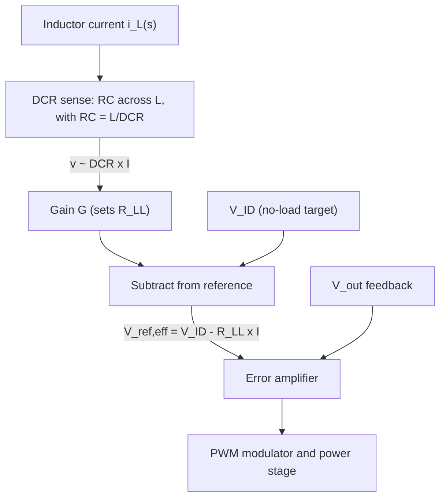

::: testing
Whether you know the **power-delivery meaning of "load line"** (also called droop, or adaptive voltage positioning) and can argue its trade-offs like a system designer. The interviewer wants:

1. A clear definition: the DC output voltage is deliberately made to *decrease* linearly with load current, $V_{out}=V_{ref}-R_{LL}\,I_{out}$, so the converter has a chosen non-zero DC output resistance.
2. *Why* anyone would degrade regulation on purpose: it lets the output swing across the whole allowed voltage window for a load step, so you need less output capacitance and get smaller overshoot and undershoot, and the load runs at lower voltage (and power) when busy.
3. The costs: worse DC accuracy, a headroom budget at full load, dependence on accurate current sensing (including temperature), and a loop that must be tuned.
4. Awareness that "load line" has a second, unrelated meaning in transistor biasing, and which one the question is about.
:::

::: why
High-current processor and FPGA rails run at about 1 V with tens or hundreds of amps and load steps of many amps per microsecond. The tolerance window is tens of millivolts, so output capacitance would be huge and expensive without a trick. The load line is that trick, and it is standard in processor voltage regulators. Interviewers ask about it to see whether you can reason about a *system-level* trade-off: deliberately worsening one specification (DC load regulation) to improve another (transient response, cost, power). It sits at the intersection of control, power integrity ([[q0151]]), current sensing and multiphase design ([[q0236]]). Even if you've never designed a VRM, being able to derive the benefit with a simple example impresses.
:::

::: concepts
- **Output impedance of a converter**: the ratio $\Delta V_{out}/\Delta I_{out}$. A tightly regulated converter has low DC output impedance, but its high-frequency output impedance is set by the output capacitors ([[q0142]]).
- **Tolerance window**: the load specifies $V_{min}$ and $V_{max}$ at the load. Static error, ripple and transient deviation must all fit.
- **Load-step transient**: a current step $\Delta I$ into an output impedance $Z_{out}$ produces a voltage excursion $\approx\Delta I\,Z_{out}$ ([[q0248]], [[q0249]]).
- **Droop / adaptive voltage positioning (AVP)**: the controller lowers its target as load current rises, by $R_{LL}\cdot I_{out}$.
- **Current sensing**: the controller needs $I_{out}$, often from inductor DCR sensing ([[q0225]]).
- **Dynamic power** $P\approx\alpha C V^2 f$: lowering $V$ at heavy load saves power ([[q0006]]).
:::

::: answer
"In a regulator, the load line, or droop, means the DC output voltage is intentionally made to drop as the load current increases: $V_{out}=V_{ref}-R_{LL}\cdot I_{out}$. $R_{LL}$ is a virtual output resistance of a milliohm or two. You do it by sensing the load current and subtracting a proportional term from the voltage the controller regulates to.

Why would you want worse regulation? Because of transients. A processor rail has a tolerance window, say plus or minus 30 millivolts around 1 V, and a load step of tens of amps. Without droop, I sit in the middle of the window and can only use half of it for undershoot when the load steps up. With droop, I sit at the *top* of the window at no load. When the load steps up, the output falls toward the bottom, and if $R_{LL}$ matches the output impedance of the converter, it falls *exactly* along the load line, using the whole window. So the output capacitance I need roughly halves, overshoot at unload is smaller, and the load runs at a lower voltage when it's busy, which saves dynamic power since it goes with $V^2$.

The trade-offs are that DC accuracy gets worse, because the voltage at full load is a deliberate 60 millivolts or so lower. The load has to work at the low end of the window at maximum current. I also need accurate current sensing, including temperature drift of an inductor-DCR sensor, and I have to tune the loop so that the droop matches the real output impedance."
:::

::: technical
**Definition.**
$$V_{out}(I)=V_{ID}-R_{LL}\,I_{out}$$
where $V_{ID}$ is the no-load setpoint and $R_{LL}$ the load-line resistance (typically around a milliohm, design-dependent). It is a *virtual* resistance made by the control loop, so it dissipates no real power.

**Window budget.** Let the load specify a total allowed window $W=V_{max}-V_{min}$ at the load, and let the load current go from 0 to $I_{max}$.
- *No droop*: regulate at the centre, so the transient excursion allowed in each direction is $W/2$. For a step $\Delta I$, need $Z_{out}\le\dfrac{W}{2\,\Delta I}$.
- *With droop*: $V_{ID}=V_{max}$ and $R_{LL}=\dfrac{W}{I_{max}}$ so that $V_{out}(I_{max})=V_{min}$. For a step $0\to I_{max}$ the output moves along the load line and the dynamic budget is $W$, so need $Z_{out}\le\dfrac{W}{\Delta I}$, i.e. twice as large.

**Numbers.** $V_{max}=1.03$ V, $V_{min}=0.97$ V ($W=60$ mV), $I_{max}=30$ A: $R_{LL}=60\text{ mV}/30\text{ A}=2$ mΩ.
- No droop: nominal 1.000 V with a $\pm30$ mV window, so $Z_{out}\le30\text{ mV}/30\text{ A}=1$ mΩ.
- Droop: $Z_{out}\le2$ mΩ (about half the output capacitance, for a capacitor-dominated $Z_{out}$).
- Power: full-load voltage 0.97 V instead of 1.00 V gives $(0.97)^2=0.941$, i.e. 5.9% less dynamic power in a CMOS load. A physical 2 mΩ resistor at 30 A would dissipate $30^2\times0.002=1.8$ W; the virtual one dissipates nothing.

**Implementation.** Sense $I_{out}$ (e.g. DCR sensing: an RC across the inductor with $RC=L/R_{DCR}$ yields a voltage $\propto I$), amplify by $G$, and subtract from the reference at the error amplifier: $V_{ref,eff}=V_{ref}-G\,R_{DCR}\,I_{out}$ so $R_{LL}\approx G\,R_{DCR}$ (scaled to $V_{out}$; exact form is design-dependent).

**Costs.** DC regulation error up to $R_{LL}I_{max}$ (here 6%); sense-gain and temperature error translate into voltage error (copper DCR rises about 0.39%/°C); the loop must be tuned so the converter's output impedance matches $R_{LL}$.
:::

::: short
"A DC load line, or droop, is a deliberate drop in output voltage with load current: $V_{out}=V_{ref}-R_{LL}I_{out}$, made by sensing current and subtracting it from the setpoint. It lets the output use the whole tolerance window during a load step instead of half, so you need less output capacitance and see less overshoot, and the load runs at lower voltage and power when busy. The costs are worse DC accuracy, a lower voltage at full load, reliance on accurate current sensing, and tuning the droop to match the output impedance."
:::

::: long
"A load line in this context, also called droop or adaptive voltage positioning, means making the regulator's output voltage fall linearly with load current on purpose: $V_{out}=V_{ID}-R_{LL}\,I_{out}$. $R_{LL}$ is a virtual output resistance, typically around a milliohm for a processor core rail. The controller senses the load current, often through the inductor's DC resistance, and subtracts a scaled copy from the reference.

The reason is transients. Say a CPU needs 1 volt plus or minus 30 millivolts, and its current steps by 30 amps. The converter's output impedance, mostly the output capacitors, turns that step into a voltage excursion of delta-I times Z. With ordinary regulation I sit at 1.0 V and can tolerate 30 millivolts of undershoot, so Z has to be 1 milliohm. With a load line I sit at the top of the window, 1.03 V, when idle. When the load steps to 30 amps, the voltage is *supposed* to end at 0.97 V, so the step uses the whole 60 millivolt window. If the droop resistance equals the output impedance, 2 milliohms, the output just slides along the load line and settles immediately without ringing. So I need only half the capacitance. The same logic applies to the unload overshoot: I start at the bottom, 0.97 V, and have the full window to rise.

There's a power benefit too. A CMOS load's dynamic power goes with V squared, so running at 0.97 instead of 1.0 V at heavy load saves about 6 percent, and, unlike a physical series resistor which would dissipate 1.8 watts, the virtual one costs nothing.

The trade-offs: DC accuracy is deliberately worse, the load must still work at the low end of the window at full current, the current sense has to be accurate across temperature, since copper DCR rises about 0.4 percent per degree, and the loop has to be designed so the droop and real output impedance match. A rail that needs tight regulation, such as an ADC reference or sensitive analog supply, shouldn't use it."
:::

::: terms
- **Load line (droop, AVP)**: intentional decrease of the output voltage with load current.
- **$R_{LL}$**: the load-line slope, in mΩ.
- **$V_{ID}$**: the no-load target voltage (commanded by the load, e.g. a VID code).
- **Tolerance window**: the allowed range $V_{min}$ to $V_{max}$ at the load.
- **Output impedance ($Z_{out}$)**: the small-signal ratio of voltage change to load-current change.
- **DCR sensing**: current sensing using the inductor winding resistance, via an RC network.
- **Dynamic (transient) deviation**: voltage excursion during a load step.
- **Static (DC) load regulation**: the output change from no load to full load.
:::

::: exceptional
**An average answer** says "droop: output decreases with current to improve transient response."

**An exceptional answer**:
- Writes $V_{out}=V_{ID}-R_{LL}I_{out}$, says $R_{LL}$ is *virtual* (no real loss), and shows the mechanism (current sense subtracted from the reference).
- Explains the *window budget* argument with numbers: half the window without droop, the whole window with droop, so $Z_{out}$ can double and the capacitance halves.
- Says the ideal case is $R_{LL}=Z_{out}$ (matched), where the response is a clean step with no ringing, and what happens when mismatched.
- Quantifies the power benefit (CMOS dynamic power $\propto V^2$: 5.9% in the example).
- Names the costs specifically: DC accuracy, full-load headroom, sense accuracy and temperature drift (copper about 0.39%/°C), and loop tuning; and says when *not* to use it.
- Notes the other meaning (transistor load line) and clarifies which one is meant.
:::

::: mistakes
- **Treating droop as a flaw.** It is a deliberate specification; the load's window is defined with it in mind.
- **Thinking it wastes power in a resistor.** The resistance is virtual, created by the control loop, so there's no $I^2R$ loss from the load line itself.
- **Confusing the DC load line with the transient response.** The DC load line describes steady-state $V_{out}$ vs. $I_{out}$; the transient benefit comes from letting the dynamic excursion use the headroom.
- **Mismatching $R_{LL}$ and $Z_{out}$ without realising it.** Too small a droop leaves part of the window unused; too large a droop gives undershoot below the window or slow, overdamped recovery ([[q0248]]).
- **Using droop on rails that need tight DC regulation** (ADC references, precision analog, a rail with a narrow tolerance).
- **Ignoring sense error.** A 5% current-sense gain error makes a 60 mV droop wrong by 3 mV, and temperature drift of DCR can make it much worse.
- **Confusing it with the amplifier "DC load line"** from transistor biasing ([[q0100]]); that is a different thing.
:::

::: deep
## What problem does a load line solve?

Consider a processor core rail. The load specifies a tolerance window at its pins, say $V_{min}=0.97$ V to $V_{max}=1.03$ V (60 mV wide). Everything that can move the voltage must fit inside: DC accuracy of the regulator, ripple, and the dynamic deviation when the load current jumps (for example from 0 to 30 A in a few hundred nanoseconds).

A load step $\Delta I$ drawn from an output network with impedance $Z_{out}$ immediately produces a voltage excursion

$$\Delta V\approx\Delta I\cdot Z_{out}$$

In the first microseconds $Z_{out}$ is set by the output capacitors (their ESR and ESL, see [[q0142]]): the regulator's control loop hasn't responded yet. To keep $\Delta V$ small you need $Z_{out}$ small, which means a large bank of capacitors. With $\Delta I=30$ A and $\Delta V\le30$ mV, you need $Z_{out}\le1$ mΩ, a lot of capacitors.

## The load line idea

Instead of regulating to a flat $V_{out}=1.00$ V, regulate to a *sloped* target:

$$V_{out}(I)=V_{ID}-R_{LL}\,I_{out}$$

```plot
{"title":"DC load line: flat regulation vs. droop (window 0.97 to 1.03 V, I_max = 30 A)","x":{"label":"Load current","unit":"A","min":0,"max":35},"y":{"label":"V_out","unit":"V","min":0.94,"max":1.06},
 "vars":{"vid":1.03,"rll":0.002},
 "series":[{"label":"no droop (flat 1.000 V)","fn":"1.0","color":"muted"},{"label":"load line: 1.03 V − 2 mΩ × I","fn":"vid-rll*x","color":"accent"}],
 "hlines":[{"at":"1.03","label":"V_max","color":"red"},{"at":"0.97","label":"V_min","color":"red"}],
 "points":[{"x":0,"y":1.03,"label":"no load: 1.030 V"},{"x":15,"y":1.0,"label":"15 A: 1.000 V"},{"x":30,"y":0.97,"label":"30 A: 0.970 V"}]}
```
Figure: The flat line sits in the middle of the window. The load line starts at the top (no load) and ends at the bottom (full load), so the *DC* output sweeps through the whole window as load rises. The slope is $R_{LL}=60\text{ mV}/30\text{ A}=2$ mΩ.

### The window budget, in numbers

Without droop the converter is parked at 1.000 V. A positive load step can pull the output down by at most 30 mV before hitting $V_{min}$; a load release can push it up by at most 30 mV. So the dynamic budget is $W/2=30$ mV in each direction.

With droop, the output is at 1.030 V at no load and 0.970 V at 30 A. A step from 0 to 30 A *should* move the output by 60 mV, from the top of the window to the bottom, so the response is allowed to use the whole 60 mV. A step down from 30 A to 0 should move it from 0.970 V to 1.030 V. In both directions the budget is $W=60$ mV instead of 30 mV.

| | No droop | With droop ($R_{LL}=2$ mΩ) |
|---|---|---|
| Setpoint at no load | 1.000 V | 1.030 V |
| Setpoint at 30 A | 1.000 V | 0.970 V |
| Allowed dynamic excursion for a full-range step | 30 mV | 60 mV |
| Required $Z_{out}$ for 30 A step | $\le1$ mΩ | $\le2$ mΩ |

Since the capacitor-dominated output impedance scales roughly as $1/C$, **doubling the allowed $Z_{out}$ roughly halves the capacitance needed**.

### The ideal case: $R_{LL}=Z_{out}$

If the converter's output impedance in the transient interval is a resistance $Z_{out}$ (ESR-dominated), a step $\Delta I$ causes an immediate drop $\Delta I\cdot Z_{out}$. If the load line has been set so that $R_{LL}=Z_{out}$, that is *exactly* the change in the setpoint, so the output simply steps to the new load-line value and stays there: no undershoot beyond the new DC target, no recovery transient, no ringing.

```plot
{"title":"Idealized 30 A load step: flat regulation vs. matched load line (Z_out = 2 mΩ)","x":{"label":"Time relative to the load step","unit":"s","min":-0.00002,"max":0.00006},"y":{"label":"V_out","unit":"V","min":0.93,"max":1.04},
 "vars":{"tau":"1e-5","dv":0.06},
 "series":[{"label":"no droop: dips by ΔI·Z_out, then loop recovers","fn":"1.0 - dv*step(x)*exp(-max(x,0)/tau)","color":"orange"},
           {"label":"matched load line: steps once to 0.970 V and stays","fn":"1.03 - dv*step(x)","color":"accent"}],
 "hlines":[{"at":"1.03","label":"V_max","color":"red"},{"at":"0.97","label":"V_min","color":"red"}]}
```
Figure: With flat regulation the 60 mV dip (30 A × 2 mΩ) goes well below $V_{min}=0.97$ V, a violation, before the loop pulls it back. With the matched load line the output starts at 1.03 V and ends at 0.97 V, staying inside the window the whole time. This is an *idealized* first-order picture: real waveforms include ESL spikes, ringing and loop dynamics.

The no-droop design would need $Z_{out}=1$ mΩ to keep the dip at 30 mV, which means twice the capacitance (and board area, and cost).

The load-release case is the mirror image. From 30 A to 0 with no droop, the output overshoots from 1.00 V to about 1.06 V, above $V_{max}$. With droop it starts at 0.97 V and rises to 1.03 V, exactly the limit.

## Second benefit: lower power at heavy load

At full load the output sits at 0.97 V instead of 1.00 V. For a CMOS load, dynamic power goes as $\alpha C V^2 f$, so the saving is $1-(0.97/1.00)^2=5.9\%$ when the load is at its highest power, which is exactly when thermal limits bite. This isn't free for the *performance*: the load must be able to run at 0.97 V at its maximum frequency and current (that's part of the specification).

Moreover, the "resistor" doesn't exist physically. If you actually put a 2 mΩ resistor in series at 30 A you'd dissipate $30^2\times0.002=1.8$ W; the virtual droop dissipates none because the controller simply targets a lower voltage.

## How the droop is implemented


Figure: The current-sense signal is scaled and subtracted from the reference, so the regulated voltage falls as load current rises. In a multiphase converter the phase currents are summed first, so $R_{LL}$ refers to total output current.

With a matched RC across the inductor ($RC=L/R_{DCR}$), the capacitor voltage is $R_{DCR}\cdot i_L$, a copy of the current. The gain $G$ sets $R_{LL}\approx G\,R_{DCR}$ (the exact relation depends on the controller architecture; some use a resistor from the sense node into the feedback divider instead). Other current-sense choices: a sense resistor (accurate but lossy), or the FET $R_{DS(on)}$.

## The trade-offs

| Benefit | Cost |
|---|---|
| Uses the full tolerance window for transients, so $Z_{out}$ can be about 2× higher (about half the output capacitance, less area and cost) | **DC accuracy is deliberately worse**: output changes by $R_{LL}I_{max}$ (6% in the example) across the load range |
| Smaller overshoot on load release and smaller undershoot on load step | **The load must work at $V_{min}$ at full current.** Timing margin at maximum frequency and current is lowest exactly when the rail is lowest |
| Lower voltage and dynamic power at heavy load (about 5.9% in the example), with no resistor loss | **Requires accurate current sensing**: gain error and temperature drift go straight into voltage error |
| Natural current sharing in paralleled phases or modules (droop sharing) | **Loop design is more constrained**: the droop must match $Z_{out}$; mismatch gives either unused window or poor damping ([[q0248]]) |

> [!UNCERTAIN]
> The exact load-line values (mΩ), window widths and VID behaviour are set by each processor or FPGA vendor's power-delivery specification and differ between generations. The numbers here (60 mV window, 30 A, 2 mΩ) are illustrative, chosen to make the arithmetic clear.

### Sensitivity to current-sense error

The sensed current is only as good as the sensor. With DCR sensing, the inductor's copper resistance rises with temperature at roughly 0.39% per °C, so at 85 °C (60 °C above room) the DCR is about 24% larger and the droop is 24% larger unless compensated: 60 mV becomes 74 mV, and the full-load voltage becomes $1.03-0.074=0.956$ V, *below* $V_{min}$. That's why DCR-sensing controllers use an NTC thermistor network to correct the sense gain, or use a sense resistor/smart power stage with a current-monitor output for better accuracy.

## What if $R_{LL}$ does not match $Z_{out}$?

- **$R_{LL}<Z_{out}$ (too little droop)**: the output dips below the load line during the step, then recovers up to it. Some of the benefit is lost, but it's safe.
- **$R_{LL}>Z_{out}$ (too much droop)**: the dynamic dip is smaller than the droop requires, then the output slowly falls further to the load line, a slow "creep" toward the lower value, and the DC end point is lower than needed.
- **$R_{LL}\approx Z_{out}$**: flat, ring-free response, which is the design target for the mid-frequency range.

## The other meaning of "load line"

In transistor biasing ([[q0100]]) the *DC load line* is the line $V_{CE}=V_{CC}-I_C R_C$ on the device's output characteristics, which determines the operating point; the AC load line has a steeper slope due to the load. The mathematics are similar (a line of voltage versus current set by a resistance) but the purpose is entirely different. In this question's section (*Buck Converters > Duty Cycle/Output Voltage*), the question concerns the regulator's output characteristic, i.e. droop. A good answer says so and, if there's time, mentions the transistor sense in one sentence.
:::

::: applications
- **CPU, GPU, FPGA and ASIC core rails**: multiphase buck controllers with adaptive voltage positioning, where a VID command sets $V_{ID}$ and the load line sets the slope.
- **Paralleled converters and phases**: droop gives passive current sharing without a dedicated share bus ([[q0236]], [[q0243]]).
- **Reducing output capacitance on large digital loads** when board area or cost is tight.
- **Power-integrity analysis**: target impedance $Z_{target}=\Delta V/\Delta I$; with a load line the allowed $\Delta V$ is the full window ([[q0151]]).
- **Validation**: measuring the static load line (voltage vs. current) as well as dynamic response to current steps ([[q0267]]).
- **Battery or source with output resistance** (a real series resistance behaves as a physical load line and gives similar passive current sharing, at a loss).
:::

::: assumptions
- **A tolerance window with known $V_{min}$ and $V_{max}$ at the load**, and a load whose current ranges from near zero to $I_{max}$.
- **Capacitor-dominated, resistive-like $Z_{out}$ during the step**, which makes "match $R_{LL}$ to $Z_{out}$" meaningful. Real output networks have ESL and capacitor dynamics.
- **Matched, accurate current sensing.** Real systems have gain and temperature error.
- **The load tolerates the low end of the window at full current.** If not, a load line is not allowed.
- **Idealized first-order transient** in the plot; actual waveforms ring and include loop dynamics ([[q0248]]).
- **Digital (CMOS) load** for the $V^2$ power saving. For other loads the power benefit differs.
:::

::: followups
### How do you choose $R_{LL}$?
Start from the window and the maximum current: $R_{LL}=(V_{max}-V_{min})/I_{max}$, so the load line spans the whole window (60 mV / 30 A = 2 mΩ). Then verify the converter's actual output impedance in the transient interval is close to that value, adjusting capacitor count and ESR (or loop bandwidth) so $Z_{out}\approx R_{LL}$. If the load vendor specifies $R_{LL}$ (as processor power-delivery specs do), use theirs.

### What happens to the output on a full load release with droop versus without?
Without droop, from 1.000 V the output overshoots by $\Delta I\cdot Z_{out}=30\text{ A}\times2\text{ mΩ}=60$ mV to about 1.06 V, above $V_{max}=1.03$ V. With the matched load line it starts at 0.970 V and rises to 1.030 V, just reaching $V_{max}$ and settling without further overshoot. The unload case is often the one that limits a design, because the inductor's stored energy dumps into the capacitors.

### Does a load line reduce efficiency?
Not in the converter: the droop is a control-loop trick, not a real resistor, so it adds no conduction loss. If anything, the load draws *less* power at heavy load because it runs at a lower voltage (5.9% less dynamic power in the example). The cost is in performance margin, not efficiency.

### Compare a load line with simply using more capacitors.
More capacitors lower $Z_{out}$ and keep tight regulation, at the cost of board area, parts and money (and possibly stability issues with very large capacitance or low ESR). A load line uses the same window more cleverly so fewer capacitors suffice, but gives up DC accuracy. For rails that need ±1% accuracy, add capacitors; for large digital loads with a defined window, use droop and fewer capacitors.

### Scenario: your VRM measures 0.956 V at 30 A at 85 °C but 0.970 V at 30 A on a cold start. Why?
The inductor-DCR current sense. The copper winding resistance rises about 0.39% per °C, so at +60 °C it is about 24% higher, the sensed current (and therefore droop) is 24% bigger: 74 mV instead of 60 mV, so $1.03-0.074\approx0.956$ V. The fix is temperature compensation of the sense network (an NTC in the RC), or a more accurate current-sense method.
:::

::: interpretations
"What is a DC load-line? What are its tradeoffs?" appears in the buck *Duty Cycle/Output Voltage* section, between questions about output voltage and the circuit-analysis section. The most likely meaning is the *regulator droop / adaptive voltage positioning* meaning (output voltage as a function of load current), and that is how I've answered. The same phrase in analog/BJT/MOSFET contexts is the biasing line $V=V_{CC}-IR$, which I've mentioned briefly. If an interviewer from an analog-design background means that one, the concept is the line on the $I_C$–$V_{CE}$ plane on which the operating point must lie, with the trade-off being headroom and linearity versus power; ask which is intended if it isn't clear.
:::

::: references
- Erickson & Maksimović, *Fundamentals of Power Electronics*: output impedance of converters and the effect of feedback on output impedance.
- Vendor multiphase VRM controller datasheets and application notes on "adaptive voltage positioning", "droop" and "load line" (search the controller vendor of your choice); processor vendors publish voltage-regulator design guidelines that define load-line values for their parts.
- Texas Instruments and other vendor application notes on inductor DCR current sensing and NTC temperature compensation.
- Horowitz & Hill, *The Art of Electronics*, 3rd ed.: regulator output impedance and load regulation; transistor load lines for the biasing meaning.
:::

::: rubric
- Defines the load line as an intentional decrease of $V_{out}$ with load current, $V_{out}=V_{ID}-R_{LL}I_{out}$ :: The core definition, with the slope as a virtual resistance.
- Explains the transient-window argument (half the window without droop, the whole window with it) :: This is *why* droop exists.
- Says fewer or smaller output capacitors suffice and overshoot/undershoot is reduced :: States the concrete benefit.
- Mentions lower power/voltage at heavy load (and that it is a virtual resistor, so no I²R loss) :: A second benefit that's often overlooked.
- Lists the trade-offs: worse DC accuracy, headroom at full load, current-sense accuracy and temperature, loop tuning :: A trade-off question needs both sides.
- Notes the ideal $R_{LL}=Z_{out}$ matching and what mismatch does :: Shows design-level understanding.
- Clarifies the other meaning of load line (transistor biasing) or checks which is intended :: Shows awareness of ambiguity.
:::

::: quiz
```json
[
 {"type":"numeric","level":"fundamental","q":"A regulator has $V_{ID}=1.05$ V and a load line of 1.5 mΩ. What is $V_{out}$ at 20 A, in volts?","answer":1.02,"tolerance":0.005,"unit":"V","explain":"$V_{out}=V_{ID}-R_{LL}I=1.05-0.0015\\times20=1.05-0.03=1.02$ V."},
 {"type":"numeric","level":"intermediate","q":"A load tolerates 0.97 V to 1.03 V and draws up to 30 A. What load-line resistance spans the whole window, in mΩ?","answer":2,"tolerance":0.02,"unit":"mΩ","explain":"$R_{LL}=(V_{max}-V_{min})/I_{max}=0.06\\text{ V}/30\\text{ A}=2$ mΩ."},
 {"type":"mcq","level":"intermediate","q":"Why does a load line allow less output capacitance for the same window and load step?","options":["It raises the switching frequency","It lets the transient excursion use the whole window rather than half, so a higher output impedance is acceptable","It adds a real series resistor that damps the output","It removes the inductor from the power stage"],"answer":1,"explain":"Without droop the setpoint is mid-window, so only half the window is available in each direction. With droop the output moves along the load line, so the full window is available, doubling the allowed $Z_{out}$ and roughly halving the capacitance."},
 {"type":"numeric","level":"intermediate","q":"For a CMOS load, by what percentage does dynamic power fall when the supply drops from 1.00 V to 0.97 V (same frequency and activity)? Answer in percent to one decimal.","answer":5.9,"tolerance":0.03,"unit":"%","explain":"Dynamic power $\\propto V^2$: $1-(0.97)^2=1-0.9409=0.0591$, i.e. 5.9%."},
 {"type":"truefalse","level":"advanced","q":"A load line (droop) implemented in a controller dissipates $I^2R_{LL}$ in a physical series resistor.","answer":false,"explain":"The load-line resistance is virtual: the controller lowers its target as current rises. There is no physical resistor in the power path, so no $I^2R_{LL}$ loss (a real 2 mΩ resistor at 30 A would dissipate 1.8 W)."},
 {"type":"mcq","level":"advanced","q":"A DCR-sensed droop gives 60 mV at 30 A at 25 °C. At 85 °C, uncompensated copper DCR rises about 0.39%/°C. What is the droop at 30 A, approximately?","options":["60 mV","66 mV","74 mV","90 mV"],"answer":2,"explain":"DCR increases by $0.0039\\times60\\approx23.6\\%$, so the sensed current and droop scale by 1.236: $60\\times1.236\\approx74$ mV. That's why DCR-sense designs use NTC temperature compensation."}
]
```
:::
