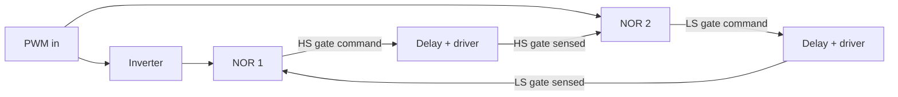

::: testing
Whether you understand **what physically happens** when both devices of a half bridge conduct and can list the *several different ways* it happens in real hardware, not just "add dead time". The interviewer is looking for:

1. The consequence: a low-impedance path from $V_{in}$ to ground, huge current spikes, heating, input droop, noise and possibly destroyed FETs.
2. Estimation: peak current is not $V_{in}/(2R_{DS(on)})$ because the devices go into saturation; energy per event times $f_{sw}$ gives the average loss.
3. Causes beyond timing: propagation-delay skew, threshold variation and, most importantly, dv/dt-induced (Miller) turn-on.
4. Mitigations at several layers: dead time (fixed, programmable, adaptive), non-overlapping logic, gate resistor/drive impedance, negative or strong turn-off, startup state.
:::

::: why
Shoot-through (cross-conduction) is the classic failure of every half-bridge and H-bridge, from a 3 A buck to a 100 kW inverter. It is also the reason the power bridge section exists: the body-diode questions ([[q0208]], [[q0209]], [[q0210]]) are the consequences of the dead time you insert to avoid it. In practice it is a debugging question too: efficiency is 3% low, the input capacitors run hot, the FETs fail at high temperature, or EMI fails at the harmonics of $f_{sw}$. Interviewers want to see you reason from the symptom to the mechanism.
:::

::: concepts
- **Half bridge**: two series switches from $V_{in}$ to ground ([[q0201]]).
- **MOSFET turn-on threshold and saturation**: current is limited by transconductance when $V_{DS}$ is large.
- **Miller capacitance ($C_{gd}$)**: couples dv/dt at the drain into the gate ([[q0206]]).
- **Dead time**: a deliberate gap where both gates are off ([[q0203]]).
- **Gate-drive impedance**: a stiff pull-down resists false turn-on.
- **CMOS complementary pair**: an NFET/PFET pair (like an inverter) also has an overlap region where both conduct.
:::

::: answer
"If both devices are on at once, you've shorted the input to ground through just the two on-resistances. In theory that's something like $V_{in}$ over 20 or 30 milliohms, hundreds of amps, though in practice the FETs go into saturation and the wiring and input capacitor limit it to tens of amps for a few nanoseconds. That pulse draws energy from the input capacitor every cycle: 50 A at 12 V for 5 ns is 3 microjoules, which at 500 kHz is 1.5 watts, a quarter of a 6.6 W converter's output. It also heats the FETs, dips the input rail, injects noise and EMI and can kill the devices.

To avoid it, the first tool is dead time: turn one device off, wait a few tens of nanoseconds, then turn the other on. The best controllers make that adaptive, sensing the gate or switch-node voltage so the gap is as small as is safe. You can also build non-overlapping logic, where each gate command is gated by the other FET's actual state.

But dead time doesn't cover everything. When the high side turns on, SW rises at several volts per nanosecond and the low side's Miller capacitance injects current into its own gate, which can push it above threshold even though its driver says off. So you also want a low-impedance turn-off path, a gate resistor on turn-on, and sometimes a negative off voltage. And make sure both gates default to off at power-up."
:::

::: technical
**Current path.** Both on: $V_{in}$ across $R_{DS(on),H}+R_{DS(on),L}+R_{par}$. Ideal limit: $12/(0.02+0.01+0.01)=300$ A. Real: each device is in saturation with $V_{DS}$ large, so $I\approx$ the saturation current set by $g_m$ and $V_{GS}$ (tens to a few hundred A for a power FET; pulsed rating), limited further by $C_{in}$ ESR/ESL and the source. Treat as *order of magnitude*; measure it.

**Loss.** Energy per event $E\approx V_{in}\,I_{pk}\,t_{ov}\times k$ ($k\approx0.5$ for a triangular pulse). For $V_{in}=12$ V, $I=50$ A, $t=5$ ns: $3\ \mu$J; at 500 kHz: $1.5$ W. For $100$ A and $10$ ns: 12 µJ and 6 W (about the entire output!).

**Dead time cost.** Body-diode conduction: $P_{dt}\approx V_{SD}\,I\,(t_{d,1}+t_{d,2})\,f_{sw}$. For 0.75 V, 2 A, 20 ns each edge: $30$ mW. So the safe design sets dead time to the smallest value that covers delay skew and edge times.

**Dv/dt-induced turn-on.** When $Q_1$ turns on, $dV_{SW}/dt$ pushes current $C_{gd}\,dv/dt$ into $Q_2$'s gate. Voltage across a pull-down impedance $R_{pd}$ is $\Delta V_{gs}\approx R_{pd}C_{gd}\,\dfrac{dv}{dt}$, capped at the capacitive divider $V_{in}\dfrac{C_{gd}}{C_{gd}+C_{gs}}$. Example: $C_{gd}=100$ pF, $C_{iss}=1$ nF, 5 V/ns: $R_{pd}=0.5$ Ω gives 0.25 V; 2 Ω gives 1.0 V; 5 Ω gives 1.2 V (capped). Hot-temperature threshold may be near 1 V: unsafe.

**Complementary NFET/PFET pair.** Both conduct whenever $V_{th,n}<V_{in,gate}<V_{dd}-|V_{th,p}|$ in a shared-gate inverter. Fast edges, separate gate drives or a break-before-make stage avoid it.

> [!UNCERTAIN]
> Peak shoot-through current depends strongly on the device, gate-drive level and loop inductance; the numbers above are illustrative orders of magnitude.
:::

::: short
"If both are on, $V_{in}$ is shorted to ground through two small $R_{DS(on)}$s. Real current is tens to hundreds of amps for nanoseconds, limited by saturation and the input cap, but it wastes energy every cycle, heats the FETs, droops $V_{in}$ and can destroy them. Avoid it with dead time, ideally adaptive, or non-overlapping gate logic. Also guard against dv/dt-induced turn-on through the Miller capacitance with a low-impedance turn-off, a gate resistor on turn-on, and safe power-up states."
:::

::: long
"If both devices conduct at once, the input rail is shorted to ground through two on-resistances. On paper that's 12 volts over 30 or 40 milliohms, hundreds of amps. In reality the FETs go into saturation, so the current is limited by their transconductance, the input capacitor's ESR and the loop inductance. You still get tens of amps for a few nanoseconds.

The cost is energy. A 50 amp pulse at 12 V for 5 ns is 3 microjoules. Do that every cycle at 500 kHz and it's 1.5 watts, which in a 6.6 W converter is a quarter of the output power. It heats the FETs, droops the input rail, rings the loop and shows up as noise, and in the worst case destroys the part.

How do you avoid it? First, dead time: turn off the conducting FET, wait, then turn on the other. A fixed dead time has to cover the worst-case delay mismatch, which wastes body-diode conduction time. Better controllers use adaptive dead time, sensing the gate voltage of the off device or the SW node, so the gap is just enough. A gate-level approach is non-overlapping logic, where each driver is only enabled when the other FET's gate is actually low.

But dead time is not enough. When the high side turns on, SW rises at a few V per ns, and the low side's Miller capacitance injects current into its gate. With a pull-down impedance of a few ohms, that raises $V_{GS}$ above threshold, especially hot. So I'd use a strong pull-down, a gate resistor on the turn-on of the high side to slow dv/dt, maybe a negative turn-off voltage, and check at the hottest and fastest condition.

Finally the boring causes: undefined states at power-up, with GPIOs floating, so add pull-downs, and firmware that drives both PWM channels without dead time."
:::

::: terms
- **Shoot-through / cross-conduction**: both switches in a leg conducting, shorting the supply.
- **Dead time ($t_d$)**: interval with both devices commanded off.
- **Adaptive (smart) dead time**: gap set by sensed gate or SW voltage.
- **Break-before-make**: turn the first off before turning the second on.
- **Miller capacitance ($C_{gd}$, $C_{rss}$)**: drain-gate capacitance that couples dv/dt into the gate.
- **dv/dt-induced turn-on**: false turn-on from capacitive coupling during fast SW edges.
- **Non-overlapping clock/gate generator**: logic that ensures two phases never overlap.
- **Pull-down impedance**: the impedance holding the off-state gate low.
:::

::: exceptional
**An average answer**: "It shorts the supply; use dead time."

**An exceptional answer**:
- Estimates the current honestly: ideal $V/R$ is a ceiling; saturation and loop impedance set the real value; gives an energy and loss estimate.
- Says the dead-time trade: too short risks shoot-through, too long loses efficiency to the body diode and adds $Q_{rr}$ ([[q0208]]).
- Names the different mechanisms: delay mismatch, $V_{th}$ variation with temperature, Miller turn-on, gate-loop ringing, undefined power-up states.
- Lists layered mitigations: dead time (fixed, programmable, adaptive), non-overlapping logic, strong pull-down, $R_g$, Miller clamp or negative drive, UVLO and pull-downs at start-up.
- Describes how to detect it: input-cap ripple current, efficiency vs dead time, current probe in the leg, hot FET at no load.
:::

::: mistakes
- **"Infinite current."** It is limited by on-resistance, saturation, the source and wiring. Large and damaging, not infinite.
- **"Dead time solves everything."** Miller-induced turn-on happens even with perfect dead time.
- **"Longer dead time is always safer."** It costs efficiency (body-diode conduction) and adds negative SW undershoot and $Q_{rr}$.
- **Believing a PFET/NFET pair cannot shoot through because they are complementary.** They conduct together in the overlap region of a shared gate drive.
- **Testing at room temperature only.** $V_{th}$ falls with temperature and propagation delays change; shoot-through margin shrinks hot.
:::

::: deep
## What physically happens

```circuit
{"caption":"Shoot-through: both gates high, supply shorted through the leg","elements":[
 {"t":"V","a":[0,2],"b":[0,14],"label":"V_{in}"},
 {"t":"wire","pts":[[0,2],[11,2]],"flow":true,"color":"red"},
 {"t":"wire","pts":[[11,14],[0,14]],"flow":true,"color":"red"},
 {"t":"nmos","at":[9,4],"label":"Q_1 on","bodyDiode":true},
 {"t":"wire","pts":[[7,4],[9,4]]},{"t":"term","at":[7,4],"label":"G_H = 1","side":"left"},
 {"t":"nmos","at":[9,10],"label":"Q_2 on","bodyDiode":true},
 {"t":"wire","pts":[[7,10],[9,10]]},{"t":"term","at":[7,10],"label":"G_L = 1","side":"left"},
 {"t":"wire","pts":[[11,6],[11,8]],"flow":true,"color":"red"},{"t":"dot","at":[11,8]},
 {"t":"wire","pts":[[11,8],[11,10]],"flow":true,"color":"red"},
 {"t":"wire","pts":[[11,12],[11,14]],"flow":true,"color":"red"},
 {"t":"wire","pts":[[11,8],[17,8]]},{"t":"term","at":[17,8],"label":"SW","side":"right"},
 {"t":"arrow","a":[3,0.6],"b":[8,0.6],"label":"I_{shoot}","color":"red"},
 {"t":"gnd","at":[11,14]}
]}
```
Figure: Both gates driven high. The only impedance between the supply and ground is $R_{DS(on),1}+R_{DS(on),2}$ plus connection and capacitor impedance. The input capacitor, not the distant source, supplies the surge, so the loop through $C_{in}$ carries a multi-amp-to-tens-of-amps spike at the switching frequency.

## How big is the current?

If you stop at Ohm's law you get $12/(20+10+10)\text{ mΩ}=300$ A. That is an upper bound. When both are on in the middle of a transition, each FET has a large $V_{DS}$ and sits in saturation:

$$I_D \approx \tfrac12 k\,(V_{GS}-V_{th})^2\ \ (\text{or }g_m(V_{GS}-V_{th})\text{ for short-channel devices})$$

For a power MOSFET with a pulsed-current rating of several hundred amps at $V_{GS}=5$ V, that is still tens to a hundred amps. In addition the loop inductance (nanohenries) limits $di/dt$, so a very short overlap gives a lower peak. The true value is easiest to measure with a current probe or a shunt in the leg.

Energy per event: $E\approx\tfrac12 V_{in}I_{pk}t_{ov}$ for a triangular spike if $V_{DS}$ stays near $V_{in}$ (device in saturation). Crude values:

| $I_{pk}$ | overlap | $E$ at 12 V (full $V_{in}$) | average power at 500 kHz |
|---|---|---|---|
| 50 A | 5 ns | 3.0 µJ | 1.5 W |
| 100 A | 10 ns | 12 µJ | 6 W |
| 20 A | 2 ns | 0.48 µJ | 0.24 W |

A 6.6 W converter cannot hide a 1.5 to 6 W loss, which is why the symptom is "low efficiency, hot FETs and hot input caps".

## Ways it happens

1. **Gate-drive skew.** Propagation delay mismatch between the two driver channels, plus $V_{th}$ and $Q_g$ spread, means the commanded gap is not the real gap.
2. **Controller or software bug.** Complementary PWM without dead time, or a reset leaving both outputs high.
3. **Undefined start-up state.** Before the MCU configures its pins they float; each gate may drift up. Use pull-downs and a driver with UVLO.
4. **dv/dt-induced turn-on (Miller).** The low side is off, but $C_{gd}$ injects charge when SW rises.
5. **Ground bounce and common-source inductance.** Large $di/dt$ in the source lead raises $V_S$ relative to the gate return and can make $V_{GS}$ look higher or lower than intended.
6. **Temperature.** $V_{th}$ falls with temperature, so a gate spike that is harmless cold can trip a hot FET.

## The Miller turn-on mechanism

When $Q_1$ turns on, SW goes from 0 to $V_{in}$ in a few nanoseconds. Through $C_{gd}$ of $Q_2$ the dv/dt forces a current

$$i = C_{gd}\frac{dv_{SW}}{dt}$$

into the gate node. The gate voltage rises by about $R_{pd}\,i$ where $R_{pd}$ is the total impedance from gate to source (driver pull-down plus gate resistor plus loop). If the gate is floating (high $R_{pd}$), the limit is the capacitive divider $V_{in}\dfrac{C_{gd}}{C_{gd}+C_{gs}}$.

```plot
{"title":"Gate spike on the OFF low-side FET versus SW dv/dt","x":{"label":"SW slew rate dv/dt","unit":"V/ns","min":0,"max":10},"y":{"label":"Spike on V_GS","unit":"V","min":0,"max":1.6},
 "vars":{"vin":12,"crss":100e-12,"ciss":1e-9},
 "series":[
  {"label":"R_pd = 0.5 Ω","fn":"min(vin*crss/ciss, 0.5*crss*x*1e9)","color":"green"},
  {"label":"R_pd = 2 Ω","fn":"min(vin*crss/ciss, 2*crss*x*1e9)","color":"orange"},
  {"label":"R_pd = 5 Ω","fn":"min(vin*crss/ciss, 5*crss*x*1e9)","color":"red"}
 ],
 "hlines":[{"at":1.0,"label":"hot V_th about 1 V (illustrative)","color":"muted"}]}
```
Figure: The spike grows with dv/dt and with the gate pull-down impedance, then saturates at the capacitive-divider limit (1.2 V here). A 2 Ω path at 5 V/ns just reaches the example's hot threshold; 5 Ω exceeds it. Fixes: lower $R_{pd}$ (Miller clamp or separate turn-off path), slower dv/dt (turn-on gate resistor), or a negative off-state gate voltage.

## Dead time as a mitigation

```timing
{"signals":[{"name":"G_H","wave":"0.1....0.....","color":"accent"},{"name":"G_L","wave":"10......1....","color":"green"}],"marks":[{"t":1,"label":"td"},{"t":7.5,"label":"td"}],"hscale":1.2}
```
Figure: Break-before-make. A deliberate dead time $t_d$ at each edge ensures $G_H$ and $G_L$ are never both high. Dead time must cover: driver delay mismatch, FET turn-off time ($t_{d(off)}+t_f$, often 20 to 50 ns), gate-loop effects and temperature drift.

Choices:

| Method | How | Pros | Cons |
|---|---|---|---|
| Fixed dead time (RC or digital delay) | Delay one edge | Simple | Must cover worst case, so wasteful |
| Programmable (resistor or register) | Set per design | Tunable | Still static |
| Adaptive / predictive | Sense $V_{GS}$ of the off FET or $V_{SW}$ to start the other | Minimum safe gap | Needs sensing, can be fooled by ringing |
| Non-overlapping logic | Each gate gated by other's feedback | Robust | Added propagation delay |


Figure: A classic non-overlapping generator. NOR 1 turns the high side on only when the input is high *and* the low-side gate has been confirmed low; NOR 2 does the opposite. The delays set the dead time and each side waits on the other's real state, not just a timer.

## Cost of too much dead time

During dead time the inductor current flows through the low-side body diode ([[q0208]]): loss $V_{SD}\,I\,t_d\,f_{sw}$ per edge, plus reverse recovery when the high side next turns on ([[q0209]]). For 0.75 V, 2 A, 20 ns each edge at 500 kHz: 30 mW. At 3 MHz with 50 ns: 450 mW. So fast converters need adaptive dead time.

## The NFET plus PFET reading

If the bridge is a complementary pair (PFET on top, NFET on bottom, like a CMOS inverter driven from one gate signal): both conduct when $V_{G}$ is between $V_{th,n}$ and $V_{DD}-|V_{th,p}|$. A slow input edge extends that region: a "short-circuit current" flows. For power stages the fix is separate gate drives with non-overlapping timing; for logic, fast input edges.

## Debugging checklist

- Scope the gate-source voltages of both FETs and SW on the same time base: look for overlap and gate bumps at SW edges.
- Measure the input current: an ac-coupled current probe on the high-side drain shows spikes at both edges.
- Vary dead time: efficiency vs dead time should show a peak; shorter than the peak drops efficiency sharply (shoot-through), longer drops it slowly.
- Warm the board: dead-time margin shrinks hot.

```sim
{"id":"h-bridge-lab","mode":"half"}
```
Figure: Turn on both switches to see the shoot-through path and fault warning, and use the dead-time timing view to see the safe break-before-make sequence.
:::

::: applications
- **Synchronous buck/boost ICs** with internal adaptive dead time, usually 10 to 30 ns.
- **Motor half/H-bridges**: both FETs of a leg must never be on together; many drivers include shoot-through protection and programmable dead time.
- **Inverters (solar, motor drive)**: IGBT/SiC legs with 0.5 to 3 µs dead time and Miller clamp or negative gate drive.
- **Class-D audio amplifiers**: dead time sets distortion vs shoot-through trade.
- **CMOS logic and output buffers**: short-circuit current during edges, one reason slow edges burn power.
:::

::: assumptions
- **Silicon MOSFET half bridge at 12 V and 500 kHz**; for GaN the overlap is shorter and edges faster, requiring tighter timing; for IGBTs dead times are microseconds.
- **Numbers (current, overlap time)** are illustrative; actual peak current depends on device, drive voltage and loop.
- **dv/dt**: 5 V/ns is typical of a fast low-voltage converter; slower with gate resistors.
- **Threshold at hot** near 1 V is an example for a logic-level device; check the datasheet's $V_{th}$ range and temperature coefficient.
- If the question refers to a **complementary NFET/PFET pair**, the answer is the same in outcome but the cause is shared gate-drive overlap rather than separate drivers.
:::

::: followups
### How does adaptive dead time work?
The controller monitors either the gate voltage of the device that is turning off or the SW node. When it sees $V_{GS}$ below a threshold (say 1 V) or SW crossing a level, it enables the other gate after a short delay. This tracks temperature, load current and FET differences instead of using a worst-case fixed delay. Pitfall: ringing can trip the sensor, so blanking is needed.

### How much dead time should I use?
Enough to cover the slowest turn-off (about $t_{d(off)}+t_f$, often 20 to 50 ns including driver delay) plus margin for mismatch and temperature; verify at hot with the scope. Typically 10 to 50 ns for a 1 MHz silicon buck. Too long wastes efficiency and amplifies body-diode side effects ([[q0209]]).

### The low-side gate shows a 2 V spike when SW rises, but dead time is fine. What do you do?
It is Miller coupling. Options: reduce the high-side turn-on speed (add $R_g$ or boot resistor) to cut dv/dt, lower the low-side turn-off impedance (a driver with a low pull-down, short loop, or a Miller clamp), use a FET with a smaller $C_{rss}/C_{iss}$ ratio, or add a negative turn-off voltage. At 5 V/ns and 100 pF the displacement current is 0.5 A.

### What if the PWM controller resets and both gates float?
If pull-downs are absent, the gates may float to partial voltages, causing partial conduction. Use gate pull-down resistors (10 to 100 kΩ) and a driver with UVLO and defined outputs, and keep MCU pins in a known state on reset.

### An engineer says shoot-through is harmless because it lasts only 5 ns. How do you respond?
Do the energy: 50 A at 12 V for 5 ns is 3 µJ per cycle; at 500 kHz that is 1.5 W, 23% of a 6.6 W converter. Not harmless. And it repeats on every cycle, heating the FETs, stressing the input capacitors with extra ripple current and coupling noise into the rest of the board.
:::

::: interpretations
The question names an "NFET and PFET", which suggests the complementary bridge (PFET high side, NFET low side), the topic of Q204. The section note says the buck bridge is usually NFET/NFET, so the answer covers both. "How do you avoid this?" is mainly about dead time and drive design; a complete answer also mentions the Miller mechanism and startup states.
:::

::: references
- Erickson & Maksimovic, *Fundamentals of Power Electronics*: switching losses and MOSFET dynamics in converters.
- Mohan, Undeland & Robbins, *Power Electronics*: gate-drive circuits and MOSFET switching, including shoot-through in bridge legs.
- Texas Instruments and other vendors' gate-driver application notes on dv/dt-induced turn-on, Miller clamp and dead time.
- Sedra & Smith, *Microelectronic Circuits*: CMOS inverter short-circuit current during transitions.
:::

::: rubric
- States both devices on shorts $V_{in}$ to ground through the two $R_{DS(on)}$s :: The direct physical answer.
- Notes the current is limited by saturation/loop, not infinite, but very large and damaging :: Shows judgment, not a textbook "infinite current".
- Estimates energy/loss ($V I\,t\,f$) :: Shows engineering quantification.
- Gives dead time as the main fix and the trade-off against body-diode loss :: Core of the second half of the question.
- Mentions adaptive dead time or non-overlapping logic :: Shows knowledge of real implementations.
- Mentions Miller/dv/dt-induced turn-on and mitigations :: Distinguishes a strong answer.
- Mentions startup/UVLO/pull-downs and temperature margin :: Practical reliability details.
:::

::: quiz
```json
[
 {"type":"mcq","level":"fundamental","q":"What is shoot-through in a half bridge?","options":["Both switches off at once","Both switches conducting at once, shorting the supply through the leg","The inductor saturating","The body diode recovering"],"answer":1,"explain":"Shoot-through (cross-conduction) is overlap of conduction in the high-side and low-side devices, creating a low-impedance path from $V_{in}$ to ground."},
 {"type":"numeric","level":"intermediate","q":"A 12 V half bridge sees 50 A of shoot-through for 5 ns on every cycle. Treating the pulse as rectangular at full $V_{in}$, what is the energy per event?","answer":3,"tolerance":0.02,"unit":"µJ","explain":"$E=V I t=12\\times50\\times5\\times10^{-9}=3\\times10^{-6}$ J = 3 µJ."},
 {"type":"numeric","level":"intermediate","q":"Same event at 500 kHz. What is the average power lost, in W?","answer":1.5,"tolerance":0.02,"unit":"W","explain":"$P = E f = 3\\ \\mu\\text{J}\\times500\\text{ kHz}=1.5$ W."},
 {"type":"numeric","level":"intermediate","q":"The off low-side FET has $C_{gd}=100$ pF, a total gate pull-down impedance of 2 Ω and SW rises at 5 V/ns. Ignoring the capacitive-divider limit, what is the gate spike?","answer":1.0,"tolerance":0.03,"unit":"V","explain":"$I = C\\,dv/dt = 100\\text{ pF}\\times5\\times10^{9}=0.5$ A; $V=IR=0.5\\times2=1.0$ V, close to a hot $V_{th}$."},
 {"type":"mcq","level":"advanced","q":"Dead time is correctly set but the low-side gate still shows a bump above threshold when SW rises. The most likely mechanism and fix?","options":["Slow driver; make dead time longer","Miller (dv/dt) coupling through $C_{gd}$; lower the off-state gate impedance or slow the high-side edge","Body-diode recovery; increase $V_{in}$","Inductor saturation; use a bigger inductor"],"answer":1,"explain":"Dead time does not prevent capacitive coupling. A stiffer pull-down, Miller clamp, negative off voltage or a slower turn-on of the other FET reduces the spike."},
 {"type":"truefalse","level":"advanced","q":"Increasing dead time always improves efficiency because it removes any chance of overlap.","answer":false,"explain":"Longer dead time lengthens body-diode conduction ($V_{SD}\\,I\\,t_d\\,f_{sw}$) and adds recovery and undershoot effects. Efficiency vs dead time has an optimum."}
]
```
:::
