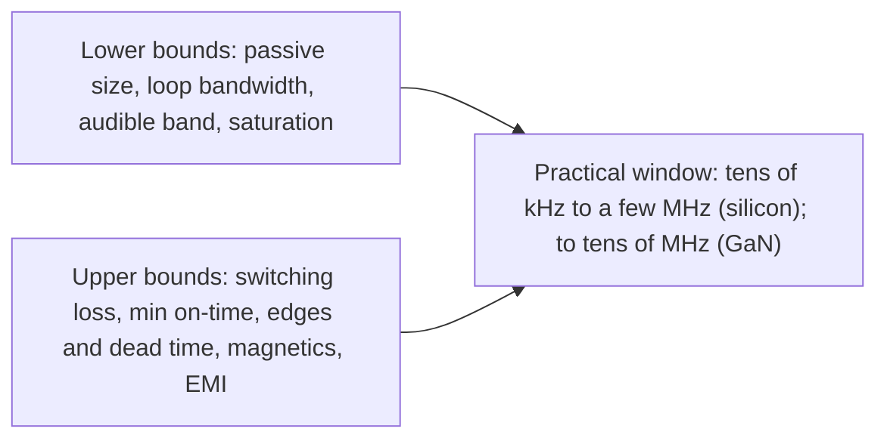

::: testing
Whether you can bound a design parameter from **both sides with physics and numbers**, including absurd extremes, which the interviewer is explicitly asking about (1 THz and 1 Hz). The interviewer is looking for:

1. Upper limits: switching loss scaling with $f$, minimum on-time ($f_{max}=D/t_{on,min}$), finite edge times and gate drive, inductor core and AC winding loss, EMI, and thermal limits.
2. Lower limits: inductor and capacitor size for ripple ($\propto1/f$), loop bandwidth ($f_c\lesssim f_{sw}/10$), audible noise, saturation/peak current, transient response.
3. Order-of-magnitude arithmetic for the extremes, done live.
4. Recognition of how the limits move with technology (GaN, better magnetics) and with $V_{in}/V_{out}$.
:::

::: why
Every buck design picks $f_{sw}$ between a lower bound set by passive size and control bandwidth and an upper bound set by losses, timing and EMI. Showing you can derive those bounds, and not just say "300 kHz to 2 MHz is typical", is how an interviewer sees engineering judgment. The absurd-extreme framing ("1 THz or 1 Hz") rewards a quick estimation answer.
:::

::: concepts
- **Frequency-proportional losses**: $k_{sw}f$ ([[q0216]]).
- **Ripple sizing**: $L,C\propto1/f$ for fixed ripple ([[q0212]]).
- **Minimum on-time**: shortest pulse the driver and FET can produce.
- **Loop bandwidth**: crossover must be well below $f_{sw}$ ([[q0244]]).
- **EMI regulation bands** and **audible band** (about 20 Hz to 20 kHz).
- **Finite switch speed**: rise and fall times, gate charge.
:::

::: answer
"Both ends have hard limits, and the limits are about energy per cycle and size.

At the top, every cycle costs a fixed bit of energy: overlap, gate charge, $C_{oss}$, recovery. For a 12 V to 3.3 V, 2 A converter that's about 0.27 microjoules per cycle, so power grows linearly: 135 milliwatts at 500 kilohertz and several watts at tens of megahertz. There's also the minimum on-time: the pulse has to be longer than the driver delay plus FET rise time, say 50 ns, and the duty cycle is $D/f$, so for 12 V to 1.2 V the frequency can't exceed $D/t_{on,min}=2$ MHz. Beyond that, inductor core and AC winding losses, EMI and thermal limits.

At the bottom, passives get huge: inductance goes as $1/f$. For 1 A of ripple and 10 mV, you need 120 microhenries and 625 microfarads at 20 kHz. Also the control loop crossover has to be well below $f_{sw}$, so low frequency means slow transient response, and below 20 kHz the converter can be audible through the ceramic capacitors and inductor.

So at 1 THz the period is 1 picosecond, and light travels 0.3 millimeters in that time. The FET can't switch in that time, the on-pulse would be 0.3 picoseconds, and the gate drive and switching losses would be around 270 kilowatts. At 1 Hz you'd need a 2.4 henry inductor and a 12 farad capacitor for the same ripple, or with a normal 4.7 microhenry part the ripple current would be about 500 kiloamps, and the converter takes seconds to respond."
:::

::: technical
**Upper bounds.**
- **Switching loss**: $P_{sw}=k_{sw}f$, $k_{sw}\approx2.69\times10^{-7}$ J for the reference converter ($E_{overlap}+E_{C_{oss}}+E_{gate}+E_{dead}+E_{rr}$). 500 kHz: 0.135 W. 5 MHz: 1.35 W. 1 THz: $2.7\times10^{5}$ W (not physically meaningful since edges exceed the period).
- **Minimum on-time**: $D/f\ge t_{on,min}$ (typically 30 to 150 ns for integrated converters, a few ns for GaN with fast drivers). $f_{max}=D/t_{on,min}$: 12 V to 3.3 V, 50 ns: 5.5 MHz; 12 V to 1.2 V ($D=0.1$): 2 MHz; 48 V to 1 V ($D=0.021$): 0.4 MHz.
- **Dead time and edges**: when $t_d+t_r+t_f$ approaches $DT$, the converter loses control range.
- **Magnetics**: core loss $\propto f^\alpha\Delta B^\beta$; AC winding loss rises (skin and proximity) so the smallest inductors cannot reach their DC resistance.
- **Gate-drive power**: $Q_gVf$ per FET.
- **EMI**: harmonics reach the radiated range; regulatory bands (e.g. AM broadcast, roughly 0.5 to 1.7 MHz) restrict where the fundamental may sit in some products.
- **Control**: propagation delays (comparator, driver) become a significant fraction of the period.

**Lower bounds.**
- **Passives**: for $\Delta I=1$ A and $\Delta V=10$ mV (12 V to 3.3 V): $L=V_{out}(1-D)/(f\Delta I)=2.39\,\text{V}\cdot\text{s}/(f\cdot1\text{ A})$ and $C=\Delta I/(8f\Delta V)$:
| $f$ | $L$ | $C$ |
|---|---|---|
| 1 Hz | 2.4 H | 12.5 F |
| 20 kHz | 120 µH | 625 µF |
| 500 kHz | 4.8 µH | 25 µF |
| 1 MHz | 2.4 µH | 12.5 µF |
- **Loop bandwidth**: $f_c\approx f_{sw}/10$ to $f_{sw}/5$; for $f_c$ of 50 kHz you need $f_{sw}\ge250$ to 500 kHz or accept a sluggish response and large $C_{out}$.
- **Audible noise**: $f_{sw}<20$ kHz (and PFM bursts) can excite capacitors (piezoelectric effect in ceramics) and magnetics.
- **Peak current**: with fixed $L$, $\Delta I\propto1/f$; at low $f$, $I_{pk}$ saturates the inductor: 4.7 µH at 1 Hz would see $\Delta I=509$ kA.

**Extremes.** 1 THz: period 1 ps; $t_{on}=0.28$ ps; light travels 0.3 mm per ps, so even a 1 mm trace is electrically long. 1 Hz: $T=1$ s; the output would sag/swing within each cycle unless $L$ and $C$ are enormous.

> [!UNCERTAIN]
> Minimum on-time and dead-time figures vary widely (GaN controllers reach a few ns; many integrated bucks quote 30 to 150 ns). EMI-band restrictions depend on the product standard (for example automotive vs ITE).
:::

::: short
"Upper limit: switching loss scales with frequency, the pulse can't be shorter than the minimum on-time ($f_{max}=D/t_{on,min}$, 2 MHz for 12 V to 1.2 V with 50 ns), plus core loss, EMI and edge times. Lower limit: $L$ and $C$ scale as $1/f$, so 1 A and 10 mV at 20 kHz needs 120 µH and 625 µF, the loop crossover must stay below $f_{sw}/10$, and below 20 kHz it's audible. At 1 THz the period is 1 ps, shorter than any FET edge; at 1 Hz you'd need a 2.4 H inductor and a 12 F capacitor."
:::

::: long
"There are hard limits on both sides.

At the top, the main limit is energy per cycle. Every cycle you charge the gates, charge and discharge $C_{oss}$, have a transition with voltage and current overlapping, and some diode recovery. For my 12 V to 3.3 V, 2 A converter that adds up to about 0.27 microjoules per cycle, so loss is linear in frequency: 135 milliwatts at 500 kilohertz, over a watt at 5 megahertz. The second limit is minimum on-time. The high side has to stay on at least as long as the driver delay plus rise time, around 50 nanoseconds, and the on-time is $D/f$. So with 12 V to 1.2 V, $D=0.1$, the frequency can't exceed $D$ over $t_{on,min}$, 2 megahertz; at 48 V to 1 V it's only 400 kilohertz. Other limits: inductor core loss and AC winding loss, EMI and radiated bands, and the control loop's propagation delays.

At the bottom, passives get big. The inductance for a given ripple goes as $1/f$ and the capacitance too. For 1 amp of ripple and 10 millivolts, I'd need 120 microhenries and 625 microfarads at 20 kilohertz, versus 5 microhenries and 25 microfarads at 500 kilohertz. The control loop crossover has to be well below $f_{sw}$, typically a tenth, so low frequency means a slow transient response and big output capacitance. And under 20 kilohertz the converter can be audible.

Now the silly limits. 1 THz: the period is 1 picosecond. Light moves 0.3 millimeters in that time, so even the gate trace is a transmission line, the FET takes nanoseconds to switch, the on-pulse would be under a picosecond and the switching loss would be about 270 kilowatts. It's physically impossible. 1 Hz: the converter would need a 2.4 henry inductor and a 12 farad capacitor for the same ripple. With a normal 4.7 microhenry part the current would ramp to about half a megaamp in half a second. It would also respond to load changes in seconds. So the real range is about tens of kHz to several MHz for silicon, tens of MHz for GaN with special care."
:::

::: terms
- **Minimum on-time ($t_{on,min}$)**: shortest high-side pulse the controller and FET can generate.
- **Maximum frequency**: $f_{max}=D/t_{on,min}$.
- **Frequency-proportional loss**: energy per cycle times $f$.
- **Crossover frequency ($f_c$)**: loop gain 0 dB frequency.
- **Skin and proximity effect**: AC winding resistance increase.
- **Audible noise**: acoustic emission in the 20 Hz to 20 kHz band.
- **Propagation delay**: input to output delay of the driver/comparator.
- **Core loss**: magnetic loss increasing with frequency.
:::

::: exceptional
**An average answer**: "High frequency means switching loss, low frequency means big components."

**An exceptional answer**:
- Names at least four upper limits (switching loss, minimum on-time with a formula, edge/dead-time, magnetics and EMI) and four lower limits (passive size, loop bandwidth, audible noise, saturation/peak current).
- Quantifies with a worked estimate ($k_{sw}f$, $f_{max}=D/t_{on,min}$, $L,C\propto1/f$ with a table).
- Evaluates the 1 THz and 1 Hz cases explicitly (picosecond period vs edge time, 270 kW, 2.4 H and 12 F).
- Notes how technology shifts the upper bound (GaN, soft switching, better cores) and how $V_{in}/V_{out}$ ratio affects it.
- Points out that practical choice is a design window (EMI bands, transient needs), not either extreme.
:::

::: mistakes
- **Only mentioning switching loss at the upper end.** Minimum on-time often caps frequency first at large step-down ratios.
- **Saying the lower limit is "ripple" only.** Loop bandwidth, audible noise and saturation matter too.
- **Treating $f_{sw}$ as free for GaN.** It still has gate, $C_{oss}$ and magnetics limits, and layout inductance becomes dominant.
- **Forgetting dead time and edges** as a fraction of the period at MHz frequencies.
- **Quoting $f_{max}=1/t_{on,min}$.** It is $D/t_{on,min}$ since the pulse is a fraction of the period.
:::

::: deep
## Upper limits, one at a time

### 1. Energy per cycle

Each switching event dissipates a roughly fixed energy, so $P=Ef$. For the reference converter the energy per cycle is

| Source | Energy per cycle (nJ) |
|---|---|
| Overlap ($\tfrac12V_{in}I\,(t_r+t_f)$) | 120 |
| Reverse recovery ($Q_{rr}V_{in}$) | 60 |
| Dead-time diode conduction | 45 |
| Gate drive | 30 |
| $C_{oss}$ | 14 |
| **Total** | **269** |

$P=269\text{ nJ}\times f$: 27 mW at 100 kHz, 135 mW at 500 kHz, 538 mW at 2 MHz, 1.35 W at 5 MHz.

```plot
{"title":"Frequency-proportional switching loss vs frequency (reference converter)","x":{"label":"Switching frequency","unit":"Hz","min":1000,"max":1e12,"log":true},"y":{"label":"Switching-related loss","unit":"W","min":0.0001,"max":1e6,"log":true},
 "series":[{"label":"E_cycle x f, E = 269 nJ","fn":"2.694e-7*x","color":"red"}],
 "hlines":[{"at":1,"label":"1 W: a typical thermal budget for a 6.6 W converter is about 0.5 W","color":"muted"}],
 "vlines":[{"at":5000000,"label":"5 MHz","color":"orange"},{"at":1e12,"label":"1 THz","color":"muted"}]}
```
Figure: The loss grows linearly, a straight line on log-log axes with slope 1. It crosses 1 W at about 3.7 MHz for this device set. At 1 THz the formula gives 270 kW, but the physics fails long before: edges take nanoseconds, longer than the period. Better devices (GaN) lower the energy per cycle and move the crossing out by an order of magnitude.

### 2. Minimum on-time

The controller, gate driver and FET need a minimum pulse: current-sense blanking (50 to 100 ns), driver propagation delay, FET rise time. A pulse of $t_{on}=D/f$ cannot be shorter than $t_{on,min}$:

$$f_{max}=\frac{D}{t_{on,min}}=\frac{V_{out}}{V_{in}\,t_{on,min}}.$$

| Conversion | $D$ | $f_{max}$ at 50 ns |
|---|---|---|
| 12 V to 3.3 V | 0.275 | 5.5 MHz |
| 12 V to 1.2 V | 0.1 | 2.0 MHz |
| 48 V to 1 V | 0.021 | 0.42 MHz |
| 5 V to 1.2 V | 0.24 | 4.8 MHz |

So the upper limit gets *lower* as the step-down ratio gets larger. That is why 48 V to 1 V converters are often two-stage. Above $f_{max}$ controllers skip pulses (the output becomes noisy and load regulation degrades).

### 3. Edges, dead time and drive

The effective duty is reduced by dead time, and the edges consume part of the pulse: $t_{on,eff}\approx DT-t_d-t_r$. At 5 MHz ($T=200$ ns) a 30 ns dead time and 5 ns edges are 18% of the period. The gate driver must source/sink $Q_g/t_r$ amps: 3 nC in 5 ns is 0.6 A.

### 4. Magnetics, EMI, thermal

- Core loss rises with $f$ for a given flux swing; ferrites are needed above about 1 MHz, and AC winding loss (skin depth in copper at 1 MHz is about 66 µm) pushes toward thin-layer windings.
- EMI: the harmonics of the SW edge extend to hundreds of MHz; high $f_{sw}$ brings more harmonics into regulated bands. In many products the fundamental is kept out of the AM band.
- Thermal: the extra switching loss must be removed by the same package.

## Lower limits, one at a time

### 1. Passive size

For ripple current $\Delta I$ and ripple voltage $\Delta V$:

$$L=\frac{V_{out}(1-D)}{f\,\Delta I},\qquad C=\frac{\Delta I}{8f\,\Delta V}.$$

```plot
{"title":"Passives needed for 1 A ripple current and 10 mV ripple (12 V to 3.3 V, ESR ignored)","x":{"label":"Switching frequency","unit":"Hz","min":10,"max":10000000,"log":true},"y":{"label":"Value (µH or µF)","unit":"","min":0.1,"max":1000000000,"log":true},
 "series":[{"label":"Inductance (µH)","fn":"2.3925e6/x","color":"accent"},{"label":"Capacitance (µF)","fn":"1.25e7/x","color":"orange"}],
 "vlines":[{"at":20000,"label":"20 kHz (audible edge)","color":"muted"}]}
```
Figure: Both required values fall as $1/f$ (slope $-1$ on log-log axes). At 1 MHz you need 2.4 µH and 12.5 µF; at 20 kHz, 120 µH and 625 µF; at 10 Hz the inductor is hundreds of mH. Real components get bigger, costlier, with higher DCR and ESR, long before an unrealistic 1 Hz.

### 2. Loop bandwidth and transient response

The duty cycle is updated once per period, so the loop crossover is limited to $f_{sw}/5$ to $f_{sw}/10$ (sampling delay of half to one period adds phase lag). The output capacitor needed for a load step is $C\approx\Delta I_{step}/(2\pi f_c\Delta V)$: dropping $f_c$ tenfold needs ten times the capacitor ([[q0244]]).

### 3. Audible and mechanical

Below about 20 kHz the switching harmonics fall in the audible band. Ceramic capacitors flex (piezoelectric effect) and inductors magnetostrict, so a 10 kHz converter or a PFM burst at light load can sing. Many designs set a floor at 25 kHz or more.

### 4. Peak current and saturation

At fixed $L$, $\Delta I=V_{out}(1-D)/(Lf)$: for 4.7 µH it is 1 A at 500 kHz, 25 A at 20 kHz, and 509 kA at 1 Hz. The inductor would saturate far below that, so $L$ must scale up to keep the peak current within its rating.

## The extremes

**1 THz.** $T=1$ ps. Nothing in a power stage can do this: the FET's gate charge needs nanoseconds, so rise time is $>$ the period; with $D=0.275$ the on-time is 0.275 ps; the signal travels 0.3 mm per ps, so any wire is a transmission line with phase delays of many cycles; the formal switching loss is $2.7\times10^5$ W; and skin depth in copper is only about 2 µm, so conductors are extremely lossy. At those frequencies you are building a radio transmitter, not a power converter.

**1 Hz.** $T=1$ s: for 1 A ripple and 10 mV you need 2.4 H and 12.5 F: not buildable. With a normal 4.7 µH inductor the current ramps at $(V_{in}-V_{out})/L=1.85$ MA/s, so in 0.275 s it would reach half a megaamp. The converter would effectively be bang-bang. Also the control loop could not respond faster than seconds.

## The design window



Typical choices: 100 to 500 kHz for efficiency-driven or high-voltage converters; 500 kHz to 2 MHz for POL converters; 2 to 10 MHz for GaN or small-form-factor designs; above that, special integrated-magnetics or on-die inductors.

```sim
{"id":"buck-lab","vin":12,"vout":1.2,"iout":2,"fsw":2000000,"l":1e-6,"c":22e-6,"view":"waveforms"}
```
Figure: Set $V_{out}$ to 1.2 V ($D=0.1$) and 2 MHz: the on-time is only 50 ns. Raise $f_{sw}$ further and the on-time shrinks toward what a real controller can produce. Then lower $f_{sw}$ to 50 kHz with the same $L$ and watch the inductor ripple current grow toward saturation.
:::

::: applications
- **Automotive 48 V or 12 V to 1 to 3.3 V**: minimum on-time limits single-stage frequency; two-stage or lower $f_{sw}$ used.
- **GaN-based USB-PD chargers**: 1 to 3 MHz for small magnetics.
- **Class-D audio and motor drive**: PWM above 20 kHz to be inaudible.
- **On-die and in-package voltage regulators**: tens to hundreds of MHz with tiny integrated inductors and low voltage (high-frequency limit extended by short edges).
- **Low-power energy-harvesting converters**: very low frequency PFM to minimize switching loss, accepting large ripple.
:::

::: assumptions
- **Silicon MOSFET buck**, edges of a few ns, 5 V gate drive; GaN extends all upper bounds by 5 to 10 times.
- **Energy per cycle** of 269 nJ is for the reference design; other parts differ.
- **Minimum on-time** of 50 ns is typical for integrated bucks; adjustable by design.
- **Passive values** are idealized (no ESR, DC bias or saturation); real values are worse.
- **Extremes** (1 THz, 1 Hz) are order-of-magnitude arguments, meant to show the scaling.
:::

::: followups
### What actually limits frequency in a 48 V to 1 V converter?
Minimum on-time: $D=0.021$, so the on-pulse is only $0.021/f$: 21 ns at 1 MHz. With a 50 ns minimum, $f_{max}=0.42$ MHz. In addition the switching loss scales with 48 V. Designers use two stages (48 to 12 to 1) or a tapped inductor/transformer topologies to avoid the extreme duty cycle.

### Why is the control loop a limit at low frequency?
The duty cycle can only be changed once per period, so the loop behaves as a sampled system; keeping stability requires crossover below about $f_{sw}/5$ to $f_{sw}/10$. At 20 kHz that means crossover under 4 kHz, so a load step is corrected slowly and the output capacitor must hold the step for hundreds of microseconds ($C\approx\Delta I/(2\pi f_c\Delta V)$).

### How does GaN change the upper limit?
Lower $Q_g$ and $C_{oss}$ and no $Q_{rr}$ reduce energy per cycle several times; faster edges shrink minimum on-time (a few ns). With careful layout (sub-nH loops) designs run at 2 to 10 MHz. The limit then moves to magnetics, EMI and minimum on-time of the controller.

### Could a buck work at 1 kHz?
Electrically yes, with enormous passives: scaling the 1 MHz values (2.4 µH and 12.5 µF for 1 A and 10 mV) by 1000 gives 2.4 mH and 12.5 mF. It would be audible and slow to respond, so it is only used in special cases such as pulsed energy-harvesting converters.

### If efficiency were free, what would you set the frequency to?
As high as the minimum on-time, loop and EMI constraints allow, to shrink the inductor and capacitor, which dominate size and cost. Efficiency is the force that stops you, together with the other upper bounds.
:::

::: interpretations
The question asks for the limits on both ends and why 1 THz or 1 Hz are impossible. The answer treats them as order-of-magnitude arguments, and gives both the physics (period vs edge times, energy per cycle) and the engineering (passive size, loop bandwidth). Q216 is the smooth efficiency/ripple trade; Q221 asks about performance more broadly.
:::

::: references
- Erickson & Maksimovic, *Fundamentals of Power Electronics*: switching loss, magnetics design at high frequency and converter control bandwidth limits.
- Mohan, Undeland & Robbins, *Power Electronics*: switching frequency considerations for converters.
- Texas Instruments, *Basic Calculation of a Buck Converter's Power Stage* (SLVA477): ripple sizing vs frequency.
- Buck controller datasheets: minimum on-time, maximum switching frequency vs input/output voltage.
:::

::: rubric
- Names switching loss proportional to $f$ with a number :: Primary upper limit.
- Names minimum on-time and gives $f_{max}=D/t_{on,min}$ :: Often the actual limit for large step-down ratios.
- Names inductor/capacitor size scaling as $1/f$ as the lower limit, with numbers :: Primary lower limit.
- Names loop bandwidth ($f_{sw}/10$) and audible noise :: Control and acoustic lower limits.
- Mentions EMI and magnetics (core/AC loss) as upper limits :: Practical high-frequency barriers.
- Handles 1 THz (period vs edge time, 270 kW) and 1 Hz (2.4 H, 12 F) quantitatively :: Directly answers the "why can't" part.
- Notes technology shifts (GaN) and that the answer is a window :: Complete judgment.
:::

::: quiz
```json
[
 {"type":"mcq","level":"fundamental","q":"Which is the main reason a buck converter can't be run at 1 THz?","options":["Inductors have infinite inductance","The period is shorter than the switch transition times and the switching loss would be enormous","Capacitors have infinite ESR","The input voltage is too high"],"answer":1,"explain":"At 1 THz the period is 1 ps; MOSFET edges take ns, and loss (energy per cycle times $f$) would reach hundreds of kilowatts."},
 {"type":"numeric","level":"intermediate","q":"Minimum on-time is 50 ns and $D=0.1$ (12 V to 1.2 V). Maximum switching frequency in MHz?","answer":2,"tolerance":0.02,"unit":"MHz","explain":"$f_{max}=D/t_{on,min}=0.1/(50\\times10^{-9})=2\\times10^6$ Hz."},
 {"type":"numeric","level":"intermediate","q":"Energy per cycle is 269 nJ. What is the switching-related loss at 5 MHz, in W?","answer":1.35,"tolerance":0.02,"unit":"W","explain":"$P=Ef=269\\times10^{-9}\\times5\\times10^6=1.345$ W."},
 {"type":"numeric","level":"intermediate","q":"For 1 A ripple current ($V_{out}=3.3$ V, $D=0.275$), what inductance is needed at 20 kHz, in µH?","answer":120,"tolerance":0.02,"unit":"µH","explain":"$L=3.3\\times0.725/(2\\times10^4\\times1)=1.196\\times10^{-4}$ H = 120 µH."},
 {"type":"numeric","level":"advanced","q":"For 1 A ripple and 10 mV (ESR ignored), what capacitance is needed at 20 kHz, in µF?","answer":625,"tolerance":0.02,"unit":"µF","explain":"$C=\\Delta I/(8f\\Delta V)=1/(8\\times2\\times10^4\\times0.01)=6.25\\times10^{-4}$ F = 625 µF."},
 {"type":"truefalse","level":"advanced","q":"For a fixed minimum on-time, the maximum switching frequency rises as the step-down ratio gets larger (lower $D$).","answer":false,"explain":"$f_{max}=D/t_{on,min}$, so a smaller $D$ lowers the maximum frequency: 48 V to 1 V is far more restricted than 12 V to 3.3 V."}
]
```
:::
