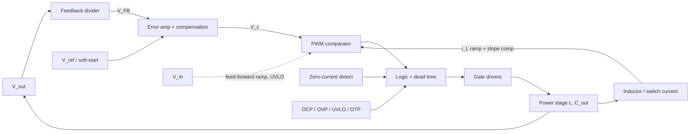

::: testing
Whether you can look at a buck converter as a **control system** and name what it measures and why. A good answer is organised by purpose, not a random list:

1. The regulated variable ($V_{out}$) and the reference it is compared to.
2. The inner-loop variable ($i_L$) in current-mode control, and its roles in limiting and protection.
3. Disturbance signals ($V_{in}$, load current) used for feed-forward, droop and mode decisions.
4. Supervisory signals (switch-node voltage for zero-crossing, bias/bootstrap, temperature, power-good).
:::

::: why
Most "why does my supply oscillate/droop/blow up" problems trace back to a signal the controller sees badly, or one it doesn't see at all. Knowing which signal feeds which block ($V_{out}$ to the error amp, $i_L$ to the PWM comparator and limit, $V_{in}$ to feed-forward and UVLO) is the map you need for debugging, for choosing between voltage-mode and current-mode ([[q0252]]), and for reading any controller datasheet block diagram.
:::

::: concepts
- **Negative feedback on $V_{out}$**: the error between $V_{ref}$ and the sensed output drives the duty cycle. See [[q0223]].
- **Inner current loop**: in current-mode control, $i_L$ is compared with the error amplifier output, making the inductor a controlled current source. See [[q0252]].
- **Feed-forward**: a measured disturbance ($V_{in}$) is used to correct the duty cycle ahead of the feedback. 
- **Protection signals**: over-current, over-voltage, under-voltage lockout and thermal shutdown. See [[q0226]].
- **Plant dynamics**: the output LC filter has a double pole at $1/(2\pi\sqrt{LC})$ that the loop must compensate. See [[q0244]].
- **Mode detection**: zero-current detection from the switch node or low-side FET decides DCM/PFM behaviour.
:::

::: answer
"The main one is the output voltage, scaled by the feedback divider and compared with the reference in the error amplifier. That's the regulation loop: it sets the duty cycle to hold $V_{out}$ constant.

Next is the inductor current. In current-mode control, the sensed inductor or switch current is compared to the error amplifier's output, which gives a fast inner loop, makes the converter easier to compensate, and provides cycle-by-cycle current limiting and protection. Slope compensation is added to that signal to prevent subharmonic oscillation.

Then the input voltage. In voltage mode, the PWM ramp is often made proportional to $V_{in}$, which is feed-forward: if the input jumps, the duty cycle corrects instantly instead of waiting for the loop. $V_{in}$ is also monitored for under-voltage lockout.

Beyond that, the load current can be used for droop or telemetry, the switch-node voltage or low-side current for zero-crossing detection in light-load modes, the gate-drive and bootstrap supply for UVLO, and temperature for thermal shutdown. $V_{out}$ is also watched separately for over-voltage and power-good."
:::

::: technical
**Regulation loop.** $V_{FB}=V_{out}R_2/(R_1+R_2)$ compared to $V_{ref}$; the error amplifier with compensation produces $V_c$. In voltage mode $D=V_c/V_{ramp}$; in peak current mode the switch turns off when $R_i\,i_L+\text{slope ramp}=V_c$.

**Plant.** From duty to output: a double pole at $f_0=\frac{1}{2\pi\sqrt{LC}}$ (15.7 kHz for 4.7 µH and 22 µF), an ESR zero at $\frac{1}{2\pi\,ESR\,C}$ (1.45 MHz for 5 mΩ), and $Q=R\sqrt{C/L}$. Voltage-mode gain $V_{in}/V_{ramp}$ scales with $V_{in}$: with $V_{ramp}=1.2$ V, 20 dB at 12 V but 26 dB at 24 V, unless the ramp is made proportional to $V_{in}$ (feed-forward). In current mode, $i_L$ feedback moves the power-stage response to a single dominant pole plus a high-frequency sampling double pole at $f_{sw}/2$.

**Slope compensation.** The ramp is added to the sensed current: required $m_a\ge0.5\,m_2$ with $m_2=V_{out}/L$ (0.35 A/µs minimum for 3.3 V and 4.7 µH). See [[q0255]].

**Other signals.**
- Load/inductor current limit: peak, valley or average.
- Zero-current detect for DCM/PFM: switch-node voltage or $V_{DS}$ of the low-side FET.
- UVLO on $V_{in}$ and on the gate-drive/bootstrap voltage.
- OVP/UVP window on $V_{out}$ (power-good), OTP on junction temperature.
:::

::: short
"The key one is $V_{out}$ through the feedback divider into the error amplifier, which sets the duty cycle. In current-mode control the inductor current is the inner loop and also gives cycle-by-cycle limiting. $V_{in}$ is used for feed-forward in voltage mode and for UVLO. Switch-node or low-side current detects zero crossing for light-load modes, and temperature, bias voltage and a power-good window on $V_{out}$ cover protection."
:::

::: long
"I'd group the signals by what they're doing.

First, the thing being regulated: the output voltage. It goes through the feedback divider into the error amplifier, which compares it with the reference and produces a control voltage. In voltage mode that sets the duty cycle by comparing to a ramp. In current mode it sets the peak inductor current target.

Second, the inductor current. In current-mode control it's the inner loop. The sensed current is compared to the control voltage, so the inductor behaves like a current source, the output LC double pole effectively collapses into one pole, and the loop is much easier to compensate. The same signal gives me cycle-by-cycle over-current protection. With duty cycles above 50 percent I add slope compensation to avoid subharmonic oscillation.

Third, disturbances I can measure. The input voltage: if the PWM ramp amplitude is proportional to $V_{in}$, a line step changes the duty cycle immediately, so I get good line rejection without waiting for the feedback loop. Without it, the plant gain scales with $V_{in}$, so crossover moves from, say, 20 dB at 12 V to 26 dB at 24 V. I also watch $V_{in}$ for under-voltage lockout. The load current can be used for droop or telemetry.

Fourth, the supervisory signals. The switch node or low-side FET voltage tells the controller when the inductor current crosses zero, so it can turn the low-side off in light-load mode. The gate-drive and bootstrap voltages have their own UVLO, so the FETs are never half-on. Temperature drives thermal shutdown, and a comparator window on $V_{out}$ makes power-good and over-voltage protection."
:::

::: terms
- **Error amplifier (EA)**: amplifies $V_{ref}-V_{FB}$ to produce the control voltage $V_c$.
- **Control voltage ($V_c$, COMP)**: EA output; sets duty (voltage mode) or the current setpoint (current mode).
- **Inner / outer loop**: the current loop is inner (fast), the voltage loop outer (slow).
- **Feed-forward**: using the measured input voltage to adjust modulation ahead of feedback.
- **UVLO**: under-voltage lockout, stops switching when $V_{in}$ or bias is too low.
- **Zero-current detection (ZCD)**: detecting that $i_L$ reached zero, to prevent reverse current.
- **Slope compensation**: an artificial ramp added to the current signal for stability at $D>0.5$.
- **Power-good (PG)**: open-drain flag indicating $V_{out}$ is within a window.
:::

::: exceptional
**An average answer** says "output voltage and inductor current".

**An exceptional answer**:
- Organises signals as regulated variable, inner-loop variable, measurable disturbances, and supervisory signals.
- Explains **what each is used for** in one line: $V_{out}$ for regulation, $i_L$ for the inner loop and limiting, $V_{in}$ for feed-forward/UVLO, ZCD for light load.
- Quantifies one: plant gain $V_{in}/V_{ramp}$ changing 6 dB between 12 V and 24 V; or LC double pole at 15.7 kHz.
- Knows what changes between voltage and current mode, and mentions slope compensation.
- Mentions protection (OVP, UVLO, OTP, power-good) as part of "the control loop".
:::

::: mistakes
- **Listing only $V_{out}$.** It is necessary but incomplete: current information is what makes current-mode and protection work.
- **Thinking $V_{in}$ is irrelevant to control.** In voltage mode the plant gain is $\propto V_{in}$ and line transients appear on the output unless feed-forward is present.
- **Mixing up which loop is fast.** The current loop is inner and fast (cycle-by-cycle); the voltage loop is outer and slow (crossover around $f_{sw}/10$).
- **Saying current-mode removes the need for voltage feedback.** It does not; the voltage loop still sets the current command and regulates DC accuracy.
- **Ignoring the supervisory signals.** A converter without UVLO or ZCD can misbehave badly at start-up or light load.
:::

::: deep
## A map of the loop


Figure: The outer loop (output voltage, divider, error amplifier) sets a control voltage $V_c$. The comparator turns $V_c$ into a pulse by comparing it with a ramp (voltage mode) or a sensed inductor-current ramp (current mode). $V_{in}$, zero-current detection and fault signals act on the logic around that core.

## 1. Output voltage: the regulated variable

$V_{out}$ is sensed through the divider ([[q0223]]) and compared with $V_{ref}$. Everything else exists to help this loop hold DC accuracy and respond to load steps. The reference itself is also a signal: during soft-start it ramps from zero so the output rises gradually, limiting inrush current into $C_{out}$ ($I=C\,dV/dt$; 22 µF rising in 1 ms to 3.3 V takes only 73 mA).

## 2. Inductor current: the inner loop, limit and protection

In **voltage mode** the plant from duty to output has the LC double pole: with $L=4.7$ µH, $C=22$ µF the resonance is at 15.7 kHz, and with a 1.65 Ω load $Q=R\sqrt{C/L}=3.6$ (11 dB of peaking). A Type III compensator is needed to cancel the phase drop through that pair of poles.

```bode
{"systems":[{"label":"duty-to-output, voltage mode (Vin/Vramp = 10)","num":[10],"den":["l*c","l/r",1]}],"vars":{"l":4.7e-6,"c":22e-6,"r":1.65},"f":{"min":100,"max":1e6},"marks":[{"f":"1/(2*pi*sqrt(l*c))","label":"f_0 = 15.7 kHz"}],"show":"both","magRange":[-60,40]}
```
Figure: The LC output filter gives a flat 20 dB (a gain of 10 from $V_{in}/V_{ramp}$) below 15.7 kHz, then a resonant peak of about 11 dB (set by $Q$) and a -40 dB/decade roll-off with the phase falling by 180°. This is the hard plant the voltage loop has to tame. (ESR zero at 1.45 MHz is out of range.)

In **current mode** the inner loop forces $i_L$ to follow $V_c$. The inductor becomes a controlled current source and the output sees a first-order plant (one pole at roughly $1/(2\pi R_LC)$): much easier compensation and inherent cycle-by-cycle limiting (clamp $V_c$). The price is noise sensitivity (blanking) and slope compensation at $D>0.5$ to avoid subharmonic oscillation ([[q0253]], [[q0255]]). For a 3.3 V, 4.7 µH converter the falling slope is $m_2=V_{out}/L=0.70$ A/µs, so $m_a\ge0.35$ A/µs is the minimum compensation.

Inductor current also serves:
- **Overcurrent protection**: peak or valley threshold, hiccup or foldback on trip.
- **Droop / adaptive voltage positioning**: average $i_L$ subtracts a small voltage from the reference ($V_{out}$ drops by $R_{droop}I_{out}$) so a CPU rail uses its tolerance band during transients.
- **Phase current sharing** in multiphase converters ([[q0236]]).

## 3. Input voltage: feed-forward and supervision

Voltage-mode duty is $D=V_c/V_{ramp}$ and $V_{out}=D\,V_{in}$, so the plant gain is $V_{in}/V_{ramp}$:

| $V_{in}$ | Gain with fixed $V_{ramp}=1.2$ V | With ramp $\propto V_{in}$ ($V_{in}/10$) |
|---|---|---|
| 5 V | 12.4 dB | 20 dB |
| 12 V | 20 dB | 20 dB |
| 24 V | 26 dB | 20 dB |

With a fixed ramp the crossover frequency doubles between 12 V and 24 V and phase margin can collapse at high line. Making the ramp proportional to $V_{in}$ (feed-forward) fixes the modulator gain and, importantly, handles line steps without feedback: a 12 to 15 V step changes the open-loop output by $3.3\cdot15/12=4.125$ V (+25%) if duty stays at 27.5%, but with feed-forward $D$ drops to 22% in the same cycle.

$V_{in}$ is also used for UVLO (do not switch below a threshold), constant on-time converters ($t_{on}=V_{out}/(V_{in}f_{sw})$), and input current limiting.

## 4. Switch-node and low-side signals: zero-current detection

In DCM or PFM operation, the low-side FET must turn off when $i_L$ reaches zero or the current reverses and discharges $C_{out}$ back into the input. The controller detects this by watching the switch node: when the low-side FET is on, $V_{SW}=-i_LR_{DS(on)}$ crosses zero. A comparator with millivolt offset (a few mV matters, since 5 mV across 10 mΩ is 0.5 A) detects the crossing. It also measures adaptive dead time (when does $V_{SW}$ ring) and short-circuit detection.

## 5. Load current

Beyond protection and droop, the load current can select the operating mode (PWM at heavy load, PFM at light load; see [[q0228]]) and feed telemetry or power-budget systems. It is typically measured with the techniques of [[q0225]].

## 6. Supervisory and protection signals

- **UVLO on the bias/gate-drive supply** (for example, requiring 4 V of a 5 V driver) to make sure the FETs are fully enhanced; a half-enhanced FET with high $R_{DS(on)}$ would overheat. The bootstrap capacitor voltage has its own UVLO for the high-side driver.
- **Output OVP/UVP**: a comparator window on $V_{out}$ (or a second divider), generating power-good and shutting off the high side at, say, 110% of target.
- **Over-temperature**: die sensor with hysteresis.
- **Soft-start timer / tracking input**: for power sequencing ([[q0171]]).

## Try it

```sim
{"id":"buck-control","l":4.7e-6,"c":22e-6,"esr":0.005,"fc":50000,"pm":60,"istep":1}
```
Figure: The loop-gain Bode shows crossover frequency and phase margin; the time plot shows the load-step response. Lower the phase margin from 60° toward 20° and watch the ringing grow; push the crossover higher and watch the settling shrink but the margin get harder to hold.
:::

::: applications
- **Peak current-mode synchronous buck ICs**: $V_{FB}$, sensed switch current (with slope compensation), $V_{in}$ UVLO and power-good, the textbook set.
- **CPU/GPU VRMs**: $V_{out}$ with remote differential sense, per-phase inductor current for balancing and droop, temperature for thermal throttling.
- **Constant on-time converters**: $V_{in}$ and $V_{out}$ set $t_{on}$; $V_{out}$ ripple directly triggers the next pulse.
- **Battery chargers**: both $V_{out}$ (termination voltage) and $i_L$/input current (constant-current phase and input limiting) appear as separate control loops.
- **LED drivers**: the sensed LED current replaces $V_{out}$ as the regulated variable.
:::

::: assumptions
- **Synchronous buck with an adjustable output**, either voltage-mode or (peak) current-mode, in CCM. Hysteretic/COT controllers have a different structure (the output ripple itself is the controlled signal).
- **Typical numbers**: $L=4.7$ µH, $C=22$ µF, 12 V in. The Bode plot omits ESR and the sampling effects.
- **Small-signal discussion** at the level of poles and zeros; large-signal behaviour (saturation, soft-start) is only mentioned.
- **Which signals exist depends on the IC**: some have no feed-forward, no droop or no digital telemetry. The categories remain.
:::

::: followups
### Why does current-mode control make compensation easier?
The inner loop forces the inductor current to track the control voltage, turning the inductor into a controlled current source. The output LC double pole (with its sharp phase drop) becomes a single pole from the load resistance and $C_{out}$. A simple Type II compensator is usually sufficient, and cycle-by-cycle limiting comes free by clamping $V_c$.

### What does $V_{in}$ feed-forward do in voltage mode?
It makes the PWM ramp amplitude proportional to $V_{in}$ (say $V_{ramp}=V_{in}/k$). Then $D=V_c/V_{ramp}=kV_c/V_{in}$ and $V_{out}=DV_{in}=kV_c$, independent of $V_{in}$. Line steps barely reach the output, and the modulator gain stays constant, so crossover and phase margin do not depend on the input voltage.

### Why monitor the switch node in a light-load mode?
To find when the inductor current reaches zero. If the low-side FET stays on past zero, the current reverses and the output capacitor pumps energy backward, wasting power. Sensing $V_{SW}$ (or $V_{DS}$ of the low-side) and turning it off at zero ("diode emulation") prevents it. See [[q0229]].

### A buck oscillates only at high input voltage. Which signals would you check?
Probably the loop gain changes with $V_{in}$: in voltage mode without feed-forward it rises 6 dB from 12 V to 24 V, pushing crossover up and phase margin down. I would measure loop gain at both input extremes. I would also check the current-sense blanking: at high $V_{in}$ the on-time is shortest, and a pulse close to the minimum on-time causes jitter that looks like oscillation.

### How would you implement droop?
Measure the average inductor (or load) current, scale by a droop resistance $R_{droop}$, and subtract $R_{droop}I_{out}$ from the reference or add it to the feedback node. Then $V_{out}=V_{ref}-R_{droop}I_{out}$ gives the rail extra room during load steps; a 1 mΩ droop at 50 A is 50 mV. The converter intentionally has non-zero output resistance.
:::

::: interpretations
"Voltages/currents ... in the control loop" can be read narrowly (the voltage and current feedback signals) or broadly (everything the controller monitors). I answer broadly, organised by function, with the narrow core (output voltage and inductor current) emphasised.
:::

::: references
- Erickson & Maksimovic, *Fundamentals of Power Electronics*: chapters on controller design, current-programmed control and feed-forward.
- Texas Instruments, "Basic Calculation of a Buck Converter's Power Stage" (SLVA477) and buck-controller datasheets (block diagram, UVLO, current-limit and power-good sections).
- Horowitz & Hill, *The Art of Electronics*, 3rd ed.: switching regulators and feedback control.
:::

::: rubric
- $V_{out}$ via the feedback divider to the error amp is the regulated variable :: The core loop, must be first.
- Inductor/switch current is used in current-mode control, limiting and protection :: The second essential signal and the inner loop.
- States the reason for the inner loop (simplifies compensation, cycle-by-cycle limit) :: Purpose, not just a list.
- $V_{in}$ for feed-forward and UVLO, with plant gain dependence $V_{in}/V_{ramp}$ :: Shows understanding of disturbances.
- Zero-current detection from switch node/low-side for light-load operation :: Connects to the PFM/DCM questions that follow.
- Supervisory signals: bias UVLO, OVP/PG, thermal :: Completes the picture of what the controller watches.
- Mentions slope compensation or droop as an application of the current signal :: Shows depth.
:::

::: quiz
```json
[
 {"type":"mcq","level":"fundamental","q":"Which signal is compared with the reference voltage in the error amplifier?","options":["The inductor current","The scaled output voltage from the feedback divider","The input voltage","The switch-node voltage"],"answer":1,"explain":"The divider scales $V_{out}$ to $V_{FB}$, which the error amplifier compares with $V_{ref}$. Inductor current feeds the PWM comparator in current mode, not the error amp's reference comparison."},
 {"type":"numeric","level":"fundamental","q":"The output filter has $L=4.7$ µH and $C=22$ µF. At what frequency is the LC double pole (kHz)?","answer":15.65,"tolerance":0.02,"unit":"kHz","explain":"$f_0=1/(2\\pi\\sqrt{LC})=1/(2\\pi\\sqrt{4.7\\text{ µ}\\cdot22\\text{ µ}})=15.65$ kHz."},
 {"type":"numeric","level":"intermediate","q":"A voltage-mode buck has a fixed PWM ramp of 1.2 V peak. By how many dB does the modulator gain $V_{in}/V_{ramp}$ increase when $V_{in}$ rises from 12 V to 24 V?","answer":6.02,"tolerance":0.02,"unit":"dB","explain":"The gain doubles, and $20\\log_{10}2=6.02$ dB. With feed-forward (ramp proportional to $V_{in}$) the gain would stay constant."},
 {"type":"numeric","level":"intermediate","q":"For a 3.3 V output with $L=4.7$ µH, what is the minimum slope compensation $m_a=0.5\\,m_2$ in A/µs?","answer":0.351,"tolerance":0.03,"unit":"A/µs","explain":"The falling slope is $m_2=V_{out}/L=3.3/4.7\\text{ µH}=0.702$ A/µs. The minimum compensating slope is half of it, 0.351 A/µs."},
 {"type":"multi","level":"advanced","q":"Which of the following signals are typically used by the controller for protection or mode decisions rather than for steady-state regulation of $V_{out}$? Select all that apply.","options":["Peak inductor current vs a threshold","Bootstrap/gate-drive supply UVLO","Switch-node voltage for zero-current detection","The feedback node $V_{FB}$ compared to $V_{ref}$"],"answer":[0,1,2],"explain":"Over-current limit, gate-drive UVLO and zero-current detection are supervisory/mode signals. $V_{FB}$ vs $V_{ref}$ is the main regulation comparison."},
 {"type":"truefalse","level":"advanced","q":"In peak current-mode control the voltage feedback loop is no longer needed because the inductor current is regulated.","answer":false,"explain":"The current loop only sets the inductor current to follow the control voltage. The outer voltage loop still generates that control voltage from the output error and provides DC accuracy."}
]
```
:::
