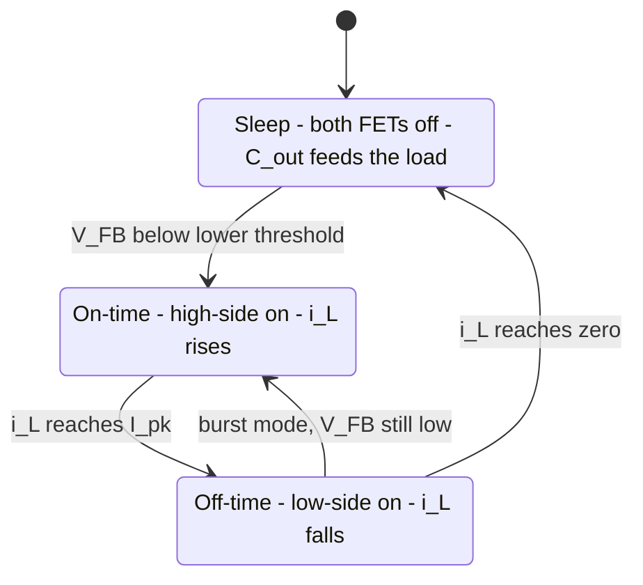

::: testing
Whether you can **narrate PFM step by step** and explain why it works, not just say "it skips pulses at light load". A strong answer covers:

1. The control idea: fixed-size pulses (fixed peak current or fixed on-time), regulation by pulse *rate*, with sleep in between.
2. The cycle: output droops below a threshold, the converter fires one or more pulses, the inductor delivers a packet of charge, the converter returns to idle.
3. The consequences: pulse rate proportional to load, losses that scale with load, output ripple with a low-frequency sawtooth, variable spectrum, and a delayed response to load steps.
:::

::: why
PFM (also sold as burst mode, pulse skipping, PSM or "eco mode") is how almost every battery-powered device gets decent efficiency at light load. If you can't explain it, you can't explain why a phone's idle current is in µA, or why the output ripple on a "quiet" rail suddenly has a 30 kHz component. It's also a favorite interview question because it forces a candidate to connect inductor-current waveforms, charge balance and control.
:::

::: concepts
- **Inductor energy**: $E=\tfrac12LI^2$; each pulse stores and delivers a packet of energy. See [[q0188]].
- **Charge balance**: average inductor current equals the load current; per pulse charge $Q$ and pulse rate $f$ give $I_{out}=Qf$.
- **DCM with diode emulation**: each pulse starts and ends at zero current. See [[q0229]].
- **Hysteretic regulation**: the output is held between two thresholds by switching the pulses on and off.
- **Output capacitor as the reservoir**: it supplies the load between pulses and absorbs each pulse.
- **Fixed per-pulse loss**: gate charge and $C_{oss}$ are paid per pulse, so loss power scales with pulse rate. See [[q0230]].
:::

::: answer
"PFM, pulse-frequency modulation, is a light-load mode where the converter stops running at a fixed frequency and instead delivers fixed-size pulses of energy only when the output needs them.

It works like this. The feedback comparator watches the output. When the output droops to the lower threshold, the controller turns the high-side FET on and lets the inductor current ramp up until it reaches a fixed peak, say 0.6 A, or for a fixed on-time. Then it turns the high side off and the low side, or a diode, takes over, and the inductor current ramps back down to zero, dumping its energy into the output capacitor and load. When the current hits zero, everything turns off and the converter goes to sleep. The output capacitor now supplies the load alone, and the output slowly sags until it crosses the threshold again, and the next pulse fires.

Each pulse delivers a fixed amount of charge, so the pulse rate is proportional to the load current: more load, more pulses per second, down to a few kilohertz at very light load. Because gate-drive and switching losses are paid per pulse, they scale with load, and efficiency stays high at tens of µA. The price is a sawtooth ripple at a low and variable frequency, a bit more ripple than PWM, and a slow first response to a sudden load step because the converter is asleep."
:::

::: technical
**Control law.** A comparator sets a start signal when $V_{FB}<V_{ref}$. Pulse: $Q_1$ on until $i_L=I_{pk}$ (or $t_{on}$ fixed), then $Q_1$ off and the rectifier on until $i_L=0$ (zero-current detect), then idle until the next trigger. Optionally a burst of several pulses until $V_{FB}$ exceeds an upper threshold.

**Pulse timing.** $t_{on}=\frac{LI_{pk}}{V_{in}-V_{out}}$, $t_{off}=\frac{LI_{pk}}{V_{out}}$. For 12 V to 3.3 V, 4.7 µH, 0.6 A: 324 ns and 855 ns.

**Charge per pulse.** $Q=\tfrac12I_{pk}(t_{on}+t_{off})=\frac{LI_{pk}^2}{2}\frac{V_{in}}{(V_{in}-V_{out})V_{out}}=0.354$ µC.

**Pulse rate.** $f_{pulse}=I_{out}/Q$: 2.8 kHz at 1 mA, 28 kHz at 10 mA, 141 kHz at 50 mA. The maximum, with back-to-back pulses (boundary conduction), is $1/(t_{on}+t_{off})=0.85$ MHz, i.e. $I_{out,max}\approx I_{pk}/2=0.3$ A.

**Output ripple.** Per pulse the output rises by about $Q/C_{out}$ (16 mV for 22 µF), then droops at $I_{out}/C_{out}$ between pulses.

**Overshoot.** The comparator and driver delay $t_d$ adds $t_d(V_{in}-V_{out})/L$ to the peak (about 0.09 A for 50 ns).

**Efficiency.** Loss power $=E_p f_{pulse}+I_{q,sleep}V_{in}$ with $E_p\approx107$ nJ, about 91% flat, falling at the very lowest loads.
:::

::: short
"PFM is a light-load mode where the converter fires fixed-size pulses only when the output droops below a threshold. Each pulse ramps the inductor to a fixed peak, then it discharges to zero into the output, and the converter sleeps until the output sags again. Pulse rate is proportional to load, so switching losses scale down with the load and efficiency stays high. The trade-offs are more, lower-frequency ripple and a slower response to a sudden load step."
:::

::: long
"Let me walk through one cycle. The converter is asleep: both FETs are off, the inductor current is zero and the output capacitor is feeding the load, so the output voltage drifts down slowly at $I_{load}/C$. When it crosses the lower threshold, a comparator wakes the controller and starts a pulse. The high-side FET turns on, the inductor sees $V_{in}-V_{out}$ and its current ramps up at that voltage divided by $L$, until it reaches a fixed peak, say 0.6 A, or for a fixed on-time. Then the high side turns off and the low-side FET, or a diode, takes over. The inductor now has $-V_{out}$ across it, so the current ramps back down to zero, delivering its energy to the output capacitor and the load. When the current reaches zero, a zero-current detector turns the low side off so the current can't reverse, and the converter goes back to sleep.

The key numbers: with 12 V in, 3.3 V out and 4.7 µH, the on-time is 324 ns and the off-time is 855 ns. The charge delivered per pulse is half the peak times the pulse duration, about 0.35 microcoulombs. So a 10 mA load needs about 28 thousand pulses a second, and 1 mA needs under 3 thousand. That is the 'frequency modulation': the pulse size is fixed and the rate follows the load.

That is why efficiency stays high. Gate charge and switch-node capacitance loss is energy per pulse, about 100 nanojoules, and the pulse rate is small. In a 500 kHz PWM converter the same 10 mA would be paying that 500 thousand times a second.

The costs: the output ripple is a sawtooth at the pulse rate, which can be tens of kHz and variable, with an amplitude of about one pulse charge over the capacitance, 16 mV for 22 µF here. It's harder to filter. The output also sits slightly above nominal, and when the load jumps the converter has to wake up first."
:::

::: terms
- **PFM (pulse-frequency modulation)**: regulation by changing how often fixed-size pulses occur.
- **Burst mode / pulse skipping / PSM**: vendor names for similar light-load modes; they differ in how pulses are grouped or clocked.
- **Peak-current threshold ($I_{pk}$)**: the inductor current at which the on-time ends.
- **Sleep (idle) interval**: the time when all switching is stopped and $C_{out}$ feeds the load.
- **Zero-current detection (ZCD)**: ends the off-time when $i_L$ hits zero.
- **Hysteresis window**: the voltage band between start and stop thresholds.
- **Charge per pulse ($Q$)**: packet of charge delivered by one pulse.
- **Ultrasonic minimum frequency**: a floor (about 20 to 25 kHz) to keep the pulse rate out of the audio band.
:::

::: exceptional
**An average answer** says "it skips pulses at light load to save power".

**An exceptional answer**:
- Narrates the **cycle**: threshold crossing, ramp to $I_{pk}$, discharge to zero, sleep.
- Derives **charge per pulse** and **pulse rate $=I_{out}/Q$**, with numbers (0.35 µC, 28 kHz at 10 mA).
- Explains the **efficiency mechanism**: per-pulse loss times a load-proportional rate.
- Gives the **ripple** estimate $Q/C_{out}$ and the low-frequency/audible-noise implication.
- Notes the transient-response delay and the ultrasonic minimum frequency or forced-PWM option.
:::

::: mistakes
- **Saying PFM changes the frequency "continuously like FM" with a fixed duty cycle.** The pulse *shape* is fixed (peak or on-time); the interval between pulses varies, and it is bursty, with long idle periods.
- **Believing PFM has the same ripple as PWM.** It is typically larger and low-frequency ([[q0233]]).
- **Confusing the pulse peak with the load current.** The peak is a fixed design parameter (here 0.6 A); the load current is the average over many pulses and idle time.
- **Forgetting zero-current detection.** Without it, the inductor current reverses and PFM stops being efficient.
- **Assuming PFM is for all loads.** The pulse rate saturates near $I_{pk}/2$; above that the converter hands over to PWM.
- **Forgetting the output sits above nominal.** Hysteretic regulation places the average output half a window above the threshold, so DC accuracy is worse than in PWM.
:::

::: deep
## One pulse, in detail

Use the standard example: $V_{in}=12$ V, $V_{out}=3.3$ V, $L=4.7$ µH, $C_{out}=22$ µF, $I_{pk}=0.6$ A, and a 20 mA load.


Figure: The PFM state machine. In single-pulse PFM the converter returns to sleep after each pulse; in burst mode it can chain several pulses until the output reaches an upper threshold, then sleep for longer.

**State 1: sleep.** Both FETs are off. The inductor current is zero. The load is fed entirely by $C_{out}$, so $\frac{dV_{out}}{dt}=-\frac{I_{load}}{C_{out}}=-0.91$ mV/µs for 20 mA and 22 µF.

**State 2: on-time.** When $V_{FB}$ falls below $V_{ref}$, the high side turns on. The inductor current rises linearly: $\frac{di_L}{dt}=\frac{V_{in}-V_{out}}{L}=1.85$ A/µs. It reaches 0.6 A in $t_{on}=324$ ns. During this time the inductor current exceeds the load current, so the surplus charges $C_{out}$.

**State 3: off-time.** The high side turns off and the low side (or diode) conducts. $\frac{di_L}{dt}=-\frac{V_{out}}{L}=-0.70$ A/µs. The current falls to zero in $t_{off}=855$ ns. Again the surplus above the load current goes into $C_{out}$.

**State 4: back to sleep.** At $i_L=0$ the zero-current detector turns the low side off. In total the pulse lasts 1.18 µs.

**Charge packet:** $Q=\tfrac12\cdot0.6\cdot1.179\text{ µs}=0.354$ µC, so $V_{out}$ steps up by $Q/C_{out}=16$ mV (less the 20 mA × 1.18 µs = 24 nC drawn during the pulse: net 15 mV).

With a 20 mA load, the capacitor needs 0.354 µC / 20 mA = 17.7 µs to droop by one pulse's worth, so pulses come every 17.7 µs: 56.5 kHz.

```plot
{"title":"PFM at 20 mA: inductor current pulses (12 V to 3.3 V, L = 4.7 uH, Ipk = 0.6 A)","x":{"label":"Time","unit":"s","min":0,"max":6e-5},"y":{"label":"i_L","unit":"A","min":-0.1,"max":0.8},
 "series":[{"label":"inductor current","points":[[0,0],[5.5e-6,0],[5.824e-6,0.6],[6.679e-6,0],[2.334e-5,0],[2.3664e-5,0.6],[2.4519e-5,0],[4.118e-5,0],[4.1504e-5,0.6],[4.2359e-5,0],[5.902e-5,0],[5.9344e-5,0.6],[6e-5,0.1395]],"color":"accent"}],
 "hlines":[{"at":0.02,"label":"load current: 20 mA","color":"red"}],
 "xspans":[{"from":5.5e-6,"to":6.679e-6,"label":"one pulse: 1.18 us"}]}
```
Figure: Each triangle is one pulse: a 324 ns rise to 0.6 A, an 855 ns fall to zero, and then roughly 16.7 µs of nothing. The average over the 17.8 µs period is the 20 mA load (red). Most of the time the inductor is idle, and nothing is switching, which is where the efficiency comes from.

```plot
{"title":"PFM at 20 mA: output voltage sawtooth","x":{"label":"Time","unit":"s","min":0,"max":6e-5},"y":{"label":"V_out","unit":"V","min":3.295,"max":3.32},
 "series":[{"label":"V_out","points":[[0,3.305],[5.5e-6,3.3002],[6.679e-6,3.3151],[2.334e-5,3.3001],[2.4519e-5,3.3149],[4.118e-5,3.3001],[4.2359e-5,3.3151],[5.902e-5,3.3001],[6e-5,3.3147]],"color":"green"}],
 "hlines":[{"at":3.3,"label":"lower threshold (3.300 V)","color":"muted"}]}
```
Figure: $V_{out}$ droops slowly at 0.91 mV/µs while the converter sleeps, then each pulse steps it up by about 15 mV. The output sits between 3.300 V and 3.315 V, averaging about 3.307 V, which is 7 mV (0.2%) above the nominal 3.3 V. Ripple is a sawtooth at 56 kHz. (Simplified from a time-domain simulation of the same converter.)

## Why the pulse rate follows the load

Charge balance over a long time: the average inductor current equals the load current, and each pulse supplies the same charge $Q$:
$$I_{out}=Q\,f_{pulse}\;\Rightarrow\;f_{pulse}=\frac{I_{out}}{Q}$$
```plot
{"title":"PFM pulse rate vs load current (Q = 0.354 uC per pulse)","x":{"label":"Load current","unit":"A","min":1e-4,"max":0.4,"log":true},"y":{"label":"Pulse rate","unit":"Hz","min":100,"max":1.2e6,"log":true},
 "vars":{"q":3.536e-7,"tp":1.179e-6},
 "series":[{"label":"PFM pulse rate","fn":"min(x/q,1/tp)","color":"accent"},{"label":"fixed 500 kHz PWM","fn":"500000","color":"red","dashed":true}],
 "points":[{"x":0.01,"y":28280,"label":"10 mA: 28 kHz"}]}
```
Figure: PFM pulse rate (blue) is a straight line on log-log axes, from 283 Hz at 100 µA to 28 kHz at 10 mA. It saturates near 0.85 MHz when pulses run back to back at about $I_{pk}/2=0.3$ A, and the converter hands off to PWM well before that. A PWM converter (red) keeps switching at 500 kHz regardless of load.

> [!NOTE]
> At 100 µA the rate would be 283 Hz, but real PFM controllers do not behave that cleanly: leakage and the controller's sleep current set a floor, and ultrasonic modes force a minimum of about 20 to 25 kHz by adding extra pulses, which costs some efficiency.

## Efficiency

The loss per pulse comes from gate charge (60 nJ), $C_{oss}$ (21.6 nJ), turn-off overlap (18 nJ), dead-time (4 nJ) and conduction (about 3 nJ): $E_p\approx107$ nJ. With a rate of 28 kHz at 10 mA that is 3.0 mW, plus sleep-mode bias of 0.24 mW, giving 91% efficiency at 10 mA instead of 41% in forced PWM at 500 kHz ([[q0230]]).

The peak current choice is a trade-off. A higher $I_{pk}$ gives more charge per pulse ($\propto I_{pk}^2$), so fewer pulses and lower loss per coulomb, but a larger ripple per pulse ($\Delta V=Q/C$) and more inductor stress. At 1.0 A, $Q=0.98$ µC and ripple is 45 mV for 22 µF. At 0.3 A, $Q=0.088$ µC and ripple is 4 mV but the pulse rate rises four-fold.

## Variants

- **Peak-current PFM** (above): fixed $I_{pk}$.
- **Constant on-time PFM**: fixed $t_{on}$, so $I_{pk}$ varies with $V_{in}$ ($=(V_{in}-V_{out})t_{on}/L$).
- **Pulse skipping**: a fixed clock, with cycles skipped when $V_{out}$ is above the threshold. The "pulse rate" is a sub-multiple of the clock.
- **Burst mode**: several pulses grouped between sleeps, with an upper and a lower threshold, to reduce wake-up overhead.
- **Ultrasonic**: floor on the pulse rate.

## Try it

```sim
{"id":"buck-lab","vin":12,"vout":3.3,"l":4.7e-6,"c":22e-6,"esr":0.005,"fsw":500000,"iout":0.02,"sync":true,"view":"waveforms"}
```
Figure: The simulator runs fixed-frequency PWM. At 20 mA it will show DCM waveforms: on each cycle the inductor current is a small triangle with a long idle interval. In PFM the same triangles occur, but with a *larger* peak and far fewer of them, with the idle gap stretching to tens of µs. Use the picture to see how small the triangle's charge is.
:::

::: applications
- **Phone and tablet PMICs**: auto PFM/PWM bucks that sit in PFM nearly all the time at idle.
- **Wearables and hearing aids**: nA-class quiescent-current bucks with a PFM floor.
- **Coin-cell IoT sensors**: PFM bucks or buck-boosts giving 90% efficiency from 1 µA to 100 mA.
- **Laptop standby rails and USB-C power-path ICs**: burst mode to meet idle-power regulations.
- **Automotive keep-alive supplies**: PFM at a few mA to keep quiescent drain low.
:::

::: assumptions
- **Peak-current PFM with ideal zero-current detection**, no comparator delay, for the base numbers. Real ICs add a delay-induced overshoot of $t_d(V_{in}-V_{out})/L$.
- **Single pulse per trigger.** Burst-mode ICs use several pulses and an upper threshold.
- **Lossless pulse** when computing charge per pulse; losses modify it by a few percent.
- **Component values** are illustrative; real converters choose $I_{pk}$ between about 1/4 and 1/2 of the current limit (vendor dependent).
- **Time-domain plots** are idealised or simplified from a simulation with a fixed-threshold comparator, not measurements.
:::

::: followups
### How does the pulse rate change when the load doubles?
It doubles, because each pulse delivers the same charge. From 10 mA to 20 mA the rate goes from 28 kHz to 56 kHz. The ripple amplitude (about $Q/C$) stays the same.

### Why does the output voltage in PFM sit above the nominal value?
Because the controller starts a pulse when $V_{out}$ crosses the *lower* threshold, and each pulse raises the output by $Q/C$ above that. The average is about half a pulse above the threshold: roughly 7 to 8 mV here. Datasheets quote "PFM DC offset" or a typical +0.5 to 1%.

### What happens when the load suddenly jumps from 10 mA to 500 mA?
The output starts falling at $I/C=23$ V/ms (500 mA into 22 µF). It drops through the lower threshold, the converter wakes, and pulses run back to back. A single pulse supplies only 0.35 µC (equivalent to about 0.3 A average at most), so the output sags until the controller switches to PWM, which takes tens of µs. Expect an undershoot of tens of millivolts, bigger than PWM would give.

### Why would you choose a larger or smaller peak current in PFM?
Larger $I_{pk}$: more charge per pulse, a lower pulse rate and lower loss per coulomb, but more ripple ($Q/C$) and more inductor stress. Smaller $I_{pk}$: lower ripple but more pulses and more overhead. Typical choice: a fraction of the current limit, such as 0.5 A to 1 A for a 2 A part, balanced against the ripple budget.

### Is PFM the same as pulse skipping?
They are related but not identical. Pulse skipping uses a fixed clock and skips cycles when the output is above target, so the pulse timing is quantised to the clock period. PFM in the strict sense triggers a pulse asynchronously when the output falls below a threshold. Datasheets use the terms loosely.
:::

::: interpretations
"Explain PFM operation" asks for the mechanism. Related questions ask for the difference from PWM ([[q0232]]), the ripple ([[q0233]]), the inductor current ([[q0234]]) and the capacitor/inductor charge cycle ([[q0235]]); this page focuses on the whole control cycle and the pulse-rate relationship.
:::

::: references
- Erickson & Maksimovic, *Fundamentals of Power Electronics*: DCM analysis, inductor energy transfer per cycle, and hysteretic/variable-frequency control concepts.
- Texas Instruments, "Basic Calculation of a Buck Converter's Power Stage" (SLVA477): inductor ripple and timing relations used for $t_{on}$ and $t_{off}$.
- Datasheets of synchronous buck ICs with PFM, "power-save" or "burst" modes: sections on light-load operation, minimum frequency and output voltage offset.
- Mohan, Undeland & Robbins, *Power Electronics*: DC-DC converter energy transfer and discontinuous conduction.
:::

::: rubric
- Describes fixed-size pulses with regulation by pulse rate/timing, not duty at fixed frequency :: The defining idea of PFM.
- Narrates the cycle: threshold crossing, ramp to peak, discharge to zero, sleep :: Shows you understand the mechanism.
- States the rate is proportional to load via $I_{out}=Qf$ and gives a number :: Quantitative depth.
- Explains the efficiency mechanism: per-pulse losses scale with pulse rate :: The reason PFM exists.
- Mentions zero-current detection / diode emulation :: Needed for the mechanism to work.
- Describes the ripple characteristic (low-frequency sawtooth, larger than PWM) :: Honest about the trade-off.
- Mentions transient delay and options (forced PWM, ultrasonic floor) :: Practical awareness.
:::

::: quiz
```json
[
 {"type":"mcq","level":"fundamental","q":"In PFM operation, what changes as the load current increases?","options":["The pulse size increases, the rate stays fixed","The pulse rate increases, the pulse size stays fixed","The switching frequency stays fixed and the duty cycle increases","The inductor current becomes negative"],"answer":1,"explain":"PFM delivers fixed-size pulses, so a larger load needs more of them per second. Fixed frequency with varying duty is PWM."},
 {"type":"numeric","level":"fundamental","q":"12 V in, 3.3 V out, $L=4.7$ µH, $I_{pk}=0.6$ A. What is the on-time of one pulse in ns?","answer":324,"tolerance":0.02,"unit":"ns","explain":"$t_{on}=LI_{pk}/(V_{in}-V_{out})=4.7\\text{ µ}\\cdot0.6/8.7=324$ ns."},
 {"type":"numeric","level":"intermediate","q":"Each pulse delivers 0.354 µC. What pulse rate is needed for a 50 mA load, in kHz?","answer":141,"tolerance":0.02,"unit":"kHz","explain":"$f=I_{out}/Q=0.05/0.354\\text{ µC}=141$ kHz."},
 {"type":"numeric","level":"intermediate","q":"With $C_{out}=47$ µF, what is the output-voltage step per 0.354 µC pulse, in mV (ignore the load during the pulse)?","answer":7.5,"tolerance":0.03,"unit":"mV","explain":"$\\Delta V=Q/C=0.354\\text{ µC}/47\\text{ µF}=7.5$ mV. Doubling the capacitor halves the ripple."},
 {"type":"multi","level":"advanced","q":"Which statements about PFM are true? Select all that apply.","options":["Switching losses scale roughly with load because they are paid per pulse","The output voltage ripple is normally smaller than in PWM at the same capacitance","Zero-current detection is needed to prevent reverse inductor current","A sudden load step can cause a larger undershoot than in PWM because the converter must wake up"],"answer":[0,2,3],"explain":"Per-pulse losses times a load-proportional rate gives load-scaled loss; ZCD is needed for diode emulation; sleep-to-wake latency worsens the transient. PFM ripple is typically larger, not smaller, because each pulse is a fixed packet that can exceed the ripple of fixed-frequency PWM."},
 {"type":"truefalse","level":"advanced","q":"If you double the peak current in a PFM converter (all else equal), the charge per pulse doubles.","answer":false,"explain":"Charge per pulse is $Q=\\tfrac12I_{pk}(t_{on}+t_{off})$ and both times are proportional to $I_{pk}$, so $Q\\propto I_{pk}^2$ and it quadruples. The pulse rate for a given load falls by 4×, and ripple $Q/C$ grows by 4×."}
]
```
:::
