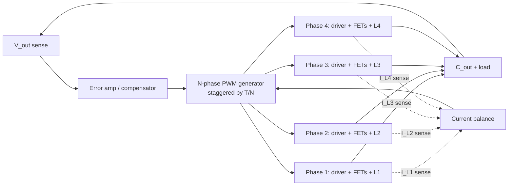

::: basics
### In plain words
A multiphase buck is several small buck converters, called phases, that share one output and one load. Each phase has its own inductor and its own pair of switches. They take turns: each starts its cycle a fraction of a period after the one before. The load sees the combined current, which is bigger and smoother than any one phase could give.

### Picture it
Think of a car engine. One huge cylinder firing once per turn would shake the whole engine. Four smaller cylinders firing in turn give smooth, steady power. In a multiphase buck, each phase is one cylinder. Their pulses interleave so the gaps in one are filled by another. The analogy does not show the downside: the "cylinders" must be balanced or one of them does too much of the work.

### Words you need
- **Phase**: one complete buck stage, with its own inductor and its own pair of switches (FETs) ([[q0174]]).
- **Interleaving**: starting the phases at evenly spaced times, $1/N$ of a period apart.
- **Ripple cancellation**: the phases' up-and-down currents partly offset each other at the output.
- **Phase count ($N$)**: how many phases are in parallel.
- **Current balancing**: making the phases share the load equally.

### The simplest example
A processor's supply needs 60 A. Four phases each carry about 15 A, which is a manageable load for each stage. If each phase switches at 500 kHz, the four are offset by a quarter of a period, so a new pulse arrives every $1/(4\times500\text{k}) = 0.5$ µs. The output capacitor therefore sees ripple at 2 MHz, four times the per-phase rate. That is the whole idea. The rest of this page shows how the ripple partly cancels, and covers the price: more parts, current balancing and a harder layout.
:::

::: testing
Whether you understand a multiphase buck as a **specific architecture**, not as "a few bucks in parallel". The interviewer is listening for:

1. Several buck power stages share one input, one output capacitor and one load.
2. Their switching is **interleaved**: each phase's clock is shifted by $T/N$ (360°/N), so the pulses take turns.
3. The inductor currents **add** at the output, the ripples partly **cancel**, and the ripple frequency seen by the output capacitor is $N f_{sw}$.
4. You can say why anyone bothers: current capability, ripple, transient response and heat spreading.
:::

::: why
Almost every CPU, GPU, FPGA and ASIC core rail you will meet in industry is a multiphase buck. A modern processor wants about 1 V at tens to hundreds of amps and demands that the rail not sag when the load jumps in nanoseconds. One inductor and one pair of FETs cannot do that well. If you can describe the idea clearly (N staggered stages, summed current, cancelled ripple) the rest of the multiphase questions ([[q0237]] to [[q0243]]) are just consequences. It is also a good test of whether you reason about waveforms instead of reciting a definition.
:::

::: concepts
- **Buck power stage**: high-side switch, low-side switch (or diode), inductor. $V_{out}=D\,V_{in}$ in CCM ([[q0178]], [[q0174]]).
- **Phase**: one half-bridge plus its own inductor. N phases means N inductors and usually N pairs of FETs.
- **Interleaving**: the N clocks are equally spaced, so phase $k$ turns on at $kT/N$.
- **Superposition of currents**: the output node sums the N inductor currents. Each inductor current is a triangle, and shifted triangles partly cancel.
- **Ripple cancellation**: the summed ripple is smaller than one phase's ripple and sits at $N f_{sw}$.
- **Current sharing**: the phases must carry nearly equal DC current, which the controller has to enforce ([[q0238]]).
:::

::: answer
"A multiphase buck is several buck power stages, called phases, that all feed the same output capacitor and load but are switched at staggered times. With N phases the clocks are offset by one N-th of a switching period, so a 4-phase converter turns on a new phase every 90 degrees.

Each phase has its own inductor and its own pair of FETs, and each carries about one N-th of the load current. At the output the inductor currents add up. Because the triangular ripples are shifted in time, they partly cancel, so the ripple current going into the output capacitor is smaller than one phase's ripple, and it comes at N times the switching frequency.

You get several things out of that one idea: more total current than one inductor and one pair of FETs can handle, much less ripple for a given inductance and capacitance, a faster response to load steps because the effective inductance is L over N, and heat spread over several spots instead of one. The price is more parts, a controller that has to balance the currents, and a harder layout.

My go-to example is a CPU core supply: 12 V down to about 1 V at 60 A or more, built from four to eight phases."
:::

::: technical
**Structure.** N identical buck stages share $V_{in}$, $C_{out}$ and the load. Phase $k$ has gate pulses of width $DT$ starting at $t_k = kT/N$, with $T = 1/f_{sw}$. In CCM every phase uses the same duty cycle $D = V_{out}/V_{in}$.

**Currents.** Each inductor carries about $I_{out}/N$ with a triangular ripple $\Delta I_{ph}=\dfrac{V_{out}(1-D)}{L f_{sw}}$. The output node receives $i_{out}=\sum_k i_{L,k}$, so the DC parts add and the ripples add with time shifts.

**Ripple cancellation.** For identical phases the summed peak-to-peak ripple is

$$\Delta I_\Sigma=\frac{V_{in}}{N\,L\,f_{sw}}\,\big(\lceil ND\rceil-ND\big)\big(ND-\lfloor ND\rfloor\big),$$

which is zero whenever $ND$ is an integer (for example $D=0.25$ with $N=4$). The summed ripple repeats at $N f_{sw}$.

**Worked example.** $V_{in}=12$ V, $V_{out}=1$ V, $N=4$, $f_{sw}=500$ kHz, $L=300$ nH per phase, $I_{out}=60$ A. Then $D=1/12$ and $ND=1/3$. One phase has $\Delta I_{ph}=1\cdot(11/12)/(0.3\,\mu\text{H}\cdot 0.5\,\text{MHz})=6.11$ A p-p, about 41% of its 15 A average. The summed ripple is $12\cdot(2/3)(1/3)/(4\cdot 0.15\ \Omega)=4.44$ A p-p at 2 MHz, which is 0.73 of one phase's ripple. Because it is at four times the frequency, the capacitor's charge-ripple voltage drops to roughly $0.73/4\approx0.18$ of the one-phase case for the same $C$.

**Effective inductance.** For a load step all phases can slew together, so the output sees $L_{eq}=L/N=75$ nH. Current slews at $(V_{in}-V_{out})/L_{eq}\approx147$ A/µs up and $V_{out}/L_{eq}\approx13$ A/µs down, versus 37 and 3.3 A/µs for one 300 nH phase.

**Controller.** It generates the staggered clocks, senses each phase current (or the total plus a share), and adds a current-balance loop beside the single voltage loop. Power stages are often smart power stages (driver, FETs and a current/temperature monitor in one package).
:::

::: short
"A multiphase buck is N buck power stages that share one output capacitor and one load but switch at evenly staggered times, 360 over N degrees apart. Each phase carries about one N-th of the current. The inductor currents add at the output and their ripples partly cancel, so the capacitor sees much less ripple, at N times the switching frequency. That lets you deliver high current, respond quickly to load steps and spread the heat, which is why CPU and GPU core rails are built this way."
:::

::: long
"Start from an ordinary buck: a high-side switch, a low-side switch, an inductor and an output capacitor. A multiphase buck is N copies of the switches and the inductor, called phases, all connected to the same input and the same output capacitor. One controller drives them with the same duty cycle but with the clocks shifted by one N-th of a period. With four phases, a phase fires every 90 degrees, so the high-side pulses take turns instead of overlapping.

At the output node the four inductor currents add. Each one is a triangle around its own DC value, which is the load current divided by four. Because the triangles are shifted in time, when one is ramping up another is ramping down, so a lot of the ripple cancels. The total ripple is smaller than one phase's ripple, and it happens at four times the switching frequency, which is much easier for the output capacitor to filter. At certain duty cycles, like 25 percent for four phases, it cancels completely.

The second benefit is dynamics. In a load step the phases can all push current together, so the effective inductance is L over N and the current can ramp N times faster. That reduces the capacitance you need for a given droop.

Third, loss and heat get distributed. Each phase carries a fraction of the current, so you have N small hot spots instead of one big one.

The costs are real: more FETs, more inductors, a controller that senses each phase current and keeps them balanced, and a more demanding layout. So I would use it when the current is high, the voltage is low and the transient demands are tough, like a processor core rail, and not for a 1 amp rail."
:::

::: terms
- **Phase**: one buck power stage (switches plus inductor) in a multiphase converter.
- **Interleaving**: staggering the switching instants of the phases equally across one period.
- **Phase shift**: $360^\circ/N$ between adjacent phases (90° for four phases).
- **Ripple cancellation**: reduction of the summed inductor ripple because the phase ripples are offset in time.
- **Effective ripple frequency**: $N f_{sw}$, the frequency of the summed ripple.
- **Current sharing / balancing**: keeping the DC current of each phase nearly equal.
- **Phase shedding**: disabling phases at light load to save fixed losses.
- **Smart power stage (DrMOS-type)**: driver plus FETs (often plus current sense) in one package per phase.
:::

::: exceptional
**An average answer** says "several bucks in parallel to get more current".

**An exceptional answer**:
- Says the phases are **interleaved** with a shift of $T/N$ and explains that this is what makes the ripple cancel.
- States that the output ripple frequency is $N f_{sw}$ while each phase still switches at $f_{sw}$, and that cancellation depends on duty cycle (complete when $ND$ is an integer).
- Gives the effective-inductance argument for transients, $L/N$.
- Volunteers the cost side: current balancing, controller complexity, component count and layout.
- Anchors it in numbers, for example 12 V to 1 V at 60 A with four phases and 15 A per phase.
- Distinguishes it from paralleling FETs or running independent bucks: the shared controller and the interleaving are the point.
:::

::: mistakes
- **"It's just bucks in parallel."** Parallel bucks switching in sync give no ripple cancellation and no frequency multiplication. The staggering is the key idea.
- **Saying the switching frequency is multiplied.** Each phase still switches at $f_{sw}$. The *output ripple* is at $N f_{sw}$. Switching loss is set by the per-phase frequency.
- **Assuming ripple always cancels.** It cancels fully only at specific duty cycles. At other duties the summed ripple is reduced but not zero (73% of one phase in the VRM example).
- **Forgetting current balancing.** Phases with slightly different duty or DCR share current unevenly, and the worst one overheats first ([[q0238]]).
- **Quoting "N times the current" with no derating.** Real designs derate for imbalance, temperature and inductor saturation ([[q0240]]).
- **Confusing it with a SIMO or dual-output buck.** Those have separate outputs ([[q0177]]). The phases of a multiphase buck share one output.
:::

::: deep
## From one buck to N bucks

Take the standard buck from [[q0174]]. In CCM the inductor current is a triangle with up-slope $(V_{in}-V_{out})/L$ for $DT$ and down-slope $-V_{out}/L$ for $(1-D)T$. Its peak-to-peak ripple is $\Delta I = V_{out}(1-D)/(Lf_{sw})$ and its average equals the load current.

Now ask what happens when the load asks for 60 A at 1 V. With one phase you need a FET pair that survives 60 A and an inductor with a saturation current above about 70 A. Both are big, the loss concentrates in one place, and the output ripple current is large. The multiphase answer is to build the high-current converter from several moderate converters, each using parts that are easy to buy, cool and place.

```circuit
{"caption":"Two-phase interleaved buck","elements":[
 {"t":"wire","pts":[[3,0],[19,0]]},{"t":"dot","at":[11,0]},
 {"t":"rail","at":[11,0],"label":"V_{in}","dir":"up"},
 {"t":"SW","a":[3,0],"b":[3,4],"label":"HS1","labelSide":"other"},
 {"t":"dot","at":[3,4]},
 {"t":"SW","a":[3,4],"b":[3,8],"label":"LS1","labelSide":"other"},
 {"t":"wire","pts":[[3,8],[3,11]]},
 {"t":"L","a":[3,4],"b":[9,4],"label":"L_1"},
 {"t":"text","at":[4,5.4],"text":"SW1","anchor":"start","muted":true},
 {"t":"SW","a":[19,0],"b":[19,4],"label":"HS2"},
 {"t":"dot","at":[19,4]},
 {"t":"SW","a":[19,4],"b":[19,8],"label":"LS2"},
 {"t":"wire","pts":[[19,8],[19,11]]},
 {"t":"L","a":[19,4],"b":[13,4],"label":"L_2"},
 {"t":"text","at":[18,5.4],"text":"SW2","anchor":"end","muted":true},
 {"t":"wire","pts":[[9,4],[13,4]]},{"t":"dot","at":[11,4]},
 {"t":"wire","pts":[[11,4],[11,2]]},{"t":"term","at":[11,2],"label":"V_{out}","side":"top"},
 {"t":"wire","pts":[[11,4],[11,6]]},{"t":"dot","at":[11,6]},
 {"t":"C","a":[11,6],"b":[11,10],"label":"C_{out}","labelSide":"other"},
 {"t":"wire","pts":[[11,6],[15,6]]},
 {"t":"I","a":[15,6],"b":[15,10],"label":"I_{load}"},
 {"t":"wire","pts":[[3,11],[19,11]]},
 {"t":"wire","pts":[[11,10],[11,11]]},{"t":"wire","pts":[[15,10],[15,11]]},
 {"t":"dot","at":[11,11]},{"t":"dot","at":[15,11]},{"t":"gnd","at":[11,11]}
]}
```
Figure: Two phases shown. Each phase is a half-bridge (HS, LS) feeding its own inductor from its own switch node (SW1, SW2). Both inductors land on the same output node and share $C_{out}$ and the load. Add more columns for more phases; the controller, not the schematic, is what makes them take turns.

## Interleaving: taking turns

The controller gives every phase the same duty cycle but delays its clock by $T/N$:

```timing
{"signals":[{"name":"HS1 gate","wave":"11110000000000001111000000000000","color":"accent"},{"name":"HS2 gate","wave":"00001111000000000000111100000000","color":"blue"},{"name":"HS3 gate","wave":"00000000111100000000000011110000","color":"green"},{"name":"HS4 gate","wave":"00000000000011110000000000001111","color":"orange"}],"hscale":0.5,"marks":[{"t":0,"label":"0°"},{"t":4,"label":"90°"},{"t":8,"label":"180°"},{"t":12,"label":"270°"},{"t":16,"label":"360°"}]}
```
Figure: Four phases at $D=0.25$, $N=4$. The high-side pulses tile the period exactly, so at every instant exactly one phase is ramping up. The labels show each phase's offset within one switching period.

The reason for the stagger is superposition. Each inductor current is $I_{out}/N$ plus a triangle. Add four triangles that are 90° apart and the up-ramp of one overlaps the down-ramps of the others.

## Why the ripple cancels

When $D = 1/N$ (here 0.25) exactly one phase is on at a time. The sum of four slopes is then $(V_{in}-V_{out})/L-3V_{out}/L = (V_{in}-4V_{out})/L=0$, so the total current is perfectly flat. For other duties the cancellation is partial. For $ND$ between integers $m$ and $m+1$:

$$\frac{\Delta I_\Sigma}{\Delta I_{ph}}=\frac{(\lceil ND\rceil-ND)(ND-\lfloor ND\rfloor)}{ND\,(1-D)}$$

```plot
{"title":"Summed output ripple relative to one phase's ripple","x":{"label":"duty cycle D","min":0.01,"max":0.99},"y":{"label":"ΔI_out / ΔI_phase","min":0,"max":1.05},"series":[{"label":"N = 1","fn":"(ceil(1*x)-1*x)*(1*x-floor(1*x))/(1*x*(1-x))","n":1200},{"label":"N = 2","fn":"(ceil(2*x)-2*x)*(2*x-floor(2*x))/(2*x*(1-x))","n":1200},{"label":"N = 3","fn":"(ceil(3*x)-3*x)*(3*x-floor(3*x))/(3*x*(1-x))","n":1200},{"label":"N = 4","fn":"(ceil(4*x)-4*x)*(4*x-floor(4*x))/(4*x*(1-x))","n":1200}],"points":[{"x":0.0833,"y":0.727,"label":"VRM example D = 1/12, N = 4: 0.73"}],"vlines":[{"at":0.25,"label":"D = 1/4","color":"muted"},{"at":0.5,"label":"D = 1/2","color":"muted"}]}
```
Figure: Each curve touches zero where $D=k/N$. Notice that for low duty (the VRM case, $D\approx0.08$) cancellation is modest, only about 0.73 for $N=4$, because between pulses the phase currents are all falling together. The big wins at low $D$ come from the frequency multiplication and the $L/N$ transient behaviour rather than from ripple cancellation.

A time-domain look at the VRM example from the technical section (12 V to 1 V, four phases, 300 nH, 500 kHz):

```plot
{"title":"Phase ripple vs summed ripple (4 phases, 12 V to 1 V, 300 nH, 500 kHz)","x":{"label":"time","unit":"s","min":0,"max":"4e-6"},"y":{"label":"AC part of inductor current","unit":"A","min":-3.6,"max":3.6},"vars":{"vin":12,"vo":1,"l":"300e-9","f":"500e3","D":"vo/vin","m1":"(vin-vo)/(l*f)","m2":"vo/(l*f)"},"series":[{"label":"phase 1 alone (6.1 A p-p at 500 kHz)","fn":"(m1*mod(x*f-0,1))*(1-step(mod(x*f-0,1)-D))+(m1*D-m2*(mod(x*f-0,1)-D))*step(mod(x*f-0,1)-D)-m1*D/2","color":"blue","n":2400},{"label":"sum of 4 phases (4.4 A p-p at 2 MHz)","fn":"((m1*mod(x*f-0,1))*(1-step(mod(x*f-0,1)-D))+(m1*D-m2*(mod(x*f-0,1)-D))*step(mod(x*f-0,1)-D)-m1*D/2)+((m1*mod(x*f-0.25,1))*(1-step(mod(x*f-0.25,1)-D))+(m1*D-m2*(mod(x*f-0.25,1)-D))*step(mod(x*f-0.25,1)-D)-m1*D/2)+((m1*mod(x*f-0.5,1))*(1-step(mod(x*f-0.5,1)-D))+(m1*D-m2*(mod(x*f-0.5,1)-D))*step(mod(x*f-0.5,1)-D)-m1*D/2)+((m1*mod(x*f-0.75,1))*(1-step(mod(x*f-0.75,1)-D))+(m1*D-m2*(mod(x*f-0.75,1)-D))*step(mod(x*f-0.75,1)-D)-m1*D/2)","color":"red","n":2400}]}
```
Figure: The blue triangle is one phase's ripple, 6.1 A p-p at 500 kHz. The red trace is the sum, 4.4 A p-p, and it repeats four times per phase period (2 MHz). Count the red humps in the blue period: four. The output capacitor sees the red current.

## What the output sees

- **Current**: DC adds. $I_{out}=\sum I_{ph}$ ($4\times15=60$ A here).
- **Ripple frequency**: $N f_{sw}$. A 500 kHz phase frequency becomes a 2 MHz ripple, so the capacitor and any downstream filter have an easier job.
- **Switching loss** is set by $f_{sw}$ per phase, so you get the high effective frequency without the high per-FET switching loss that a single 2 MHz converter would have.

## What the controller has to do

1. Generate N equally spaced PWM edges (a ring counter or a delay chain driven by one oscillator).
2. Run one voltage loop on $V_{out}$. Its output is shared by all phases.
3. Measure each phase current and trim each phase's duty cycle so that the currents match. Without this, tiny differences in duty or resistance turn into amps of imbalance ([[q0238]]).
4. Optionally disable phases at light load (phase shedding, [[q0241]]).


Figure: One shared voltage loop sets the total current demand. A second, per-phase, current-balance path trims each phase's duty cycle so no phase is overloaded.

## Try it

```sim
{"id":"multiphase-buck","phases":4,"vin":12,"vout":1,"iout":60,"l":3e-7,"fsw":500000}
```
Figure: Step the phase count from 1 to 4 and watch the red summed current. Then change V_out so $D=0.25$ (3 V from 12 V) and see the ripple vanish for $N=4$ while each phase still ripples.

## Variations you will meet

- **Smart power stages (DrMOS-type)**: driver, high-side and low-side FET and a current/temperature monitor in one package per phase, so the controller only needs PWM and a current signal back.
- **Coupled inductors**: the phases' inductors share a magnetic core so that the steady-state inductance is high (low ripple) while the transient inductance is low (fast response). They are a refinement of the same idea.
- **Dual-phase POL modules**: two phases in one small package for 10 to 30 A rails.
- **Phase count by load**: from 2 phases for a modest FPGA rail to 12 or more for a server CPU.

## Worked example: 60 A at 1 V from four phases

Take the VRM example used above: 12 V in, 1 V out, 60 A, four phases of 300 nH at 500 kHz per phase, and an output bank of 470 µF with 0.5 mΩ of effective ESR (an assumed value for the capacitor bank).

**Per phase.** Each inductor carries 15 A DC plus a triangle of $\Delta I_{ph}=V_{out}(1-D)/(Lf)=1\times0.9167/(300\ \text{nH}\times500\ \text{kHz})=6.11$ A peak-to-peak. The peak is $15+3.06=18.1$ A, so the inductor needs a saturation rating well above that (with margin, say 25 A), but it does not need to be rated for 60 A. The RMS current squared is $15^2+6.11^2/12=228$ A².

**Summed ripple.** At $D=1/12$ with $N=4$, $ND=0.333$, and the formula above gives $\Delta I_\Sigma/\Delta I_{ph}=0.727$, so $\Delta I_\Sigma=4.44$ A. The output voltage ripple is the capacitive part plus the ESR part:

$$\Delta V\approx\frac{\Delta I_\Sigma}{8(Nf_{sw})C}+\Delta I_\Sigma\,ESR=\frac{4.44}{8\times2\ \text{MHz}\times470\ \mu\text{F}}+4.44\times0.5\ \text{m}\Omega=0.59+2.22=2.8\ \text{mV}$$

For comparison, one 300 nH phase at 500 kHz with the same capacitor has $\Delta I=6.11$ A and ripple $\frac{6.11}{8\times500\ \text{kHz}\times470\ \mu\text{F}}+6.11\times0.5\ \text{m}\Omega=3.25+3.06=6.3$ mV. Interleaving cuts the voltage ripple by a bit more than half here, mostly because the capacitive term collapses by a factor of $N/0.727\approx5.5$ while the ESR term only falls with the ripple current.

**Load-step response.** The big transient benefit is in the equivalent inductance. All four inductors can ramp up together, so the combined current slew rate during a step-up (every high side on at once) is $N(V_{in}-V_{out})/L=4\times11\ \text{V}/300\ \text{nH}=147$ A/µs. A 30 A step therefore needs about $30/147=0.20$ µs for the inductors to catch up with the load, and the capacitor supplies the missing charge $\tfrac12\times30\ \text{A}\times0.20\ \mu\text{s}=3.1\ \mu\text{C}$. That sags the output by $3.1\ \mu\text{C}/470\ \mu\text{F}=6.5$ mV in the ideal case (a controller that reacts instantly and uses maximum duty). One 300 nH inductor would take four times as long and sag four times as much, 26 mV. On top of that sits the instantaneous ESR step, $30\ \text{A}\times0.5\ \text{m}\Omega=15$ mV, so the ideal total is about 21 mV. Real controllers add delay and finite gain, so treat this as a lower bound, not a prediction.

## What happens when the phases are not balanced

Interleaving works only if each phase carries its share. The DC current in each phase is set by the duty cycle and the series resistance, and small errors get amplified. Suppose each phase has a total series resistance of 1.5 mΩ (FETs, inductor DCR and copper), and the PWM generator or its dead-time handling gives one phase a duty error of just 0.1%. A 0.1% error on a 2 µs period is a 2 ns timing error, trivial for a digital controller. But the extra voltage that phase applies is $V_{in}\Delta D=12\ \text{V}\times0.001=12$ mV, and across 1.5 mΩ that would be $12\ \text{mV}/1.5\ \text{m}\Omega=8$ A if the output node were fixed. Because the loop holds the total at 60 A, the other three phases give some of it back: the mismatched phase gains $\Delta V(N-1)/(NR_{ph})=12\ \text{mV}\times3/(4\times1.5\ \text{m}\Omega)=6$ A and carries 21 A, while each of the other three drops to 13 A. A 0.1% timing error has become a 40% current error. This is the reason every serious multiphase controller measures phase currents (inductor DCR sensing, FET sense, or smart-stage telemetry) and trims duty to equalize them. It is also why the controller's current-sense accuracy sets the thermal margin: a 5% sense error on 15 A is 0.75 A of imbalance.

> [!UNCERTAIN]
> The 1.5 mΩ series resistance, 470 µF/0.5 mΩ output bank and 0.1% duty mismatch are assumed values for the exercise. A real design takes them from the FET, inductor and capacitor datasheets and from the controller's specified accuracy.

## Limiting cases and design choices

For $N=1$ the formulas collapse to the single-phase buck, which is a good check. As $N$ grows the benefits saturate: the ripple at $D=k/N$ is zero but elsewhere it depends on the fractional part of $ND$, so adding a fifth phase to a 12 V to 1 V design reduces the ripple only modestly while adding a full power stage. Loss at equal total silicon is also unchanged. $N$ phases each carrying $I/N$ in $R_{ph}$ lose $N(I/N)^2R_{ph}=I^2R_{ph}/N$, the same as one phase of resistance $R_{ph}/N$, so the case for more phases is thermal spreading, smaller parts and transient speed, not conduction efficiency. At light load the fixed loss multiplies by $N$, which is why phase shedding ([[q0241]]) exists.

## Verifying it on the bench

1. **Phase timing.** Probe each SW node with the scope triggered on phase 1. The rising edges of the others should arrive at $T/N$ intervals (500 ns apart at 4 phases and 2 µs period). Two phases whose edges coincide are a sign of a configuration or clocking issue.
2. **Phase currents.** Measure each inductor current with a current probe or through a sense resistor and confirm they match to within the controller's spec. Repeat at light, medium and full load and when the board is warm.
3. **Summed ripple.** Measure the output capacitor ripple with the tip-and-barrel technique. It should be at $Nf_{sw}=2$ MHz and fall to nearly zero as you shift $V_{out}$ toward $V_{in}/N$ (3 V from 12 V for $N=4$).
4. **Transient.** Use an electronic load to apply a fast 30 A step and record the undershoot. Compare with the 21 mV ideal (15 mV ESR plus 6.5 mV capacitive). The difference is the controller's reaction time and the capacitor bank's ESL.
:::

::: applications
- **CPU/GPU/ASIC core rails**: 12 V in, about 0.7 to 1.2 V out at tens to hundreds of amps, often 4 to 16 phases.
- **DDR/memory and SoC rails on server and laptop boards**, typically two to four phases.
- **FPGA core supplies** (for example 1 V at 30 to 60 A) as a two to four-phase controller with power stages.
- **Telecom and data-center point-of-load modules** that stack several phases in one package.
- **Automotive ADAS compute modules** that need clean, fast, low-voltage high-current rails.
:::

::: assumptions
- **Identical phases and equal duty cycles.** Mismatch in inductance, DCR or timing reduces the cancellation and unbalances the currents.
- **CCM operation** for the ripple formula. At light load the phases enter DCM or are shed and the waveforms change.
- **Fixed-frequency PWM with equal phase spacing.** Other schemes (constant on-time, valley current-mode) interleave by different means, but the principles are the same.
- **Shared output capacitor** and an output impedance that is dominated by the capacitor bank.
- The numbers in this page are illustrative. A real design uses datasheet FET and inductor values.

Alternative answer: you can also describe it as "paralleling buck converters with phase shifted clocks". That is fine if you immediately mention ripple cancellation and the $N f_{sw}$ ripple frequency.
:::

::: followups
### Does the switching frequency of a 4-phase buck become four times higher?
No. Each phase and each FET still switches at $f_{sw}$, so switching losses are set by $f_{sw}$. What becomes $N$ times higher is the frequency of the summed ripple at the output, and the effective bandwidth the controller can use for the transient response. This is the main trick: you get a fast-looking converter from slow, efficient switches.

### Why is there no ripple at $D=0.25$ with four phases?
At $D=1/N$ exactly one phase is on at any instant. The up-slope of the active phase, $(V_{in}-V_{out})/L$, is cancelled by the three down-slopes, $3V_{out}/L$, because $V_{in}=4V_{out}$. The sum of the slopes is zero, so the total current is flat. The idea carries over to any $N$ and $D=k/N$.

### How is this different from using two bigger FETs in parallel?
Paralleling FETs shares conduction loss but leaves one inductor, one switching edge and one ripple frequency. You do not get cancellation, a higher ripple frequency or a smaller effective inductance. Multiphase adds inductors, each carrying a fraction of the current, and shifts their timing.

### What changes if one phase fails short or open?
If a high-side FET shorts, it will pull $V_{in}$ onto the output and needs protection. If a phase fails open, the remaining phases must carry its share, so the current per phase rises by $N/(N-1)$ (33% for four to three phases). The controller should detect it, shed the load or shut down. Hence the per-phase current limits and the derating in [[q0240]].

### Scenario: your 12 V to 1 V FPGA rail needs 40 A and the one-phase prototype's inductor is hot. What would you try?
First check the numbers: 40 A in one inductor with a ripple of 8 A p-p. A two- or three-phase design gives about 13 to 20 A per phase, lets each inductor be smaller and cooler, and reduces ripple at the output. I would pick a controller with per-phase current sensing, check that the phase count gives a comfortable per-phase current (say, 30 to 50% below the part's rating), and check the layout for balance.
:::

::: interpretations
"Multiphase" almost always means **interleaved** multiphase. Some people use it to describe two bucks in parallel without interleaving, but then none of the ripple, frequency or transient advantages apply. Do not confuse it with polyphase AC power or with the SIMO/multi-output converters in [[q0177]].
:::

::: references
- Erickson & Maksimović, *Fundamentals of Power Electronics*: buck converter, inductor ripple and CCM analysis.
- Mohan, Undeland & Robbins, *Power Electronics: Converters, Applications and Design*: DC-DC buck converters.
- Manufacturer application notes on multiphase buck design and interleaving from vendors such as Texas Instruments, Analog Devices and Infineon (search for "multiphase buck" and "interleaved") for practical controller and current-sharing details. Treat any specific numbers as vendor-dependent.
:::

::: rubric
- Defines it as N buck phases sharing the output, switched with $T/N$ phase shifts :: The staggering is what separates multiphase from simple paralleling.
- Says the inductor currents add and ripples partly cancel :: Shows the superposition picture, which every other multiphase answer relies on.
- States the output ripple frequency is $N f_{sw}$ :: Distinguishes ripple frequency from per-phase switching frequency.
- Lists benefits: current, ripple, transient, heat spreading :: Shows you know why anyone builds one.
- Mentions costs: current balancing, controller, parts, layout :: A complete answer is balanced.
- Gives a concrete example, such as a CPU rail at about 1 V and tens of amps :: Anchors the idea in real hardware.
:::

::: quiz
```json
[
 {"type":"mcq","level":"fundamental","q":"In a 3-phase interleaved buck, by how many degrees are adjacent phase clocks offset?","options":["60°","90°","120°","360°"],"answer":2,"explain":"Equal spacing across a 360° switching period gives $360^\\circ/N = 120^\\circ$ for $N=3$."},
 {"type":"numeric","level":"fundamental","q":"A 4-phase buck has each phase switching at 400 kHz. What is the frequency of the summed output ripple?","answer":1600,"tolerance":0.01,"unit":"kHz","explain":"The ripple repeats $N$ times per phase period, so $f_{ripple}=N f_{sw}=4\\cdot400=1600$ kHz."},
 {"type":"numeric","level":"intermediate","q":"A 12 V to 1 V buck delivers 60 A from 4 equal phases. What is the average current in each inductor?","answer":15,"tolerance":0.01,"unit":"A","explain":"Currents add at the output, so each phase carries about $60/4=15$ A if balanced."},
 {"type":"mcq","level":"intermediate","q":"At which duty cycle does a 4-phase interleaved buck have zero summed ripple (identical phases, CCM)?","options":["D = 0.1","D = 0.25","D = 0.4","D = 0.9"],"answer":1,"explain":"Zero ripple needs $ND$ to be an integer. With $N=4$ that gives $D=0.25$, 0.5 or 0.75. At 0.25 exactly one phase is on at a time and the slopes sum to zero."},
 {"type":"truefalse","level":"intermediate","q":"Interleaving four phases lets each FET switch at four times the frequency, increasing switching loss by four.","answer":false,"explain":"Each phase still switches at $f_{sw}$. Only the summed ripple is at $4f_{sw}$. That is why multiphase gets a high effective frequency without per-FET switching loss going up."},
 {"type":"numeric","level":"advanced","q":"12 V to 1 V, 4 phases, 300 nH each, 500 kHz. What is the effective inductance seen by a load step, in nH?","answer":75,"tolerance":0.01,"unit":"nH","explain":"All phases slew together, so the equivalent inductance is $L/N=300/4=75$ nH."}
]
```
:::
