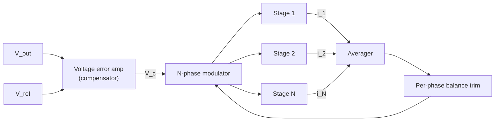

::: testing
Whether you can explain **how** the architecture works at the control level and name the **engineering problems** that come with it, not just recite benefits. The interviewer wants to hear:

1. One voltage loop, N phase generators, staggered clocks.
2. Why current sharing is the central problem and how it is solved (sensing plus a balance loop).
3. Secondary challenges: sense accuracy, thermal imbalance, phase add/shed, loop dynamics, layout symmetry, input and output filtering.
4. Specific numbers that show how small errors become large imbalances.
:::

::: why
Anyone can say "multiphase is better for high current". Teams get burned by the details: one phase running hot because a sense trace was routed differently, a transient that overshoots because phases drop out, or light-load efficiency that is worse than the single-phase prototype. Interviews at companies that make processors, GPUs and power ICs probe this because it separates people who have laid out or debugged a VRM from people who have read a datasheet intro.
:::

::: concepts
- **Interleaved PWM generation**: one oscillator, $N$ staggered edges ([[q0236]]).
- **Single voltage loop** shared by all phases: the compensator output sets total demand.
- **Current sensing**: DCR sensing, series sense resistor, or FET/power-stage sense ([[q0225]], [[q0227]]).
- **Current balancing loop**: compares each phase's current to the average and trims its duty.
- **Resistive imbalance**: a tiny duty or timing error across a milliohm loop gives amps.
- **Thermal coefficient of copper**: DCR rises about 0.39%/°C, so DCR sensing needs temperature compensation.
- **Phase shedding and adding**: dynamic phase count changes the loop gain and ripple.
:::

::: answer
"The core idea is one voltage loop that decides how much total current the load needs, plus a PWM generator that splits that into N staggered pulses, one per phase. Each phase is a normal buck stage with its own inductor, and the currents add at the output.

The main challenge is current sharing. The phases are connected through a very low impedance, only a few milliohms, so a tiny difference in duty cycle, in on-resistance or in inductor DCR makes a large difference in current. If you gave one phase 0.1 percent more duty at 12 V with about 4 milliohms in the loop, that is roughly 3 amps of imbalance, on a 15 amp phase. So the controller senses each phase current, usually through the inductor DCR or the power stage, compares it with the average, and trims each phase's duty until they match.

That brings the next problems: the sense signal is small, a few millivolts, so offset and temperature drift show up directly as imbalance. DCR sensing needs temperature compensation. Layout has to be symmetric so no phase has extra resistance or thermal advantage.

Then there are dynamic issues. During a load step you want all phases on together. At light load you shed phases to save power, and adding them back changes loop gain and ripple. And the control loop has to be stable with the combined L over N plant.

So it is more parts, more control, more layout care, in exchange for current, ripple and transient performance."
:::

::: technical
**Operation.** The voltage error amplifier output $V_c$ is common. A PWM generator produces $N$ pulses of width $d_kT$ with phase $kT/N$. In voltage mode $d_k = d + \delta_k$, where $\delta_k$ is the per-phase trim from the balance loop. In peak-current mode, $V_c$ is the shared current command, and each phase terminates its on-time when its own sensed current (plus slope compensation) reaches $V_c$.

**Why sharing is hard.** The phases are tied together at the output node. With two phase outputs of average voltage $d_kV_{in}$ driving the same node through resistance $R_k$ (switch + DCR),

$$I_k=\frac{d_kV_{in}-V_{out}}{R_k},\quad \Delta I\approx\frac{\Delta d\,V_{in}}{R_{loop}}$$

For $\Delta d=0.1\%$, $V_{in}=12$ V and $R_{loop}=4$ mΩ the imbalance is $0.001\cdot12/0.004=3$ A. Without feedback, this is what you get from a few nanoseconds of timing or a few mΩ of resistance mismatch.

**Balance loop.** Sense $i_k$, compute the average $\bar i=\frac1N\sum i_k$, trim $\delta_k=-K(i_k-\bar i)$ with an integrator whose bandwidth is well below the voltage-loop crossover so they do not fight.

**DCR sensing.** An RC across the inductor with $R_{s}C_{s}=L/R_{DCR}$ reproduces the inductor current as the capacitor voltage. With $L=300$ nH and $R_{DCR}=0.25$ mΩ the time constant is 1.2 µs (for instance 1 kΩ and 1.2 nF). The signal is $15\text{ A}\cdot0.25\text{ mΩ}=3.75$ mV, so a 0.5 mV offset is a 13% error. Copper's DCR rises about 0.39%/°C, so from 25 °C to 105 °C it grows by $80\cdot0.0039\approx31\%$ unless compensated with an NTC network or a temperature-corrected sense.

**Other challenges.**

- **Phase add/shed**: changes the effective inductance and loop gain. Smooth transitions need gain scheduling or overlap.
- **Transient**: during a step all phases should turn on together (phase overlap), not wait for their time slot.
- **Layout**: equal power-loop inductance, symmetric sense routing (Kelvin), thermal coupling, switch-node noise.
- **Startup and fault**: pre-biased output, one-phase failure, per-phase current limit.
:::

::: short
"A multiphase buck has one voltage loop that sets total current and a PWM generator that gives each phase a staggered pulse. The main challenge is current sharing: the phases are connected through milliohms, so a 0.1 percent duty error at 12 V can push about 3 amps into one phase. So the controller senses each phase current, usually through the inductor DCR, and trims duty to balance. Other challenges are small sense signals and temperature drift, symmetric layout, shedding phases at light load, and keeping the loop stable and fast in a load step."
:::

::: long
"Structurally, there is one output voltage loop. An error amplifier compares the output with the reference and produces a single control signal. A multiphase PWM block turns that into N pulses, each shifted by one N-th of a period, and each phase is a standard buck stage with its own inductor. The inductor currents add at the output capacitor.

The biggest challenge is current sharing. The phase outputs are connected to the same node through a few milliohms of resistance, so there is almost no natural voltage to separate them. A 0.1 percent duty-cycle difference at 12 V gives about 12 millivolts across about 4 milliohms, which is 3 amps of imbalance on a phase that is carrying 15. And the phase that carries more runs hotter and hits current limit first.

The solution is a current-balancing loop. Each phase current is sensed, often by an RC across the inductor so you read the DCR drop, or by a current-sense output from the power stage. The controller compares each phase with the average and trims that phase's duty. That works, but the sense signal is only a few millivolts, so offset, noise and temperature drift matter. The DCR of copper rises about 0.4 percent per degree, so you need compensation. And the sense traces must be routed symmetrically and Kelvin-connected.

Beyond sharing there are dynamic issues. In a transient all phases should respond together, so controllers use phase overlap rather than waiting for each slot. Phase shedding saves light-load power but changes the loop gain and ripple when phases come and go, so the transitions must be smooth. The compensation has to be designed for the plant with the effective inductance L over N.

Finally, layout: matched power loops, symmetrical inductor placement, and thermal coupling so one phase isn't always the hot one. So the benefits are real, but they are paid for in control and layout effort."
:::

::: terms
- **Current sharing / balancing**: making each phase carry about $I_{out}/N$.
- **DCR sensing**: reading inductor current from the voltage across an RC placed over the inductor.
- **Kelvin sense**: separate, low-current traces that sense a voltage without picking up drops in the power path.
- **Phase overlap**: allowing several phases to be on at once during a transient.
- **Phase shedding / dynamic phase control**: changing the number of active phases with load.
- **Average-current balance loop**: compares each phase with the mean of all phases.
- **Sense offset**: error in the measured current signal, which becomes a current imbalance.
- **Smart power stage**: package with a current-sense output and temperature flag per phase.
:::

::: exceptional
**An average answer** says "you need current sharing between the phases".

**An exceptional answer**:
- Explains *why* sharing is hard: milliohm coupling, so a duty or resistance error becomes amps, with the 3 A example.
- Describes the fix (per-phase sensing and a trimmed duty) and its limits (small signals, offset, DCR temperature coefficient).
- Mentions the peak-current-mode alternative and its slope-compensation requirement.
- Covers dynamic issues: phase overlap in transients, phase add/drop, loop gain with $L/N$.
- Mentions layout symmetry, Kelvin sensing and thermal coupling.
- Mentions per-phase protection: current limit and fault handling for a failed phase.
:::

::: mistakes
- **"The phases share current automatically."** Without feedback they do not, because the combining impedance is a few milliohms.
- **Treating sense error as negligible.** A 0.5 mV offset on a 3.75 mV DCR signal is 13%.
- **Ignoring copper's temperature coefficient.** The sensed current drifts by about 31% over an 80 °C rise without compensation.
- **Making the balance loop faster than the voltage loop.** They then interact and can oscillate. Keep it slower.
- **Forgetting that shedding changes loop gain.** A fixed compensator that is stable at 4 phases may ring at 1 phase.
- **Asymmetric layout.** The phase with the longest trace or best airflow always differs from the rest.
:::

::: deep
## How it works, block by block


Figure: The outer loop (V_out to V_c) is the ordinary voltage loop. The inner balance path trims each phase's duty so that its current follows the average. If the trim loop is much slower than the voltage loop the two do not interact.

Voltage mode with a ramp compare is the simplest implementation: one ramp per phase, compare with $V_c + \delta_k$. Peak current mode compares the sensed current of each phase against $V_c$, which gives automatic first-order sharing but needs slope compensation ([[q0255]]) and is noise-sensitive. Valley or constant-on-time schemes with interleaving are common in processor VRMs because they react fast, but need their own methods to hold phase spacing.

## Why a few milliohms matter

Each phase is a voltage source $d_kV_{in}$ behind $R_k$ driving the same output. Two phases whose average switch-node voltages differ by $\Delta v$ drive a circulating current $\Delta v/(R_1+R_2)$ around the loop through the output node. At 12 V a duty error of $\Delta d$ gives $\Delta v=12\Delta d$.

```plot
{"title":"Phase current imbalance from duty-cycle mismatch (V_in = 12 V)","x":{"label":"duty mismatch (%)","min":0,"max":0.3},"y":{"label":"current imbalance (A)","min":0,"max":10},"series":[{"label":"R_loop = 2 mΩ","fn":"(x/100)*12/(2*1e-3)","color":"red"},{"label":"R_loop = 4 mΩ","fn":"(x/100)*12/(4*1e-3)","color":"orange"},{"label":"R_loop = 8 mΩ","fn":"(x/100)*12/(8*1e-3)","color":"blue"}],"points":[{"x":0.1,"y":3,"label":"0.1%, 4 mΩ: 3 A"}]}
```
Figure: Current imbalance for the 12 V example against duty-cycle mismatch, for three loop resistances. Notice that lowering resistance (to improve efficiency) makes imbalance worse: the better your power stage, the more you need a balance loop.

A 4 ns timing error on a 500 kHz clock is $4\text{ ns}\cdot500\text{ kHz}=0.2\%$ of a period, which is more than the 0.1% in the example.

## Sensing the current

**DCR sensing** is lossless and cheap. An RC across the inductor with $R_sC_s=L/R_{DCR}$ gives $v_C(s)=R_{DCR}\,i_L(s)$. Problems: the signal is only $I_{ph}R_{DCR}$ (3.75 mV in the example), $L$ and DCR have tolerances (so the RC match is imperfect and gives a frequency-dependent error), and DCR rises with temperature.

**Series sense resistor** is accurate but dissipates $I^2R$ and adds a noisy, high-di/dt part in the power path.

**Power-stage (FET) sensing**: a smart stage mirrors the high-side or low-side current to a sense pin. Compact and low-loss, but accuracy depends on the vendor's mirror and temperature behaviour.

> [!UNCERTAIN]
> Typical sense accuracies and offsets differ by controller and power stage. Use the datasheet's specified current-report accuracy for your part rather than the generic numbers here.

## Other things that go wrong

1. **Transient with fixed slots**: if a load step arrives just after phase 1 fired, the next phase can only start a quarter-period later. Phase overlap lets several phases turn on immediately so the response is not quantized to $T/N$.
2. **Phase add/drop**: removing a phase doubles the current in the others. The controller should ramp, rebalance, and adjust the loop gain.
3. **Layout and thermal**: the inner phases of a row of inductors run hotter than the outer ones, and if the sense of one phase is routed near a switch node, it picks up noise.
4. **Fault tolerance**: a failed phase raises the others by $N/(N-1)$. Per-phase limits prevent a cascading failure.

## Try it

```sim
{"id":"multiphase-buck","phases":3,"vin":12,"vout":1.2,"iout":45,"l":3e-7,"fsw":500000}
```
Figure: Compare 1, 3 and 6 phases in the Currents and Losses views. The sim assumes perfect balance. In hardware, every difference between the per-phase traces is a balance-loop problem.

## Designing the balance loop with numbers

The imbalance between two phases is a circulating current that flows down one inductor, across the output node, and back up the other. It sees both inductors in series, so with $L=300$ nH each and $R_{loop}=4$ mΩ the imbalance mode behaves as a first-order lag with time constant

$$\tau=\frac{2L}{R_{loop}}=\frac{600\ \text{nH}}{4\ \text{mΩ}}=150\ \mu\text{s}\quad(\text{pole at }1.06\ \text{kHz}).$$

This is not a fast plant. A duty trim $\delta$ moves the steady-state circulating current by $V_{in}/R_{loop}=12/0.004=3000$ A per unit duty (3 A per 0.1%, consistent with the earlier estimate), but it takes a few hundred microseconds to get there. An integral balance trim $\dot\delta=-K_i\,e$ (with $e$ the current error and $K_i$ in duty per amp-second) closes a loop with

$$L(s)=\frac{3000\,K_i}{s\,(1+s\tau)}.$$

Pick a crossover at $\omega_c\tau=0.5$, which gives $PM=90^\circ-\arctan(0.5)=63^\circ$. Then $\omega_c=3333$ rad/s (530 Hz) and $|L(j\omega_c)|=1$ requires $K_i=\omega_c\sqrt{1+0.25}/3000=1.24$ duty per A·s. The closed-loop characteristic equation $\tau s^2+s+3000K_i=0$ has a damping ratio of about 0.67 and an envelope time constant of $2\tau=300$ µs, so an imbalance dies out (with a few percent overshoot) in about a millisecond. Two things follow. First, the balance bandwidth is naturally a few hundred hertz, a decade or more below a typical voltage-loop crossover of tens to hundreds of kHz, which justifies "keep the balance loop slower". Second, a transient imbalance caused by a load step is not corrected within the step; the output capacitors and the first-order averaging of the inductors handle that interval.

## What the sensing errors turn into

Because the balance loop drives the *sensed* currents equal, any sense error becomes a real imbalance. With DCR sensing:

- **Offset:** a 0.5 mV amplifier offset on a 0.25 mΩ DCR is $0.5/0.25=2$ A of real current error, 13% of a 15 A phase (the same 13% found in the previous section).
- **Common-mode temperature drift is mostly harmless for sharing.** Copper's DCR rises 0.39%/°C, so 80 °C of warming raises the sensed signal by 31% in every phase. All phases read 31% high together, so the *relative* sharing is preserved. The error matters for the reported total current, the droop line and overcurrent thresholds.
- **Phase-to-phase temperature difference is what hurts sharing.** If one phase runs 15 °C hotter, its DCR is $1+0.0039\times15=1.0585$ times higher. The loop equalizes $DCR_k\,i_k$, so with a 30 A total the cool phase carries $30/(1+1/1.0585)=15.43$ A and the hot one 14.57 A: each is 0.43 A off equal sharing, a 0.85 A difference between them. Interestingly this is a stabilizing mistake: the hot phase gets less current, which slightly cools it. Real controllers rely on a thermistor to cancel the common-mode part.
- **$L/R_{DCR}$ mismatch only affects dynamics.** If $R_sC_s$ is not equal to $L/R_{DCR}$ (inductor tolerance and DC-bias roll-off easily give ±20%), the DC gain stays correct but the sensed waveform over- or undershoots after a step, which can mislead peak-current or overcurrent comparators.
- **Ripple on the sense node.** At 500 kHz the per-phase ripple of 6.1 A pp becomes $6.1\times0.25=1.5$ mV pp of sensed signal on top of a 3.75 mV DC term, so the balance loop must average, not sample at one instant.

> [!UNCERTAIN]
> Whether a given controller uses an integrator, a proportional trim or a digital algorithm, and the update rate of the balance loop, are vendor specific. The bandwidth numbers here are for a representative analog integrator and a 150 µs plant.

## Limiting cases and failure scenarios

- **One phase fails open:** the remaining $N-1$ phases each carry $N/(N-1)$ times more. For four 15 A phases at 60 A total, three survivors carry 20 A each, which may exceed per-phase limits. A correct design either derates or trips.
- **One phase shorts a FET:** the balance loop sees a huge current and tries to trim it down while the faulty stage cannot comply. Per-phase overcurrent protection must act without waiting for the slow balance loop.
- **$N\to$ large:** the common-mode current per phase gets small, so fixed sense errors (offsets in mV) become a larger fraction of each phase's signal. Doubling the phase count halves the DCR signal per phase for the same total current, which is why high-phase-count VRMs use amplifiers with sub-mV offsets or digital calibration.
- **Very low load:** the sensed signal approaches the offset. Balancing is disabled or phases are shed, so the problem disappears by operating in fewer phases.

## Verifying a multiphase design on the bench

1. **Open-loop sharing test.** If the controller allows it, disable the balance trim and inject a known duty offset in one phase (say 0.1%, i.e. 2 ns at 500 kHz) while measuring both phase currents with current probes. The imbalance should be about $V_{in}\Delta d/R_{loop}=3$ A, which also validates your estimate of $R_{loop}$.
2. **Balance step response.** Enable balancing, apply the offset, and watch how fast the imbalance decays. A decay envelope near 300 µs with only a small overshoot agrees with the design; sustained ringing or oscillation means the trim loop is too fast.
3. **Telemetry versus probes.** Compare the controller's reported per-phase current with a calibrated probe at 25%, 50% and 100% load. The difference is the sense error, which is what the balance loop will convert into real imbalance.
4. **Thermal check.** Run at full load for several time constants of the board (minutes) with a thermal camera. Hot spots that persist after you swap power stages are layout, not parts.
:::

::: applications
- **CPU/GPU VRMs** with per-phase DCR sensing and a digital controller doing current balance and phase shedding.
- **Smart power stages (DrMOS-type)** that output a current-sense signal and temperature flag.
- **Peak-current-mode multiphase controllers** used in telecom/POL modules with a shared COMP pin.
- **Digital multiphase controllers with PMBus** telemetry, which report per-phase current for debug.
- **Server boards** where per-phase thermal monitoring catches a bad inductor or solder joint.
:::

::: assumptions
- **Identical phases** as the baseline, with mismatches introduced as small errors.
- **Voltage-mode or peak current-mode PWM** with a common compensator. Constant-on-time multiphase controllers use different sharing mechanisms.
- **Imbalance formula** assumes DC steady state and that the current error is limited by the loop resistance, not by the sensing.
- **Temperature coefficient** 0.39%/°C is the nominal value for copper. Windings and sense networks may differ.
- The answer would change for coupled-inductor designs, where the inductors interact magnetically.
:::

::: followups
### Why do you need a separate balance loop? Doesn't peak-current-mode share automatically?
Peak-current-mode with a shared command does equalize the peak currents, so it shares more naturally than voltage mode. But the average current still depends on ripple, which depends on each inductor's value and $V_{in}-V_{out}$ slopes, and on slope compensation and sense offsets. Many controllers add a balance trim even in peak-current mode.

### How do you pick the bandwidth of the balance loop?
Well below the voltage loop crossover, typically a decade or so lower, so the two do not interact. It only needs to correct slow drifts (temperature, aging), not transients. If it is too fast it competes with the voltage loop and can add a pole that cuts phase margin.

### What does DCR temperature compensation look like?
An NTC thermistor placed near the inductors modifies the resistance of the sense network so the sensed gain falls as DCR rises, ideally by about 0.39% per degree. In digital controllers, a temperature reading is used to scale the measured current. Without it the controller thinks the phase carries more current when the inductor is hot.

### What if one inductor has 10% lower inductance than the others?
In CCM its DC current is set by its resistance and duty, not its inductance, so the average current is little affected, but its ripple is 10% higher. In DCM or at light load, or in peak-current mode, its current and loss differ more. Ripple cancellation also degrades slightly.

### Scenario: one phase of your VRM always runs 15 °C hotter than the others. How do you debug it?
Read the per-phase current (telemetry or sense voltage). If the current is higher, look at sense network values and routing, duty trims, and the inductor DCR. If the current is equal, the thermal path differs: copper area, airflow or neighbour heating, or a worse solder joint on that power stage. Swap the power stages to see whether the problem follows the part or the board position.
:::

::: references
- Erickson & Maksimović, *Fundamentals of Power Electronics*: current-programmed control and converter dynamics.
- Texas Instruments, *Basic Calculation of a Buck Converter's Power Stage* (SLVA477) for single-phase buck power-stage basics.
- Controller and power-stage datasheets and application notes from major vendors on multiphase current sharing and DCR sensing. Always check the exact part for sensing and balancing details.
:::

::: rubric
- Describes one voltage loop plus N staggered PWM phases :: This is the working principle.
- Identifies current sharing as the central problem and explains why (milliohm coupling) :: Shows you understand the mechanism and not just the name.
- Gives a quantitative imbalance estimate :: Numbers show that tiny errors matter.
- Describes sensing options and their issues (DCR tolerance and temperature, resistor loss, power-stage mirrors) :: Practical depth.
- Mentions dynamic issues: phase overlap, phase add/shed, loop gain :: Control-level awareness.
- Mentions layout symmetry, Kelvin sense and thermal coupling :: Hardware reality.
:::

::: quiz
```json
[
 {"type":"mcq","level":"fundamental","q":"Why is current sharing a problem in a multiphase buck?","options":["The inductors saturate easily","The phases connect through a very low impedance, so small mismatches create large current differences","The switching frequency differs per phase","Ripple always adds"],"answer":1,"explain":"The phase outputs are tied together through milliohms. A tiny voltage difference, such as a few mV from a duty error, drives amps of circulating current."},
 {"type":"numeric","level":"intermediate","q":"Two phases at $V_{in}=12$ V have a duty-cycle mismatch of 0.05% and a total loop resistance of 3 mΩ. What is the current imbalance in A?","answer":2,"tolerance":0.02,"unit":"A","explain":"$\\Delta I\\approx\\Delta d\\,V_{in}/R=0.0005\\cdot12/0.003=2$ A."},
 {"type":"numeric","level":"intermediate","q":"A DCR-sense network must match $L/R_{DCR}$. With $L=300$ nH and $R_{DCR}=0.25$ mΩ, what $R_sC_s$ time constant is needed, in µs?","answer":1.2,"tolerance":0.02,"unit":"µs","explain":"$\\tau=L/R_{DCR}=300\\text{ nH}/0.25\\text{ mΩ}=1.2$ µs."},
 {"type":"numeric","level":"advanced","q":"The DCR sense signal for a 15 A phase with 0.25 mΩ DCR is 3.75 mV. A 0.5 mV offset in the sense amplifier causes what percentage error in the reported current?","answer":13.3,"tolerance":0.03,"unit":"%","explain":"$0.5/3.75=0.133$, a 13.3% current-reporting error."},
 {"type":"truefalse","level":"advanced","q":"The balance loop should be faster than the voltage loop so that phase currents are corrected before the output moves.","answer":false,"explain":"The balance loop corrects slow drifts and should be well below the voltage-loop crossover. A faster balance loop interacts with the voltage loop and can reduce phase margin."}
]
```
:::
