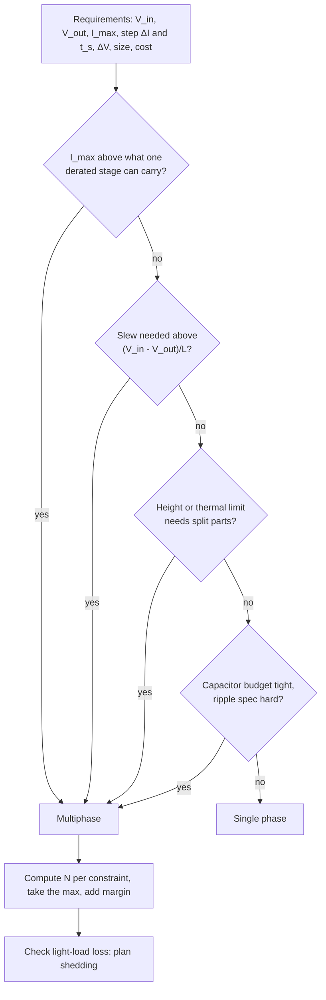

::: testing
Whether you can turn a pile of pros and cons into a **decision**. The interviewer is looking for:

1. The triggers: high current, low output voltage, hard transient specs, thermal or height limits, wide load range.
2. A way to pick the number of phases from requirements (current per phase, slew, ripple, thermal), not from a gut feeling.
3. The counter-cases where single phase is the right answer.
4. Awareness that the answer comes from numbers, with thresholds that depend on the parts and vendor.
:::

::: why
Power architecture decisions are made early and are expensive to undo. Picking one phase when you needed four costs a board spin; picking six when two would do costs money, area and light-load efficiency every day of the product's life. Being able to state "I'd go multiphase when X, Y or Z, and here's how I'd count phases" is the practical form of knowing the topic, and it is what a design review expects.
:::

::: concepts
- **Per-phase current limit**: FET, inductor saturation and thermal limits set how many amps one stage can carry ([[q0240]]).
- **Transient requirement**: current slew needed is $\Delta I/t_{slew}$, and the achievable slew is $(V_{in}-V_{out})/L_{eq}$ ([[q0243]]).
- **Target impedance**: $Z_t=\Delta V_{allowed}/\Delta I_{step}$ sets how stiff the rail must be.
- **Ripple and capacitor budget**: lower and faster ripple lets you shrink the output capacitors ([[q0236]]).
- **Thermal and height limits**: loss and inductor height spread over more, smaller parts ([[q0242]]).
- **Light-load efficiency**: fixed losses times $N$ unless phases are shed ([[q0241]]).
:::

::: answer
"I'd use multiphase when one stage can't meet the current, transient or thermal requirements at reasonable size and cost. Typical triggers are high current, say a few tens of amps or more, especially at low output voltage like a one-volt processor core; a hard transient spec, where the load steps by tens of amps in a microsecond and I need the effective inductance to be small; limits on component height, so I'd rather use two thin inductors than one tall one; and thermal limits, where I want to spread the loss over several parts. It also helps when the output capacitor budget is tight, since ripple is lower and at a higher frequency.

To choose the phase count, I'd look at the largest of a few numbers. First, the maximum current divided by the derated per-phase rating. Second, the slew I need divided by what one inductor gives, since the slew rate scales with N over L. Third, the thermal limit per stage. Then I'd add margin for imbalance.

I would not use it for low-current rails, below around 10 to 15 amps, or where load steps are gentle, cost and area are tight, or the load is mostly light, since the controller, extra inductors and fixed losses would cost more than they give back. There a single-phase buck IC is the right answer."
:::

::: technical
**Selection method.** Compute the phase count needed by each constraint and take the largest:

1. **Current/thermal**: $N_I=\left\lceil \dfrac{I_{max}\,(1+\varepsilon)}{I_{ph,derated}}\right\rceil$, where $\varepsilon$ is the imbalance margin (for example 5%) and $I_{ph,derated}$ is the lower of the FET/power-stage, inductor $I_{sat}$ and thermal limits.
2. **Transient slew**: the total current must rise by $\Delta I$ in $t_s$, so $L_{eq}\le (V_{in}-V_{out})\,t_s/\Delta I$ and $N_{tr}=\lceil L/L_{eq}\rceil$.
3. **Ripple/capacitance**: choose $N$ so that the summed ripple and frequency meet the capacitor budget.
4. **Light-load**: check that the fixed losses of $N$ phases are acceptable, or that shedding is available.

**Worked example.** A 1.0 V core rail from 12 V, $I_{max}=80$ A, load step $\Delta I=50$ A that must be supplied in $t_s=0.3$ µs, 250 nH per phase, power stage rated 40 A (derated to 25 A for temperature).

- $N_I=\lceil 80\cdot1.05/25\rceil=\lceil3.36\rceil=4$.
- $L_{eq}\le 11\cdot0.3\text{ µs}/50=66$ nH, so $N_{tr}=\lceil250/66\rceil=\lceil3.8\rceil=4$.
- Target impedance for $\Delta V=30$ mV: $Z_t=30\text{ mV}/50\text{ A}=0.6$ mΩ, which sets the capacitor bank.

Four phases satisfy all of them, at 20 A per phase (80% of the derated 25 A). One phase would need a 250 nH inductor passing 80 A and a power stage twice as strong as available.

**When not to use it.** For $I_{max}\lesssim10$–15 A with gentle steps a single synchronous buck IC meets the specs with one inductor, less area and lower cost, and its fixed losses are smaller.

> [!UNCERTAIN]
> Thresholds such as "above about 20–30 A" depend on the available power stages, inductors, cooling and cost targets. Treat them as starting points and check actual datasheet limits.
:::

::: short
"I'd use a multiphase buck when one stage can't meet the current, transient or thermal requirements: high current, typically tens of amps or more, at low voltage like a processor core; tough load steps where I need a small effective inductance; and limits on heat or component height. I'd choose the number of phases from the largest of current over derated per-phase rating, slew needed over slew per phase, and thermal limits. For low-current, gentle-load rails I'd keep it single-phase because it is cheaper, smaller and more efficient at light load."
:::

::: long
"The way I think about it is: when does one buck stop being good enough? There are four common answers.

First, current. A single stage is limited by its FETs, by the inductor's saturation and heating current, and by the package. Once the load is a few tens of amps, especially at one volt, you'd need very large parts. Splitting into phases lets me use standard power stages and inductors, each at maybe 20 amps.

Second, the transient. If the load steps by 50 amps in under a microsecond, the inductor current has to rise that fast. The slew is V in minus V out over L. With N phases the effective inductance is L over N, so the slew is N times higher without making the ripple worse. Without that, the capacitor bank has to cover the gap, which can be a lot of capacitance.

Third, heat and height. Spreading the loss over several smaller parts lowers hot-spot temperature and lets me use low-profile inductors in a laptop or a thin module.

Fourth, output filtering: the ripple is lower and at N times the frequency.

To pick N I compute it from each constraint: current over the derated per-phase rating plus margin for imbalance, required slew over what one phase provides, and the thermal budget. I take the largest and round up. For an 80 amp, one-volt rail with 50 amp steps, that came to four phases.

I would not use it on a 5 amp rail or a rail with gentle loads. The extra inductors, controller and fixed losses cost more than they give, and light-load efficiency suffers unless I can shed phases. A single buck IC is the answer there."
:::

::: terms
- **Target impedance**: $Z_t=\Delta V_{allowed}/\Delta I_{step}$, the output impedance the rail must stay under.
- **Derated rating**: the per-phase current after temperature and margin are applied.
- **Slew rate (di/dt)**: how fast the total inductor current can change.
- **Phase count (N)**: number of interleaved stages.
- **POL (point of load) converter**: a regulator placed next to the load.
- **VRM / VR**: voltage regulator module for a processor core rail.
- **Phase shedding**: turning phases off at light load.
- **Imbalance margin**: extra headroom for uneven current sharing.
:::

::: exceptional
**An average answer** says "for high current applications".

**An exceptional answer**:
- Names several independent triggers: current, transient slew, thermal/height, ripple and capacitor budget.
- Shows how to compute $N$ from each constraint and take the largest.
- Works a numeric example (80 A, 50 A step, four phases).
- Cites the counter-cases: low current, gentle load, cost/area and light-load efficiency.
- Says that the thresholds depend on the parts available and flags them as rules of thumb.
- Mentions phase shedding as the way to keep light-load efficiency acceptable.
:::

::: mistakes
- **Picking N by current only.** The transient spec often needs more phases than the thermal limit does.
- **Forgetting derating.** The 40 A rating of a power stage is not the 40 A you can run at 100 °C board temperature.
- **No margin for imbalance.** If one phase carries 5% more, it sets the limit.
- **Using multiphase for a 3 A rail.** The overhead exceeds the benefit.
- **Assuming more phases is always better.** Beyond a point the returns diminish: cost, area, fixed losses and layout complexity keep growing.
- **Ignoring the load profile.** A load that spends most of its time at 10% of max needs phase shedding or a better partition.
:::

::: deep
## The decision, step by step


Figure: Any one trigger is enough to justify multiphase. The count N then comes from the numbers, not from the flowchart.

## Trigger 1: current and heat

One stage's limit is the weakest of three: the power stage (FET conduction and thermal), the inductor ($I_{sat}$ and temperature rise from $I^2R_{DCR}$) and the PCB copper. For example a power stage rated 40 A at a 25 °C test condition may only hold 25 A at a board temperature of 100 °C in still air. Always use the derated number.

At about 1 V output the duty cycle is small ($D=1/12$), the low-side FET conducts for 92% of the time and you are really building a huge current source. Conduction loss $I^2R$ is the main loss mechanism, and the only way to keep the loss per package reasonable is to split the current.

## Trigger 2: transient demand

The inductor current can change at most at $(V_{in}-V_{out})/L$ (rising) or $V_{out}/L$ (falling). The output capacitor supplies the difference between the load and inductor current until the inductor catches up. In the ideal slew-limited limit

$$\Delta V_{sag}\approx\frac{L_{eq}\Delta I^2}{2(V_{in}-V_{out})C}$$

Halving $L_{eq}$ halves the capacitor needed for the same sag. Notice that a *single* phase could also use a smaller $L$ to slew faster, but its ripple current would grow ($\Delta I=V_{out}(1-D)/(Lf_{sw})$), losing efficiency and filtering. Multiphase decouples the two: each phase keeps a moderate $L$ for ripple and loss, while the combination has a small $L/N$ for transients, and the ripple cancels in the sum. See [[q0243]].

```plot
{"title":"Up-slew of summed current, 12 V to 1 V, 300 nH per phase","x":{"label":"number of phases N","min":1,"max":8},"y":{"label":"max di/dt (A/µs)","min":0,"max":300},"series":[{"label":"N·(Vin−Vout)/L","fn":"x*11/300e-9/1e6","color":"blue"}],"hlines":[{"at":166.7,"label":"needed: 50 A in 0.3 µs","color":"orange"}]}
```
Figure: Maximum current slew for 12 V to 1 V against the number of phases, at 300 nH per phase. The horizontal line is the slew needed to move a 50 A step in 0.3 µs (167 A/µs). Notice that with 300 nH per phase you only cross it between four and five phases (the worked example above used 250 nH, which crosses at four).

## Trigger 3: height, area and thermal spreading

A single inductor that carries 80 A is a large, tall part with high losses. Four 20 A inductors are smaller each and can be low-profile. On a laptop board 3 mm tall is a hard limit, and two or three thin inductors may be the only way to fit the current. Distributed loss also lowers the peak temperature ([[q0242]]).

## Trigger 4: ripple and capacitors

The summed ripple is lower and at $Nf_{sw}$, so you can reduce output capacitance and the filtering requirements, which saves area and cost near the load.

## Counter-cases

- **Low current (about 10 to 15 A or less)**: a single buck IC with integrated FETs is cheaper, smaller, and has lower fixed losses.
- **Mostly light-load duty**: unless phases shed, efficiency is poor.
- **Cost- or area-sensitive rails** where capacitors are cheaper than inductors.
- **High $V_{out}/V_{in}$ ratios (e.g. 12 V to 5 V)**: duty is large, ripple cancellation points are different, and slew is easier because $V_{in}-V_{out}$ is large and $V_{out}/L$ is large. Multiphase still helps with current but less with transients.

## Try it

```sim
{"id":"multiphase-buck","phases":2,"vin":12,"vout":1,"iout":40,"l":3e-7,"fsw":500000}
```
Figure: Increase the load to 80 A and the phases from 2 to 4, and watch the per-phase current. Use the transient view for a 50 A step and see how many phases you need to hold the droop within 30 mV.
:::

::: applications
- **Server CPUs and AI accelerators**: 8 to 16+ phases for the core rails.
- **GPUs on graphics cards**: typically 6 to 16 phases for a rail around 1 V.
- **Laptop CPU rails**: 2 to 4 phases with thin inductors because of height limits.
- **FPGA cores**: 2 to 4 phases for 20 to 60 A.
- **Counter-example**: a 3.3 V, 3 A I/O rail on the same board, which is a single-phase buck.
:::

::: assumptions
- **12 V input and about 1 V output** in the numeric example. The thresholds shift for other ratios.
- **Derated per-phase current** is an input from datasheets and thermal design, not a universal number.
- **Ideal slew-limited transient** for the capacitor numbers. Loop bandwidth, ESR and ESL add to it.
- **Fixed per-phase switching frequency.** Some designs trade phase count against frequency.
- Cost depends on volume and parts; "multiphase is more expensive" is typical but not universal when it avoids exotic single parts.
:::

::: followups
### How many phases for a 120 A, 1 V rail with a 60 A step?
Use a derated per-phase of about 25 A: $\lceil120\cdot1.05/25\rceil=6$. Check the slew: for a 0.3 µs step on 60 A you need $L_{eq}\le11\cdot0.3\text{ µs}/60=55$ nH. With 250 nH per phase that is $N\ge5$. So 6 phases satisfies both with 20 A per phase, and I'd check thermal and capacitor budget.

### Could you use one phase at a much higher switching frequency instead?
Raising $f_{sw}$ lets you cut $L$ for the same ripple, which improves slew, but switching loss grows with $f_{sw}$, and at 12 V to 1 V the minimum on-time ($D=1/12$ means 167 ns at 500 kHz, 83 ns at 1 MHz) becomes limiting. You also cannot get around the current limit of one stage. Multiphase gets a high effective frequency without raising each FET's switching loss.

### When is two-phase the sweet spot?
When the rail is 15 to 40 A, a single stage is thermally or magnetically stretched, but the step requirements are modest or board height forbids one large inductor. Two phases give the 2x current and 2x slew, half the ripple per capacitor, with a simple controller.

### Does a lower $V_{out}$ favor multiphase?
Yes. Lower voltage at the same power means higher current, so the current constraint bites, and the small duty cycle makes the down-slew $V_{out}/L$ slow, which hurts unload transients. That is why sub-1.2 V rails are strongly associated with multiphase.

### Scenario: management wants to drop from 4 phases to 3 to save cost. What do you say?
I would check three numbers with 3 phases: per-phase current vs the derated limit (80 A over 3 is 26.7 A, above the 25 A derated limit here), the slew ($L_{eq}$ goes from 62.5 to 83 nH, so the sag grows by about 33% for the same $C$) and the target impedance. If any fails, I'd show the cost of extra capacitors or a better power stage instead, and let the numbers decide.
:::

::: references
- Erickson & Maksimović, *Fundamentals of Power Electronics*: converter basics and ripple.
- Intel, AMD or NVIDIA voltage-regulator design guidelines for processor rails (public design guides exist; consult the exact document for your part, do not quote numbers from memory).
- Power-stage and controller datasheets from Texas Instruments, Infineon, Analog Devices, onsemi and Renesas for per-phase ratings and recommended phase counts.
:::

::: rubric
- States clear triggers: current, transient, thermal/height, ripple/capacitor budget :: A decision needs criteria.
- Shows how to count phases from constraints (current, slew, thermal) with margin :: Moves the answer from opinion to engineering.
- Gives numbers for a worked example :: Demonstrates real calculation ability.
- Describes when not to use it (low current, light-load dominated, cost/area) :: Judgment includes saying no.
- Mentions low $V_{out}$ and high current as the classic case :: Connects to the real-world VRM context.
- Notes thresholds depend on parts and vendor :: Avoids false precision.
:::

::: quiz
```json
[
 {"type":"mcq","level":"fundamental","q":"Which rail is the best candidate for a multiphase buck?","options":["3.3 V at 2 A for a sensor","1.0 V at 100 A with 50 A load steps for a processor","5 V at 1 A for a USB port","12 V at 0.5 A for a fan"],"answer":1,"explain":"High current at low voltage with fast steps is exactly where one stage runs out of current, slew and thermal margin."},
 {"type":"numeric","level":"intermediate","q":"A rail needs 90 A max. A derated power stage carries 25 A, and you want 5% imbalance margin. How many phases are needed for the current constraint?","answer":4,"tolerance":0.01,"unit":"phases","explain":"$\\lceil90\\cdot1.05/25\\rceil=\\lceil3.78\\rceil=4$."},
 {"type":"numeric","level":"intermediate","q":"12 V to 1 V rail, 60 A step that must be supplied in 0.4 µs. What is the largest effective inductance allowed, in nH?","answer":73.3,"tolerance":0.02,"unit":"nH","explain":"$L_{eq}\\le(V_{in}-V_{out})t_s/\\Delta I=11\\cdot0.4\\text{ µs}/60=73.3$ nH."},
 {"type":"numeric","level":"advanced","q":"With $L_{eq}\\le73.3$ nH and 300 nH per phase, what is the minimum number of phases for the slew constraint?","answer":5,"tolerance":0.01,"unit":"phases","explain":"$300/73.3=4.09$, which rounds up to 5 phases."},
 {"type":"truefalse","level":"intermediate","q":"For a lightly loaded 3 A, 3.3 V rail, a 4-phase buck is usually the best choice.","answer":false,"explain":"The overhead (extra inductors, controller, fixed losses) outweighs the benefits at low current. A single-phase IC is smaller, cheaper and more efficient at light load."}
]
```
:::
